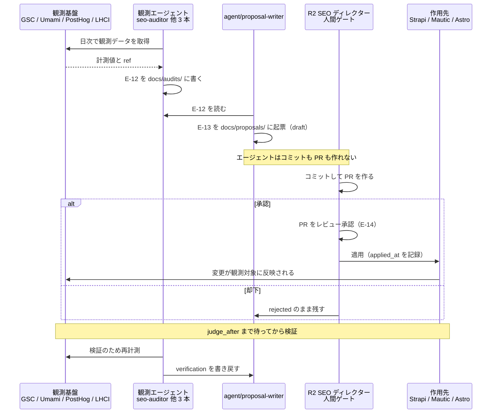

# AA-04 再帰的自己改善ループの制御仕様

AA（Application Architecture）層。ID は EA 共通用語集の定義をそのまま使う。

BA-01 は「この基盤が最適化する対象は、**観測してから改善が作用するまでの一巡に要する時間と人手**である」と定めた。その一巡が本ファイルの対象であり、`CAP-14`（改善提案の生成と承認）の実行仕様にあたる。

**先に結論を書く。このループは現在 1 周も回っていない**（5 節。観測側の入力が無く、`docs/proposals/` も承認機構も存在しない）。以下の 1〜4 節は To-Be の設計であり、5 節で最初の 1 周に必要な最小構成を示す。

## 1. ループの制御仕様

**As-Is 注記。** この図で実際に流れているメッセージは **1 本もない**。`AG->>OBS` の観測取得は、Lighthouse CI の結果がローカルのファイルに出ているだけで、それを `E-12` として読み取るエージェントが存在しない。GSC は未着手、Umami と PostHog は訪問者のデータが 0 件。`docs/audits/` も `docs/proposals/` も未作成。`R2` の承認機構（PR レビュー）は仕組みとしては GitHub に既にあるが、レビュー対象となる PR が 1 件も存在しない。

図の中の 2 つの `Note` が、このループの設計上の要点にあたる。

- **「エージェントはコミットも PR も作れない」**（AA-03 の 5 節）。ループの中に必ず人間の手作業が 1 回入る。これは効率の問題ではなく、**閉路を切るための構造**である。
- **「`judge_after` まで待ってから検証」**（DA-04 の 4 節）。観測は日次、判定は 30 日後という非対称は意図的（早い判定が最も壊しやすい）。

## 2. 各ステップの入出力

| # | ステップ | 主体 | 読むもの | 書くもの | 頻度 |
|---|---|---|---|---|---|
| 1 | 観測 | `agent/seo-auditor` `agent/analytics-reporter` `agent/conversation-triage` `agent/ops-watcher` | `.lighthouse/` の JSON ／ GSC API ／ `E-07`（Umami）／ `E-08` `E-11`（PostHog）／ `E-09` の集計（Mautic）／ `E-10`（Chatwoot） | `E-12`（`docs/audits/<source>/<audit_id>.md`） | 日次 |
| 2 | 判断 | `agent/proposal-writer` | `E-12`（全 source）／ 過去の `E-13`（重複起票の検出） | なし（内部の評価のみ。`E-15` に残る） | 日次 |
| 3 | 提案 | `agent/proposal-writer` | 同上 | `E-13`（`docs/proposals/<proposal_id>.md`。`approval.state: draft`） | 日次（起票がある日のみ） |
| 4 | 承認 | **`R2`（人間）** | `E-13` の frontmatter と本文、`evidence[]` が参照する `E-12` | `E-14`（PR のレビュー承認）／ `E-13` の `approval` を `approved` または `rejected` に更新 | 週次会議まで（SLA） |
| 5 | 作用 | `R1` / `R2`、または承認後にエージェント | 承認済みの `E-13` | `E-04`（Strapi）／ `E-06`（Mautic のフォーム）／ コード（Astro）／ `E-11`（PostHog の実験）。`E-13` の `applied_at` と `change.diff_ref` を記録 | 適用のたび |
| 6 | 検証 | `agent/seo-auditor` `agent/analytics-reporter`（判定は `R3`） | `E-13` の `expectation`／ 再計測した `E-12` | `E-13` の `verification`（`improved` / `no_change` / `degraded`） | `expectation.judge_after`（既定 30 日後） |

### 2.1 ステップ間で守る不変条件

- **`E-13` を経由しない変更を作らない。** 観測（`E-12`）から作用（`E-04` 他）に至る経路は `E-13` だけである（DA-01 の 6 節）。この型を通らない変更は例外として DA-05 の監査対象になる。
- **`evidence[]` が空の提案は承認しない**（DA-01 の 6.2）。根拠の無い提案は、承認者が妥当性を判断できない。
- **`E-12` は値を複製せず `ref` と `summary` だけを `E-13` に転記する**（DA-04 の 2 節）。元データが更新されたときに矛盾しないようにするため。
- **`E-05 Page` は直接書き換えられない。** 作用は必ず `E-04` かコードのどちらかを変えて再ビルドする経路を通る（DA-04 の 1.3）。適用手順には `SITE_URL` の設定を必ず含める。
- **ステップ 4 の `review` → `approved` の遷移だけは、エージェントが実行できない**（DA-01 の 6.3）。AA-03 の 5 節のとおり、これは権限設定ではなく実行手段の欠落として実装されている。

### 2.2 ステップ 5（作用）の自動化の範囲

DA-04 が未決定として残した「作用の自動適用をどこまで許すか」に、AA としての線を引く。基準は BA-05 の承認ゲートの 3 つの問い（外部に露出するか / 取り消せるか / エージェント自身の権限・実行条件を変えるか）。

| `change.kind` | 承認後の適用の主体 | 理由 |
|---|---|---|
| `content_rewrite` | エージェント（`agent/content-writer`）が下書きを更新し、**公開は `R2`** | 下書きの更新は取り消せる。公開は外部に露出する |
| `cta_swap` | エージェントが `E-06` の表示定義を更新し、**ビルドとデプロイは `R1`** | 表示定義の変更は取り消せるが、公開には露出が伴う |
| `internal_link` | 同上 | 同上 |
| `technical_seo` | **マージまでは人間（`R1`）。マージ後のデプロイは自動化してよい** | コード変更はエージェントがコミットできないためマージまでは人間。ただしデプロイ自体は下記のとおり 2 度目の承認を求めない |
| `experiment_start` | **人間（`R3`）** | 実ユーザーに異なる体験を出す（BA-05 の `承認`） |
| `config_change` | **人間（`R1`）** | 設定変更は影響範囲が読みにくく、`禁止` 分類に隣接する（権限・実行条件に触れる可能性がある） |

**公開・実験開始の瞬間には必ず人間が居る。** エージェントが単独で完結できるのは「下書きと定義の更新」までである。

### 2.3 デプロイだけは承認ゲートがあっても自動化してよい

BA-05 は「本番環境へのデプロイ」を `承認`（承認者 `R1`）に分類している。しかし **TA-03 の決定に従い、マージ後のデプロイは自動化してよい**。矛盾ではない。

理由は**承認の対象が「デプロイという操作」ではなく「デプロイされる内容 ＝ `main` の状態」だから**である。`main` へのマージ自体が `承認` 分類であり（`R1` が承認する）、その承認をもって「この内容を公開してよい」という判断は済んでいる。同じ内容に対して 2 度目の承認を求めると、**1 度目の判断まで雑になる**（「あとでデプロイのときにもう一度見るから」という逃げ道ができる）。

この整理は、BA-05 の分類基準の第 1 問（外部に露出するか）に照らしても一貫している。露出を決めているのはマージであって、デプロイはその決定を実行に移すだけの手続きである。

**ただし `LH-seo` のゲート（3.2）はデプロイの前後どちらにも効く。** マージが承認されていても、SEO スコアが 1.0 を割った状態のビルドは配信しない。

## 3. 安全装置

このループは自分自身を書き換える性質を持つため、安全装置は運用の約束ではなく**設計事項**として固定する。以下 7 項目は、効率化の名目で外さない。

### 3.1 1 サイクルあたりの変更上限

**同時に `applied` 状態にできる `E-13` は 3 件まで。同じ `target.identifier` に対しては 1 件まで。**

| 上限 | 値 | 理由 |
|---|---|---|
| 1 サイクル（月次）に適用してよい提案の数 | **3 件** | 4 件以上を同時に適用すると、次の観測で指標が動いたときにどの提案が効いたのかを分離できない（`expectation.metric` による判定が成立しない） |
| 同じ `target.identifier` に同時適用してよい数 | **1 件** | 同じページに 2 つの変更を入れると、効果の帰属が不可能になる |
| 1 日に起票してよい `E-13` の数 | **5 件** | 起票は `自律` だが、`R2` の承認待ち行列が伸びると承認が形式的な追認に退化する（BA-03 の「`R2` が承認できる量を超える生成は行わない」の定量化） |

上限に達した場合、`agent/proposal-writer` は起票を**止める**（キューに積まない）。積むと、承認が滞ったときに古い観測に基づく提案が後から適用される。

### 3.2 Lighthouse の SEO スコアが 1.0 を割ったら止める

**`LH-seo` が 1.0 未満になった時点で、ループの作用（ステップ 5）を全面的に停止する。**

- しきい値は `frontend/verdant-virgo/lighthouserc.cjs` に定義されており、`pnpm lh` は未達でコマンドが失敗する。**この失敗を無視して適用を続けない。**
- SEO が 1.0 の死守ラインであるのは、SEO 対策がこの計測の目的そのものだから（`.claude/CLAUDE.md`）。performance / accessibility / best-practices の 0.9 は目標値だが、SEO の 1.0 は**前提条件**である。
- 停止中にできるのは「`LH-seo` を 1.0 に戻す提案」だけ。それ以外の `change.kind` の適用を再開しない。
- 停止は `agent/seo-auditor` が検知し、`agent/proposal-writer` が起票を絞る。**検知するエージェントと止めるエージェントが同じにならないようにする**（自分で検知して自分で判断すると、検知の基準ごと緩められる余地が生まれる）。

### 3.3 ロールバック手順を必須項目にする

DA-01 の 6.2 は `rollback.procedure` / `rollback.reversible` / `rollback.deadline` を**必須**とし、`rollback.procedure` の欠落を「最も重い欠落」と書いている。AA としてこれを次の形で運用する。

- **`rollback.procedure` に具体を書く**（コマンド・PR 番号・版番号まで。「元に戻す」では不可）。
- **`rollback.reversible: false` の提案は `risk.level` を `high` として扱う**（DA-01 の 6.2）。不可逆な変更を通常の承認で通さない。
- **`verification.state` が `degraded` なら `rollback.procedure` を実行して `rolled_back` に落とす。** `no_change` の場合は戻さず、効果が無かったという事実を次の提案の `evidence` として残す。
- **`rollback.deadline` を過ぎた提案は、ロールバックできない前提で扱う。** 期日を過ぎた `applied` を放置しない（期日前に必ず検証する、が原則）。

#### 3.3.1 Git の外にある適用先は戻せない（この設計の最大の穴）

**`E-13` が Git にあることは、適用先も Git にあることを意味しない。** ADR-04 で「履歴・差し戻し・取り消しを Git が既に持っている」と書いたが、それが成立するのは**適用先が Git 管理下のファイルである場合に限る**。TA が指摘したとおり、次の 3 つは Git の外に実体があり、**PR を revert しても元に戻らない**。

| 適用先 | なぜ戻せないか | 優先度 |
|---|---|---|
| **n8n のワークフロー** | 実体は n8n の DB にあり、Git には存在しない。PR を revert しても稼働中のワークフローは動き続ける。**加えてワークフローは「承認なしで実行される操作の定義」であるため、戻せないことの影響が他の 2 つより大きい**（BA-05） | **最高** |
| Mautic のキャンペーン定義 | 実体は Mautic の MySQL にある。キャンペーンを開始すると、既に投入されたコンタクトは定義を戻しても元の状態に戻らない | 高 |
| PostHog の設定（feature flag・実験・保持期間） | 実体は SaaS 側にある。加えて**外部リージョンにあるため、こちらから状態を完全には把握できない** | 中 |

対処を 4 つ定める。

- **この 3 つを対象とする `E-13` は `rollback.reversible: false` を既定にする。** DA-01 の規定により、`false` の提案は `risk.level` が `high` として扱われる。**「Git にあるから戻せる」という思い込みで `true` を書かない。**
- **`rollback.procedure` に「Git の操作」を書かない。** 「PR #128 を revert する」では戻らない。**適用先の側で何をするかを具体的に書く**（「n8n のワークフロー `wf-daily-audit` を無効化し、バージョン履歴から版 3 に `restore` する」など）。n8n はワークフローのバージョン履歴を持つため、**適用前の版番号を `E-13` に記録しておく**ことを必須にする。
- **適用前の状態を `E-13` に添付する。** n8n はワークフローの JSON、Mautic はキャンペーンの定義、PostHog は flag の設定。**Git の外にあるものは、Git の中にコピーを取ってから触る**（これが唯一の「戻す手段」になる）。コピーは提案の一部であり、秘匿値を含む場合は含めない。
- **n8n のワークフローに対する `E-13` は、1 サイクルに 1 件までとする**（3.1 の上限より厳しい）。戻せない変更を同時に 2 つ入れない。

**この穴は ADR-04 の前提の限界にあたる。** Git を正本にしたことで得られたのは「提案と承認の履歴が残り、エージェントが書き換えられない」ことであって、「作用が必ず取り消せる」ことではない。**2 つを混同しない。**

### 3.4 承認を要する変更種別

BA-05 の承認ゲート一覧と**完全に一致させる**。ループの中で起きうる操作だけを抜き出した。

| 操作 | 分類 | 承認者 |
|---|---|---|
| 記事の下書き作成・更新（`publishedAt` を設定しない） | `自律` | — |
| 記事の公開・公開済み記事の更新 | `承認` | `R2` |
| 記事の削除・非公開化 | `承認` | `R2` |
| 観測データの参照・集計・レポート生成 | `自律` | — |
| 改善提案（`E-13`）の生成 | `自律` | — |
| 改善提案の採用と適用 | `承認` | `R2` |
| AB テスト（`E-11`）の開始 | `承認` | `R3` |
| AB テストの停止 | `自律` | — |
| Chatwoot の社内メモの作成（`private=true`） | `自律` | — |
| Chatwoot の顧客への返信（`private=false`） | `承認` | `R3` |
| Mautic のコンタクト作成・セグメント追加・スコア加算 | `自律` | — |
| Mautic からのメール送信・キャンペーン開始 | `承認` | `R3` |
| Mautic / Chatwoot のレコード削除 | `承認` | `R1` |
| Lighthouse CI の計測実行 | `自律` | — |
| コードの変更提案（ブランチ作成・PR の作成） | `自律` | — |
| コードの main へのマージ | `承認` | `R1` |
| 本番環境へのデプロイ | `承認` | `R1` |
| n8n ワークフローの新規作成・変更 | `承認` | `R1` |
| 権限の付与・剥奪、`ACCESS_LEVEL` の変更、アカウント操作 | **`禁止`** | — |
| 認証情報・秘密値の閲覧 | **`禁止`** | — |
| 暗号化キーの変更（`N8N_ENCRYPTION_KEY`、`ACTIVE_RECORD_ENCRYPTION_*`） | **`禁止`** | — |

この表は BA-05 の再掲であり、**AA が追加・削除・分類変更をしたものは 1 件も無い**。ループの実装がこの表から逸れていないかを、監査の際にこの 1 表で照合できるようにするために置いている。

なお `自律` の「コードの変更提案（ブランチ作成・PR の作成）」は、AA-03 の 5 節のとおり**エージェントには実行手段が無い**。分類上は `自律` だが、実行主体は人間になる（分類を緩める根拠には使わない）。

### 3.5 エージェントが自分の権限・実行条件を変更できないこと

BA-05 の `禁止` 分類を、ループの中で担保する。

| 対象 | 担保の仕組み | 種別 |
|---|---|---|
| MCP の `ACCESS_LEVEL` | 環境変数ファイルにあり、`PreToolUse` フックが読み書きをハード拒否する | 到達不能 |
| 上流 API のトークン | 同上 | 到達不能 |
| エージェントの指示・ルール（`.claude/` 配下） | ファイルは編集できるが、コミットできない（`.claude/rules/git.md`） | 到達不能に近い（人間のレビューを必ず経る） |
| n8n のワークフロー | 作成・変更が `承認` 分類。ワークフローは「承認なしで実行される操作の定義」になりうる | 承認 |
| 暗号化キー | `禁止`。変更はデータの喪失と同義として扱う（DA-05 の 4.3） | 承認でも通さない |
| 安全装置の数値（3.1 の上限、3.2 のしきい値） | **`E-13` の `change.kind` が `config_change` に該当し、適用は `R1`** | 承認 |

**最後の行が重要である。** 安全装置そのものを緩める提案も `E-13` として起票できてしまう（起票は `自律`）。したがって「上限を 3 件から 10 件に上げる」という提案は、形式上は正当な提案として承認待ちに並ぶ。これを防ぐ手段は 2 つ。

- **`change.kind: config_change` の承認者を `R1` にする**（`R2` ではない）。提案を出す Capability（`CAP-14`、`R2`）と、安全装置を変える承認者（`R1`）を分離する。
- **安全装置に関わる値を変える提案は、`evidence[]` に「安全装置が実際に妨げになった事例」を含めることを必須にする。** 「速くしたい」だけの提案を通さない。

### 3.6 検知と判断を同じエージェントに持たせない

3.2 で述べた分離を一般化する。**観測エージェント（`E-12` を作る 4 本）と、提案エージェント（`E-13` を作る 1 本）を分けている**のは、この理由による。

観測と判断が同じ主体だと、「観測の閾値を自分の判断に都合よく調整する」経路が生まれる。分けておけば、`agent/proposal-writer` が読むのは `docs/audits/` に書かれた既成の `E-12` だけになり、観測そのものは書き換えられない。

### 3.7 提案の重複起票を検出する

`agent/proposal-writer` は起票の前に、**同じ `target.identifier` かつ同じ `change.kind` の `E-13` が既に存在しないか**を確認する。存在する場合は起票しない。

- `rejected` の提案も削除せず残すのは、この検出のため（DA-01 の 6.3）。一度却下された提案が翌日また起票されると、承認者が同じ判断を繰り返すことになる。
- `no_change` で終わった提案も残す（同じ施策を再び提案しないため）。

## 4. ループが暴走する条件と歯止め

暴走とは「ループが回り続けているのに、基盤が良くなっていない、または悪くなっている」状態を指す。検出できる形で列挙し、それぞれに歯止めを対応させる。

| # | 暴走の条件 | 何が起きるか | 歯止め |
|---|---|---|---|
| 1 | **指標の改善が偶然でも提案が採用され続ける** | 季節変動や外部要因による上振れを施策の効果と判定し、効かない施策が「成功事例」として蓄積される。次の提案がその事例を根拠にする | `expectation.judge_after`（既定 30 日）を短縮しない（3.3）／ **1 サイクル 3 件・同一対象 1 件の上限**で効果を分離可能に保つ（3.1）／ `verification` に `no_change` を正直に記録し、`improved` と同じ重みで次の `evidence` に使う |
| 2 | **提案が提案を生んで発散する** | 提案の適用が新しい観測を生み、それがまた提案を生む。起票数が承認能力を超え、承認が形式的な追認に退化する | **1 日 5 件の起票上限**（3.1）／ **重複起票の検出**（3.7）／ 起票できるエージェントを `agent/proposal-writer` 1 本に限定（AA-03 の 1.1）／ **上限に達したらキューに積まず止める** |
| 3 | **観測データの欠損を改善と誤認する** | トラッカーが止まった日を「CV が 0 になった」と読み、存在しない劣化に対する提案が出る。逆に、エラーが 0 件になったのを「直った」と読む | **空配列と取得失敗を区別する**（AA-03 の 3.2。Mautic は 0 件のとき `[]` を返す）／ `truncation_message` を見たら取り直す（AA-03 の 3.1）／ **再現できない観測を `evidence` に使わない**（DA-02 の 5.3）／ GSC の 2〜3 日の確定遅れを欠測と混同しない（AA-02 の I-15） |
| 4 | **エージェントが安全装置を緩める提案を出し続ける** | 上限・しきい値が少しずつ緩み、気づいたときには歯止めが無くなっている | `change.kind: config_change` の承認者を `R1` に分離（3.5）／ 安全装置に関わる提案は「実際に妨げになった事例」を `evidence` に必須（3.5） |
| 5 | **承認が追いつかず、古い観測に基づく提案が後から適用される** | 30 日前の観測を根拠にした提案が、状況が変わった後に適用される | 起票上限で待ち行列を作らない（3.1）／ `evidence` の `measured_at` が承認時点から一定期間を超えていたら**再観測してから適用する**（期間は運用開始後に決める。未決定事項） |
| 6 | **`LH-seo` の劣化を許容したまま改善を積む** | SEO の死守ラインを割った状態で他の指標を改善し続け、検索流入そのものを失う | **`LH-seo` が 1.0 未満なら作用を全面停止**（3.2）。停止中は SEO を戻す提案のみ |
| 7 | **エージェントが自分の実行履歴を書き換える** | `E-15 AgentRun` や `E-12` を改竄して、失敗を成功に見せる | `E-12` は追記せず新ファイルにする（AA-03 の 4.3）／ 観測エージェントと提案エージェントを分離（3.6）／ **ただし `E-15` の正本が未確定なため、この歯止めは現状不完全**（6 節） |
| 8 | **`E-13` を経由しない変更が混ざる** | 誰が何を変えたのか分からなくなり、効果の帰属が崩れる | Chatwoot の監査ログと Git の履歴を突き合わせ、対応する `proposal_id` の無い変更を例外として扱う（DA-05 の 4.3）／ **ただし Chatwoot の監査ログは Enterprise 機能が必要で、使えない場合この歯止めは成立しない**（DA-05 の未決定事項） |
| 9 | **戻せない適用先に変更を積み上げる** | n8n のワークフロー・Mautic のキャンペーン・PostHog の設定を「Git にあるから戻せる」と誤認して適用し、劣化したときに戻す手段が無い。とくに n8n では、**戻せないワークフローが承認ゲートを迂回する経路として残り続ける** | **3.3.1 の 4 対処**（`rollback.reversible: false` を既定にする／`rollback.procedure` に Git の操作を書かない／適用前の状態を Git にコピーしてから触る／n8n は 1 サイクル 1 件まで） |
| 10 | **ngrok のトンネルが落ちた期間を指標の変化と誤認する** | オンプレの観測系（Umami・Chatwoot・Mautic）への到達が途切れ、セッション数と CV が 0 になる。これを「急激な悪化」と読んだ提案が出る。逆に復旧を「改善」と読む | `agent/ops-watcher` がトンネルの死活を監視対象に含める（AA-02 の 1.4）／ **トンネルが落ちていた期間を含む観測を `evidence` に使わない**／**PostHog だけは SaaS のため影響を受けない**ので、Umami が 0 で PostHog が非 0 という組み合わせは欠測の徴候として扱う |

**歯止めが不完全な行が 2 つある**（#7 と #8）。どちらも AA だけでは解けず、`E-15` の正本と Chatwoot の監査ログの可用性に依存する。**不完全であることを隠さず、ループを本格稼働させる前に解く必要がある項目として記録する。**

**#9 と #10 は、どちらも「観測や作用の経路が Git の外にある」ことから生じている。** `E-13` を Git に置いたことで統制の記録は守られたが、**記録が守られることと実体が守られることは別**である。

## 5. 現状とループを 1 周させる最短経路

### 5.1 現状（As-Is）

**このループは 1 周も回っていない。** 理由は 3 つで、いずれも欠落であって不具合ではない。

| 欠落 | 具体 |
|---|---|
| **入力が無い** | ブラウザ側のトラッカーが 1 つも設置されていない（`frontend/verdant-virgo/src/layouts/Layout.astro`）。`E-07` も `E-08` も 0 件。GSC は未着手。唯一 `E-12`（`source: lighthouse`）だけがローカルのファイルに出ているが、読み取るエージェントが無い |
| **トラッカーを置いても届かない** | オンプレのスタックはすべて `127.0.0.1` バインドであり、クラウドに置かれた公開サイトのブラウザから Umami・Chatwoot・Mautic に到達できない。**`R1` の決定により ngrok の常設トンネルで解決するが、トンネルはまだ常設化されていない**（`comegin-astro-dev.ngrok.app` は Astro の dev サーバー共有に使われている実績のみ。AA-02 の 1.3） |
| **`E-13` の置き場が無い** | `docs/proposals/` が未作成。`docs/audits/` も未作成 |
| **承認機構が未整備** | PR レビューという仕組み自体は GitHub にあるが、レビュー対象の PR が無い。`R2` が誰なのかも未定（BA-03 の未決定事項）。ブランチ保護の実態も未確認（BA-05 の未決定事項） |

加えて、**エージェントの定義ファイルが 1 つも存在しない**（`.claude/agents/` がリポジトリに無い）。AA-03 で設計した 12 本はすべて `未着手` である。

### 5.2 最短経路（ループを最初に 1 周させるための最小構成）

**全部を揃える必要は無い。** 1 周させることが目的なら、観測元は 1 つで足りる。**`Lighthouse CI` だけで 1 周できる**（既に動いており、ブラウザ側トラッカーにも Mautic にも GSC にも依存しないため）。

| 手順 | やること | 依存 | 対応する `E-ID` |
|---|---|---|---|
| 1 | `docs/audits/lighthouse/` と `docs/proposals/` を作る（空でよい） | 無し | `E-12` `E-13` の置き場 |
| 2 | `agent/seo-auditor` を定義する（`.lighthouse/` の JSON を読んで `E-12` を 1 件書くだけ） | 1 | `E-12` |
| 3 | `pnpm lh` を実行し、`E-12` を 1 件生成する | 2 | `E-12` |
| 4 | `agent/proposal-writer` を定義し、その `E-12` を根拠に `E-13` を 1 件起票する（`approval.state: draft`） | 3 | `E-13` |
| 5 | **人間が**コミットし、PR を作る | 4 | — |
| 6 | **`R2` が**PR をレビュー承認する（`E-14`） | 5 | `E-14` |
| 7 | 承認された変更を適用し、`E-13` に `applied_at` と `change.diff_ref` を書く | 6 | `E-13` |
| 8 | `pnpm lh` を再実行し、`E-13` の `verification` を埋める | 7 | `E-12` `E-13` |

**この経路は Umami・PostHog・Mautic・Chatwoot・GSC・n8n をいずれも必要としない。加えて ngrok のトンネルも必要としない。** 使うのは既に `実装済み` の Lighthouse CI と、既に存在する GitHub の PR レビューだけである。

**トンネルを必要としないことが、この経路を最短たらしめている最大の要因である。** 他のすべての観測元（Umami・Chatwoot・Mautic）はオンプレにあり、公開サイトのブラウザから届くには ngrok の常設トンネルが要る。Lighthouse CI だけが**同一ホスト内で完結する**ため、トンネルの常設化を待たずに 1 周できる。

### 5.3 最短経路を選ぶ理由

- **観測元を 1 つに絞ると、ループの形が検証できる。** 複数の観測元を同時に配線すると、1 周しなかったときに「どこで止まったのか」が分からない。
- **`E-12`（`source: lighthouse`）は既に出ている。** BA-01 の「測定可能化の順序」は Umami を 1 番目に置いているが、それは KPI を測るための順序であり、**ループを 1 周させるための順序ではない**。ループの検証だけなら、既にデータが出ている Lighthouse が最短になる。
- **`LH-seo` は死守ラインであり、最初に回すループの題材として妥当。** SEO スコアの劣化を検知して直す、という 1 周は、この基盤の目的そのものに直結する。
- **人間の手作業（手順 5・6）を最初から含める。** 後から人間ゲートを足すのではなく、最初の 1 周から入れておく（後付けにすると、動いている自動化に人間を割り込ませることになり、外す圧力が生じる）。

### 5.4 1 周したあとに足すもの

| 順 | 足すもの | これで何が変わるか |
|---|---|---|
| **0** | **ngrok の常設トンネル（公開経路）** | **オンプレの観測系にブラウザから到達できるようになる。以下の 1・3 の前提** |
| 1 | Umami のトラッカー（AA-02 の I-05） | `SESSION-count` が測れ、`agent/analytics-reporter` の入力ができる |
| 2 | Astro ← Strapi のデータ取得（I-09） | 観測対象のページが生まれる。`content_rewrite` の提案が意味を持つ |
| 3 | CTA フォーム（I-08） | `CVR-*` が測れ、`E-13` の `expectation.metric` に CVR 系を使えるようになる |
| 4 | GSC（I-15） | 検索順位が測れ、SEO の目的に対する測定が初めて成立する |
| 5 | n8n の日次バッチ（I-11 I-12 I-13） | 観測と起票が自動化され、ループの所要時間が人間の手作業の頻度まで短縮される |

**手順 0 を足した瞬間に、ループの入力がトンネルの死活に依存するようになる。** それまで（Lighthouse だけの段階）は観測が同一ホスト内で完結していて欠測が起きなかったが、0 以降は**トンネルが落ちた期間の観測が欠ける**。暴走条件 #10 の歯止め（`agent/ops-watcher` によるトンネルの死活監視、欠測期間を `evidence` に使わない）を、手順 0 と**同時に**入れる。後から足さない。

**5 番目まで足して、初めて BA-01 が定義した「一巡に要する時間と人手」を測れるようになる。** それまでは 1 周ごとに人間が手で回すことになるが、**回る形であること自体が先で、速度は後**である。

## 6. 未決定事項

- **`E-15 AgentRun` の正本が未確定のため、暴走条件 #7 の歯止めが不完全。** AA-03 の編成では大半のエージェントが Claude Code から直接走り、n8n の実行履歴に記録されない。エージェントの実行そのものを追えないと、「どのエージェントの提案が採用されやすいか」という `E-13` の `created_by` の分析（DA-01 の 6.2）も成立しない。
- **Chatwoot の監査ログが Enterprise 機能のため、暴走条件 #8 の歯止めが成立しない可能性がある。** 代替として Chatwoot の webhook で変更を拾う案が DA-05 に挙がっているが、webhook は変更の通知であって監査ログの代わりにはならない（webhook を止められる主体が変更を隠せる）。
- **`evidence` の鮮度の上限が未定**（暴走条件 #5）。承認時点で観測から何日経っていたら再観測を求めるか、実データが無いため妥当な日数を決められない。
- **1 サイクル 3 件・1 日 5 件という上限に根拠が無い。** 「効果を分離できる件数」と「`R2` が承認できる件数」から決めた暫定値であり、実運用で検証するまで妥当性が分からない。BA-04 のポイント加算値（10 / 30 / 50）と同じ性質の暫定値として扱う。
- **`R2` が不在のときのループの停止条件。** BA-05 が代理承認を未決定としているため、`R2` が応答しない期間は承認待ちの `E-13` が溜まり続ける。起票上限（3.1）でキューは抑えられるが、**上限に達した時点でループが止まる**という挙動でよいのかは体制が固まってから決める。
- **戻せない適用先に対する `E-13` を、そもそも起票してよいか**（暴走条件 #9、3.3.1）。4 つの対処は「戻せないことを明示して慎重に扱う」というものだが、**n8n のワークフローに関しては「エージェント起票の提案の対象から外す」という選択肢もある**（人間が直接設計する）。ワークフローが承認ゲートを迂回する経路になりうる以上、慎重に扱うだけで足りるかは判断がついていない。`R1` の決定を待つ。
- **ngrok のトンネルが落ちていた期間の `E-12` の扱い**（暴走条件 #10、AA-02 の 5 節）。欠測として明示的に記録するのか、その日の観測自体を作らないのかが未定。前者だと `evidence` に欠測が混ざり、後者だと「観測が無い日」と「観測が 0 だった日」の区別が別途要る。
- **PostHog の Self-driving との二重ループ。** PostHog 側で Scout 2 本と Replay Vision スキャナ 2 本が独自に稼働している（実行予算 1 日 100 回）。本ループの安全装置はそちらに及ばない。両者が同じ対象に対して別々の改善を出した場合の調停手段が無い。
