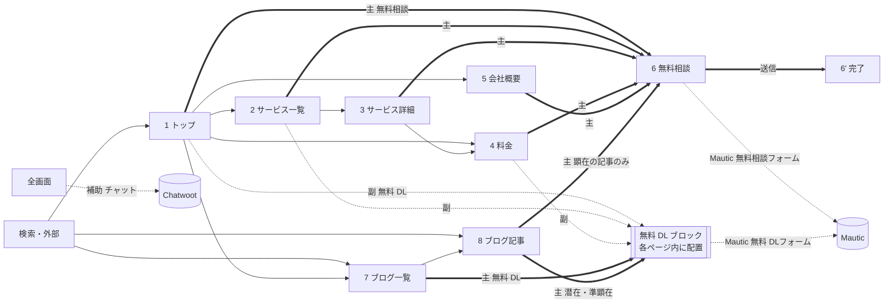

# 01. コンテンツ仕様（情報設計・コピー・CTA・計測）

担当: `ia-copy`。前提は [00-brief.md](00-brief.md)。builder はこの文書の文言をそのまま Figma に流し込む。
根拠にした文書: `BA/01-business-model.md`、`BA/04-business-processes.md`、`AA/04-recursive-improvement-loop.md`、`DA/01-conceptual-data-model.md`、`DA/02-metrics-and-kpi.md`、`DetailedDesign/02-public-path-flows.md`、ルート `README.md`。

**状態: ゲート G2 承認済み（2026-09-20）。** 承認時のユーザーの決定（F1〜F4・F6・C1・C2・C4・C7 と計測イベント）は反映済み。10 節の「決定済み」を参照。

## 0. この文書の読み方と表記ルール

### 0.1 builder への約束

- **`【要記入】` と `【要確認】` は、そのまま Figma に文字として置く**（消さない・埋めない）。`【要記入】` はユーザーが値を入れる箇所、`【要確認】` は内容の妥当性をユーザーが確かめる箇所。どちらも 10 節の未決事項に対応する。
  - 本文・回答文に掛かるものは、その文の末尾に置く。括弧内の説明（「構築先の環境＝…を確認する」など）は設計上の注記なので画面には出さない。
  - **見出しに掛かるものは、見出しの文に混ぜない。** 見出しの右に `Badge`（Outline、小）「要確認」「要記入」を置く（h2 は SEO の見出しでもあるため）。該当は 2-6「ご利用の流れ」と 3-5「こんな方に向いています」。
- **`（準備中）` `（サンプル）` の付いた文言は、明示したダミー**である。架空の社名・人名・証言・数値に置き換えない。
- `Button - Nova` のラベルは TEXT プロパティではないため、instance 内の TEXT ノードを書き換える（00-brief の 3 節）。
- 各 CTA には、6 節の表の `cta_id` とイベント名を Figma の注記（dev annotation）に書き写す。
- **本文・補足・エラー文など読ませる文字を載せる面は白（`card`）にし、`muted` の面には読ませる文字を置かない。** `muted`（#f5f5f5）の上に `muted foreground`（#737373）を載せると 4.35:1 で WCAG AA の 4.5:1 に届かないため（白の上なら 4.74:1 で満たす）。セクションを区切るための装飾だけの面（文字を載せない帯など）は `muted` のままでよい。面を分けたいときは、白 ＋ `border` の枠で分ける。
- 「部品」欄は shadcn/ui の名前で書く。kit では `<名前> - Nova`（例 `Card - Nova`）。サイト固有の複合部品（`SiteHeader` など）は design-system の `02-component-map.md` の名前に合わせる（9 節）。

### 0.2 文字の表記

| 項目 | ルール | 例 |
|---|---|---|
| 文体 | です・ます調。見出しは体言止めか短い文 | 「料金」「改善が回り続ける仕組みを、事業の土台に。」 |
| 半角英数字の前後 | 和文との間に半角スペースを入れる（料金表の原文の表記に合わせる） | 「23,000 円」「1 日」「AI エージェント」 |
| 金額 | 3 桁区切りのカンマ ＋ 半角スペース ＋「円」。月額は全角スラッシュ「／月」 | 「500,000 円／月」 |
| 期間の範囲 | 全角の波ダッシュ「〜」 | 「60〜90 日」 |
| お客さまの呼び方 | 「お客さま」「事業者さま」 | |
| 社名・サービス名 | 「ComeGin」（正式な会社名は未決。10 節） | |
| ボタン | 動詞で終える（「〜する」「〜を受け取る」）。15 字以内 | 「無料で相談する」 |

### 0.3 段組みと折り返しの規則

- **Desktop で本文（説明文が付くカードやステップ）を横に並べるときは、1 列あたり 1 行 20 字以上入る幅を目安にする。** 20 字を下回ると、語の途中で改行されて読みにくくなる。足りないときは段を分ける（4 つなら 2 列 ×2 段、5 つなら 3 列 ＋ 2 列、6 つなら 3 列 ×2 段）。
- **ただし 3 列は下限として許容する。** 3 列のカードは本文幅 318px なので、**本文 16px の `IconCard` を 3 列で使うと約 19.3 字**になり、目安を 1 字下回る（該当は 1-4 と 5-4）。この幅を満たそうとすると 3 列のセクションがすべて 2 列になってしまうため、19.3 字は許容する。**5 列（約 13 字）で起きたような語の途中での改行は、19.3 字では起きていない**（qa-reviewer の確認）。本文 14px の `ServiceCard`・`PricingCard`・`BlogCard` は 3 列でも約 22.7 字で、目安を満たす。
- **4 列以上（1 列 270px、本文幅 222px）は、本文を載せない場合に限る。**
- 計算の前提（**qa-reviewer が部品を実測した値**）:
  - コンテンツ幅 1152px、列の間隔 24px。1 列の幅は 3 列で 368px、4 列で 270px、5 列で 218px、6 列で 172px（368×3 ＋ 24×2 ＝ 1152）。
  - **カードの左右の余白は各 24px。** 本文幅は 1 列の幅 − 48px で、3 列＝318px、4 列＝222px、5 列＝170px、6 列＝124px。
  - **字数は本文の文字サイズで決まる。** 1 行の字数はおよそ「本文幅 ÷ 文字サイズ」。3 列なら 14px で約 22.7 字、16px で約 19.3 字。4 列なら 14px で約 15.9 字、16px で約 13.9 字。
  - 本文が 16px なのは `IconCard` だけで、`ServiceCard`・`PricingCard`・`BlogCard` は 14px。**「3 列だから 19 字」ではなく「`IconCard` を 3 列で使うと 19.3 字」**である。1 列の幅が広ければ 16px でも足りる（Contact の `IconCard` は 1 列 384px で約 20.4 字）。
  - `03-handoff.md` の H-5 と同じ前提。どちらかを直すときは両方を直す。
- 文字を持たない枠（ロゴ枠など）と、1〜2 語の短いリンクだけを並べる列（フッター）はこの規則の対象外。

## 1. サイトマップとナビゲーション

### 1.1 画面一覧（10 画面 ＋ 状態）

| # | 画面 | URL | Figma ページ | 担当 | index | 主 CTA |
|---|---|---|---|---|---|---|
| 1 | トップ | `/` | 10 Top | builder-sales | index | 無料相談 |
| 2 | サービス一覧 | `/services` | 11 Services | builder-sales | index | 無料相談 |
| 3 | サービス詳細（テンプレート。例: 受託開発） | `/services/development` | 11 Services | builder-sales | index | 無料相談 |
| 4 | 料金 | `/pricing` | 12 Pricing | builder-sales | index | 無料相談 |
| 5 | 会社概要 | `/about` | 13 About | builder-site | index | 無料相談 |
| 6 | 無料相談（フォーム） | `/contact` | 14 Contact | builder-site | index | 無料相談 |
| 6' | 無料相談（完了） | `/contact/thanks` | 14 Contact | builder-site | **noindex** | —（副のみ） |
| 7 | ブログ一覧 | `/blog` | 15 Blog | builder-site | index | **無料 DL**（4.3 節） |
| 8 | ブログ記事（テンプレート） | `/blog/<slug>` | 15 Blog | builder-site | index | 検索意図で切り替え（4.3 節）。Figma の例は **無料 DL** |
| 9 | 404 | （存在しない URL すべて） | 16 System | builder-site | **noindex** | なし |
| 10 | 法務（テンプレート） | `/legal/privacy`、`/legal/tokushoho` | 16 System | builder-site | index | なし |

サービス詳細テンプレートを使う URL（Figma で組むのは `development` だけ）:

| URL | サービス |
|---|---|
| `/services/environment-setup` | 環境構築 |
| `/services/development` | 受託開発（Figma の例） |
| `/services/consulting` | コンサル |
| `/services/partnership` | 業務提携（福祉業界のみ） |

### 1.2 画面遷移と CTA の導線

- 太線は主 CTA、点線は副 CTA・補助・送信先。**無料 DL は独立したページを持たず、各ページの中の「無料 DL ブロック」（`#source-dl`）で完結する**（ページ遷移を挟まないため離脱が少なく、フォームがメール 1 項目で済むため）。
- 他ページから無料 DL へ誘導するリンクは、同じページ内に無料 DL ブロックがあればそこへ、無ければトップの `/#source-dl` へ飛ばす。

### 1.3 グローバルナビ（`SiteHeader`）

| 並び | 表示 | リンク先 | 備考 |
|---|---|---|---|
| 左 | ロゴ「ComeGin」（文字ロゴ。画像は使わない） | `/` | ロゴ画像が決まるまで Inter Bold の文字で置く |
| 中央〜右 | サービス | `/services` | 現在地のページは `aria-current="page"`（Figma では active の見た目） |
| | 料金 | `/pricing` | |
| | 会社概要 | `/about` | |
| | ブログ | `/blog` | |
| 右端 | ボタン「無料相談」（主 CTA。`Button` Small。**強さは画面で切り替える**。下の表） | `/contact` | ヘッダーの「無料相談」は各ページの主 CTA の種類に数えない（00-brief の 4 節） |

**ヘッダーの「無料相談」の強さ（G2 の決定 F2）**

| 画面 | ヘッダーの「無料相談」 | 理由 |
|---|---|---|
| ブログ一覧（7）、ブログ記事（8） | **`Button` Outline**（弱める） | ブログの主 CTA は無料 DL。BA-04 の「潜在には商談系 CTA を置かない」に近づけるため、ヘッダーの無料相談を本文の主 CTA より目立たせない |
| 上記以外のすべての画面 | `Button` Primary | |

- Mobile の Sheet の中の「無料相談」ボタン（下の 4）も同じ規則に従う（ブログ一覧・記事では Outline、それ以外は Primary）。
- **Desktop**: 上の並びを 1 行。`Navigation Menu` の項目 4 つ ＋ `Button`。高さは design-system の `SiteHeader` に従う。
- **Mobile**: ロゴ（左）＋ ハンバーガー（右。`Icon Button` ＋ `Lucide / menu`、aria-label「メニューを開く」）。**ヘッダーの「無料相談」ボタンは Mobile では出さず、Sheet の中に入れる**（390px では並べるとロゴとタップ領域が窮屈になるため）。
- **Mobile の Sheet（右から開く）**の中身（上から）:
  1. 見出しなし。閉じるボタン（`Lucide / x`、aria-label「メニューを閉じる」）
  2. リンク 4 つ（サービス／料金／会社概要／ブログ）。各行 48px 以上
  3. `Separator`
  4. ボタン「無料相談」（主。全幅。ブログ一覧・記事では Outline、それ以外は Primary）
  5. テキストリンク「ソースコードを無料DL」（副。`Button` Link）→ `/#source-dl`

### 1.4 フッター（`SiteFooter`）

| 列 | 見出し | リンク |
|---|---|---|
| 1 | ComeGin | 説明文「観測・改善提案・人の承認・反映・検証を回し続ける、再帰的自己改善型の事業経営基盤。」 |
| 2 | サービス | 環境構築（`/services/environment-setup`）／受託開発（`/services/development`）／コンサル（`/services/consulting`）／業務提携（`/services/partnership`）／料金（`/pricing`） |
| 3 | ComeGin について | 会社概要（`/about`）／ブログ（`/blog`）／無料相談（`/contact`）／ソースコード無料DL（`/#source-dl`） |
| 4 | 規約・ポリシー | プライバシーポリシー（`/legal/privacy`）／特定商取引法に基づく表記（`/legal/tokushoho`）／Cookie 設定（Cookie 同意バナーを再表示するボタン） |
| 下段 | — | 「© 2026 ComeGin」（正式な会社名が決まったら差し替える。10 節） |

- **Desktop**: 4 列を横並び。下段に `Separator` とコピーライト。
- **Mobile**: 列 1 を全幅、列 2〜4 を縦積み（Accordion にはしない。リンク数が少なく、畳むとフッターから辿れる導線が見えなくなるため）。
- 部品: `Separator`、`Button`（Link）。「Cookie 設定」はリンクの見た目の `button` 要素（ページ遷移しない）。

### 1.5 全画面に共通する要素

| 要素 | 分類 | 置き場所 | 仕様 |
|---|---|---|---|
| `SiteHeader` | Site Navigation & Headers | 全画面の最上部 | 1.3 |
| パンくず（`Breadcrumb`） | Site Navigation & Headers | トップ・404 以外のすべての画面。ヘッダー直下 | 「ホーム / 親 / 現在のページ」。現在のページはリンクにしない。Mobile も同じ（長い記事タイトルは 1 行で省略「…」） |
| `SiteFooter` | Website Foundations | 全画面の最下部 | 1.4 |
| Cookie 同意バナー（`CookieBanner`） | Website Foundations | 初回訪問時に全画面の下部に重ねる | 8 節。Figma では Top の Desktop・Mobile にだけ重ねた状態のフレームを置き、他の画面には置かない |
| チャット（Chatwoot のウィジェット） | Pricing & Conversion（補助） | 全画面の右下 | **Chatwoot が描画するため Figma の部品は作らない**。位置を示すため Top と Contact にだけ「チャット（Chatwoot ウィジェット）」と書いた 56px の円の枠を置く。文言は 8.3 |

## 2. 料金（正本）

**この表の金額・期間・備考は、ブリーフの表と一字一句同じにする。** 画面のどこに出すときもこの表から写す（言い換え・省略・「〜」の置き換えをしない）。

| プロダクト | 金額（税別） | 期間 | 備考 |
|---|---|---|---|
| 本プロジェクトの環境構築 | 23,000 円 | 1 日 | ソースコードは無料で配布 |
| 受託開発：バイブコーディングのみ | 50,000 円 | 5 日 | |
| 受託開発：要件定義〜運用保守 | 500,000 円／月 | 60〜90 日 | |
| コンサル | 125,000 円／月 | 4 日／月 | |
| 業務提携（福祉業界のみ） | 要相談 | — | 開発費は基本的に弊社負担 |

- **注記「表示価格はすべて税別です。」を、料金を出すすべての箇所（料金カード群の直下、比較表の直下、サービスカード群の直下）に置く。**
- ブリーフの環境構築の備考「ソースコードは無料で配布（副 CTA と連動）」のうち、括弧内は設計上の注記であり画面には出さない（画面では「ソースコードは無料で配布」の後ろに副 CTA のリンクを置くことで連動を表す）。この扱いは G2 で確認する（10 節）。
- プロダクト名「本プロジェクトの環境構築」は原文のまま出す。訪問者には「本プロジェクト」が何を指すか伝わりにくいため、カードでは名前の下に補足「ComeGin の事業経営基盤一式を、お客さまのクラウドまたは端末に構築します。」を添える（名前自体は変えない）。

## 3. 6 分類の対応

| 分類 | この文書で使う略号 |
|---|---|
| Hero, Banners & Landing Intros | `HERO` |
| Site Navigation & Headers | `NAV` |
| Trust & Social Proof | `TRUST` |
| Content & Editorial | `CONTENT` |
| Pricing & Conversion | `CONV` |
| Website Foundations | `FOUND` |

## 4. 画面ごとのセクション仕様

各セクションは上から順に並べる。「D/M」は Desktop（1440px）と Mobile（390px）で構成が変わる点。書いていないものは縦積みにするだけ。

### 4.1 画面 1 トップ（`/`）

**h1**: 改善が回り続ける仕組みを、事業の土台に。

#### 1-1 告知バナー（`HERO`、副 CTA）

- 部品: `AnnouncementBanner`（`Badge` ＋ テキスト ＋ `Button` Link）
- Badge: 「無料配布中」
- 本文: 「環境構築のソースコードを無料で配布しています。メールアドレスだけで受け取れます。」
- ボタン: 「受け取る」（Link。`Lucide / arrow-right` を右に）→ `#source-dl`
- 置き場所: ヘッダーの**上**。閉じるボタンは付けない（閉じた状態の保存に同意が要らない `sessionStorage` を使う案もあるが、要素を増やさないため）
- D/M: Mobile は Badge を省き、本文を「ソースコードを無料配布中」に短縮して 1 行に収める

#### 1-2 ヘッダー（`NAV`）

1.3 のとおり。

#### 1-3 ヒーロー（`HERO`、主 CTA ＋ 副 CTA）

- 部品: `Badge`、見出し、本文、`Button` ×2、画像枠
- Badge: 「BtoB の集客から商談までを、ひとつの基盤に」
- h1: 「改善が回り続ける仕組みを、事業の土台に。」
- 本文: 「検索からの流入、記事、問い合わせ、商談までをオープンソースを中心としたツールでつなぎ、観測 → 改善提案 → 人の承認 → 反映 → 効果の検証を繰り返す。ComeGin は、この『再帰的自己改善型』の事業経営基盤を、環境構築・受託開発・コンサルでお届けします。」
- ボタン（主）: 「無料で相談する」（Primary / Large）→ `/contact`
- ボタン（副）: 「ソースコードを無料DL」（Ghost / Large、`Lucide / download` を左に）→ `#source-dl`
- 補足（ボタンの下、小さい文字）: 「相談は無料です。しつこい営業はいたしません。」（G2 で承認済み）
- 画像枠: 「画像（準備中）：ループの図」（右側。4:3）
- D/M: Desktop はテキスト左・画像枠右の 2 カラム。Mobile は 1 カラムで画像枠を本文の下に置き、ボタン 2 つを全幅で縦積み（主を上）

#### 1-4 こんな課題はありませんか（`CONTENT`）

- 部品: `Card` ×3（アイコン ＋ 見出し ＋ 本文）
- セクション見出し: 「こんな課題はありませんか」
- カード 1（`Lucide / file-text`）: 見出し「記事を書いても、成果が見えない」／本文「公開した記事が問い合わせにつながったのか、どの記事が効いたのかを説明できない。」
- カード 2（`Lucide / unplug`）: 見出し「ツールは入れたが、つながっていない」／本文「CMS、MA、アクセス解析、チャットがばらばらで、数字を突き合わせるのに毎月手間がかかる。」
- カード 3（`Lucide / user-round`）: 見出し「改善が、担当者の勘と手作業頼み」／本文「何を直すかが人によって変わり、担当者が替わると改善の履歴ごと途切れてしまう。」
- D/M: Desktop 3 列、Mobile 1 列

#### 1-5 仕組み（`CONTENT`）

- 部品: ステップ（番号付きの `Card` ×5 を矢印でつなぐ）、`Separator`、`Card`（約束の枠）
- セクション見出し: 「観測から検証までを、ひとつのループに」
- リード: 「ComeGin の事業経営基盤は、次の 5 つのステップを繰り返します。AI エージェントが観測と改善案の下書きを担い、採用するかどうかは必ず人が決めます。」
- ステップ（番号・見出し・本文）:
  1. 「観測」—「検索順位、流入、問い合わせ、表示速度などのデータを、毎日決まった範囲で集めます。」
  2. 「提案」—「AI エージェントが、観測結果から改善案を下書きします。根拠のデータと、元に戻す手順も必ず添えます。」
  3. 「承認」—「改善案を採用するかどうかは、人が決めます。この判断は自動化しません。」
  4. 「反映」—「承認された改善だけを、サイトの記事や問い合わせの導線に反映します。」
  5. 「検証」—「反映からおよそ 30 日後に効果を測り、その結果を次の改善の根拠にします。」
- 約束の枠（`Card`。**面は白（`card`）＋ `border`**。0.1 のコントラストの規則。builder-sales の実装もこの形）:
  - 見出し: 「暴走させないための、設計上の約束」
  - 箇条書き:
    - 「記事の公開や配信など、外部に出る操作は人が行います。」
    - 「1 か月に反映する改善は 3 件まで。どの変更が効いたのかを後から説明できるようにします。」
    - 「SEO の品質スコアが基準を下回ったら、改善の反映を止めます。」
    - 「すべての改善案に、元に戻す手順を先に書きます。」
- D/M: **Desktop は 3 列 ＋ 2 列の 2 段（上段に 1〜3、下段に 4〜5）**。段の中は横向きの矢印（`Lucide / arrow-right`）でつなぐ。Mobile は縦 1 列（矢印 `Lucide / arrow-down`）
  - 5 つを横 1 列にしない理由: 5 列では 1 列 218px・本文幅 170px で、14px の和文が 1 行およそ 12 字になり、「問い合わ／せ」のように語の途中で改行される。3 列なら 1 列 368px・本文幅 318px で、14px なら約 22.7 字、16px でも約 19.3 字になる（0.3 の折り返しの規則）

#### 1-6 つなぐツール（`CONTENT`）

- 部品: `Badge`（Outline）×10 を折り返して並べる。**各ツールのロゴは使わない**（商標の扱いを避け、画像を使わない方針に合わせる）
- セクション見出し: 「使うツール」
- リード: 「用途ごとに実績のあるツールを組み合わせ、データの正本を用途ごとに 1 つに決めてつなぎます。」
- Badge（表示順）: 「Astro（サイト）」「Strapi（CMS）」「Mautic（MA）」「Umami（アクセス解析）」「PostHog（行動分析・AB テスト）」「Chatwoot（チャット）」「n8n（ワークフロー）」「OpenSEO（検索市場調査）」「Google Search Console」「Lighthouse CI（品質監査）」

#### 1-7 サービス（`CONTENT`）

- 部品: `ServiceCard` ×4（`Card` ＋ `Badge` ＋ 価格の行 ＋ `Button` Link）
- セクション見出し: 「サービス」
- リード: 「基盤を自分で立ち上げる方から、作り込みや運用まで任せたい方まで、4 つの関わり方をご用意しています。」
- カードの中身は 4.2 の 2-4 と同じ文言（価格の行を含む）。各カードのボタン「詳しく見る」（Link、`Lucide / arrow-right`）→ 各サービス詳細
- 環境構築のカードの副 CTA リンク「ソースコードを無料DL」（→ `#source-dl`）の `cta_id` は **`dl_top_card`**（サービス一覧の同じリンクは `dl_services_card`。6.3 の 8 行目）
- カード群の直下: 「表示価格はすべて税別です。」
- セクション末尾のリンク: 「料金の一覧を見る」（Link）→ `/pricing`
- D/M: **Desktop は 2 列 ×2 段**（4 列に並べると 1 列 270px・本文幅 222px で、本文が 1 行 16 字を切るため。0.3 の折り返しの規則）、Mobile 1 列

#### 1-8 導入事例（`TRUST`、ダミー）

- 部品: `LogoCloud`（ダミー）、`TestimonialCard`（ダミー）×3、実績数値の枠 ×3、`Badge`
- セクション見出し: 「導入事例」 ＋ `Badge`「準備中」
- リード: 「導入事例とお客さまの声は、掲載の許可をいただいたものから順に公開します。現在は準備中です。」
- ロゴ枠 ×6: 各枠に「ロゴ（準備中）」
- お客さまの声 ×3: 各カードに「お客さまの声（準備中）」と「掲載準備中です。」。**人名・社名・肩書き・星の数を入れない**
- 実績数値 ×3: ラベル「導入社数」「公開記事数」「改善の反映件数」、値はすべて「—」、下に「公開準備中」
- D/M: ロゴ枠は Desktop 6 列 → Mobile 3 列 ×2 行。声と数値は Mobile で 1 列

#### 1-9 無料 DL ブロック（`CONV`、副 CTA。`id="source-dl"`）

- 部品: `SourceDownloadBlock`（**控えめ版**。**面は白（`card`）＋ `border`**、`Input`、`Checkbox`、`Button` Secondary）
  - 「控えめ」は面の色ではなく、枠線とボタンの variant（Secondary）で表す（0.1 のコントラストの規則）
- 見出し: 「環境構築のソースコードを無料で配布しています」
- 本文: 「この基盤をご自身の手で立ち上げたい方へ。ソースコード一式を無料でお渡しします。構築を任せたい場合は、環境構築サービス（23,000 円・1 日、税別）もご利用いただけます。」
  - 注: 本文中の「23,000 円」「1 日」は 2 節の値。「・」「、税別」は文中の接続であり料金表の表記ではない
- フォーム: 5.2 節（メールアドレス ＋ 同意）
- ボタン: 「ソースコードを受け取る」（Secondary）
- D/M: Desktop は左に見出しと本文、右にフォームの 2 カラム。Mobile は縦積み、入力欄とボタンは全幅

#### 1-10 よくある質問（`CONTENT`）

- 部品: `Accordion`（最初の 1 件だけ開いた状態）
- セクション見出し: 「よくある質問」
- Q1「ソースコードは本当に無料ですか？」— A「はい。環境構築に使うソースコードは無料で配布しています。ご自身での構築が難しい場合は、環境構築サービスをご利用ください。」
- Q2「AI が勝手にサイトを書き換えることはありませんか？」— A「ありません。AI エージェントが行うのは、観測、改善案の作成、記事の下書きまでです。記事の公開や配信など外部に出る操作は、必ず人が承認して行う設計です。」
- Q3「どのサービスから始めればよいですか？」— A「まずは無料相談でお話を伺います。ご自身で試したい場合はソースコードの無料配布から、構築を任せたい場合は環境構築から始める方が多い想定です。」 ← **【要確認】**（「多い想定です」は実績ではないため、実績が出たら書き換える）
- Q4「料金は税込ですか？」— A「表示価格はすべて税別です。」
- Q5「業務提携の対象を教えてください」— A「福祉業界の事業者さまに限ります。開発費は基本的に弊社負担で、条件はご相談のうえ個別に決めます。」
- D/M: 構成は同じ。Mobile は全幅

#### 1-11 CTA バナー（`CONV`、主 CTA）

- 部品: `CTABanner`（Primary 版。反転背景またはアクセント背景は design-system の決定に従う）
- 見出し: 「まずは、いまの課題をお聞かせください」
- 本文: 「どこから手を付けるべきかの整理からご一緒します。相談は無料です。」
- ボタン: 「無料で相談する」（Primary / Large）→ `/contact`
- D/M: Desktop は見出しと本文が左、ボタンが右。Mobile は縦積み、ボタン全幅

#### 1-12 フッター（`FOUND`）

1.4 のとおり。

#### 1-13 Cookie 同意バナー（`FOUND`、重ねた状態の別フレーム）

8 節のとおり。Top の Desktop・Mobile それぞれに「Cookie バナー表示中」のフレームを 1 枚ずつ追加で置く。

### 4.2 画面 2 サービス一覧（`/services`）

**h1**: サービス：事業経営基盤の構築から運用まで

#### 2-1 ヘッダー（`NAV`）／2-2 パンくず（`NAV`）

パンくず: 「ホーム / サービス」

#### 2-3 導入ヒーロー（`HERO`）

- 部品: 見出し、本文（下層ページ共通の `PageIntro`）
- h1: 「サービス：事業経営基盤の構築から運用まで」
- 本文: 「ComeGin のサービスは 4 つです。ソースコードを使ってご自身で立ち上げる、構築を任せる、自社向けに作り込む、運用を一緒に回す。いまの状況に合わせてお選びください。」
- ボタンなし（主 CTA はページ下部に集める）

#### 2-4 サービスカード（`CONTENT` ＋ `CONV`）

- 部品: `ServiceCard` ×4
- カード 1「環境構築」
  - Badge: 「ソースコード無料配布」
  - 本文: 「ComeGin の事業経営基盤一式を、お客さまのクラウドまたはお客さまの端末に構築します。ソースコードは無料で配布しているため、ご自身で構築することもできます。」（2026-09-20 にユーザーが確定。構築先はご希望に合わせて選べる）
  - 価格の行: プロダクト名「本プロジェクトの環境構築」／「23,000 円」／「1 日」
  - ボタン: 「詳しく見る」（Link）→ `/services/environment-setup`
  - 追加リンク（副）: 「ソースコードを無料DL」（Link、`Lucide / download`）→ `#source-dl`
- カード 2「受託開発」
  - 本文: 「5 日間で動くものを作る『バイブコーディングのみ』と、要件定義から運用保守までを一貫して担うプランがあります。」
  - 価格の行（2 行）: 「受託開発：バイブコーディングのみ」／「50,000 円」／「5 日」、「受託開発：要件定義〜運用保守」／「500,000 円／月」／「60〜90 日」
  - ボタン: 「詳しく見る」→ `/services/development`
- カード 3「コンサル」
  - 本文: 「KPI の設計、検索意図に合わせた記事と CTA の設計、月次の改善会議の運営を支援します。」（2026-09-20 にユーザーが確定）。**料金ページのカード 4 と同じ文**（期間は価格の行の「4 日／月」で示すため、文からは外した）
  - 価格の行: 「コンサル」／「125,000 円／月」／「4 日／月」
  - ボタン: 「詳しく見る」→ `/services/consulting`
- カード 4「業務提携」
  - Badge: 「福祉業界のみ」
  - 本文: 「福祉業界の事業者さまに限ってお受けしています。進め方と条件は個別にご相談のうえ決めます。」**料金ページのカード 5 と同じ文**（開発費の扱いは価格の行の備考「開発費は基本的に弊社負担」で示すため、文からは外した）
  - 価格の行: 「業務提携（福祉業界のみ）」／「要相談」／「—」／備考「開発費は基本的に弊社負担」
  - ボタン: 「詳しく見る」→ `/services/partnership`
- カード群の直下: 「表示価格はすべて税別です。」
- D/M: Desktop 2×2、Mobile 1 列

#### 2-5 どれを選べばよいか（`CONTENT`）

- 部品: `Table`（Desktop）／`Card` の縦並び（Mobile）
- セクション見出し: 「どれを選べばよいか」
- 表（列: こんなとき／おすすめ）
  - 「まずは自分の手で試してみたい」／「ソースコードの無料DL」
  - 「基盤の立ち上げを任せたい」／「環境構築」
  - 「自社の業務に合わせて作り込みたい」／「受託開発」
  - 「立ち上げた基盤の運用を一緒に回してほしい」／「コンサル」
  - 「福祉業界で、開発の費用を抑えて取り組みたい」／「業務提携」
- D/M: **Mobile は表をやめ、行ごとに `Card`（上に「こんなとき」、下に「おすすめ」）にする**
  - Mobile では Desktop の列見出しが消えるため、**下の行に「おすすめ：」を前置する**（例「おすすめ：ソースコードの無料DL」）。上の行はラベルを付けず、文だけを置く（文そのもので読めるため）

#### 2-6 ご利用の流れ（`CONTENT`）

- 部品: ステップ（番号付き）×4
- セクション見出し: 「ご利用の流れ」 **【要確認】**（流れ全体）
- 1「無料相談」—「フォームから、いまの状況とご相談内容をお送りください。」
- 2「ご提案」—「内容を伺い、合うサービスと進め方をご提案します。」
- 3「ご契約」—「内容にご納得いただけたら、ご契約に進みます。」
- 4「実施と振り返り」—「実施後に結果を一緒に確かめ、次の改善につなげます。」
- D/M: **Desktop は 2 列 ×2 段**（各ステップに 1 文の説明が付くため。0.3 の折り返しの規則）、Mobile 縦 1 列

#### 2-7 無料 DL ブロック（`CONV`、副、控えめ版）

1-9 と同じ文言・部品。`id="source-dl"`。

#### 2-8 CTA バナー（`CONV`、主）

- 見出し: 「どのサービスが合うか、一緒に考えます」
- 本文: 「迷っている段階でもかまいません。相談は無料です。」
- ボタン: 「無料で相談する」→ `/contact`

#### 2-9 フッター（`FOUND`）

### 4.3 画面 3 サービス詳細テンプレート（例: `/services/development`）

**h1**: 受託開発：バイブコーディングから要件定義〜運用保守まで

テンプレートの枠: パンくず → 導入ヒーロー → プラン（料金カード）→ こんな方に → 進め方 → よくある質問 → 関連記事 → CTA バナー。他の 3 サービスも同じ枠に文言を差し替えて使う（文言は G2 後に別途作る。10 節）。

#### 3-1 ヘッダー（`NAV`）／3-2 パンくず（`NAV`）

パンくず: 「ホーム / サービス / 受託開発」

#### 3-3 導入ヒーロー（`HERO`、主 CTA）

- 部品: `PageIntro`、`Badge`、`Button`
- Badge: 「受託開発」
- h1: 「受託開発：バイブコーディングから要件定義〜運用保守まで」
- 本文: 「短い期間で動くものを作る『バイブコーディングのみ』と、何を作るかの整理からリリース後の運用保守までを一貫して担う『要件定義〜運用保守』の 2 つのプランがあります。」
- ボタン（主）: 「無料で相談する」（Primary）→ `/contact?service=development`
- D/M: Mobile はボタン全幅

#### 3-4 プラン（`CONV`）

- 部品: `PricingCard` ×2（`Card` ＋ `Badge` ＋ 金額 ＋ 期間 ＋ 箇条書き ＋ `Button`）
- セクション見出し: 「プラン」
- カード A
  - プロダクト名: 「受託開発：バイブコーディングのみ」
  - 金額: 「50,000 円」 期間: 「5 日」
  - 説明: 「AI コーディングエージェントと対話しながら短いサイクルで実装し、動くものをお渡しします。」（文はユーザーが確定。**「のみ」が何を含まないか（要件定義・設計・保守）は 3-7 の Q2 で未決**）
  - ボタン: 「このプランで相談する」（Primary）→ `/contact?service=development-vibe`
- カード B
  - Badge: 「要件定義から一貫対応」
  - プロダクト名: 「受託開発：要件定義〜運用保守」
  - 金額: 「500,000 円／月」 期間: 「60〜90 日」
  - 説明: 「何を作るかの整理から、設計、開発、テスト、リリース、リリース後の運用保守までを担当します。」
  - ボタン: 「このプランで相談する」（Primary）→ `/contact?service=development-full`
- カードの直下: 「表示価格はすべて税別です。」
- D/M: Desktop 2 列、Mobile 1 列

#### 3-5 こんな方に（`CONTENT`）

- 部品: `Card` ×2（カード A・B に対応）、箇条書き（`Lucide / check`）
- セクション見出し: 「こんな方に向いています」 **【要確認】**（対象の妥当性）
- バイブコーディングのみ:
  - 「作りたいものの仕様が、ある程度まで決まっている」
  - 「まずは動く試作品を短期間で手に入れたい」
- 要件定義〜運用保守:
  - 「何を作るべきかの整理から相談したい」
  - 「リリース後の運用や保守まで任せたい」

#### 3-6 進め方（`CONTENT`）

- 部品: ステップ ×6（要件定義〜運用保守のプラン）
- セクション見出し: 「進め方（要件定義〜運用保守のプラン）」
- 1「要件定義」—「業務と目的を伺い、作るものと作らないものを決めます。」
- 2「設計」—「画面、データ、外部サービスとのつなぎ方を設計します。」
- 3「開発」—「設計にもとづいて実装します。」
- 4「テスト」—「要件どおりに動くかを確かめます。」
- 5「リリース」—「本番環境に反映し、公開します。」
- 6「運用保守」—「リリース後の不具合の対応と、改善の相談を受けます。」
- 期間ごとの内訳は書かない（60〜90 日のどこに何日を割くかが未定のため）
- D/M: **Desktop は 3 列 ×2 段**（6 列に並べると 1 列 172px・本文幅 124px で読めないため。0.3 の折り返しの規則）、Mobile 縦 1 列

#### 3-7 よくある質問（`CONTENT`）

- 部品: `Accordion`
- Q1「バイブコーディングとは何ですか？」— A「AI コーディングエージェントと対話しながら、短いサイクルで実装を進める開発のやり方です。」
- Q2「『バイブコーディングのみ』には何が含まれますか？」— A「含まれるのは、AI コーディングエージェントと対話しながら短いサイクルで実装し、動くものをお渡しするところまでです。要件定義と設計、テストと品質保証、インフラの構築とデプロイ、リリース後の運用保守は含まれません。これらも含めてお任せいただく場合は、要件定義〜運用保守（500,000 円／月）をご利用ください。」
- Q3「期間が 60〜90 日と幅があるのはなぜですか？」— A「作るものの規模によって変わるためです。無料相談で内容を伺い、目安をお伝えします。」
- Q4「開発したソースコードの権利はどうなりますか？」— A「納品時に、開発したソースコードの著作権をお客さまに譲渡します。」

#### 3-8 関連記事（`CONTENT`）

- 部品: `BlogCard` ×3（ダミー。4.7 の 7-4 と同じ中身）
- セクション見出し: 「関連する記事」
- D/M: Desktop 3 列、Mobile 1 列（または横スクロールしない縦積み）

#### 3-9 CTA バナー（`CONV`、主）

- 見出し: 「作りたいものを、まずはお聞かせください」
- 本文: 「仕様が固まっていなくてもかまいません。相談は無料です。」
- ボタン: 「無料で相談する」→ `/contact?service=development`

#### 3-10 フッター（`FOUND`）

### 4.4 画面 4 料金（`/pricing`）

**h1**: 料金：環境構築・受託開発・コンサル・業務提携

#### 4-1 ヘッダー（`NAV`）／4-2 パンくず（`NAV`）

パンくず: 「ホーム / 料金」

#### 4-3 導入ヒーロー（`HERO`）

- h1: 「料金：環境構築・受託開発・コンサル・業務提携」
- 本文: 「すべてのサービスの金額と期間です。表示価格はすべて税別です。」

#### 4-4 料金カード（`CONV`、主 CTA ＋ 副 CTA）

- 部品: `PricingCard` ×5
- 各カードの中身（2 節の表の 1 行 ＝ 1 カード。文言は 2 節から写す）:

| カード | プロダクト名 | 金額 | 期間 | 備考 | ボタン（主） | 追加リンク（副） |
|---|---|---|---|---|---|---|
| 1 | 本プロジェクトの環境構築 | 23,000 円 | 1 日 | ソースコードは無料で配布 | 「このサービスを相談する」→ `/contact?service=environment-setup` | 「ソースコードを無料DL」→ `#source-dl` |
| 2 | 受託開発：バイブコーディングのみ | 50,000 円 | 5 日 | （なし） | 「このサービスを相談する」→ `/contact?service=development-vibe` | — |
| 3 | 受託開発：要件定義〜運用保守 | 500,000 円／月 | 60〜90 日 | （なし） | 「このサービスを相談する」→ `/contact?service=development-full` | — |
| 4 | コンサル | 125,000 円／月 | 4 日／月 | （なし） | 「このサービスを相談する」→ `/contact?service=consulting` | — |
| 5 | 業務提携（福祉業界のみ） | 要相談 | — | 開発費は基本的に弊社負担 | 「このサービスを相談する」→ `/contact?service=partnership` | — |

- **5 枚とも、プロダクト名の下に 1 行説明を置く**（長さをそろえるため 33〜46 字。カード 1 の文は 2 節の補足と同じ）:

| カード | 1 行説明 |
|---|---|
| 1 本プロジェクトの環境構築 | 「ComeGin の事業経営基盤一式を、お客さまのクラウドまたは端末に構築します。」 |
| 2 受託開発：バイブコーディングのみ | 「AI コーディングエージェントと対話しながら短いサイクルで実装し、動くものをお渡しします。」 |
| 3 受託開発：要件定義〜運用保守 | 「何を作るかの整理から、設計、開発、テスト、リリース、リリース後の運用保守までを担当します。」 |
| 4 コンサル | 「KPI の設計、検索意図に合わせた記事と CTA の設計、月次の改善会議の運営を支援します。」 |
| 5 業務提携（福祉業界のみ） | 「福祉業界の事業者さまに限ってお受けしています。進め方と条件は個別にご相談のうえ決めます。」 |

- カード 2・3 の説明は §4.3 の 3-4 のプランの説明と同じ文にする。カード 4・5 の説明は §4.2 の 2-4 のサービスカードと同じ文にする（同じ内容が画面ごとに食い違わないようにするため）。
- 説明に期間・金額を書かない（カードの金額と期間の欄と重複するため）。実績・速さ・満足度の主張も書かない。
- カード 5 に `Badge`「福祉業界のみ」
- 期間のラベルは「期間」、金額のラベルは付けない（金額を最も大きく表示）
- カード群の直下: **「表示価格はすべて税別です。」**
- D/M: Desktop は 3 列 ＋ 2 列（上段 1〜3、下段 4〜5）。Mobile は 1 列

#### 4-5 料金一覧表（`CONV`）

- 部品: `Table`
- セクション見出し: 「料金一覧」
- 表: 2 節の表をそのまま（列「プロダクト」「金額（税別）」「期間」「備考」）
- 表の直下: **「表示価格はすべて税別です。」**
- D/M: **Mobile ではこの表を出さない**（4-4 のカードと同じ情報で、390px では 4 列の表が読めないため。カードが Mobile での一覧の役割を担う）

#### 4-6 お支払いと契約について（`CONTENT`）

- 部品: `Table`（2 列。項目／内容）
- セクション見出し: 「お支払いと契約について」
- 行: 「お支払い方法」／「【要記入】」、「お支払いの時期」／「【要記入】」、「月額のプランの契約期間と解約」／「【要記入】」、「料金以外に必要な費用」／「【要記入】（例: 交通費、外部サービスの利用料の扱い）」
- D/M: Mobile も 2 列の表のまま（項目名が短いため）

#### 4-7 無料 DL ブロック（`CONV`、副、控えめ版）

1-9 と同じ。`id="source-dl"`。

#### 4-8 よくある質問（`CONTENT`）

- Q1「表示価格は税込ですか？」— A「いいえ。表示価格はすべて税別です。」
- Q2「月額のプランの料金は、いつから発生しますか？」— A「【要記入】」
- Q3「業務提携の条件を教えてください」— A「福祉業界の事業者さまに限ります。開発費は基本的に弊社負担で、条件はご相談のうえ個別に決めます。」
- Q4「ソースコードの無料配布と環境構築サービスの違いは何ですか？」— A「ソースコードは無料でお渡しするため、ご自身で構築できます。環境構築サービスでは、その構築作業を ComeGin が 1 日で行います。」

#### 4-9 CTA バナー（`CONV`、主）

- 見出し: 「見積もりの前に、まずはご相談ください」
- 本文: 「どのプランが合うかを一緒に整理します。相談は無料です。」
- ボタン: 「無料で相談する」→ `/contact`

#### 4-10 フッター（`FOUND`）

### 4.5 画面 5 会社概要（`/about`）

**h1**: 人を増やすのではなく、仕組みを育てる。

#### 5-1 ヘッダー（`NAV`）／5-2 パンくず（`NAV`）

パンくず: 「ホーム / 会社概要」

#### 5-3 導入ヒーロー（`HERO`）

- Badge: 「会社概要」
- h1: 「人を増やすのではなく、仕組みを育てる。」
- 本文: 「ComeGin は、検索からの流入を起点にした BtoB のリード獲得を、人員を増やすことではなく、基盤そのものを改善することで伸ばすことを目指しています。私たちが短くしたいのは、観測してから改善が効くまでの一巡にかかる時間と手間です。」
- 画像枠: 「画像（準備中）」（Desktop のみ右側。Mobile は置かない）

#### 5-4 運営方針（`CONTENT`）

- 部品: `Card` ×3
- セクション見出し: 「大切にしていること」
- カード 1「人が決める場所を固定する」—「改善案を採用するかどうかと、外部に公開するかどうかは、必ず人が判断します。自動化で効率を上げるときも、この 2 か所は外しません。」
- カード 2「測れるものから始める」—「測れない指標に対しては、改善案を作れません。まず計測を整え、測れるようになった順に改善を回します。」
- カード 3「一度に変えすぎない」—「1 か月に反映する改善は 3 件までにしています。どの変更が効いたのかを、後から説明できるようにするためです。」
- D/M: Desktop 3 列、Mobile 1 列

#### 5-5 自社での運用（`TRUST`）

- 部品: `Card`（**面は白（`card`）＋ `border`**。0.1 のコントラストの規則）、`Badge`
- 見出し: 「この基盤は、ComeGin 自身のために作りました」
- 本文: 「このサイトの記事、問い合わせ、チャットは、ここで紹介している事業経営基盤の上で運用するために設計しています。運用の結果は、準備が整いしだいブログで公開します。」
- Badge: 「運用実績（準備中）」
- 注: 「運用しています」とは書かない（改善のループはまだ 1 周も回っていない。`AA/04` の 5 節）。運用が始まったら書き換える（10 節）

#### 5-6 会社情報（`FOUND`）

- 部品: `Table`（2 列。項目／内容）
- セクション見出し: 「会社情報」
- 行:
  - 「会社名」／「【要記入】」
  - 「代表者」／「【要記入】」
  - 「所在地」／「【要記入】」
  - 「設立」／「【要記入】」
  - 「事業内容」／「事業経営基盤の環境構築、受託開発、コンサルティング、業務提携」
  - 「お問い合わせ」／「無料相談フォーム」（`/contact` へのリンク）
- D/M: Mobile も 2 列の表（項目列を 96px 程度に固定）

#### 5-7 メンバー（`TRUST`、ダミー）

- 見出し: 「メンバー」
- 本文: 「メンバー紹介（準備中）」
- 枠: `Card` ×2 に「画像（準備中）」と「メンバー紹介（準備中）」。**人名・肩書きを入れない**

#### 5-8 CTA バナー（`CONV`、主）

- 見出し: 「考え方に共感いただけたら、まずはお話ししましょう」
- 本文: 「いまの体制のままで何ができるかを一緒に考えます。相談は無料です。」
- ボタン: 「無料で相談する」→ `/contact`

#### 5-9 フッター（`FOUND`）

### 4.6 画面 6 無料相談（`/contact`）と 6' 完了（`/contact/thanks`）

**h1**: 無料相談・お問い合わせ

#### 6-1 ヘッダー（`NAV`）／6-2 パンくず（`NAV`）

パンくず: 「ホーム / 無料相談」

#### 6-3 導入ヒーロー（`HERO`）

- h1: 「無料相談・お問い合わせ」
- 本文: 「事業経営基盤の構築、受託開発、コンサル、業務提携について、お気軽にご相談ください。内容を確認し、担当者からメールでご連絡します。」

#### 6-4 相談フォーム（`CONV`、主 CTA）

- 部品: `ContactForm`（`Input`、`Textarea`、`Checkbox`、`Button`、`Alert`）
- フォームの項目・文言・状態: 5.1 節
- 送信ボタン: 「無料相談を申し込む」（Primary / Large）
- Figma のフレーム: 通常 ／ 入力エラー ／ 送信中 ／ 送信失敗 の 4 状態を Desktop に並べる（Mobile は通常と入力エラーの 2 状態）

#### 6-5 サイドの案内（`CONTENT`）

- 部品: `Card` ×3
- カード 1「ご相談の流れ」 **【要確認】**
  1. 「フォームを送信」
  2. 「担当者からメールでご連絡（【要記入】営業日以内）」
  3. 「オンラインでお話を伺う（【要確認】形式）」
  4. 「ご提案」
- カード 2「チャットでも受け付けています」— 本文「ちょっとした質問なら、画面右下のチャットからどうぞ。」／ボタン「チャットで質問する」（Outline、`Lucide / message-circle`）→ Chatwoot のウィジェットを開く
- カード 3「まずは自分で試したい方へ」— 本文「環境構築のソースコードを無料で配布しています。」／リンク「ソースコードを無料DL」（Link）→ `/#source-dl`
- D/M: Desktop はフォーム（左 2/3）と案内（右 1/3）の 2 カラム。**Mobile はフォームを先に、案内を下に縦積み**

#### 6-6 フッター（`FOUND`）

#### 6'-1 完了画面（`CONV`）

- URL: `/contact/thanks`（noindex）。パンくず「ホーム / 無料相談 / 受付完了」
- 部品: アイコン（`Lucide / circle-check`）、見出し、本文、`Card` ×3、`Button`
- h1: 「ご相談を受け付けました」
- 本文: 「お問い合わせいただき、ありがとうございます。内容を確認し、担当者から【要記入】営業日以内にメールでご連絡します。」
- 本文 2（自動返信メールを設定する場合のみ。**【要確認】**）: 「ご入力のメールアドレスに、受付確認のメールをお送りしました。届かない場合は、迷惑メールフォルダもご確認ください。」
- 見出し 2: 「ご連絡までの間に」
- カード 1「ブログを読む」—「事業経営基盤づくりの考え方を紹介しています。」→ `/blog`
- カード 2「料金を確認する」—「すべてのサービスの金額と期間を掲載しています。」→ `/pricing`
- カード 3（副）「ソースコードを無料DL」—「ご自身で先に試すこともできます。」→ `/#source-dl`
- ボタン: 「トップページへ戻る」（Outline）→ `/`
- D/M: カードは Desktop 3 列、Mobile 1 列

### 4.7 画面 7 ブログ一覧（`/blog`）

**h1**: ブログ

**このページの主 CTA は無料 DL**（ブログの読者は検索意図が潜在・準顕在の段階にいることが多く、BA-04 の出し分けではホワイトペーパー相当＝無料 DL を主に置くため。4.8 と 6.1 も参照）。

#### 7-1 ヘッダー（`NAV`）／7-2 パンくず（`NAV`）

ヘッダーの「無料相談」は **Outline**（Mobile の Sheet の中も Outline。1.3 の F2）。

パンくず: 「ホーム / ブログ」

#### 7-3 導入ヒーロー（`HERO`）

- h1: 「ブログ」
- 本文: 「検索から問い合わせ、商談までをつなぐ事業経営基盤づくりについて、課題の整理、手法の比較、導入の進め方の 3 つの段階に分けてお届けします。」

#### 7-4 カテゴリと記事一覧（`CONTENT`）

- 部品: `Tabs`（カテゴリ）、`BlogCard` ×9、`Pagination`
- タブ: 「すべて」「課題を知る」「手法を比べる」「導入を検討する」 **【要確認】**（カテゴリ名。検索意図の 3 分類＝潜在／準顕在／顕在・指名に対応させた案）
- `BlogCard` の中身（9 枚とも同じダミー）:
  - 画像枠: 「画像（準備中）」（16:9）
  - Badge: 「課題を知る」（3 枚ずつ「手法を比べる」「導入を検討する」にしてカテゴリの見た目を示す）
  - タイトル: 「記事タイトル（サンプル）」
  - 要約: 「記事の要約が入ります。CMS の要約欄の文章を 2 行まで表示します。」
  - 日付: 「YYYY年M月D日」（**実在の日付を入れない**）
- ページ送り: 「前へ」「1」「2」「3」「次へ」
- D/M: Desktop 3 列 ×3 行。Mobile 1 列、`Tabs` は横スクロール（折り返さない）、ページ送りは「前へ」「次へ」と現在ページだけ

#### 7-5 無料 DL ブロック（`CONV`、**主 CTA。強調版**）

- 部品: `SourceDownloadBlock`（**強調版**。`Button` Primary）
- 見出し: 「記事で紹介している仕組みのソースコードを、無料で配布しています」
- 本文: 「読むだけでなく、手元で動かしてみたい方へ。メールアドレスだけで受け取れます。」
- フォーム: 5.2 節。ボタン「ソースコードを受け取る」（Primary）
- `id="source-dl"`
- D/M: 1-9 と同じ

#### 7-6 フッター（`FOUND`）

### 4.8 画面 8 ブログ記事テンプレート（`/blog/<slug>`）

**h1**: （記事ごと）Figma では「記事タイトルのサンプル（32 字前後を想定）」

**主 CTA は記事の検索意図で切り替える**（BA-04 の CTA 出し分けマトリクスを、このサイトの 2 種の CTA に写したもの。G2 で承認済み）。

| 記事の検索意図（BA-04） | カテゴリ（7-4） | 主 CTA | 副 CTA | 置かない |
|---|---|---|---|---|
| 潜在（課題探求） | 課題を知る | 無料 DL | なし | 無料相談（本文中には置かない） |
| 準顕在（手法比較） | 手法を比べる | 無料 DL | なし | 無料相談（本文中には置かない） |
| 顕在・指名（導入検討） | 導入を検討する | 無料相談 | 無料 DL | なし |

- **Figma では「潜在・準顕在」の形（主 ＝ 無料 DL）で組む。** 顕在の記事の形は、8-6 と 8-8 の差し替え文言だけを注記で示す。
- ヘッダーの「無料相談」はどの記事でも残る（00-brief の 4 節で数えない扱い）が、**ブログ記事では Outline に弱める**（G2 の決定 F2。1.3）。顕在の記事でもヘッダーは Outline のまま（記事本文の主 CTA が Primary を担う）。

#### 8-1 ヘッダー（`NAV`）／8-2 パンくず（`NAV`）

ヘッダーの「無料相談」は **Outline**（Mobile の Sheet の中も Outline。1.3 の F2）。

パンくず: 「ホーム / ブログ / 記事タイトルのサンプル（32 字前後を想定）」（Mobile は現在のページを 1 行で省略）

#### 8-3 記事ヘッダー（`HERO`）

- 部品: `Badge`、見出し、メタ情報、画像枠
- Badge: 「手法を比べる」
- h1: 「記事タイトルのサンプル（32 字前後を想定）」
- メタ情報: 「公開日 YYYY年M月D日」「更新日 YYYY年M月D日」「著者【要記入】」
- アイキャッチ枠: 「画像（準備中）」（16:9、本文幅いっぱい）

#### 8-4 目次（`NAV`）

- 部品: Desktop はリンクのリスト（本文の右に固定表示）、Mobile は `Accordion`（見出し「目次」、閉じた状態）
- 項目（ダミー）: 「見出し 2 のサンプル」「見出し 2 のサンプル」「見出し 2 のサンプル」「まとめ」
- D/M: **Desktop は右サイドの目次（スクロール追従）、Mobile は本文の前の `Accordion`**

#### 8-5 本文（`CONTENT`）

- 部品: 本文の組み（`shadcn/typeset` 相当。design-system の文字スタイル）、`Table`、`Separator`
- 並び（すべてダミー。**欧文のダミー文は使わず、下の和文をそのまま置く**）:
  - リード文: 「ここには記事のリード文が入ります。記事の本文は CMS（Strapi）から読み込み、この組みで表示します。」
  - h2: 「見出し 2 のサンプル」
  - 段落: 「本文のサンプルです。1 行の長さは全角 35〜40 字程度を目安にし、段落の間は 1 行分あけます。」
  - h3: 「見出し 3 のサンプル」
  - 箇条書き: 「箇条書きのサンプル 1」「箇条書きのサンプル 2」「箇条書きのサンプル 3」
  - 引用: 「引用のサンプルです。」
  - 表（3 列 ×3 行）: 見出し行「項目」「内容」「備考」、本文は「サンプル」
  - コード: `pnpm install`（1 行）
  - h2: 「まとめ」／段落「まとめのサンプルです。」

#### 8-6 記事中 CTA（`CONV`、主）

- 置き場所: 最初の h2 の直前（リード文のすぐ後）
- 部品: `CTABanner`（小型・インライン版）
- 潜在・準顕在（Figma で組む形）:
  - 見出し: 「この記事で紹介する仕組みのソースコードを無料で配布しています」
  - ボタン: 「ソースコードを受け取る」（Primary）→ 同じページの `#source-dl`
- 顕在（注記だけ）:
  - 見出し: 「導入の進め方を、具体的にご相談いただけます」
  - ボタン: 「無料で相談する」（Primary）→ `/contact`

#### 8-7 著者（`TRUST`）

- 部品: `Card`（画像枠 ＋ 名前 ＋ 紹介文）
- 画像枠: 「画像（準備中）」
- 名前: 「著者【要記入】」
- 紹介文: 「著者の紹介文（準備中）」

#### 8-8 記事末 CTA（`CONV`、主）

- 潜在・準顕在（Figma で組む形）: 無料 DL ブロック（**強調版**。7-5 と同じ文言。`id="source-dl"`）
- 顕在（注記だけ）: CTA バナー（見出し「導入をご検討中なら、無料でご相談ください」、ボタン「無料で相談する」）＋ その下に無料 DL ブロックの**控えめ版**

#### 8-9 関連記事（`CONTENT`）

- 部品: `BlogCard` ×3（7-4 と同じダミー）
- 見出し: 「関連する記事」

#### 8-10 フッター（`FOUND`）

### 4.9 画面 9 404

**h1**: ページが見つかりません

- 部品: 見出し、本文、`Button` ×2（パンくずは置かない）
- 9-1 ヘッダー（`NAV`）
- 9-2 本文（`FOUND`）
  - 表示: 「404」（大きい数字。Inter）
  - h1: 「ページが見つかりません」
  - 本文: 「お探しのページは、移動または削除された可能性があります。URL に誤りがないかをご確認ください。」
  - ボタン: 「トップページへ戻る」（Primary）→ `/`、「ブログを見る」（Outline）→ `/blog`
  - **CTA（無料相談・無料 DL）は本文に置かない**（迷っている訪問者に商談を促さない。ヘッダーからは辿れる）
- 9-3 フッター（`FOUND`）
- D/M: Mobile はボタンを全幅で縦積み

### 4.10 画面 10 法務テンプレート

**法的な本文は創作しない。** 見出しの構成と `【要記入】` の箇所だけを示す。本文は専門家の確認を経てユーザーが入れる。

共通の枠: ヘッダー（`NAV`）→ パンくず（`NAV`）→ タイトルと制定日（`FOUND`）→ 目次（`FOUND`。Desktop は本文の左に固定、Mobile は本文の前に `Accordion`）→ 本文（`FOUND`。見出し ＋ `【要記入】` の段落）→ フッター（`FOUND`）。CTA は置かない。

#### 10-A プライバシーポリシー（`/legal/privacy`）

- パンくず: 「ホーム / プライバシーポリシー」
- h1: 「プライバシーポリシー」
- 制定日・改定日: 「制定日【要記入】」「最終改定日【要記入】」
- 前文: 「【要記入】」
- 見出し（h2）と本文:
  1. 「事業者の名称と所在地」—「【要記入】」
  2. 「取得する情報」—「【要記入】」（注記: 無料相談フォーム＝会社名・氏名・メールアドレス・相談内容、無料 DL フォーム＝メールアドレス、チャットの内容、アクセス情報）
  3. 「利用目的」—「【要記入】」
  4. 「第三者への提供」—「【要記入】」
  5. 「外国にある第三者への提供」—「【要記入】」（注記: 行動分析の PostHog は米国のサービスで、同意した訪問者のデータだけが送られる。`DA/03`・`DetailedDesign/02` の 1.3）
  6. 「Cookie などによる外部送信と行動分析」—「【要記入】」（注記: Umami＝Cookie を使わないアクセス解析で同意の前から計測する。PostHog＝同意の後にだけ計測する。Chatwoot＝チャットのウィジェット。送信先・送信する情報・利用目的を列挙する）
  7. 「安全管理のための措置」—「【要記入】」
  8. 「保有個人データの開示・訂正・利用停止などのご請求」—「【要記入】」
  9. 「お問い合わせ窓口」—「【要記入】」
  10. 「改定」—「【要記入】」

#### 10-B 特定商取引法に基づく表記（`/legal/tokushoho`）

- パンくず: 「ホーム / 特定商取引法に基づく表記」
- h1: 「特定商取引法に基づく表記」
- 部品: `Table`（2 列。項目／内容）
- 行（内容はすべて `【要記入】`。ただし販売価格の行だけは値が決まっている）:
  - 「事業者の名称」／「【要記入】」
  - 「代表者または責任者」／「【要記入】」
  - 「所在地」／「【要記入】」
  - 「電話番号」／「【要記入】」
  - 「メールアドレス」／「【要記入】」
  - 「販売価格」／「料金ページ（`/pricing`）に記載のとおり。表示価格はすべて税別です。」
  - 「商品代金以外に必要な料金」／「【要記入】」
  - 「お支払い方法」／「【要記入】」
  - 「お支払いの時期」／「【要記入】」
  - 「役務の提供時期」／「【要記入】」
  - 「キャンセル・解約について」／「【要記入】」
  - 「動作環境（ソースコードの配布について）」／「【要記入】」
- D/M: Mobile も 2 列の表（項目列を 112px 程度に固定し、内容を折り返す）

## 5. フォーム定義

両フォームとも Mautic の埋め込みではなく、Astro で描く自前のフォームから Mautic に送る（`DetailedDesign/02-public-path-flows.md` の 5 節）。送信は同期・タイムアウト 10 秒・自動再送なし・失敗は利用者に明示する（同 5 節の表）。

### 5.1 無料相談フォーム（`form_key: consult`）

#### 項目

| 順 | 項目 | ラベル | 部品 | 必須 | プレースホルダ | 補足文 | 制約 | Mautic のフィールド |
|---|---|---|---|---|---|---|---|---|
| 1 | 会社名 | 会社名 | `Input` | 必須 | （なし） | — | 100 文字以内 | `company` |
| 2 | 氏名 | 氏名 | `Input` ×2（姓・名） | 必須 | 「姓」「名」 | — | 各 50 文字以内 | `lastname` / `firstname` |
| 3 | メール | メールアドレス | `Input`（type=email） | 必須 | `name@example.com` | 「ご連絡はこのメールアドレスにお送りします。」 | 254 文字以内。形式チェック。**送信時に小文字化する** | `email` |
| 4 | 相談内容 | ご相談内容 | `Textarea`（6 行） | 必須 | 「ご検討中のサービスや、いまお困りのことを自由にお書きください。」 | 右下に文字数「0 / 2,000」 | 2,000 文字以内 | `message` |
| 5 | 同意 | 「プライバシーポリシーに同意する」（「プライバシーポリシー」は `/legal/privacy` へのリンク。新しいタブ） | `Checkbox` | 必須 | — | — | チェック必須 | 【要確認】（同意の記録先。10 節） |

- 必須の表示: ラベルの右に `Badge`（小）「必須」。任意の項目は無いので「任意」の表示は不要。
- **氏名を姓と名の 2 欄に分ける**のは、Mautic の `lastname` / `firstname` にそのまま入れるため（1 欄にするとサーバ側で分割が要り、分割を誤る）。Desktop は 2 欄を横並び、Mobile も横並び（各 50%）。
- プレースホルダに**人名・社名の例を入れない**（架空の人名・社名を書かない方針のため）。

#### 送らない・見せない項目（hidden。`DetailedDesign/02` の 5.3）

| 項目 | 値 | 備考 |
|---|---|---|
| `mautic_form_id` | `TBD`（Mautic で無料相談フォームを作ったら決まる） | 必須 |
| `page_url` | 相談のきっかけになったページのパス（`?from=` で受け渡す。無ければ同じオリジンの `document.referrer`、それも無ければ `/contact`） | 必須。**フォームが `/contact` にあるため、そのまま `location` を入れると全件が `/contact` になり、どの記事が効いたか分からなくなる**。この受け渡しは G2 で承認済み（F6） |
| `cta_id` | 押された CTA の `cta_id`（`?cta=` で受け渡す） | 任意（G2 で承認済み。`DetailedDesign/02` の 5.3 には未記載。10 節の F6'） |
| `service_interest` | `?service=` の値（`environment-setup` / `development` / `development-vibe` / `development-full` / `consulting` / `partnership`） | 任意（同上） |
| `distinct_id` | PostHog の ID（同意した訪問者だけ） | 任意 |
| `umami_session_id` | Umami のセッション ID | 任意 |

#### 状態と文言

| 状態 | 表示 |
|---|---|
| 通常 | 上の項目 ＋ ボタン「無料相談を申し込む」＋ ボタン下の注記「通常【要記入】営業日以内に、担当者からメールでご連絡します。」 |
| 入力エラー | 項目ごとに、入力欄の下に赤字（destructive）でメッセージ。入力欄は `Invalid` 状態。ボタンの上に「入力内容に誤りがあります。赤字の項目をご確認ください。」 |
| 送信中 | ボタンを `Disabled` ＋ スピナー、ラベル「送信中…」。入力欄は触れない |
| 送信失敗（エラー応答・通信断） | ボタンの上に `Alert`（destructive）。見出し「送信できませんでした」、本文「一時的な障害の可能性があります。入力内容はそのまま残っています。時間をおいて、もう一度「無料相談を申し込む」を押してください。解決しない場合は【要記入】までメールでご連絡ください。」。ボタンは押せる状態に戻す |
| 送信失敗（10 秒の無応答） | 同じ `Alert`。見出しだけ「応答がありませんでした」 |
| 二重送信の防止 | 同じブラウザから同じ日に送信済みの場合、ボタンの上に `Alert`（通常）。「このブラウザから本日すでに送信いただいています。追加でお伝えしたいことは、担当者からのメールにご返信ください。」 |
| 成功 | `/contact/thanks` に遷移（4.6 の 6'-1） |

- 失敗時の代わりの連絡先にチャットを案内しない（Chatwoot と Mautic は本番で同じ ALB の後ろにあり、同時に落ちるため。`DetailedDesign/02` の 1.3）。

#### バリデーションの文言

| 項目 | 条件 | メッセージ |
|---|---|---|
| 会社名 | 空 | 「会社名を入力してください」 |
| 会社名 | 100 文字超 | 「会社名は 100 文字以内で入力してください」 |
| 氏名（姓） | 空 | 「姓を入力してください」 |
| 氏名（名） | 空 | 「名を入力してください」 |
| 氏名 | 50 文字超 | 「姓・名はそれぞれ 50 文字以内で入力してください」 |
| メールアドレス | 空 | 「メールアドレスを入力してください」 |
| メールアドレス | 形式違い | 「メールアドレスの形式が正しくありません（例: name@example.com）」 |
| ご相談内容 | 空 | 「ご相談内容を入力してください」 |
| ご相談内容 | 2,000 文字超 | 「ご相談内容は 2,000 文字以内で入力してください」 |
| 同意 | 未チェック | 「プライバシーポリシーへの同意が必要です」 |

検証のタイミング: 各欄は入力欄からフォーカスが外れたとき、全体は送信ボタンを押したとき。送信時にエラーがあれば最初のエラー項目にフォーカスを移す。

### 5.2 無料 DL フォーム（`form_key: source_dl`）

#### 項目

| 順 | 項目 | ラベル | 部品 | 必須 | プレースホルダ | 制約 | Mautic のフィールド |
|---|---|---|---|---|---|---|---|
| 1 | メール | メールアドレス | `Input`（type=email） | 必須 | `name@example.com` | 254 文字以内。形式チェック。送信時に小文字化 | `email` |
| 2 | 同意 | 「プライバシーポリシーに同意する」（リンク付き） | `Checkbox` | 必須 | — | チェック必須 | 【要確認】 |
| 3 | お知らせメール | 「ComeGin からのお知らせメールを受け取る（いつでも配信を停止できます）」 | `Checkbox`（初期値はチェックなし） | 任意 | — | — | 【要確認】 |

- **項目 3 は G2 で承認済み（決定 F4）。初期値は未チェック。** BA-04 は無料 DL（ホワイトペーパー相当）の登録者をナーチャリングメールのキャンペーンに入れるため、宣伝のメールの受信の同意をプライバシーポリシーの同意とは別に取る。**未チェックの登録者にはナーチャリングメールを送らない**（Mautic のセグメント条件で分ける。フィールドは F5 で決める）。
- **ソースコードはメールで送る（決定 F3）。** フォームの送信が成功したら、Mautic がダウンロードのリンクを入力されたメールアドレスに送る。項目 3 のチェックの有無にかかわらず、このメールは送る（申し込みに対する返信であり、宣伝のメールではないため）。
- hidden: `mautic_form_id`（`TBD`）、`page_url`（**このフォームは各ページに埋め込むため `location.pathname` をそのまま入れる**）、`cta_id`（そのブロックの `cta_id`）、`distinct_id`、`umami_session_id`。BA-04 の「DL した資料名」は、Mautic 側でフォームごとに固定値にする（訪問者の入力にしない）。
- ボタン: 「ソースコードを受け取る」（控えめ版は Secondary、強調版は Primary）
- ボタンの下: 「メールアドレスだけで受け取れます。ダウンロードのリンクをメールでお送りします。」

#### 状態と文言

| 状態 | 表示 |
|---|---|
| 入力エラー | 無料相談と同じ文言（メールアドレス・同意の行） |
| 送信中 | ボタン `Disabled` ＋ スピナー、「送信中…」 |
| 送信失敗 | `Alert`（destructive）。見出し「登録できませんでした」、本文「一時的な障害の可能性があります。時間をおいて、もう一度お試しください。」 |
| 成功（ブロック内で置き換える。ページ遷移しない） | アイコン `Lucide / circle-check`、見出し「ご登録ありがとうございます」、本文「ソースコードのダウンロードのリンクを、ご入力のメールアドレスにお送りしました。数分たっても届かない場合は、迷惑メールフォルダをご確認ください。」（決定 F3 で確定。その場でのダウンロードのボタンは置かない） |

## 6. CTA の配置と計測

### 6.1 CTA の種類と BA・DA との対応

| サイトの CTA | 役割 | BA-04 の CTA との対応 | DA-01 の `cta_type` | 送信先 | Mautic で起きること（BA-04 のトスアップ条件） |
|---|---|---|---|---|---|
| 無料相談 | 主 | デモ予約 相当（会社名・氏名・メール必須） | `demo` | Mautic 無料相談フォーム（`mautic_form_id: TBD`） | ステージ `demo-requested`、セグメント `demo-request`、ポイント `+50`、`R3` へ即時通知（SNS `comegin-lead-alert`。本文に氏名・メールを載せない） |
| 無料 DL | 副（ブログでは主） | ホワイトペーパー 相当（メール必須） | `whitepaper` | Mautic 無料 DL フォーム（`mautic_form_id: TBD`） | セグメント `wp-download`、ポイント `+10`、資料名と流入ページの URL を保存、通知なし、ナーチャリングのキャンペーンへ |
| チャット | 補助（CTA の数に入れない） | —（`CVR-assist`） | 【要確認】（提案 `chat`） | Chatwoot（Web サイトの受信箱） | Mautic には入らない |

- `cta_type` の値は DA-01 の定義（`whitepaper / trial / demo`）をそのまま使い、新しい値を足さない。**`trial`（無料トライアル）はこのサイトに無い。** DA の値を「無料相談」「無料 DL」の名前に改めるかは DA の判断（10 節）。

### 6.2 計測イベント（PostHog）

**命名規則は DA-02 に既にあるので、それに合わせる。** DA-02 の 4.2 は CTA のイベントを `cta_viewed` / `cta_clicked` と定めており、Strapi のイベント（`article_published` など）と同じく「対象_過去分詞」の `snake_case` である。**依頼にあった `cta_<purpose>_click` / `form_<purpose>_submit` の形は採らない。** 目的（無料相談か無料 DL か）はイベント名ではなくプロパティ（`cta_type`）に入れる。こうすると `CTR-cta`（CTA クリック数 / CTA 表示回数）を 1 組のイベントで出せ、CTA の種類ごとの内訳はプロパティで切れる。

| イベント | 発火条件 | プロパティ | 出典 |
|---|---|---|---|
| `cta_viewed` | CTA の要素が画面内に 50% 以上入ったとき（1 ページの表示につき 1 つの CTA で 1 回） | `cta_id` `cta_type` `cta_role`（`primary` / `secondary` / `assist`） `page_path` | DA-02 の 4.2（名前は既定。プロパティは G2 で承認済み） |
| `cta_clicked` | CTA のボタン・リンクを押したとき | 上と同じ ＋ `destination` | DA-02 の 4.2（同上） |
| `form_started` | フォームのいずれかの入力欄に初めてフォーカスしたとき | `form_key`（`consult` / `source_dl`） `mautic_form_id` `cta_id` `page_path` | G2 で承認済み（DA-02 の「フォーム離脱率」を測るため。命名は DA-02 の規則に合わせた。DA-02 への取り込みは F8'） |
| `form_validation_failed` | 送信ボタンを押して入力エラーが出たとき | 上と同じ ＋ `fields`（エラーのあった項目名の配列。**値は送らない**） | G2 で承認済み |
| `form_submitted` | Mautic から成功の応答が返ったとき | `form_key` `mautic_form_id` `cta_id` `page_path` | G2 で承認済み |
| `form_submit_failed` | エラー応答・通信断・10 秒の無応答のとき | 上と同じ ＋ `error_kind`（`timeout` / `network` / `http_4xx` / `http_5xx` / `duplicate`） | G2 で承認済み |

- **どのイベントも Cookie の同意の後にだけ送る**（PostHog は同意まで初期化しない。`DetailedDesign/02` の 3 節）。同意の前の操作を溜めて後から送らない。
- **プロパティにメールアドレス・氏名・会社名・相談内容を入れない**（`distinct_id` に email を入れない規則と同じ扱い。DA-05）。
- **CV は `form_submitted` で数えない。** CV の正本は Mautic のフォーム送信（DA-02 の 1.2）で、PostHog のイベントは `CTR-cta` とフォーム離脱率に使う。
- Umami にはイベントを足さない（`DetailedDesign/02` の 2.3「独自のプロパティを足さない」）。Umami は同意と無関係にページビューだけを数える。
- チャットは Chatwoot 側で会話数を数える（`CVR-assist`）。ウィジェットを開く操作を PostHog に送るかは任意（6.3 の `chat_contact_aside` だけ `cta_clicked` を送る案）。

### 6.3 CTA 一覧（builder が Figma の注記に写す表）

`cta_id` の形式: `<cta>_<画面>_<配置>`（`cta` は `consult` / `dl` / `chat`）。ヘッダーなど全画面共通のものは画面を `global` とする。

| # | 画面 | 配置（セクション） | 文言 | 主/副 | `cta_id` | `cta_type` | 遷移先 / 送信先 | イベント |
|---|---|---|---|---|---|---|---|---|
| 1 | 全画面 | ヘッダー（Desktop） | 無料相談 | 主（数えない。**ブログ一覧・記事では Outline**、他は Primary） | `consult_global_header` | `demo` | `/contact?cta=consult_global_header&from=<現在のパス>` | `cta_viewed` `cta_clicked` |
| 2 | 全画面 | Sheet（Mobile） | 無料相談 | 主（数えない。**ブログ一覧・記事では Outline**、他は Primary） | `consult_global_sheet` | `demo` | `/contact?cta=…&from=…` | `cta_viewed` `cta_clicked` |
| 3 | 全画面 | Sheet（Mobile） | ソースコードを無料DL | 副 | `dl_global_sheet` | `whitepaper` | ページ内に `#source-dl` があればそこ、無ければ `/#source-dl` | `cta_clicked` |
| 4 | 全画面 | フッター | 無料相談 / ソースコード無料DL | 主 / 副（リンク） | `consult_global_footer` / `dl_global_footer` | `demo` / `whitepaper` | 同上 | `cta_clicked` |
| 5 | トップ | 1-1 告知バナー | 受け取る | 副 | `dl_top_banner` | `whitepaper` | `#source-dl` | `cta_viewed` `cta_clicked` |
| 6 | トップ | 1-3 ヒーロー | 無料で相談する | **主** | `consult_top_hero` | `demo` | `/contact?cta=…&from=/` | `cta_viewed` `cta_clicked` |
| 7 | トップ | 1-3 ヒーロー | ソースコードを無料DL | 副 | `dl_top_hero` | `whitepaper` | `#source-dl` | `cta_viewed` `cta_clicked` |
| 8 | トップ | 1-7 サービス（環境構築のカード） | ソースコードを無料DL | 副 | `dl_top_card` | `whitepaper` | `#source-dl` | `cta_clicked` |
| 9 | トップ | 1-9 無料 DL ブロック | ソースコードを受け取る | 副 | `dl_top_section` | `whitepaper` | Mautic 無料 DL フォーム（`TBD`） | `cta_viewed` `form_started` `form_validation_failed` `form_submitted` `form_submit_failed` |
| 10 | トップ | 1-11 CTA バナー | 無料で相談する | **主** | `consult_top_banner` | `demo` | `/contact?cta=…&from=/` | `cta_viewed` `cta_clicked` |
| 11 | サービス一覧 | 2-4 環境構築カード | ソースコードを無料DL | 副 | `dl_services_card` | `whitepaper` | `#source-dl` | `cta_clicked` |
| 12 | サービス一覧 | 2-7 無料 DL ブロック | ソースコードを受け取る | 副 | `dl_services_section` | `whitepaper` | Mautic 無料 DL フォーム（`TBD`） | 9 と同じ（フォームのイベント一式） |
| 13 | サービス一覧 | 2-8 CTA バナー | 無料で相談する | **主** | `consult_services_banner` | `demo` | `/contact?cta=…&from=/services` | `cta_viewed` `cta_clicked` |
| 14 | サービス詳細 | 3-3 導入ヒーロー | 無料で相談する | **主** | `consult_development_hero` | `demo` | `/contact?service=development&cta=…&from=…` | `cta_viewed` `cta_clicked` |
| 15 | サービス詳細 | 3-4 プランのカード（×2） | このプランで相談する | **主** | `consult_development_card` | `demo` | `/contact?service=development-vibe`（または `-full`）`&cta=…&from=…` | `cta_viewed` `cta_clicked`（プロパティに `service`） |
| 16 | サービス詳細 | 3-9 CTA バナー | 無料で相談する | **主** | `consult_development_banner` | `demo` | `/contact?service=development&cta=…&from=…` | `cta_viewed` `cta_clicked` |
| 17 | 料金 | 4-4 料金カード（×5） | このサービスを相談する | **主** | `consult_pricing_card` | `demo` | `/contact?service=<各サービス>&cta=…&from=/pricing` | `cta_viewed` `cta_clicked`（プロパティに `service`） |
| 18 | 料金 | 4-4 環境構築カード | ソースコードを無料DL | 副 | `dl_pricing_card` | `whitepaper` | `#source-dl` | `cta_clicked` |
| 19 | 料金 | 4-7 無料 DL ブロック | ソースコードを受け取る | 副 | `dl_pricing_section` | `whitepaper` | Mautic 無料 DL フォーム（`TBD`） | 9 と同じ（フォームのイベント一式） |
| 20 | 料金 | 4-9 CTA バナー | 無料で相談する | **主** | `consult_pricing_banner` | `demo` | `/contact?cta=…&from=/pricing` | `cta_viewed` `cta_clicked` |
| 21 | 会社概要 | 5-8 CTA バナー | 無料で相談する | **主** | `consult_about_banner` | `demo` | `/contact?cta=…&from=/about` | `cta_viewed` `cta_clicked` |
| 22 | 無料相談 | 6-4 相談フォーム | 無料相談を申し込む | **主** | `consult_contact_form` | `demo` | Mautic 無料相談フォーム（`TBD`） | `form_started` `form_validation_failed` `form_submitted` `form_submit_failed` |
| 23 | 無料相談 | 6-5 チャットのカード | チャットで質問する | 補助 | `chat_contact_aside` | 【要確認】 | Chatwoot のウィジェットを開く | `cta_clicked` |
| 24 | 無料相談 | 6-5 DL のカード | ソースコードを無料DL | 副 | `dl_contact_aside` | `whitepaper` | `/#source-dl` | `cta_clicked` |
| 25 | 完了 | 6'-1 カード 3 | ソースコードを無料DL | 副 | `dl_thanks_card` | `whitepaper` | `/#source-dl` | `cta_clicked` |
| 26 | ブログ一覧 | 7-5 無料 DL ブロック（強調版） | ソースコードを受け取る | **主** | `dl_blog_section` | `whitepaper` | Mautic 無料 DL フォーム（`TBD`） | 9 と同じ（フォームのイベント一式） |
| 27 | ブログ記事 | 8-6 記事中 CTA | ソースコードを受け取る | **主**（潜在・準顕在） | `dl_article_inline` | `whitepaper` | `#source-dl` | `cta_viewed` `cta_clicked` |
| 28 | ブログ記事 | 8-8 記事末 無料 DL ブロック（強調版） | ソースコードを受け取る | **主**（潜在・準顕在） | `dl_article_end` | `whitepaper` | Mautic 無料 DL フォーム（`TBD`） | 9 と同じ（フォームのイベント一式） |
| 29 | ブログ記事（顕在の記事のみ・注記） | 8-6 記事中 CTA | 無料で相談する | **主** | `consult_article_inline` | `demo` | `/contact?cta=…&from=/blog/<slug>` | `cta_viewed` `cta_clicked` |
| 30 | ブログ記事（顕在の記事のみ・注記） | 8-8 記事末 CTA バナー | 無料で相談する | **主** | `consult_article_end` | `demo` | 同上 | `cta_viewed` `cta_clicked` |
| 31 | ブログ記事（顕在の記事のみ・注記） | 8-8 無料 DL ブロック（控えめ版） | ソースコードを受け取る | 副 | `dl_article_end` | `whitepaper` | Mautic 無料 DL フォーム（`TBD`） | 9 と同じ（フォームのイベント一式） |

- `/contact` へのリンクの `?cta=` と `?from=` は、フォームの hidden（`cta_id` / `page_url`）に渡すためのもの（5.1）。Figma の注記には `cta_id` と遷移先のパスだけを書けばよい。
- **各画面の主 CTA の種類**: トップ・サービス一覧・サービス詳細・料金・会社概要・無料相談 ＝ 無料相談。ブログ一覧 ＝ 無料 DL。ブログ記事 ＝ 検索意図で切り替え（Figma の例は無料 DL）。完了・404・法務 ＝ 主 CTA なし。どの画面でも主 CTA は 1 種類に収まっている。
- **主 CTA のボタンはすべて `Button` Primary、副 CTA は Secondary / Ghost / Link** にそろえる（qa-reviewer の「main の中で主 CTA の variant が 1 種類」の検査に合わせる）。ブログで無料 DL が主になるときは Primary にする。**例外はブログ一覧・記事のヘッダーの「無料相談」で、Outline にする**（ヘッダーは main の外なので、上の検査には掛からない）。
- 「詳しく見る」「料金の一覧を見る」などのページ内・ページ間の移動リンクは CTA ではないので計測しない。
- **同じ `cta_id` を 2 つの画面で使わない。** 同じ見た目・同じ文言でも画面が違えば別の ID にする（`cta_id` 単位の集計が混ざるため）。トップのサービスカードは `dl_top_card`、サービス一覧のサービスカードは `dl_services_card`、料金のカードは `dl_pricing_card` と分けている。
- **1 つの画面の中で複数のボタンに同じ ID を使っているのは 3 か所だけ**で、いずれも内訳をプロパティで分けられるようにしてある。
  - `consult_development_card`（プラン 2 種）と `consult_pricing_card`（料金 5 種）は、`cta_clicked` の `service` プロパティで分ける。
  - `dl_article_end`（記事末の無料 DL ブロック）は、記事の検索意図で `cta_role` が変わる（潜在・準顕在は `primary`、顕在は `secondary`）。ブロックの位置と送信先は同じなので ID は分けない。

## 7. SEO メタ情報

title は 32 字前後、description は 120 字前後（全角・半角とも 1 字で数えた値を併記）。区切りは「｜」、末尾は「 | ComeGin」で統一する。

| 画面 | title | 字数 | meta description | 字数 | h1 | index |
|---|---|---|---|---|---|---|
| トップ | 再帰的自己改善型の事業経営基盤を構築・開発 \| ComeGin | 31 | 検索流入から記事・問い合わせ・商談までをツール群でつなぎ、観測・改善提案・人の承認・反映・効果検証を回し続ける事業経営基盤を構築します。環境構築・受託開発・コンサルに対応し、環境構築のソースコードは無料で配布中です。 | 108 | 改善が回り続ける仕組みを、事業の土台に。 | index |
| サービス一覧 | サービス一覧｜環境構築・受託開発・コンサル \| ComeGin | 31 | ComeGin のサービス一覧です。事業経営基盤の環境構築、バイブコーディングから要件定義〜運用保守までの受託開発、月 4 日の伴走コンサル、福祉業界限定の業務提携の 4 つをご用意しています。料金と期間の目安も掲載しています。 | 114 | サービス：事業経営基盤の構築から運用まで | index |
| サービス詳細（受託開発） | 受託開発｜バイブコーディングから運用保守まで \| ComeGin | 32 | ComeGin の受託開発は、5 日間のバイブコーディングのみのプランと、要件定義から運用保守までを 60〜90 日で進めるプランの 2 つです。対象となるお客さま、進め方、料金（税別）、よくある質問をまとめています。 | 109 | 受託開発：バイブコーディングから要件定義〜運用保守まで | index |
| 料金 | 料金｜環境構築・受託開発・コンサルの価格 \| ComeGin | 30 | ComeGin の料金ページです。環境構築 23,000 円、受託開発 50,000 円から、コンサル 125,000 円／月など、全サービスの金額と期間を一覧で掲載しています。表示価格はすべて税別です。業務提携（福祉業界のみ）は要相談です。 | 121 | 料金：環境構築・受託開発・コンサル・業務提携 | index |
| 会社概要 | 会社概要｜人ではなく仕組みで事業を伸ばす \| ComeGin | 30 | ComeGin の会社概要です。人員を増やすのではなく、観測と改善の仕組みそのものを育てて事業を伸ばす、という考え方と、AI エージェントに任せる範囲と人が判断する範囲を分ける運営方針、会社情報を掲載しています。 | 106 | 人を増やすのではなく、仕組みを育てる。 | index |
| 無料相談 | 無料相談・お問い合わせ｜事業経営基盤の構築 \| ComeGin | 31 | 事業経営基盤の構築、受託開発、コンサル、業務提携についての無料相談フォームです。会社名・氏名・メールアドレス・相談内容をご入力ください。内容を確認のうえ、担当者からメールでご連絡します。チャットでのご質問も受け付けています。 | 112 | 無料相談・お問い合わせ | index |
| 無料相談（完了） | ご相談を受け付けました \| ComeGin | 21 | （設定しない） | — | ご相談を受け付けました | **noindex** |
| ブログ一覧 | ブログ｜SEO・MA・事業経営基盤のノウハウ \| ComeGin | 32 | ComeGin のブログです。検索流入から記事、問い合わせ、商談までをつなぐ事業経営基盤づくりについて、課題の整理、手法の比較、導入の進め方の 3 つの段階に分けて、SEO・MA・アクセス解析の実践ノウハウをお届けします。 | 111 | ブログ | index |
| ブログ記事 | `{記事タイトル} \| ComeGin`（記事タイトルは 22 字以内を推奨し、全体を 32 字前後に収める） | — | `{記事の要約}`（Strapi の要約欄。120 字前後） | — | `{記事タイトル}` | index |
| 404 | ページが見つかりません \| ComeGin | 21 | （設定しない） | — | ページが見つかりません | **noindex** |
| プライバシーポリシー | プライバシーポリシー \| ComeGin | 20 | ComeGin のプライバシーポリシーです。お問い合わせフォームや資料のダウンロードで取得する個人情報の利用目的、アクセス解析や行動分析ツールによる外部送信、国外の事業者への提供、開示等のご請求の窓口について定めています。 | 111 | プライバシーポリシー | index |
| 特定商取引法に基づく表記 | 特定商取引法に基づく表記 \| ComeGin | 22 | ComeGin の特定商取引法に基づく表記です。事業者の名称、所在地、連絡先、販売価格、商品代金以外に必要な料金、お支払い方法と時期、役務の提供時期、キャンセルについての条件を掲載しています。表示価格はすべて税別です。 | 109 | 特定商取引法に基づく表記 | index |

- 表中の `\|` は Markdown の表を壊さないためのエスケープで、実際の title は半角の「|」。
- **h1 は 1 画面に 1 つ**。セクション見出しは h2、カードの見出しは h3。
- `?service=` `?cta=` `?from=` の付いた `/contact` は canonical を `/contact` にする（パラメータ違いの重複を作らない。`LH-seo` 1.0 のため）。

## 8. Cookie 同意バナーとチャット

### 8.1 同意バナー（`CookieBanner`）

- 表示条件: 同意の状態が未保存の訪問者に、全画面で表示する（保存先は未決。10 節）
- 部品: `Card`（Desktop）／下端いっぱいのパネル（Mobile）、`Button` ×2、`Button` Link
- 見出し: 「Cookie の利用について」
- 本文: 「サイトの改善のため、同意いただいた場合に限り、行動分析ツール（PostHog）で閲覧中の操作を記録します。記録したデータは米国のサーバーに送られます。アクセス数の集計（Umami）は Cookie を使わず、個人を識別しない方法で行っています。」
- リンク: 「詳しくはプライバシーポリシー」→ `/legal/privacy`
- ボタン: 「同意する」「同意しない」
  - **2 つのボタンは同じ見た目の重み（どちらも Outline、または どちらも Secondary）にする**（片方だけを目立たせて同意に誘導しない）
- 選んだ後: バナーを閉じる。「同意する」なら PostHog をここで初期化する（それまでは初期化しない。`DetailedDesign/02` の 3.2）。「同意しない」なら初期化しない
- 再表示: フッターの「Cookie 設定」
- **このバナーの操作自体は計測しない**（同意の前は PostHog が動いておらず、同意しないを選んだ人を数える手段がないため。数えるために Cookie を使うと本末転倒になる）
- D/M: **Desktop は左下に幅 420px のカード**（右下は Chatwoot のウィジェットがあるため避ける）。**Mobile は画面下端いっぱいのパネル**、ボタン 2 つは横並びで各 50%。Mobile では Chatwoot のボタンと重なるため、バナー表示中はウィジェットを隠すか上にずらす（実装の申し送り。10 節）

### 8.2 PostHog の初期化との関係

| 同意の状態 | Umami | PostHog | Chatwoot | フォームの hidden の `distinct_id` |
|---|---|---|---|---|
| 未選択 | 計測する | **初期化しない** | 読み込む（【要確認】10 節） | 空 |
| 同意する | 計測する | 初期化し、以後のイベントを送る | 読み込む | 入れる |
| 同意しない | 計測する | 初期化しない | 読み込む（【要確認】） | 空 |

### 8.3 Chatwoot のウィジェットの文言（Chatwoot の管理画面で設定する値）

| 設定 | 値 |
|---|---|
| 表示位置 | 右下（`position: 'right'`。`DetailedDesign/02` の 4.1） |
| 言語 | 日本語（`locale: 'ja'`） |
| ランチャーの文言 | 「チャットで質問する」 |
| 受信箱の見出し | 「ComeGin へのご質問」 |
| 受信箱の説明 | 「担当者が確認してお返事します。対応時間は【要記入】です。」 |
| 最初のメッセージ | 「ご質問をどうぞ。料金やサービスの内容など、お気軽にお送りください。」 |

## 9. design-system と builder への申し送り

design-system の `02-component-map.md` にこの名前の部品が無い場合は、lead 経由で相談する（この文書は部品を作らない）。

| 部品（この文書での名前） | 必要な variant・状態 | 使う画面 |
|---|---|---|
| `SiteHeader` | Desktop ／ Mobile（ハンバーガー）／ Mobile の Sheet を開いた状態。ナビの項目に active の見た目。**「無料相談」ボタンの強さの variant（`Primary` / `Outline`）が必要**（ブログ一覧・記事は Outline。Sheet の中のボタンも同じ。1.3 の F2） | 全画面 |
| `SiteFooter` | Desktop（4 列）／ Mobile（縦積み） | 全画面 |
| `AnnouncementBanner` | Desktop ／ Mobile（短縮文言） | トップ |
| `PageIntro` | Badge あり／なし、ボタンあり／なし、画像枠あり／なし | 下層ページ全部 |
| `ServiceCard` | 価格の行 1 行／2 行、Badge あり／なし、副 CTA のリンクあり／なし | トップ、サービス一覧 |
| `PricingCard` | 備考あり／なし、Badge あり／なし、副 CTA のリンクあり／なし、金額「要相談」 | 料金、サービス詳細 |
| `SourceDownloadBlock` | **控えめ版（Secondary）／強調版（Primary）**、状態: 通常／入力エラー／送信中／送信失敗／成功 | トップ、サービス一覧、料金、ブログ一覧、ブログ記事 |
| `CTABanner` | 標準（セクション幅）／インライン（記事中の小型） | ほぼ全画面 |
| `ContactForm` | 通常／入力エラー／送信中／送信失敗／二重送信 | 無料相談 |
| `LogoCloud`（ダミー） | 「ロゴ（準備中）」の枠 ×6 | トップ |
| `TestimonialCard`（ダミー） | 「お客さまの声（準備中）」 | トップ |
| `BlogCard` | 画像枠 ＋ Badge ＋ タイトル ＋ 要約 ＋ 日付 | ブログ一覧、ブログ記事、サービス詳細 |
| `CookieBanner` | Desktop（左下のカード）／ Mobile（下端のパネル） | トップ（表示中のフレーム） |
| ステップ（番号付きの手順） | 横並び／縦並び、矢印あり | トップ、サービス一覧、サービス詳細 |

## 10. 未決事項と決定事項

ユーザー（または担当ロール）の確認が必要な項目。**推測で埋めず、画面には `【要記入】` `【要確認】` のまま置いている。** G2（2026-09-20）で決まったものは 10.0 に移した。

### 10.0 G2 で決まったこと（2026-09-20 承認）

| # | 決定 | 反映した箇所 |
|---|---|---|
| F1 | ブログ一覧・記事の主 CTA は無料 DL（記事は検索意図で切り替え、顕在の記事だけ無料相談） | 4.7、4.8、6.3 |
| F2 | ブログ一覧・記事では、ヘッダー（と Mobile の Sheet）の「無料相談」を **Outline** で弱める。他の画面は Primary | 1.3、4.7、4.8、6.3、9 節 |
| F3 | 無料 DL は**メールで送る**（フォーム送信後、Mautic がダウンロードのリンクをメールで送る）。完了の文言を確定 | 5.2 |
| F4 | 無料 DL フォームに任意のチェック「お知らせメールを受け取る」を追加（初期値は未チェック） | 5.2 |
| F6 | 氏名は姓と名の 2 欄。`/contact` への hidden の受け渡しは `?from=` `?cta=` `?service=` | 5.1、6.3 |
| F8 | 計測イベントは DA-02 の `cta_viewed` / `cta_clicked` ＋ プロパティに合わせ、フォームは `form_started` / `form_validation_failed` / `form_submitted` / `form_submit_failed` の 4 つを使う | 6.2、6.3 |
| C1 | 環境構築の備考の「（副 CTA と連動）」は画面に出さない | 2 節 |
| C2 | プロダクト名「本プロジェクトの環境構築」は原文のまま出し、補足文を添える | 2 節、4-4 |
| C4 | ヒーローの補足「相談は無料です。しつこい営業はいたしません。」を載せる | 1-3 |
| C7 | 自社での運用は「運用するために設計しています」＋「運用実績（準備中）」と書く（ループが回り始めたら書き換える） | 5-5、1-5 |
| C3' | 料金カード 5 枚の 1 行説明を確定（2026-09-20 承認）。バイブコーディングのみ・コンサルの説明から【要確認】を外した | 4-4、2-4、3-4、1-7 |
| C3 | 各サービスの提供範囲を確定（2026-09-20 承認）。①環境構築の構築先は**お客さまのクラウドでも端末（ローカル）でも可**（ご希望に合わせて選べる）。②「バイブコーディングのみ」は実装と受け渡しまでで、**要件定義・設計／テスト・品質保証／インフラ構築・デプロイ／リリース後の運用保守は含まない**。③開発したソースコードの**著作権は納品時にお客さまへ譲渡** | 2-4、1-7、2 節、4-4、3-7 の Q2・Q4 |

### 10.1 会社情報・法務（ユーザーが値を入れる）

| # | 項目 | 使う場所 |
|---|---|---|
| U1 | 正式な会社名（事業者の名称）。フッターのコピーライト「© 2026 ComeGin」もこれで差し替える | 会社概要、法務 2 種、フッター |
| U2 | 代表者名 | 会社概要、特商法 |
| U3 | 所在地 | 会社概要、特商法、プライバシーポリシー |
| U4 | 設立年月 | 会社概要 |
| U5 | 電話番号・問い合わせ用のメールアドレス（フォームが失敗したときの代わりの連絡先にも使う） | 特商法、無料相談フォームの失敗表示、プライバシーポリシーの窓口 |
| U6 | お支払い方法・時期、月額プランの契約期間と解約、料金以外に必要な費用、キャンセル規定 | 料金 4-6・4-8、特商法 |
| U7 | 返信の目安（何営業日以内にメールで連絡するか）とチャットの対応時間 | 無料相談、完了画面、Chatwoot の設定 |
| U8 | 著者名の表記（個人名か「ComeGin 編集部」か） | ブログ記事 |
| U9 | プライバシーポリシーと特商法の本文（専門家の確認を含む） | 法務 2 種 |
| U10 | ロゴ（画像）の有無。決まるまでは文字ロゴ「ComeGin」 | ヘッダー、フッター |

### 10.2 コピー・サービス内容

| # | 項目 | 論点 |
|---|---|---|
| C10 | クラウドに構築する場合のクラウドの利用料を誰が負担するか | C3 の①でクラウドへの構築が決まったが、利用料の負担が未確定。**画面には書いていない**（環境構築のカード、料金 4-6「お支払いと契約について」、サービス詳細の環境構築の回で必要になる） |
| C11 | ソースコードの著作権を譲渡する条件（時期） | C3 の③で譲渡は決まったが、検収後か支払い後かなどの条件が未確定。**3-7 の Q4 には条件を書いていない**（契約書の条項と合わせて決める） |
| C5 | ご利用の流れ・ご相談の流れ | オンライン面談の有無と形式（2-6、6-5） |
| C6 | ブログのカテゴリ名 | 検索意図の 3 分類に対応させた「課題を知る／手法を比べる／導入を検討する」でよいか（7-4） |
| C8 | FAQ「始める方が多い想定です」 | 実績ではない表現のままでよいか、Q ごと外すか（1-10 Q3） |
| C9 | サービス詳細テンプレートの他 3 サービス（環境構築・コンサル・業務提携）の文言 | Figma では受託開発だけを組む。C3 が決まったので実装時に書ける（環境構築の回では C10 が決まるまでクラウドの利用料に触れない） |

### 10.3 CTA・フォーム・計測

| # | 項目 | 論点 | 判断者の候補 |
|---|---|---|---|
| F3' | 配布するソースコードのライセンスと置き場所 | メールで送るリンクの先（公開リポジトリか、Mautic のアセットか）と、配布物のライセンス（上流の Mautic などのライセンスとの整合を含む）。受け取り方法（メール）は決定済み | ユーザー、`R1` |
| F5 | 同意（プライバシーポリシー・お知らせメール）の記録先 | Mautic のどのフィールドに持つか。お知らせメールが未チェックの登録者をナーチャリングから外すセグメント条件もこれで決まる。DA-03 の未決定事項（同意の記録をどの型に持つか）と同じ論点 | `R1` `R3`（DA） |
| F6' | 設計書への反映（hidden の追加項目） | F6 で決めた `cta_id` と `service_interest` は `DetailedDesign/02` の 5.3 のペイロード表に無い。実装までに DD-02 に追記する | `R1`（DD） |
| F7 | `cta_type` の値 | DA-01 の `whitepaper / trial / demo` に「無料相談 ＝ `demo`」「無料 DL ＝ `whitepaper`」を当てた。名前を実態（`consult` / `source_dl`）に改めるか、`trial` を使わないことをどう記録するか。チャットの `cta_type`（案 `chat`）も未定 | DA |
| F8' | 設計書への反映（計測イベント） | F8 で決めたフォーム系 4 イベントと CTA のプロパティ（`cta_id` `cta_type` `cta_role` `page_path` など）を DA-02 の 4.2 に取り込む | DA |
| F9 | 無料相談フォームの Mautic フォーム ID、無料 DL フォームの Mautic フォーム ID | どちらも `TBD`（Mautic 側で未作成） | `R3` |
| F10 | 相談内容を必須にするか | 必須とした（ブリーフの 4 項目をすべて必須と解釈）。入力の負担を下げるために任意にするか | ユーザー |

### 10.4 Cookie・同意

| # | 項目 | 論点 |
|---|---|---|
| K1 | 同意の状態の保存先 | Cookie / `localStorage` / サーバ側（`DetailedDesign/02` の 3.1 で未決） |
| K2 | 同意の撤回 | 「Cookie 設定」で同意しないに変えたとき、それまでに PostHog に送ったイベントをどうするか（同 3.1、DA-03） |
| K3 | Chatwoot を同意の対象にするか | Chatwoot のウィジェットは訪問者の識別のために Cookie や `localStorage` を使う。設計書は Chatwoot を同意の対象にしていない。同意の前から読み込んでよいか（8.2） |
| K4 | バナーとチャットのボタンの重なり（Mobile） | バナー表示中に Chatwoot のボタンを隠すか、ずらすか（8.1。実装の申し送り） |
