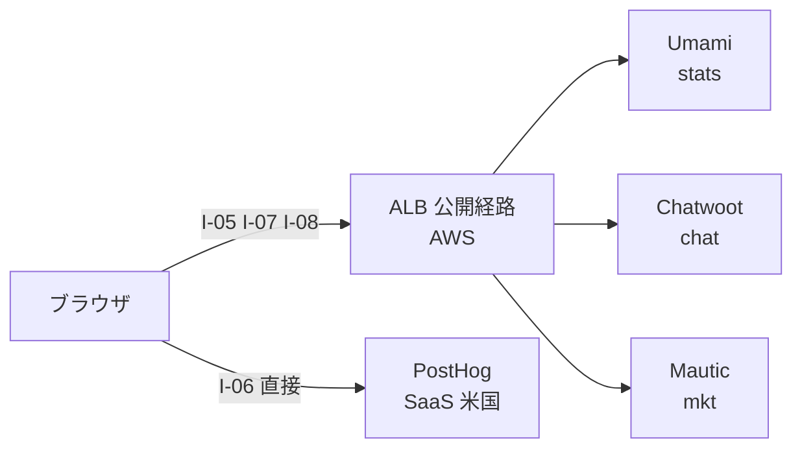
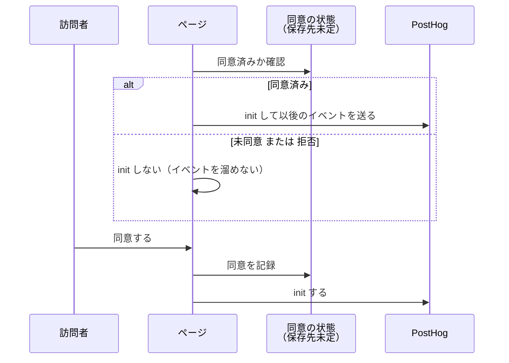
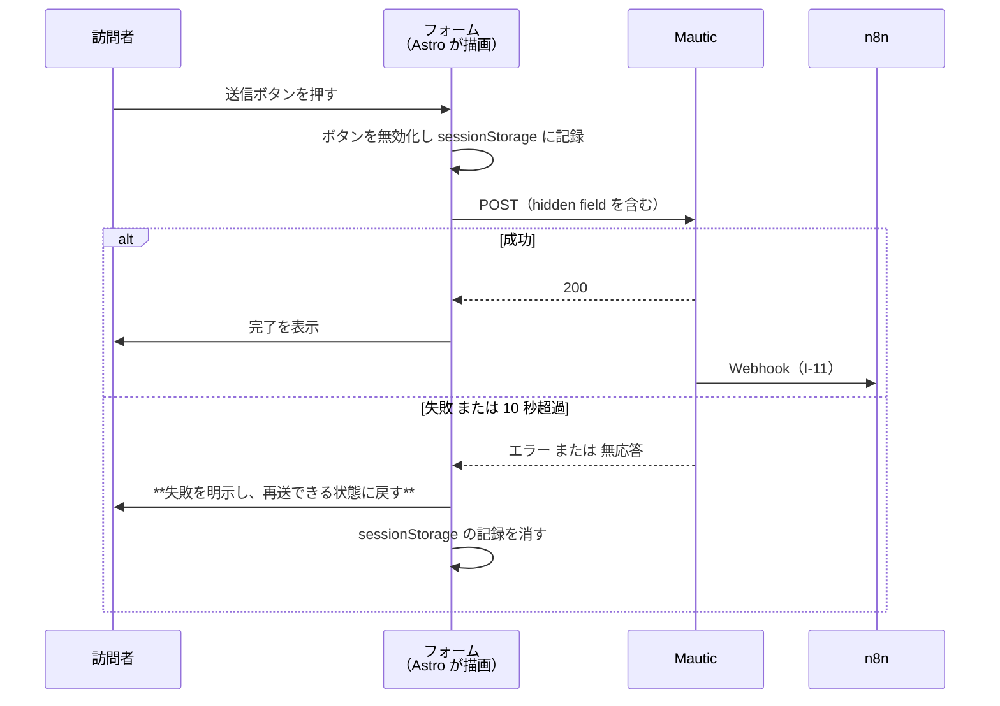

# DD-02 公開経路のフロー

詳細設計層。ID は EA 共通用語集の定義をそのまま使う。横断規約は [DD-01](01-flow-specification-rules.md) を参照する。

**発信元がブラウザである 4 本**（`I-05` `I-06` `I-07` `I-08`）を扱う。AA-02 の 1.3 が定義した公開経路（全訪問者が到達してよい）に属する連携がこの 4 本にあたる。**この 4 本には認証も認可もかけない。本番の守りは WAF のレート制限だけである**（`R1` の 2026-09-18 の決定。TA-06 の 5.2・5.5）。

**4 本のうち 3 本は AWS の ALB を通り、`I-06` だけが SaaS へ直接到達する。** この非対称がこの層の設計の中心にある（ALB とその後ろの Umami・Chatwoot・Mautic が落ちると 3 本が止まり、1 本だけ生き残る）。**2026-09-18 に経路を ngrok の常設トンネルから ALB に置き換えた**（AA-05 の ADR-12、TA-06）。開発環境では 3 本とも開発機のローカルに届く。

## 1. 公開経路の定義

### 1.1 エンドポイントを変数で書く

**この文書ではエンドポイントを変数名で書く**（値は環境ごとに変わる。開発環境は開発機のローカル、本番は AWS の ALB のホスト名）。本番のホスト名は ADR-12 で**システムごとに分ける**と決まり、**値は 2026-09-18 に確定した**（TA-06 の 5.1）。変数で書いておくのは、開発環境と本番で値が変わるためである。

| 変数 | 指すもの | 経路（本番） | 本番の値 |
|---|---|---|---|
| `PUBLIC_UMAMI_BASE` | Umami のトラッカー配信とイベント受信（開発環境は 3000） | 公開経路（**ALB**） | `https://stats.comegin.com`（TA-06 の 5.1） |
| `PUBLIC_CHATWOOT_BASE` | Chatwoot のウィジェット配信と会話 API（開発環境は 3100） | 公開経路（**ALB**） | `https://chat.comegin.com` |
| `PUBLIC_MAUTIC_BASE` | Mautic のフォーム受付とトラッキング（開発環境は 8000） | 公開経路（**ALB**） | `https://mkt.comegin.com` |
| `PUBLIC_N8N_WEBHOOK_BASE` | n8n（5678）の Webhook 受け口。**ブラウザからは使わない**（AWS の Mautic・Chatwoot から届く） | 公開経路（**ngrok**。TA-01 の経路 5） | 未確定（ngrok の固定ドメイン） |
| `SITE_URL` | 公開サイト（CloudFront） | — | `comegin.com` は取得済み。apex か `www` かが未確定 |

**この 5 つと Vite の `allowedHosts` と `MCP_ALLOWED_HOSTS` を必ず同時に揃える。** 1 つでもずれると連携が静かに失敗する（AA-02 の 1.4）。揃える手順を 1 か所から生成するかどうかは TA の判断待ち。

### 1.2 公開経路に載せてはいけないもの

**AA-02 の 1.3 の分離をそのまま守る。** 次のものは公開経路に現れてはならない。

- 各システムの管理画面（Strapi / Mautic / Chatwoot / Umami / n8n の UI）
- MCP サーバ（stdio 前提のため本来どの入口にも載らない。HTTP で運用する場合のみ運用経路に現れる）
- BA-05 の `禁止` 分類に到達する導線（権限の付与・剥奪、アカウント操作、秘密値）

**公開経路は当然に攻撃対象になる。** トラッカーの URL から管理画面の所在が推測できる形にしない。**本番では、Umami・Chatwoot・Mautic の管理画面が訪問者向けと同じホスト名の下にある**（同一オリジンで配信する製品のため）。そのため ALB のリスナールールで**訪問者向けに列挙したパスだけを認証なし（WAF のレート制限のみ）で通し、それ以外はすべて管理者の認証を求める**許可リスト方式を採る（TA-06 の 5.2・5.3）。管理者の認証は ALB の OIDC 認証で、IdP は自作の `admin-auth`（Better Auth。`auth.comegin.com`）、ログインは Google Workspace である（TA-06 の 5.2.1、AA-05 の ADR-13）。例外は、オンプレの MCP サーバ・n8n が使う Chatwoot・Mautic の API のパスと、Umami MCP が使う Umami の `/mcp`（API キー）だけで、ALB の認証をかけずに製品側の認証と WAF のレート制限で守る（Umami の `/api/*` と `/api/auth/login` は管理者の認証の内側に残る。TA-06 の 5.4）。

### 1.3 4 本の到達先の非対称



図は To-Be を描いている。**As-Is ではこの 5 本のうち 1 本も成立していない**（`frontend/verdant-virgo/src/layouts/Layout.astro` にトラッカーのスクリプトが 1 つも無く、AWS 側の ALB・ECS も 1 つも構築されていない）。状態の正本は AA-02 のカタログ。

- **ALB またはその後ろの 3 システムが落ちると `I-05` `I-07` `I-08` が止まり、`I-06` だけが生き残る。** この組み合わせ（Umami が 0 で PostHog が非 0）は欠測の徴候として扱う（AA-04 の暴走条件 #10、[07 の 2 節](07-failure-and-degradation.md)）。
- **`I-06` だけが越境する。** PostHog は米国リージョンであり、観測基盤の中で唯一データが国外に出る（DA-05 の 1.2）。AWS の 3 システムは `ap-northeast-1` に置くため越境しない。
- **ngrok のトンネル断は、本番ではこの 4 本に影響しない。** ngrok に残るのは n8n への Webhook（DD-04 の `I-11` `I-12`）だけである。

## 2. `I-05` ブラウザ → Umami

| 項目 | 値 |
|---|---|
| 発信元 → 受信先 | ブラウザ → Umami（`middleware/umami-master`） |
| 種別 | `API` |
| 経路 | **公開経路**（本番は ALB。TA-06 の 5 節） |
| トリガー | ページの読み込み完了、および SPA 的な画面遷移 |
| 同期性 | **非同期**（投げっぱなし） |
| タイムアウト | **設定しない**（DD-01 の 7.2。サイトの表示を止めない） |
| リトライ | **しない**（失敗は黙って捨てる。再送するとセッション数が過大になる） |
| 冪等キー | **不要**（Umami 側がセッションを同定する。こちらから再送しないため二重計上が起きない） |
| 失敗時の扱い | 何もしない。サイトの表示に影響させない |
| 観測点 | Umami の管理画面のリアルタイム表示 ／ ブラウザの DevTools の Network |
| 完成度 | `条件付き`（Umami のサイト登録と、本番の AWS の Umami・ALB が前提） |

### 2.1 設置

`frontend/verdant-virgo/src/layouts/Layout.astro` に、Umami のトラッキングスクリプトを**直接置く**。

```html
<script
  defer
  src={`${PUBLIC_UMAMI_BASE}/script.js`}
  data-website-id={UMAMI_WEBSITE_ID}
  data-host-url={PUBLIC_UMAMI_BASE}
></script>
```

- **`src` と `data-host-url` の両方を `PUBLIC_UMAMI_BASE` にする。** 片方だけ本番のホスト名にすると、スクリプトは読めるがイベントの送信先が `127.0.0.1` のままになり、**スクリプトの読み込みは成功しているのにデータが 1 件も入らない**という最も気づきにくい壊れ方をする。
- **`defer` を付ける。** Lighthouse の performance しきい値（0.9）に効く。
- **`@astrojs/partytown` を経由させるかは、動作確認のあとで決める**（AA-02 の 3.1）。Umami のスクリプトは `document.referrer` と `location` を読むため、Web Worker に逃がすと壊れる可能性がある。**まず partytown 無しで配線し、Lighthouse のスコアを測ってから判断する。**

### 2.2 同意の前でも送る

**`I-05` は同意取得を待たない。** Umami は cookie を置かず個人を識別しないため（DA-02 の 3 節）、同意の有無によらず全トラフィックを数えられる。

**これが `CVR` の分母を同意率から切り離している唯一の仕組みである**（ADR-01）。`I-06` と同じ扱いにすると、母数が同意率で動いて KPI ツリー全体が読めなくなる。

### 2.3 ペイロード

Umami のトラッカーが送る既定の項目をそのまま使う。**独自のプロパティを足さない**（`E-07 Session` の正本は Umami であり、こちらで項目を増やすと正本の型が暗黙に広がる）。

| 項目 | 由来 | `E-07` との対応 |
|---|---|---|
| `website` | `data-website-id` | 計測対象の同定 |
| `url` / `referrer` | ブラウザ | ランディングページ・参照元 |
| `hostname` / `language` / `screen` | ブラウザ | — |

**`umami_session_id` を `I-08` の hidden field に載せる**（DA-03 が分母と分子を突合する唯一の接続点とした）ため、トラッカーが払い出したセッション識別子をページ側から読めるようにしておく必要がある。取得方法は Umami のバージョンに依存するため、**配線時に実地で確認する**（5.3）。

## 3. `I-06` ブラウザ → PostHog

| 項目 | 値 |
|---|---|
| 発信元 → 受信先 | ブラウザ → PostHog（SaaS・米国） |
| 種別 | `API` |
| 経路 | **SaaS 直接**（ALB もトンネルも通らない） |
| トリガー | **同意の取得後**の `identify` と行動イベント |
| 同期性 | 非同期（投げっぱなし） |
| タイムアウト | 設定しない |
| リトライ | しない |
| 冪等キー | 不要 |
| 失敗時の扱い | 何もしない |
| 観測点 | PostHog の Live events ／ ブラウザの DevTools |
| 完成度 | **`前提待ち`**（同意取得の実装手段が DA-03 の未決定事項） |

### 3.1 何が決まっていて、何が決まっていないか

**決まっていること。**

- **同意が取れるまで初期化しない**（AA-02 の 3.1）。スクリプトの読み込みまでは行ってよいが、`posthog.init()` を呼ばない。
- **`distinct_id` に email を入れない**（DA-05 の 1.2）。実名への昇格は `I-18`（越境の可否が未決）でのみ行う。
- **セッションリプレイを有効にする場合は、入力欄のマスキングを先に入れる**（AA-02 の 3.1）。順序を逆にすると、マスキング前に記録されたリプレイが残る。
- PostHog のセッション数を KPI に使わない（ADR-01。デバッグと定性確認に限る）。

**決まっていないこと（これが `前提待ち` の理由）。**

- 同意 UI を自作するか外部ライブラリを使うか（`CAP-09` の Lighthouse スコアへの影響が変わる。AA-02 の 5 節）
- 同意状態をどこに保存するか（cookie / `localStorage` / サーバ側）
- 同意を撤回されたときに、それまでに送ったイベントをどう扱うか

### 3.2 決まっている部分だけの制御フロー



図は To-Be を描いている。**As-Is では `posthog-js` が設置されておらず、訪問者の `E-08 Person` は 1 件も存在しない**（PostHog に届いているのは Strapi のサーバ側イベント `I-01` `I-02` だけ）。

**未同意のあいだイベントを溜めない。** 溜めて同意後にまとめて送ると、同意前の行動が同意後に送られることになり、「同意前は送らない」（DA-03 の 2.1）が実質的に破れる。

## 4. `I-07` ブラウザ → Chatwoot ウィジェット

| 項目 | 値 |
|---|---|
| 発信元 → 受信先 | ブラウザ → Chatwoot（`backend/chatwoot-system`） |
| 種別 | `API` |
| 経路 | **公開経路**（本番は ALB。TA-06 の 5 節） |
| トリガー | ウィジェットの読み込み、訪問者による会話の開始 |
| 同期性 | 非同期（読み込み）／ 同期（会話中のメッセージ送受信） |
| タイムアウト | 設定しない（ウィジェット側の既定に従う） |
| リトライ | しない |
| 冪等キー | 不要（会話の同定は Chatwoot 側が行う） |
| 失敗時の扱い | **ウィジェットが表示されないだけで、サイト本体を壊さない** |
| 観測点 | Chatwoot の受信箱に会話が現れるか ／ ブラウザの DevTools |
| 完成度 | `条件付き`（Web サイト受信箱の作成と、本番の AWS の Chatwoot・ALB が前提） |

### 4.1 設置

```html
<script>
  window.chatwootSettings = { position: 'right', type: 'standard' };
</script>
<script defer src={`${PUBLIC_CHATWOOT_BASE}/packs/js/sdk.js`}></script>
```

初期化時に `websiteToken` と `baseUrl` を渡す。**`baseUrl` も `PUBLIC_CHATWOOT_BASE` にする**（`I-05` と同じ理由で、片方だけ本番のホスト名にすると静かに壊れる）。

### 4.2 `website_token` を公開ページに埋め込んでよい理由

`sanitize()` の `NON_SECRET_KEYS` に `website_token` が含まれているのは、**この値が公開ページに埋め込まれる前提だから**である（AA-02 の 3.1）。これは秘匿値の漏洩ではなく、設計上そうなっている値にあたる。

**他の Chatwoot の値を同じ理由で公開しない。** `api_access_token` はユーザーに紐づき（AA-02 の 2.1）、公開すればそのユーザーの権限がそのまま渡る。

### 4.3 ウィジェットの失敗が Lighthouse に効く

Chatwoot のウィジェットは外部スクリプトを読み込むため、**Chatwoot（本番は ALB の後ろ）が落ちている状態で Lighthouse を回すと、読み込み失敗が performance と best-practices のスコアを下げる**。

`LH-seo` は 1.0 が死守ラインだが（AA-04 の 3.2）、**ウィジェットの読み込み失敗は主に performance と best-practices に効く**ため、SEO の 1.0 は割りにくい。ただし「ウィジェットが落ちたせいで performance が 0.9 を割った」ことを「サイトが劣化した」と読むと、暴走条件 #10 を踏む。**Lighthouse の計測時に、ウィジェットの配信元（`PUBLIC_CHATWOOT_BASE`）の死活を同時に記録する**（[05 の 2 節](05-build-and-delivery-flows.md)。旧版ではトンネルの死活としていた）。

## 5. `I-08` ブラウザ → Mautic フォーム

| 項目 | 値 |
|---|---|
| 発信元 → 受信先 | ブラウザ（Astro が描画した自前のフォーム）→ Mautic（`backend/mautic-system`） |
| 種別 | `API` |
| 経路 | **公開経路**（本番は ALB。TA-06 の 5 節） |
| トリガー | CTA フォームの送信ボタンの押下 |
| 同期性 | **同期**（4 本の中でこれだけ応答を待つ） |
| タイムアウト | **10 秒**（DD-01 の 7.3。送信失敗を利用者に明示するため） |
| リトライ | **自動では行わない。** 失敗を表示し、利用者の操作による再送に委ねる |
| 冪等キー | `mautic_form_id` + `lower(email)` + 送信日（JST）。**3 層で守る**（DD-01 の 6.3） |
| 失敗時の扱い | **利用者に明示する**（黙って失敗させない）。`E-09` は作られない |
| 観測点 | Mautic のフォーム送信一覧 ／ `E-09` の増加 ／ ブラウザの DevTools |
| 完成度 | `条件付き`（Mautic のフォーム作成と、本番の AWS の Mautic・ALB が前提） |

### 5.1 なぜ埋め込みではなく自前のフォームか

AA-02 の 3.1 が挙げた 4 つの理由をそのまま引き継ぐ。**この層で足すのは 5 つ目の理由である。**

- **冪等性の第 1 層（ブラウザ側の二重送信防止）を実装できるのは自前のフォームだけ**（DD-01 の 6.3）。Mautic の埋め込みフォームは送信ボタンの挙動をこちらから制御できない。

### 5.2 シーケンス



図は To-Be を描いている。**As-Is ではフォームも Mautic 側のフォーム定義も存在しない。**

**失敗時に `sessionStorage` の記録を消すのが要点にあたる。** 消さないと、失敗したのに「送信済み」と見なされて二度と送れなくなる。第 1 層（ブラウザ）は**成功したときだけ**記録を残す。

### 5.3 ペイロード

| 項目 | 型 | 必須 | 由来 | 用途 |
|---|---|---|---|---|
| `email` | string | **必須** | 利用者の入力 | `E-09` のキー。**小文字化して送る**（冪等キーと `I-19` の突合が大文字小文字で割れないようにするため） |
| `firstname` / `lastname` / `company` | string | 任意 | 利用者の入力 | `E-09` の属性 |
| `message` | string | 任意 | 利用者の入力 | 問い合わせ本文 |
| `mautic_form_id` | number | **必須** | Strapi の `E-06`（表示定義）に記録された値 | 受付定義との対応。冪等キーの構成要素 |
| `distinct_id` | string | 任意 | PostHog（`I-06`） | **匿名から実名への昇格の接続点**（DA-03）。同意していない訪問者では空になる |
| `umami_session_id` | string | 任意 | Umami（`I-05`） | **CVR の分母と分子を突合する唯一の接続点**（DA-03） |
| `page_url` | string | **必須** | ブラウザ | どのページの CTA が効いたか。`E-13` の `target.identifier` と対応させる |

- **hidden field の 2 つ（`distinct_id` / `umami_session_id`）は任意にする。** 必須にすると、同意していない訪問者やトラッカーが落ちている状態でフォームが送れなくなる。**観測のために CV を失うことはしない。**
- `umami_session_id` の**取得方法は Umami のバージョンに依存する**ため、配線時に実地で確認する。取得できない場合は空で送り、突合を諦める（**フォームを壊さない**）。
- **`email` の小文字化はブラウザ側で行う。** Mautic 側の統合も `I-19` の突合も小文字前提にすることで、3 か所の規則を 1 つに揃える。

### 5.4 `CV 数` の数え方

**`CV 数` は Mautic のフォーム送信件数ではなく、`mautic_form_id` + `lower(email)` + 日付で畳んだ件数とする**（DD-01 の 6.3 の第 3 層）。

- 畳む処理は `agent/analytics-reporter` の集計時に行う（[03 の 3 節](03-operation-path-flows.md)）。
- **DA-02 の「CV の判定はフォーム送信完了」という定義は変えていない。** 変えたのは数え方であり、同じ完了イベントを何件と数えるかの規則をここで与えた。
- 畳んだ結果と生の件数の**両方を `E-12` に記録する**（差が大きければ二重送信が起きている徴候になる）。

## 6. `Layout.astro` への設置と Lighthouse への影響

### 6.1 設置の順序

4 本のうち 3 本（`I-05` `I-06` `I-07`）が `Layout.astro` にスクリプトを足す。**同時に入れない。**

| 順 | 入れるもの | 入れたあとに測ること |
|---|---|---|
| 1 | `I-05` Umami | Lighthouse の 4 指標。**SEO が 1.0 のままか** |
| 2 | `I-07` Chatwoot ウィジェット | 同上。ウィジェットは外部スクリプトのため performance への影響が最も大きい |
| 3 | `I-06` PostHog | 同上（**同意取得が決まってから**） |

**1 本ずつ入れて測るのは、しきい値を割ったときに原因を特定するためである。** 3 本同時に入れて performance が 0.9 を割ったら、どれを外すかの判断ができない。

### 6.2 `LH-seo` が 1.0 を割ったらトラッカーを外す

AA-04 の 3.2 は「`LH-seo` が 1.0 未満ならループの作用を全面停止する」と定めている。**トラッカーの設置はループの作用ではない**（`E-13` を経由しない、配線の作業）が、同じ扱いにする。

- トラッカーを入れて `LH-seo` が 1.0 を割ったら、**そのトラッカーを外して 1.0 に戻す。**
- 外した事実と、割ったときのスコアを `E-12` として記録する（次に入れるときの根拠になる）。
- **`SEO 1.0` と観測の両方は取れない場合、SEO を取る。** SEO 対策がこの計測の目的そのものであり（`.claude/CLAUDE.md`）、観測はその手段にすぎない。

### 6.3 partytown をどう扱うか

`@astrojs/partytown` は導入済みだが空回りしている（DA-03 の 1.1）。**3 本のトラッカーそれぞれについて、partytown 無しで測ってから判断する。**

| 前提 | 判断 |
|---|---|
| partytown 無しでしきい値を満たす | **partytown を使わない。** 壊れる可能性を増やす理由が無い |
| performance が 0.9 を割り、partytown で回復する | partytown を使う。ただし**イベントが届いているかを必ず確認する**（Web Worker で `document` 依存の処理が壊れると、スコアは良くなるがデータが入らない） |
| partytown でも回復しない | そのトラッカーを入れない。6.2 に従う |

## 7. 未決定事項

- **`umami_session_id` の取得方法。** Umami のバージョンによってセッション識別子の露出の仕方が違う。取得できない場合、DA-03 が「分母と分子を突合する唯一の接続点」とした経路が成立しない（代替が無い）。配線時に実地確認が要る。
- **同意を撤回されたときの扱い**（`I-06`）。それまでに PostHog に送ったイベントを削除するのか、以後を止めるだけなのかが決まっていない。DA-03 の未決定事項に含まれる。
- **`I-08` の失敗を利用者にどう見せるか。** 「明示する」と決めたが、文言と再送の導線は UI の設計事項であり、この層では決めない（`agent/design-implementer` の担当範囲。`R1`）。
- **公開経路のホスト名が 1 本か 4 本か → ADR-12 で決着し、値も 2026-09-18 に確定した。** システムごとにホスト名を分ける（1.1、TA-06 の 5.1）。**ただし ALB は 1 台に集約するため、ALB が落ちると 3 本が同時に止まる**（ホスト名は分かれていても入口は 1 つ）。3 システムの ECS サービスはそれぞれ独立に落ちうる。**AWS 側は単一構成で決まった**（`R1` の 2026-09-18 の決定。TA-06）ため、ALB 以外にも NAT Gateway や RDS が単一障害点として残る。
- **トラッカー 3 本を入れた後の Lighthouse スコアが不明。** 6.1 の順序は「1 本ずつ測る」と決めたが、**3 本入れた状態でしきい値を満たせるかは測るまで分からない**。満たせない場合、`CAP-10`（行動観測）と `CAP-09`（テクニカル SEO）が構造的に競合することになる。この競合が現実のものになるかどうかが、配線の最大の不確定要素にあたる。
