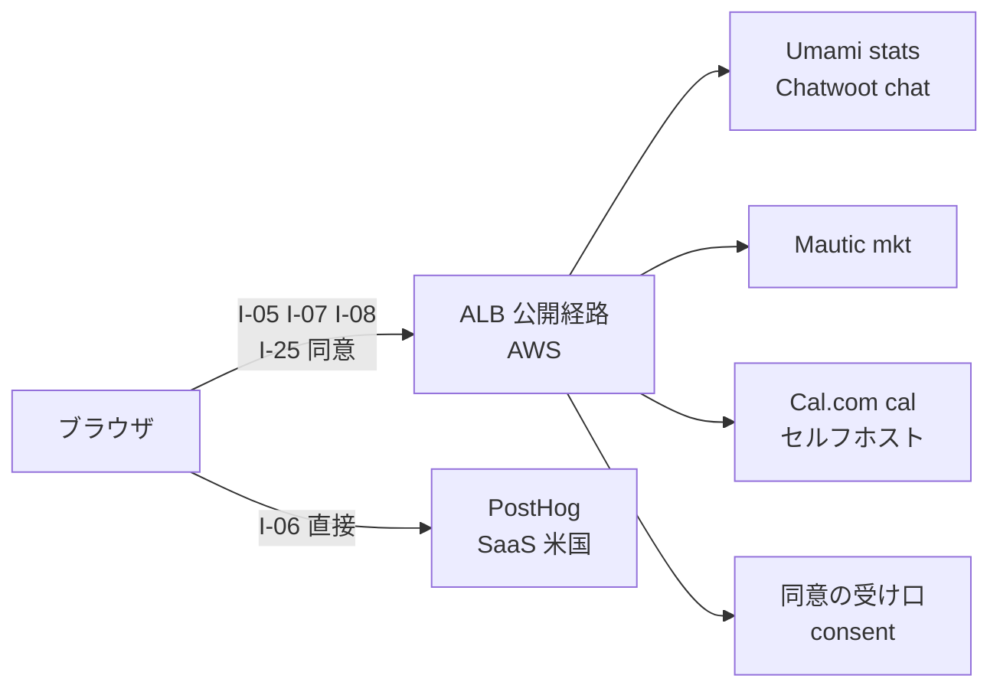
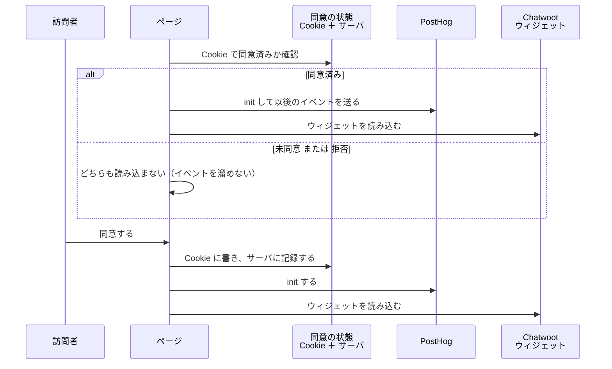
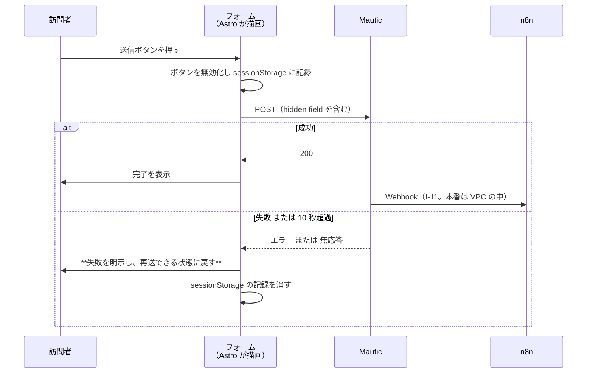

# DD-02 公開経路のフロー

詳細設計層。ID の採番の正本は層ごとのファイルにあり、索引は [`docs/README.md` の「ID の採番と正本」](../README.md) にある。横断規約は [DD-01](01-flow-specification-rules.md) を参照する。

**発信元がブラウザである 5 本**（`I-05` `I-06` `I-07` `I-08` `I-25`）と、**連携点の番号を持たない 1 本（同意の受け口）**を扱う。AA-02 の 1.3 が定義した公開経路（全訪問者が到達してよい）に属する連携がこれにあたる。**どれにも認証も認可もかけない。本番の守りは WAF のレート制限だけである**（`R1` の 2026-09-18 の決定。TA-06 の 5.2・5.5）。

**2026-10-01 に 2 本増えた。** `I-25`（Cal.com の予約の枠。7 節）と、同意の状態を受け取る受け口（8 節）である。**どちらも AWS の ALB の後ろに置く**（Cal.com は**セルフホスト**。受け口は自作のサービス。ユーザーと `R1` の 2026-10-01 の決定。**AA-05 の ADR-19**。TA-06 の 3.1・4.8）。

**6 本のうち 5 本は AWS の ALB を通り、`I-06` だけが SaaS へ直接到達する。** この非対称がこの層の設計の中心にある（ALB とその後ろのシステムが落ちると 5 本が止まり、1 本だけ生き残る）。**2026-09-18 に経路を ngrok の常設トンネルから ALB に置き換えた**（AA-05 の ADR-12、TA-06）。開発環境では 5 本とも開発機のローカルに届く。

## 1. 公開経路の定義

### 1.1 エンドポイントを変数で書く

**この文書ではエンドポイントを変数名で書く**（値は環境ごとに変わる。開発環境は開発機のローカル、本番は AWS の ALB のホスト名）。本番のホスト名は ADR-12 で**システムごとに分ける**と決まり、**値は 2026-09-18 に確定した**（TA-06 の 5.1）。変数で書いておくのは、開発環境と本番で値が変わるためである。

| 変数 | 指すもの | 経路（本番） | 本番の値 |
|---|---|---|---|
| `PUBLIC_UMAMI_BASE` | Umami のトラッカー配信とイベント受信（開発環境は 3000） | 公開経路（**ALB**） | `https://stats.comegin.com`（TA-06 の 5.1） |
| `PUBLIC_CHATWOOT_BASE` | Chatwoot のウィジェット配信と会話 API（開発環境は 3100） | 公開経路（**ALB**） | `https://chat.comegin.com` |
| `PUBLIC_MAUTIC_BASE` | Mautic のフォーム受付とトラッキング（開発環境は 8000） | 公開経路（**ALB**） | `https://mkt.comegin.com` |
| `PUBLIC_N8N_WEBHOOK_BASE` | n8n（5678）の Webhook 受け口。**ブラウザからは使わない**（本番の Mautic・Chatwoot から届く。ADR-16 の時点では記事の公開を知らせる Strapi からも届く想定だったが、**ADR-17 で公開の検知は監視アプリが本番の Strapi を見る形に変わった**。DD-04 の 1 節） | **`VPC 内`**（ADR-16。公開経路に載せない）。ADR-12 の時点では ngrok の公開経路（TA-01 の経路 5）だった | 未確定（ECS の内部の名前か、ALB の内部向けのリスナーか。TA-06 の 11 節）。**`PUBLIC_` の名前は旧版のまま**（公開経路ではなくなった。9 節） |
| **`PUBLIC_CALCOM_BASE`** | **Cal.com（セルフホスト）の予約ページと埋め込みのスクリプト配信**（開発環境のポートは **3105**。TA-01 の 5 節・TA-06 の 10 節） | 公開経路（**ALB**） | `https://cal.comegin.com`（**案**。TA-06 の 5.1） |
| **`PUBLIC_CONSENT_BASE`** | **同意の状態の受け口**（自作のサービス。8 節） | 公開経路（**ALB**） | `https://consent.comegin.com`（**案**。TA-06 の 5.1） |
| `SITE_URL` | 公開サイト（CloudFront） | — | `comegin.com` は取得済み。apex か `www` かが未確定 |

**この 7 つと Vite の `allowedHosts` と `MCP_ALLOWED_HOSTS` を必ず同時に揃える。** 1 つでもずれると連携が静かに失敗する（AA-02 の 1.4）。揃える手順を 1 か所から生成するかどうかは TA の判断待ち。**2026-10-01 に 2 つ増えた**（`PUBLIC_CALCOM_BASE` と `PUBLIC_CONSENT_BASE`）。揃える対象が増えるほど、1 か所から生成する仕組みの必要性が上がる。

### 1.2 公開経路に載せてはいけないもの

**AA-02 の 1.3 の分離をそのまま守る。** 次のものは公開経路に現れてはならない。

- 各システムの管理画面（Strapi / Mautic / Chatwoot / Umami / n8n の UI）
- MCP サーバ（stdio 前提のため本来どの入口にも載らない。HTTP で運用する場合のみ運用経路に現れる）
- BA-05 の `禁止` 分類に到達する導線（権限の付与・剥奪、アカウント操作、秘密値）

**公開経路は当然に攻撃対象になる。** トラッカーの URL から管理画面の所在が推測できる形にしない。**本番では、Umami・Chatwoot・Mautic の管理画面が訪問者向けと同じホスト名の下にある**（同一オリジンで配信する製品のため）。そのため ALB のリスナールールで**訪問者向けに列挙したパスだけを認証なし（WAF のレート制限のみ）で通し、それ以外はすべて管理者の認証を求める**許可リスト方式を採る（TA-06 の 5.2・5.3）。管理者の認証は ALB の OIDC 認証で、IdP は自作の `admin-auth`（Better Auth。`auth.comegin.com`）、ログインは Google Workspace である（TA-06 の 5.2.1、AA-05 の ADR-13）。例外は、ローカルの Claude Code の MCP とビルドが使う機械向けのパスだけで、ALB の認証をかけずに製品側の認証と WAF のレート制限で守る（TA-06 の 5.4）。対象は Chatwoot・Mautic の API、Umami の `/mcp`（API キー）、**Strapi の `/mcp`（Admin トークン）と `/api/*`（ビルド用の読み取り専用の API トークン）、n8n の `/mcp-server/http`**（ADR-16）である。Umami の `/api/*` と `/api/auth/login`、**Strapi の `/admin` と n8n のエディター**は管理者の認証の内側に残る。**ADR-16 で n8n が AWS に移ったため、n8n から Chatwoot・Mautic への呼び出しは VPC の中で行い、ALB を通らない**（ADR-12 の時点ではオンプレの n8n もこの例外のパスを使う想定だった）。

### 1.3 到達先の非対称



図は To-Be を描いている。**As-Is ではこの 6 本のうち 1 本も成立していない**（`frontend/verdant-virgo/src/layouts/Layout.astro` にトラッカーのスクリプトが 1 つも無く、AWS 側の ALB・ECS も 1 つも構築されていない）。状態の正本は AA-02 のカタログ。**`I-25` と同意の受け口は 2026-10-01 に加えた**（Umami と Chatwoot を 1 つのノードにまとめたのは、1 図あたり 7±2 ノードの規約に収めるためで、別のシステムである）。

- **ALB またはその後ろのシステムが落ちると `I-05` `I-07` `I-08` `I-25` と同意の受け口が止まり、`I-06` だけが生き残る。** この組み合わせ（Umami が 0 で PostHog が非 0）は欠測の徴候として扱う（AA-04 の暴走条件 #10、[07 の 2 節](07-failure-and-degradation.md)）。
- **ALB が落ちているあいだは、同意の受け口も止まる。** 受け口が応答しないと新しい同意を記録できないため、**同意していない訪問者には PostHog も Chatwoot も出ない**（8.4）。すなわち **ALB の障害は `I-06` の新規の訪問者も止める**（既に同意済みの訪問者は Cookie が残っているため続く）。ALB の障害で `I-06` が完全に生き残るのは、同意済みの訪問者に限る。
- **Cal.com をセルフホストにしたため、予約も ALB の障害で止まる**（2026-10-01 の決定。SaaS のままなら止まらなかった）。これは意図した取り引きであり、理由は TA-01 の 8 節の SaaS 依存の基準を変えないことである（AA-02 の 3.9）。
- **`I-06` だけが越境する。** PostHog は米国リージョンであり、**ブラウザ発信の 6 本の中で唯一データが国外に出る**（DA-05 の 1.2）。ALB の後ろのシステムは `ap-northeast-1` に置くため越境しない（**セルフホストの Cal.com も越境しない**。7.5）。**ただし、予約が成立した後に Cal.com が Google Calendar へ予定を作る部分は越境する**（氏名・メールアドレス・面談の日時が Google LLC に渡る。ユーザーの 2026-10-01 の決定。DA-05 の 1.2.2）。**これはブラウザ発信ではなくサーバ発信であり、この文書の範囲の外にある。**
- **ngrok のトンネル断は、本番ではこの 4 本に影響しない。** ADR-12 の時点で ngrok に残ったのは n8n への Webhook（DD-04 の `I-11` `I-12`）だけで、**ADR-16 で n8n も AWS に移り、本番は ngrok を使わなくなった**（Webhook は `VPC 内`）。ngrok に残るのは Astro dev サーバーの共有だけである。

## 2. `I-05` ブラウザ → Umami

| 項目 | 値 |
|---|---|
| 発信元 → 受信先 | ブラウザ → Umami（`middleware/umami-master`） |
| 種別 | `API` |
| 経路 | **公開経路**（本番は ALB。TA-06 の 5 節） |
| トリガー | ページの読み込み完了、および SPA 的な画面遷移 |
| 同期性 | **非同期**（投げっぱなし） |
| タイムアウト | **設定しない**（DD-01 の 7.2。サイトの表示を止めない） |
| リトライ | **しない**（失敗は黙って捨てる。再送するとセッション数が過大になる） |
| 冪等キー | **不要**（Umami 側がセッションを同定する。こちらから再送しないため二重計上が起きない） |
| 失敗時の扱い | 何もしない。サイトの表示に影響させない |
| 観測点 | Umami の管理画面のリアルタイム表示 ／ ブラウザの DevTools の Network |
| 完成度 | `条件付き`（Umami のサイト登録と、本番の AWS の Umami・ALB が前提） |

### 2.1 設置

`frontend/verdant-virgo/src/layouts/Layout.astro` に、Umami のトラッキングスクリプトを**直接置く**。

```html
<script
  defer
  src={`${PUBLIC_UMAMI_BASE}/script.js`}
  data-website-id={UMAMI_WEBSITE_ID}
  data-host-url={PUBLIC_UMAMI_BASE}
></script>
```

- **`src` と `data-host-url` の両方を `PUBLIC_UMAMI_BASE` にする。** 片方だけ本番のホスト名にすると、スクリプトは読めるがイベントの送信先が `127.0.0.1` のままになり、**スクリプトの読み込みは成功しているのにデータが 1 件も入らない**という最も気づきにくい壊れ方をする。
- **`defer` を付ける。** Lighthouse の performance しきい値（0.9）に効く。
- **`@astrojs/partytown` を経由させるかは、動作確認のあとで決める**（AA-02 の 3.1）。Umami のスクリプトは `document.referrer` と `location` を読むため、Web Worker に逃がすと壊れる可能性がある。**まず partytown 無しで配線し、Lighthouse のスコアを測ってから判断する。**

### 2.2 同意の前でも送る

**`I-05` は同意取得を待たない。** Umami は cookie を置かず個人を識別しないため（DA-02 の 3 節）、同意の有無によらず全トラフィックを数えられる。

**これが `CVR` の分母を同意率から切り離している唯一の仕組みである**（ADR-01）。`I-06` と同じ扱いにすると、母数が同意率で動いて KPI ツリー全体が読めなくなる。

### 2.3 ペイロード

Umami のトラッカーが送る既定の項目をそのまま使う。**独自のプロパティを足さない**（`E-07 Session` の正本は Umami であり、こちらで項目を増やすと正本の型が暗黙に広がる）。

| 項目 | 由来 | `E-07` との対応 |
|---|---|---|
| `website` | `data-website-id` | 計測対象の同定 |
| `url` / `referrer` | ブラウザ | ランディングページ・参照元 |
| `hostname` / `language` / `screen` | ブラウザ | — |

**`umami_session_id` を `I-08` の hidden field に載せる**（DA-03 が分母と分子を突合する唯一の接続点とした）ため、トラッカーが払い出したセッション識別子をページ側から読めるようにしておく必要がある。取得方法は Umami のバージョンに依存するため、**配線時に実地で確認する**（5.3）。

## 3. `I-06` ブラウザ → PostHog

| 項目 | 値 |
|---|---|
| 発信元 → 受信先 | ブラウザ → PostHog（SaaS・米国） |
| 種別 | `API` |
| 経路 | **SaaS 直接**（ALB もトンネルも通らない） |
| トリガー | **同意の取得後**の `identify` と行動イベント |
| 同期性 | 非同期（投げっぱなし） |
| タイムアウト | 設定しない |
| リトライ | しない |
| 冪等キー | 不要 |
| 失敗時の扱い | 何もしない |
| 観測点 | PostHog の Live events ／ ブラウザの DevTools |
| 完成度 | **`前提待ち`**（同意取得の実装手段が DA-03 の未決定事項） |

### 3.1 何が決まっていて、何が決まっていないか

**決まっていること。**

- **同意が取れるまで初期化しない**（AA-02 の 3.1）。スクリプトの読み込みまでは行ってよいが、`posthog.init()` を呼ばない。
- **`distinct_id` に email を入れない**（DA-05 の 1.2）。実名への昇格は `I-18`（越境の可否が未決）でのみ行う。
- **セッションリプレイを有効にする場合は、入力欄のマスキングを先に入れる**（AA-02 の 3.1）。順序を逆にすると、マスキング前に記録されたリプレイが残る。
- PostHog のセッション数を KPI に使わない（ADR-01。デバッグと定性確認に限る）。
- **同意の状態は Cookie とサーバの両方に保存する**（ユーザーの 2026-10-01 の決定。3.3）。`localStorage` は使わない。
- **同意の対象は PostHog と Chatwoot の 2 つである**（同日の決定。4.4）。Umami は同意の前でも送る（2.2）。
- **サーバ側の受け口は ALB の後ろの自作のサービス（ECS on Fargate）に置く**（`R1` の 2026-10-01 の決定。8 節）。Lambda 関数 URL・API Gateway・CloudFront Function は採らない（実行基盤を ECS に揃える。TA-06 の 3.1）。
- **同意を撤回されたときは、以後の送信を止めるだけにする**（2026-10-01 の決定。3.4）。それまでに送ったイベントを撤回だけで削除しない。

**決まっていないこと（これが `前提待ち` の理由）。**

- 同意 UI を自作するか外部ライブラリを使うか（`CAP-09` の Lighthouse スコアへの影響が変わる。AA-02 の 5 節）
- 同意の記録の保持期間（TTL）と、受け口のサービスの実装（8 節。置き場所は決まったが、作っていない）

### 3.2 決まっている部分だけの制御フロー



図は To-Be を描いている。**As-Is では `posthog-js` も Chatwoot のウィジェットも設置されておらず、訪問者の `E-08 Person` は 1 件も存在しない**（PostHog に届いているのは Strapi のサーバ側イベント `I-01` `I-02` だけ）。**Chatwoot を同意の対象に含めたのは 2026-10-01 の決定**（4.4）。

**未同意のあいだイベントを溜めない。** 溜めて同意後にまとめて送ると、同意前の行動が同意後に送られることになり、「同意前は送らない」（DA-03 の 2.1）が実質的に破れる。

### 3.3 同意の状態の保存（2026-10-01 の決定）

**同意の状態は Cookie とサーバ（Redis 等）の両方に保存する**（ユーザーの決定。`docs/BasicDesign/DesignSpec/website/01-content-spec.md` の 10.4 の K1）。`localStorage` 単独の案は採らない。

| 保存先 | 持つもの | 役割 |
|---|---|---|
| **Cookie** | 同意の状態（`granted` / `denied`）と、サーバ側の記録を指す識別子 | **ページの描画時に同期で読める唯一の場所。** PostHog と Chatwoot を読み込むかどうかを、サーバへの往復を待たずに決める |
| **サーバ**（Redis 等。既存の ElastiCache を使う。書き手は 8 節の受け口。TA-06 の 4.8） | 同意の記録（状態・時刻・同意した文面の版・識別子） | **Cookie が消えても「いつ・何に同意したか」を示せる。** 撤回の要求と、同意の有無の問い合わせに答える根拠になる |

- **Cookie だけにしない理由**: Cookie は利用者が消せ、保持期間も端末に依存する。同意を取った記録が利用者の端末にしか無いと、**同意の有無を後から示せない**（削除請求と `E-09` の `dnc_status` の扱いに突き合わせられない。DA-05）。
- **サーバだけにしない理由**: 公開サイトは静的配信（S3 ＋ CloudFront。TA-02）であり、ページの描画時にサーバへ問い合わせると、**同意の判定が描画より遅れる**。遅れる間に PostHog を初期化しないためには、同期で読める Cookie が要る。
- **同意の Cookie 自体は同意の対象外とする。** 同意を記録するために同意を求めることはできない（このバナーの操作自体を計測しないのと同じ構造）。この Cookie に識別子以外の訪問者の情報を入れない。
- **Cookie が無くサーバの記録だけがある状態を「未同意」として扱う。** 判定が Cookie の有無で決まる以上、Cookie を消した訪問者にはバナーを出し直す。サーバの記録は、同じ識別子が再び提示されたときに上書きしない（**記録を消さずに積む**。撤回の履歴も同じ場所に残す）。
- **受け口は 8 節で決まった**（ALB の後ろの自作のサービス）。**それでも `I-06` は `前提待ち` のままである**（8.5 に理由を書いた。残るのは同意 UI の実装手段と、受け口のサービスそのものが未作成であること）。

### 3.4 同意を撤回されたときの扱い（2026-10-01 の決定）

**以後の送信を止めるだけにする。** 撤回より前に送ったイベントを、撤回だけでは削除しない（`01-content-spec.md` の 10.4 の K2。デザイン側が決め、`R1` が設計書に反映した）。

| 順 | 撤回のときに行うこと |
|---|---|
| 1 | PostHog への送信を止める |
| 2 | `reset()` 相当の操作で `distinct_id` を切る（以後のイベントが同じ person に紐づかないようにする） |
| 3 | Chatwoot のウィジェットを隠す（4.4 で同意の対象にしたため） |
| 4 | Cookie とサーバ側の記録（3.3）を `denied` に更新する |

- **撤回は「これ以降の取得を止める」意思表示であり、過去の記録の削除は別の請求（利用停止・消去）にあたる。** 削除を一律に行うと、**PostHog（米国の SaaS）への個別の削除をすべての撤回で走らせることになる**。削除請求の手順は DA-05 の 5 節で未決のままであり、撤回のたびにその未決の手順が必要になる設計にしない。
- **削除を希望する訪問者は、プライバシーポリシーの請求の窓口で受ける。** 撤回した訪問者の記録も、いずれ保持期間（PostHog は最終観測から 12 か月。DA-05 の 2 節）で消える。
- **この扱いは DA-03 にも反映が要る**（同意の撤回を DA-03 が未決定として残している。9 節）。

## 4. `I-07` ブラウザ → Chatwoot ウィジェット

| 項目 | 値 |
|---|---|
| 発信元 → 受信先 | ブラウザ → Chatwoot（`backend/chatwoot-system`） |
| 種別 | `API` |
| 経路 | **公開経路**（本番は ALB。TA-06 の 5 節） |
| トリガー | **同意の取得後**のウィジェットの読み込み（4.4）、訪問者による会話の開始 |
| 同期性 | 非同期（読み込み）／ 同期（会話中のメッセージ送受信） |
| タイムアウト | 設定しない（ウィジェット側の既定に従う） |
| リトライ | しない |
| 冪等キー | 不要（会話の同定は Chatwoot 側が行う） |
| 失敗時の扱い | **ウィジェットが表示されないだけで、サイト本体を壊さない** |
| 観測点 | Chatwoot の受信箱に会話が現れるか ／ ブラウザの DevTools |
| 完成度 | `条件付き`（Web サイト受信箱の作成と、本番の AWS の Chatwoot・ALB が前提。**2026-10-01 の決定で、同意の取得も前提に加わった**。4.4） |

### 4.1 設置

```html
<script>
  window.chatwootSettings = { position: 'right', type: 'standard' };
</script>
<script defer src={`${PUBLIC_CHATWOOT_BASE}/packs/js/sdk.js`}></script>
```

初期化時に `websiteToken` と `baseUrl` を渡す。**`baseUrl` も `PUBLIC_CHATWOOT_BASE` にする**（`I-05` と同じ理由で、片方だけ本番のホスト名にすると静かに壊れる）。

**このスクリプトを同意の前に読み込まない**（4.4）。`I-06` の PostHog と同じく、同意の状態（3.3 の Cookie）を見てから読み込む。

### 4.2 `website_token` を公開ページに埋め込んでよい理由

`sanitize()` の `NON_SECRET_KEYS` に `website_token` が含まれているのは、**この値が公開ページに埋め込まれる前提だから**である（AA-02 の 3.1）。これは秘匿値の漏洩ではなく、設計上そうなっている値にあたる。

**他の Chatwoot の値を同じ理由で公開しない。** `api_access_token` はユーザーに紐づき（AA-02 の 2.1）、公開すればそのユーザーの権限がそのまま渡る。

### 4.3 ウィジェットの失敗が Lighthouse に効く

Chatwoot のウィジェットは外部スクリプトを読み込むため、**Chatwoot（本番は ALB の後ろ）が落ちている状態で Lighthouse を回すと、読み込み失敗が performance と best-practices のスコアを下げる**。

`LH-seo` は 1.0 が死守ラインだが（AA-04 の 3.2）、**ウィジェットの読み込み失敗は主に performance と best-practices に効く**ため、SEO の 1.0 は割りにくい。ただし「ウィジェットが落ちたせいで performance が 0.9 を割った」ことを「サイトが劣化した」と読むと、暴走条件 #10 を踏む。**Lighthouse の計測時に、ウィジェットの配信元（`PUBLIC_CHATWOOT_BASE`）の死活を同時に記録する**（[05 の 2 節](05-build-and-delivery-flows.md)。旧版ではトンネルの死活としていた）。

**4.4 でウィジェットを同意後にしたため、Lighthouse の計測では既定でウィジェットが読み込まれない。** 同意を取らないまま計測すると、ウィジェットを含む状態の performance が測れない（計測の対象が訪問者の見る画面と変わる）。**計測の条件（同意を与えた状態か、与えない状態か）を `E-12` に記録する**（記録しないと、スコアの差が施策の効果なのか計測条件の違いなのか分からなくなる）。

### 4.4 Chatwoot を同意の対象に含める（2026-10-01 の決定）

**Chatwoot のウィジェットも、PostHog と同じく同意の取得後にだけ読み込む**（ユーザーの決定。`docs/BasicDesign/DesignSpec/website/01-content-spec.md` の 10.4 の K3）。

- **変更前の整理**: 同意の対象は PostHog だけで、Umami は同意の前でも送り（2.2）、Chatwoot は同意の状態にかかわらず読み込む（【要確認】のまま）としていた。
- **変更後**: 同意の対象は **PostHog と Chatwoot の 2 つ**。Umami は変わらず同意の前でも送る（Cookie を使わず個人を識別しないため。2.2）。
- **Cal.com の予約の枠（`I-25`。AA-02 の 3.9）は対象に含めない**（デザイン側の暫定の判断で、ユーザーの確認待ち。`01-content-spec.md` の 8.2・10.4 の K5）。完了画面に到達した訪問者が予約という自分の手続きのために使うものであり、同意を条件にすると商談プロセスの段 2（BA-04）が同意率に依存する。**ただし予約に関する PostHog のイベント（`booking_viewed` / `booking_scheduled`。DA-02 の 4.4）は同意後にだけ送る**（送り先が PostHog である以上、同意の対象は変わらない）。
- **理由**: Chatwoot のウィジェットは訪問者の識別のために Cookie と `localStorage` を使う。同意の前に読み込めば、同意を求める前に識別子を置くことになり、**同意の対象を PostHog だけに絞る根拠が無くなる**（Umami を対象外にできるのは「Cookie を使わず識別しない」ためであり、Chatwoot はその条件を満たさない）。

**帰結として受け入れること。**

- **同意しない訪問者はチャットで問い合わせられない。** 代わりの導線は無料相談フォーム（`I-08`）である。フォームは Cookie に依存しないため、同意の状態にかかわらず送れる。
- **`CVR-assist`（Chatwoot の新規会話数 / Umami のセッション数）の分母と分子の前提がずれる。** 分母は全セッション、分子は同意した訪問者の会話だけになるため、**同意率が下がると `CVR-assist` も下がる**。DA-02 の 4.2 の `CVR-assist` はこのずれを含む値として読む（同意率そのものを別に持たないと切り分けられない。9 節）。
- **`Layout.astro` への設置の順序（6.1）が変わる。** Chatwoot も同意の実装を待つため、**同意の実装前に 1 本ずつ測れるのは `I-05` の Umami だけ**になる。

## 5. `I-08` ブラウザ → Mautic フォーム

| 項目 | 値 |
|---|---|
| 発信元 → 受信先 | ブラウザ（Astro が描画した自前のフォーム）→ Mautic（`backend/mautic-system`） |
| 種別 | `API` |
| 経路 | **公開経路**（本番は ALB。TA-06 の 5 節） |
| トリガー | CTA フォームの送信ボタンの押下 |
| 同期性 | **同期**（4 本の中でこれだけ応答を待つ） |
| タイムアウト | **10 秒**（DD-01 の 7.3。送信失敗を利用者に明示するため） |
| リトライ | **自動では行わない。** 失敗を表示し、利用者の操作による再送に委ねる |
| 冪等キー | `mautic_form_id` + `lower(email)` + 送信日（JST）。**3 層で守る**（DD-01 の 6.3） |
| 失敗時の扱い | **利用者に明示する**（黙って失敗させない）。`E-09` は作られない |
| 観測点 | Mautic のフォーム送信一覧 ／ `E-09` の増加 ／ ブラウザの DevTools |
| 完成度 | `条件付き`（Mautic のフォーム作成と、本番の AWS の Mautic・ALB が前提） |

### 5.1 なぜ埋め込みではなく自前のフォームか

AA-02 の 3.1 が挙げた 4 つの理由をそのまま引き継ぐ。**この層で足すのは 5 つ目の理由である。**

- **冪等性の第 1 層（ブラウザ側の二重送信防止）を実装できるのは自前のフォームだけ**（DD-01 の 6.3）。Mautic の埋め込みフォームは送信ボタンの挙動をこちらから制御できない。

### 5.2 シーケンス



図は To-Be を描いている。**As-Is ではフォームも Mautic 側のフォーム定義も存在しない。**

**失敗時に `sessionStorage` の記録を消すのが要点にあたる。** 消さないと、失敗したのに「送信済み」と見なされて二度と送れなくなる。第 1 層（ブラウザ）は**成功したときだけ**記録を残す。

### 5.3 ペイロード

| 項目 | 型 | 必須 | 由来 | 用途 |
|---|---|---|---|---|
| `email` | string | **必須** | 利用者の入力 | `E-09` のキー。**小文字化して送る**（冪等キーと `I-19` の突合が大文字小文字で割れないようにするため） |
| `firstname` / `lastname` / `company` | string | 任意 | 利用者の入力 | `E-09` の属性 |
| `message` | string | 任意 | 利用者の入力 | 問い合わせ本文 |
| `mautic_form_id` | number | **必須** | **Astro の環境変数 1 か所**（`MAUTIC_FORM_ID_CONSULT` / `MAUTIC_FORM_ID_SOURCE_DL`）。仕様書・Figma には数値を書かず変数名で書く（2026-10-01 の決定。`01-content-spec.md` の 5.1 の F9） | 受付定義との対応。冪等キーの構成要素。**フォームの呼び名の正本は Mautic の alias**（`consult` / `source_dl`。2026-10-05 に `source-dl` から改めた。Mautic の alias は英数字と `_` だけにする）で、数値 ID は採番されてから環境変数に入れる |
| `privacy_consent_at` | string（日付時刻） | **必須** | ブラウザ（送信した時刻。JST） | **「いつ同意したか」の証跡。** 同意のチェックが必須のため、空のまま `E-09` が作られることは無い |
| `privacy_consent_version` | string | **必須** | ブラウザ（同意した時点のプライバシーポリシーの最終改定日） | **ポリシーを改定したあと、どの版に同意した訪問者かを判別する**（同意の取り直しの範囲を決められるようにする） |
| `email_optin` | boolean | **必須** | 利用者の入力（無料 DL フォームの任意のチェック。**無料相談フォームでは `false` を入れる**） | ナーチャリングのキャンペーンのセグメント条件（`email_optin = true`）。**Mautic の Do Not Contact とは別に持つ**（配信停止の記録と、受信の希望の記録は別物） |
| `distinct_id` | string | 任意 | PostHog（`I-06`） | **匿名から実名への昇格の接続点**（DA-03）。同意していない訪問者では空になる |
| `umami_session_id` | string | 任意 | Umami（`I-05`） | **CVR の分母と分子を突合する唯一の接続点**（DA-03） |
| `page_url` | string | **必須** | ブラウザ（**フォームのあるページではなく、CTA を押したページ**。下記） | どのページの CTA が効いたか。`E-13` の `target.identifier` と対応させる |
| `cta_id` | string | 任意 | ブラウザ（`/contact?cta=` で受け渡す。CTA の定義は `E-06`） | **どの CTA が効いたかをフォーム送信の側から特定する。** `page_url` だけでは、同じページに複数の CTA があるときに分けられない |
| `service_interest` | string | 任意 | ブラウザ（`/contact?service=` で受け渡す） | 相談の対象のサービス。値は `environment-setup` / `development` / `development-vibe` / `development-full` / `consulting` / `partnership` の 6 種に限る |

- **hidden field の 2 つ（`distinct_id` / `umami_session_id`）は任意にする。** 必須にすると、同意していない訪問者やトラッカーが落ちている状態でフォームが送れなくなる。**観測のために CV を失うことはしない。**
- `umami_session_id` の**取得方法は Umami のバージョンに依存する**ため、配線時に実地で確認する。取得できない場合は空で送り、突合を諦める（**フォームを壊さない**）。
- **`email` の小文字化はブラウザ側で行う。** Mautic 側の統合も `I-19` の突合も小文字前提にすることで、3 か所の規則を 1 つに揃える。
- **`page_url` に `location` をそのまま入れない。** 無料相談フォームは `/contact` の 1 ページに集約されるため、`location` を入れると全件が `/contact` になり、**どの記事・どのページが CV を生んだかが辿れなくなる**（BA-04 の「流入記事の URL を必ずコンタクトに保存する」が満たせない）。CTA のリンクに `?from=<現在のパス>` を付けて渡し、無ければ同じオリジンの `document.referrer`、それも無ければ `/contact` を入れる。**無料 DL フォームは各ページに埋め込むため、こちらは `location.pathname` をそのまま入れる**（CTA とフォームが同じページにある）。
- **`cta_id` と `service_interest` は任意にする。** URL のクエリは利用者の操作（リンクの共有・直接入力・履歴からの再訪）で容易に欠ける。必須にすると、`/contact` を直接開いた訪問者がフォームを送れなくなる（`distinct_id` と同じ理由で、**観測のために CV を失うことはしない**）。
- **`service_interest` の値を Mautic 側で検査する。** クエリから来る値であり、6 種の列挙の外の値が送られうる。列挙外は空として扱い、送信そのものは失敗させない。
- この 3 項目（`page_url` の受け渡し・`cta_id`・`service_interest`）は **2026-09-20 の G2 で承認された**（`docs/BasicDesign/DesignSpec/website/01-content-spec.md` の 5.1・6.3、同 10.0 の F6）。`cta_id` と `service_interest` の 2 行は、同文書の未決事項 F6' としてこの表への追記が残っていたもので、**2026-10-01 に反映した**。
- **同意の 3 項目（`privacy_consent_at` / `privacy_consent_version` / `email_optin`）は同じ F6' の一部として 2026-10-01 に足した**（同文書の 5.1 の「同意の記録先」。F5 の決定）。**同意そのものはチェックボックスで取り、サーバに渡るのはこの 3 つである。** Mautic 側にカスタムフィールドを 3 つ作ることが前提になる（無いまま公開すると、プライバシーポリシーに「同意した日時を記録します」と書いているのに記録が残らない）。
- **この 3 項目は `I-08` の payload であり、3.3 の「同意の状態の保存」とは別物である。** 前者は**フォームを送った訪問者（実名）がポリシーに同意した記録**で、正本は Mautic（`E-09`）。後者は**匿名の訪問者が Cookie の利用に同意した記録**で、正本は Cookie とサーバ（ElastiCache）。**2 つを 1 つにまとめない**（対象も正本も保持期間も違う）。
- **`email_optin` を任意ではなく必須にする**のは、`false` を明示的に送らないと「希望していない」と「送られてこなかった」が区別できないためである（セグメント条件 `email_optin = true` が、値の無いコンタクトをどちらに入れるかに依存しなくなる）。
- **同意の記録をどの型（`E-xx`）に持つかは DA-03 の未決定事項である。** ここでは Mautic のカスタムフィールド（`E-09` の属性）として送る形だけを決めている。

### 5.4 `CV 数` の数え方

**`CV 数` は Mautic のフォーム送信件数ではなく、`mautic_form_id` + `lower(email)` + 日付で畳んだ件数とする**（DD-01 の 6.3 の第 3 層）。

- 畳む処理は `agent/analytics-reporter` の集計時に行う（[03 の 3 節](03-operation-path-flows.md)）。
- **DA-02 の「CV の判定はフォーム送信完了」という定義は変えていない。** 変えたのは数え方であり、同じ完了イベントを何件と数えるかの規則をここで与えた。
- 畳んだ結果と生の件数の**両方を `E-12` に記録する**（差が大きければ二重送信が起きている徴候になる）。

## 6. `Layout.astro` への設置と Lighthouse への影響

### 6.1 設置の順序

4 本のうち 3 本（`I-05` `I-06` `I-07`）が `Layout.astro` にスクリプトを足す。**同時に入れない。**

| 順 | 入れるもの | 入れたあとに測ること |
|---|---|---|
| 1 | `I-05` Umami | Lighthouse の 4 指標。**SEO が 1.0 のままか** |
| 2 | `I-07` Chatwoot ウィジェット | 同上。ウィジェットは外部スクリプトのため performance への影響が最も大きい（**同意取得が決まってから**。4.4） |
| 3 | `I-06` PostHog | 同上（**同意取得が決まってから**） |

**1 本ずつ入れて測るのは、しきい値を割ったときに原因を特定するためである。** 3 本同時に入れて performance が 0.9 を割ったら、どれを外すかの判断ができない。

**2026-10-01 の決定（4.4）で、順序の 2 と 3 がどちらも同意の実装を待つことになった。** 同意の実装より先に入れられるのは 1（Umami）だけである。順序そのものは変えない（ウィジェットのほうが performance への影響が大きく、先に測る価値があるため）。

### 6.2 `LH-seo` が 1.0 を割ったらトラッカーを外す

AA-04 の 3.2 は「`LH-seo` が 1.0 未満ならループの作用を全面停止する」と定めている。**トラッカーの設置はループの作用ではない**（`E-13` を経由しない、配線の作業）が、同じ扱いにする。

- トラッカーを入れて `LH-seo` が 1.0 を割ったら、**そのトラッカーを外して 1.0 に戻す。**
- 外した事実と、割ったときのスコアを `E-12` として記録する（次に入れるときの根拠になる）。
- **`SEO 1.0` と観測の両方は取れない場合、SEO を取る。** SEO 対策がこの計測の目的そのものであり（`.claude/CLAUDE.md`）、観測はその手段にすぎない。

### 6.3 partytown をどう扱うか

`@astrojs/partytown` は導入済みだが空回りしている（DA-03 の 1.1）。**3 本のトラッカーそれぞれについて、partytown 無しで測ってから判断する。**

| 前提 | 判断 |
|---|---|
| partytown 無しでしきい値を満たす | **partytown を使わない。** 壊れる可能性を増やす理由が無い |
| performance が 0.9 を割り、partytown で回復する | partytown を使う。ただし**イベントが届いているかを必ず確認する**（Web Worker で `document` 依存の処理が壊れると、スコアは良くなるがデータが入らない） |
| partytown でも回復しない | そのトラッカーを入れない。6.2 に従う |

**`I-25`（Cal.com の埋め込み）と同意の受け口は、この順序の表に入れない。** 前者は完了画面（`/contact/thanks`。noindex）の 1 ページにだけ載り、後者はスクリプトを足さない（同意バナーからの通信だけ）。**ただし完了画面の performance は外部スクリプトの影響を受ける**ため、`I-25` を入れた後に完了画面だけを測る（`LH-seo` の計測対象ではないが、`LH-performance` の記録は残す。`01-content-spec.md` の 10.5 の B4）。

## 7. `I-25` ブラウザ → Cal.com（セルフホスト）

| 項目 | 値 |
|---|---|
| 発信元 → 受信先 | ブラウザ（無料相談の完了画面 `/contact/thanks` に埋め込んだ予約の枠）→ **Cal.com（セルフホスト。AWS の ECS。`cal.comegin.com`）** |
| 種別 | `API` |
| 経路 | **公開経路**（本番は ALB。TA-06 の 5 節） |
| トリガー | 完了画面の表示（枠の読み込み）、訪問者が面談の枠を選んで予約する |
| 同期性 | 非同期（読み込み）／ 同期（予約の確定は Cal.com の中で完結する） |
| タイムアウト | **設定しない**（埋め込み側の既定に従う。DD-01 の 7.2） |
| リトライ | しない |
| 冪等キー | 不要（**同じ枠の二重予約は Cal.com が防ぐ**。同じ訪問者が複数の枠を取ることは許す） |
| 失敗時の扱い | **予約の枠が表示されないだけで、完了画面と CV を壊さない。** 代替の案内（「担当者からメールで日程を調整する」）を必ず表示する（7.3） |
| 観測点 | Cal.com の予約の一覧 ／ ComeGin の Google Calendar に予定が入るか ／ `booking_viewed` と `booking_scheduled`（DA-02 の 4.4） |
| 完成度 | **`条件付き`**（Cal.com のセルフホストの構築・Google Calendar との連携・`I-08` の成立が前提。7.5） |

**`I-25` は 2026-10-01 に加わった**（BA-04 の商談プロセスの段 2。AA-02 の 3.9）。**ユーザーが同日に「セルフホスト」を決めた**ため、SaaS ではなく自前で動かす（TA-01 の 8 節の SaaS 依存の基準を変えないため。AA-02 の 5 節）。

### 7.1 設置

**完了画面にだけ置く。** `Layout.astro` には足さない（全ページに外部スクリプトを増やさない。6.3 の下の注記）。

- 埋め込みのスクリプトの配信元は `PUBLIC_CALCOM_BASE`（1.1）。**セルフホストのため、スクリプトも予約ページも自分たちの ALB から配信される。**
- **`PUBLIC_CALCOM_BASE` を他の `PUBLIC_*` と同時に揃える**（1.1。1 つでもずれると埋め込みが静かに空になる）。
- 枠の大きさは画面側の仕様（Desktop は本文幅 720px・高さ 640px、Mobile は全幅・高さ 560px。`01-content-spec.md` の 4.6 の 6'-2）。

### 7.2 なぜ埋め込みで、完了画面に置くのか

- **CV の成立より後に置く**（`I-08` が成功した訪問者だけが到達する）。したがって **Cal.com の障害で CV が失われることはない**（AA-02 の 3.9）。`CVR` の定義（DA-02 の 1.2）に手を入れずに済むのはこの順序のためである。
- **メールの往復で日程を決める手間が消える。** 訪問者が最も前向きな 1 回の来訪のうちに予約まで済む（BA-04 の商談プロセスの設計上の約束）。
- **予約を CV の条件にしない。** 予約しなかった訪問者も `R3` がメールか Chatwoot で追う（BA-04）。

### 7.3 失敗したときに行き止まりを作らない

**`I-07`（Chatwoot のウィジェット）が「出ないだけで済む」のと違い、`I-25` の失敗は商談の機会をそのまま落とす。** 完了画面は商談プロセスの段 2 の唯一の入口だからである。

- 読み込みに失敗したら、**代替の案内を必ず表示する**（「担当者からメールで日程を調整させてください。3 営業日以内にご連絡します」＋ 問い合わせ先。`01-content-spec.md` の 4.6 の 6'-2）。
- **代替の案内は、埋め込みの成否にかかわらず画面にある文（「日程が決まらない場合も、担当者からメールでご連絡します」）と矛盾しない。** 約束を 2 通り書かない。
- **Cal.com の死活を Lighthouse の計測時に記録する**（`I-07` と同じ扱い。4.3、[05 の 2 節](05-build-and-delivery-flows.md)）。

### 7.4 同意の対象にしない（暫定）

**予約の枠は、同意していない訪問者にも表示する**（`01-content-spec.md` の 8.2・10.4 の K5。デザイン側の暫定の判断で、**ユーザーの確認待ち**）。

- 理由: 完了画面に到達した訪問者が、予約という**自分の手続き**のために使うものであり、同意を条件にすると商談プロセスの段 2 が同意率に依存する。
- **ただし予約に関する PostHog のイベント（`booking_viewed` / `booking_scheduled`。DA-02 の 4.4）は同意後にだけ送る**（送り先が PostHog である以上、同意の対象は変わらない）。
- **判断の基準は明文化された**（`01-content-spec.md` の 8.2.1。2026-10-01）。**「その機能が訪問者の意思と関係なく読み込まれるか」**で分ける。Chatwoot は**全画面に常時読み込まれ、訪問者が 1 度も開かなくても識別の値を置く**ため対象にする。Cal.com は**フォームを送った訪問者の完了画面にだけ出て、予約という自分の手続きのために開いた画面で動く**ため対象にしない。**次に同種の判断が出たときもこの基準で見る。**
- **この基準は「個人情報を扱うかどうか」とは別である。** Cal.com は氏名とメールアドレスを扱うが、同意の対象にはしない（扱う内容はプライバシーポリシーで説明する）。**対象にしないことは、説明しなくてよいことを意味しない。**
- **残るのは実測だけである。** 埋め込みが実際に Cookie や `localStorage` に何を置くかを確かめていない（**セルフホストにしても置くかどうかは変わらない**。同一サイトの Cookie になるだけである）。基準に照らせば対象外だが、置く値が「訪問者を横断して識別する」ものであれば基準の当てはめを見直す（9 節）。

### 7.5 セルフホストにしたことで変わること

| 項目 | SaaS だった場合 | セルフホスト（決定） |
|---|---|---|
| 到達経路 | ブラウザ → SaaS に直接（`I-06` と同じ） | **ブラウザ → ALB → `calcom`**（`I-05` `I-07` `I-08` と同じ） |
| ALB の障害 | 影響しない | **予約ができなくなる**（1.3） |
| 氏名・メールアドレス | SaaS に渡る（越境） | **予約の正本（`E-16`）は自分たちの VPC の中に留まる。** ただし**予約の成立後に Google Calendar へ予定を作るため、氏名・メールアドレス・日時は Google LLC（米国）に渡る**（ユーザーの 2026-10-01 の決定。DA-05 の 1.2.2）。**越境するのは複製（予定）であって正本ではない** |
| 運用対象 | 増えない | **1 つ増える**（ECS のサービス・RDS のデータベース・イメージの更新。TA-06 の 3.1） |
| Google Calendar との連携 | SaaS → Google | **`calcom` → Google Calendar API**（中から外への送信。露出ではない。AA-02 の 1.3） |

**この取り引きは意図したものである。** TA-01 の 8 節の「SaaS に依存してよい 2 種類」に Cal.com は当てはまらず（自前で立てられる）、基準を緩める代わりに運用対象を 1 つ増やす側を選んだ（ユーザーの 2026-10-01 の決定）。

## 8. 同意の受け口（連携点の番号を持たない 1 本）

**同意の状態をサーバに記録する受け口を、ALB の後ろの自作のサービス（ECS on Fargate）として置く**（`R1` の 2026-10-01 の決定。TA-06 の 3.1・4.8、`01-content-spec.md` の 10.4 の K1'）。

| 項目 | 値 |
|---|---|
| 発信元 → 受信先 | ブラウザ（同意バナーの操作）→ **同意の受け口**（自作。`consent.comegin.com`。案） |
| 種別 | `API` |
| 経路 | **公開経路**（本番は ALB。TA-06 の 5 節） |
| トリガー | 「同意する」「同意しない」の押下、フッターの「Cookie 設定」からの変更（撤回を含む。3.4） |
| 同期性 | **非同期**（応答を待たずにバナーを閉じる。8.3） |
| タイムアウト | **設定しない**（投げっぱなし。DD-01 の 7.2） |
| リトライ | しない |
| 冪等キー | **不要**（記録を消さずに積むため、同じ操作が 2 回届いても矛盾しない。3.3） |
| 失敗時の扱い | **Cookie は書けているので、訪問者から見た挙動は変わらない**（8.3）。サーバ側の記録だけが欠ける |
| 観測点 | ElastiCache の該当のキー ／ 受け口のサービスのログ |
| 完成度 | **`前提待ち`**（サービスが未作成。同意 UI の実装手段も未決。8.5） |

### 8.1 なぜ ECS on Fargate なのか

候補は 3 つあり、**ALB の後ろの自作のサービス**を採った（TA-06 の 4.8）。

| 候補 | 採否 | 理由 |
|---|---|---|
| **ALB の後ろの自作のサービス（ECS）** | **採用** | **実行基盤が増えない**（TA-06 の 3.1 の「ECS on Fargate に揃える」を守る）。`admin-auth` という自作のサービスの前例があり、デプロイ・ログ・監視の扱いが既存と同じになる |
| Lambda 関数 URL / API Gateway | 不採用 | 実行基盤が 1 つ増え、デプロイ手順（TA-06 の 8 節）と監視（TA-05）が二重になる |
| CloudFront Function / Lambda@Edge | 不採用 | 同上。加えて ElastiCache（VPC の中）に届かせるための構成が増える |

**既存の 5 システムに同居させる案も採らない。** Umami・Chatwoot・Mautic・Strapi・n8n はいずれも上流の製品であり、**同意を預かるエンドポイントを足すには製品に手を入れることになる**（上流無改変の取り込み方針に反する）。

### 8.2 Cookie はどちらが書くか

**受け口の応答が Cookie を書く**（`Domain=.comegin.com`）。公開サイト（`comegin.com`）と受け口（`consent.comegin.com`）は**同じサイト**になるため、サイト側の JavaScript がこの Cookie を同期で読める（3.3 の「Cookie は同期で読める唯一の場所」が成り立つ）。

- **`HttpOnly` を付けない。** ページの描画時に JavaScript が読む必要があるため（付けると 3.3 の役割分担が壊れる）。
- **`Secure` と `SameSite=Lax` を付ける。** 同意の Cookie は他サイトからの遷移でも読めてよいが、第三者の文脈で送る必要は無い。
- **Cookie に入れるのは状態と識別子だけ**（3.3）。訪問者の情報を入れない。
- **CORS の設定が要る。** 公開サイトのオリジン（`SITE_URL`）だけを許し、資格情報（Cookie）付きのリクエストを許可する。**`*` を使わない**（Cookie 付きでは使えず、使えたとしても他サイトから同意を書き換えられる）。

### 8.3 応答を待たずにバナーを閉じる

**同意の判定は Cookie で行う**（3.3）。そのため、サーバ側の記録が遅れても訪問者の体験は変わらない。

- 受け口が落ちていても、**Cookie は書けるので PostHog と Chatwoot の読み込みの判定は成立する**（ただし下の 8.4 の制約が付く）。
- **記録に失敗したことを訪問者に見せない**（同意の操作をやり直させる意味が無い）。
- **失敗を黙って捨てるのは `I-05` と同じ扱いである。** `I-08`（フォーム）と違い、**訪問者の意思表示の受け取りそのものは Cookie で完了している**ため、サーバ側の記録の失敗は観測の欠損に近い。

### 8.4 受け口が落ちているあいだの扱い

**Cookie を受け口の応答で書く（8.2）なら、受け口が落ちていると Cookie も書けない。** この場合、同意を選んだ訪問者が未同意のまま扱われる。

- **対処**: サイト側の JavaScript でも Cookie を書けるようにし、**受け口への送信は記録のためだけに行う**（Cookie を書く役を二重に持たせる）。こうすると受け口が落ちても同意は成立し、サーバ側の記録だけが欠ける（8.3 の前提が保たれる）。
- **この二重化を採るかは実装時に決める**（9 節）。採らない場合、**ALB の障害が新しい訪問者の PostHog と Chatwoot を止める**（1.3 の 2 つめの注記）。

### 8.5 連携点の番号を振らない理由

**AA-02 のカタログは E-ID を運ぶ連携を棚卸しする表であり、同意の記録に対応する型（`E-xx`）がまだ無い**（DA-03 の未決定事項「同意の記録をどの型に持つか」）。したがって `I-26` を振らず、**AA-02 の 1.3（露出経路の分類）にだけ載せる**。

- 前例がある。`admin-auth` のログインの経路（到達の制御）と、監視アプリから Claude Code への指示の経路（E-ID を運ばない）はどちらもカタログに載せていない（AA-02 の 1.3）。
- **型が決まった時点で I-ID を振るかを判断する**（9 節）。
- **`I-06` が `前提待ち` のままである理由。** 受け口の置き場所は決まったが、（1）同意 UI の実装手段が未決、（2）受け口のサービスが未作成、（3）保持期間（TTL）が未決である。**置き場所の決定は前提の 1 つを消しただけである。**

## 9. 未決定事項

- **`umami_session_id` の取得方法。** Umami のバージョンによってセッション識別子の露出の仕方が違う。取得できない場合、DA-03 が「分母と分子を突合する唯一の接続点」とした経路が成立しない（代替が無い）。配線時に実地確認が要る。
- **同意を撤回されたときの扱い**（`I-06`）。それまでに PostHog に送ったイベントを削除するのか、以後を止めるだけなのかが決まっていない。DA-03 の未決定事項に含まれる。**2026-10-01 に保存先が決まった（3.3）ことで、撤回の記録をサーバ側に残す場所はできた**が、PostHog 側のデータの扱いは変わらず未決である。**Chatwoot が同意の対象に入った（4.4）ため、撤回のときにウィジェットが置いた Cookie と `localStorage`、および撤回前に生まれた会話（`E-10`）をどうするかも加わった**。判断者 `R1` `R3`。
- **同意の状態を受け取るサーバ側の受け口**（3.3。2026-10-01 の決定で生じた）。保存先は Cookie ＋ サーバ（Redis 等）に決まったが、**公開サイトは静的配信（S3 ＋ CloudFront）であり、同意を受け取る動的な口がどこにも無い**。ALB の後ろの 3 システムはいずれも製品で、同意を預かるエンドポイントを持たない。受け口を足す場合、公開経路に新しい到達先が 1 つ増えるため、AA-02 の 1.3 の分類・TA-06 の 5.3 の許可リスト・WAF のレート制限の対象に加える必要がある。**この受け口が決まるまで `I-06` は `前提待ち` のままである。** 判断者 `R1`。
- **同意の記録の保持期間**（3.3）。サーバ側の記録は Redis 等に置くため、**TTL を設けると記録が消え、設けないと増え続ける**。DA-05 の保持期間の表に同意の記録の行が無く、削除請求の対象に含めるかも決まっていない。判断者 `R1`。
- **同意率を指標として持つか**（4.4 の帰結）。Chatwoot が同意の対象に入ったことで、`CVR-assist` が同意率に引きずられる。同意率そのものを測るには同意・拒否の操作を数える必要があるが、**同意バナーの操作自体は計測しない**と決めている（`01-content-spec.md` の 8.1。同意前は PostHog が動かず、拒否した人を数える手段がない）。サーバ側の記録（3.3）の件数で代えられるかを決める必要がある。判断者 `R3`。
- **`I-08` の失敗を利用者にどう見せるか。** 「明示する」と決めたが、文言と再送の導線は UI の設計事項であり、この層では決めない（`agent/design-implementer` の担当範囲。`R1`）。
- **公開経路のホスト名が 1 本か 4 本か → ADR-12 で決着し、値も 2026-09-18 に確定した。** システムごとにホスト名を分ける（1.1、TA-06 の 5.1）。**ただし ALB は 1 台に集約するため、ALB が落ちると 3 本が同時に止まる**（ホスト名は分かれていても入口は 1 つ）。3 システムの ECS サービスはそれぞれ独立に落ちうる。**AWS 側は単一構成で決まった**（`R1` の 2026-09-18 の決定。TA-06）ため、ALB 以外にも NAT Gateway や RDS が単一障害点として残る。
- **`PUBLIC_N8N_WEBHOOK_BASE` の名前と置き場所**（1.1）。ADR-16 で n8n の Webhook 受け口は公開経路ではなくなり（`VPC 内`）、ブラウザにも公開ページにも出ない値になった。`PUBLIC_` を外した名前（例 `N8N_WEBHOOK_BASE`）に改めるか、1.1 の「同時に揃える」組から外すかを決めていない。値は TA-06 の 11 節（VPC の中で届ける方法）が決まるまで決まらない。判断者 `R1`。
- **トラッカー 3 本を入れた後の Lighthouse スコアが不明。** 6.1 の順序は「1 本ずつ測る」と決めたが、**3 本入れた状態でしきい値を満たせるかは測るまで分からない**。満たせない場合、`CAP-10`（行動観測）と `CAP-09`（テクニカル SEO）が構造的に競合することになる。この競合が現実のものになるかどうかが、配線の最大の不確定要素にあたる。
- **Cal.com の埋め込みが Cookie を置くか**（7.4。2026-10-01 の決定で生じた）。置くなら、4.4 で Chatwoot を同意の対象にした判断と向きを揃えるべきかが問われる（**セルフホストにしたことで越境は無くなったが、Cookie を置くかどうかは変わらない**）。実装時に実測して決める。デザイン側は「対象にしない」を暫定とし、**ユーザーの確認待ち**である（`01-content-spec.md` の 10.4 の K5）。判断者 ユーザー、`R1`。
- **同意の Cookie を誰が書くか**（8.2・8.4）。受け口の応答が書く形にすると、**受け口が落ちているあいだ同意が成立しない**（新しい訪問者の PostHog と Chatwoot が止まる）。サイト側の JavaScript でも書けるようにして二重化するかを実装時に決める。判断者 `R1`。
- **同意の記録に対応する型（`E-xx`）**（8.5）。DA-03 の「同意の記録をどの型に持つか」が決まるまで、受け口の経路に I-ID を振らない。型が決まったら、AA-02 のカタログに加えるかを判断する。**フォームが送る同意の 3 項目（5.3）は `E-09` の属性として持つ**ため、この論点は Cookie の同意（匿名）の側にだけ残る。判断者 `R1`（DA）。
- **（2026-10-01 に解決）`I-25` が運ぶ型。** **`E-16 Booking` を立てた**（DA-01 の 4.1。正本は本番の Cal.com）。`cta_type` の `booking` も DA-01 に反映済み。**残るのは `E-16` の保持期間と、削除請求の対象に含めるか**（DA-05。DA-01 の 7 節）。
- **Cal.com の運用の負担**（7.5）。セルフホストにしたため、**イメージの更新・DB の移行・Google Calendar の連携の再認可**が運用に加わる（TA-06 の 3.2・3.3）。更新を止めると、予約の枠が訪問者に見える機能のまま古い版で動き続ける。TA-05 の構成管理の対象に含める必要がある。判断者 `R1`。
