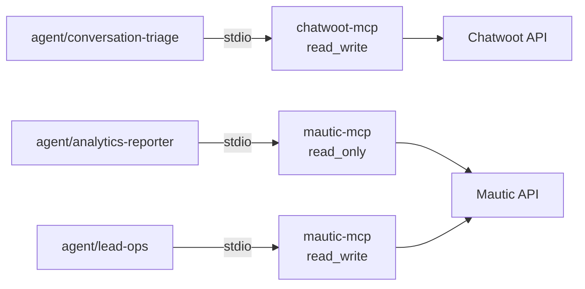
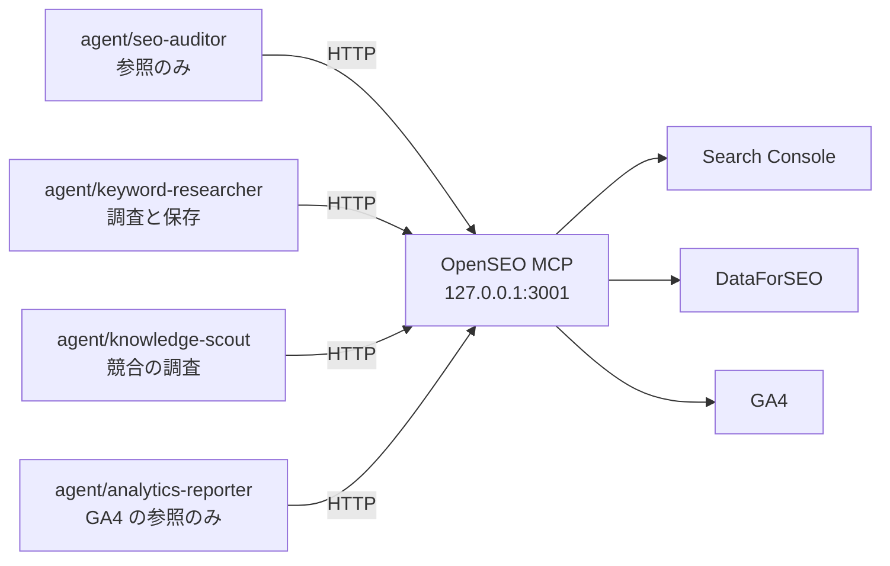

# DD-03 運用経路のフロー

詳細設計層。ID の採番の正本は層ごとのファイルにあり、索引は [`docs/README.md` の「ID の採番と正本」](../README.md) にある。横断規約は [DD-01](01-flow-specification-rules.md) を参照する。

**発信元がエージェントである 5 本**（`I-03` `I-04` `I-16` `I-17` `I-22`）を扱う。前の 4 本は AA-02 の 1.3 が定義した運用経路（認証必須・運用者のみ）に属する。**`I-22`（OpenSEO）だけはどちらの経路にも載せず、ホスト内で閉じる**（6 節）。（**2026-10-06 ADR-25: `I-17` は Umami の読み取りから GA4 の読み取り〈OpenSEO の MCP 経由〉に変わり、`I-22` と同じくホスト内で閉じる。5 節**）

**この 4 本は本来トンネルに載らない。** AA-03 の 2.3 が MCP を stdio 前提としたため、プロセス間通信でポートを使わない。HTTP トランスポートで運用する場合のみ運用経路に現れ、そのときは固定 Bearer（`MCP_AUTH_TOKEN`）が唯一の防御になる。

**2026-09-19 に接続先が開発環境と本番の 2 系統になった**（AA-05 の ADR-15。同日の ADR-14 の「開発環境だけ」を置き換えた）。エージェントは監視アプリ（`frontend/next-js`）から起動し（管理者の指示と、**ADR-17 で加わった定期実行**の 2 通り。TA-07 の 3.3・3.5）、**`I-03` `I-04` `I-17` は同じ MCP サーバを開発環境用（`chatwoot` / `mautic` / `umami`）と本番用（`chatwoot-prod` / `mautic-prod` / `umami-prod`）に 2 回登録する**。本番の登録は `ACCESS_LEVEL=read_write` を上限にし（**ADR-16 で暫定を外して確定**）、トークンはエージェント専用のアカウントで発行する（TA-07 の 3.3）。（**2026-10-06 ADR-25〈AA-05〉: Umami を廃止し、`umami`・`umami-prod` の登録を外した。2 回登録するのは `I-03` `I-04` だけになった。`I-17` は GA4 の読み取りに変わり、OpenSEO の MCP〈`openseo`。オンプレのローカル `127.0.0.1:3001`。登録は 1 つ〉を経由する。5 節**）

**同日の ADR-16 で Strapi と n8n も本番として AWS に置いた。** `I-16`（Strapi）は ADR-15 の時点ではオンプレの Strapi＝正本だけに接続していたが、**開発環境（`strapi-mcp`）と本番（`strapi-prod`。本番の Strapi の組み込みの `/mcp`）の 2 系統になり、記事の正本は本番の Strapi になった**（4 節）。n8n の MCP も `n8n` / `n8n-prod` の 2 系統で登録するが、AA-02 のカタログに連携点の番号が無い（7 節・8 節）。`I-22`（OpenSEO）はローカルだけに接続する（6 節）。

**同日の ADR-17 で、本番への書き込みの範囲を仕組みで絞った。** `strapi-prod` は下書きまで（公開・非公開化・削除の権限を与えない。記事の公開は `R2` が本番の管理画面で行う。4.1）、Chatwoot は社内メモと顧客への送信を分ける（2.3）。どちらも ADR-16 の反映でこの層が推奨していたものが、上位層の決定になった。**同日の ADR-18 で、本番の n8n に登録する Strapi の資格情報も下書きまでにした**（4.1）。**エージェントの実行の記録（`E-15`）の正本は監視アプリの実行記録になった**（6.2・7 節）。

## 1. 運用経路の前提

### 1.1 stdio が既定である理由と、その実装上の帰結

`ACCESS_LEVEL` は環境変数でありプロセスごとに 1 つしか持てない（ADR-03）。したがって**エージェントごとに異なる `ACCESS_LEVEL` を成立させるには、プロセスを分けるしかない**。



図は To-Be を描いている。**As-Is では 3 本のエージェントがいずれも未定義**（`.claude/agents/` がリポジトリに存在しない）。MCP サーバから上流 API への 2 本だけが `実装済み`。

- **`mautic-mcp` のプロセスが 2 つ立つ。** 同じサーバだが `MAUTIC_ACCESS_LEVEL` が違うため、別プロセスになる。
- **上流の認証情報も別にする**（AA-03 の 2.3）。`agent/analytics-reporter` には参照専用ロールの API 認証情報、`agent/lead-ops` にはコンタクト更新権限の API 認証情報を**別々に発行する**。同じ認証情報を共有すると、`MAUTIC_ACCESS_LEVEL` を下げても上流側の権限が残る。
- **`mautic-mcp` の `TRANSPORT` の既定は `http`** であるため、何も指定せずに `pnpm start` すると Chatwoot 本体（3100）とポートが衝突する（AA-01 の 8 節）。**エージェントからの起動では必ず stdio を明示する。**

### 1.2 HTTP で運用する場合だけ守ること

`ACCESS_LEVEL` をエージェント別にする必要が無い用途（たとえば人間が対話的に使う）では HTTP でもよい。その場合のみ次が要る。

| 項目 | 値 |
|---|---|
| 認証 | 固定 Bearer（`MCP_AUTH_TOKEN`、32 文字以上）。比較は SHA-256 ダイジェスト同士の `timingSafeEqual` |
| 到達範囲 | 運用経路のみ。**公開経路に載せない** |
| ポート | `chatwoot-mcp` は 3102。`mautic-mcp` は 3100 が既定だが **Chatwoot 本体と衝突する**ため、HTTP で使うなら変更する |
| `MCP_ALLOWED_HOSTS` | トンネルのホスト名に合わせる（ずれると静かに失敗する） |

## 2. `I-03` エージェント → Chatwoot（`chatwoot-mcp`）

| 項目 | 値 |
|---|---|
| 発信元 → 受信先 | エージェント（Claude Code）→ `chatwoot-mcp`（31 ツール）→ Chatwoot API（**開発環境〈3100〉と本番〈`chat.comegin.com`〉の 2 登録**。ADR-15） |
| 種別 | `MCP` |
| 経路 | **運用経路**（stdio のためトンネルを通らない） |
| トリガー | エージェントのツール呼び出し |
| 同期性 | 同期 |
| タイムアウト | **12 秒**（`Rack::Timeout` の 15 秒より内側。DD-01 の 7.2） |
| リトライ | `unreachable` 2 回 / `timeout` 1 回 / **起動直後の 500 のみ 1 回**（DD-01 の 5.4）。**401 は再試行しない**（DD-01 の 5.3） |
| 冪等キー | 参照系は不要。`chatwoot_create_*` は**冪等でない**（AA-02 の I-03）。エージェント側で同じ作成を 2 回呼ばない |
| 失敗時の扱い | `E-12` の `fetch.outcome` に分類を記録。`permission_denied` ならその項目をスキップして観測を続ける |
| 観測点 | stderr のログ（`<ULID> WARN I-03 outcome=...`）／ `docs/audits/conversations/` にファイルが生まれるか |
| 完成度 | **`条件付き`**（**本番〈`chatwoot-prod`〉に接続する前に、社内メモと顧客への送信を分けること**。ADR-17。2.3。開発環境への接続はこの条件を待たない。ADR-17 の前は `仕様確定`） |

### 2.1 接続してよいエージェント

**`agent/conversation-triage` の 1 本だけ**（`CHATWOOT_ACCESS_LEVEL=read_write`）。他の 11 本には接続しない。

**ADR-15 の後、この 1 本は本番の Chatwoot（`chatwoot-prod`）の会話を読み、社内メモ・ラベルを書く。** 顧客へのメッセージ送信を許すかは ADR-15 の時点では未決定だった。**ADR-16 で「許す」と決まった**（`chatwoot-prod` の許可リストから送信系のツールを外さない）。**送信の分類は BA-05 のとおり `承認`（`R3`）のまま**であり、エージェントは `R3` の承認を得た文面だけを送る。送信した事実は 2.3 の規則と TA-07 の 6.2 の突き合わせ（**エージェント専用ユーザーの送信の記録〈`sender`〉と `E-13`**。ADR-17）で追う。

- **監視アプリの定期実行（ADR-17。TA-07 の 3.5）で起動する実行には、顧客への送信のツールを渡さない**（この層の判断）。定期実行は人間が居合わせない前提で動くため、`R3` の承認を得る場面が無い。送信は管理者の指示で起動した実行に限り、承認を得た文面をその場で渡す。定期実行で使うのは会話の読み取りと社内メモ・ラベルまでとする。

**「接続しない」は `read_only` より強い**（AA-03 の 2.2）。`read_only` にすると参照系のツールが登録され、会話本文に到達できてしまう。DA-05 が「`sanitize()` は個人情報を伏せない」と明記している以上、**会話本文が読めるエージェントを 1 本に絞ることが唯一の制御**にあたる。

### 2.2 取得範囲

AA-03 の 3 節の契約を、実装できる形に落とす。

| 項目 | 値 | 根拠 |
|---|---|---|
| 対象 | **直近の未解決の会話のみ** | AA-03 の 3 節 |
| 上限 | **4 ページ**（会話 25 件／ページのサーバ固定） | 件数ではなくページ数で書く（ページ件数がサーバ側で固定のため、クライアントから増やせない） |
| 期間 | 指定しない（`status` で絞る） | `q`（本文検索）を指定すると `status` の絞り込みが無視される（AA-02 の 2.1）。**本文検索と未解決の絞り込みは併用できない** |
| 会話 ID | **必ず `display_id` を使う** | 内部 ID とは別。後から人間が画面で照合できるようにするため |
| 長文 | 既定では省略されたまま判断する | `LONG_TEXT_LIMIT` 1,000 文字。全文を取るのは記事化候補の要約を残すときだけ（AA-03 の 3.3） |

### 2.3 出力に会話本文を転記しない

**`E-12` と社内メモに会話本文をそのまま貼らない**（AA-03 の 3.4）。実装としては次の 3 つで守る。

- **残すのは要旨と `display_id` だけ。** 本文は Chatwoot 側を見に行かせる。
- **`E-13` の `evidence[]` に会話本文が現れないことを、起票前に検査する**（`E-13` は Git に置かれ、GitHub に越境するため）。
- **社内メモの `private` を固定値 `true` にする**（エージェントが指定できるパラメータにしない。[06 の 3.4](06-proposal-loop-flows.md)）。**`private=false` は顧客に即時送信される。**
  - **ADR-16 で顧客への送信を許したため、この規則はそのままでは成立しない。** `chatwoot-mcp` では社内メモと顧客への送信が同じツール（`chatwoot_send_message`）で、`private` の値だけで分かれる。**しかも `private` の既定値は `false`（送信側）である**（`backend/chatwoot-mcp/src/tools/write-conversations.ts`）。送信系のツールを許可リストに残す以上、`private` はエージェントが指定できるパラメータになり、指定を忘れると社内メモのつもりの文面が顧客に届く。
  - **この層の判断: 社内メモ専用の登録（または専用のツール）を分ける案を推奨する**（8 節）。分けるまでは、`agent/conversation-triage` の指示に「社内メモでは必ず `private=true` を明示する」と書く（約束にとどまる）。
  - **（2026-09-19 に ADR-17 で決定）社内メモと顧客への送信を分ける。** 上の推奨が上位層の決定になった（TA-07 の 3.3）。手段は次の 2 つのどちらかで、**どちらにするかは未決定**（8 節。TA-07 の 9 節）。`chatwoot-mcp` の実装はまだ行っていない。
    - **社内メモ専用のツールを `chatwoot-mcp` に足す。** ツールの中で `private=true` を固定し、エージェントに指定させない。社内メモだけを使う実行の許可リストには社内メモのツールだけを載せ、`chatwoot_send_message` を載せない。`chatwoot-mcp` のコードと README の更新が要る。
    - **社内メモ用の登録を分ける。** 社内メモ用の登録からは顧客への送信ができないようにする。ただし今の `chatwoot-mcp` では社内メモも `chatwoot_send_message` で書くため、ツールを外すと社内メモも書けなくなる。**登録の側で `private` を固定する仕組み（環境変数など）が `chatwoot-mcp` に要り**（8 節の旧案 A）、こちらもコードの変更を伴う。
    - **どちらの手段でも `chatwoot-mcp` の変更は要る。** この層では、ツールを足す案のほうが「既定値に頼らない」（ADR-17 の理由）を 1 つのツールの中で完結させられ、`ACCESS_LEVEL` と同じ「登録しない」の形（ADR-03）で許可リストから送信を外せると見る（推奨。判断者は `R1`）。
  - **分けるまでは、本番の登録（`chatwoot-prod`）で `agent/conversation-triage` を動かさない**（`I-03` の完成度を `条件付き` にした理由。この層の判断）。約束（`private=true` の明示）だけで本番の顧客に届く経路を開けない。

### 2.4 チーム変更の順序

`chatwoot_update_conversation` は**チーム → 担当者の順に適用する**（AA-02 の 2.1）。チームを変更すると、そのチームに属さない担当者が自動的に外れるため。

**反映されなかった場合は警告が返る。エージェントはこの警告を無視しない。** 無視すると「担当者を割り当てたつもりで誰にも割り当たっていない会話」が生まれる。

## 3. `I-04` エージェント → Mautic（`mautic-mcp`）

| 項目 | 値 |
|---|---|
| 発信元 → 受信先 | エージェント → `mautic-mcp`（17 ツール）→ Mautic API（**開発環境〈8000〉と本番〈`mkt.comegin.com`〉の 2 登録**。ADR-15） |
| 種別 | `MCP` |
| 経路 | **運用経路**（stdio） |
| トリガー | エージェントのツール呼び出し |
| 同期性 | 同期 |
| タイムアウト | **30 秒**（上流に固定の打ち切りが無く、`mautic_query_stats` が重い） |
| リトライ | `unreachable` 2 回 / `timeout` 1 回 / **401 は 1 回**（トークンを再取得してから。DD-01 の 5.3） |
| 冪等キー | 参照系は不要。`mautic_update_record` は `PATCH` 相当のため**同じ本文なら冪等** |
| 失敗時の扱い | `fetch.outcome` に記録。**500 の主因は不正な `order_by`** のため `invalid_response` に分類し、再試行しない |
| 観測点 | stderr のログ ／ `docs/audits/analytics/` のファイル |
| 完成度 | `仕様確定` |

### 3.1 接続する 2 本と、その違い

| エージェント | `MAUTIC_ACCESS_LEVEL` | 上流のロール | 使ってよいツール |
|---|---|---|---|
| `agent/analytics-reporter` | `read_only` | **参照専用ロール** | `mautic_list_form_submissions` / `mautic_query_stats` / `mautic_run_report` |
| `agent/lead-ops` | `read_write` | コンタクト更新権限 | 上記 + `mautic_update_record`（`E-09` のセグメント追加・スコア加算） |

**`agent/analytics-reporter` が `mautic_get_contact` と `mautic_get_contact_activity` を呼ばない制約は、`ACCESS_LEVEL` では表現できない**（どちらも参照系として `read_only` に登録される。AA-03 の 2.2）。

したがってこの制約は**エージェントの指示側にしか置けない**。この層でできる補強は 2 つ。

- **上流のロール側で個票 API を落とす。** Mautic のロールでコンタクトの閲覧権限を外せば、ツールは登録されていても 403 が返り `permission_denied` になる。**`ACCESS_LEVEL` では守れない箇所を、上流の権限で守る。**
- **出力の検査。** `docs/audits/analytics/` に書かれた `E-12` に個人を識別する値（email・氏名・電話）が含まれていないことを、起票前に検査する（[06 の 1 節](06-proposal-loop-flows.md)）。

**1 つ目が本命である。** 上流のロールで落とせば `ACCESS_LEVEL` と同じ「到達できなくする」形になり、指示の遵守に依存しなくなる。これは AA-03 が未決定事項に残した「集計限定を権限で表現できない」問題に対する、**この層からの部分的な回答**にあたる（`mautic-mcp` を変えずに済む）。

### 3.2 使ってはいけない API

**ツール一覧に載っていないものは呼べない**（ADR-03）。ただし設計者が誤ってツールを足さないよう、理由を再掲する。

| API | なぜ載せないか |
|---|---|
| `PUT`（全般） | **存在しない ID で新規作成してしまう。** 承認の対象と実行の結果が一致しないため、承認では守れない（AA-02 の 2.3） |
| `GET /api/smses/{id}/contact/{cid}/send` | **GET なのに SMS を送信する。** 参照系の見た目で分類の網から漏れ、`read_only` でも呼べてしまう |

**3 つ目の MCP サーバを作る場合も、「GET だが副作用を持つ API」を同じ理由で除外する。**

### 3.3 `agent/analytics-reporter` の集計仕様

DD-01 の 6.3 の第 3 層（`CV 数` の畳み込み）を、ここで実装できる形にする。

| 項目 | 値 |
|---|---|
| 取得元 | `mautic_list_form_submissions`（`E-09` の個票は読まない） |
| 取得範囲 | **直近 35 日**（前月比較が取れる最小期間。DA-02 の 5.1）。**終端は 3 日前の終わり（JST）**（**2026-10-06 ADR-25 で GA4 と同じ期間にそろえた**。旧版は終端が昨日。`CVR-total` の分母〈GA4〉と分子〈Mautic〉の期間を一致させるため。5.1。`.claude/agents/analytics-reporter.md`） |
| 畳む単位 | `mautic_form_id` + `lower(email)` + 送信日（JST の日付） |
| 記録するもの | **畳んだ件数と生の件数の両方** |
| 上限 | `truncation_message` が付いたら期間を狭めて取り直す（DD-01 の 5.2） |

`E-12` に記録する形。

```yaml
metric: CV-count
value: 42            # 畳んだ件数。これが CVR の分子になる
raw_value: 45        # 生のフォーム送信件数
dedup_dropped: 3     # 畳んで消えた件数。大きいと二重送信の徴候
fetch:
  outcome: ok
  range: { from: 2026-08-13, to: 2026-09-16 }
```

- **`dedup_dropped` が生の件数の 1 割を超えたら、二重送信が常態化している徴候として扱う**（[07 の 5 節](07-failure-and-degradation.md)）。1 割という値は暫定（未決定事項）。
- **GA4 の `SESSION-count` と組み合わせて `CVR` を出す**（分母は GA4、分子は Mautic。`CVR-total = CV-count ÷ SESSION-count`）。異なる系から取った値を割るため、**片方だけが欠測した場合に CVR が跳ねる**。両方の `fetch.outcome` が `ok` か `empty_but_ok` で、かつ `SESSION-count ≥ 1` でない限り `CVR` を計算しない。（**2026-10-06 ADR-25〈AA-05〉: 分母を Umami から GA4 に替えた。**）
- **分母と分子で数える訪問者の範囲が違う**（ADR-25 の帰結 6）。分母（GA4 のセッション）は**同意した訪問者だけ**、分子（Mautic のフォーム送信）は**全員**である。**同意率が下がると CVR が見かけ上上がる。** `E-12` の `CVR-total` にはこの偏りを注記し、同意率（consent-api の記録）を補正の材料にする（補正の方法は未決定。8 節）。**訪問者単位の突合はしない**（hidden field の `umami_session_id` を廃止し、代わりの識別子を足さない。DA-03）。CVR は集計値どうしの比だけである。

## 4. `I-16` エージェント → Strapi（`strapi-mcp`）

| 項目 | 値 |
|---|---|
| 発信元 → 受信先 | エージェント → Strapi の組み込みの MCP（`/mcp`。**リポジトリ管理外**）→ Strapi（**開発環境〈1337〉の `strapi-mcp` と、本番〈`cms.comegin.com`。記事の正本〉の `strapi-prod` の 2 登録**。ADR-16。ADR-15 の時点ではオンプレの Strapi＝正本だけだった） |
| 種別 | `MCP` |
| 経路 | **運用経路**（開発環境はローカル。本番は ALB の機械向けのパス `/mcp` を ALB の認証なしで通し、Admin トークンで守る。TA-06 の 5.4） |
| トリガー | エージェントのツール呼び出し |
| 同期性 | 同期 |
| タイムアウト | **20 秒**（管理外のため上流の挙動を保証できない。短くして早く気づく） |
| リトライ | `unreachable` 2 回 / `timeout` 1 回。401・403 は再試行しない |
| 冪等キー | 参照系は不要。**作成系は冪等でない**（AA-02 の I-16） |
| 失敗時の扱い | `fetch.outcome` に記録。作成系の失敗は**再実行せず人間に返す**（二重作成を避ける） |
| 観測点 | Strapi の管理画面 ／ stderr のログ |
| 完成度 | `仕様確定`（ADR-07 でリスク受容済み） |

### 4.1 この経路の権限は Strapi 側の API トークンで絞る

**`strapi-mcp` はリポジトリ管理外であり、`ACCESS_LEVEL` も `sanitize()` も保証できない**（AA-01 の 8 節、AA-03 の未決定事項）。`R1` は 2026-09-17 に「現状のまま使い続ける」と判断した（ADR-07。リスク受容）。

したがって**権限の境界は Strapi 側の API トークンにしか置けない**。エージェント 3 本に対して別々のトークンを発行する。

| エージェント | Strapi 側で許可するもの | 禁止するもの |
|---|---|---|
| `agent/keyword-researcher` | `api::keyword.keyword` の作成・更新 | 他のコンテンツタイプすべて |
| `agent/content-planner` | `api::content-plan.content-plan` の作成・更新 | 同上 |
| `agent/content-writer` | `api::article.article` の**下書きの**作成・更新 | **`publishedAt` の設定**／削除／他のコンテンツタイプ |

**`agent/content-writer` から `publishedAt` を設定する権限を外すのが、この 3 本で最も重要な境界である**（AA-03 の 1.1「`agent/content-writer` は公開しない」）。記事の公開は `承認` 分類（`R2`）であり、BA-03 が `R4` をエージェント委任としつつ `A` を `R2` に残した構造が、そのまま権限の境界になる。

**Strapi の権限モデルでフィールド単位の制限ができない場合、この境界は成立しない。** その場合は 4.2 の代替に落とす。

**トークンの発行先は ADR-14・ADR-15・ADR-16 で 2 度変わった。** ADR-14 で「本番の Strapi」とその読み取り用トークンを書き、ADR-15 で取り消してこの表のトークンをオンプレの Strapi（正本）のものとした。**ADR-16 で再び本番の Strapi を置き、記事の正本は本番の Strapi になった**（TA-07 の 6 節）。したがって**本番の作業に使うのは、本番の Strapi で発行する Admin トークン（`strapi-prod`）である。** 開発環境の Strapi は試験用で、記事を開発と本番の間で移さない（TA-07 の 6 節）。

| 登録 | トークン | 絞り方 |
|---|---|---|
| `strapi-mcp`（開発環境） | 開発環境の Strapi のトークン | 上の表のとおり |
| `strapi-prod`（本番） | **本番の Strapi の Admin トークン**（エージェント専用のアカウントで発行） | **下書きまで**（作成・読み取り・更新だけ。**公開・非公開化・削除の権限を与えない**。ADR-16 で削除を、ADR-17 で公開・非公開化を外した）。上の表の `publishedAt` の境界と同じものを本番のトークンで守る（4.2 の代替 C） |

- **ADR-16 が明示したのは「削除の権限を与えない」だけだった。** 公開の権限を外すのは当初この層の判断で、4.1 の「`agent/content-writer` から `publishedAt` を外す」を本番にも及ぼしたものだった。**ADR-17 で上位層の決定になった**（TA-07 の 3.3）。**記事の公開は人間（`R2`）が本番の Strapi の管理画面で行う。**
- **Strapi 5 の Admin トークンで公開だけを外せるかは、実装時に確かめる**（TA-07 の 9 節）。外せない場合は、エージェントが公開できてしまう状態で運用するか、自作の MCP に切り替えるかを決め直す（AA-05 の ADR-07。8 節）。
- **登録が 1 つだと、トークンも 1 つになる。** 上の表はエージェント 3 本に別々のトークンを発行する前提だが、`strapi-prod` を 1 つだけ登録すると 3 本が同じトークン（3 本の権限の和）を使う。**本番でも 3 本を分けるなら、`strapi-prod` をエージェントごとに登録し分ける必要がある**（8 節）。
- エージェントが下書きを書いても、**公開サイトに出るのは `R2` が公開し、人間が配信を承認したときだけ**である（[05 の 3 節](05-build-and-delivery-flows.md)、TA-07 の 7 節）。境界は「Strapi の公開権限」と「配信の承認」の 2 段になり、前者は `strapi-prod` のトークンに公開の権限を与えないこと（ADR-17）、後者は配信用の IAM をエージェントに渡さないことで成立する。**公開された記事を見つけてビルドと計測を起こすのは監視アプリの定期実行である**（ADR-17。[05 の 3.2](05-build-and-delivery-flows.md)）。
- **本番の n8n に登録する Strapi の資格情報にも、公開・非公開化・削除の権限を与えない**（ADR-18。`strapi-prod` と同じく下書きまで）。エージェントは `n8n-prod` でワークフローを本番に置けるため（7 節）、n8n の資格情報に公開の権限があると、ワークフロー経由で記事を公開でき、上の 2 段のうち前者を迂回できる。**今の設計で本番の n8n が Strapi に書く処理は無い**（記事の公開の Webhook も ADR-17 で使わなくなった）**ため、必要になるまで登録しない。** 登録するときは下書きまでの権限で発行する。

### 4.2 フィールド単位で絞れない場合の代替

| 代替 | 内容 | 評価 |
|---|---|---|
| A エージェントの指示で禁止する | 「`publishedAt` を設定しない」と指示に書く | **弱い。** 指示の遵守に依存し、到達不能性にならない |
| B 公開の検査を後段に置く | 公開済み記事のうち `E-13` の `proposal_id` を持たないものを例外として検出する | 事後検出。公開されたあとにしか気づけない |
| **C Draft & Publish を人間の操作に限定する** | Strapi の管理画面からしか公開できない運用にし、API トークンから公開系の操作を落とす | **推奨。** 到達不能性として成立する |

**C を推奨する。** A は AA-03 の 6 節が「約束にとどまる」として区別した種類の担保であり、`publishedAt` は BA-05 の `承認` 分類に属するため、約束では守らない。**（2026-09-19）本番については ADR-17 で C が上位層の決定になった**（公開は `R2` が管理画面で行い、`strapi-prod` のトークンから公開の権限を外す）。開発環境の `strapi-mcp` のトークンにも同じ絞り方を課す（開発と本番の設定をそろえる。TA-07 の 6.1）。

### 4.3 `documentId` 単位の排他

**同じ記事を 2 つのエージェントが同時に編集しない**（AA-03 の 4.3）。並列化が必要なら記事ごとにエージェントのインスタンスを分け、`documentId` を引数で渡す。

- 排他の仕組みはこの層では作らない（Strapi 側にロックが無く、作ると新たな状態を持つことになる）。
- **編成の側で守る。** `agent/content-writer` は 1 回の実行で 1 記事しか触らない。

## 5. `I-17` エージェント → GA4（OpenSEO の MCP 経由）

> **（2026-10-06）ADR-25（AA-05）の反映。** 流入・ページ・参照元の正本を **GA4** にし、**Umami を廃止した**。旧版のこの節は「`I-17` エージェント → Umami（Umami MCP）」で、Umami MCP（リポジトリ管理外）を開発環境（`umami`。3000）と本番（`umami-prod`。`stats.comegin.com/mcp`）の 2 つに登録し、本番の登録で訪問者の実績を読む（ADR-15）としていた。**Umami MCP・`umami`・`umami-prod` の登録はすべて外した。** GA4 は SaaS で、エージェントは **OpenSEO の MCP（`openseo`）の GA4 のツール**で読む。**連携点の番号を `I-17` のまま GA4 の読み取りに付け替えるか、`I-22`（OpenSEO）に含めるかは AA-02 のカタログに合わせる**（8 節）。

| 項目 | 値 |
|---|---|
| 発信元 → 受信先 | `agent/analytics-reporter` → OpenSEO の MCP（**リポジトリ管理外**。`http://127.0.0.1:3001/mcp`。登録名 `openseo`）→ GA4 の Data API（**本番のプロパティ 1 つだけ**。OpenSEO の OAuth の接続。スコープは `analytics.readonly` だけ） |
| 種別 | `MCP`（Streamable HTTP） |
| 経路 | **ホスト内**（ループバック。6 節の `I-22` と同じ。**トンネルを張らない**） |
| トリガー | 日次の観測バッチ（**監視アプリの定期実行が起動する**。ADR-17。ADR-05 では n8n のスケジュール） |
| 同期性 | 同期 |
| タイムアウト | **30 秒**（6 節の参照系と同じ） |
| リトライ | `unreachable` 2 回 / `timeout` 1 回。**GA4 の未接続・接続の失効は `auth_failed` に分類し、再試行せず人間に返す**（OpenSEO の画面で接続し直す。[07 の 2 節](07-failure-and-degradation.md)） |
| 冪等キー | **不要**（参照のみ。費用も発生しない。ただし反映の遅れの範囲では同じ期間の再取得で値が変わりうる。5.1） |
| 失敗時の扱い | `fetch.outcome` に記録。`I-05` が通るまでは **`empty_but_ok` が正常な応答**である（5.2） |
| 観測点 | `docs/audits/analytics/` のファイル ／ GA4 の管理画面 ／ `get_google_analytics_measurement_health` |
| 完成度 | `条件付き`（**本番の GA4 プロパティの作成と OpenSEO への接続**〈`runbooks/01-onprem-verification.md`〉／`I-05` が通るまでデータが無い） |

**使ってよいツールは 7 本だけである**（ADR-25。`agent/analytics-reporter` の許可リストに書く。AA-03 の 2.4）。

| ツール | 用途 |
|---|---|
| `mcp__openseo__list_projects` / `mcp__openseo__get_project_context` | `comegin.com` のプロジェクトの ID を得る（6.1 と同じく、そのプロジェクト以外を引数に渡さない） |
| `mcp__openseo__get_google_analytics_traffic_acquisition` | `breakdown: channel_group` で `SESSION-count`・`ORGANIC-share`、`breakdown: source_medium` で `REFERRER-sessions` |
| `mcp__openseo__get_google_analytics_page_performance` | `channel: all` で `PAGEVIEW-count`・`PAGE-views` |
| `mcp__openseo__get_google_analytics_organic_landing_pages` | `ORGANIC-landing` |
| `mcp__openseo__get_google_analytics_organic_overview` | 自然検索の概況（`ORGANIC-share` の確かめ） |
| `mcp__openseo__get_google_analytics_measurement_health` | 計測の健全性（タグが届いているか、しきい値・サンプリングの有無）。**日次バッチの冒頭で呼ぶ** |

**持たせないもの**: `get_google_analytics_audience_breakdown`・`get_google_analytics_ecommerce_performance`・`get_google_analytics_site_search`・`get_google_analytics_key_events`（**CV の正本は Mautic**。GA4 の `key_events` を CV に使わない）・`get_search_opportunities`、**費用の出る OpenSEO のツールすべて**。OpenSEO の 1 プロセスを `agent/seo-auditor` などと共有するため、**エージェントごとの差は許可リストだけで作る**（6.2 と同じ）。

### 5.1 取得範囲

| 項目 | 値 | 根拠 |
|---|---|---|
| 期間 | **直近 35 日。終端は 3 日前の終わり（JST）** | 前月比較が取れる最小期間（DA-02 の 5.1）。**GA4 の反映の遅れ（24〜48 時間）を避けるため、終端を 3 日前にする**（GSC の 6.3 と同じ。ADR-25 の帰結 3）。プロパティのタイムゾーンは `Asia/Tokyo` |
| ランキング | **上位 100 件**（`PAGE-views`・`REFERRER-sessions`・`ORGANIC-landing`） | 同上 |
| 取る指標 | `SESSION-count`・`ORGANIC-share`・`PAGEVIEW-count`・`PAGE-views`・`REFERRER-sessions`・`ORGANIC-landing`（定義は DA-02。ADR-25 で置き換えた） | 流入・ページ・参照元の正本は GA4（ADR-25。ADR-01 の Umami の部分を置き換え） |
| Core Web Vitals（実測） | **GA4 からは取らない。PostHog から取る**（`CWV-lcp-p75`・`CWV-inp-p75`・`CWV-cls-p75`。下記） | ADR-25（ユーザーの決定） |
| 取らない指標 | `VISITOR-count`（**廃止**。GA4 のユーザー数はチャネル別の行を足すと重複し、OpenSEO に全体のユーザー数を返すツールが無い）・ファネル・AB テスト（PostHog の担当） | ADR-25・DA-04 の 3 節 |

- **`ORGANIC-share` は訪問者ベースからセッションベースに変わった**（`Organic Search` の sessions ÷ `SESSION-count`）。ADR-25 の前の `E-12` と比べるときは、定義が違うことを注記する。
- **`PAGEVIEW-count` は全件が取れたときだけ書く。** `hasMore` などで全件が取れなければ値を書かず、`fetch.outcome` を `truncated` にする（DD-01 の 5.2）。
- **しきい値・行の省略を 0 で埋めない。** GA4 はプライバシーのしきい値で少ない数を伏せ、OpenSEO は伏せられた指標を `null` にし、省かれた行は「不明」として扱う（`middleware/open-seo-main/specs/0007-google-analytics-mcp-integration.md` の「A restricted metric is `null`; an omitted or thresholded row is unknown and is never synthesized as zero.」）。**`E-12` でも `null` か行の欠落のまま残し、0 にしない。** 0 にすると、欠測を「流入が減った」と読む（AA-04 の暴走条件 #3）。
- **観測できるのは同意した訪問者だけである**（GA4 は Cookie〈`_ga`・`_ga_<ID>`〉を使うため、同意の後にだけタグを読み込む。DD-02 の 2 節）。同意しない訪問者の分は失う（ADR-25 の帰結 1）。
- **OpenSEO の GA4 のツールはカスタムイベントの値を読めない**（ADR-25 の帰結 7）。GA4 に独自のイベントを足しても、エージェントから見えるのは `key_events` の件数だけで、それも持たせない。

**Core Web Vitals（実測）は PostHog の `$web_vitals` から取る**（ADR-25。PostHog の 4 つの用途の 1 つ）。posthog-js の Web Vitals の自動取得が送るイベントで、値のプロパティは `$web_vitals_LCP_value`・`$web_vitals_INP_value`・`$web_vitals_CLS_value` である（出典: https://posthog.com/docs/web-analytics/web-vitals ）。`execute-sql` で上の期間の `quantile(0.75)` を取り、`CWV-lcp-p75`・`CWV-inp-p75`・`CWV-cls-p75` として書く。**標本は同意した訪問者だけ**であることを `E-12` に注記する（PostHog も同意の対象。DD-02 の 4 節）。**PostHog のページビュー・セッションの数字は報告に使わない**（ADR-25。正本は GA4）。

### 5.1.1 `E-12` の分け方と `fetch.outcome`（2026-10-06。ADR-25。`agent/analytics-reporter` の実装）

**1 回の日次バッチで、GA4 から 2 件、PostHog の CWV から 1 件の `E-12` を書く**（`.claude/agents/analytics-reporter.md`。Mautic の `CV-count` は 3.3 のとおり別に書く）。

| `E-12` | 指標・表 | 分ける理由 |
|---|---|---|
| (a) 流入 | `SESSION-count`・`ORGANIC-share`・表 `REFERRER-sessions`・`ORGANIC-landing` | **`CVR-total` の分母（`SESSION-count`）を守る。** (b) が `truncated` になっても (a) は `ok` のまま使える |
| (b) ページ | `PAGEVIEW-count`・表 `PAGE-views` | `PAGEVIEW-count` は全件が取れなければ書かない（5.1）。ページの全件は `limit: 1000` で最大 5 回（5,000 行）まで `nextOffset` で取り、取り切れなければ (b) だけを `truncated` にする |
| (c) CWV（PostHog） | `CWV-lcp-p75`・`CWV-inp-p75`・`CWV-cls-p75`（`target_ref: "E-07 site=comegin.com"`） | PostHog が落ちても (a)(b) に影響させない |

- **期間は 3 件とも、Mautic とも同じ**（直近 35 日、終端は 3 日前の終わり〈JST〉）。PostHog の HogQL は `toDate(toTimeZone(timestamp, 'Asia/Tokyo'))` で JST の日付にそろえる。**`CVR-total` は GA4 と Mautic の `fetch.range` が同じときだけ計算する**（3.3）。
- **GA4 が OpenSEO に接続されていない（`ga4_not_connected`）・接続が失効したときは `auth_failed`**（再試行しない。人間が OpenSEO の画面で接続し直す）。`empty_but_ok` にしない（`agent/seo-auditor` の GSC の未接続を `auth_failed` にしているのと同じ。6 節）。`ok`/`empty_but_ok` 以外なので、提案の根拠にも `CVR-total` の分母にも使われない。
- **`comegin.com` のプロジェクトを特定できない（0 件・2 件以上）、または接続先のプロパティに `comegin.com` の Web ストリームが無いときは `permission_denied`**（対象を特定できない。`seo-auditor` のプロジェクトの扱いと同じ）。
- **`ORGANIC-share` は `Organic Search` の行が無いときは書かない**（0 にしない。5.1 の「省かれた行は不明」）。
- **欠測の徴候（GA4 が 0 で PostHog が非 0、またはその逆。[07 の 2.2](07-failure-and-degradation.md)）は、(c) の標本数と (a) の `SESSION-count` で判定し、(a) と (c) の両方の本文に書く。**

### 5.2 `empty_but_ok` が正常である期間

**`I-05` が通るまで（本番のタグの設置と同意の実装が済むまで）、GA4 には 1 件もデータが無い。** この期間の応答は `empty_but_ok` になる。

**この `empty_but_ok` を「セッション数が 0 に減った」と読まない。** 区別の手段は 3 つ。

- **`get_google_analytics_measurement_health` を先に呼ぶ。** タグが届いていない（計測の対象が存在しない）のか、届いているがセッションが 0 なのかを分ける。
- **`E-12` に `range` を必ず書く**（DD-01 の 4.3）。対象期間が分かれば、後から「この期間はそもそも計測していなかった」と判定できる。
- **終端を 3 日前にする**（5.1）。反映の遅れの範囲を観測に含めると、直近の日が必ず少なく見える。

**この区別が AA-04 の暴走条件 #3 の実装にあたる。**

### 5.3 読むのは本番のプロパティだけ（ADR-25）

**GA4 のプロパティは本番の 1 つだけを作り、OpenSEO に接続するのもそれだけである。** 開発環境では `PUBLIC_GA4_MEASUREMENT_ID` を設定せず、タグを出さない（DD-02 の 2 節。ユーザーの決定）。したがって**開発中のアクセスが GA4 に混ざる経路は無く**、旧版（Umami）の「開発環境の値を `evidence` に使わない」は、プロパティを 1 つにすることで構造的に守られる。

- （旧版。ADR-25 で効力を失った）**5.3 訪問者の実績は本番の Umami から読む（ADR-15）。** 訪問者のブラウザが送る `I-05` は本番（AWS）の Umami に届き、開発環境の Umami には開発中の送信だけが来るため、`agent/analytics-reporter` は `umami-prod` で読む、としていた。
- **OpenSEO はオンプレのローカルだけで動く**（6 節）。開発機が止まっている間は GA4 を読めない（[07 の 3.4](07-failure-and-degradation.md) の取り戻しの対象。GA4 は期間を指定して過去を読める）。

## 6. `I-22` エージェント → OpenSEO（OpenSEO の MCP）

| 項目 | 値 |
|---|---|
| 発信元 → 受信先 | `agent/seo-auditor` / `agent/keyword-researcher` / `agent/knowledge-scout`（**2026-10-06 ADR-25: `agent/analytics-reporter` が GA4 の読み取りで加わった。5 節**）→ OpenSEO の MCP（**リポジトリ管理外**。`http://127.0.0.1:3001/mcp`）→ GSC（`I-15`）／ DataForSEO（`I-23`）／ **GA4 の Data API（ADR-25）**／ OpenSEO の DB |
| 種別 | `MCP`（Streamable HTTP。stdio は無い） |
| 経路 | **ホスト内**（ループバック。**トンネルを張らない**。TA-04 の 7 節のエンドポイント 13） |
| トリガー | エージェントのツール呼び出し（日次の観測バッチ、週次のキーワード調査。**定期のものは監視アプリの定期実行が起動する**。ADR-17） |
| 同期性 | 同期 |
| タイムアウト | **参照系 30 秒 / 調査系 90 秒**（調査系は DataForSEO の集計を待つため長めに取る。暫定） |
| リトライ | 参照系は DD-01 の 5.2 の既定。**調査系は `timeout` でも再試行しない**（回数を 0 に上書きする。打ち切った要求も DataForSEO 側では課金されている可能性があり、再試行は 2 回目の課金になる） |
| 冪等キー | 参照系は不要。**調査系は冪等でも費用が 2 回かかる**ため、同じ `ref` での再取得を検証目的に限る（DA-02 の 5.2.1） |
| 失敗時の扱い | `fetch.outcome` に記録。**GSC の `not_connected` は `auth_failed`、DataForSEO の残高不足は `permission_denied`**（DD-01 の 5.3）。どちらも再試行せず人間に返す |
| 観測点 | `docs/audits/gsc/` `docs/audits/serp/` `docs/audits/site_audit/` `docs/audits/market/` にファイルが生まれるか ／ OpenSEO の `/api/health` ／ DataForSEO の残高 |
| 完成度 | `条件付き`（**`comegin.com`・日本・日本語のプロジェクトを作ること**／エージェント定義の許可リスト。MCP 設定の付け替えは 2026-09-18 に済んだ） |

### 6.1 接続の前提

- **MCP 設定はセルフホストに付け替え済みである**（2026-09-18。ユーザースコープの設定が `http://127.0.0.1:3001/mcp`）。ローカルの `whoami` は `mode: self-hosted` / `admin@localhost` / 残高 `null` を返す。**付け替えは Claude Code のセッションを起動し直すまで効かない**（起動時に確立した MCP の接続を使い続けるため。付け替えた当日のセッションは、ホスト版に繋がったままだった）。
- **プロジェクトを 1 つだけ作る。** ローカルには既定のプロジェクト `Default`（ドメイン未設定・米国／英語）しか無い。**ドメイン `comegin.com`、市場は日本・日本語**のプロジェクトを作り、`Default` は使わない（市場が米国のまま調査すると、検索ボリュームも順位も米国の値になる）。エージェントは `list_projects` で ID を得て、**そのプロジェクト以外を引数に渡さない**（エージェントの指示に書く）。プロジェクトの作成は人間（`R1`）が行う（`create_project` は許可リストに無い）。

### 6.2 1 プロセスを 3 本が共有する

OpenSEO の MCP は HTTP の 1 プロセスであり、**`ACCESS_LEVEL` も無い**。1.1 の「エージェントごとにプロセスを分けて `ACCESS_LEVEL` を変える」方法が使えないため、**エージェントごとの差はエージェント定義の許可リストだけで作る**（AA-03 の 2.4）。



図は To-Be を描いている。**As-Is では 3 本のエージェントがいずれも未定義**で、OpenSEO の MCP はホスト版に繋がっている。`OpenSEO → DataForSEO` だけが成立している。

- **図の 3 本の線は同じ MCP サーバに入る。** サーバの側からは 3 本を区別できない（無認証のため、呼び出し元の名前も分からない）。**ログで誰が費用を発生させたかを辿れるのは、エージェント側の stderr（相関 ID つき。DD-01 の 9.1）だけ**である。**ADR-18 の後は、監視アプリの実行記録（`E-15` の正本）にも残せる**（相関 ID ごとに、どのエージェントが起動されたか）。ただしツールの呼び出し（引数・回数）まで残すかは、`E-15` に何を残すかの未決定に掛かる（TA-07 の 9 節。8 節）。**（2026-09-19）ADR-18 の追加の決定 4 で、`E-15` には要約と ID だけを残し、ツールの結果は残さないと決まった。** 呼び出しの引数（調べたキーワード・ドメイン）は残さない。**費用の発生した調査系の呼び出しの回数は、要約の一部として残す**（この層の判断。回数はツールの結果でも個人情報でもなく、決定 4 の趣旨に反しない。エージェントの自己申告に頼らず、監視アプリが Claude Agent SDK の経過から数える形を推奨する。8 節）。
- **3 本以外のエージェントの定義には OpenSEO のツールを 1 つも書かない。** 書かなければ、Claude Code の上ではツールが存在しないように見える。
- **（2026-10-06）ADR-25 で `agent/analytics-reporter` が加わり、共有するのは 4 本になった**（図の `AR`）。`agent/analytics-reporter` に許すのは GA4 の参照の 5 本と `list_projects`・`get_project_context` だけ（5 節）で、**`get_google_analytics_*` を持つのは `agent/analytics-reporter` だけ**である（AA-03 の 2.4）。費用の出るツールは持たせない。上の「3 本」は ADR-25 の前の記述である。

### 6.3 GSC の取得仕様

[06 の 4 節](06-proposal-loop-flows.md) の `I-15` の取得を、このツール呼び出しで行う。

| 項目 | 値 |
|---|---|
| ツール | `get_search_console_performance` |
| `dimensions` | `["page"]`（ページ単位。クエリ単位は `api::keyword.keyword` の実装後） |
| 期間 | `startDate` / `endDate` を明示する（`dateRange` の既定に頼らない）。`endDate` は **3 日前**、`startDate` はそこから 35 日前 |
| `dataState` | **`final`**（確定分のみ。既定の `all` は直近の不完全なデータを含む） |
| `rowLimit` | 1,000。`hasMore` が真なら `startRow` で続きを取る |
| `ref` に残すもの | 上の引数をすべて（**日付は太平洋時間である**ことを併記する。DA-02 の 5.2.1） |

### 6.4 調査系の 1 回の上限

| エージェント | 1 回の実行の上限 | 超えるとき |
|---|---|---|
| `agent/keyword-researcher` | シード 10 個、SERP 20 キーワード | `R2` の承認を求めて止まる |
| `agent/knowledge-scout` | 競合ドメイン 5 件 | 同上 |

- **見積もりは実行前にエージェントが計算する**（ツール説明の目安から。キーワード調査は 1 シード約 100 クレジットで上限側に寄せる）。10 シードで約 1,000、SERP 20 キーワードで約 100 となり、**2,000 クレジットの内側に収まるよう上限を決めた**。
- **この上限は約束である**（ツールの引数で支出の上限を指定できない）。最後の歯止めは前払い残高（[04 の 9.2](04-server-to-server-flows.md)）。

## 7. エージェントと MCP の接続表

AA-03 の 2.1 の権限表を、**プロセスの起動という形**に落とす。この表に無い組み合わせで起動しない。

| エージェント | 起動する MCP プロセス | 環境変数 | 上流の認証情報 |
|---|---|---|---|
| `agent/keyword-researcher` | `strapi-mcp` / `strapi-prod` ／ **OpenSEO（HTTP）** | — | Strapi のトークン（`keyword` のみ）。OpenSEO は無認証 |
| `agent/knowledge-scout` | **OpenSEO（HTTP）** | — | —（無認証） |
| `agent/content-planner` | `strapi-mcp` / `strapi-prod` | — | Strapi のトークン（`content-plan` のみ） |
| `agent/content-writer` | `strapi-mcp` / `strapi-prod` | — | Strapi のトークン（`article` の下書きのみ） |
| `agent/quality-checker` | **なし**（ファイル読み取りのみ） | — | — |
| `agent/design-implementer` | **なし** | — | — |
| `agent/seo-auditor` | **OpenSEO（HTTP。参照のみ）**と `.lighthouse/` | — | —（**GSC の資格情報は OpenSEO の中にあり、エージェントは持たない**） |
| `agent/analytics-reporter` | `mautic-mcp` / **OpenSEO（HTTP。GA4 の参照のみ）** / PostHog（**2026-10-06 ADR-25: Umami MCP を外し、OpenSEO の GA4 のツールに替えた。5 節**） | `TRANSPORT=stdio` `MAUTIC_ACCESS_LEVEL=read_only` | Mautic の**参照専用ロール**。GA4 は OpenSEO の中の OAuth（`analytics.readonly`）で、**エージェントは GA4 の資格情報を持たない** |
| `agent/lead-ops` | `mautic-mcp` | `TRANSPORT=stdio` `MAUTIC_ACCESS_LEVEL=read_write` | Mautic の**コンタクト更新ロール** |
| `agent/conversation-triage` | `chatwoot-mcp` | `TRANSPORT=stdio` `CHATWOOT_ACCESS_LEVEL=read_write` | Chatwoot の**専用エージェントユーザー**のトークン。**本番は社内メモと送信を分けてから接続する**（ADR-17。2.3） |
| `agent/ops-watcher` | **なし**（PostHog） | — | PostHog の API キー |
| `agent/proposal-writer` | **なし**（ファイル読み取りのみ） | — | — |

- **`full` を起動するエージェントは 1 つも無い**（AA-03 の 2.1）。削除・統合の操作に到達させない。
- **12 本中 4 本が MCP に 1 つも接続しない**（2026-09-18 に OpenSEO へ接続する 2 本が加わり、7 本から減った）。接続の有無が `ACCESS_LEVEL` の上にもう 1 段の境界を作っている。
- **OpenSEO はプロセスを起動するのではなく、稼働中の HTTP サーバに接続する。** 表の「起動する MCP プロセス」のうち OpenSEO の行だけは、エージェントごとに別プロセスにならない（6.2）。
- **この表の「上流の認証情報」は、開発環境用と本番用の 2 組がある**（ADR-15）。本番用はエージェント専用のアカウントで発行し、`ACCESS_LEVEL=read_write` を上限にする（**ADR-16 で確定**）。Strapi は ADR-15 の時点ではオンプレの正本だけだったが、**ADR-16 で本番の Strapi（`strapi-prod`。Admin トークン）が加わった**（4.1）。
- **PostHog は開発環境と本番でプロジェクトを分ける**（ADR-16。ADR-15 の時点では未決定で、開発環境の Strapi の `I-01` `I-02` が本番のイベントに混ざる懸念があった）。`agent/ops-watcher`・`agent/analytics-reporter` が観測に使うのは**本番用のプロジェクトの**API キーである。
- **n8n の MCP（`n8n` / `n8n-prod`）はこの表のどのエージェントにも割り当てていない。** ADR-16 で、開発環境で確かめたワークフローを `n8n-prod` で本番に置く経路になった（作成と更新まで。有効化と実行は許さない。TA-07 の 3.3）が、AA-03 のエージェント定義にこれを使うものが無く、AA-02 のカタログにも連携点の番号が無い（8 節）。
- **エージェントの起動元は監視アプリである**（TA-07 の 3.3）。監視アプリは MCP の接続先と許可リストをこの表どおりに渡し、広げない。**ADR-17 で定期実行も監視アプリから起動するようになった**（TA-07 の 3.5）。定期実行の定義には、この表の範囲に加えて取得の範囲（期間と件数）を固定して書き、**顧客への送信のツールを含めない**（2.1）。**監視アプリは起動ごとに相関 ID を振って `E-15` に記録し、エージェントに渡す**（ADR-18。DD-01 の 3.2）。**定義の置き場所は上位層で未決定である**（AA-05 の未決定事項・TA-07 の 9 節。8 節）。**（2026-09-19）ADR-18 の追加の決定 3 で、定義は Git で持つと決まった。** 監視アプリは承認済みの `main` から作った別のチェックアウトで定義を読み、**定義の変更（この表の範囲を広げること、顧客への送信のツールを足すことを含む）は必ず PR を通る**（TA-07 の 3.5）。
- **実行記録（`E-15`）に残すのは要約と ID だけである**（ADR-18 の追加の決定 4）。この表のエージェントが MCP で読んだ本番の Mautic・Chatwoot のデータは、`E-15` に入らない。**エージェント定義には「人は ID で指す（氏名・メールアドレスを要約に書かない）」規則を置く**（TA-07 の 3.6。AA-03）。会話本文を読める `agent/conversation-triage`・コンタクトを更新する `agent/lead-ops` で、とくにこの規則が効く。
- **秘密値はエージェント自身が読めない。** `PreToolUse` フック（`~/.claude/hooks/protect-secrets.sh`）が環境変数ファイルの読み書きをハード拒否する。これが BA-05 の `禁止` 分類（秘密値の閲覧）の実装にあたる。

## 8. 未決定事項

- **Strapi の権限モデルでフィールド単位（`publishedAt`）の制限ができるか未確認。** 4.2 で代替 C を推奨し、**本番については ADR-17 で決定になった**が、できるかどうかは Strapi のバージョンと Draft & Publish の設定に依存する（TA-07 の 9 節「Strapi 5 の Admin トークンで公開だけを外せるか」と同じ項目）。**できない場合、`agent/content-writer` の境界は約束にとどまる**（AA-03 の「4 つ目だけが約束にとどまる」と同じ性質の穴が 1 つ増える）。その場合は ADR-07 の再検討（自作の MCP に切り替えるか）に戻る。判断者 `R1`。
- **Mautic のロールで個票 API だけを落とせるか未確認。** 3.1 の「上流のロール側で落とす」が成立するかはロールの粒度に依存する。成立しなければ、AA-03 の未決定事項（集計限定を権限で表現できない）はそのまま残る。判断者 `R1` `R3`。
- **`dedup_dropped` のしきい値 1 割に根拠が無い。** 二重送信が常態化している徴候とする値だが、実データが無い。
- **`agent/analytics-reporter` が PostHog をどう呼ぶか決めていない。** 6 節の接続表では MCP ではなく PostHog として書いたが、PostHog の MCP を使うのか API を直接叩くのかは決めていない。**直接叩く場合、ADR-02 が MCP を挟むと決めた 4 つの利点（`sanitize()`・応答サイズ・権限の境界・危険な API の除外）がこの経路には及ばない。**
- **管理外の MCP（`strapi-mcp` / OpenSEO。**2026-10-06 ADR-25: Umami MCP は廃止して外れ、GA4 の読み取りで OpenSEO への依存が増えた**）のバージョン変更を検知する手段が無い。** ADR-07 でリスクを受容したが、受容したリスクが変化したときに気づく仕組みが無い（ツールの定義が変わっても、このリポジトリからは分からない）。**ただし本番の Strapi は `backend/strapi-system` からイメージをビルドする**（TA-06 の 3.2）ため、`strapi-prod` の MCP の版はこのリポジトリの依存関係の更新でしか変わらない。気づく機会はデプロイの手順（TA-06 の 8 節）に置ける。
- **調査系のタイムアウト 90 秒に根拠が無い**（6 節）。DataForSEO の集計にかかる時間を計測していない。短すぎると、課金された要求を結果の受け取り前に捨てることになる。
- **（2026-09-19 に ADR-15 で解決）本番の観測値を読む経路。** 本番用の MCP の登録で読む（5.3）。
- **（2026-09-19 に ADR-15 で解決）`agent/conversation-triage` と `agent/lead-ops` の本番への接続。** 本番用の登録で読み書きする（`read_write` まで）。
- **（2026-09-19 に ADR-16 で解決）本番の Chatwoot でエージェントに顧客へのメッセージ送信を許すか**（2.1、TA-07 の 9 節）。**許す**（分類は BA-05 のとおり `承認`・`R3`）。
- **（2026-09-19 に ADR-16 で解決）PostHog のプロジェクトを開発環境と本番で分けるか**（7 節）。**分ける。**
- **社内メモと顧客への送信を分ける手段**（2.3。ADR-16 で新たに生じた）。`chatwoot_send_message` は `private` の値で社内メモと送信を兼ね、既定値が `false`（送信）である。送信系のツールを許した以上、「`private` を固定値 `true`」はツールか登録を分けない限り成立しない。案は (A) 社内メモだけを登録する別の登録を作る（`private` を固定する仕組みが `chatwoot-mcp` に要る）、(B) `chatwoot-mcp` に社内メモ専用のツールを足す、(C) 指示で守る（約束にとどまる）。この層は A か B を推奨していた。**（2026-09-19 に ADR-17 で一部解決）分けることは決まり、C は採らないことになった。A か B かは未決定のまま**（TA-07 の 9 節）。この層は B を推奨する（2.3）。**分けるまでは本番で `agent/conversation-triage` を動かさない**（`I-03` は `条件付き`）。判断者 `R1`。
- **顧客への送信の承認が約束にとどまる**（2.1）。`R3` の承認を得たかどうかを、ツールの呼び出しの側では検査できない。検出は事後の突き合わせ（TA-07 の 6.2）だけになる。**ADR-17 で突き合わせは Chatwoot の監査ログではなく、エージェント専用ユーザーの送信の記録（`sender`）と `E-13` で行うことになった。** 送信が `E-13` に対応するかは分かるが、その `E-13` に `R3` の承認があったかまでは送信の記録から分からない。判断者 `R1` `R3`。
- **（2026-09-19 に ADR-18 の追加の決定で解決）定期実行で起動した実行に顧客への送信のツールを渡さない、という境界を何で守るか**（2.1・7 節。ADR-17 で新たに生じた）。監視アプリの定期実行の定義（許可リスト）で守る形になり、定義を書き換えられる主体がエージェントでないことが前提になる（[06 の 2.4](06-proposal-loop-flows.md) の「監視アプリのスケジュールの定義をエージェントが書き換えられない場所に置く」と同じ根）。**（2026-09-19）ADR-18 の反映で、上位層が「定期実行の定義（取得範囲・頻度・使うエージェントとツール）の置き場所」を未決定事項に上げた**（AA-05・TA-07 の 9 節。案は「Git で持ち、承認済みの `main` から作った別の場所で監視アプリが読む」）。この項目はその決定を待つ。**ADR-18 の追加の決定 3 で案のとおりに決まった**（定義は Git。監視アプリは承認済みの `main` のチェックアウトで読み、定義の変更は必ず PR を通す）。**境界は定義の許可リストで守り、許可リストを広げる変更は PR のレビューを通る。** 残るのは、そのチェックアウトをいつ誰が更新するか（TA-07 の 9 節）で、境界の成立そのものには効かない（更新が遅れても、効くのは承認済みの古い定義である）。判断者 `R1`。
- **本番の n8n に登録する Strapi の資格情報を、下書きまでに絞れるか**（4.1。ADR-18 で新たに生じた）。ADR-18 は「必要になるまで登録しない。登録するときは下書きまでの権限で発行する」とした。n8n から Strapi を呼ぶなら Content API のトークンになり、`strapi-prod` の Admin トークンとは権限の設定が違う。**そのトークンで作成・更新を許しつつ公開を外せるか**は、登録するときに確かめる（上の「フィールド単位の制限」・TA-07 の 9 節の「Admin トークンで公開だけを外せるか」と同じ根）。登録するまでは論点にならない。判断者 `R1`。
- **`strapi-prod` をエージェントごとに登録し分けるか**（4.1）。1 つにすると 3 本が同じ Admin トークン（権限の和）を使い、`agent/keyword-researcher` が記事を書ける状態になる。判断者 `R1`。
- **（2026-09-19 に ADR-17 で決定。確認は残る）本番の Strapi の Admin トークンから公開（`publishedAt`）の権限を外すか**（4.1。ADR-16 は削除の権限だけを明示した）。**外す**（下書きまで。公開は `R2` が管理画面で行う）。**外せるか**（Strapi 5 の権限の粒度）は実装時に確かめる（上の「フィールド単位の制限」と同じ項目。TA-07 の 9 節）。外せない場合、本番でも `agent/content-writer` の境界は約束にとどまる。判断者 `R1`。
- **エージェント → n8n（MCP）の連携点が AA-02 のカタログに無い**（7 節）。`n8n-prod` は本番のワークフローを書き換えられる経路であり（有効化は人間）、AA-04 の 3.3.1 が「戻せない適用先」の筆頭に挙げた n8n への作用になる。カタログに番号を与えるか、監視アプリ → Claude Code と同じく採番しない扱いにするかは AA の判断（判断者 `R1`）。
- **OpenSEO の MCP に誰が費用を発生させたかをサーバ側で記録できない**（6.2）。無認証のため呼び出し元を区別できず、エージェント側の stderr が唯一の記録になる。`E-15` の正本が決まらない限り、この記録も永続化されない（DD-01 の 10 節と同じ根）。**（2026-09-19 に ADR-18 で一部解決）`E-15` の正本は監視アプリの実行記録になり、どの起動がどのエージェントを動かしたかは残る。** 残るのは、OpenSEO のツールの呼び出し（引数・回数）まで `E-15` に残すかで、上位層の「記録する範囲」の未決定に掛かる（TA-07 の 9 節。DD-01 の 10 節）。調査系の引数には個人情報は含まれないため、この経路に限れば残しても DA-05 の懸念は小さい（この層の見立て）。**（2026-09-19）ADR-18 の追加の決定 4 で、`E-15` には要約と ID だけを残すと決まった。** 引数は残さない。**呼び出しの回数は要約の一部として残す**のがこの層の判断である（6.2）。残るのは、**回数を監視アプリが Claude Agent SDK の経過から数えられるか**（TA-07 の 9 節の「Claude Agent SDK の仕様の確認」と同じ根。数えられなければ回数もエージェントの自己申告になる）と、**回数を `E-15` の属性として持つか、要約の文の中に書くか**（型の変更にあたり DA の判断。判断者 `R3`）である。判断者 `R1`。
- **（2026-10-06。ADR-25 で新たに生じた）GA4 の読み取りに振る連携点の番号。** 5 節は旧 `I-17`（Umami の MCP）の番号を GA4 の読み取りに付け替えて書いたが、経路は `I-22`（OpenSEO）と同じホスト内で、`I-15`（OpenSEO → GSC）と同じ形の「OpenSEO → GA4」の区間もある。**`I-17` を付け替えるか、`I-22` に含めて OpenSEO → GA4 に新しい番号を振るかは AA-02 のカタログに合わせる。** 判断者 `R1`。
- **（2026-10-06。ADR-25 で新たに生じた）CVR の偏りの補正**（3.3）。分母（GA4 のセッション）は同意した訪問者だけ、分子（Mautic のフォーム送信）は全員のため、同意率が下がると CVR が見かけ上上がる。consent-api の記録から同意率を出して補正するか、注記にとどめるかを決めていない（DA-02）。判断者 `R1` `R3`。
- **（2026-10-06。ADR-25 で新たに生じた）GA4 の BigQuery エクスポートを使うか。** OpenSEO の GA4 のツールはカスタムイベントの値を読めず（ADR-25 の帰結 7）、しきい値で伏せられた行も取り戻せない。BigQuery のエクスポートなら行単位で読めるが、費用と、エージェントに渡す読み取りの経路（新しい MCP の登録）が増える。判断者 `R1`。
