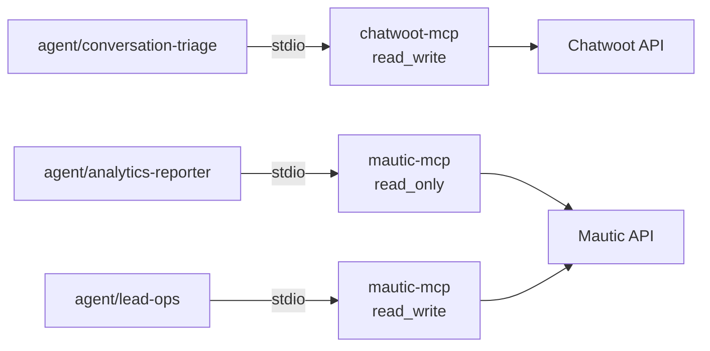
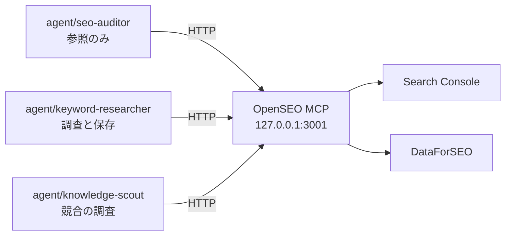

# DD-03 運用経路のフロー

詳細設計層。ID は EA 共通用語集の定義をそのまま使う。横断規約は [DD-01](01-flow-specification-rules.md) を参照する。

**発信元がエージェントである 5 本**（`I-03` `I-04` `I-16` `I-17` `I-22`）を扱う。前の 4 本は AA-02 の 1.3 が定義した運用経路（認証必須・運用者のみ）に属する。**`I-22`（OpenSEO）だけはどちらの経路にも載せず、ホスト内で閉じる**（6 節）。

**この 4 本は本来トンネルに載らない。** AA-03 の 2.3 が MCP を stdio 前提としたため、プロセス間通信でポートを使わない。HTTP トランスポートで運用する場合のみ運用経路に現れ、そのときは固定 Bearer（`MCP_AUTH_TOKEN`）が唯一の防御になる。

## 1. 運用経路の前提

### 1.1 stdio が既定である理由と、その実装上の帰結

`ACCESS_LEVEL` は環境変数でありプロセスごとに 1 つしか持てない（ADR-03）。したがって**エージェントごとに異なる `ACCESS_LEVEL` を成立させるには、プロセスを分けるしかない**。



図は To-Be を描いている。**As-Is では 3 本のエージェントがいずれも未定義**（`.claude/agents/` がリポジトリに存在しない）。MCP サーバから上流 API への 2 本だけが `実装済み`。

- **`mautic-mcp` のプロセスが 2 つ立つ。** 同じサーバだが `MAUTIC_ACCESS_LEVEL` が違うため、別プロセスになる。
- **上流の認証情報も別にする**（AA-03 の 2.3）。`agent/analytics-reporter` には参照専用ロールの API 認証情報、`agent/lead-ops` にはコンタクト更新権限の API 認証情報を**別々に発行する**。同じ認証情報を共有すると、`MAUTIC_ACCESS_LEVEL` を下げても上流側の権限が残る。
- **`mautic-mcp` の `TRANSPORT` の既定は `http`** であるため、何も指定せずに `pnpm start` すると Chatwoot 本体（3100）とポートが衝突する（AA-01 の 8 節）。**エージェントからの起動では必ず stdio を明示する。**

### 1.2 HTTP で運用する場合だけ守ること

`ACCESS_LEVEL` をエージェント別にする必要が無い用途（たとえば人間が対話的に使う）では HTTP でもよい。その場合のみ次が要る。

| 項目 | 値 |
|---|---|
| 認証 | 固定 Bearer（`MCP_AUTH_TOKEN`、32 文字以上）。比較は SHA-256 ダイジェスト同士の `timingSafeEqual` |
| 到達範囲 | 運用経路のみ。**公開経路に載せない** |
| ポート | `chatwoot-mcp` は 3102。`mautic-mcp` は 3100 が既定だが **Chatwoot 本体と衝突する**ため、HTTP で使うなら変更する |
| `MCP_ALLOWED_HOSTS` | トンネルのホスト名に合わせる（ずれると静かに失敗する） |

## 2. `I-03` エージェント → Chatwoot（`chatwoot-mcp`）

| 項目 | 値 |
|---|---|
| 発信元 → 受信先 | エージェント（Claude Code）→ `chatwoot-mcp`（31 ツール）→ Chatwoot API |
| 種別 | `MCP` |
| 経路 | **運用経路**（stdio のためトンネルを通らない） |
| トリガー | エージェントのツール呼び出し |
| 同期性 | 同期 |
| タイムアウト | **12 秒**（`Rack::Timeout` の 15 秒より内側。DD-01 の 7.2） |
| リトライ | `unreachable` 2 回 / `timeout` 1 回 / **起動直後の 500 のみ 1 回**（DD-01 の 5.4）。**401 は再試行しない**（DD-01 の 5.3） |
| 冪等キー | 参照系は不要。`chatwoot_create_*` は**冪等でない**（AA-02 の I-03）。エージェント側で同じ作成を 2 回呼ばない |
| 失敗時の扱い | `E-12` の `fetch.outcome` に分類を記録。`permission_denied` ならその項目をスキップして観測を続ける |
| 観測点 | stderr のログ（`<ULID> WARN I-03 outcome=...`）／ `docs/audits/conversations/` にファイルが生まれるか |
| 完成度 | `仕様確定` |

### 2.1 接続してよいエージェント

**`agent/conversation-triage` の 1 本だけ**（`CHATWOOT_ACCESS_LEVEL=read_write`）。他の 11 本には接続しない。

**「接続しない」は `read_only` より強い**（AA-03 の 2.2）。`read_only` にすると参照系のツールが登録され、会話本文に到達できてしまう。DA-05 が「`sanitize()` は個人情報を伏せない」と明記している以上、**会話本文が読めるエージェントを 1 本に絞ることが唯一の制御**にあたる。

### 2.2 取得範囲

AA-03 の 3 節の契約を、実装できる形に落とす。

| 項目 | 値 | 根拠 |
|---|---|---|
| 対象 | **直近の未解決の会話のみ** | AA-03 の 3 節 |
| 上限 | **4 ページ**（会話 25 件／ページのサーバ固定） | 件数ではなくページ数で書く（ページ件数がサーバ側で固定のため、クライアントから増やせない） |
| 期間 | 指定しない（`status` で絞る） | `q`（本文検索）を指定すると `status` の絞り込みが無視される（AA-02 の 2.1）。**本文検索と未解決の絞り込みは併用できない** |
| 会話 ID | **必ず `display_id` を使う** | 内部 ID とは別。後から人間が画面で照合できるようにするため |
| 長文 | 既定では省略されたまま判断する | `LONG_TEXT_LIMIT` 1,000 文字。全文を取るのは記事化候補の要約を残すときだけ（AA-03 の 3.3） |

### 2.3 出力に会話本文を転記しない

**`E-12` と社内メモに会話本文をそのまま貼らない**（AA-03 の 3.4）。実装としては次の 3 つで守る。

- **残すのは要旨と `display_id` だけ。** 本文は Chatwoot 側を見に行かせる。
- **`E-13` の `evidence[]` に会話本文が現れないことを、起票前に検査する**（`E-13` は Git に置かれ、GitHub に越境するため）。
- **社内メモの `private` を固定値 `true` にする**（エージェントが指定できるパラメータにしない。[06 の 3.4](06-proposal-loop-flows.md)）。**`private=false` は顧客に即時送信される。**

### 2.4 チーム変更の順序

`chatwoot_update_conversation` は**チーム → 担当者の順に適用する**（AA-02 の 2.1）。チームを変更すると、そのチームに属さない担当者が自動的に外れるため。

**反映されなかった場合は警告が返る。エージェントはこの警告を無視しない。** 無視すると「担当者を割り当てたつもりで誰にも割り当たっていない会話」が生まれる。

## 3. `I-04` エージェント → Mautic（`mautic-mcp`）

| 項目 | 値 |
|---|---|
| 発信元 → 受信先 | エージェント → `mautic-mcp`（17 ツール）→ Mautic API |
| 種別 | `MCP` |
| 経路 | **運用経路**（stdio） |
| トリガー | エージェントのツール呼び出し |
| 同期性 | 同期 |
| タイムアウト | **30 秒**（上流に固定の打ち切りが無く、`mautic_query_stats` が重い） |
| リトライ | `unreachable` 2 回 / `timeout` 1 回 / **401 は 1 回**（トークンを再取得してから。DD-01 の 5.3） |
| 冪等キー | 参照系は不要。`mautic_update_record` は `PATCH` 相当のため**同じ本文なら冪等** |
| 失敗時の扱い | `fetch.outcome` に記録。**500 の主因は不正な `order_by`** のため `invalid_response` に分類し、再試行しない |
| 観測点 | stderr のログ ／ `docs/audits/analytics/` のファイル |
| 完成度 | `仕様確定` |

### 3.1 接続する 2 本と、その違い

| エージェント | `MAUTIC_ACCESS_LEVEL` | 上流のロール | 使ってよいツール |
|---|---|---|---|
| `agent/analytics-reporter` | `read_only` | **参照専用ロール** | `mautic_list_form_submissions` / `mautic_query_stats` / `mautic_run_report` |
| `agent/lead-ops` | `read_write` | コンタクト更新権限 | 上記 + `mautic_update_record`（`E-09` のセグメント追加・スコア加算） |

**`agent/analytics-reporter` が `mautic_get_contact` と `mautic_get_contact_activity` を呼ばない制約は、`ACCESS_LEVEL` では表現できない**（どちらも参照系として `read_only` に登録される。AA-03 の 2.2）。

したがってこの制約は**エージェントの指示側にしか置けない**。この層でできる補強は 2 つ。

- **上流のロール側で個票 API を落とす。** Mautic のロールでコンタクトの閲覧権限を外せば、ツールは登録されていても 403 が返り `permission_denied` になる。**`ACCESS_LEVEL` では守れない箇所を、上流の権限で守る。**
- **出力の検査。** `docs/audits/analytics/` に書かれた `E-12` に個人を識別する値（email・氏名・電話）が含まれていないことを、起票前に検査する（[06 の 1 節](06-proposal-loop-flows.md)）。

**1 つ目が本命である。** 上流のロールで落とせば `ACCESS_LEVEL` と同じ「到達できなくする」形になり、指示の遵守に依存しなくなる。これは AA-03 が未決定事項に残した「集計限定を権限で表現できない」問題に対する、**この層からの部分的な回答**にあたる（`mautic-mcp` を変えずに済む）。

### 3.2 使ってはいけない API

**ツール一覧に載っていないものは呼べない**（ADR-03）。ただし設計者が誤ってツールを足さないよう、理由を再掲する。

| API | なぜ載せないか |
|---|---|
| `PUT`（全般） | **存在しない ID で新規作成してしまう。** 承認の対象と実行の結果が一致しないため、承認では守れない（AA-02 の 2.3） |
| `GET /api/smses/{id}/contact/{cid}/send` | **GET なのに SMS を送信する。** 参照系の見た目で分類の網から漏れ、`read_only` でも呼べてしまう |

**3 つ目の MCP サーバを作る場合も、「GET だが副作用を持つ API」を同じ理由で除外する。**

### 3.3 `agent/analytics-reporter` の集計仕様

DD-01 の 6.3 の第 3 層（`CV 数` の畳み込み）を、ここで実装できる形にする。

| 項目 | 値 |
|---|---|
| 取得元 | `mautic_list_form_submissions`（`E-09` の個票は読まない） |
| 取得範囲 | **直近 35 日**（前月比較が取れる最小期間。DA-02 の 5.1） |
| 畳む単位 | `mautic_form_id` + `lower(email)` + 送信日（JST の日付） |
| 記録するもの | **畳んだ件数と生の件数の両方** |
| 上限 | `truncation_message` が付いたら期間を狭めて取り直す（DD-01 の 5.2） |

`E-12` に記録する形。

```yaml
metric: CV-count
value: 42            # 畳んだ件数。これが CVR の分子になる
raw_value: 45        # 生のフォーム送信件数
dedup_dropped: 3     # 畳んで消えた件数。大きいと二重送信の徴候
fetch:
  outcome: ok
  range: { from: 2026-08-13, to: 2026-09-16 }
```

- **`dedup_dropped` が生の件数の 1 割を超えたら、二重送信が常態化している徴候として扱う**（[07 の 5 節](07-failure-and-degradation.md)）。1 割という値は暫定（未決定事項）。
- **Umami の `SESSION-count` と組み合わせて `CVR` を出す**（分母は Umami、分子は Mautic）。異なる系から取った値を割るため、**片方だけが欠測した場合に CVR が跳ねる**。両方の `fetch.outcome` が `ok` か `empty_but_ok` でない限り `CVR` を計算しない。

## 4. `I-16` エージェント → Strapi（`strapi-mcp`）

| 項目 | 値 |
|---|---|
| 発信元 → 受信先 | エージェント → `strapi-mcp`（**リポジトリ管理外**）→ Strapi API（1337） |
| 種別 | `MCP` |
| 経路 | **運用経路**（ローカル） |
| トリガー | エージェントのツール呼び出し |
| 同期性 | 同期 |
| タイムアウト | **20 秒**（管理外のため上流の挙動を保証できない。短くして早く気づく） |
| リトライ | `unreachable` 2 回 / `timeout` 1 回。401・403 は再試行しない |
| 冪等キー | 参照系は不要。**作成系は冪等でない**（AA-02 の I-16） |
| 失敗時の扱い | `fetch.outcome` に記録。作成系の失敗は**再実行せず人間に返す**（二重作成を避ける） |
| 観測点 | Strapi の管理画面 ／ stderr のログ |
| 完成度 | `仕様確定`（ADR-07 でリスク受容済み） |

### 4.1 この経路の権限は Strapi 側の API トークンで絞る

**`strapi-mcp` はリポジトリ管理外であり、`ACCESS_LEVEL` も `sanitize()` も保証できない**（AA-01 の 8 節、AA-03 の未決定事項）。`R1` は 2026-09-17 に「現状のまま使い続ける」と判断した（ADR-07。リスク受容）。

したがって**権限の境界は Strapi 側の API トークンにしか置けない**。エージェント 3 本に対して別々のトークンを発行する。

| エージェント | Strapi 側で許可するもの | 禁止するもの |
|---|---|---|
| `agent/keyword-researcher` | `api::keyword.keyword` の作成・更新 | 他のコンテンツタイプすべて |
| `agent/content-planner` | `api::content-plan.content-plan` の作成・更新 | 同上 |
| `agent/content-writer` | `api::article.article` の**下書きの**作成・更新 | **`publishedAt` の設定**／削除／他のコンテンツタイプ |

**`agent/content-writer` から `publishedAt` を設定する権限を外すのが、この 3 本で最も重要な境界である**（AA-03 の 1.1「`agent/content-writer` は公開しない」）。記事の公開は `承認` 分類（`R2`）であり、BA-03 が `R4` をエージェント委任としつつ `A` を `R2` に残した構造が、そのまま権限の境界になる。

**Strapi の権限モデルでフィールド単位の制限ができない場合、この境界は成立しない。** その場合は 4.2 の代替に落とす。

### 4.2 フィールド単位で絞れない場合の代替

| 代替 | 内容 | 評価 |
|---|---|---|
| A エージェントの指示で禁止する | 「`publishedAt` を設定しない」と指示に書く | **弱い。** 指示の遵守に依存し、到達不能性にならない |
| B 公開の検査を後段に置く | 公開済み記事のうち `E-13` の `proposal_id` を持たないものを例外として検出する | 事後検出。公開されたあとにしか気づけない |
| **C Draft & Publish を人間の操作に限定する** | Strapi の管理画面からしか公開できない運用にし、API トークンから公開系の操作を落とす | **推奨。** 到達不能性として成立する |

**C を推奨する。** A は AA-03 の 6 節が「約束にとどまる」として区別した種類の担保であり、`publishedAt` は BA-05 の `承認` 分類に属するため、約束では守らない。

### 4.3 `documentId` 単位の排他

**同じ記事を 2 つのエージェントが同時に編集しない**（AA-03 の 4.3）。並列化が必要なら記事ごとにエージェントのインスタンスを分け、`documentId` を引数で渡す。

- 排他の仕組みはこの層では作らない（Strapi 側にロックが無く、作ると新たな状態を持つことになる）。
- **編成の側で守る。** `agent/content-writer` は 1 回の実行で 1 記事しか触らない。

## 5. `I-17` エージェント → Umami（Umami MCP）

| 項目 | 値 |
|---|---|
| 発信元 → 受信先 | `agent/analytics-reporter` → Umami MCP（**リポジトリ管理外**）→ Umami（3000） |
| 種別 | `MCP` |
| 経路 | **運用経路**（ローカル） |
| トリガー | 日次の観測バッチ |
| 同期性 | 同期 |
| タイムアウト | 20 秒 |
| リトライ | `unreachable` 2 回 / `timeout` 1 回 |
| 冪等キー | **不要**（参照のみ。同じ期間の再取得で同じ値になる） |
| 失敗時の扱い | `fetch.outcome` に記録。`I-05` が通るまでは **`empty_but_ok` が正常な応答**である |
| 観測点 | `docs/audits/analytics/` のファイル ／ Umami の管理画面 |
| 完成度 | `仕様確定`（ただし `I-05` が通るまでデータが無い） |

### 5.1 取得範囲

| 項目 | 値 | 根拠 |
|---|---|---|
| 期間 | **直近 35 日** | 前月比較が取れる最小期間（DA-02 の 5.1） |
| ランキング | **上位 100 件** | 同上 |
| 取る指標 | セッション数・PV・参照元・ランディングページ・Core Web Vitals（実測） | 流入・母数系の正本は Umami（ADR-01） |
| 取らない指標 | ファネル・AB テスト | PostHog の担当（Umami にファネル機能はあるが使わない。DA-04 の 3 節） |

### 5.2 `empty_but_ok` が正常である期間

**`I-05` が通るまで、Umami には 1 件もデータが無い**（`list_websites` が空を返す。`docs/README.md` の現況）。この期間の応答は `empty_but_ok` になる。

**この `empty_but_ok` を「セッション数が 0 に減った」と読まない。** 区別の手段は 2 つ。

- **サイトが登録されているか**を先に確認する。登録が 0 件なら、それは観測の対象が存在しないのであって、セッションが 0 なのではない。
- **`E-12` に `range` を必ず書く**（DD-01 の 4.3）。対象期間が分かれば、後から「この期間はそもそも計測していなかった」と判定できる。

**この区別が AA-04 の暴走条件 #3 の実装にあたる。**

## 6. `I-22` エージェント → OpenSEO（OpenSEO の MCP）

| 項目 | 値 |
|---|---|
| 発信元 → 受信先 | `agent/seo-auditor` / `agent/keyword-researcher` / `agent/knowledge-scout` → OpenSEO の MCP（**リポジトリ管理外**。`http://127.0.0.1:3001/mcp`）→ GSC（`I-15`）／ DataForSEO（`I-23`）／ OpenSEO の DB |
| 種別 | `MCP`（Streamable HTTP。stdio は無い） |
| 経路 | **ホスト内**（ループバック。**トンネルを張らない**。TA-04 の 7 節のエンドポイント 13） |
| トリガー | エージェントのツール呼び出し（日次の観測バッチ、週次のキーワード調査） |
| 同期性 | 同期 |
| タイムアウト | **参照系 30 秒 / 調査系 90 秒**（調査系は DataForSEO の集計を待つため長めに取る。暫定） |
| リトライ | 参照系は DD-01 の 5.2 の既定。**調査系は `timeout` でも再試行しない**（回数を 0 に上書きする。打ち切った要求も DataForSEO 側では課金されている可能性があり、再試行は 2 回目の課金になる） |
| 冪等キー | 参照系は不要。**調査系は冪等でも費用が 2 回かかる**ため、同じ `ref` での再取得を検証目的に限る（DA-02 の 5.2.1） |
| 失敗時の扱い | `fetch.outcome` に記録。**GSC の `not_connected` は `auth_failed`、DataForSEO の残高不足は `permission_denied`**（DD-01 の 5.3）。どちらも再試行せず人間に返す |
| 観測点 | `docs/audits/gsc/` `docs/audits/serp/` `docs/audits/site_audit/` `docs/audits/market/` にファイルが生まれるか ／ OpenSEO の `/api/health` ／ DataForSEO の残高 |
| 完成度 | `条件付き`（**`comegin.com`・日本・日本語のプロジェクトを作ること**／エージェント定義の許可リスト。MCP 設定の付け替えは 2026-09-18 に済んだ） |

### 6.1 接続の前提

- **MCP 設定はセルフホストに付け替え済みである**（2026-09-18。ユーザースコープの設定が `http://127.0.0.1:3001/mcp`）。ローカルの `whoami` は `mode: self-hosted` / `admin@localhost` / 残高 `null` を返す。**付け替えは Claude Code のセッションを起動し直すまで効かない**（起動時に確立した MCP の接続を使い続けるため。付け替えた当日のセッションは、ホスト版に繋がったままだった）。
- **プロジェクトを 1 つだけ作る。** ローカルには既定のプロジェクト `Default`（ドメイン未設定・米国／英語）しか無い。**ドメイン `comegin.com`、市場は日本・日本語**のプロジェクトを作り、`Default` は使わない（市場が米国のまま調査すると、検索ボリュームも順位も米国の値になる）。エージェントは `list_projects` で ID を得て、**そのプロジェクト以外を引数に渡さない**（エージェントの指示に書く）。プロジェクトの作成は人間（`R1`）が行う（`create_project` は許可リストに無い）。

### 6.2 1 プロセスを 3 本が共有する

OpenSEO の MCP は HTTP の 1 プロセスであり、**`ACCESS_LEVEL` も無い**。1.1 の「エージェントごとにプロセスを分けて `ACCESS_LEVEL` を変える」方法が使えないため、**エージェントごとの差はエージェント定義の許可リストだけで作る**（AA-03 の 2.4）。



図は To-Be を描いている。**As-Is では 3 本のエージェントがいずれも未定義**で、OpenSEO の MCP はホスト版に繋がっている。`OpenSEO → DataForSEO` だけが成立している。

- **図の 3 本の線は同じ MCP サーバに入る。** サーバの側からは 3 本を区別できない（無認証のため、呼び出し元の名前も分からない）。**ログで誰が費用を発生させたかを辿れるのは、エージェント側の stderr（相関 ID つき。DD-01 の 9.1）だけ**である。
- **3 本以外のエージェントの定義には OpenSEO のツールを 1 つも書かない。** 書かなければ、Claude Code の上ではツールが存在しないように見える。

### 6.3 GSC の取得仕様

[06 の 4 節](06-proposal-loop-flows.md) の `I-15` の取得を、このツール呼び出しで行う。

| 項目 | 値 |
|---|---|
| ツール | `get_search_console_performance` |
| `dimensions` | `["page"]`（ページ単位。クエリ単位は `api::keyword.keyword` の実装後） |
| 期間 | `startDate` / `endDate` を明示する（`dateRange` の既定に頼らない）。`endDate` は **3 日前**、`startDate` はそこから 35 日前 |
| `dataState` | **`final`**（確定分のみ。既定の `all` は直近の不完全なデータを含む） |
| `rowLimit` | 1,000。`hasMore` が真なら `startRow` で続きを取る |
| `ref` に残すもの | 上の引数をすべて（**日付は太平洋時間である**ことを併記する。DA-02 の 5.2.1） |

### 6.4 調査系の 1 回の上限

| エージェント | 1 回の実行の上限 | 超えるとき |
|---|---|---|
| `agent/keyword-researcher` | シード 10 個、SERP 20 キーワード | `R2` の承認を求めて止まる |
| `agent/knowledge-scout` | 競合ドメイン 5 件 | 同上 |

- **見積もりは実行前にエージェントが計算する**（ツール説明の目安から。キーワード調査は 1 シード約 100 クレジットで上限側に寄せる）。10 シードで約 1,000、SERP 20 キーワードで約 100 となり、**2,000 クレジットの内側に収まるよう上限を決めた**。
- **この上限は約束である**（ツールの引数で支出の上限を指定できない）。最後の歯止めは前払い残高（[04 の 9.2](04-server-to-server-flows.md)）。

## 7. エージェントと MCP の接続表

AA-03 の 2.1 の権限表を、**プロセスの起動という形**に落とす。この表に無い組み合わせで起動しない。

| エージェント | 起動する MCP プロセス | 環境変数 | 上流の認証情報 |
|---|---|---|---|
| `agent/keyword-researcher` | `strapi-mcp` ／ **OpenSEO（HTTP）** | — | Strapi の API トークン（`keyword` のみ）。OpenSEO は無認証 |
| `agent/knowledge-scout` | **OpenSEO（HTTP）** | — | —（無認証） |
| `agent/content-planner` | `strapi-mcp` | — | Strapi の API トークン（`content-plan` のみ） |
| `agent/content-writer` | `strapi-mcp` | — | Strapi の API トークン（`article` の下書きのみ） |
| `agent/quality-checker` | **なし**（ファイル読み取りのみ） | — | — |
| `agent/design-implementer` | **なし** | — | — |
| `agent/seo-auditor` | **OpenSEO（HTTP。参照のみ）**と `.lighthouse/` | — | —（**GSC の資格情報は OpenSEO の中にあり、エージェントは持たない**） |
| `agent/analytics-reporter` | `mautic-mcp` / Umami MCP / PostHog | `TRANSPORT=stdio` `MAUTIC_ACCESS_LEVEL=read_only` | Mautic の**参照専用ロール** |
| `agent/lead-ops` | `mautic-mcp` | `TRANSPORT=stdio` `MAUTIC_ACCESS_LEVEL=read_write` | Mautic の**コンタクト更新ロール** |
| `agent/conversation-triage` | `chatwoot-mcp` | `TRANSPORT=stdio` `CHATWOOT_ACCESS_LEVEL=read_write` | Chatwoot の**専用エージェントユーザー**のトークン |
| `agent/ops-watcher` | **なし**（PostHog） | — | PostHog の API キー |
| `agent/proposal-writer` | **なし**（ファイル読み取りのみ） | — | — |

- **`full` を起動するエージェントは 1 つも無い**（AA-03 の 2.1）。削除・統合の操作に到達させない。
- **12 本中 4 本が MCP に 1 つも接続しない**（2026-09-18 に OpenSEO へ接続する 2 本が加わり、7 本から減った）。接続の有無が `ACCESS_LEVEL` の上にもう 1 段の境界を作っている。
- **OpenSEO はプロセスを起動するのではなく、稼働中の HTTP サーバに接続する。** 表の「起動する MCP プロセス」のうち OpenSEO の行だけは、エージェントごとに別プロセスにならない（6.2）。
- **秘密値はエージェント自身が読めない。** `PreToolUse` フック（`~/.claude/hooks/protect-secrets.sh`）が環境変数ファイルの読み書きをハード拒否する。これが BA-05 の `禁止` 分類（秘密値の閲覧）の実装にあたる。

## 8. 未決定事項

- **Strapi の権限モデルでフィールド単位（`publishedAt`）の制限ができるか未確認。** 4.2 で代替 C を推奨したが、Strapi のバージョンと Draft & Publish の設定に依存する。**できない場合、`agent/content-writer` の境界は約束にとどまる**（AA-03 の「4 つ目だけが約束にとどまる」と同じ性質の穴が 1 つ増える）。判断者 `R1`。
- **Mautic のロールで個票 API だけを落とせるか未確認。** 3.1 の「上流のロール側で落とす」が成立するかはロールの粒度に依存する。成立しなければ、AA-03 の未決定事項（集計限定を権限で表現できない）はそのまま残る。判断者 `R1` `R3`。
- **`dedup_dropped` のしきい値 1 割に根拠が無い。** 二重送信が常態化している徴候とする値だが、実データが無い。
- **`agent/analytics-reporter` が PostHog をどう呼ぶか決めていない。** 6 節の接続表では MCP ではなく PostHog として書いたが、PostHog の MCP を使うのか API を直接叩くのかは決めていない。**直接叩く場合、ADR-02 が MCP を挟むと決めた 4 つの利点（`sanitize()`・応答サイズ・権限の境界・危険な API の除外）がこの経路には及ばない。**
- **管理外の MCP（`strapi-mcp` / Umami MCP）のバージョン変更を検知する手段が無い。** ADR-07 でリスクを受容したが、受容したリスクが変化したときに気づく仕組みが無い（ツールの定義が変わっても、このリポジトリからは分からない）。
- **調査系のタイムアウト 90 秒に根拠が無い**（6 節）。DataForSEO の集計にかかる時間を計測していない。短すぎると、課金された要求を結果の受け取り前に捨てることになる。
- **OpenSEO の MCP に誰が費用を発生させたかをサーバ側で記録できない**（6.2）。無認証のため呼び出し元を区別できず、エージェント側の stderr が唯一の記録になる。`E-15` の正本が決まらない限り、この記録も永続化されない（DD-01 の 10 節と同じ根）。
