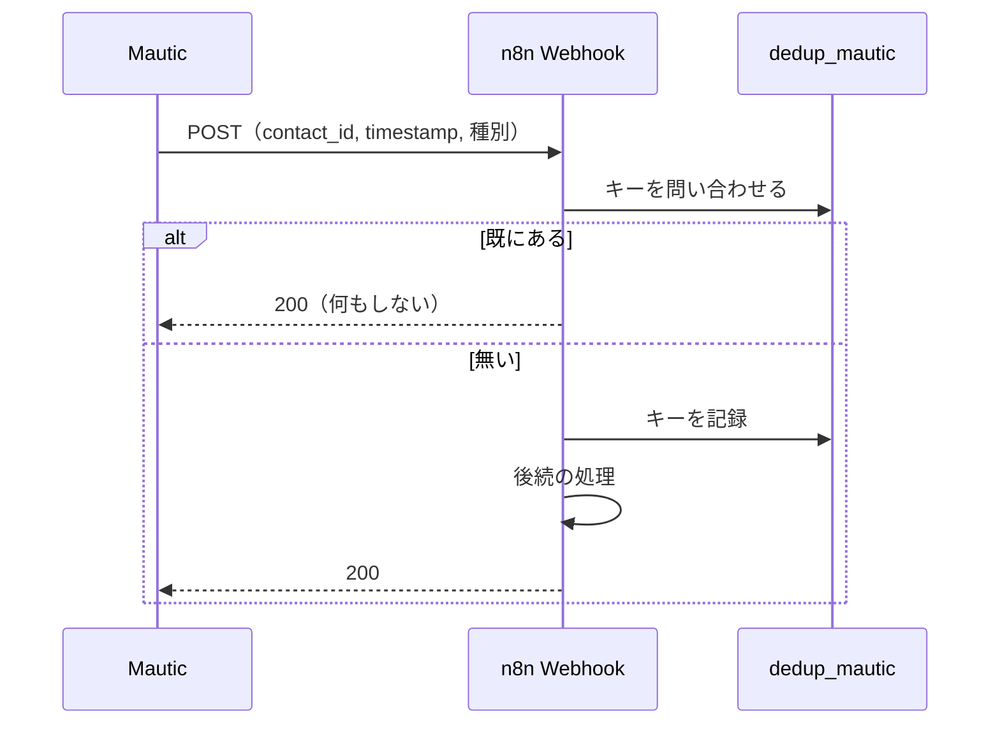
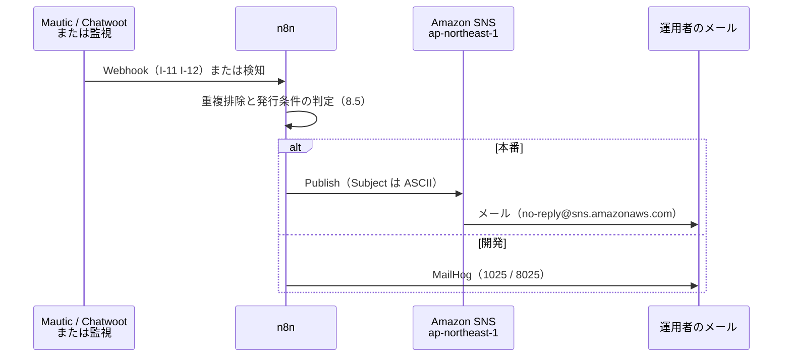

# DD-04 サーバ間通知のフロー

詳細設計層。ID は EA 共通用語集の定義をそのまま使う。横断規約は [DD-01](01-flow-specification-rules.md) を参照する。

**ブラウザもエージェントも介さず、サーバ同士が直接やりとりする 9 本**（`I-01` `I-02` `I-11` `I-12` `I-18` `I-19` `I-21` `I-23` `I-24`）を扱う。

この 9 本は 5 つの性質に分かれる。

| 性質 | 連携 | 特徴 |
|---|---|---|
| **既に動いている**（`実装済み`） | `I-01` `I-02` | 仕様を**実コードから起こして固定する**のがこの層の仕事。設計上の穴が 3 つ見つかった（2.4・3.4） |
| **n8n が受ける Webhook** | `I-11` `I-12` | 冪等性が「要設計」だったもの。DD-01 の 6.2 でキーを与えた |
| **システム間のデータ突合** | `I-18` `I-19` | `I-18` は越境の可否が未決のため**前提待ち**。`I-19` は email の完全一致のみ |
| **外部への通知** | `I-21` | **オンプレの外へ出る唯一の通知経路**（`R1` の 2026-09-17 の決定。ADR-08）。オンプレが全滅しても届く必要があるため、この配置になっている |
| **OpenSEO からの外向きの取得** | `I-23` `I-24` | 起点はエージェントのツール呼び出し（`I-22`。[03 の 6 節](03-operation-path-flows.md)）か人間の操作だが、**外に出る要求は OpenSEO が発する**。`I-23` は**呼ぶたびに費用が発生する唯一の連携**（2026-09-18 に追加。ADR-09・ADR-10） |

## 1. この分類に共通すること

- **発信元が上流システム、受信先が n8n または SaaS。** ブラウザが介在しないため、公開経路を通るのは「外部から n8n に届く Webhook」だけになる（Mautic と Chatwoot はホスト内から n8n を直接叩けるため、本来トンネルは不要。AA-02 の 3.3）。
- **失敗が利用者に見えない。** 6 本とも、失敗しても訪問者の画面には何も起きない。したがって**観測点の設計がこの分類で最も重要**にあたる（DD-01 の 9.2 の「沈黙したこと」）。

## 2. `I-01` Strapi → PostHog（記事イベント）

| 項目 | 値 |
|---|---|
| 発信元 → 受信先 | Strapi（`api::article.article` のライフサイクル）→ PostHog（SaaS・米国） |
| 種別 | `API` |
| 経路 | **SaaS 直接** |
| トリガー | 記事の作成・公開・更新・削除 |
| 同期性 | **同期**（`flush()` の完了まで待つ） |
| タイムアウト | **現状は未設定**（`posthog-node` の既定に依存）。DD-01 の 7.2 は 5 秒と定めたが**未実装**（8 節） |
| リトライ | **しない**（送信失敗は記事の保存を止めない） |
| 冪等キー | **無い。** 同じ操作を 2 回行えばイベントが 2 件出る（AA-02 の I-01） |
| 失敗時の扱い | 記事の保存は成功させる。**送信失敗は記録されない**（8 節） |
| 観測点 | PostHog の Live events ／ Strapi のログ |
| 完成度 | `仕様確定`（実装済みの追認） |

### 2.1 送られるイベント

実装は `backend/strapi-system/src/index.ts`。**`api::article.article` のみ**を購読する。

| イベント名 | 発火条件 |
|---|---|
| `article_created` | `afterCreate` かつ `data.publishedAt` が偽 |
| `article_published` | `afterCreate` かつ `data.publishedAt` が真 ／ `afterUpdate` かつ `data` に `publishedAt` があって真 |
| `article_updated` | 上記以外の `afterUpdate` |
| `article_deleted` | `afterDelete` |

### 2.2 ペイロード

| 項目 | 型 | 値 | 意味 |
|---|---|---|---|
| `distinctId` | string | **固定値 `strapi_cms`** | 操作者ではなくシステムを表す |
| `content_type` | string | 固定値 `article` | 将来コンテンツタイプが増えたときの識別子 |
| `document_id` | string \| number | `result.documentId` ?? `where.documentId` ?? `result.id` ?? `where.id` | `E-04` の同定。`E-13` の `target.identifier` と対応する |
| `locale` | string | `result.locale` ?? `data.locale` | — |
| `$process_person_profile` | boolean | **固定値 `false`** | **person を作らない。** これが無いと `strapi_cms` が `E-08 Person` として作られ、DA-03 の ID 統合を汚す |

### 2.3 `$process_person_profile: false` を外さない

**この 1 行が、サーバ側のイベントと訪問者の `E-08 Person` を分離している。** 外すと `strapi_cms` という person が生まれ、PostHog 上で訪問者と同じ空間に並ぶ。

- `E-08` の正本は PostHog であり（DA-04 の 2 節）、そこにシステム由来の person が混ざると、DA-03 の ID 統合（匿名から実名への昇格）の対象が汚れる。
- `I-02` も同じ理由で person を作らないべきだが、**`capturePostHogException` にはこの指定が無い**（3.4）。

### 2.4 この実装で見つかった設計上の穴 2 つ

**穴 1 非公開化のイベントが存在しない。**

`afterUpdate` の分岐は `'publishedAt' in data && data.publishedAt` である。非公開化（`publishedAt` を `null` にする操作）は `data.publishedAt` が偽になるため、**`article_updated` として送られる**。

BA-05 は「記事の削除・非公開化」を `承認` 分類（`R2`）としているが、**イベントの側では通常の更新と区別できない**。したがって「承認が必要な操作が行われたこと」を PostHog の側から検出できない。

| 対処の案 | 内容 | 評価 |
|---|---|---|
| A 分岐を足す | `'publishedAt' in data && !data.publishedAt` を `article_unpublished` にする | **推奨。** 変更が 1 箇所で済み、既存のイベント名を変えない |
| B 検出を諦める | 非公開化は Strapi の管理画面の操作ログで追う | Strapi 側に監査ログの機能が要る。`CAP-15` の未定義エンティティの問題に合流する |

**A を推奨する。** ただし**この層ではコードを変更しない**（詳細設計の文書であるため）。実装は `E-13` の対象として起票する。

**穴 2 公開済み記事の更新が通常の更新と区別できない。**

公開済みの記事を編集しても、`data` に `publishedAt` が含まれなければ `article_updated` になる。BA-05 は「公開済み記事の更新」を `承認` 分類としているが、これも区別できない。

**穴 1 と同じ構造の問題である。** 承認ゲートの対象になっている操作が、観測の側では通常操作と同じ形で現れる。**`E-13` を経由しない変更の検出**（AA-04 の暴走条件 #8）が、この 2 つの穴の分だけ成立しない。

## 3. `I-02` Strapi → PostHog（例外）

| 項目 | 値 |
|---|---|
| 発信元 → 受信先 | Strapi（`global::posthog-error` ミドルウェア）→ PostHog（Error Tracking） |
| 種別 | `API` |
| 経路 | **SaaS 直接** |
| トリガー | ハンドリングされない例外の発生 |
| 同期性 | 同期（`flush()` を待つ） |
| タイムアウト | 現状は未設定（`I-01` と同じ） |
| リトライ | しない |
| 冪等キー | 無い（例外ごとに 1 件） |
| 失敗時の扱い | **元の例外は必ず再送出される**（`finally` で `throw`）。PostHog への送信失敗は握りつぶされる（3.4） |
| 観測点 | PostHog の Error Tracking |
| 完成度 | `仕様確定`（実装済みの追認） |

### 3.1 送らない例外

実装は `backend/strapi-system/src/middlewares/posthog-error.ts`。**`strapi::errors` の直後**に `global::posthog-error` として入れる（`config/middlewares.ts`）。

| 送らないもの | 理由 |
|---|---|
| `errors.ApplicationError` | 想定内のクライアント応答 |
| `errors.HttpError` かつ `status < 500` | 同上。**管理画面の 404（Preview config not found など）で誤検知するため** |

**この除外は `strapi::errors` の分類を鏡写しにしている。** Strapi 自身が「クライアントの誤り」と判断したものをサーバの障害として数えない、という整理にあたる。

### 3.2 ペイロード

| 項目 | 型 | 値 |
|---|---|---|
| `distinctId` | string | ログイン中の管理者がいれば `strapi-user-<id>`、いなければ `strapi_server` |
| `request_method` | string | `ctx.method` |
| `status_code` | number | `ctx.status` |

### 3.3 `status_code` を信用しない

**`ctx.status` は例外が送出された時点の値であり、Strapi のエラーハンドラが最終的に返す HTTP ステータスとは限らない。** ハンドラに届く前に投げられた例外では、まだ応答のステータスが設定されていない。

- **`E-12` の根拠として `status_code` を単独で使わない**（`invalid_response` の判定などに使わない）。
- 参考値として残すのはよい（例外の種類と組み合わせれば手がかりになる）。

### 3.4 この実装で見つかった設計上の穴 1 つ

**穴 3 例外の二重捕捉の可能性。**

`backend/strapi-system/src/posthog.ts` はクライアントの生成時に `enableExceptionAutocapture: true` を指定している。これは `posthog-node` の自動例外捕捉であり、**ミドルウェアの明示的な `captureException` とは別に動く**。

| 帰結 | 内容 |
|---|---|
| **同じ例外が 2 件記録されうる** | 自動捕捉と明示捕捉の両方が発火した場合 |
| **除外した例外が自動捕捉で送られうる** | 3.1 の除外はミドルウェアの中だけの判断であり、自動捕捉には及ばない。**管理画面の 404 を除外した意図が、自動捕捉の側で破れる可能性がある** |
| AA-02 の記述との差 | AA-02 は `I-02` の冪等性を「無い（例外ごとに 1 件）」としているが、**自動捕捉を勘定に入れていない** |

**実際に二重になっているかは、PostHog の Error Tracking を実地で確認するまで分からない**（`posthog-node` の自動捕捉が Koa のミドルウェアで捕捉済みの例外を拾うかどうかは、バージョンに依存する）。

- **確認の手順**: Strapi で意図的に 500 を発生させ、PostHog の Error Tracking に 1 件出るか 2 件出るかを数える。
- **二重だった場合の対処**: `enableExceptionAutocapture` を `false` にする（ミドルウェア側の除外規則を正とする）。
- **この確認を `E-12` として記録する**（`source: posthog`）。以後の例外件数の読み方が変わるため。

**`I-02` にも `$process_person_profile: false` が無い。** `capturePostHogException` は properties にこの指定を渡していないため、`strapi_server` や `strapi-user-<id>` が person として作られうる。`I-01` と揃えるべきかどうかは 8 節に上げる。

## 4. `I-11` Mautic → n8n（Webhook）

| 項目 | 値 |
|---|---|
| 発信元 → 受信先 | Mautic → n8n（5678） |
| 種別 | `Webhook` |
| 経路 | **ホスト内**（Mautic から n8n へは直接到達できるためトンネル不要） |
| トリガー | コンタクトの作成・更新、フォーム送信 |
| 同期性 | 非同期（n8n は受領して即座に 200 を返す） |
| タイムアウト | n8n 側の既定に従う |
| リトライ | **Mautic 側の再送に任せる。** n8n からは再試行しない |
| 冪等キー | **`contact_id` + webhook の `timestamp`（秒精度）。** 保存先 n8n の Data Table `dedup_mautic`、保持 7 日（DD-01 の 6.2） |
| 失敗時の扱い | 重複なら何もせず 200 を返す（上流に再送させない）。処理の失敗は `E-15` に残す |
| 観測点 | n8n の実行履歴 ／ `dedup_mautic` の行数 |
| 完成度 | `条件付き`（n8n のワークフロー作成は `承認` 分類・`R1`） |

### 4.1 受領の形



図は To-Be を描いている。**As-Is では n8n のワークフローが 0 件**であり、この経路は存在しない。

**重複でも 200 を返す。** エラーを返すと Mautic が再送を続け、同じ重複が繰り返し届く。

### 4.2 スコア加算を 1 回に抑える

BA-04 のトスアップ条件は「1 回の送信につき加算する」前提で書かれている。**`I-08` の二重送信がここまで届くと、スコアが 2 回加算される。**

- **冪等キーの重複排除がこれを止める**（DD-01 の 6.3 の第 2 層と第 3 層の中間に位置する防御）。
- ただし**別日の再送信は別のキーになる**ため、同一 email が翌日また送ればスコアは加算される。これは仕様として正しい（別の日の意思表示は別の行動）。

### 4.3 n8n の Data Table が Git の外にある

重複排除の状態を n8n の Data Table に置くと、**その状態は Git の管理外になる**（AA-04 の 3.3.1 が「戻せない適用先」の筆頭に n8n を挙げている理由と同じ構造）。

| 帰結 | 内容 |
|---|---|
| 状態を失うと重複排除が効かなくなる | n8n のボリュームを作り直すと `dedup_mautic` が空になり、7 日以内の再送がすべて通る |
| バックアップの対象に含める必要がある | TA-05 のバックアップ設計に引き渡す |
| **代替が無い** | 静的サイトにサーバ側の受け口が無く、Strapi に自前の API を増やすのは適用範囲を広げすぎる |

**受容したうえでバックアップの対象に含める**、というのがこの層の判断にあたる（未決定事項に上げる）。

## 5. `I-12` Chatwoot → n8n（Webhook）

| 項目 | 値 |
|---|---|
| 発信元 → 受信先 | Chatwoot → n8n（5678） |
| 種別 | `Webhook` |
| 経路 | **ホスト内** |
| トリガー | 会話の作成、メッセージの受信 |
| 同期性 | 非同期 |
| タイムアウト | n8n 側の既定 |
| リトライ | Chatwoot 側の再送に任せる |
| 冪等キー | **`display_id` + `message_id`。** 保存先 `dedup_chatwoot`、保持 7 日 |
| 失敗時の扱い | `I-11` と同じ（重複なら 200） |
| 観測点 | n8n の実行履歴 ／ `dedup_chatwoot` の行数 |
| 完成度 | `条件付き`（同上） |

### 5.1 `display_id` を使う理由

**他システムに会話 ID を保存するときは必ず `display_id` を使う**（AA-02 の 2.1）。内部 ID とは別であり、**後から人間が Chatwoot の画面で照合できるのは `display_id` のほうだけ**である。

この規則は `E-12`・社内メモ・冪等キーのすべてに及ぶ。

### 5.2 Webhook は監査ログの代わりにならない

DA-05 は Chatwoot の監査ログが Enterprise 機能であることへの代替として、Webhook で変更を拾う案を挙げている。**この層ではその代替を採らない。**

**理由は 1 つ。Webhook を止められる主体が、変更を隠せるためである**（AA-04 の 6 節が既に指摘）。監査ログは記録される側が止められないが、Webhook は設定で無効化できる。**「止められる記録」を監査の根拠にすると、監査が成立していないことに気づけない。**

`I-12` は運用の自動化（会話の一次切り分けの起動）に使い、**AA-04 の暴走条件 #8 の歯止めには使わない。**

## 6. `I-18` Mautic → PostHog（書き戻し）

| 項目 | 値 |
|---|---|
| 発信元 → 受信先 | Mautic → PostHog（person への書き戻し） |
| 種別 | `Webhook` |
| 経路 | SaaS 直接（越境する） |
| トリガー | email の取得（匿名から実名への昇格） |
| 同期性 | — |
| タイムアウト | — |
| リトライ | — |
| 冪等キー | **定義しない**（6.1） |
| 失敗時の扱い | — |
| 観測点 | — |
| 完成度 | **`前提待ち`** |

### 6.1 なぜキーの形すら決めないか

AA-02 は `I-18` を「越境の可否が決まるまで実装しない」とし、冪等性を「要設計」としている。**この層では設計に着手しない。**

理由は、**冪等キーの設計自体が越境の判断に依存するため**である。

| キーの候補 | 越境するもの |
|---|---|
| `email` そのもの | **個人データそのもの** |
| `email` のハッシュ（SHA-256 など） | **仮名化された個人データ。** 同じ email から同じ値が出る以上、照合可能であり個人データとして扱うのが妥当 |
| Mautic 側の `contact_id` | **PostHog 側で照合する相手が無い。** `distinct_id` と対応付けるには結局 email の経路が要る |

**どの候補も越境の可否の判断の対象になる。** 「キーだけ先に決めておく」ことができない、という構造になっている。

### 6.2 ワークフローは作れる状態にしておくが有効化しない

AA-02 の 3.3 の方針をそのまま守る。**n8n のワークフローを作れる状態にはしておくが、有効化しない。**

- 有効化を `E-13` の対象にする場合、`change.kind` は `config_change`（承認者 `R1`）になる。
- **越境の可否が決まる前に有効化された場合、DA-05 の個人情報の区分に反する。** 有効化の操作が n8n の UI から行えてしまうため、**この歯止めは承認の約束にとどまる**（到達不能性にならない）。

## 7. `I-19` Chatwoot → Mautic（email 突合）

| 項目 | 値 |
|---|---|
| 発信元 → 受信先 | Chatwoot（`E-10`）→ Mautic（`E-09`） |
| 種別 | `API` |
| 経路 | **ホスト内** |
| トリガー | 会話に email が現れたとき |
| 同期性 | 同期（突合の問い合わせ） |
| タイムアウト | Chatwoot 側 12 秒 / Mautic 側 30 秒（DD-01 の 7.2） |
| リトライ | DD-01 の 5.2 の既定に従う |
| 冪等キー | **不要**（email の完全一致は冪等） |
| 失敗時の扱い | **一致しない場合は統合せず匿名のまま残す** |
| 観測点 | `E-12`（`source: chatwoot`）に突合できた件数と、できなかった件数の両方を記録 |
| 完成度 | `条件付き`（`I-07` と `I-08` の双方が通り、突合対象が生まれること） |

### 7.1 突合の規則

| 項目 | 値 |
|---|---|
| キー | **`lower(email)` の完全一致のみ** |
| 部分一致・あいまい一致 | **行わない**（誤った統合は不可逆） |
| 一致しなかった場合 | 統合せず匿名のまま残す。**エラーにしない** |
| 一致が複数あった場合 | **統合しない。** 人間に返す（`E-12` に記録する） |

**`lower()` を掛けるのは `I-08` と揃えるため**（DD-02 の 5.3 で email をブラウザ側で小文字化すると決めた）。3 か所（ブラウザ・Mautic の統合・この突合）を同じ規則にすることで、大文字小文字で割れる事故を防ぐ。

### 7.2 `chatwoot_merge_contacts` を自動実行しない

**統合は不可逆であり、`full` でのみ公開される操作である**（AA-03 の 2.1）。`agent/conversation-triage` の `CHATWOOT_ACCESS_LEVEL` は `read_write` のため、**そもそもツールが登録されない。**

- **この経路は「対応付けを記録する」までで、統合そのものは行わない。** 対応付けの記録先は `E-12` であり、実際に統合するかどうかは人間（`R1`）が判断する。
- BA-05 は「Mautic / Chatwoot のレコード削除」を `承認`（`R1`）としており、統合は削除に準じる不可逆操作として同じ扱いにする。

## 8. `I-21` n8n → Amazon SNS（通知）

| 項目 | 値 |
|---|---|
| 発信元 → 受信先 | n8n（5678）→ Amazon SNS（`ap-northeast-1`）→ **メール（運用者）** |
| 種別 | `API` |
| 経路 | **オンプレ → AWS**（TA-01 の経路 10）。ngrok を通らない |
| トリガー | 顧客からの要求（`I-11` `I-12` 経由）／ 監視の**状態遷移**（8.5） |
| 同期性 | 同期（`Publish` の応答を待つ） |
| タイムアウト | **10 秒**（通知のためにワークフローを長く止めない） |
| リトライ | `unreachable` 2 回 / `timeout` 1 回。**`permission_denied` は再試行しない**（DD-01 の 5.2） |
| 冪等キー | **無い。** Standard トピックは at-least-once のため重複配信がありうる（8.6） |
| 失敗時の扱い | **通知の失敗で顧客対応もループも止めない。** `E-15` に残す |
| 観測点 | 運用者の受信箱 ／ n8n の実行履歴 ／ **`Confirmed` の購読数**（TA-05 の項目 8） |
| 完成度 | `条件付き`（トピックの作成・購読の確認は**人間の作業**） |



図は To-Be を描いている。**As-Is では SNS のトピックが 0 件、購読が 0 件、n8n のワークフローも 0 件**であり、この経路は存在しない（権限だけは実地に確認済み）。

### 8.1 トピックと購読

**`R1` の 2026-09-17 の決定**（ADR-08）。**トピックを 2 本に分ける。**

| トピック | 何を送るか | 宛先 | 緊急度 |
|---|---|---|---|
| `comegin-lead-alert` | 顧客からの要求（フォーム送信・会話の開始・MQL 到達） | `R3`（データアナリスト） | 営業時間内 |
| `comegin-ops-alert` | 監視の検知（TA-05 の項目 1・2・3・6・7） | `R1`（Web マスター） | 即時 |

- **購読の確認は受信者の手作業であり、自動化できない。** 担当者変更の手順（BA-05）に購読の追加と削除を含める。
- **確認はメールのリンクを踏まず、AWS コンソールに確認 URL を貼り付けて行う**（TA-04 の 1 節）。解除リンクを含むメールを受信箱に残さないため。
- **開発環境では SNS を使わず MailHog に送る**（1025 / 8025）。SNS のトピックを開発用に増やすと、購読の確認が環境の数だけ必要になる。

### 8.2 メッセージの形

**`Subject` は ASCII のみ**（AWS のリファレンスに明記。100 文字未満・改行不可）。**したがって日本語の件名は使えない。** 会社名は件名ではなく本文に置く。

```
Subject: [comegin] lead: demo-requested (contact 1234)

Message:
  種別: demo-requested
  会社名: 株式会社○○
  Mautic contact_id: 1234
  流入記事: /blog/saas-kpi
  受付: 2026-09-17 08:40 JST
  確認: Mautic のコンタクト画面を見る
```

| 項目 | 型 | 必須 | 置き場 |
|---|---|---|---|
| 種別（`demo-requested` / `trial` / `wp-download` / `mql` / `conversation-opened`） | string | **必須** | Subject と本文 |
| 各システムの ID（`contact_id` / `display_id`） | number | **必須** | Subject と本文 |
| **会社名** | string | 任意 | **本文のみ**（日本語のため Subject に置けない） |
| 流入記事のパス | string | 任意 | 本文 |
| 受付時刻（JST） | string | **必須** | 本文 |

- **Subject だけで種別と件数が分かるようにする。** 受信箱で並べたときに、本文を開かずに優先度を判断できる必要があるため。
- **本文は UTF-8 で日本語を置く。** ただし**メール配信時の文字化けの有無は配線時に実地確認する**（本セッションでは実際に配信して確認していない）。

### 8.3 載せないもの

**email・氏名・問い合わせ本文・会話本文は載せない**（DA-05 の 1.3）。

理由は 2 つ。**SNS（AWS）と各運用者のメールボックスという保管先が 2 つ増える**こと、そして**メールボックスの保持期間をこちらから制御できない**ことである。転送されればさらに広がる。

**`comegin-ops-alert` には個人情報を一切載せない**（システムの状態を伝えるものであり、顧客のデータを含める理由が無い）。

**この規則は `E-12` と `E-13` の扱いと同じ形にあたる**（要旨と ID だけを残し、本文は元のシステムを見に行く。AA-03 の 3.4、DA-04 の 2 節）。

### 8.4 購読解除による沈黙

**SNS の通知メールには購読解除リンクが付いており、転送を受けた人でも解除できる。** 解除されると**通知が静かに止まる** — DD-07 の 1 節が「最も気づけない異常」とした沈黙にあたる。

| 対処 | 内容 | 種別 |
|---|---|---|
| トピックポリシーで `sns:Unsubscribe` を制限する | TA-04 の 1 節 | 到達不能に近い |
| 確認 URL をコンソールに貼り付けて購読する | 解除リンクを含むメールを残さない | 運用上の約束 |
| **`Confirmed` の購読数を監視する** | TA-05 の項目 8 | **検出** |

**3 つ目が本命である。** 1 と 2 は解除を起きにくくするだけで、0 にはできない。

**ただしこの監視の結果は SNS では知らせられない**（通知経路そのものが壊れている場合があるため）。**監視の連鎖がここだけ閉じていない**（TA-05 の未決定事項）。

### 8.5 無料枠を守る発行条件

SNS の無料枠は**月 1,000 通**（超過分は $2.00/100,000 通）。CV が月 100 件規模なら十分だが、**監視通知が枠を食い潰しうる**。

| 通知 | 発行条件 |
|---|---|
| 顧客からの要求 | **発生のたびに 1 通。** BA-04 の表で「通知しない」とされているもの（ホワイトペーパー DL）は発行しない |
| 監視の検知 | **状態が遷移したときだけ**（`ok → ng` と `ng → ok`）。**`ng` が続いている間は発行しない** |

**監視を 5 分間隔で回して毎回通知すると、1 日で枠を超える**（288 通/日 × 監視項目数）。状態遷移に絞ることが、無料枠を守る唯一の条件にあたる。

### 8.6 重複配信を許容する

Standard トピックは at-least-once であり、**同じ通知が 2 回届きうる**。**冪等キーを設けない。**

- 通知の重複は害が小さい（`I-08` の二重送信と違い、KPI を汚染しない）。
- `I-11` `I-12` の重複排除（DD-01 の 6.2）を通った後に発行するため、**同じ顧客の要求から 2 通出ることは起きにくい**。残るのは SNS 自身の重複配信だけである。
- **重複を排除する仕組みを入れると、そのための状態をどこかに持つことになる**（`I-11` の Data Table と同じ問題）。害の小ささに見合わない。

## 9. `I-23` OpenSEO → DataForSEO（検索データの問い合わせ）

| 項目 | 値 |
|---|---|
| 発信元 → 受信先 | OpenSEO（3001）→ DataForSEO API |
| 種別 | `API` |
| 経路 | **オンプレ → 外部 SaaS**（TA-01 の経路 11）。ngrok を通らない |
| トリガー | `I-22` の調査系ツールの呼び出し ／ OpenSEO 内部のランク追跡のスケジュール |
| 同期性 | 同期（OpenSEO がツールの応答として返す） |
| タイムアウト | OpenSEO の実装に従う（こちらからは `I-22` の側で切る。[03 の 6 節](03-operation-path-flows.md)） |
| リトライ | **こちらからは再試行しない**（DD-01 の 5.2 の回数を 0 に上書きする）。再試行はそのまま 2 回目の課金になる |
| 冪等キー | **無い。同じ問い合わせでも毎回課金される** |
| 失敗時の扱い | **残高不足は `permission_denied` に分類する**（再試行しても通らない。DD-01 の 5.3）。その日の調査を止め、`R1` に残高の補充を求める |
| 観測点 | DataForSEO の残高と当月の支出（TA-05 の項目 11） ／ `I-22` の `fetch.outcome` |
| 完成度 | `仕様確定`（API キー設定済み。予算の監視手段だけが未定） |

### 9.1 送るものと送らないもの

| 送る | 送らない |
|---|---|
| キーワード（シード・候補） | **会話本文・フォームの入力・コンタクトの属性**（DA-05 の 1.2.1） |
| ドメイン（自サイト・競合） | 自サイトの非公開の URL（管理画面・プレビュー） |
| 地域コードと言語コード（**日本・日本語に固定**） | — |

- **市場を日本に固定する。** OpenSEO のプロジェクトの既定の市場（As-Is はローカルもホスト版も米国・英語の `Default`）がそのまま使われると、**検索ボリュームも順位も別の国の値になる**。セルフホストのプロジェクトを作るときに、日本（`locationCode`）と日本語を既定にする（人間の作業。`seo-project-setup` スキル）。

### 9.2 費用の縛り方

**費用の縛りは 3 段である**（AA-05 の ADR-10）。

| 段 | 何が効くか | 種別 |
|---|---|---|
| 1 回 | 見積もり 2,000 クレジット超は `R2` の承認。**ツールの引数で上限を指定できるのはランク追跡の実行だけ**（`maxCostCredits`） | 約束 |
| 月次 | 10 USD（暫定）。8 割で `comegin-ops-alert` に通知（TA-05 の項目 11） | 監視 |
| 絶対 | **DataForSEO の前払い残高**。残高を超える支出は起きない | 到達不能 |

- **エージェントは `I-23` を直接呼べない。** 呼べるのは `I-22` の許可リストにあるツールだけであり、DataForSEO の資格情報は OpenSEO の環境変数にあって読めない（`PreToolUse` フック）。
- **ランク追跡のスケジュールによる `I-23` は、エージェントが 1 度も呼ばなくても発生する。** 設定は `承認`（`R2`）であり、設定した後の支出は月次の監視でしか見えない。

## 10. `I-24` OpenSEO → 公開サイト（サイト監査のクロール）

| 項目 | 値 |
|---|---|
| 発信元 → 受信先 | OpenSEO（3001）→ 公開サイト（CloudFront） |
| 種別 | `API`（HTTP のクロール） |
| 経路 | **オンプレ → AWS**（TA-01 の経路 13） |
| トリガー | **人間（`R1`）が OpenSEO の画面で実行する**（エージェントには `run_site_audit` を許可しない。AA-03 の 2.4） |
| 同期性 | 非同期（バックグラウンドで実行し、状態を問い合わせる） |
| タイムアウト | OpenSEO の実装に従う |
| リトライ | OpenSEO の実装に従う（レート制限に当たると速度を落として再試行し、それでも取れないページは「取得できなかった」と記録する） |
| 冪等キー | 不要（同じ成果物に対しては同じ結果） |
| 失敗時の扱い | 「取得できなかった」ページを**問題なしと数えない**。`E-12`（`source: site_audit`）の `note` に件数を書く |
| 観測点 | OpenSEO の監査の状態（`get_audit_status`） ／ `docs/audits/site_audit/` |
| 完成度 | `条件付き`（公開サイトが存在すること。`I-20`） |

- **監査するのは `SITE_URL` のホストだけである**（BA-05 で自サイト以外は `禁止`）。
- **監査の中の Lighthouse 実行が Umami に数えられないかを確認する**（AA-02 の未決定事項）。数えられる場合、週次の監査が `SESSION-count` を押し上げ、CVR の分母が汚れる。
- **Lighthouse CI（`I-10`）とは役割が違う。** `I-10` はビルドごとの 1 URL の合成監査で、しきい値でビルドを止める。`I-24` は公開後のサイト全体の構造監査で、止める機能を持たない。**`I-24` の結果で `LH-seo` の停止条件（AA-04 の 3.2）を発動しない。**

## 11. 未決定事項

- **`I-01` `I-02` にタイムアウトが実装されていない。** DD-01 の 7.2 で 5 秒と定めたが、現状のコードは `posthog-node` の既定に依存する。**`flush()` を待つ設計のため、PostHog が遅いと記事の保存の応答が遅れる。** 実装は `E-13`（`change.kind: technical_seo`）として起票する。判断者 `R1`。
- **`I-01` の穴 1・穴 2（非公開化と公開済み更新が区別できない）。** 2.4 で対処案 A を推奨したが、この層ではコードを変更しない。`E-13` として起票する。判断者 `R2`（承認ゲートの対象に関わるため）。
- **`I-02` の穴 3（例外の二重捕捉）。** 実地確認が要る。確認するまで PostHog の例外件数を `E-12` の根拠に使わない。判断者 `R1`。
- **`I-02` に `$process_person_profile: false` を足すか。** `I-01` と揃えるのが一貫するが、Error Tracking では person があるほうが追跡しやすいという別の理屈もありうる。DA-03 の ID 統合への影響を `R3` と確認する。
- **`I-01` `I-02` の送信失敗が記録されない。** どちらも送信失敗を握りつぶす設計であり（記事の保存と元の例外を優先するため妥当）、**失敗したこと自体がどこにも残らない**。DD-01 の 9.2 の「沈黙したこと」の典型例にあたる。記録先を作るかどうかは TA-05 の監視設計待ち。
- **n8n の Data Table（`dedup_mautic` / `dedup_chatwoot`）を Git の外に置くことの受容。** 4.3 で「受容してバックアップの対象に含める」としたが、バックアップの設計は TA-05 の担当であり、まだ無い。判断者 `R1`。
- **`I-21` の本文の日本語が文字化けしないかを実地確認していない**（8.2）。`Subject` の ASCII 制約は AWS のリファレンスで確認済みだが、本文の UTF-8 がメール配信でどう扱われるかは実際に送るまで分からない。**文字化けする場合、会社名を載せる決定（DA-05 の 1.3）が成立しない。**
- **`I-21` の購読状態の監視結果を何で知らせるかが未定**（8.4）。通知経路の異常を通知経路で知らせられないという循環があり、TA-05 の未決定事項として残っている。
- **SNS の無料枠（月 1,000 通）を超えたときの挙動を決めていない**（8.5）。超過しても配信は止まらず課金されるだけだが、**CloudFront のフラットレート Free（超過課金が無い）と姿勢が違う**。上限に達したら通知を止めるのか、課金を受け入れるのかを決めていない。判断者 `R1`。
- **`I-18` の有効化を到達不能にする手段が無い。** 6.2 のとおり、n8n の UI から有効化できてしまう。越境の可否が決まるまで、この経路は**承認の約束だけで守られている**状態が続く。
- **DataForSEO の残高不足がどういう応答で返るかを実地確認していない**（9 節）。`permission_denied` に分類するとしたが、OpenSEO が残高不足をどのエラーに変換して MCP に返すかは、残高を使い切ってみないと分からない。
- **OpenSEO のランク追跡のスケジュールが Docker 版で動くか未確認**（9.2）。**実機で初めて週次の追跡を設定したときに確認する**（`R1` の 2026-09-18 の判断）。動かない場合、`I-23` は `I-22` 経由の呼び出しだけになり、週次の順位計測は人間の手動実行に依存する。判断者 `R1`。
