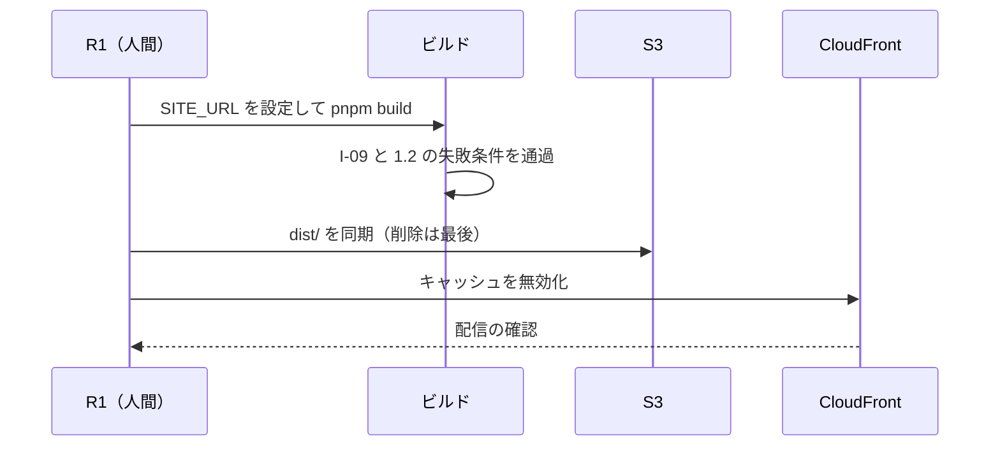
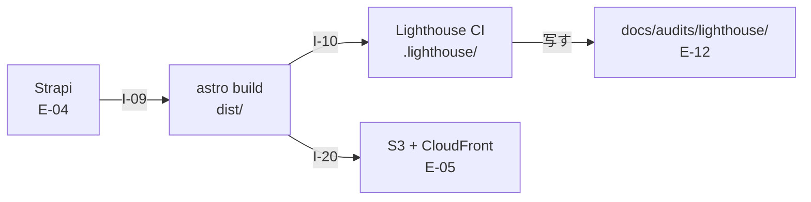

# DD-05 ビルドと配信のフロー

詳細設計層。ID は EA 共通用語集の定義をそのまま使う。横断規約は [DD-01](01-flow-specification-rules.md) を参照する。

**`E-05 Page` を生み、測り、届ける 3 本**（`I-09` `I-10` `I-20`）を扱う。

この 3 本は**決定論的**である点で他のフローと違う。同じ入力からは同じ成果物が出る（AA-02 のカタログで `I-09` `I-10` `I-20` の冪等性がいずれも「有り」になっているのはこのため）。したがってこの層の仕事は冪等性の設計ではなく、**失敗させるべき条件を正しく失敗させること**にある。

## 1. `I-09` Strapi → Astro（ビルド時のデータ取得）

| 項目 | 値 |
|---|---|
| 発信元 → 受信先 | Strapi（1337）→ Astro（`frontend/verdant-virgo`） |
| 種別 | `ビルド` |
| 経路 | **ビルド時**（同一ホスト内。トンネルを通らない） |
| トリガー | `pnpm build` の実行 |
| 同期性 | 同期 |
| タイムアウト | **1 リクエスト 20 秒 / ビルド全体 5 分**（DD-01 の 7.2） |
| リトライ | `unreachable` 2 回 / `timeout` 1 回。**それでも失敗したらビルドを失敗させる** |
| 冪等キー | 不要（同じコンテンツからは同じ成果物） |
| 失敗時の扱い | **ビルドを失敗させる**（1.2） |
| 観測点 | ビルドの終了コード ／ 生成されたページ数 |
| 完成度 | `条件付き`（Strapi に公開記事が 1 件以上あること／`SITE_URL` の設定） |

### 1.1 MCP を使わない

**Strapi の REST API をビルド時に直接呼ぶ。** `strapi-mcp` を経由させない（AA-02 の 3.2）。

理由をこの層の言葉で言い直すと、**MCP はモデルのための層であり、その特性がビルドに有害だから**である。

| MCP の特性 | ビルドにとって何が問題か |
|---|---|
| `CHARACTER_LIMIT`（25,000 文字）で件数を削る | **記事が静かに減った成果物ができる。** `fitToLimit()` は応答サイズで削るため、何件になるかがビルドのたびに変わりうる |
| `LONG_TEXT_LIMIT`（1,000 文字）で長文を省略する | **本文が途中で切れた記事ページが公開される** |
| `sanitize()` がキーを伏せる | 公開してよい値まで `[redacted]` になりうる |

**決定論的な処理に、応答サイズで結果が変わる層を挟まない。**

### 1.2 失敗させる条件

| 条件 | 挙動 | 理由 |
|---|---|---|
| **`SITE_URL` が未設定** | **例外で停止**（実装済み。`astro.config.mjs`） | 未設定だと sitemap と canonical に `localhost` が焼き込まれ、**警告も出ないまま公開される** |
| **Strapi が停止している** | **ビルドを失敗させる** | 記事 0 件のサイトが黙って公開されると、検索エンジンに空のサイトがインデックスされる |
| **記事が 0 件** | **ビルドを失敗させる** | 同上。「取得できたが 0 件」（`empty_but_ok`）は、ビルドにおいては成功ではない |
| 一部の記事の取得に失敗 | **ビルドを失敗させる** | 部分的に欠けたサイトを公開しない |

**`empty_but_ok` の扱いが観測と逆になる。** DD-01 の 4.2 は `empty_but_ok` を成功として扱うと決めたが、**それは観測の文脈での話**である。ビルドでは 0 件は失敗にあたる。

- 観測の 0 件は「事実の記録」だが、ビルドの 0 件は「公開してはいけない成果物」である。
- **この非対称を実装で混同しない。** `I-09` は `fetch.outcome` の分類を使わず、独自に失敗させる。

### 1.3 取得する内容

| エンティティ | Strapi のコンテンツタイプ | 用途 | 現状 |
|---|---|---|---|
| `E-04 Content` | `api::article.article` | 記事ページの生成 | `実装済み`（ただし 6 件すべてサンプルで全件 `draft`） |
| `E-01 Keyword` | `api::keyword.keyword` | メタ情報・内部リンクの生成 | **コンテンツタイプが未作成** |
| `E-03 ContentPlan` | `api::content-plan.content-plan` | 構成の反映 | **同上** |
| `E-06 CTA`（表示定義） | Strapi のコンポーネント | CTA の埋め込み。`mautic_form_id` を `I-08` に渡す | **未作成** |

**`publishedAt` が `null` の記事を取得しない。** 現在の 6 件はすべて `draft` であるため、この条件で取ると 0 件になり 1.2 によりビルドが失敗する。**これは正しい挙動である**（公開記事が無い状態でサイトを公開しない）。

### 1.4 `E-05` は直接書き換えられない

`E-05 Page` は Astro のビルド成果物であり、作用は必ず `E-04` かコードのどちらかを変えて再ビルドする経路を通る（DA-04 の 1.3）。

**`dist/` を直接編集しない。** `dist/` は `.gitignore` に入っており、次のビルドで消える。`E-13` の `rollback.procedure` に「`dist/` のファイルを戻す」と書いてはならない（AA-04 の 3.3.1 の「Git の操作を書かない」と同じ理由で、**戻したつもりが戻っていない**という失敗になる）。

## 2. `I-10` Astro → Lighthouse CI

| 項目 | 値 |
|---|---|
| 発信元 → 受信先 | Astro の preview（4322）→ Lighthouse CI → `.lighthouse/` |
| 種別 | `ファイル` |
| 経路 | **ビルド時**（同一ホスト内） |
| トリガー | `pnpm lh`（`astro build && lhci autorun`） |
| 同期性 | 同期 |
| タイムアウト | LHCI の既定に従う（3 回計測のため 1 回が重い） |
| リトライ | **しない**（3 回計測の中央値を取る仕組みが既にばらつきを吸収している） |
| 冪等キー | 不要 |
| 失敗時の扱い | **しきい値未達でコマンドが失敗する。** この失敗を無視して適用を続けない（AA-04 の 3.2） |
| 観測点 | `.lighthouse/manifest.json` ／ コマンドの終了コード |
| 完成度 | `仕様確定` |

### 2.1 出力の形

`lighthouserc.cjs` の `upload.target` が `filesystem`（`outputDir: './.lighthouse'`）のため、外部に公開されない。出力は次の 4 ファイル。

```
.lighthouse/
├── manifest.json                                  3 回分の要約と代表実行の指定
├── localhost--<YYYY_MM_DD_HH_MM_SS>.report.json   ×3
└── localhost--<YYYY_MM_DD_HH_MM_SS>.report.html   ×3
```

`manifest.json` は配列で、1 要素が 1 回の計測にあたる。

| 項目 | 内容 |
|---|---|
| `url` | 計測した URL（現状は `http://localhost:4322/` の 1 本のみ） |
| `isRepresentativeRun` | **`true` の 1 件が中央値の代表。** `E-12` にはこれを使う |
| `summary` | `performance` / `accessibility` / `best-practices` / `seo` の 4 スコア |
| `jsonPath` / `htmlPath` | **絶対パスが焼き込まれる**（2.4） |

### 2.2 `E-12` への変換仕様

`agent/seo-auditor` が `.lighthouse/manifest.json` を読んで `E-12` を生成する。

```yaml
audit_id: AUD-2026-0916-lighthouse-0003
source: lighthouse
target:
  kind: page
  identifier: /            # manifest の url からサイト内パスだけを取る
metrics:
  LH-performance: 1.00
  LH-accessibility: 1.00
  LH-best-practices: 1.00
  LH-seo: 1.00
ref: .lighthouse/localhost--2026_09_16_04_59_22.report.json   # 相対パスに直す（2.4）
fetch:
  outcome: ok
  attempts: 1
  correlation_id: 01JBQZ8F3K7XN2M5V9TWRC4HED
  measured_at: 2026-09-16T13:59:22+09:00                      # JST に変換する（2.3）
tunnel_up: true            # 計測時にトンネルが生きていたか（2.5）
```

**`isRepresentativeRun: true` の 1 件だけを `E-12` にする。** 3 件すべてを記録すると、`E-13` の `evidence` がどれを指すかで解釈が割れる。

### 2.3 ファイル名のタイムスタンプは UTC

**`localhost--2026_09_16_04_59_22.report.json` の `04_59_22` は UTC である**（実際の計測は JST 13:59）。

DD-01 の 4.3 は `measured_at` を JST の ISO 8601 と定めたので、**変換が要る**。

- 変換を忘れると、**`E-12` が 9 時間前にずれる**。日次の観測では日付がまたぐ場合があり、「昨日の観測が無い」という誤検知につながる。
- **`report.json` の中の `fetchTime`（ISO 8601・UTC）を使うほうが安全**（ファイル名を解釈するより、値を読んで変換するほうが壊れにくい）。

### 2.4 `jsonPath` を `ref` にそのまま転記しない

`manifest.json` の `jsonPath` と `htmlPath` は**実行環境の絶対パス**が入る（`/home/kamegin/ComeGin/...`）。

**`E-12` の `ref` にそのまま書くと、別の環境では解決できない参照になる。** `E-13` は Git 経由で GitHub に載り、他の環境から読まれるため、絶対パスは必ず壊れる。

- **`frontend/verdant-virgo/` を起点とした相対パスに直してから記録する。**
- ただし**`.lighthouse/` は `.gitignore` に入っている**ため、相対パスに直しても**参照先のファイルが Git には無い**（2.5）。

### 2.5 `.lighthouse/` は Git に無く、毎回上書きされる

これが `I-10` の状態が `未配線` である理由にあたる（`pnpm lh` は実行できるが、**結果を `E-12` として継続的に蓄積する経路が無い**。AA-01 の 2 節）。

| 事実 | 帰結 |
|---|---|
| `.lighthouse/` は `.gitignore` に入っている | **観測の原本が Git に残らない** |
| `pnpm lh` のたびに上書きされる | **前回の計測結果が消える。** 定点観測が成立しない |

**したがって「蓄積」は、計測直後に追跡対象のディレクトリへ写す操作としてしか実装できない。**

| 写すもの | 写す先 | 理由 |
|---|---|---|
| `E-12`（要約した YAML + Markdown） | `docs/audits/lighthouse/<audit_id>.md` | **これが正本になる。** `E-13` の `evidence` はこれを指す |
| 代表実行の `report.json` | **写さない** | 1 ファイル 300KB 超。毎日 Git に積むとリポジトリが肥大する |
| `report.html` | **写さない** | 同上（500KB 超） |

**`E-12` に必要なのはスコアと `ref` であって、レポートの全文ではない**（DA-04 の 2 節「値そのものを複製せず `ref` と `summary` だけを置く」）。ただし**`.lighthouse/` は上書きされるため、`ref` が指す先は次の計測で消える**。

- **`ref` は「再取得できるクエリ」として書く**（DA-04 の 2 節の定義）。Lighthouse の場合は「同じコミットに対して `pnpm lh` を再実行すれば同じ値が得られる」という意味になるので、**`ref` にはファイルパスではなくコミット SHA を書くほうが要件に合う。**
- これは DA-04 の定義に照らした解釈であり、**DA を書き換えるものではない**。5 節に上げる。

### 2.6 計測対象が 1 URL しかない

**`lighthouserc.cjs` の `url` は `http://localhost:4322/` の 1 本だけである。**

したがって現状では、`LH-seo` 1.0 の死守ライン（AA-04 の 3.2）は**トップページにしか掛かっていない**。

| `I-09` が通った後に起きること | 帰結 |
|---|---|
| 記事ページが生成される | **記事ページは計測されない** |
| `content_rewrite` の提案が記事を変える | **その効果を Lighthouse では測れない**（`E-13` の `expectation.metric` に `LH-*` を使えない） |
| 記事ページの SEO が劣化する | **検知されない。** トップページのスコアは 1.0 のまま |

**`I-09` を通すのと同時に、計測対象の URL を増やす。** 後回しにすると、「記事を公開したが SEO は測っていない」期間が生まれる。

| 案 | 内容 | 評価 |
|---|---|---|
| A 全記事を計測する | `url` に全ページを列挙する | 記事が増えると計測時間が線形に伸びる（1 URL あたり 3 回計測） |
| **B 代表ページを固定する** | トップ + 記事一覧 + **代表記事 1 本**の 3 URL | **推奨。** 計測時間が一定で、ページ種別ごとの劣化を検知できる |
| C 変更のあった記事だけ | 差分から対象を決める | 対象がビルドごとに変わり、**定点観測にならない**（DA-02 の 5.3 の再現性の条件に反する） |

**B を推奨する。** 代表記事は固定し、変更しない（変えると前後比較が切れる）。

## 3. `I-20` Astro `dist/` → 配信先

| 項目 | 値 |
|---|---|
| 発信元 → 受信先 | Astro の `dist/` → AWS S3 + CloudFront |
| 種別 | `ファイル` |
| 経路 | **オンプレ → AWS**（境界を越える。TA-01 の 4 節） |
| トリガー | **人間の明示的な指示**（`R1` の承認後） |
| 同期性 | 同期 |
| タイムアウト | AWS SDK の既定 |
| リトライ | S3 の転送は SDK の再試行に任せる |
| 冪等キー | 不要（同じ成果物の再配置は同じ結果） |
| 失敗時の扱い | **部分的に転送された状態で止めない**（3.3） |
| 観測点 | CloudFront の配信 ／ `SITE_URL` へのアクセス |
| 完成度 | `条件付き`（配信ホスト名の確定／デプロイの承認） |

### 3.1 配信先は決まっている

AA-02 は「配信先（未選定）」としているが、**その後に確定した**（`docs/README.md` の 2026-09-17 時点の現況）。

| 項目 | 値 |
|---|---|
| AWS アカウント | `798560359429`（`ComeGin`）。`accountPlanType: PAID` |
| ドメイン | **`comegin.com` 取得済み**（Route 53 登録、有効期限 2027-09-16、ホストゾーン作成済み） |
| 構成 | S3 + CloudFront（OAC）+ ACM + WAF。設計は TA-02 |
| 課金方式 | **CloudFront のフラットレートプラン Free（$0/月）。** CDN・WAF・DDoS 対策・Route 53 DNS・TLS 証明書・S3 クレジットを含み、**超過課金が無い** |
| 現状のリソース | S3・CloudFront・ACM・WAF・OAC とも **0 件** |

**残っているのは apex（`comegin.com`）か `www` かの確定だけである。** これが決まらないと `SITE_URL` の値が決まらず、`I-09` のビルドも確定しない（`SITE_URL` は sitemap と canonical に焼き込まれるため、後から変えると全ページの canonical が変わる）。

### 3.2 手順



図は To-Be を描いている。**As-Is では AWS 側のリソースが 0 件**であり、この経路は存在しない。

### 3.3 部分的に転送された状態で止めない

静的サイトは**ファイル同士が参照し合う**（HTML が CSS と JS を参照し、sitemap が全ページを参照する）。転送が途中で止まると、**存在しないファイルを参照する HTML が公開される**。

| 規則 | 理由 |
|---|---|
| **新規・更新を先に転送し、削除を最後にする** | 削除を先にすると、古いページが消えて新しいページがまだ無い瞬間が生まれる |
| **転送がすべて成功してからキャッシュを無効化する** | 無効化を先にすると、CloudFront が未転送のファイルを取りに行って 404 をキャッシュする |
| **失敗したら無効化しない** | 古い成果物が配信され続けるほうが、壊れた成果物が配信されるよりよい |

### 3.4 デプロイの承認は 2 度求めない

BA-05 は「本番環境へのデプロイ」を `承認`（`R1`）に分類しているが、**AA-04 の 2.3 のとおり、マージ後のデプロイは自動化してよい。**

**承認の対象は「デプロイという操作」ではなく「デプロイされる内容 ＝ `main` の状態」である。** `main` へのマージ自体が `承認` 分類であり、その承認をもって「この内容を公開してよい」という判断は済んでいる。

**ただし `LH-seo` のゲートはデプロイの前後どちらにも効く**（AA-04 の 2.3）。マージが承認されていても、SEO スコアが 1.0 を割った状態のビルドは配信しない。

### 3.5 この層では実行しない

- **`.claude/rules/build-deploy.md`**: ビルドコマンドとデプロイコマンドは、明確な指示がない限り実行しない。
- **`.claude/rules/devops-testing.md`**: `.github/workflows/` は明確な指示がない限り作成しない。したがって **CI によるデプロイの自動化は現時点で選択肢に入らない**（AA-02 の 3.6）。
- 3.4 の「自動化してよい」は**設計上の許可**であって、実装の指示ではない。実装するかどうかは `R1` の判断。

## 4. 3 本の連鎖



図は To-Be を描いている。**As-Is で成立しているのは `astro build` → `Lighthouse CI` の 1 本だけ**（`pnpm lh` で実行できる）。`I-09` は 1 行も書かれておらず、`docs/audits/lighthouse/` は未作成、AWS 側のリソースは 0 件。

### 4.1 `pnpm lh` が `astro build` を含むことの帰結

`package.json` の `lh` は `astro build && lhci autorun` である。したがって**計測には必ずビルドが先行する**。

- **`SITE_URL` が未設定だと `pnpm lh` も失敗する**（ビルドが停止するため）。計測だけしたい場合も `SITE_URL` が要る。
- **`I-09` が通ると `pnpm lh` の実行時間が伸びる**（記事の取得が加わるため）。3 回計測と合わせて、日次バッチの時間を圧迫しうる。

### 4.2 順序の規則

| 規則 | 理由 |
|---|---|
| **ビルド → 計測 → デプロイの順を崩さない** | 計測していない成果物を配信しない |
| **計測に失敗したらデプロイしない** | `LH-seo` のゲート（AA-04 の 3.2） |
| **デプロイ後に再計測する** | preview（4322）で測ったスコアと、CloudFront 経由のスコアは一致しない（CDN・圧縮・TLS の差）。**配信後のスコアが `E-12` の正本になるべきか**は 5 節に上げる |

## 5. 未決定事項

- **配信ホスト名（apex か `www` か）。** `SITE_URL` が決まらず、`I-09` `I-20` と `I-15`（GSC の所有権確認）がすべてここで止まっている。**この層で最も多くのものをブロックしている 1 項目**にあたる。判断者 `R2`。
- **`E-12` の `ref` にコミット SHA を書くか、ファイルパスを書くか。** 2.5 でコミット SHA を推奨したが、DA-04 の 2 節は `ref` を「再取得できるクエリ」と定義しているだけで形式を定めていない。**DA を書き換えずに提起する**（判断者 `R3`）。
- **`.lighthouse/` の原本を残さないことの影響。** 2.5 で「`E-12` にスコアと `ref` だけを残し、レポート本体は写さない」と決めたが、**後から「なぜこのスコアだったか」を調べる手段が失われる**（再実行しても当時のコードには戻せない場合がある）。リポジトリの肥大と追跡可能性のどちらを取るかの判断。判断者 `R1`。
- **計測対象の URL を 3 本に増やす案（B）の代表記事の選び方。** 固定すると決めたが、その記事が削除・非公開化されたときにどうするかが未定（`I-01` の穴 1 により、非公開化はイベントとしても検知できない）。
- **デプロイ後の再計測を `E-12` の正本にするか。** 4.2 のとおり preview と CloudFront ではスコアが一致しない。**現在の `LH-seo` 1.0 は preview での値**であり、配信後の値は測っていない。どちらを死守ラインの判定に使うかが決まっていない。判断者 `R1` `R2`。
- **`I-09` が通った後のビルド時間。** 4.1 のとおり `pnpm lh` の実行時間が伸びる。日次バッチに収まるかは記事数に依存し、現時点では分からない。
