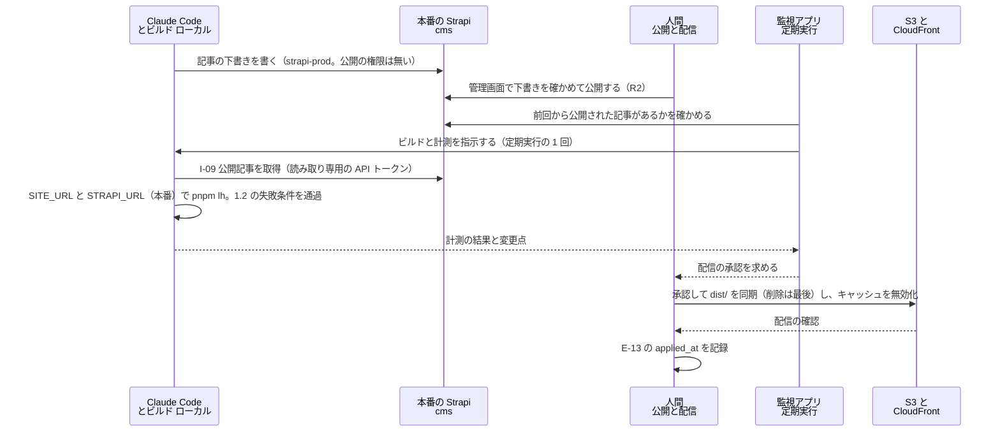
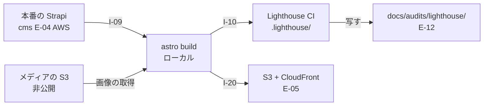

# DD-05 ビルドと配信のフロー

詳細設計層。ID の採番の正本は層ごとのファイルにあり、索引は [`docs/README.md` の「ID の採番と正本」](../README.md) にある。横断規約は [DD-01](01-flow-specification-rules.md) を参照する。

**`E-05 Page` を生み、測り、届ける 3 本**（`I-09` `I-10` `I-20`）を扱う。

この 3 本は**決定論的**である点で他のフローと違う。同じ入力からは同じ成果物が出る（AA-02 のカタログで `I-09` `I-10` `I-20` の冪等性がいずれも「有り」になっているのはこのため）。したがってこの層の仕事は冪等性の設計ではなく、**失敗させるべき条件を正しく失敗させること**にある。

## 1. `I-09` Strapi → Astro（ビルド時のデータ取得）

| 項目 | 値 |
|---|---|
| 発信元 → 受信先 | **本番の Strapi（`https://cms.comegin.com` の Content API。`E-04` の正本。AWS）**→ Astro（`frontend/verdant-virgo`。**ビルドはローカル**）（ADR-16） |
| 種別 | `ビルド` |
| 経路 | **ビルド時**。ローカルのビルドから ALB の機械向けのパス（`/api/*`）を通って本番の Strapi を読む（ALB の認証はかけず、読み取り専用の API トークンと WAF のレート制限で守る。TA-06 の 5.4）。**経緯**: ADR-14 で一度「本番の Strapi を AWS から読む」とし、同日の ADR-15 で取り消して「オンプレの Strapi を同一ホスト内で読む」に戻し、さらに同日の ADR-16 で再び本番の Strapi を読むことにした（TA-07 の 7 節） |
| トリガー | `pnpm build` の実行。記事の変更では、**監視アプリの定期実行が本番の Strapi で公開された記事を見つけたとき**に Claude Code が実行する（ADR-17。3.2）。コードの変更では管理者の指示 |
| 同期性 | 同期 |
| タイムアウト | **1 リクエスト 20 秒 / ビルド全体 5 分**（DD-01 の 7.2） |
| リトライ | `unreachable` 2 回 / `timeout` 1 回。**それでも失敗したらビルドを失敗させる** |
| 冪等キー | 不要（同じコンテンツからは同じ成果物） |
| 失敗時の扱い | **ビルドを失敗させる**（1.2） |
| 観測点 | ビルドの終了コード ／ 生成されたページ数 |
| 完成度 | `条件付き`（本番の Strapi に公開記事が 1 件以上あること／`SITE_URL` の設定／ビルド用の読み取り専用 API トークンの発行／メディアの S3 の取得方法。1.5.1） |

**接続先は `STRAPI_URL` で、本番の配信用のビルドでは `https://cms.comegin.com` にする**（ADR-16）。**これまでの `http://localhost:1337` は開発時の値として残す**（`astro dev` と、開発環境の Strapi を読む試験のビルド）。Strapi の API トークンは**読み取り専用**で、権限は `find` / `findOne` に限る（書き込みを持たせない）。本番のトークンはローカルの PC の本番用の設定（`.env.production`。Git で追跡しない）に置き、AWS には置かない（TA-06 の 7 節）。ビルドと計測は Claude Code が行ってよいが、**配信は人間が承認する**（3 節）。**記事の公開も人間（`R2`）が本番の Strapi の管理画面で行う**（ADR-17。エージェントの `strapi-prod` のトークンには公開の権限が無い。[03 の 4.1](03-operation-path-flows.md)）。

- **本番の配信用のビルドが開発環境の Strapi を読んではならない。** 開発環境の Strapi は試験用で、記事の正本ではない（TA-07 の 6 節）。取り違えると、試験の記事が公開される。**`SITE_URL` と同じく、配信用のビルドで `STRAPI_URL` が `localhost` を指していたら停止する**（1.2。この層の判断）。

### 1.1 MCP を使わない

**Strapi の REST API をビルド時に直接呼ぶ。** `strapi-mcp` を経由させない（AA-02 の 3.2）。

理由をこの層の言葉で言い直すと、**MCP はモデルのための層であり、その特性がビルドに有害だから**である。

| MCP の特性 | ビルドにとって何が問題か |
|---|---|
| `CHARACTER_LIMIT`（25,000 文字）で件数を削る | **記事が静かに減った成果物ができる。** `fitToLimit()` は応答サイズで削るため、何件になるかがビルドのたびに変わりうる |
| `LONG_TEXT_LIMIT`（1,000 文字）で長文を省略する | **本文が途中で切れた記事ページが公開される** |
| `sanitize()` がキーを伏せる | 公開してよい値まで `[redacted]` になりうる |

**決定論的な処理に、応答サイズで結果が変わる層を挟まない。**

### 1.2 失敗させる条件

| 条件 | 挙動 | 理由 |
|---|---|---|
| **`SITE_URL` が未設定** | **例外で停止**（実装済み。`astro.config.mjs`） | 未設定だと sitemap と canonical に `localhost` が焼き込まれ、**警告も出ないまま公開される** |
| **配信用のビルドで `STRAPI_URL` が `localhost` を指している**（ADR-16） | **例外で停止**（未実装。この層の判断） | 開発環境の Strapi（試験用）の記事が公開される。**`SITE_URL` と同じく、静かに誤った成果物ができる**。「配信用のビルド」をどう見分けるか（`SITE_URL` が本番の値か、専用の変数を置くか）は実装時に決める（5 節） |
| **Strapi が停止している**（本番は ALB・ECS・RDS のどれかの障害、またはローカルから AWS への回線断を含む。ADR-16） | **ビルドを失敗させる** | 記事 0 件のサイトが黙って公開されると、検索エンジンに空のサイトがインデックスされる |
| **記事が 0 件** | **ビルドを失敗させる** | 同上。「取得できたが 0 件」（`empty_but_ok`）は、ビルドにおいては成功ではない |
| 一部の記事の取得に失敗 | **ビルドを失敗させる** | 部分的に欠けたサイトを公開しない |
| **画像の取得・変換に失敗** | **ビルドを失敗させる**（1.5） | 画像の欠けたページを公開しない。記事の一部欠けと同じ扱い |
| **公開サイトで使うメディアが画像でない**（動画・PDF など） | **ビルドを失敗させる**（1.5.3） | `<Image>` で `dist/` に取り込めず、Strapi を直接参照するしかなくなる |
| **`dist/` に Strapi の URL か、メディアの S3 のバケットの URL が残っている** | **ビルドを失敗させる**（1.5.4。S3 は ADR-16 で加えた） | 公開後の表示が Strapi（またはそのメディアの S3）の稼働に依存する。**しかも静かに壊れる** |

**`empty_but_ok` の扱いが観測と逆になる。** DD-01 の 4.2 は `empty_but_ok` を成功として扱うと決めたが、**それは観測の文脈での話**である。ビルドでは 0 件は失敗にあたる。

- 観測の 0 件は「事実の記録」だが、ビルドの 0 件は「公開してはいけない成果物」である。
- **この非対称を実装で混同しない。** `I-09` は `fetch.outcome` の分類を使わず、独自に失敗させる。

### 1.3 取得する内容

| エンティティ | Strapi のコンテンツタイプ | 用途 | 現状 |
|---|---|---|---|
| `E-04 Content` | `api::article.article` | 記事ページの生成 | `実装済み`（ただし 6 件すべてサンプルで全件 `draft`） |
| `E-01 Keyword` | `api::keyword.keyword` | メタ情報・内部リンクの生成 | **コンテンツタイプが未作成** |
| `E-03 ContentPlan` | `api::content-plan.content-plan` | 構成の反映 | **同上** |
| `E-06 CTA`（表示定義） | Strapi のコンポーネント | CTA の埋め込み。`mautic_form_id` を `I-08` に渡す | **未作成** |

**`publishedAt` が `null` の記事を取得しない。** 現在の 6 件はすべて `draft` であるため、この条件で取ると 0 件になり 1.2 によりビルドが失敗する。**これは正しい挙動である**（公開記事が無い状態でサイトを公開しない）。

- **「現状」の列は開発環境の Strapi（`backend/strapi-system`。SQLite）の状態である。** 本番の Strapi（ADR-16）はまだ構築されておらず、記事は 0 件である。開発環境の記事を本番に移すことはしない（TA-07 の 6 節）ため、**`R2` が本番で最初の記事を公開するまで配信用のビルドは 1.2 により失敗し続ける**（エージェントは下書きまでしか書けない。ADR-17）。**監視アプリの定期実行は公開を見つけたときにだけビルドを起こす**（3.2）ため、公開記事が 0 件の間は定期実行からビルドが起きず、この失敗は管理者の指示でビルドしたときにだけ現れる。

### 1.4 `E-05` は直接書き換えられない

`E-05 Page` は Astro のビルド成果物であり、作用は必ず `E-04` かコードのどちらかを変えて再ビルドする経路を通る（DA-04 の 1.3）。

**`dist/` を直接編集しない。** `dist/` は `.gitignore` に入っており、次のビルドで消える。`E-13` の `rollback.procedure` に「`dist/` のファイルを戻す」と書いてはならない（AA-04 の 3.3.1 の「Git の操作を書かない」と同じ理由で、**戻したつもりが戻っていない**という失敗になる）。

### 1.5 画像はビルド時に `dist/` に取り込む（決定）

**Strapi のメディアは、ビルド時に Astro の `<Image>`（または `getImage()`）で最適化し、`dist/_astro/` に書き出す。** 公開後のページから Strapi へのリクエストを 1 本も出さない。2026-09-18 に `R1` が決定した。

**この決定で「Strapi が止まっても公開サイトの表示に影響しない」が画像を含めて成立する。** 記事本文はもともとビルド時に HTML へ埋め込まれるため、Strapi の停止が影響するのは**更新の反映だけ**だった。唯一の例外が画像で、Strapi の既定（ローカルのアップロードプロバイダー）では画像が `http://localhost:1337/uploads/...` から配信される。その URL を HTML に書くと、公開後の訪問者のブラウザが開発機の Strapi を直接取りに行き、画像が表示されない。

**ADR-16 で本番の Strapi を AWS に置き、メディアを S3（`@strapi/provider-upload-aws-s3`。パブリックアクセスを全ブロックした非公開のバケット）に置いた後も、この決定は変わらない**（AA-05 の ADR-11 の帰結）。S3 は Strapi のメディアの**保管先**であって、公開ページの**配信元**ではない。ビルドが本番の Strapi のメディアを S3 から取得して `dist/` に取り込み、公開ページから Strapi と S3 へのリクエストを 1 本も出さない（TA-07 の 7 節）。

| 選択肢 | 採否 | 理由 |
|---|---|---|
| **A. ビルド時に `dist/` に取り込む** | **採用** | 構成要素が増えない（TA-02 の構成要素表は変わらない）。WebP 化と `srcset` の生成で Lighthouse の performance にも効く。`dist/_astro/` はハッシュ付きのファイル名になり、TA-02 のキャッシュ方針（長期キャッシュ ＋ `immutable`）にそのまま乗る |
| B. Strapi のアップロード先を S3 にし、**公開ページから S3 を直接参照する** | 不採用 | 当初の理由は「Strapi（オンプレ）に AWS への書き込み権限が要り、資格情報がオンプレに増える」だった。ADR-14（2026-09-19）で一度本番の Strapi とメディアの S3 を置くと決め、同日の ADR-15 で Strapi はオンプレだけに戻り、**さらに同日の ADR-16 で本番の Strapi とメディアの S3 を置いた**（書き込みはタスクロールで行い、オンプレに資格情報は増えない。TA-06 の 7 節）。**保管先を S3 にすることは ADR-16 で採ったが、公開ページから S3 を参照することは今も採らない。** バケットを公開する必要があり、公開ページの表示が S3 の URL の形とバケットの設定に依存するためである |
| C. Strapi をトンネルで公開する | 不採用 | 公開面に Strapi が載る。管理画面と同じプロセスを無認証の経路に置くことになる（DD-02 の 1.2） |

#### 1.5.1 2 つの設定がそろわないと静かに壊れる

`<Image>` は、許可していないリモート画像や `/uploads/...` のような相対パスを受け取っても**エラーにならない**。最適化も取り込みもせず、渡された URL のまま `` を出力する。つまり**ビルドは成功し、公開後に画像だけが壊れる**。これを防ぐには次の 2 つを両方そろえる。

| 設定 | 内容 | 欠けたときの壊れ方 |
|---|---|---|
| **`image.remotePatterns` に Strapi を許可する** | `astro.config.mjs` に Strapi のオリジン（`STRAPI_URL` から組み立てる）を登録する。**本番ではメディアの S3 のオリジンも登録する**（ADR-16。下の注） | 画像が最適化されず、Strapi（または S3）の絶対 URL のまま HTML に出る |
| **Strapi が返す相対 URL を絶対 URL にする** | ローカルのアップロードプロバイダー（開発環境）の `url` は `/uploads/xxx.jpg` という相対パスで返る。`<Image>` に渡す前に `STRAPI_URL` を前に付ける | `public/` 配下の画像と見なされ、`` のまま出る。**CloudFront では 404 になる** |

- **開発環境と本番でメディアの URL の形が違う**（ADR-16）。開発環境の Strapi はローカルのアップロードプロバイダーのまま相対パス（`/uploads/...`）を返し、本番の Strapi は S3 のアップロードプロバイダーで S3 の絶対 URL を返す。**変換の処理は両方の形を受け付け、どちらでも 1.5.4 の検査を通る成果物を作る。**
- **本番のバケットは非公開である**（パブリックアクセスを全ブロック。TA-06 の 4.1）。S3 の URL をそのまま `<Image>` に渡しても、ビルドは画像を取得できない（403）。**署名付き URL を使うか、別の取得方法にするかは未決定**（TA-06 の 11 節）。取得できなければ 1.2 の「画像の取得・変換に失敗」でビルドが止まるため、公開サイトは壊れない（止まるのは更新）。
- **署名付き URL を使う場合、`image.remotePatterns` にはバケットのオリジンを登録し、クエリ文字列（署名）は照合の対象にしない。** 署名付き URL が `dist/` に残ると、期限が切れた後に画像が壊れるうえ署名が公開される。1.5.4 の検査がこれを捕まえる。

**`STRAPI_URL` は `PUBLIC_` を付けない環境変数にする。** frontmatter と設定ファイルの中でだけ使い、ブラウザに渡る JS には含めない（Strapi の所在を公開ページから推測できる形にしない。DD-02 の 1.2）。**S3 のバケットの名前も同じ扱いにする**（ADR-16）。

#### 1.5.2 変換の規則

| 項目 | 規則 | 理由 |
|---|---|---|
| 寸法 | Strapi のメディアの応答にある `width` / `height` を渡す。**`inferSize` を使わない** | 寸法を取るためだけに画像を 1 回余計に取得しない。CLS も防げる |
| 派生サイズ | Strapi の `formats`（thumbnail / small / medium / large）を**使わない**。原本の `url` を渡し、`srcset` は Astro に生成させる | 派生サイズを作る場所を 1 か所に絞る |
| `alt` | Strapi の `alternativeText` を使う。空なら `alt=""`（装飾扱い）で出し、**件数をビルドログに出す** | 空の `alt` でビルドを止めると記事を公開できなくなる。件数を出すのは Lighthouse の accessibility（しきい値 0.9）が落ちたときに原因を追えるようにするため |
| 本文（Markdown）中の画像 | `shared.rich-text` の `body`（`richtext` 型＝Markdown）に書かれた画像も**同じ規則で変換する**。そのまま HTML にしない | Markdown をそのまま HTML にすると、`` が Strapi の URL のまま出る |
| `og:image` | `shared.seo` の `shareImage` を `getImage()` で JPEG に変換し、`SITE_URL` を前に付けた**絶対 URL**にする | `getImage()` が返すのは `/_astro/...` という相対パスで、`og:image` には使えない。WebP を読めない SNS のクローラーがあるため形式を固定する |
| 対象のフィールド | `article.cover`、`shared.media.file`、`shared.slider.files`、`shared.seo.shareImage`、`author.avatar` | Strapi のスキーマのうち、公開サイトに出る `media` 型のすべて |
| `global.favicon` | **Strapi から取らない。** `frontend/verdant-virgo/public/` の `favicon.svg` / `favicon.ico` を使い続ける（`Layout.astro` の現状のまま） | `.ico` は画像変換の対象にならない。ファビコンは記事と違って頻繁に変わらないため、Strapi で管理する利点が無い |

#### 1.5.3 画像以外のメディアはビルドを失敗させる

Strapi 側の `media` フィールドは、ほぼすべてが `allowedTypes: ["images", "files", "videos"]`（スキャフォールドの既定）になっている。**動画や PDF は `<Image>` で処理できない**ため、公開サイトに出すと Strapi を直接参照するしかない。

- **公開サイトで使うメディアの `mime` が `image/` で始まらなければ、ビルドを失敗させる。**
- 動画・PDF を公開サイトで扱う方法は 1.5 の決定の対象外であり、5 節に上げる。

#### 1.5.4 `dist/` に Strapi と S3 の URL が残っていないことをビルドの最後に検査する

1.5.1 の 2 つの設定と 1.5.2 の規則が正しくても、描画経路が 1 本でも漏れれば（新しいコンポーネントが `` を直接書く、Markdown の変換を通らない経路ができる、など）同じように静かに壊れる。**正しさを個々の描画経路に頼らず、成果物で保証する。**

- **Astro のインテグレーションの `astro:build:done` フックで、`dist/` 配下の HTML・CSS・JS・XML に次の文字列が含まれていないかを検査する。** 含まれていればビルドを失敗させる。
  - `STRAPI_URL` のオリジン（例: 開発時は `http://localhost:1337`、本番の配信用のビルドは `https://cms.comegin.com`）
  - `/uploads/`（1.5.1 の相対 URL の漏れ）
  - **Strapi のメディアの S3 のバケットの URL**（ADR-16 で加えた）。仮想ホスト形式（`<バケット名>.s3.<リージョン>.amazonaws.com`）とパス形式（`s3.<リージョン>.amazonaws.com/<バケット名>`）の両方を検査する。署名付き URL の漏れ（`X-Amz-Signature`）もここで捕まる
- **検査する文字列は環境変数から組み立てる。** バケットの名前は Strapi の設定と同じ値を読む（ビルドの側に別の値を書くと、バケットを変えたときに検査が空振りする）。
- **`pnpm build` の外に後処理のスクリプトとして置かない。** フックにしておけば、`pnpm build` と `pnpm lh`（内部で `astro build` を実行する）の**両方で必ず実行される**。後処理のスクリプトにすると、どちらかの経路で実行を忘れる。
- **失敗時は該当ファイルと該当箇所を出す。** 値は `STRAPI_URL` とバケットの URL だけで、秘密値を含まない（出力してよい）。**ただし署名付き URL が漏れていた場合は、署名の部分を伏せて出す。**

#### 1.5.5 `I-09` の仕様表への影響

- **画像の取得には `I-09` の取得層のタイムアウト（1 リクエスト 20 秒）とリトライが効かない。** 画像を取得するのは Astro の画像処理であり、`I-09` で自作する取得処理ではない。効くのはビルド全体の 5 分の上限だけである。
- **Strapi の停止は、記事の取得の段階で先に検出される**（1.2 の「Strapi が停止している」）。画像の取得だけが失敗するのは、記事の応答が返った後に Strapi が止まった場合か、ファイルが欠けている場合に限られる。**本番ではこれに、S3 からの取得の失敗（署名の期限切れ・権限不足）が加わる**（ADR-16）。
- **`astro dev` では、Strapi が動いている必要がある。** 開発サーバーは画像をリクエストのたびに変換するため、ビルド時と違って閲覧中も Strapi を参照する。これは開発時だけの依存であり、公開サイトには影響しない。`astro dev` が読むのは開発環境の Strapi（`http://localhost:1337`）である。

## 2. `I-10` Astro → Lighthouse CI

| 項目 | 値 |
|---|---|
| 発信元 → 受信先 | Astro の preview（4322）→ Lighthouse CI → `.lighthouse/` |
| 種別 | `ファイル` |
| 経路 | **ビルド時**（同一ホスト内） |
| トリガー | `pnpm lh`（`astro build && lhci autorun`） |
| 同期性 | 同期 |
| タイムアウト | LHCI の既定に従う（3 回計測のため 1 回が重い） |
| リトライ | **しない**（3 回計測の中央値を取る仕組みが既にばらつきを吸収している） |
| 冪等キー | 不要 |
| 失敗時の扱い | **しきい値未達でコマンドが失敗する。** この失敗を無視して適用を続けない（AA-04 の 3.2） |
| 観測点 | `.lighthouse/manifest.json` ／ コマンドの終了コード |
| 完成度 | `仕様確定` |

### 2.1 出力の形

`lighthouserc.cjs` の `upload.target` が `filesystem`（`outputDir: './.lighthouse'`）のため、外部に公開されない。出力は次の 4 ファイル。

```
.lighthouse/
├── manifest.json                                  3 回分の要約と代表実行の指定
├── localhost--<YYYY_MM_DD_HH_MM_SS>.report.json   ×3
└── localhost--<YYYY_MM_DD_HH_MM_SS>.report.html   ×3
```

`manifest.json` は配列で、1 要素が 1 回の計測にあたる。

| 項目 | 内容 |
|---|---|
| `url` | 計測した URL（現状は `http://localhost:4322/` の 1 本のみ） |
| `isRepresentativeRun` | **`true` の 1 件が中央値の代表。** `E-12` にはこれを使う |
| `summary` | `performance` / `accessibility` / `best-practices` / `seo` の 4 スコア |
| `jsonPath` / `htmlPath` | **絶対パスが焼き込まれる**（2.4） |

### 2.2 `E-12` への変換仕様

`agent/seo-auditor` が `.lighthouse/manifest.json` を読んで `E-12` を生成する。

```yaml
audit_id: AUD-2026-0916-lighthouse-0003
source: lighthouse
target:
  kind: page
  identifier: /            # manifest の url からサイト内パスだけを取る
metrics:
  LH-performance: 1.00
  LH-accessibility: 1.00
  LH-best-practices: 1.00
  LH-seo: 1.00
ref: .lighthouse/localhost--2026_09_16_04_59_22.report.json   # 相対パスに直す（2.4）
fetch:
  outcome: ok
  attempts: 1
  correlation_id: 01JBQZ8F3K7XN2M5V9TWRC4HED
  measured_at: 2026-09-16T13:59:22+09:00                      # JST に変換する（2.3）
tunnel_up: true            # 計測時に公開経路（本番は ALB とその後ろ）が生きていたか（DD-07 の 2.3。名前は旧版のまま）
```

**`isRepresentativeRun: true` の 1 件だけを `E-12` にする。** 3 件すべてを記録すると、`E-13` の `evidence` がどれを指すかで解釈が割れる。

### 2.3 ファイル名のタイムスタンプは UTC

**`localhost--2026_09_16_04_59_22.report.json` の `04_59_22` は UTC である**（実際の計測は JST 13:59）。

DD-01 の 4.3 は `measured_at` を JST の ISO 8601 と定めたので、**変換が要る**。

- 変換を忘れると、**`E-12` が 9 時間前にずれる**。日次の観測では日付がまたぐ場合があり、「昨日の観測が無い」という誤検知につながる。
- **`report.json` の中の `fetchTime`（ISO 8601・UTC）を使うほうが安全**（ファイル名を解釈するより、値を読んで変換するほうが壊れにくい）。

### 2.4 `jsonPath` を `ref` にそのまま転記しない

`manifest.json` の `jsonPath` と `htmlPath` は**実行環境の絶対パス**が入る（`/home/kamegin/ComeGin/...`）。

**`E-12` の `ref` にそのまま書くと、別の環境では解決できない参照になる。** `E-13` は Git 経由で GitHub に載り、他の環境から読まれるため、絶対パスは必ず壊れる。

- **`frontend/verdant-virgo/` を起点とした相対パスに直してから記録する。**
- ただし**`.lighthouse/` は `.gitignore` に入っている**ため、相対パスに直しても**参照先のファイルが Git には無い**（2.5）。

### 2.5 `.lighthouse/` は Git に無く、毎回上書きされる

これが `I-10` の状態が `未配線` である理由にあたる（`pnpm lh` は実行できるが、**結果を `E-12` として継続的に蓄積する経路が無い**。AA-01 の 2 節）。

| 事実 | 帰結 |
|---|---|
| `.lighthouse/` は `.gitignore` に入っている | **観測の原本が Git に残らない** |
| `pnpm lh` のたびに上書きされる | **前回の計測結果が消える。** 定点観測が成立しない |

**したがって「蓄積」は、計測直後に追跡対象のディレクトリへ写す操作としてしか実装できない。**

| 写すもの | 写す先 | 理由 |
|---|---|---|
| `E-12`（要約した YAML + Markdown） | `docs/audits/lighthouse/<audit_id>.md` | **これが正本になる。** `E-13` の `evidence` はこれを指す |
| 代表実行の `report.json` | **写さない** | 1 ファイル 300KB 超。毎日 Git に積むとリポジトリが肥大する |
| `report.html` | **写さない** | 同上（500KB 超） |

**`E-12` に必要なのはスコアと `ref` であって、レポートの全文ではない**（DA-04 の 2 節「値そのものを複製せず `ref` と `summary` だけを置く」）。ただし**`.lighthouse/` は上書きされるため、`ref` が指す先は次の計測で消える**。

- **`ref` は「再取得できるクエリ」として書く**（DA-04 の 2 節の定義）。Lighthouse の場合は「同じコミットに対して `pnpm lh` を再実行すれば同じ値が得られる」という意味になるので、**`ref` にはファイルパスではなくコミット SHA を書くほうが要件に合う。**
- これは DA-04 の定義に照らした解釈であり、**DA を書き換えるものではない**。5 節に上げる。

### 2.6 計測対象が 1 URL しかない

**`lighthouserc.cjs` の `url` は `http://localhost:4322/` の 1 本だけである。**

したがって現状では、`LH-seo` 1.0 の死守ライン（AA-04 の 3.2）は**トップページにしか掛かっていない**。

| `I-09` が通った後に起きること | 帰結 |
|---|---|
| 記事ページが生成される | **記事ページは計測されない** |
| `content_rewrite` の提案が記事を変える | **その効果を Lighthouse では測れない**（`E-13` の `expectation.metric` に `LH-*` を使えない） |
| 記事ページの SEO が劣化する | **検知されない。** トップページのスコアは 1.0 のまま |

**`I-09` を通すのと同時に、計測対象の URL を増やす。** 後回しにすると、「記事を公開したが SEO は測っていない」期間が生まれる。

| 案 | 内容 | 評価 |
|---|---|---|
| A 全記事を計測する | `url` に全ページを列挙する | 記事が増えると計測時間が線形に伸びる（1 URL あたり 3 回計測） |
| **B 代表ページを固定する** | トップ + 記事一覧 + **代表記事 1 本**の 3 URL | **推奨。** 計測時間が一定で、ページ種別ごとの劣化を検知できる |
| C 変更のあった記事だけ | 差分から対象を決める | 対象がビルドごとに変わり、**定点観測にならない**（DA-02 の 5.3 の再現性の条件に反する） |

**B を推奨する。** 代表記事は固定し、変更しない（変えると前後比較が切れる）。

## 3. `I-20` Astro `dist/` → 配信先

| 項目 | 値 |
|---|---|
| 発信元 → 受信先 | Astro の `dist/` → AWS S3 + CloudFront |
| 種別 | `ファイル` |
| 経路 | **オンプレ → AWS**（境界を越える。TA-01 の 4 節。ADR-16 の後もビルドはローカルに残した） |
| トリガー | **人間の明示的な指示**（承認後。ADR-15 で、ビルドと計測は Claude Code、配信は人間の承認と定めた。ADR-16・ADR-17 でも変わらない。TA-07 の 7 節）。**監視アプリの定期実行は配信を起こさない**（起こすのはビルドと計測まで。3.2） |
| 同期性 | 同期 |
| タイムアウト | AWS SDK の既定 |
| リトライ | S3 の転送は SDK の再試行に任せる |
| 冪等キー | 不要（同じ成果物の再配置は同じ結果） |
| 失敗時の扱い | **部分的に転送された状態で止めない**（3.3） |
| 観測点 | CloudFront の配信 ／ `SITE_URL` へのアクセス |
| 完成度 | `条件付き`（配信ホスト名の確定／デプロイの承認） |

### 3.1 配信先は決まっている

AA-02 は「配信先（未選定）」としているが、**その後に確定した**（`docs/README.md` の 2026-09-17 時点の現況）。

| 項目 | 値 |
|---|---|
| AWS アカウント | `798560359429`（`ComeGin`）。`accountPlanType: PAID` |
| ドメイン | **`comegin.com` 取得済み**（Route 53 登録、有効期限 2027-09-16、ホストゾーン作成済み） |
| 構成 | S3 + CloudFront（OAC）+ ACM + WAF。設計は TA-02 |
| 課金方式 | **CloudFront のフラットレートプラン Free（$0/月）。** CDN・WAF・DDoS 対策・Route 53 DNS・TLS 証明書・S3 クレジットを含み、**超過課金が無い** |
| 現状のリソース | S3・CloudFront・ACM・WAF・OAC とも **0 件** |

**残っているのは apex（`comegin.com`）か `www` かの確定だけである。** これが決まらないと `SITE_URL` の値が決まらず、`I-09` のビルドも確定しない（`SITE_URL` は sitemap と canonical に焼き込まれるため、後から変えると全ページの canonical が変わる）。

### 3.2 手順

記事の変更は次の順で進む（ADR-17。TA-07 の 7 節）。



図は To-Be を描いている。**As-Is では AWS 側のリソースも監視アプリの画面も 0 件**であり、この経路は存在しない。

| # | 手順 | 実行者 | 仕組みで守られていること |
|---|---|---|---|
| 1 | 本番の Strapi に記事の下書きを書く | Claude Code（`strapi-prod`） | **公開できない**（トークンに公開の権限が無い。ADR-17） |
| 2 | 管理画面で記事を公開する | **人間（`R2`）** | 公開の承認（BA-05）が人間の操作そのものになる |
| 3 | 公開された記事を見つけ、ビルドと計測を起こす | **監視アプリの定期実行**（ADR-17。TA-07 の 3.5） | 同じ処理を重ねて起動しない |
| 4 | `pnpm lh`（ビルドと計測） | Claude Code | 1.2 の失敗条件と `LH-seo` のゲート（4.2） |
| 5 | 配信（`s3 sync` と CloudFront の無効化） | **人間**（承認して実行） | **配信用の IAM を Claude Code に渡さない** |
| 6 | `E-13` の `applied_at` を記録する | **配信した人間**（ADR-16） | —（書き忘れの検出は [06 の 6 節](06-proposal-loop-flows.md)） |

- **旧版の図は `R1` がビルドから配信までを 1 人で行う形だった。** ADR-15 でビルドと計測を Claude Code に、配信を人間の承認に分け（TA-07 の 7 節）、**ADR-16 で `applied_at` を配信した人間が記録すると決め**（DD-01 の 8.3）、**ADR-17 で記事の公開を人間の操作にし、公開の検知を監視アプリの定期実行にした**。図はその分担に合わせた（ADR-17 の前の図は Claude Code・ビルド・人間・S3・CloudFront の 5 者で、公開と検知の段が無かった）。
- **記事の公開と配信は、どちらも人間の操作である**（手順 2 と 5）。公開と配信を同じ人が続けて行うかは運用で決める（TA-07 の 7 節）。**公開しただけでは公開サイトに出ない**（ADR-11。公開ページは Strapi を実行時に参照しない）ため、`applied` は配信の完了で記録する（DD-01 の 8.3）。
- **Astro のコードだけの変更は手順 1〜3 を飛ばす。** 管理者の指示で Claude Code がビルドと計測を行い、手順 5 から同じである。
- **配信用の IAM は Claude Code に渡さない**（TA-07 の 7 節）。図で `S3 と CloudFront` に矢印を出すのが人間だけなのはこのためである。
- **この層の判断: 手順 3 の「公開された記事があるか」の確認は、エージェントを使わずに行う。** ビルド用の読み取り専用の API トークンで Content API を読み、公開された記事の一覧（`documentId` と `publishedAt`・`updatedAt`）を前回の確認の結果と比べる決定論的な処理にする。差分があったときだけ Claude Code を起動する。**比べるのは「新しく公開された記事」だけでなく「公開済みの記事の更新」と「公開済みから消えた記事（非公開化・削除）」も含める**（どれも公開サイトに反映するには再ビルドと配信が要る。`I-01` の穴 1・穴 2 と違い、Content API の一覧を比べれば区別できる）。前回の確認の結果の置き場（監視アプリの側）は実装時に決める（5 節）。

### 3.3 部分的に転送された状態で止めない

静的サイトは**ファイル同士が参照し合う**（HTML が CSS と JS を参照し、sitemap が全ページを参照する）。転送が途中で止まると、**存在しないファイルを参照する HTML が公開される**。

| 規則 | 理由 |
|---|---|
| **新規・更新を先に転送し、削除を最後にする** | 削除を先にすると、古いページが消えて新しいページがまだ無い瞬間が生まれる |
| **転送がすべて成功してからキャッシュを無効化する** | 無効化を先にすると、CloudFront が未転送のファイルを取りに行って 404 をキャッシュする |
| **失敗したら無効化しない** | 古い成果物が配信され続けるほうが、壊れた成果物が配信されるよりよい |

### 3.4 デプロイの承認は 2 度求めない

BA-05 は「本番環境へのデプロイ」を `承認`（`R1`）に分類しているが、**AA-04 の 2.3 のとおり、マージ後のデプロイは自動化してよい。**

**承認の対象は「デプロイという操作」ではなく「デプロイされる内容 ＝ `main` の状態」である。** `main` へのマージ自体が `承認` 分類であり、その承認をもって「この内容を公開してよい」という判断は済んでいる。

**ただし `LH-seo` のゲートはデプロイの前後どちらにも効く**（AA-04 の 2.3）。マージが承認されていても、SEO スコアが 1.0 を割った状態のビルドは配信しない。

- **記事の変更は `main` を経由しない**（ADR-16。本番の Strapi が記事の正本で、エージェントは `strapi-prod` で書く）。したがって**記事だけが変わったビルドには「マージの承認」が存在せず、配信の承認（TA-07 の 7 節）と Strapi での公開（`R2`）が承認のすべてになる。** 「2 度求めない」はコードの変更についての整理であり、記事の配信の承認を省く根拠にはならない。**ADR-17 で Strapi での公開は `R2` 自身の操作になり、エージェントのトークンからは到達できなくなった**（3.2 の手順 1・2）。記事の 2 つの承認は、どちらも約束ではなく人間の操作として成立する。

### 3.5 この層では実行しない

- **`.claude/rules/build-deploy.md`**: ビルドコマンドとデプロイコマンドは、明確な指示がない限り実行しない。
- **`.claude/rules/devops-testing.md`**: `.github/workflows/` は明確な指示がない限り作成しない。したがって **CI によるデプロイの自動化は現時点で選択肢に入らない**（AA-02 の 3.6）。
- 3.4 の「自動化してよい」は**設計上の許可**であって、実装の指示ではない。実装するかどうかは `R1` の判断。

## 4. 3 本の連鎖



図は To-Be を描いている。**As-Is で成立しているのは `astro build` → `Lighthouse CI` の 1 本だけ**（`pnpm lh` で実行できる）。`I-09` は 1 行も書かれておらず、`docs/audits/lighthouse/` は未作成、AWS 側のリソースは 0 件（本番の Strapi とメディアの S3 も未構築）。**旧版の図では起点が「オンプレの Strapi」だった**（ADR-15）。ADR-16 で本番の Strapi に変わった。

### 4.1 `pnpm lh` が `astro build` を含むことの帰結

`package.json` の `lh` は `astro build && lhci autorun` である。したがって**計測には必ずビルドが先行する**。

- **`SITE_URL` が未設定だと `pnpm lh` も失敗する**（ビルドが停止するため）。計測だけしたい場合も `SITE_URL` が要る。
- **`I-09` が通ると `pnpm lh` の実行時間が伸びる**（記事の取得が加わるため）。3 回計測と合わせて、日次バッチの時間を圧迫しうる。

### 4.2 順序の規則

| 規則 | 理由 |
|---|---|
| **ビルド → 計測 → デプロイの順を崩さない** | 計測していない成果物を配信しない |
| **計測に失敗したらデプロイしない** | `LH-seo` のゲート（AA-04 の 3.2） |
| **デプロイ後に再計測する** | preview（4322）で測ったスコアと、CloudFront 経由のスコアは一致しない（CDN・圧縮・TLS の差）。**配信後のスコアが `E-12` の正本になるべきか**は 5 節に上げる |

## 5. 未決定事項

- **配信ホスト名（apex か `www` か）。** `SITE_URL` が決まらず、`I-09` `I-20` がここで止まっている（`I-15` の GSC は 2026-09-18 にドメインプロパティで登録すると決め、この項目に依存しなくなった。[06 の 4.1](06-proposal-loop-flows.md)）。**この層で最も多くのものをブロックしている 1 項目**にあたる。判断者 `R2`。
- **`E-12` の `ref` にコミット SHA を書くか、ファイルパスを書くか。** 2.5 でコミット SHA を推奨したが、DA-04 の 2 節は `ref` を「再取得できるクエリ」と定義しているだけで形式を定めていない。**DA を書き換えずに提起する**（判断者 `R3`）。
- **`.lighthouse/` の原本を残さないことの影響。** 2.5 で「`E-12` にスコアと `ref` だけを残し、レポート本体は写さない」と決めたが、**後から「なぜこのスコアだったか」を調べる手段が失われる**（再実行しても当時のコードには戻せない場合がある）。リポジトリの肥大と追跡可能性のどちらを取るかの判断。判断者 `R1`。
- **計測対象の URL を 3 本に増やす案（B）の代表記事の選び方。** 固定すると決めたが、その記事が削除・非公開化されたときにどうするかが未定（`I-01` の穴 1 により、非公開化はイベントとしても検知できない。**ADR-17 の後は、3.2 の公開の確認が「公開済みから消えた記事」として見つけられる**ため、気づく手段はできた。どう差し替えるかは未定のまま）。
- **デプロイ後の再計測を `E-12` の正本にするか。** 4.2 のとおり preview と CloudFront ではスコアが一致しない。**現在の `LH-seo` 1.0 は preview での値**であり、配信後の値は測っていない。どちらを死守ラインの判定に使うかが決まっていない。判断者 `R1` `R2`。
- **`I-09` が通った後のビルド時間。** 4.1 のとおり `pnpm lh` の実行時間が伸びる。日次バッチに収まるかは記事数に依存し、現時点では分からない。**1.5 の決定で画像の変換が加わり、さらに伸びる**（1 枚の画像から `srcset` 用に複数のサイズが生成される）。ビルド全体の上限 5 分に収まるかは、画像の枚数が決まるまで分からない。
- **動画・PDF を公開サイトで扱う方法。** 1.5.3 で当面はビルドを失敗させると決めたが、扱いたくなった場合は「ビルド時に `dist/` へそのままコピーする」か「Strapi の `allowedTypes` を `images` に絞って入力の段階で防ぐ」かを決める必要がある。後者は Strapi のスキーマの変更になる。判断者 `R1`。
- **本番の Strapi が止まっている間はビルドが失敗し、公開サイトの更新が止まる**（1.2。ADR-16）。ADR-15 の時点では Strapi が同じ開発機にあり、ビルドと Strapi が同時に止まるだけだった。ADR-16 の後は、**AWS 側（ALB・`strapi` のタスク・RDS・メディアの S3）の障害とローカルから AWS への回線断のどれでもビルドが止まる。** 失敗させる判断は変えない（空や欠けたサイトを公開しない）が、急ぎの修正（誤記の訂正など）を AWS 側の障害の間に出す手段が無い。**止まっている間は古い成果物が配信され続ける**（3.3）ことを許容とするか、手元の直近の取得結果で組み立てる逃げ道を設けるかは決めていない。判断者 `R1`。
- **本番の Strapi のメディア（S3・非公開）をビルドが取得する方法**（1.5.1。TA-06 の 11 節）。署名付き URL を使うなら、Strapi の S3 のアップロードプロバイダーが Content API の応答に署名付き URL を返すか、ビルド用の読み取り専用 API トークンで署名付き URL を得られるかを確かめる。取得できない間は、画像を含む記事のビルドが止まる。判断者 `R1`。
- **「配信用のビルド」を見分ける方法**（1.2。ADR-16 で「配信用のビルドで `STRAPI_URL` が `localhost` なら停止する」を足した）。`SITE_URL` が本番の値であることで見分けるか、専用の変数（例 `BUILD_TARGET=production`）を置くかを決めていない。判断者 `R1`。
- **（2026-09-19 に ADR-17 で解決）記事の公開をきっかけにしたビルドの起動**（ADR-16 で新たに生じた）。TA-03 の 2 節は「Strapi の Webhook → n8n → n8n がビルドと計測を起動する」としていたが、ADR-16 で本番の Strapi と n8n は AWS に、ビルドはローカルに分かれた。**AWS の n8n からローカルのビルドを起動する経路は無い**（ローカルにトンネルを張らない。TA-07 の 3.4）。この層では「n8n は公開を知らせるまでにとどめ、ビルドは監視アプリから Claude Code に指示して始める」のが素直としていた。**ADR-17 で、監視アプリの定期実行が定期的に本番の Strapi を見て、公開された記事があれば Claude Code がビルドと計測を行う形に決まった**（案。TA-07 の 3.5・7 節。3.2）。Strapi → n8n の Webhook は使わない。
- **公開の検知の間隔と、公開から配信までの遅れ**（3.2。ADR-17 で新たに生じた）。公開から公開サイトに出るまでの遅れは「確認の間隔 ＋ ビルドと計測の時間 ＋ 人間が配信を承認するまでの時間」になる。確認の間隔を短くすると監視アプリが本番の Strapi を読む回数が増え（ALB と WAF のレート制限の内側に収める）、長くすると誤記の訂正などの急ぎの公開が遅れる。**急ぎの場合に、管理者が監視アプリから確認を即時に起動できるようにするか**も合わせて決める。判断者 `R1` `R2`。
- **公開の確認の実装**（3.2 の「この層の判断」）。前回の確認の結果（公開された記事の `documentId` と `publishedAt`・`updatedAt` の一覧）を監視アプリのどこに持つか、確認に使うトークンをビルド用の読み取り専用の API トークンと共用するか分けるか。共用すると、監視アプリのサーバー側と Claude Code の実行環境の両方に同じトークンが置かれる。判断者 `R1`。
- **定期実行が止まっていた間に公開された記事の扱い**（3.2。ADR-17 で新たに生じた）。開発機が止まっている間は公開の確認も止まる（[07 の 6 節](07-failure-and-degradation.md)）。3.2 の比べ方（前回の確認との差分）なら、再開後の最初の確認で止まっていた間の公開がまとめて見つかるため取りこぼしは起きないが、**複数の記事の公開が 1 回のビルドと 1 回の配信にまとまり、`E-13` ごとの `applied_at` が同じ時刻になる**。検証（DD-06 の 1.4）で効果を記事ごとに分けられるかは確かめていない。判断者 `R1` `R3`。
- **公開したが配信されない状態の検出**（3.2）。`R2` が公開した後、ビルドが 1.2 で失敗したり、配信の承認が滞ったりすると、Strapi では公開済みなのに公開サイトに出ない状態が続く。**Strapi の公開を見た人は公開サイトに出たと思いやすい。** 監視アプリに「公開済みで未配信の記事」を出すかを決めていない。判断者 `R1` `R2`。
- **本文（Markdown）中の画像を変換する実装手段。** 1.5.2 で「同じ規則で変換する」と決めたが、Markdown を HTML にする処理のどこで画像を差し替えるかは `I-09` の実装時に決める。**どの手段を選んでも 1.5.4 の検査が漏れを捕まえる**ため、この未決定は公開サイトを壊さない。
