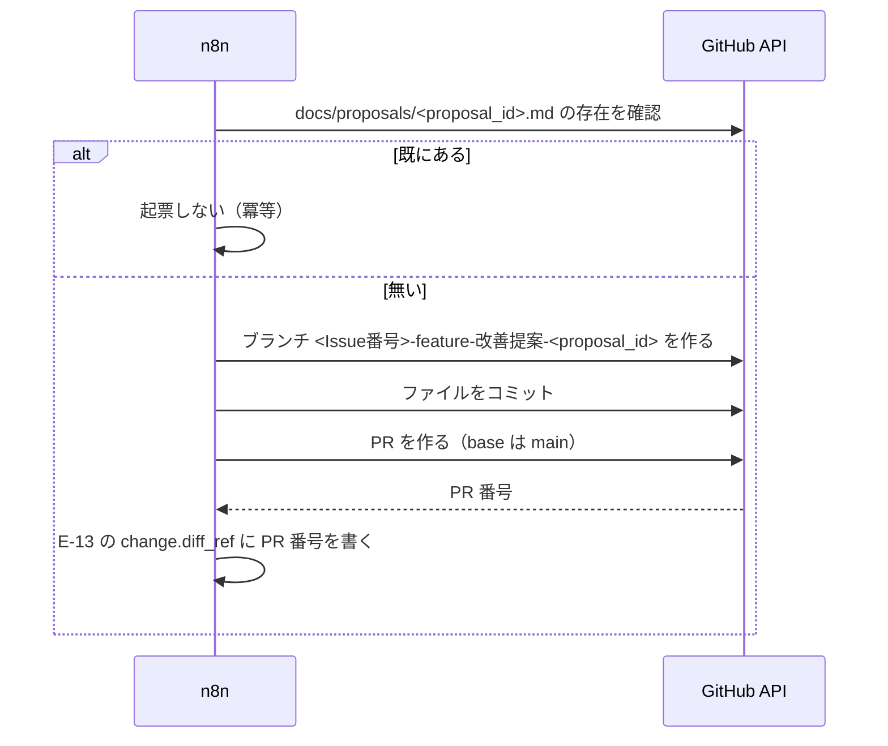

# DD-06 提案と承認のフロー

詳細設計層。ID は EA 共通用語集の定義をそのまま使う。横断規約は [DD-01](01-flow-specification-rules.md) を参照する。

AA-04 のループ 6 段階（観測 → 判断 → 提案 → 承認 → 作用 → 検証）の**実行仕様**と、そこに使う 2 本の連携（`I-13` `I-15`）を扱う。**旧 `I-14`（通知）は廃止した**（3 節）。

AA-04 は「何を守るか」（安全装置 7 項目、暴走条件 11 件）を定めた。**この層が決めるのは「いつ・どうやって検査するか」である。**

## 1. ループ 6 段階の実行仕様

### 1.1 ステップごとの入出力

AA-04 の 2 節の表を、実装できる形に落とす。

| # | ステップ | 主体 | 読む | 書く | 実行のきっかけ |
|---|---|---|---|---|---|
| 1 | 観測 | 観測系 4 本 | 各上流（DD-03・DD-05） | `docs/audits/<source>/<audit_id>.md` | 日次バッチ。**4 本は並列**（AA-03 の 4.1） |
| 2 | 判断 | `agent/proposal-writer` | `docs/audits/**` の全 `E-12` ／ `docs/proposals/**` の全 `E-13` | なし（内部評価のみ） | **4 本の完了を待つ** |
| 3 | 提案 | `agent/proposal-writer` | 同上 | `docs/proposals/<proposal_id>.md`（`approval.state: draft`） | 1.2 の検査をすべて通過した場合のみ |
| 4 | 承認 | **`R2`（人間）** | `E-13` の frontmatter と本文、`evidence[]` が参照する `E-12` | `E-14`（PR のレビュー承認）／ `approval` ブロック | 週次会議まで（SLA） |
| 5 | 作用 | `change.kind` ごと（DD-01 の 8.3） | 承認済みの `E-13` | 適用先 ／ `applied_at` と `change.diff_ref` | 承認後 |
| 6 | 検証 | 再計測はエージェント、**判定は `R3`** | `expectation` ／ 再計測した `E-12` | `verification` ブロック | `expectation.judge_after`（既定 30 日後） |

### 1.2 起票前チェックリスト

**`agent/proposal-writer` は、`E-13` を書く前に次の 14 項目をすべて検査する。1 つでも通らなければ起票しない。**

AA-04 の安全装置と暴走条件の歯止めは、この 1 表に集約される。**検査を分散させると、エージェントを増やしたときに検査が漏れる。**

| # | 検査 | 通らなかった場合 | 根拠 |
|---|---|---|---|
| 1 | `evidence[]` が 1 件以上ある | 起票しない | DA-01 の 6.2（**空の提案は承認しない**） |
| 2 | すべての `evidence` の `fetch.outcome` が `ok` か `empty_but_ok` | その `evidence` を除外し、1 に戻る | DD-01 の 4.2 ／ 暴走条件 #3 |
| 3 | すべての `evidence` の `measured_at` が**14 日以内**（暫定。1.3） | 再観測してから起票する | 暴走条件 #5 |
| 4 | 同じ `target.identifier` かつ同じ `change.kind` の `E-13` が存在しない（**`rejected` と `no_change` も含めて**探す） | 起票しない | AA-04 の 3.7 ／ 暴走条件 #2 |
| 5 | 当日の起票数が **5 件未満** | **止める**（キューに積まない） | AA-04 の 3.1 |
| 6 | `approval.state: applied` の `E-13` が **3 件未満** | 止める | AA-04 の 3.1 |
| 7 | 同じ `target.identifier` に `applied` の `E-13` が無い | 止める | AA-04 の 3.1（効果の帰属） |
| 8 | 最新の `LH-seo` が **1.0 以上** | **`LH-seo` を 1.0 に戻す提案だけを起票する。** 他の `change.kind` は止める | AA-04 の 3.2 ／ 暴走条件 #6 |
| 9 | `rollback.procedure` に**具体**（コマンド・PR 番号・版番号）が書かれている | 起票しない | AA-04 の 3.3（**最も重い欠落**） |
| 10 | 適用先が Git の外（n8n / Mautic のキャンペーン / PostHog の設定 / OpenSEO のランク追跡）なら、`rollback.reversible: false` であり、かつ**適用前の状態のコピーが添付されている** | 起票しない | AA-04 の 3.3.1 ／ 暴走条件 #9 |
| 11 | 適用先が n8n のワークフローなら、**そのサイクルに他の n8n 対象の `E-13` が無い**（1 サイクル 1 件） | 止める | AA-04 の 3.3.1 |
| 12 | `change.kind` が `config_change` なら、`evidence[]` に**「安全装置が実際に妨げになった事例」**が含まれている | 起票しない | AA-04 の 3.5 ／ 暴走条件 #4 |
| 13 | `evidence[].summary` と本文に、**会話本文・email・氏名・電話番号・GSC の個々の検索クエリが含まれていない** | 該当箇所を要旨に置き換える（検索クエリは件数と傾向だけにする） | AA-03 の 3.4（`E-13` は GitHub に越境する）／ DA-05 の 1.2.1 |
| 14 | `agent_run_id` が空でない | 起票しない | DA-01 の 6.2 ／ DD-01 の 3.4（暫定値を入れる） |

**5・6・7・8・11 は「止める」であり、6 と 8 は再試行で通るようになる。** 一方 1・9・10・12・14 は「起票しない」であり、**提案の内容が変わらない限り通らない**。この違いを実装で区別する（前者は翌日また試す、後者は諦める）。

**止めた事実を残す。** 起票しないことは成果物が生まれないことであり、DD-01 の 9.2 の「沈黙したこと」に見える。stderr に理由つきで記録し、`E-15` に `skipped` として残す。

### 1.3 `evidence` の鮮度を 14 日とする根拠

AA-04 の暴走条件 #5 は「`evidence` の `measured_at` が承認時点から一定期間を超えていたら再観測してから適用する」とし、**期間を未決定として残している**。DD の規約（暫定値を入れて根拠を併記する）に従い、**14 日**を暫定値として置く。

| 積み上げ | 日数 |
|---|---|
| 観測から起票まで | 同日（日次バッチ） |
| 起票から承認まで（SLA は週次会議まで） | 最大 7 日 |
| 承認から適用まで（`R1` / `R2` の作業） | 最大 3 日 |
| 余裕 | 4 日 |
| **合計** | **14 日** |

**この値は運用開始後に見直す**（AA-04 の 3.1 の上限値と同じ性質の暫定値）。見直した履歴は `E-13`（`change.kind: config_change`）として Git に残るため、BA-04 のトスアップ条件のような「見直した履歴が残らない」問題は起きない。

### 1.4 検証（ステップ 6）の判定規則

| `verification.state` | 条件 | その後 |
|---|---|---|
| `improved` | 再計測した値が `expectation.target` に到達した | 何もしない。`evidence` として次の提案に使える |
| `no_change` | 到達しなかったが悪化していない | **戻さない。** 効果が無かったという事実を残す（AA-04 の 3.3） |
| `degraded` | `expectation.baseline` より悪化した | **`rollback.procedure` を実行して `rolled_back` に落とす** |

- **判定に使った `E-12` を `verification.audit_ref` に必ず書く**（DA-01 の 6.2）。
- **`no_change` を `improved` と同じ重みで次の `evidence` に使う**（暴走条件 #1 の歯止め）。効かなかった施策の記録が無いと、同じ施策が繰り返し提案される。
- **`rollback.deadline` を過ぎた `applied` を放置しない。** 期日前に必ず検証する。過ぎた場合はロールバックできない前提で扱う（AA-04 の 3.3）。

## 2. `I-13` n8n → GitHub（起票）

| 項目 | 値 |
|---|---|
| 発信元 → 受信先 | n8n（5678）→ GitHub API |
| 種別 | `API` |
| 経路 | **運用経路**（n8n からインターネットへ。受信側の webhook は公開経路） |
| トリガー | 日次バッチ、または提案の起票要求 |
| 同期性 | 同期 |
| タイムアウト | 30 秒（DD-01 の 7.2） |
| リトライ | DD-01 の 5.2 の既定。**401 は再試行しない** |
| 冪等キー | **`proposal_id`。** GitHub 上に同名ファイルが既に存在すれば起票しない |
| 失敗時の扱い | `E-15` に `failure` として残し、**翌日の実行で再試行する**（AA-02 の I-13） |
| 観測点 | GitHub の PR 一覧 ／ n8n の実行履歴 |
| 完成度 | `条件付き`（n8n のワークフロー作成は `承認`・`R1`／トークンの発行） |

### 2.1 この経路が承認ゲートの迂回路にならないこと

AA-03 の 5.4 は「**n8n が作れるのは PR までで、レビュー承認とマージには到達できないことを GitHub 側の権限で保証する必要がある**」と書いた。**この層でその保証の具体を決める。**

| 保証 | 実装 | 種別 |
|---|---|---|
| **n8n が `main` に直接 push できない** | ブランチ保護で `main` への直接 push を禁止し、**bypass の許可リストを空にする** | 到達不能 |
| **n8n が自分の作った PR を承認できない** | **GitHub の仕様により、PR の作成者は自分の PR を承認できない。** n8n 専用のアカウント／トークンで PR を作れば、そのアカウントは承認側に回れない | **到達不能（仕様として）** |
| **n8n がマージできない** | ブランチ保護で「承認 1 件以上」を必須にする。n8n は承認できないため、承認 0 件の PR をマージできない | 到達不能 |
| **n8n が保護設定を変えられない** | トークンの権限から Administration を外す | 到達不能 |

**2 行目がこの設計で最も強い担保にあたる。** 権限設定ではなく GitHub のプラットフォームの仕様であるため、こちらの設定ミスで破れない。

**逆に言えば、n8n と `R2` が同じアカウントを使うとこの担保は消える。** 起票用のアカウントは `R2` の個人アカウントと必ず分ける。

### 2.2 トークンの権限

GitHub の fine-grained personal access token を使い、**リポジトリを 1 つに限定する**。

| 権限 | 値 | 理由 |
|---|---|---|
| Contents | Read and write | `docs/proposals/` にファイルを作るため |
| Pull requests | Read and write | PR を作るため |
| **Administration** | **なし** | ブランチ保護を変えられないようにする（2.1） |
| **Actions** | **なし** | `.github/workflows/` を作らない方針（`.claude/rules/devops-testing.md`）と整合させる |
| その他 | なし | 最小権限 |

**トークンは n8n の資格情報ストアに置き、環境変数ファイルの実体には置かない**（SNS の資格情報と同じ扱い。TA-04 の 1 節。GSC は 2026-09-18 に OpenSEO の中へ移した）。

### 2.3 起票の手順

図は To-Be を描いている。**As-Is では n8n のワークフローが 0 件、`docs/proposals/` も未作成**であり、この経路は存在しない。

- **ブランチ名はリポジトリの規約に従う**（`<Issue番号>-feature-<日本語名>`。`.claude/CLAUDE.md`）。Issue を先に作るか、提案用の固定 Issue を使うかは 6 節に上げる。
- **コミットメッセージは `add:` プレフィックス**（同規約）。

### 2.4 エージェントは `I-13` を起動しない

**`agent/proposal-writer` はファイルを書くところまでを担当し、n8n を呼ばない**（AA-03 の 5.2）。

- n8n のワークフローを起動する手段をエージェントに与えると、**AA-03 の 5.3 の 3 点（自分の提案を承認できない・正本に昇格させられない・実行条件を書き換えられない）のうち 2 つ目が破れる**。
- `I-13` を走らせるのは n8n のスケジュールトリガーであり、**その起動条件は n8n 側にある**（エージェントから触れない）。
- **n8n のワークフローの作成・変更は `承認` 分類**（BA-05）。エージェントが自分でワークフローを作って承認ゲートを迂回することを防ぐ。

## 3. 通知（`I-14` を廃止し GitHub の PR に一本化）

### 3.1 決定

**提案の起票・承認待ち・適用完了の通知は、GitHub の PR の機能に任せる。通知のための連携点を設けない。**

**`R1` の 2026-09-17 の決定**により、AA-02 のカタログにあった `I-14`（n8n → Chatwoot の社内メモ）は**廃止された**。DA-04 が未決定として残していた「通知先を Chatwoot にするか」はこれで解決している。

| 通知したいこと | 手段 | 届く相手 |
|---|---|---|
| 提案が起票された | **PR の作成**（`I-13`）。Reviewer に `R2` を指定する | `R2` |
| 承認を待っている | 同上（Reviewer 指定がそのままレビュー依頼になる） | `R2` |
| 適用された | PR のマージ | PR の参加者 |
| 却下された | PR のクローズ | 同上 |

**追加の実装が要らないのがこの決定の要点にあたる。** `I-13` が PR を作れば、通知は GitHub 側で自動的に発生する。

### 3.2 `E-14` の正本と通知の出所を一致させる

`E-14 ApprovalRecord` の正本は **GitHub の PR レビュー**である（DA-04 の 2 節）。したがって**承認を求める通知も、正本と同じ場所から出る**のが一貫する。

DA-01 の 5.2 は `E-13` を Git に置く代償として「`R2` が GitHub を直接見に行く必要が生じる」と書き、その補填として外部への通知を想定していた。**しかし PR には Reviewer 指定と通知が標準で付いているため、補填のために別のシステムを持ち出す必要がそもそも無かった。**

### 3.3 Chatwoot を社内通知に使わない理由

Chatwoot は「Web 接客 / チャット」であり（リポジトリルートの `README.md`）、**顧客対応（リード獲得・CS）が用途**である。改善提案の通知を持ち込むと 4 つの害が出る。

| # | 害 | 影響を受けるもの |
|---|---|---|
| 1 | **`agent/conversation-triage` の取得範囲が埋まる** | 取得範囲は「直近の未解決の会話・最大 4 ページ」（[03 の 2.2](03-operation-path-flows.md)）。承認待ちの提案が未解決の会話として並ぶと、**顧客の会話が押し出される**。**承認の滞留が、そのまま顧客対応の見落としに変換される** |
| 2 | `CAP-12` のレポートが汚れる | 未解決件数・応答時間・解決率に内部の会話が混ざり、Web 接客の KPI が測れなくなる |
| 3 | `E-10 Conversation` の正本が汚れる | 顧客でない会話が正本に入る（DA-01） |
| 4 | `I-19` の突合対象に内部会話が混ざる | email による `E-09` との突合（[04 の 7 節](04-server-to-server-flows.md)） |

**1 が最も重い。** これは運用上の不便ではなく、**内部統制の滞留が顧客対応の品質を下げるという、方向の異なる 2 つの問題を結合させてしまう**構造にあたる。

**Mautic への振り替えも採らない。** Mautic は MA であり顧客向けである。社内の宛先を `E-09 Contact` として登録することになって正本が汚れ、さらに BA-05 が Mautic のメール送信を `承認`（`R3`）に分類しているため、**通知のたびに承認が必要**になる。

### 3.4 `private` を固定する規則は残る

**Chatwoot の社内メモには 2 つの用途があり、廃止したのは片方だけである。**

| 用途 | 内容 | 扱い |
|---|---|---|
| **A 顧客対応の中の社内メモ** | `agent/conversation-triage` が会話の一次切り分けで書く（`I-03`。AA-03 の 1 節） | **残す。** Chatwoot 本来の使い方 |
| B 改善提案の通知 | 旧 `I-14` | **廃止** |

用途 A に対して、**`private` を固定値 `true` とし、エージェントが指定できるパラメータにしない**（[03 の 2.3](03-operation-path-flows.md)）。

**`private=false` は顧客に即時送信される。** BA-05 は「Chatwoot の顧客への返信（`private=false`）」を `承認`（`R3`）に分類しているが、**承認を挟む前に、誤送信の経路そのものを塞ぐ**（ADR-03 の「分類するのではなく到達できなくする」と同じ形）。

**旧 `I-14` を廃止しても、この規則を緩めない。** 用途 A が残る限り誤送信の余地は残るためである。

### 3.5 この決定の代償

| 代償 | 内容 | 扱い |
|---|---|---|
| **`R2` に GitHub のアカウントと通知設定が要る** | Reviewer に指定できなければ通知は届かない | BA-03 の未決定事項（**`R2` が誰なのかが未定**）に依存する。`R2` を決めるときに GitHub アカウントの用意を条件に含める |
| **GitHub のメール通知は埋もれやすい** | 承認の SLA（週次会議まで）を守れるかは運用で確認するしかない | 滞留は [06 の 1.2](06-proposal-loop-flows.md) の検査 5・6（起票と適用の件数上限）で**間接的に**検出できる。上限に達した時点でループが止まるため、滞留が見える |
| **通知の到達を確認する手段が無い** | GitHub が通知を送ったかどうかをこちらから観測できない | 通知は正本ではないため、届かなくても `E-13` は失われない。**通知の失敗でループを止めない**（[07 の 6.1](07-failure-and-degradation.md)） |

## 4. `I-15` Google Search Console → OpenSEO → 観測エージェント

**2026-09-18 に経路を変えた。** 当初は「Search Console → 観測エージェント（または n8n の日次バッチ）」で、資格情報を n8n に置く設計だった。**GSC を OpenSEO に統合した**（AA-05 の ADR-06・ADR-09）ため、OpenSEO が OAuth で GSC を取り、`agent/seo-auditor` が OpenSEO の MCP（`I-22`）で読む。

| 項目 | 値 |
|---|---|
| 発信元 → 受信先 | Google Search Console → **OpenSEO**（OAuth。`webmasters.readonly`）→ `agent/seo-auditor`（`I-22` の参照系） |
| 種別 | `API`（GSC → OpenSEO）＋ `MCP`（OpenSEO → エージェント） |
| 経路 | **SaaS → ホスト内**。トンネルを通らない |
| トリガー | 日次バッチ（**対象期間を 3 日ずらす**。4.2） |
| 同期性 | 同期 |
| タイムアウト | **30 秒**（`I-22` の参照系。DD-01 の 7.2） |
| リトライ | DD-01 の 5.2 の既定。**`not_connected` は `auth_failed` として再試行しない**（人間の再接続が要る。DD-01 の 5.3） |
| 冪等キー | **不要**（同じ期間の再取得で同じ値になる。費用も発生しない） |
| 失敗時の扱い | `fetch.outcome` に記録。その日の GSC 観測をスキップする。`not_connected` が続く場合は TA-05 の項目 10 で通知する |
| 観測点 | `docs/audits/gsc/` にファイルが生まれるか ／ OpenSEO の `/api/health` の `gsc` |
| 完成度 | `条件付き`（ドメインプロパティの登録・OAuth クライアントの発行・接続は**人間の作業**／MCP 設定の付け替え） |

### 4.1 配線の手順

AA-02 の 3.5 の 5 手順を、この層の観点で補う。

| 順 | やること | 担当 | この層で決めること |
|---|---|---|---|
| 1 | ドメインプロパティ `sc-domain:comegin.com` を登録し、Route 53 の TXT で所有権を確認する | **人間（`R1`）** | **配信ホスト名の確定を待たない**（ドメインプロパティは apex と `www` の両方を覆う） |
| 2 | OAuth クライアントを発行する（リダイレクト URI は `http://localhost:3001/api/gsc/oauth/callback`） | **人間（`R1`）** | **同意画面は「内部」**（`comegin.com` は Google Workspace。TA-04 の 8.3）。接続する Google アカウントは `comegin.com` の Workspace アカウントに限られる |
| 3 | OpenSEO の環境変数に 3 つの値を置いてコンテナを作り直す | **人間（`R1`）** | 秘密値（`PreToolUse` フックの対象） |
| 4 | OpenSEO の画面で接続し、プロパティをプロジェクトに結び付ける | **人間（`R1`）** | **エージェントは行えない**（BA-05 で `禁止`） |
| 5 | 日次バッチで `E-12`（`source: gsc`）として取り込む | エージェント | 取得の引数は [03 の 6.3](03-operation-path-flows.md) |

### 4.2 別サイクルにする

**GSC のデータは 2〜3 日遅れて確定する**（AA-02 の I-15）。他の観測と同じ日次サイクルに混ぜると「昨日のデータが無い」が常態化する。

| 項目 | 値 |
|---|---|
| 取得対象 | **3 日前までの確定データ**（`range.to` = `measured_at` の 3 日前） |
| 取得期間 | 直近 35 日（他の観測と揃える。DA-02 の 5.1） |
| 実行時刻 | 他の観測と同じ日次バッチでよい。**対象期間だけをずらす** |

**`measured_at` と `range.to` が 3 日ずれるのは、この観測だけの正常な状態である**（DD-01 の 4.3）。**これを欠測と読まない。**

**GSC の日付は太平洋時間である**（OpenSEO のツールがそのまま返す。DA-02 の 5.2.1）。`range` の日付に `tz: America/Los_Angeles` を併記し、日本時間で切った他の観測と日単位で突き合わせない。

- `agent/proposal-writer` の起票前チェック 3（`measured_at` が 14 日以内）は `measured_at` を見るので、3 日のずれがあっても通る。
- 一方で「昨日の順位が下がった」という判断は GSC ではできない（昨日のデータが存在しない）。**`expectation.judge_after` が 30 日後であることが、この遅延を吸収している。**

### 4.3 取得する指標

| 指標 | `E-12` の `metric` | 単位 |
|---|---|---|
| 平均掲載順位 | `GSC-position` | 順位 |
| 表示回数 | `GSC-impressions` | 件 |
| クリック数 | `GSC-clicks` | 件 |
| CTR | `GSC-ctr` | 比率 |

- **ページ単位で取る**（`target.kind: page`、`identifier` はサイト内パス）。クエリ単位の分解は `E-01 Keyword` との対応が必要になるが、`api::keyword.keyword` が未作成のため現時点では取らない。
- **`E-12` の入れ物は Lighthouse と同じ**。GSC から LHCI にデータが流れる訳ではなく、`agent/seo-auditor` が `.lighthouse/` と OpenSEO の MCP の両方を読んで `E-12` に正規化する（AA-01 の 4 節）。
- **同じ経路で `SERP-position`（`source: serp`）・`INDEX-status`（`inspect_urls`）・`SITE-issues`（`source: site_audit`）も取れる**（DA-02 の 4.3）。いずれも保存済みの結果を読むだけで費用は発生しない。**`GSC-position` と `SERP-position` を同じ `metric` として扱わない**（定義が違う）。

### 4.4 SEO が目的なのに測れていない期間

**この連携が通るまで、`平均検索順位` は測れない。** OpenSEO の順位計測（`SERP-position`）は狙いのキーワードの進捗を見る補助であり、`平均検索順位` の代わりにしない（DA-02 の 4.3）。 SEO 対策が事業の目的であるにもかかわらず、その目的に対する測定手段が 1 つも無い状態が続く（ADR-06）。

**この期間、`LH-seo` が唯一の SEO 指標になる。** ただし `LH-seo` は**合成監査であって検索結果ではない**。1.0 を維持していても検索順位が下がっている可能性がある。

- **`E-13` の `expectation.metric` に `LH-seo` を使った提案は、「SEO が改善した」ことの証明にならない。** 「SEO の前提条件を満たし続けている」ことの確認にとどまる。
- この区別を `E-13` の `change.description` に明記する（承認者が効果を誤解しないため）。

## 5. 最短経路の実行仕様

AA-04 の 5.2 の 8 手順を、実装できる粒度に落とす。**Umami・PostHog・Mautic・Chatwoot・GSC・n8n をいずれも必要とせず、ngrok のトンネルも必要としない。**

| 順 | やること | 担当 | 完了の判定 |
|---|---|---|---|
| 1 | `docs/audits/lighthouse/` と `docs/proposals/` を作る（`.gitkeep` を置く） | `R1` | ディレクトリが Git に追跡されている |
| 2 | `.claude/agents/seo-auditor.md` を書く（`.lighthouse/manifest.json` を読んで `E-12` を 1 件書くだけ） | `R1` | `agent/seo-auditor` が起動できる |
| 3 | `SITE_URL` を設定して `pnpm lh` を実行する | `R1` | `.lighthouse/manifest.json` が生成される |
| 4 | `agent/seo-auditor` を走らせ、`docs/audits/lighthouse/<audit_id>.md` を 1 件作る | エージェント | `fetch.outcome: ok` の `E-12` が 1 件 |
| 5 | `.claude/agents/proposal-writer.md` を書き、**1.2 の 14 項目の検査を実装する** | `R1` | 検査が 1 項目も欠けていない |
| 6 | `agent/proposal-writer` を走らせ、`docs/proposals/<proposal_id>.md` を 1 件起票する（`approval.state: draft`） | エージェント | `evidence[]` に手順 4 の `audit_id` が入っている |
| 7 | **人間が**コミットし、PR を作る（`draft` → `review`） | `R1` | PR が 1 件ある |
| 8 | **`R2` が**PR をレビュー承認する（`E-14`） | `R2` | `approval.state: approved` |
| 9 | 承認された変更を適用し、`applied_at` と `change.diff_ref` を書く | `R1` / `R2` | `approval.state: applied` |
| 10 | `pnpm lh` を再実行し、`verification` を埋める | エージェント + `R3` | `verification.state` が `pending` でない |

**AA-04 の 8 手順を 10 手順に分けた。** 分けたのは手順 2（エージェント定義）と手順 5（検査の実装）で、**ここが最も手間がかかり、かつ最も省略されやすい**ためである。

### 5.1 手順 5 を省略しない

**14 項目の検査を「あとで足す」にしない。**

- 検査が無い状態でループが 1 周すると、**動いているものに検査を割り込ませる**ことになり、外す圧力が生じる（AA-04 の 5.3 が人間ゲートについて述べたのと同じ理由）。
- 1 周目は `E-13` が 1 件しか無いので、検査 4・5・6・7・11（件数と重複の上限）はすべて自明に通る。**通ることが分かっていても実装する。**
- 検査 8（`LH-seo` >= 1.0）と検査 9（`rollback.procedure` の具体）は、1 周目から実質的に効く。

### 5.2 1 周目の題材

**`LH-seo` の劣化を検知して直す**、という 1 周がこの基盤の目的に直結する（AA-04 の 5.3）。

ただし**現在のスコアは 4 指標とも 1.00 か 0.99 である**（`.lighthouse/manifest.json` の実測）。劣化が無いため、1 周目の題材が無い。

| 案 | 内容 | 評価 |
|---|---|---|
| A 劣化するまで待つ | 自然に劣化したときに 1 周する | **いつ回るか分からない。** 検証にならない |
| **B `performance` の 0.99 を題材にする** | 3 回計測のうち 1 回が 0.99。これを 1.00 に揃える提案を出す | **推奨。** 実在する差であり、しきい値（0.9）は割っていないので安全 |
| C 意図的に劣化させる | わざとスコアを下げてから直す | 本番の成果物を壊す。採らない |
| D 計測対象を増やす（[05 の 2.6](05-build-and-delivery-flows.md) の案 B） | URL を 3 本にする提案自体を `E-13` にする | **有力。** `change.kind: config_change`（承認者 `R1`）になり、安全装置の承認者分離（AA-04 の 3.5）も同時に検証できる |

**B か D を選ぶ。** どちらも実在する改善余地であり、ループの形を検証するという目的に足りる。

## 6. 未決定事項

- **`evidence` の鮮度 14 日に実証的な根拠が無い。** 1.3 の積み上げは SLA と作業日数の見積もりであり、実測ではない。運用開始後に見直す。判断者 `R3`。
- **起票用のブランチに対応する Issue をどうするか。** リポジトリの規約はブランチ名に Issue 番号を含めることを求めている（`<Issue番号>-feature-<日本語名>`）が、**日次で自動起票される提案に毎回 Issue を立てるのか、提案用の固定 Issue を 1 つ使うのかが決まっていない**。判断者 `R1`。
- **`R2` が GitHub の通知を実際に見るか。** 3.5 のとおり通知先は GitHub に一本化したが、**メール通知が埋もれた場合に承認の滞留を能動的に知る手段が無い**。検査 5・6 が上限に達すればループが止まって気づけるが、それは滞留がかなり進んでからになる。運用開始後に確認する。判断者 `R1` `R2`。
- **`I-13` の起票を n8n で行うか、人間が行うか。** AA-03 の 5.4 は n8n 経由を「承認ゲートを迂回する経路になりうる」と警告した。2.1 で 4 つの担保を設計したが、**そもそもこの経路を作るかどうか**は決まっていない。作らない場合、ループの所要時間は人間のコミットの頻度に律速される（AA-03 の 5.4）。判断者 `R1`。
- **1 周目の題材**（5.2 の B と D）。どちらを選ぶかで、検証されるものが変わる（B はループの形だけ、D は安全装置の承認者分離も）。判断者 `R1` `R2`。
- **`agent/proposal-writer` が過去の `E-13` を全件読むことの限界。** 検査 4（重複の検出）は `docs/proposals/**` の全件走査を要する。件数が増えると 1 回の実行で読み切れなくなる（DA-01 の 5.1 が Git を選んだ際の欠点「件数が増えると検索・集計ができない」がここで現れる）。**何件で破綻するかは分からない。** 判断者 `R1`。
- **`E-15` に `skipped` という状態が無い。** 1.2 で「止めた事実を `E-15` に `skipped` として残す」としたが、DA-01 は `E-15` の属性を定義していない（正本すら未確定）。値の名前だけ先に決めた形になっている。
- **GSC の `range` に太平洋時間を併記する形を `E-12` の型に入れるか**（4.2）。DD-01 の 4.3 の `fetch.range` はタイムゾーンを持たない。GSC だけが違うため、型に `tz` を足すか、GSC の `E-12` だけ注記で済ませるかを決めていない。型の変更は DA の判断（判断者 `R3`）。
