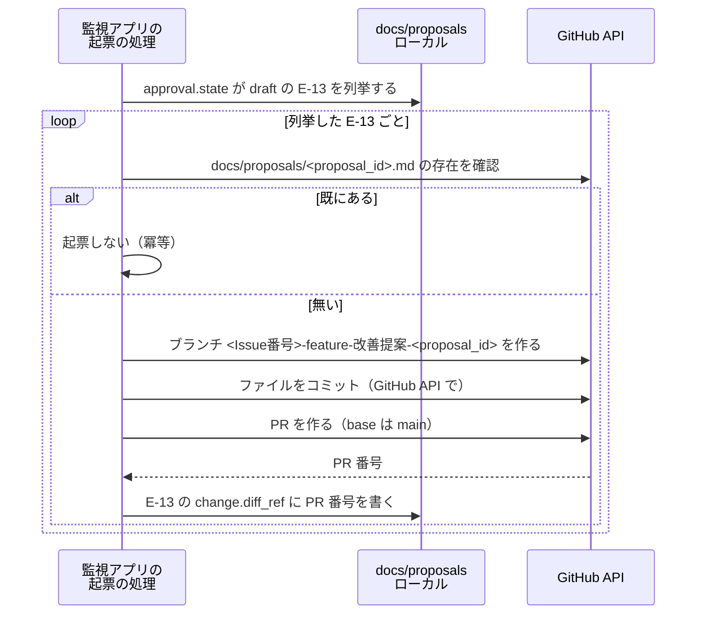

# DD-06 提案と承認のフロー

詳細設計層。ID の採番の正本は層ごとのファイルにあり、索引は [`docs/README.md` の「ID の採番と正本」](../README.md) にある。横断規約は [DD-01](01-flow-specification-rules.md) を参照する。

AA-04 のループ 6 段階（観測 → 判断 → 提案 → 承認 → 作用 → 検証）の**実行仕様**と、そこに使う 2 本の連携（`I-13` `I-15`）を扱う。**旧 `I-14`（通知）は廃止した**（3 節）。

AA-04 は「何を守るか」（安全装置 7 項目、暴走条件 13 件）を定めた。**この層が決めるのは「いつ・どうやって検査するか」である。**

## 1. ループ 6 段階の実行仕様

### 1.1 ステップごとの入出力

AA-04 の 2 節の表を、実装できる形に落とす。

| # | ステップ | 主体 | 読む | 書く | 実行のきっかけ |
|---|---|---|---|---|---|
| 1 | 観測 | 観測系 4 本 | 各上流（DD-03・DD-05）。**本番の値は MCP の本番用の登録で読む**（1.5。ADR-15 で決着した。ADR-14 の時点では未決定だった） | `docs/audits/<source>/<audit_id>.md` | 日次バッチ。**4 本は並列**（AA-03 の 4.1）。**日次バッチは監視アプリの定期実行が起動する**（ADR-17。ADR-05 では n8n のスケジュール）。取得の範囲（期間と件数）は定期実行の定義に固定して書く（**定義は Git で持ち、監視アプリは承認済みの `main` のチェックアウトで読む**。ADR-18 の追加の決定 3。2.4） |
| 2 | 判断 | `agent/proposal-writer` | `docs/audits/**` の全 `E-12` ／ `docs/proposals/**` の全 `E-13` | なし（内部評価のみ） | **4 本の完了を待つ**（待つのは監視アプリ。4 本と `agent/proposal-writer` は別々の起動にし、それぞれが `E-15` の 1 件になる。ADR-18。DD-01 の 3.2.1） |
| 3 | 提案 | `agent/proposal-writer` | 同上 | `docs/proposals/<proposal_id>.md`（`approval.state: draft`） | 1.2 の検査をすべて通過した場合のみ |
| 4 | 承認 | **`R2`（人間）** | `E-13` の frontmatter と本文、`evidence[]` が参照する `E-12` | `E-14`（PR のレビュー承認）／ `approval` ブロック | 週次会議まで（SLA） |
| 5 | 作用 | `change.kind` ごと（DD-01 の 8.3）。**Mautic・Chatwoot はエージェントが本番に直接、公開サイト（本番の Strapi の記事を含む）は人間が配信を承認（記事はその前に `R2` が本番の Strapi で公開する。ADR-17）、n8n のワークフローは人間が有効化**（1.5） | 承認済みの `E-13` | 本番への作用 ／ `applied_at` と `change.diff_ref`（**記録するのは本番に作用させた主体**。ADR-16） | 承認後 |
| 6 | 検証 | 再計測はエージェント、**判定は `R3`** | `expectation` ／ 再計測した `E-12` | `verification` ブロック | `expectation.judge_after`（既定 30 日後） |

### 1.2 起票前チェックリスト

**`agent/proposal-writer` は、`E-13` を書く前に次の 14 項目をすべて検査する。1 つでも通らなければ起票しない。**

AA-04 の安全装置と暴走条件の歯止めは、この 1 表に集約される。**検査を分散させると、エージェントを増やしたときに検査が漏れる。**

| # | 検査 | 通らなかった場合 | 根拠 |
|---|---|---|---|
| 1 | `evidence[]` が 1 件以上ある | 起票しない | DA-01 の 6.2（**空の提案は承認しない**） |
| 2 | すべての `evidence` の `fetch.outcome` が `ok` か `empty_but_ok` | その `evidence` を除外し、1 に戻る | DD-01 の 4.2 ／ 暴走条件 #3 |
| 3 | すべての `evidence` の `measured_at` が**14 日以内**（暫定。1.3） | 再観測してから起票する | 暴走条件 #5 |
| 4 | 同じ `target.identifier` かつ同じ `change.kind` の `E-13` が存在しない（**`rejected` と `no_change` も含めて**探す） | 起票しない | AA-04 の 3.7 ／ 暴走条件 #2 |
| 5 | 当日の起票数が **5 件未満** | **止める**（キューに積まない） | AA-04 の 3.1 |
| 6 | `approval.state: applied` の `E-13` が **3 件未満** | 止める | AA-04 の 3.1 |
| 7 | 同じ `target.identifier` に `applied` の `E-13` が無い | 止める | AA-04 の 3.1（効果の帰属） |
| 8 | 最新の `LH-seo` が **1.0 以上** | **`LH-seo` を 1.0 に戻す提案だけを起票する。** 他の `change.kind` は止める | AA-04 の 3.2 ／ 暴走条件 #6 |
| 9 | `rollback.procedure` に**具体**（コマンド・PR 番号・版番号）が書かれている | 起票しない | AA-04 の 3.3（**最も重い欠落**） |
| 10 | 適用先が Git の外（n8n / Mautic のキャンペーン / PostHog の設定 / OpenSEO のランク追跡）なら、`rollback.reversible: false` であり、かつ**適用前の状態のコピーが添付されている** | 起票しない | AA-04 の 3.3.1 ／ 暴走条件 #9 |
| 11 | 適用先が n8n のワークフローなら、**そのサイクルに他の n8n 対象の `E-13` が無い**（1 サイクル 1 件） | 止める | AA-04 の 3.3.1 |
| 12 | `change.kind` が `config_change` なら、`evidence[]` に**「安全装置が実際に妨げになった事例」**が含まれている | 起票しない | AA-04 の 3.5 ／ 暴走条件 #4 |
| 13 | `evidence[].summary` と本文に、**会話本文・email・氏名・電話番号・GSC の個々の検索クエリが含まれていない** | 該当箇所を要旨に置き換える（検索クエリは件数と傾向だけにする） | AA-03 の 3.4（`E-13` は GitHub に越境する）／ DA-05 の 1.2.1 |
| 14 | `agent_run_id` が空でなく、**監視アプリから渡された相関 ID と一致する**（監視アプリを通らない実行では自分で発行した値。DD-01 の 3.2） | 起票しない | DA-01 の 6.2 ／ DD-01 の 3.4（相関 ID を入れる。ADR-18 で `E-15` を引くキーになった） |

**5・6・7・8・11 は「止める」であり、6 と 8 は再試行で通るようになる。** 一方 1・9・10・12・14 は「起票しない」であり、**提案の内容が変わらない限り通らない**。この違いを実装で区別する（前者は翌日また試す、後者は諦める）。

**止めた事実を残す。** 起票しないことは成果物が生まれないことであり、DD-01 の 9.2 の「沈黙したこと」に見える。stderr に理由つきで記録し、`E-15` に `skipped` として残す。

**（2026-09-19）ADR-18 で `E-15` の正本は監視アプリの実行記録になり、書くのは監視アプリのサーバー側だけになった**（TA-07 の 3.6）。`agent/proposal-writer` は `E-15` に書かない。**止めた理由（どの検査で止めたか）を実行の結果として監視アプリに返し、監視アプリがその実行の `E-15` に `skipped` と理由を記録する**（この層の判断）。

- **理由はエージェントの自己申告である。** 監視アプリが自分で確かめられるのは「起動した・終わった・成果物が生まれなかった」までで、どの検査で止めたかはエージェントの報告に依る。報告が偽でも、`docs/proposals/` に `E-13` が増えていないことは監視アプリの側で確かめられる（[07 の 3.2](07-failure-and-degradation.md)）。
- **理由に会話本文・email などを書かない**（検査 13 と同じ）。`E-15` はローカルに残り、何を残すかは未決定である（TA-07 の 9 節。6 節）。**（2026-09-19）ADR-18 の追加の決定 4 で、`E-15` には要約と ID だけを残すと決まった。** 止めた理由は**要約として残す**（どの検査で止めたかを検査の番号で書き、対象は `target.identifier` や `proposal_id` などの ID で指す。この層の判断）。要約は監視アプリが記録の前にメールアドレス・電話番号の形を検査し（TA-07 の 3.6。検査の方法は未決定）、S3 にも写される（追加の決定 5）ため、検査 13 と同じ規則をエージェント定義の「人は ID で指す」規則として持つ。

### 1.3 `evidence` の鮮度を 14 日とする根拠

AA-04 の暴走条件 #5 は「`evidence` の `measured_at` が承認時点から一定期間を超えていたら再観測してから適用する」とし、**期間を未決定として残している**。DD の規約（暫定値を入れて根拠を併記する）に従い、**14 日**を暫定値として置く。

| 積み上げ | 日数 |
|---|---|
| 観測から起票まで | 同日（日次バッチ） |
| 起票から承認まで（SLA は週次会議まで） | 最大 7 日 |
| 承認から適用まで（`R1` / `R2` の作業。**公開サイトは配信の承認を含む**。1.5。**記事は `R2` の公開と、監視アプリの定期実行が公開を見つけるまでの遅れも含む**。ADR-17。[05 の 3.2](05-build-and-delivery-flows.md)） | 最大 3 日 |
| 余裕 | 4 日 |
| **合計** | **14 日** |

**この値は運用開始後に見直す**（AA-04 の 3.1 の上限値と同じ性質の暫定値）。見直した履歴は `E-13`（`change.kind: config_change`）として Git に残るため、BA-04 のトスアップ条件のような「見直した履歴が残らない」問題は起きない。

### 1.4 検証（ステップ 6）の判定規則

| `verification.state` | 条件 | その後 |
|---|---|---|
| `improved` | 再計測した値が `expectation.target` に到達した | 何もしない。`evidence` として次の提案に使える |
| `no_change` | 到達しなかったが悪化していない | **戻さない。** 効果が無かったという事実を残す（AA-04 の 3.3） |
| `degraded` | `expectation.baseline` より悪化した | **`rollback.procedure` を実行して `rolled_back` に落とす** |

- **判定に使った `E-12` を `verification.audit_ref` に必ず書く**（DA-01 の 6.2）。
- **`no_change` を `improved` と同じ重みで次の `evidence` に使う**（暴走条件 #1 の歯止め）。効かなかった施策の記録が無いと、同じ施策が繰り返し提案される。
- **`rollback.deadline` を過ぎた `applied` を放置しない。** 期日前に必ず検証する。過ぎた場合はロールバックできない前提で扱う（AA-04 の 3.3）。

### 1.5 作用は本番に対して行い、本番に作用した時点で `applied` にする（ADR-15・ADR-16）

**2026-09-19 にエージェントの操作対象が開発環境と本番の 2 系統になった**（AA-05 の ADR-15。同日の ADR-14 の「開発環境だけ」と、それに伴う 5a・5b の 2 段は置き換えた）。**同日の ADR-16 で Strapi と n8n も本番として AWS に置き、記事の正本は本番の Strapi になった。** ステップ 5 は `change.kind` によって経路が分かれる。

| 作用先 | 主体 | 場所 | `approval.state` | `applied_at` を記録する主体（ADR-16） |
|---|---|---|---|---|
| 本番の Mautic・Chatwoot | エージェント（監視アプリから起動）。MCP の本番用の登録（`read_write` まで。ADR-16 で確定） | 本番（AWS） | **書き込みが完了した時点で `applied`** | **エージェント**（書き込みの完了と同時） |
| 公開サイト（記事・コード） | エージェントが**本番の Strapi（正本。`strapi-prod`）に下書きを書き**、ローカルのコードを更新し、ビルドと計測まで行う。**記事の公開は `R2` が本番の Strapi の管理画面で行い**、公開を監視アプリの定期実行が見つけてビルドと計測を起こす（ADR-17。[05 の 3.2](05-build-and-delivery-flows.md)）。**配信は人間が承認して実行する**。ADR-15 の時点ではオンプレの Strapi（正本）を更新していた | ローカル → 本番（S3 + CloudFront） | **配信が完了した時点で `applied`**。`applied_at` はこの時刻 | **配信した人間** |
| 本番の n8n のワークフロー | エージェントが `n8n-prod` で本番に置く（作成と更新まで）。**有効化は人間が本番のエディターで行う**（TA-07 の 3.3） | 本番（AWS） | **有効化が完了した時点で `applied`** | **有効にした人間** |

- **Strapi やコードの更新が済んだだけでは `applied` にしない。** 検証（ステップ 6）は本番の観測で行うため、配信されていない変更の `judge_after` を数え始めると、効果が無い期間を「効果が無かった」と判定することになる（暴走条件 #1 の変種）。**ADR-16 で記事を本番の Strapi に直接書くようになっても同じである**（公開ページは Strapi を実行時に参照しないため、訪問者に届くのは配信の後。ADR-11）。**ADR-17 で `R2` が Strapi で公開するようになっても同じで、公開の時点でも `applied` にしない。** ADR-16 の反映の時点では TA-07 の 6 節が Strapi を「本番への書き込みの完了」で `applied` としており、この層の扱いと食い違っていた。**（2026-09-19 解決）TA-07 の 6 節・BA-05・AA-04・DA-01 も配信の完了に合わせた**（DD-01 の 8.3・10 節）。
- **n8n のワークフローを本番に置いただけでは `applied` にしない。** 有効にするまで何も動かない。
- **人間が記録する 2 つ（配信・有効化）は、作用の操作と記録の操作が別になる**（DD-01 の 8.3）。書き忘れの扱いは 6 節。
- **`rollback.procedure` は本番に対する手順を書く**（起票前チェック 9）。Mautic・Chatwoot は本番側の戻し方、公開サイトは戻す版の配信（記事は本番の Strapi での戻し方と、その後の配信）、n8n は無効化と以前の版への復元を書く。
- **観測（ステップ 1）は本番の値で行う。** 本番用の MCP の登録で本番の Umami・Mautic・Chatwoot を読む（[03 の 5.3](03-operation-path-flows.md)）。開発環境の値を `evidence` に使わない。**PostHog も本番用のプロジェクトだけを読む**（ADR-16 で開発と本番のプロジェクトを分けた）。
- **`E-15` の正本の候補が生まれた。** エージェントの起動元が監視アプリに一本化されるため、その実行記録を `E-15` の正本にできる可能性がある（TA-07 の 9 節）。**ADR-17 で定期実行（日次バッチ・`I-13` など）も監視アプリから起動するようになり、一本化は手動の指示に限らなくなった。** 決まれば、1.2 の「止めた事実を `E-15` に `skipped` として残す」の置き場もそこになる。**（2026-09-19）ADR-18 で監視アプリの実行記録が `E-15` の正本に決まった**（TA-07 の 3.6）。1.2 の `skipped` の置き場はそこになり、書くのは監視アプリである（1.2）。
- **本番への書き込みも、相関 ID で `E-15` と結ぶ**（ADR-18。TA-07 の 3.6）。Mautic・Chatwoot に MCP で書き込んだエージェントは、`applied_at` と一緒に**その実行の相関 ID**を `E-13` に残す（書き込みの完了を記録する主体がエージェントであるため。上の表）。**`E-13` のどの項目に置くか**（`change.diff_ref` に併記するか、項目を足すか）は型の変更にあたり、この層では決めない（6 節）。**ADR-18 の追加の決定 4 で、`E-15` の側にも書き込みの対象の ID（会話・コンタクトなど）が残る**ため、逆向き（`E-15` の対象の ID から本番の書き込みへ）にも引ける。書き込みの中身は `E-15` に残らないため、ID から本番の管理画面で確かめる（[07 の 4.1](07-failure-and-degradation.md)）。

## 2. `I-13` ローカル → GitHub（起票）

**2026-09-19 の ADR-17 で、起票の主体を n8n からローカル（監視アプリの定期実行）に移した**（ADR-05 の「GitHub への起票は n8n」を置き換え）。改善提案のファイル（`docs/proposals/`）がローカルの作業ツリーにあり、AWS の n8n からは読めないためである（2.5）。AA-02 のカタログの表記は「n8n → GitHub」のままである。

| 項目 | 値 |
|---|---|
| 発信元 → 受信先 | **監視アプリの起票の処理（ローカル）**→ GitHub API（ADR-17）。**この層では、起票はエージェントではなく監視アプリの決定論的な処理が行う**（2.4）。ADR-05 では n8n（5678）、ADR-16 の後は「どの n8n で動かすか」が未決定だった（2.5） |
| 種別 | `API` |
| 経路 | **運用経路**（ローカルからインターネットへ。ngrok も ALB も通らない）。**GitHub からの Webhook は受けない**（ローカルに着信を開けない。TA-07 の 3.4）。ADR-12 の時点では GitHub から n8n への Webhook を ngrok で受ける想定があり、ADR-16 の後は本番の n8n で受けるならそのパスを ALB の許可リストに加える形だった（TA-06 の 5.3）が、どちらも今の設計では使わない |
| トリガー | **監視アプリの定期実行**（日次。`agent/proposal-writer` の後。TA-07 の 3.5）、または管理者が監視アプリから起票を指示したとき |
| 同期性 | 同期 |
| タイムアウト | 30 秒（DD-01 の 7.2） |
| リトライ | DD-01 の 5.2 の既定。**401 は再試行しない** |
| 冪等キー | **`proposal_id`。** GitHub 上に同名ファイルが既に存在すれば起票しない |
| 失敗時の扱い | `E-15` に `failure` として残し、**翌日の実行で再試行する**（AA-02 の I-13）。**記録するのは起票の処理を動かす監視アプリ自身である**（ADR-18。`E-15` の正本は監視アプリの実行記録）。**定期実行が止まっていた日の分も、再開後の最初の実行でまとめて起票される**（未起票の `E-13` を毎回すべて見るため。冪等キーが二重起票を防ぐ） |
| 観測点 | GitHub の PR 一覧 ／ **監視アプリの実行記録**（ADR-17。**ADR-18 で `E-15` の正本になった**。旧版は n8n の実行履歴で、**n8n の実行履歴は `E-15` の正本ではない**） |
| 完成度 | `条件付き`（監視アプリの定期実行と起票の処理の実装。TA-07 の 3.5／起票用のアカウントとトークンの発行。ADR-17 の前は「n8n のワークフロー作成（`承認`・`R1`）」だった） |

### 2.1 この経路が承認ゲートの迂回路にならないこと

AA-03 の 5.4 は「**n8n が作れるのは PR までで、レビュー承認とマージには到達できないことを GitHub 側の権限で保証する必要がある**」と書いた。**この層でその保証の具体を決める。** ADR-17 で起票の主体が n8n から監視アプリに移ったが、**保証は起票用のアカウントとトークンに掛けているため、主体が変わっても同じ形で成り立つ**（下の表の「起票用のアカウント」は、ADR-17 の前は n8n が使うアカウントだった）。

| 保証 | 実装 | 種別 |
|---|---|---|
| **起票用のアカウントが `main` に直接 push できない** | ブランチ保護で `main` への直接 push を禁止し、**bypass の許可リストを空にする** | 到達不能 |
| **起票用のアカウントが自分の作った PR を承認できない** | **GitHub の仕様により、PR の作成者は自分の PR を承認できない。** 起票専用のアカウント／トークンで PR を作れば、そのアカウントは承認側に回れない | **到達不能（仕様として）** |
| **起票用のアカウントがマージできない** | ブランチ保護で「承認 1 件以上」を必須にする。起票用のアカウントは承認できないため、承認 0 件の PR をマージできない | 到達不能 |
| **起票用のアカウントが保護設定を変えられない** | トークンの権限から Administration を外す | 到達不能 |

**2 行目がこの設計で最も強い担保にあたる。** 権限設定ではなく GitHub のプラットフォームの仕様であるため、こちらの設定ミスで破れない。

**逆に言えば、起票用のアカウントと `R2` が同じアカウントを使うとこの担保は消える。** 起票用のアカウントは `R2` の個人アカウントと必ず分ける。**監視アプリはローカルの PC で管理者が動かすため、管理者の個人アカウントの GitHub の認証情報（`gh` の設定など）を起票に流用しやすい。流用しない**（この層の判断）。

### 2.2 トークンの権限

GitHub の fine-grained personal access token を使い、**リポジトリを 1 つに限定する**。

| 権限 | 値 | 理由 |
|---|---|---|
| Contents | Read and write | `docs/proposals/` にファイルを作るため |
| Pull requests | Read and write | PR を作るため |
| **Administration** | **なし** | ブランチ保護を変えられないようにする（2.1） |
| **Actions** | **なし** | `.github/workflows/` を作らない方針（`.claude/rules/devops-testing.md`）と整合させる |
| その他 | なし | 最小権限 |

**トークンは監視アプリのサーバー側の環境変数（Git で追跡しない）に置き、Claude Code の実行環境には渡さない**（ADR-17 の後。配信用の IAM を Claude Code に渡さないのと同じ扱い。TA-07 の 7 節）。`PreToolUse` フックが環境変数ファイルの読み書きを拒否するため、エージェントからは読めない。**ADR-17 の前は n8n の資格情報ストアに置く設計だった**（SNS の資格情報と同じ扱い。TA-04 の 1 節。GSC は 2026-09-18 に OpenSEO の中へ移した）。

### 2.3 起票の手順

図は To-Be を描いている。**As-Is では監視アプリに画面も定期実行も無く、`docs/proposals/` も未作成**であり、この経路は存在しない。**ADR-17 の前の図は n8n と GitHub API の 2 者で、n8n が `docs/proposals/` を読める前提だった**（ADR-16 でその前提が崩れた。2.5）。

- **コミットは GitHub API で行い、ローカルの Git の状態を変えない。** ローカルの作業ツリーは人間とエージェントが作業する場所であり、起票の処理がブランチを切り替えたりコミットしたりすると作業と衝突する。

- **ブランチ名はリポジトリの規約に従う**（`<Issue番号>-feature-<日本語名>`。`.claude/CLAUDE.md`）。Issue を先に作るか、提案用の固定 Issue を使うかは 6 節に上げる。
- **コミットメッセージは `add:` プレフィックス**（同規約）。

### 2.4 エージェントは `I-13` を起動しない

**`agent/proposal-writer` はファイルを書くところまでを担当し、`I-13` を呼ばない**（AA-03 の 5.2。ADR-17 の前は「n8n を呼ばない」）。

- 起票の手段をエージェントに与えると、**AA-03 の 5.3 の 3 点（自分の提案を承認できない・正本に昇格させられない・実行条件を書き換えられない）のうち 2 つ目が破れる**。
- **ADR-17 は `I-13` の主体を「監視アプリから起動したエージェント、またはローカルの処理」とした。この層では後者に絞る**（この層の判断）。`I-13` はファイルの存在を確かめて PR を作るだけの決定論的な処理であり、判断を要しない（ADR-05 の境界「決定論的な処理は n8n、判断を要する処理はエージェント」の考え方をそのまま使い、決定論的な処理をエージェントに任せない）。エージェントに GitHub のトークンを渡すと、DD-01 の 8.2 の T2（`draft` → `review`）が `到達可` に変わる。
- **`I-13` の実行の記録は、エージェントを起動しない実行の記録になる。** `E-15` は `AgentRun` だが、`I-13` はエージェントを使わない決定論的な処理である（上の項目）。監視アプリの実行記録に残すことは変わらないが、**それを `E-15` の 1 件と数えるか、監視アプリの実行記録の中で `E-15` と分けて持つか**は決めていない（6 節）。
- `I-13` を走らせるのは監視アプリのスケジュールであり、**その起動条件は監視アプリの側にある**（ADR-17。ADR-05 では n8n のスケジュールトリガー）。**ただし n8n と違い、監視アプリのスケジュールの定義と起票の処理のコードは、エージェントが編集できるローカルのリポジトリ（`frontend/next-js`）にある。** 監視アプリを作業ツリーからそのまま動かすと、エージェントがファイルを書き換えただけで（コミットせずに）起票の処理や定期実行の定義（取得の範囲・許可リスト）が変わりうる。**監視アプリは承認済みの `main` から作った別の場所（作業ツリーと分けたディレクトリやビルド成果物）で動かし、エージェントの作業ツリーの変更が届かないようにする**（この層の判断。6 節）。**ADR-18 の反映で、この判断は上位層に「定期実行の定義の置き場所」の案として取り込まれた**（AA-05 の未決定事項・TA-07 の 3.5・9 節。決定はまだ）。**（2026-09-19）ADR-18 の追加の決定 3 で、定義については上位層の決定になった。** 定義（取得範囲・頻度・使うエージェントとツール）は Git で持ち、監視アプリは承認済みの `main` から作った別のチェックアウトで読み、**定義の変更は必ず PR を通す**（`E-14` の承認と同じ経路。TA-07 の 3.5）。上位層が決めたのは定義の読み先であり、**監視アプリのコード（起票の処理を含む）も同じチェックアウトから動かすことは、引き続きこの層の判断である**（コードを作業ツリーから動かすと、定義を `main` から読んでも、読む処理そのものをエージェントが書き換えられる）。チェックアウトをいつ誰が更新するかは未決定（TA-07 の 9 節。6 節）。**`E-15` の実行記録（監視アプリのローカルの DB。TA-07 の 3.6）も同じ扱いにする**（この層の判断）。ADR-18 は「エージェントには書き込ませない」としたが、DB のファイルが作業ツリーの中（たとえば `frontend/next-js` の下）にあると、エージェントはファイル編集の道具で直接書き換えられる。DB は作業ツリーの外に置き、エージェントのファイル操作の届かない場所にする。**ADR-18 の追加の決定 5 で S3 に追記専用で写すようになった後も、この判断は変えない**（写しと突き合わせれば写した後の書き換えには気づけるが、写す前の記録と、ローカルで読む画面の表示は守れない。[07 の 7.1](07-failure-and-degradation.md)）。
- **n8n のワークフローの作成・変更は `承認` 分類**（BA-05）。エージェントが自分でワークフローを作って承認ゲートを迂回することを防ぐ。監視アプリのスケジュールの定義の変更も、コードの変更として PR の承認（`R1`）を通す。
- **ADR-16 で、エージェントが `n8n-prod` でワークフローを本番に「置く」経路ができた**（作成と更新まで。TA-07 の 3.3）。**有効化と実行は許さない**ため、置いたワークフローが動き出すのは人間が有効にした後である。したがって上の 3 点は「有効化が人間にしかできない」ことで保たれる。ただし**既に有効なワークフローを `n8n-prod` で更新した場合、更新がそのまま本番で動くかどうか**（n8n が有効なワークフローの更新を即時に反映するか、公開〈publish〉を別に要するか）は確かめていない（6 節）。
- **本番の n8n に登録する Strapi の資格情報も下書きまでに絞る**（ADR-18）。エージェントは `n8n-prod` でワークフローを置けるため、n8n の資格情報に公開の権限があると、ワークフロー経由で記事を公開でき、`strapi-prod` を下書きまでにした ADR-17 の歯止めを迂回できる。**今の設計で本番の n8n が Strapi に書く処理は無いため、必要になるまで登録しない**（[03 の 4.1](03-operation-path-flows.md)・[04 の 1 節](04-server-to-server-flows.md)）。

### 2.5 どこで `I-13` を動かすか（ADR-16 で生じ、ADR-17 で決着）

**ADR-16 で本番の n8n は AWS に移り、ローカルの作業ツリー（`docs/proposals/`）を読めなくなった。** ADR-17 の前の 2.3 の手順は「n8n が `docs/proposals/<proposal_id>.md` の存在を確かめ、ファイルをコミットする」形であり、ADR-15 までの n8n（オンプレ）はエージェントと同じ開発機にあったため、ファイルを読めた。ADR-16 の反映の時点で、この層は次の 3 案を挙げて決めなかった。

| 案 | 内容 | 評価（ADR-16 の反映の時点） |
|---|---|---|
| A 開発環境（オンプレ）の n8n で動かす | エージェントと同じ開発機にあるため、2.3 の手順がそのまま成り立つ | ハートビート（TA-07 の 8 節）と同じく「開発環境の n8n が本番の仕事を持つ」例外が増える。オンプレが止まると起票の搬送も止まる（起票そのものはローカルのファイルなので失われない） |
| B 本番の n8n で動かす | 本番の自動化は本番に、という ADR-16 の基準にそろう | ファイルを本番の n8n に渡す経路が要る（ローカルから押し込む、または GitHub を介す）。どちらも新しい経路になる |
| C `I-13` を作らず人間が PR を作る | 6 節の「そもそもこの経路を作るか」の片側 | ループの所要時間が人間のコミットの頻度に律速される（AA-03 の 5.4） |
| **D ローカルで動かす（監視アプリの定期実行）** | **ADR-17 で採った。** 監視アプリがスケジュールを持ち、ローカルの `docs/proposals/` を読んで GitHub に起票する | A と同じく 2.3 の手順が成り立ち、しかも開発環境の n8n に本番の仕事を持たせない。オンプレが止まると起票も止まる（A と同じ。起票そのものはローカルのファイルなので失われず、再開後にまとめて起票される） |

**（2026-09-19 に ADR-17 で決着）D を採る。** ADR-17 はエージェントを使う定期処理の起動元を監視アプリにまとめ（TA-07 の 3.5）、`I-13` もそこに含めた。**起動する側と、読むファイルが同じ場所（ローカル）にそろう**のが理由である。A の「開発環境の n8n が本番の仕事を持つ」例外は生じない。C（人間が PR を作る）は、1 周目（5 節）の手順として残る。

## 3. 通知（`I-14` を廃止し GitHub の PR に一本化）

### 3.1 決定

**提案の起票・承認待ち・適用完了の通知は、GitHub の PR の機能に任せる。通知のための連携点を設けない。**

**`R1` の 2026-09-17 の決定**により、AA-02 のカタログにあった `I-14`（n8n → Chatwoot の社内メモ）は**廃止された**。DA-04 が未決定として残していた「通知先を Chatwoot にするか」はこれで解決している。

| 通知したいこと | 手段 | 届く相手 |
|---|---|---|
| 提案が起票された | **PR の作成**（`I-13`）。Reviewer に `R2` を指定する | `R2` |
| 承認を待っている | 同上（Reviewer 指定がそのままレビュー依頼になる） | `R2` |
| 適用された | PR のマージ | PR の参加者 |
| 却下された | PR のクローズ | 同上 |

**追加の実装が要らないのがこの決定の要点にあたる。** `I-13` が PR を作れば、通知は GitHub 側で自動的に発生する。

### 3.2 `E-14` の正本と通知の出所を一致させる

`E-14 ApprovalRecord` の正本は **GitHub の PR レビュー**である（DA-04 の 2 節）。したがって**承認を求める通知も、正本と同じ場所から出る**のが一貫する。

DA-01 の 5.2 は `E-13` を Git に置く代償として「`R2` が GitHub を直接見に行く必要が生じる」と書き、その補填として外部への通知を想定していた。**しかし PR には Reviewer 指定と通知が標準で付いているため、補填のために別のシステムを持ち出す必要がそもそも無かった。**

### 3.3 Chatwoot を社内通知に使わない理由

Chatwoot は「Web 接客 / チャット」であり（リポジトリルートの `README.md`）、**顧客対応（リード獲得・CS）が用途**である。改善提案の通知を持ち込むと 4 つの害が出る。

| # | 害 | 影響を受けるもの |
|---|---|---|
| 1 | **`agent/conversation-triage` の取得範囲が埋まる** | 取得範囲は「直近の未解決の会話・最大 4 ページ」（[03 の 2.2](03-operation-path-flows.md)）。承認待ちの提案が未解決の会話として並ぶと、**顧客の会話が押し出される**。**承認の滞留が、そのまま顧客対応の見落としに変換される** |
| 2 | `CAP-12` のレポートが汚れる | 未解決件数・応答時間・解決率に内部の会話が混ざり、Web 接客の KPI が測れなくなる |
| 3 | `E-10 Conversation` の正本が汚れる | 顧客でない会話が正本に入る（DA-01） |
| 4 | `I-19` の突合対象に内部会話が混ざる | email による `E-09` との突合（[04 の 7 節](04-server-to-server-flows.md)） |

**1 が最も重い。** これは運用上の不便ではなく、**内部統制の滞留が顧客対応の品質を下げるという、方向の異なる 2 つの問題を結合させてしまう**構造にあたる。

**Mautic への振り替えも採らない。** Mautic は MA であり顧客向けである。社内の宛先を `E-09 Contact` として登録することになって正本が汚れ、さらに BA-05 が Mautic のメール送信を `承認`（`R3`）に分類しているため、**通知のたびに承認が必要**になる。

### 3.4 `private` を固定する規則は残る

**Chatwoot の社内メモには 2 つの用途があり、廃止したのは片方だけである。**

| 用途 | 内容 | 扱い |
|---|---|---|
| **A 顧客対応の中の社内メモ** | `agent/conversation-triage` が会話の一次切り分けで書く（`I-03`。AA-03 の 1 節） | **残す。** Chatwoot 本来の使い方 |
| B 改善提案の通知 | 旧 `I-14` | **廃止** |

用途 A に対して、**`private` を固定値 `true` とし、エージェントが指定できるパラメータにしない**（[03 の 2.3](03-operation-path-flows.md)）。

**`private=false` は顧客に即時送信される。** BA-05 は「Chatwoot の顧客への返信（`private=false`）」を `承認`（`R3`）に分類しているが、**承認を挟む前に、誤送信の経路そのものを塞ぐ**（ADR-03 の「分類するのではなく到達できなくする」と同じ形）。

**旧 `I-14` を廃止しても、この規則を緩めない。** 用途 A が残る限り誤送信の余地は残るためである。

**ADR-16 で、本番の Chatwoot で顧客へのメッセージ送信を許した**（`chatwoot-prod` の許可リストから送信系のツールを外さない。分類は BA-05 のとおり `承認`・`R3`）。**これで「誤送信の経路そのものを塞ぐ」は、社内メモの操作に限った話になった。**

- **顧客への送信そのものは到達可能になった。** 守りは `R3` の承認（約束）と、事後の突き合わせの 2 つである。突き合わせは ADR-16 では Chatwoot の監査ログと `E-13` で行う形だったが、**ADR-17 でエージェント専用ユーザーの送信の記録（`sender`）と `E-13` で行う形に改めた**（監査ログは Enterprise の機能のため。TA-07 の 6.2。[07 の 4 節](07-failure-and-degradation.md)）。
- **社内メモと送信が同じツール（`chatwoot_send_message`）の `private` の値で分かれ、既定値は `false`（送信）である。** 送信系のツールを残したまま `private` を固定値 `true` にすることはできない。**社内メモ用に `private` を固定した登録かツールを分けるまで、この規則は約束にとどまる**（[03 の 2.3・8 節](03-operation-path-flows.md)）。
- **（2026-09-19）ADR-17 で「社内メモと顧客への送信を分ける」ことが決まった**（TA-07 の 3.3）。社内メモ専用のツールを `chatwoot-mcp` に足すか、社内メモ用の登録を分けるかは未決定で、実装もまだである。**分ければ、用途 A に対する「`private` を固定値 `true`」は再び仕組みとして成立する**（社内メモだけを使う実行の許可リストから `chatwoot_send_message` を外せる）。分けるまでは、本番で `agent/conversation-triage` を動かさない（[03 の 2.3](03-operation-path-flows.md)）。

### 3.5 この決定の代償

| 代償 | 内容 | 扱い |
|---|---|---|
| **`R2` に GitHub のアカウントと通知設定が要る** | Reviewer に指定できなければ通知は届かない | BA-03 の未決定事項（**`R2` が誰なのかが未定**）に依存する。`R2` を決めるときに GitHub アカウントの用意を条件に含める |
| **GitHub のメール通知は埋もれやすい** | 承認の SLA（週次会議まで）を守れるかは運用で確認するしかない | 滞留は [06 の 1.2](06-proposal-loop-flows.md) の検査 5・6（起票と適用の件数上限）で**間接的に**検出できる。上限に達した時点でループが止まるため、滞留が見える |
| **通知の到達を確認する手段が無い** | GitHub が通知を送ったかどうかをこちらから観測できない | 通知は正本ではないため、届かなくても `E-13` は失われない。**通知の失敗でループを止めない**（[07 の 6.1](07-failure-and-degradation.md)） |

## 4. `I-15` Google Search Console → OpenSEO → 観測エージェント

**2026-09-18 に経路を変えた。** 当初は「Search Console → 観測エージェント（または n8n の日次バッチ）」で、資格情報を n8n に置く設計だった。**GSC を OpenSEO に統合した**（AA-05 の ADR-06・ADR-09）ため、OpenSEO が OAuth で GSC を取り、`agent/seo-auditor` が OpenSEO の MCP（`I-22`）で読む。

| 項目 | 値 |
|---|---|
| 発信元 → 受信先 | Google Search Console → **OpenSEO**（OAuth。`webmasters.readonly`）→ `agent/seo-auditor`（`I-22` の参照系） |
| 種別 | `API`（GSC → OpenSEO）＋ `MCP`（OpenSEO → エージェント） |
| 経路 | **SaaS → ホスト内**。トンネルを通らない |
| トリガー | 日次バッチ（**対象期間を 3 日ずらす**。4.2） |
| 同期性 | 同期 |
| タイムアウト | **30 秒**（`I-22` の参照系。DD-01 の 7.2） |
| リトライ | DD-01 の 5.2 の既定。**`not_connected` は `auth_failed` として再試行しない**（人間の再接続が要る。DD-01 の 5.3） |
| 冪等キー | **不要**（同じ期間の再取得で同じ値になる。費用も発生しない） |
| 失敗時の扱い | `fetch.outcome` に記録。その日の GSC 観測をスキップする。`not_connected` が続く場合は TA-05 の項目 10 で通知する |
| 観測点 | `docs/audits/gsc/` にファイルが生まれるか ／ OpenSEO の `/api/health` の `gsc` |
| 完成度 | `条件付き`（ドメインプロパティの登録・OAuth クライアントの発行・接続は**人間の作業**／MCP 設定の付け替え） |

### 4.1 配線の手順

AA-02 の 3.5 の 5 手順を、この層の観点で補う。

| 順 | やること | 担当 | この層で決めること |
|---|---|---|---|
| 1 | ドメインプロパティ `sc-domain:comegin.com` を登録し、Route 53 の TXT で所有権を確認する | **人間（`R1`）** | **配信ホスト名の確定を待たない**（ドメインプロパティは apex と `www` の両方を覆う） |
| 2 | OAuth クライアントを発行する（リダイレクト URI は `http://localhost:3001/api/gsc/oauth/callback`） | **人間（`R1`）** | **同意画面は「内部」**（`comegin.com` は Google Workspace。TA-04 の 8.3）。接続する Google アカウントは `comegin.com` の Workspace アカウントに限られる |
| 3 | OpenSEO の環境変数に 3 つの値を置いてコンテナを作り直す | **人間（`R1`）** | 秘密値（`PreToolUse` フックの対象） |
| 4 | OpenSEO の画面で接続し、プロパティをプロジェクトに結び付ける | **人間（`R1`）** | **エージェントは行えない**（BA-05 で `禁止`） |
| 5 | 日次バッチで `E-12`（`source: gsc`）として取り込む | エージェント | 取得の引数は [03 の 6.3](03-operation-path-flows.md) |

### 4.2 別サイクルにする

**GSC のデータは 2〜3 日遅れて確定する**（AA-02 の I-15）。他の観測と同じ日次サイクルに混ぜると「昨日のデータが無い」が常態化する。

| 項目 | 値 |
|---|---|
| 取得対象 | **3 日前までの確定データ**（`range.to` = `measured_at` の 3 日前） |
| 取得期間 | 直近 35 日（他の観測と揃える。DA-02 の 5.1） |
| 実行時刻 | 他の観測と同じ日次バッチでよい。**対象期間だけをずらす** |

**`measured_at` と `range.to` が 3 日ずれるのは、この観測だけの正常な状態である**（DD-01 の 4.3）。**これを欠測と読まない。**

**GSC の日付は太平洋時間である**（OpenSEO のツールがそのまま返す。DA-02 の 5.2.1）。`range` の日付に `tz: America/Los_Angeles` を併記し、日本時間で切った他の観測と日単位で突き合わせない。

- `agent/proposal-writer` の起票前チェック 3（`measured_at` が 14 日以内）は `measured_at` を見るので、3 日のずれがあっても通る。
- 一方で「昨日の順位が下がった」という判断は GSC ではできない（昨日のデータが存在しない）。**`expectation.judge_after` が 30 日後であることが、この遅延を吸収している。**

### 4.3 取得する指標

| 指標 | `E-12` の `metric` | 単位 |
|---|---|---|
| 平均掲載順位 | `GSC-position` | 順位 |
| 表示回数 | `GSC-impressions` | 件 |
| クリック数 | `GSC-clicks` | 件 |
| CTR | `GSC-ctr` | 比率 |

- **ページ単位で取る**（`target.kind: page`、`identifier` はサイト内パス）。クエリ単位の分解は `E-01 Keyword` との対応が必要になるが、`api::keyword.keyword` が未作成のため現時点では取らない。
- **`E-12` の入れ物は Lighthouse と同じ**。GSC から LHCI にデータが流れる訳ではなく、`agent/seo-auditor` が `.lighthouse/` と OpenSEO の MCP の両方を読んで `E-12` に正規化する（AA-01 の 4 節）。
- **同じ経路で `SERP-position`（`source: serp`）・`INDEX-status`（`inspect_urls`）・`SITE-issues`（`source: site_audit`）も取れる**（DA-02 の 4.3）。いずれも保存済みの結果を読むだけで費用は発生しない。**`GSC-position` と `SERP-position` を同じ `metric` として扱わない**（定義が違う）。

### 4.4 SEO が目的なのに測れていない期間

**この連携が通るまで、`平均検索順位` は測れない。** OpenSEO の順位計測（`SERP-position`）は狙いのキーワードの進捗を見る補助であり、`平均検索順位` の代わりにしない（DA-02 の 4.3）。 SEO 対策が事業の目的であるにもかかわらず、その目的に対する測定手段が 1 つも無い状態が続く（ADR-06）。

**この期間、`LH-seo` が唯一の SEO 指標になる。** ただし `LH-seo` は**合成監査であって検索結果ではない**。1.0 を維持していても検索順位が下がっている可能性がある。

- **`E-13` の `expectation.metric` に `LH-seo` を使った提案は、「SEO が改善した」ことの証明にならない。** 「SEO の前提条件を満たし続けている」ことの確認にとどまる。
- この区別を `E-13` の `change.description` に明記する（承認者が効果を誤解しないため）。

## 5. 最短経路の実行仕様

AA-04 の 5.2 の 8 手順を、実装できる粒度に落とす。**Umami・PostHog・Mautic・Chatwoot・GSC・n8n をいずれも必要とせず、AWS 側の公開経路（ALB。ADR-12）も ngrok のトンネルも必要としない。** **監視アプリの定期実行（ADR-17）も必要としない**（手順 4・6・10 のエージェントは人間が起動し、手順 7 の PR も人間が作る。`I-13` は使わない）。

| 順 | やること | 担当 | 完了の判定 |
|---|---|---|---|
| 1 | `docs/audits/lighthouse/` と `docs/proposals/` を作る（`.gitkeep` を置く） | `R1` | ディレクトリが Git に追跡されている |
| 2 | `.claude/agents/seo-auditor.md` を書く（`.lighthouse/manifest.json` を読んで `E-12` を 1 件書くだけ） | `R1` | `agent/seo-auditor` が起動できる |
| 3 | `SITE_URL` を設定して `pnpm lh` を実行する | `R1` | `.lighthouse/manifest.json` が生成される |
| 4 | `agent/seo-auditor` を走らせ、`docs/audits/lighthouse/<audit_id>.md` を 1 件作る | エージェント | `fetch.outcome: ok` の `E-12` が 1 件 |
| 5 | `.claude/agents/proposal-writer.md` を書き、**1.2 の 14 項目の検査を実装する** | `R1` | 検査が 1 項目も欠けていない |
| 6 | `agent/proposal-writer` を走らせ、`docs/proposals/<proposal_id>.md` を 1 件起票する（`approval.state: draft`） | エージェント | `evidence[]` に手順 4 の `audit_id` が入っている |
| 7 | **人間が**コミットし、PR を作る（`draft` → `review`） | `R1` | PR が 1 件ある |
| 8 | **`R2` が**PR をレビュー承認する（`E-14`） | `R2` | `approval.state: approved` |
| 9 | 承認された変更をローカルで作り、**ビルドと計測のあと、人間が承認して S3 に同期する**（1.5）。**配信した人間が** `applied_at` と `change.diff_ref` を書く（ADR-16） | `R1` / `R2` | `approval.state: applied` |
| 10 | `pnpm lh` を再実行し、`verification` を埋める | エージェント + `R3` | `verification.state` が `pending` でない |

**ADR-15・ADR-16 の後もこの経路は成立する。** 題材が Astro のコード（`LH-seo` などの Lighthouse の指標）であるため、観測はローカルのビルドで取れ、本番への作用は承認後の配信である。本番用の MCP の登録にも依存しない。

- **ただし `I-09` を配線した後は、`pnpm lh` が本番の Strapi を読む**（ADR-16。ADR-15 の時点ではオンプレの Strapi を読んだ）。そうなると手順 3・10 は本番の Strapi（AWS）の稼働と、本番に公開記事が 1 件以上あること（[05 の 1.2](05-build-and-delivery-flows.md)。**公開は `R2` が管理画面で行う**。ADR-17）に依存する。**1 周目を `I-09` の配線より先に回せば、この依存は生じない。**
- 手順 9 の `applied_at` は、**配信した人間が記録する**（1.5。ADR-16）。

**AA-04 の 8 手順を 10 手順に分けた。** 分けたのは手順 2（エージェント定義）と手順 5（検査の実装）で、**ここが最も手間がかかり、かつ最も省略されやすい**ためである。

### 5.1 手順 5 を省略しない

**14 項目の検査を「あとで足す」にしない。**

- 検査が無い状態でループが 1 周すると、**動いているものに検査を割り込ませる**ことになり、外す圧力が生じる（AA-04 の 5.3 が人間ゲートについて述べたのと同じ理由）。
- 1 周目は `E-13` が 1 件しか無いので、検査 4・5・6・7・11（件数と重複の上限）はすべて自明に通る。**通ることが分かっていても実装する。**
- 検査 8（`LH-seo` >= 1.0）と検査 9（`rollback.procedure` の具体）は、1 周目から実質的に効く。

### 5.2 1 周目の題材

**`LH-seo` の劣化を検知して直す**、という 1 周がこの基盤の目的に直結する（AA-04 の 5.3）。

ただし**現在のスコアは 4 指標とも 1.00 か 0.99 である**（`.lighthouse/manifest.json` の実測）。劣化が無いため、1 周目の題材が無い。

| 案 | 内容 | 評価 |
|---|---|---|
| A 劣化するまで待つ | 自然に劣化したときに 1 周する | **いつ回るか分からない。** 検証にならない |
| **B `performance` の 0.99 を題材にする** | 3 回計測のうち 1 回が 0.99。これを 1.00 に揃える提案を出す | **推奨。** 実在する差であり、しきい値（0.9）は割っていないので安全 |
| C 意図的に劣化させる | わざとスコアを下げてから直す | 本番の成果物を壊す。採らない |
| D 計測対象を増やす（[05 の 2.6](05-build-and-delivery-flows.md) の案 B） | URL を 3 本にする提案自体を `E-13` にする | **有力。** `change.kind: config_change`（承認者 `R1`）になり、安全装置の承認者分離（AA-04 の 3.5）も同時に検証できる |

**B か D を選ぶ。** どちらも実在する改善余地であり、ループの形を検証するという目的に足りる。

## 6. 未決定事項

- **`evidence` の鮮度 14 日に実証的な根拠が無い。** 1.3 の積み上げは SLA と作業日数の見積もりであり、実測ではない。運用開始後に見直す。判断者 `R3`。
- **起票用のブランチに対応する Issue をどうするか。** リポジトリの規約はブランチ名に Issue 番号を含めることを求めている（`<Issue番号>-feature-<日本語名>`）が、**日次で自動起票される提案に毎回 Issue を立てるのか、提案用の固定 Issue を 1 つ使うのかが決まっていない**。判断者 `R1`。
- **`R2` が GitHub の通知を実際に見るか。** 3.5 のとおり通知先は GitHub に一本化したが、**メール通知が埋もれた場合に承認の滞留を能動的に知る手段が無い**。検査 5・6 が上限に達すればループが止まって気づけるが、それは滞留がかなり進んでからになる。運用開始後に確認する。判断者 `R1` `R2`。
- **（2026-09-19 に ADR-17 でおおむね解決）`I-13` の起票を n8n で行うか、人間が行うか。** AA-03 の 5.4 は n8n 経由を「承認ゲートを迂回する経路になりうる」と警告した。2.1 で 4 つの担保を設計したが、**そもそもこの経路を作るかどうか**は決まっていなかった。**ADR-17 で起票の主体がローカル（監視アプリの定期実行）と決まり、作る前提になった。** 2.1 の担保は起票用のアカウントに掛けているため、主体が変わってもそのまま効く。人間が PR を作る形（2.5 の案 C）は 1 周目（5 節）に残る。
- **（2026-09-19 に ADR-18 の追加の決定で定義については解決）監視アプリのスケジュールの定義と起票の処理を、エージェントが書き換えられない場所で動かす**（2.4。ADR-17 で新たに生じた）。n8n のワークフローは本番のエディター（ALB の管理者の認証の内側）にあり、エージェントから `n8n-prod` で置いても有効化は人間だった。監視アプリはローカルの作業ツリーにコードがあり、作業ツリーから動かすとエージェントの未コミットの変更がそのまま定期実行に効く。**承認済みの `main` から作った別の場所で動かす**のがこの層の判断だが、その置き場と更新の手順（`main` にマージされたら入れ替える）を決めていない。定期実行の定義に書く取得の範囲と許可リスト（[03 の 7 節](03-operation-path-flows.md)）も同じ扱いにする。**（2026-09-19）ADR-18 の反映で、上位層（AA-05 の未決定事項・TA-07 の 9 節）が「定期実行の定義（取得範囲・頻度・使うエージェントとツール）の置き場所」を未決定事項に上げ、この層の判断を案として取り込んだ。** この項目は上位層の決定を待つ（README の「上位層から引き継いだ未決定事項」）。**`E-15` の実行記録の DB も同じ場所の問題に含める**（2.4。ADR-18 は「エージェントに書き込ませない」とし、TA-07 の 3.6 は「監視アプリのローカルの DB」とするが、DB を作業ツリーの外に置くことまでは書いていない）。**ADR-18 の追加の決定 3 で、定義は Git で持ち、監視アプリは承認済みの `main` から作った別のチェックアウトで読み、定義の変更は必ず PR を通すと決まった**（この層の判断が上位層の決定になった）。**残るのは 3 つ。**（1）チェックアウトをいつ誰が更新するか（マージのたびか定期的か、人間か監視アプリか。上位層の未決定。TA-07 の 9 節）。（2）監視アプリのコード（起票の処理）も同じチェックアウトから動かすこと（この層の判断。上位層は定義の読み先だけを決めた）。（3）`E-15` の DB を作業ツリーの外に置くこと（この層の判断。TA-07 の 3.6 は置き場所を「監視アプリのローカルの DB（種類は未決定）」とするだけである）。（2）と（3）は上位層の決定と矛盾しないため、この層の判断のまま残し、TA-07 に取り込むかは TA の判断とする。判断者 `R1`。
- **エージェントを使わない定期実行（`I-13`）の記録を `E-15` に含めるか**（2.4。ADR-18 で新たに生じた）。`E-15` は `AgentRun` であり、DA-01 の属性（`agent_name` など）はエージェントの実行を前提にしている。監視アプリの実行記録には `I-13` の起票・公開された記事の確認のようにエージェントを起動しない実行も残るため、それを `E-15` の 1 件と数えるか、実行記録の中で分けて持つかを決める。型の定義は DA の判断。判断者 `R3`。
- **本番への書き込みの相関 ID を `E-13` のどこに置くか**（1.5。ADR-18 で新たに生じた）。TA-07 の 3.6 は相関 ID で `E-15` と本番への書き込みを結ぶとしたが、`E-13` の型（DA-01 の 6 節）には書き込みを行った実行の相関 ID を置く項目が無い（`agent_run_id` は起票した実行）。型の変更は DA の判断。判断者 `R3`。
- **`I-13` を行うのがエージェントか、監視アプリの決定論的な処理か**（2.4。ADR-17 は「監視アプリから起動したエージェント、またはローカルの処理」の両方を許している）。この層は後者に絞った（エージェントに GitHub のトークンを渡すと DD-01 の 8.2 の T2 が `到達可` に変わるため）。上位層（AA-05 の ADR-17・TA-07 の 3.5）で同じ絞り方をするかは AA の判断。判断者 `R1`。
- **1 周目の題材**（5.2 の B と D）。どちらを選ぶかで、検証されるものが変わる（B はループの形だけ、D は安全装置の承認者分離も）。判断者 `R1` `R2`。
- **`agent/proposal-writer` が過去の `E-13` を全件読むことの限界。** 検査 4（重複の検出）は `docs/proposals/**` の全件走査を要する。件数が増えると 1 回の実行で読み切れなくなる（DA-01 の 5.1 が Git を選んだ際の欠点「件数が増えると検索・集計ができない」がここで現れる）。**何件で破綻するかは分からない。** 判断者 `R1`。
- **（2026-09-19 に ADR-15 で解決）本番の観測値を読む経路。** 本番用の MCP の登録で読む（1.5）。
- **（2026-09-19 に ADR-16 で解決）配信を誰が `applied` と記録するか**（1.5）。**配信した人間が記録する。** n8n のワークフローの有効化も、有効にした人間が記録する。MCP での書き込みはエージェントが完了時に記録する。
- **人間による `applied_at` の書き忘れを検出する手段**（1.5。上の決着から残ったもの）。配信と有効化は作用の操作と記録の操作が別であり、書き忘れると配信済みの変更が `approved` のまま残って検証が始まらない。監視アプリの「承認して配信」に記録を含めれば配信の側は防げる（TA-07 の 9 節と一体で決める）が、**n8n の有効化は本番のエディターで行うため、記録の操作を同じ画面に置けない。** 検出するなら、`approved` のまま一定日数が過ぎた `E-13` を `agent/ops-watcher` が拾う形になる。判断者 `R1`。
- **（2026-09-19 に ADR-17 で解決）`I-13` をどの n8n で動かすか**（2.5。ADR-16 で新たに生じた）。本番の n8n はローカルの `docs/proposals/` を読めない。案 A（開発環境の n8n）・B（本番の n8n にファイルを渡す経路を作る）・C（`I-13` を作らない）を挙げていた。**どの n8n でもなく、ローカル（監視アプリの定期実行）で動かす**（案 D）。
- **`n8n-prod` で既に有効なワークフローを更新したとき、更新が即時に本番で動くか**（2.4）。動くなら、「有効化は人間」という境界は新規のワークフローにしか効かず、既存のワークフローの書き換えはエージェントの操作だけで本番に作用する。n8n の MCP のツールの一覧と合わせて実装時に確かめる（TA-07 の 9 節の「`n8n-prod` で許すツールの範囲」と同じ根）。判断者 `R1`。
- **`E-15` に `skipped` という状態が無い。** 1.2 で「止めた事実を `E-15` に `skipped` として残す」としたが、DA-01 は `E-15` の属性を定義していない（正本すら未確定）。値の名前だけ先に決めた形になっている。**（2026-09-19）ADR-18 で正本は監視アプリの実行記録に決まり、`skipped` を書くのは監視アプリになった**（1.2）。DA-01 の `E-15` の主要属性は `outcome` を挙げるだけで、値の一覧（`success` / `failure` / `skipped`、起動の見送り）は定義されていない点は変わらない。**`skipped` の理由（どの検査で止めたか）を `E-15` にどこまで残すかは、上位層の「記録する範囲」の未決定に含まれる**（TA-07 の 9 節）。**（2026-09-19）ADR-18 の追加の決定 4 で記録する範囲は要約と ID だけに決まり、理由は要約として残すことにした**（1.2。この層の判断）。値の一覧（`success` / `failure` / `skipped`、起動の見送り）が DA-01 に無い点は残る。判断者 `R3`。
- **GSC の `range` に太平洋時間を併記する形を `E-12` の型に入れるか**（4.2）。DD-01 の 4.3 の `fetch.range` はタイムゾーンを持たない。GSC だけが違うため、型に `tz` を足すか、GSC の `E-12` だけ注記で済ませるかを決めていない。型の変更は DA の判断（判断者 `R3`）。
