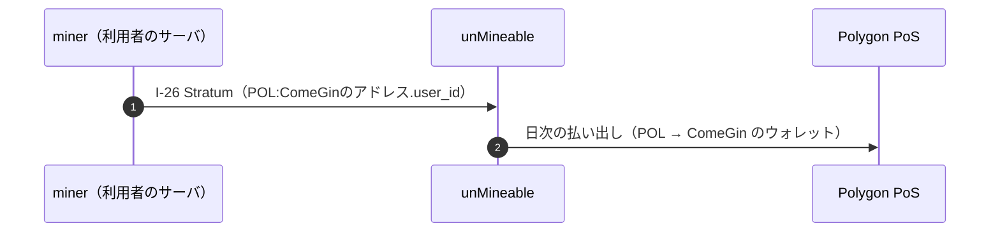
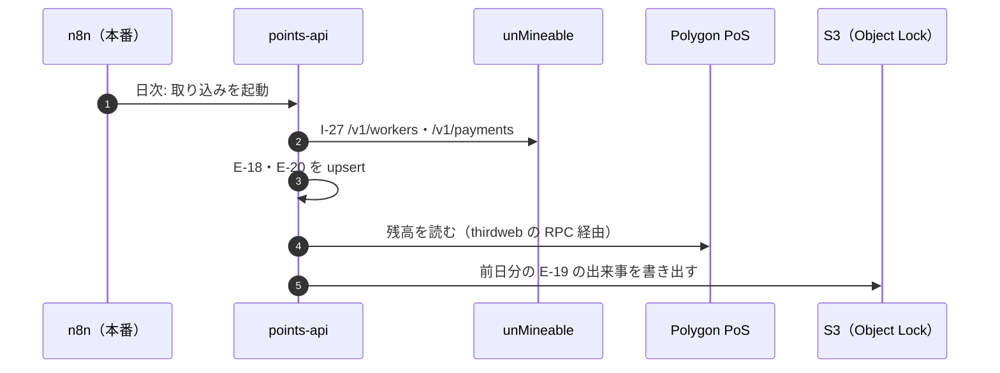
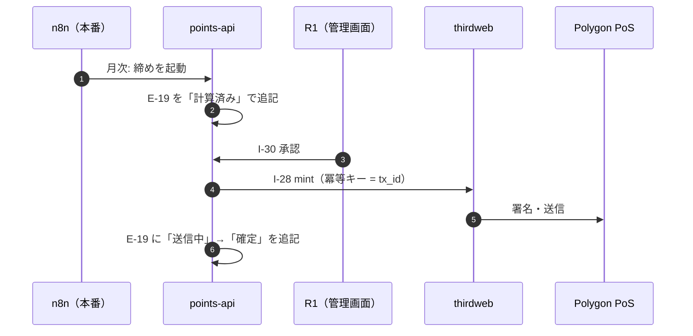
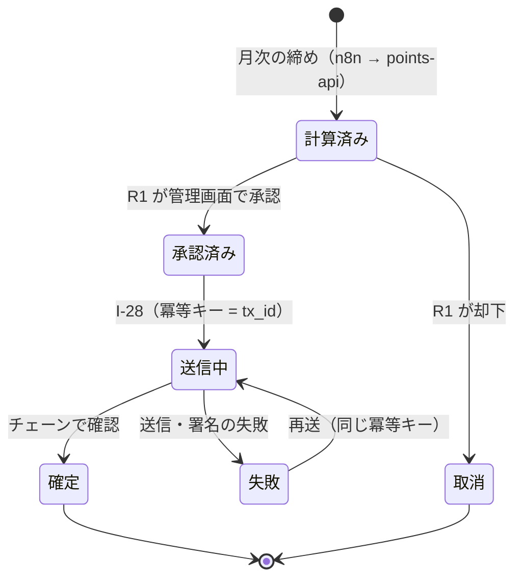

# DD-08 収益化のフロー（2026-10-03 に追加）

マネタイズモデル（AA-05 の ADR-20）の連携 `I-26`〜`I-30` を、実装に着手できる粒度まで下ろす。横断規約（相関 ID・失敗分類・リトライ・冪等キー・タイムアウト）は DD-01 に従う。ID の正本は各層のファイル（索引は [`docs/README.md` の「ID の採番と正本」](../README.md)）。

**仕様の状態は `条件付き`**（承認ゲート G-1〜G-3〈BA-05〉の結果で変わりうる）。**本システムの完成後に着手する。**

## 1. 全体の流れ

図 1 採掘と払い出し（`I-26`）。

図 2 日次の取り込みと突き合わせ（`I-27`）。

図 3 月次の締めと付与（`I-30` `I-28`）。

## 2. `I-26` miner → unMineable

| 項目 | 値 |
|---|---|
| プロトコル | Stratum（XMRig の `algo: rx/0`） |
| 接続先 | `rx.unmineable.com:3333` |
| `user` | `POL:<ComeGin のアドレス>.<user_id>`（**トークンとネットワークは POL・Polygon に固定**） |
| 起動の条件 | `MINER_ENABLED=true`（既定 `false`。利用者が設定する） |
| CPU の使い方 | スレッドの上限（`E-17` の `max_threads`。既定値の案は論理コア数の半分以下〈8 節で確定する〉）を設け、利用者が `MINER_MAX_THREADS` で設定する（ポータルで値を見て自分で設定する）。利用者の業務の負荷が高いときは止める（AA-04 の暴走条件 #13） |
| コンテナの隔離 | ボリュームを持たない。ネットワークの宛先は unMineable の接続先だけ |
| 取得 | 導入時に公式のリリースを**ハッシュを固定して**取得する（配布物に実行ファイルを含めない） |

- **ComeGin はこの連携を観測しない。** 失敗は「`E-18` の貢献量が 0」としてしか見えない。
- **`user` に取引業者の入金アドレスを書かない**（トラベルルール。BA-04 の P-M4）。

## 3. `I-27` points-api → unMineable の API

| 項目 | 値 |
|---|---|
| 起動 | 本番の n8n の日次のスケジュール（TA-03 の 3.3） |
| 認証 | HMAC-SHA256（`x-user-api-key` `x-user-api-timestamp` `x-user-api-signature`）。鍵は Secrets Manager |
| 呼ぶ API | `GET /v1/workers`（worker ごとの状態）、`GET /v1/workers/chart`（ハッシュレートの時系列）、`GET /v1/payments`（払い出しの履歴） |
| 書く先 | `E-18`（`user_id` × `date` で upsert）、`E-20`（`payout_uuid` で upsert。`chain_tx_hash` はチェーンで確かめてから埋める） |
| タイムアウト | DD-01 の 7.2（`I-27`） |
| 失敗時 | DD-01 の失敗分類に従って再試行する。**3 日続けて失敗したら SNS**（unMineable の保持期間を過ぎると取り戻せない） |

## 4. `I-28` points-api → thirdweb → Polygon PoS

| 項目 | 値 |
|---|---|
| 起動 | 付与: `R1` の承認（`I-30`）の後。消化: `R1` の操作（`I-30`） |
| 呼ぶ API | thirdweb の API（SaaS）。ポイントのコントラクト（ERC-20）の mint（付与）・burn（消化） |
| 資格情報 | **mint・burn に限る。POL の送金を含めない**（TA-04） |
| 冪等キー | `E-19` の `tx_id` |
| ガス代 | ComeGin のサーバウォレットが POL で直接払う（アカウント抽象化は使わない） |
| タイムアウト | DD-01 の 7.2（`I-28`） |
| 失敗時 | `E-19` を `失敗` で追記し、同じ冪等キーで再送する。thirdweb が止まっている間は待つ（付与は月次の締めなので数日の遅れは許容する） |

### 4.1 `E-19` の状態遷移

- **状態の遷移は行の更新ではなく、出来事の追記で表す。** 1 件の付与は「計算済み」「承認済み」「送信中」「確定」の 4 行になり、現在の状態は最新の行で決まる（DA-01 の 4.2）。
- **消化（burn）は `承認済み` から始まる**（`R1` の操作そのものを承認として扱う）。
- **`確定` の後の訂正は、状態を戻さずに打ち消しの取引（`kind: reversal`）を新しく起こす。**
- **禁止する遷移**: `確定` → 他の状態、`取消` → 他の状態、`計算済み` → `送信中`（承認を飛ばす）。

### 4.2 日次の突き合わせ

1. `E-19` の `確定` の合計（利用者ごと）と、チェーン上の残高（利用者ごとのアドレス）を比べる。ずれたら SNS。`R1` が `E-19` を正として補正の取引を起こす。
2. DB の前日分の出来事と S3 の写しを比べる。食い違ったら SNS（追記だけの権限が崩れた疑い。S3 の写しを正として調べる）。
3. `E-20` の unMineable の払い出しと、チェーン上の入金を比べる。差は `R1` が月次で確かめる（`E-20` の正本はチェーンの入金）。
4. S3 への写しが失敗したら、翌日に前日分も含めて書き直す（出来事の ID で冪等）。2 日続けて失敗したら SNS（TA-05）。

## 5. 月次の締め

1. n8n が `points-api` の締めを呼ぶ（前月の 1 日〜末日。日時は TA-03 の未決定事項）。
2. `points-api` が前月の `E-20` の円換算の合計（その月の採掘収入）を出す。
3. 利用者ごとの貢献比 = 利用者の `E-18` の前月のハッシュ数 ÷ 全利用者の合計。
4. 付与量 = 採掘収入 × 貢献比 × 還元率（1 ポイント = 1 円。端数は切り捨て）。
5. 利用者ごとに `E-19`（`kind: grant`）を `計算済み` で追記する。冪等キーは `grant:<user_id>:<YYYY-MM>`（同じ月を 2 回締めても 2 件にならない）。
6. `R1` が管理画面で内訳を確かめ、承認するか却下する（`I-30`）。

## 6. `I-29` 利用者 → points-api（ポータル）

| 操作 | 書く先 | 冪等キー | 失敗時 |
|---|---|---|---|
| オプトイン | `E-17`（`consented_at` `consent_version`） | `optin:<user_id>:<consent_version>` | 利用者に明示する |
| 撤回 | `E-17`（`revoked_at`） | `revoke:<user_id>:<consent_version>` | 利用者に明示する |
| 残高・履歴の閲覧 | 読むだけ（`E-19`） | — | 利用者に明示する |

- ログインは SES で送るメールのワンタイムリンク。メールアドレスは `E-09`（Mautic）と突き合わせ、`E-17` には `contact_ref` だけを置く。
- 同意文には、採掘の内容、CPU の使い方、越境（unMineable・thirdweb）、チェーンと S3 の写しの記録が消えないことを書く（文言は承認ゲート G-1 で確かめる）。

## 7. `I-30` R1 → points-api（管理画面）

| 操作 | 書く先 | 備考 |
|---|---|---|
| 付与の承認・却下 | `E-19`（`承認済み` / `取消` を追記） | 承認の後に `I-28` が走る |
| 消化 | `E-19`（`kind: redeem`、`basis` に発注書番号） | 冪等キーは `redeem:<発注書番号>` |
| 付与率の変更 | `points-api` の設定（変更の履歴を残す） | エージェントの経路は無い（AA-04 の暴走条件 #12） |

## 8. 未決定事項

- `E-19` の出来事を同じテーブルに追記するか、取引と出来事の 2 テーブルに分けるか（DA-01 の 7 節）。
- スレッドの上限の既定値と、「負荷が高い」の判定の方法（XMRig の設定で表せるか、miner のコンテナの外側で止めるか）。
- 月次の締めの日時（TA-03）。
