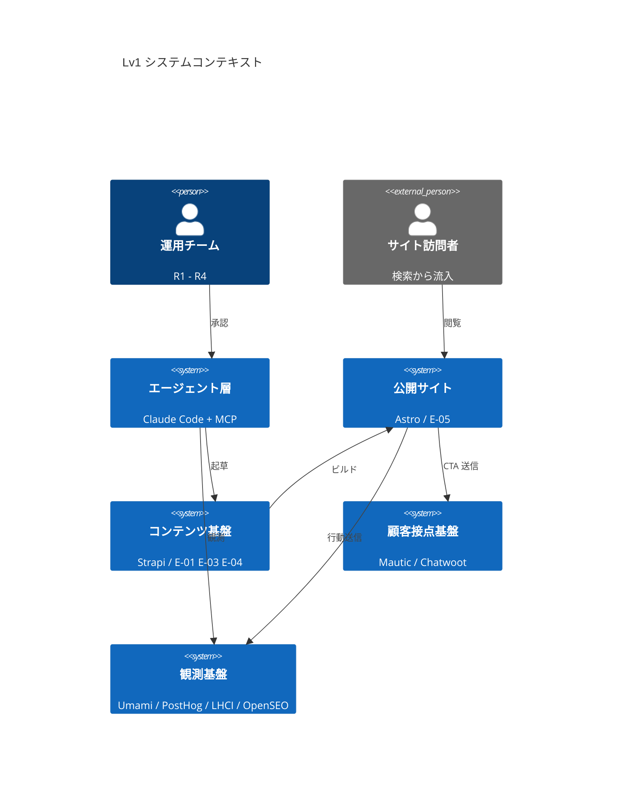
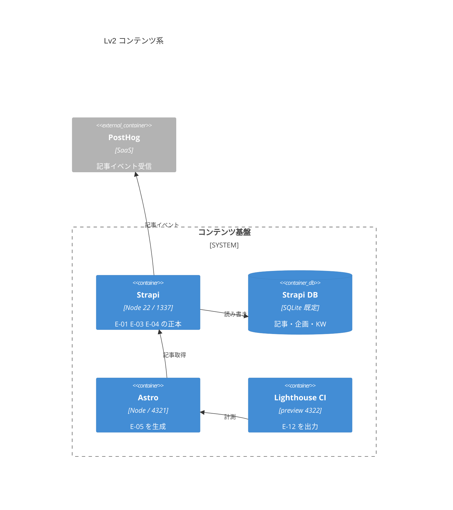
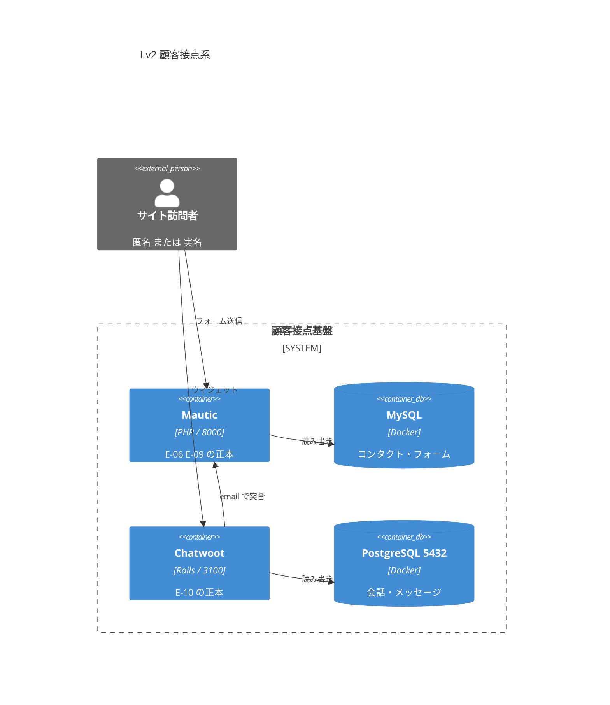
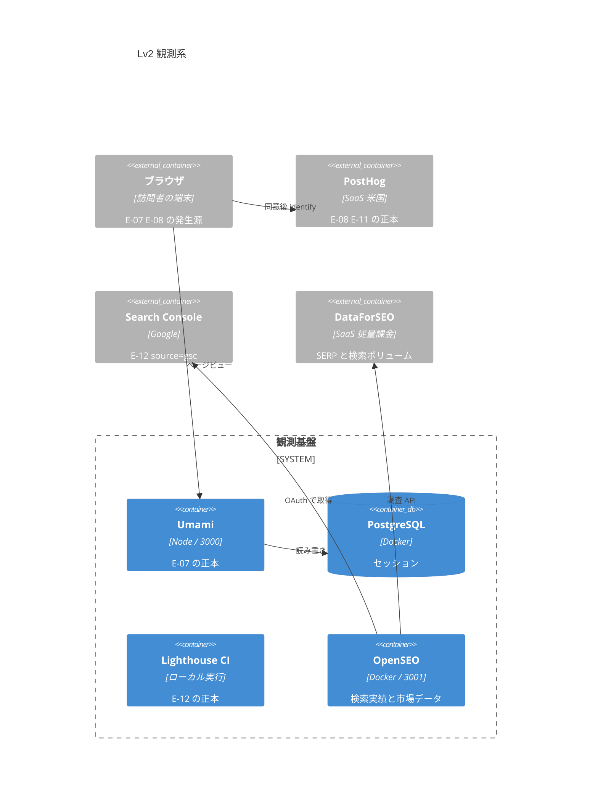
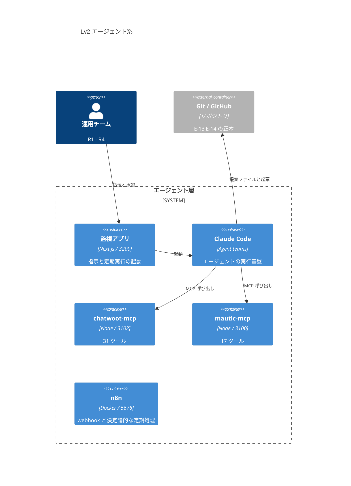

# AA-01 アプリケーションランドスケープ

AA（Application Architecture）層。ロール ID `R1`〜`R4`、Capability ID `CAP-01`〜`CAP-16`、エンティティ ID `E-01`〜`E-15` は EA 共通用語集の定義をそのまま使う。

この層が答えるのは「BA が定義した Capability と、DA が正本を決めたエンティティを、**どのアプリケーションが実際に担うのか**」の 1 問だけ。物理構成（ホスティング先・コンテナの配置・ネットワーク）は TA の担当で、ここでは扱わない。

図はすべて **To-Be** を描く。状態（`実装済み` / `未配線` / `未着手`）は図に持ち込まず、必ず表の「状態」列と図の直下の As-Is 注記で表す（用語集の表記ルールと Mermaid の実装メモに従う）。

## 1. C4 Lv1 システムコンテキスト

**As-Is 注記。** この図の 7 本の関係のうち、実際に成立しているのは `エージェント層 → コンテンツ基盤`（`strapi-mcp` 経由の記事操作）と `エージェント層 → 顧客接点基盤`（`chatwoot-mcp` / `mautic-mcp`。図では `観測` の線に含めている）だけ。`サイト訪問者 → 公開サイト` は記事を描画するページが存在せず（`frontend/verdant-virgo/src/pages/` に `index.astro` しかない）、`公開サイト → 顧客接点基盤` と `公開サイト → 観測基盤` はブラウザ側のスクリプトが 1 つも設置されていない（`frontend/verdant-virgo/src/layouts/Layout.astro`）。詳細は 6 節の一覧表と AA-02 の連携点カタログを見る。

`運用チーム → エージェント層` の線は承認の流れであって実行の流れではない。**この線が逆向き（エージェントが人間の承認条件を書き換える）になることは設計上あってはならない**（BA-03 の「Accountable をエージェントに置かない」決定。AA-03 の 5 節で担保方法を述べる）。

## 2. C4 Lv2 コンテナ図（コンテンツ系）

**As-Is 注記。** 実際に動いているのは `Strapi → Strapi DB` と `Strapi → PostHog`（`backend/strapi-system/src/index.ts` のライフサイクル購読）の 2 本。`Astro → Strapi` は**まだ 1 行も書かれていない**（記事を取得するローダも描画ページも無い）。`Lighthouse CI → Astro` は `pnpm lh` で実行できるが、結果を `E-12 AuditResult` として継続的に蓄積する経路が無い。

- Strapi の DB クライアントは `DATABASE_CLIENT` で切り替わり、既定は SQLite（`backend/strapi-system/config/database.ts`）。**`E-01` `E-03` `E-04` の正本は本番（AWS）の Strapi である**（ADR-16。2026-09-19）。本番の Strapi は ECS on Fargate で動き、DB は RDS for PostgreSQL（共有インスタンスの `strapi` データベース）、メディアは S3 に置く（TA-06）。**図の技術表記（`Node 22 / 1337`・`SQLite 既定`）は開発環境のものである。** 開発環境の Strapi は試験用で、記事を開発と本番の間で移さない（TA-07 の 6 節）。
- **配置の経緯。** ADR-14 で「本番の Strapi を AWS に置く」と決め、同日の ADR-15 で取り消してオンプレだけに戻した（記事は HTML に焼き込まれて配信されるため、本番に Strapi を置く理由が無いとした）。さらに同日の ADR-16 で、**正本が開発機 1 台にしか無い**ことを理由に再び AWS に置いた。
- **`Astro → Strapi`（`I-09`）の接続先は本番の Strapi である**（ADR-16。ADR-15 ではオンプレの Strapi だった）。ビルドはオンプレで行い、読み取り専用の API トークンで本番の Content API を読む。配信は人間が承認する（ADR-15、DD-05 の 1 節）。**エージェントが本番の Strapi に書けるのは下書きまでで、記事の公開は `R2` が本番の管理画面で行う**（ADR-17）。公開された記事は監視アプリの定期実行が見つけてビルドと計測を起こす（案。本番の Strapi からローカルへは通知できないため。TA-07 の 3.5）。画像はビルド時に `dist/` へ取り込み、公開ページから Strapi と S3 へのリクエストを出さない（ADR-11）。
- `E-05 Page` は Astro のビルド成果物であり、直接書き換えられない。作用は必ず `E-04` かコードのどちらかを変えて再ビルドする経路を通る（DA-04 の 1.3）。

## 3. C4 Lv2 コンテナ図（顧客接点系）

**As-Is 注記。** Mautic と Chatwoot は本体・DB とも起動できるが、**訪問者からの 2 本の線は成立していない**（Mautic のフォームが未作成、Chatwoot のウィジェットがサイトに未設置）。`Chatwoot → Mautic` の email 突合も未着手で、両者を繋ぐ経路は現時点で存在しない。MailHog（8025）は Mautic の送信メールを開発環境で受けるためのもので、本番の配信経路ではない。**本番の顧客向けメールは Amazon SES から送る**（ADR-12、TA-06 の 6 節。`未着手`）。

- **図の技術表記（`PHP / 8000`・`Docker`・`PostgreSQL 5432`）は開発環境のものである。** 本番では Mautic・Chatwoot は AWS の ECS on Fargate で動き、DB は RDS for MySQL / RDS for PostgreSQL、Chatwoot の Redis は ElastiCache、添付ファイルは S3、Mautic の `media/` は EFS に置く（ADR-12、TA-06）。物理構成は TA の担当であり、この図では描き分けない。

- Chatwoot のホスト側ポート 3100 は **`mautic-mcp` の HTTP 既定値と衝突する**（`.claude/CLAUDE.md` のポート表）。両方を HTTP で動かす構成を採るなら、`mautic-mcp` 側の `PORT` を変える（AA-05 の未決定事項に記録）。
- `E-06 CTA` は表示定義（Strapi のコンポーネント）と受付定義（Mautic のフォーム）に分割保持される（DA-01 の 4 節）。図では受付定義側だけを Mautic に置いている。

## 4. C4 Lv2 コンテナ図（観測系）

**As-Is 注記。** ブラウザからの 2 本はどちらも未着手（トラッカーのスクリプトが無い）。Umami は起動できるがセッションが 0 件。PostHog に届いているのは Strapi のサーバ側イベントだけで、訪問者の `E-08 Person` は 1 件も存在しない（DA-03 の 1.2）。Google Search Console はサイト登録も所有権確認も行っていない。**OpenSEO は Docker で稼働しており、`OpenSEO → DataForSEO` だけが成立している**（API キー設定済み）。`OpenSEO → Search Console` は OAuth クライアントが未発行のため未接続。

- **GSC は OpenSEO に統合した**（`R1` の 2026-09-18 の決定。ADR-06・ADR-09）。当初の図にあった `Search Console → Lighthouse CI` の線（順位データを `E-12` の別ソースとして同じ入れ物に入れる、という論理的な関係）は廃した。**実装上は `agent/seo-auditor` が `.lighthouse/` と OpenSEO の MCP の両方を読んで `E-12` に正規化する**（AA-03）。
- **OpenSEO を観測基盤の境界の内側に、DataForSEO と Search Console を外側（`Container_Ext`）に置いたのは配置の違いを表すため**である。OpenSEO はセルフホストでオンプレに留まり、外に出るのは DataForSEO への問い合わせと GSC からの取得だけになる。

- **個人に関わるデータが越境するのは PostHog（米国リージョン）だけ**である（DA-05 の 1.2）。DataForSEO も SaaS だが、送るのはキーワードとドメインだけで個人情報を含まない（DA-05 の 1.2.1）。この図で PostHog を `Container_Ext` にしているのは、配置の違いを図の上でも区別するため。
- **本番の `ブラウザ → Umami` は AWS の ALB を通る**（`R1` の 2026-09-18 の決定。ADR-12、AA-02 の 1.3）。当初は Umami をオンプレに置き ngrok の常設トンネルで到達させる設計だったが、訪問者のブラウザから届く必要があるシステムは AWS に置くことにした。**`ブラウザ → PostHog` だけは SaaS のため直接到達する**ので、AWS 側の障害に影響されない。Chatwoot のウィジェット（3 節）と Mautic のフォーム受付（同）も同じく ALB 経由になる。
- Umami の `docker-compose.yml` は上流のままでループバック限定になっていない（`.claude/CLAUDE.md`）。**これは開発環境の問題として残る**（本番の Umami は private サブネットに置き、ALB だけがインターネットに面する。TA-06 の 5.6）。公開範囲の制御は TA の担当。

## 5. C4 Lv2 コンテナ図（エージェント系）

**As-Is 注記。** 成立しているのは `Claude Code → chatwoot-mcp` と `Claude Code → mautic-mcp` の 2 本だけ。監視アプリは雛形のみで画面が無く、n8n はコンテナと環境変数テンプレートのみでワークフローが 0 件、`docs/proposals/` は未作成、`E-13` を書き込む経路も通知経路も存在しない。`Claude Code → Git` は**ファイルを書くところまでしか成立しない**（リポジトリのルールで状態変更系の git コマンドが禁止されているため。AA-03 の 4 節で詳述する）。

- **（2026-09-19 に ADR-17 で変更）GitHub への起票（`I-13`）の線を `n8n → Git` から `Claude Code → Git` に移し、監視アプリを図に加えた。** ADR-16 で n8n が AWS に移り、ローカルの PC に着信できなくなったため、エージェントを使う定期処理（観測の日次バッチ・`I-13` の起票など）は監視アプリが起動する（TA-07 の 3.5）。n8n に残るのは Webhook の受け口と、エージェントを使わない決定論的な定期処理である。起票をエージェントが行うか、エージェントを使わないローカルの処理で行うかは未決定（8 節、AA-03 の 5.4）。

- **n8n の技術表記（`Docker / 5678`）は開発環境のものである。** 本番の n8n は AWS の ECS on Fargate で動き（本体と runners。DB は RDS for PostgreSQL の共有インスタンス）、**サンドボックスは置かない**（Fargate は privileged のコンテナを受け付けないため。ADR-16、TA-06 の 3.1）。本番の Chatwoot・Mautic からの Webhook は VPC の中で n8n に届き、ngrok を通らない。n8n は AA の分類ではエージェント層に置いているが、本番の自動化という正本の処理を持つため、配置はクラウドになる（ADR-16 の基準）。

- **Amazon SNS も図に含めていない。** n8n から呼ばれる送信先であり、エージェント層の構成要素ではないため（ランドスケープには載せる。6 節）。
- 図から意図的に省いたもの: `strapi-mcp`（本番用の登録は `strapi-prod`）と Umami MCP と OpenSEO の MCP と n8n の MCP（本番用の登録は `n8n-prod`。ADR-16）。いずれも Claude Code の環境側に MCP サーバとして設定されており実際に呼べるが、**このリポジトリが管理しているコードではない**（`backend/` に実体が無い）。ランドスケープには載せる（6 節）が、コンテナ図では自作 2 本と区別できなくなるため外した。
- `Claude Code` を 1 つのコンテナとして描いているのは、個々のエージェントがコンテナではなく**同一実行基盤上の役割**だから（エージェントの内訳は AA-03 の 1 節）。

## 6. アプリケーション一覧

「担う Capability」は BA-02 の主担当を実現手段の側から割り当てたもので、BA の担当ロールを書き換えるものではない。

| アプリケーション | 役割 | 担う Capability | 扱うエンティティ | ポート | 配置 | 状態 |
|---|---|---|---|---|---|---|
| Strapi（`backend/strapi-system`） | `E-01` `E-03` `E-04` の正本（**本番の Strapi**。ADR-16）。記事・企画・キーワードの管理画面と API。組み込みの MCP（`/mcp`） | `CAP-02` `CAP-03` `CAP-04` `CAP-07` | `E-01` `E-02` `E-03` `E-04` `E-06`（表示定義） | 1337（開発） | 開発: オンプレ（試験用）／**本番: AWS**（ECS on Fargate ＋ RDS for PostgreSQL の共有インスタンス ＋ メディアは S3。`cms.comegin.com`。ADR-16、TA-06）。ADR-15 ではオンプレだけだった | `実装済み`（開発環境の `api::article.article` のみ。`keyword` / `content-plan` は未作成。**AWS 側は `未着手`**。`pg` と S3 のアップロードプロバイダーが依存関係に無い） |
| Astro（`frontend/verdant-virgo`） | `E-05` の生成。公開サイトの実体 | `CAP-05` `CAP-07` `CAP-08` `CAP-09` | `E-05` `E-06`（埋め込み） | 4321 | ビルドはオンプレ／配信は **AWS（S3 + CloudFront。TA-02）** | `未配線`（スキャフォールドのみ。記事描画ページが無い） |
| Lighthouse CI（`frontend/verdant-virgo/lighthouserc.cjs`） | 合成パフォーマンス監査。SEO 1.0 / 他 0.9 のしきい値ゲート | `CAP-06` `CAP-09` | `E-12` | 4322（preview） | オンプレ | `実装済み`（`pnpm lh` で実行可能。蓄積の仕組みは無い） |
| Mautic（`backend/mautic-system`） | `E-09` の正本。フォーム・セグメント・スコアリング・メール | `CAP-11` | `E-06`（受付定義） `E-09` | 8000 / 8025（開発） | 開発: オンプレ／**本番: AWS**（ECS on Fargate ＋ RDS for MySQL ＋ EFS。ADR-12、TA-06） | `未配線`（開発環境で本体は動く。フォーム・セグメント・キャンペーンが未作成。**AWS 側は `未着手`**） |
| Chatwoot（`backend/chatwoot-system`） | `E-10` の正本。Web 接客と問い合わせ対応 | `CAP-12` | `E-10` | 3100 / 5432（開発） | 開発: オンプレ／**本番: AWS**（ECS on Fargate ＋ RDS for PostgreSQL ＋ ElastiCache ＋ S3。ADR-12、TA-06） | `未配線`（開発環境で本体は動く。ウィジェットがサイトに無い。**AWS 側は `未着手`**） |
| Umami（`middleware/umami-master`） | `E-07` の正本。流入・母数系 KPI の測定元 | `CAP-10` | `E-07` | 3000（開発） | 開発: オンプレ／**本番: AWS**（ECS on Fargate ＋ RDS for PostgreSQL。Chatwoot と 1 インスタンスを共有。ADR-12、TA-06） | `未配線`（開発環境で起動できるがセッション 0 件。**AWS 側は `未着手`**） |
| PostHog | `E-08` `E-11` の正本。行動・実験系 KPI とエラー追跡 | `CAP-10` `CAP-13` | `E-08` `E-11` `E-12` | — | **SaaS（米国）** | `未配線`（Strapi からのサーバ側イベントのみ到達） |
| Google Search Console | 検索順位・表示回数・URL 検査の測定元。**OpenSEO 経由で取得する**（ADR-06） | `CAP-02` `CAP-09` | `E-12`（`source: gsc`） | — | SaaS（Google） | `未着手`（ドメインプロパティ未登録・OAuth クライアント未発行） |
| **OpenSEO**（`middleware/open-seo-main`。上流の取り込み） | **競合・検索市場調査と GSC の取得口。** キーワード調査・SERP・順位計測・競合・被リンク・サイト監査（ADR-09） | `CAP-02` `CAP-09` `CAP-16` | `E-01`（候補の作業場。正本ではない） `E-12`（`source: gsc` / `serp` / `site_audit` / `market`） | **3001**（`127.0.0.1`） | オンプレ（Docker。`local_noauth`） | `未配線`（稼働中・DataForSEO 設定済み。GSC 未接続。プロジェクトが米国市場の `Default` のみ） |
| **DataForSEO** | OpenSEO が呼ぶ検索データの提供元（SERP・検索ボリューム・競合・被リンク）。**従量課金・前払い制** | `CAP-02` `CAP-16` | キーワード・ドメイン・地域コード（**個人情報を含まない**） | — | **SaaS（外部）** | `実装済み`（OpenSEO に API キー設定済み） |
| n8n（`middleware/n8n`） | webhook 受け口・**エージェントを使わない決定論的な定期処理**・n8n 自身の実行履歴。**エージェントを使う定期処理の起動と `I-13` の起票は ADR-17 で監視アプリ（ローカル）に移した**（ADR-05 の時点では n8n の役割だった） | `CAP-13` | —（n8n 自身のワークフローの実行履歴だけ。**エージェントの実行は記録されず、`E-15` の正本ではない**。ADR-18） | 5678 / 5433（開発） | 開発: オンプレ（サンドボックスを含む）／**本番: AWS**（ECS on Fargate の本体と runners ＋ RDS for PostgreSQL の共有インスタンス。**サンドボックスは置かない**。ADR-16、TA-06） | `未配線`（compose のみ。ワークフロー 0 件。**AWS 側は `未着手`**） |
| chatwoot-mcp（`backend/chatwoot-mcp`） | Chatwoot API の MCP 公開（31 ツール）。`ACCESS_LEVEL` で公開範囲を制御 | `CAP-12` `CAP-15` | `E-10` `E-09`（Chatwoot 側） | 3102（HTTP 時） | オンプレ | `実装済み` |
| mautic-mcp（`backend/mautic-mcp`） | Mautic API の MCP 公開（17 ツール）。同上 | `CAP-11` `CAP-15` | `E-06` `E-09` | 3100（HTTP 時） | オンプレ | `実装済み` |
| Claude Code（Agent teams） | エージェントの実行基盤。`E-13` の起票。`E-15` に記録される実行の主体（**記録は監視アプリのサーバー側が書き、Claude Code には書かせない**。ADR-18）。**監視アプリから起動され（手動の指示と定期実行の両方。ADR-17）、MCP で開発環境と本番の Strapi・Mautic・Chatwoot・Umami・n8n を読み書きする**（本番は `read_write` まで。`strapi-prod` は下書きまで。ADR-15・ADR-16・ADR-17） | `CAP-04` `CAP-05` `CAP-14` `CAP-16` | ほぼ全 `E-ID`（読み取り） | — | ローカル | `実装済み`（基盤として。エージェント定義は未作成） |
| **監視アプリ**（`frontend/next-js`。**自作**） | **管理者の操作の起点。** 開発環境と本番の全システムの状態を表示し（読み取りのみ）、管理者の指示を Claude Agent SDK で Claude Code に渡す（ADR-14・ADR-15、TA-07）。**エージェントを使う定期処理（観測の日次バッチ・`I-13` の起票・公開された記事の確認・誤った書き込みの突き合わせ）もスケジュールを持って起動する**（ADR-17、TA-07 の 3.5）。**定期実行の定義は Git で持ち、承認済みの `main` から作った別のチェックアウトで読む**（ADR-18 の追加の決定） | `CAP-13` `CAP-14` `CAP-15` | **`E-15` の正本**（実行記録。ローカルの DB に保存し、サーバー側だけが書く。**要約と ID だけを残し、S3 に追記専用で写す**。**ADR-18。ADR-16 の「正本はクラウド」の唯一の例外**）、他は表示のみ | 3200（開発。`127.0.0.1`） | **オンプレ**（本番に置かない。ADR-18 でクラウドに置く案も退けた） | `未着手`（Next.js 16.3.5 の雛形と Better Auth の導入のみ） |
| Git / GitHub | `E-13` `E-14` の正本。PR レビューが承認機構 | `CAP-06` `CAP-14` | `E-13` `E-14` | — | SaaS（リモート） | `未着手`（`docs/proposals/` が未作成） |
| strapi-mcp（リポジトリ管理外） | Strapi のコンテンツ操作を MCP 公開（Strapi 組み込みの `/mcp`）。**本番用に `strapi-prod` として別登録する**（ADR-16。本番の Admin トークンには**公開・非公開化・削除の権限を与えず、下書きまでに絞る**。ADR-17。ADR-16 の時点では削除だけを外す `read_write` 相当だった） | `CAP-04` | `E-04` | — | 登録はローカル（環境側の MCP 設定）／サーバは各 Strapi の中 | `未配線`（呼べるが、この EA の権限設計の管理下に無い。`strapi-prod` は本番の Strapi を立てるまで登録できない） |
| Umami MCP（リポジトリ管理外） | Umami の集計 API を MCP 公開 | `CAP-10` | `E-07` | — | ローカル（環境側の MCP 設定） | `未配線`（同上。加えて Umami にデータが無い） |
| **OpenSEO の MCP**（リポジトリ管理外） | OpenSEO の機能を MCP 公開（Streamable HTTP の `/mcp`）。**費用を発生させるツールを含む** | `CAP-02` `CAP-09` `CAP-16` | `E-01`（候補） `E-12` | 3001（`/mcp`） | ローカル | `未配線`（Claude Code の MCP 設定は 2026-09-18 にローカルへ付け替え済み。接続するエージェントが未定義。ADR-10） |
| **n8n の MCP**（リポジトリ管理外） | n8n のインスタンスの MCP（`/mcp-server/http`）。ワークフローの作成と更新。**本番用に `n8n-prod` として別登録する**（ADR-16。暫定。有効化は人間） | `CAP-13` `CAP-14` | —（ワークフローの定義。E-ID は無い） | 5678（開発） | 登録はローカル／サーバは各 n8n の中 | `未配線`（開発環境の登録は呼べる。`n8n-prod` は本番の n8n を立てるまで登録できない） |
| **Amazon SNS** | **通知の配信。** 顧客からの要求（`comegin-lead-alert`）と監視・障害（`comegin-ops-alert`）を運用者のメールアドレスへ届ける | `CAP-11` `CAP-12` `CAP-13` | `E-09` `E-10` の**要旨のみ**（DA-05 の 1.3） | — | **AWS（`ap-northeast-1`）** | `未着手`（トピック 0 件・購読 0 件。権限は確認済み） |
| **admin-auth**（`backend/admin-auth` を想定。**自作**） | **本番の Strapi・Mautic・Chatwoot・Umami・n8n の管理画面の手前の関門**（Strapi と n8n は ADR-16 で加わった）。 Better Auth を OIDC の IdP として動かし、ALB の OIDC 認証から参照される。ログインは Google Workspace、認可は管理者の許可リスト（ADR-13、TA-06 の 5.2.1） | `CAP-15` | —（管理者の許可リストとログインの記録。E-ID は無い） | 3103（開発） | **AWS**（ECS on Fargate ＋ RDS for PostgreSQL の共有インスタンス。`auth.comegin.com`） | `未着手`（コード未作成） |
| **Amazon SES** | **顧客向けメールの送信。** Mautic の配信・フォームの自動返信、Chatwoot のメール（ADR-12。社内向けの通知は SNS のまま） | `CAP-11` `CAP-12` | `E-09` `E-10`（宛先と本文） | — | **AWS（`ap-northeast-1`）** | `未着手`（**サンドボックスのまま**。本番アクセスの申請が必要。TA-06 の 6 節） |

### 一覧表の読み方

- **監視アプリは ADR-14 で増えた自作のアプリケーション**である。管理者はオンプレの画面だけを操作し、エージェントへの指示はこのアプリから出す。**MCP サーバは開発環境用と本番用の 2 回登録する**（chatwoot-mcp・mautic-mcp・Umami MCP は ADR-15、Strapi の `/mcp`〈`strapi-prod`〉と n8n の MCP〈`n8n-prod`〉は ADR-16。本番は `read_write` まで。`strapi-prod` は Admin トークンの権限で下書きまでに絞る〈ADR-17〉。OpenSEO の MCP はローカルだけ）。**本番の記事の公開は人間（`R2`）が本番の Strapi の管理画面で行い**（ADR-17）、公開サイトへの反映は人間が配信を承認し、n8n のワークフローの本番での有効化も人間が行う（ADR-15・ADR-16・ADR-17、TA-07 の 3.3・7 節）。**ADR-17 で、エージェントを使う定期処理の起動も監視アプリが持つことになった**（本番の n8n〈AWS〉からはローカルの Claude Code を起動できないため）。**ADR-18 で、監視アプリの実行記録が `E-15 AgentRun` の正本になった。** 監視アプリは正本のデータを持つが、ローカルに置いたままにする（ADR-16 の基準の唯一の例外。エージェントの実行と同じ場所で記録が生まれ、クラウドに置いても開発機が止まれば改善ループは止まるため）。`.claude/CLAUDE.md` の「自作コードと vendor 取り込みの区別」の表に加える対象になる。

- **`admin-auth` は ADR-13 で増えた自作のアプリケーション**であり、`.claude/CLAUDE.md` の「自作コードと vendor 取り込みの区別」の表に加える対象になる（コード作成時）。**管理画面への通信は `admin-auth` を通らない**（ログインのときだけ関わる）ため、E-ID を運ぶ連携を持たず、AA-02 の連携点カタログにも載せない。
- **状態が `実装済み` なのは 6 つだけ**（Strapi・Lighthouse CI・chatwoot-mcp・mautic-mcp・Claude Code・DataForSEO）。このうち事業の価値に直接触れているのは Strapi のみで、他の 5 つは道具か土台にあたる。DataForSEO は OpenSEO からの問い合わせが成立しているだけで、OpenSEO 自体はまだどのエージェントにも繋がっていない（`未配線`）。
- **ポートが重複している行が 1 組ある**（Chatwoot 本体と mautic-mcp の HTTP がともに 3100）。同時に HTTP で起動しない運用でしのぐか、`PORT` を変えるかを決める必要がある。
- **配置が外部の行は 5 つ**（PostHog・Google Search Console・GitHub・**Amazon SNS**・**DataForSEO**）。**DataForSEO は 2026-09-18 に増えた外部依存**であり、TA-01 の 8 節の基準（自前で持てないデータの取得元に限る）で認めた（ADR-09）。このうち **Amazon SNS だけはベンダーを増やしていない**（AWS は `CAP-07` `CAP-08` の配信先として既に使う前提。TA-01 の 8 節）。**Amazon SES と、ADR-12 で AWS に移した Mautic・Chatwoot・Umami、ADR-16 で AWS に移した Strapi・n8n も同じく AWS の中にあり、ベンダーを増やしていない**（いずれも `ap-northeast-1` で越境しない）。DA-05 は PostHog の越境だけを扱っているが、`E-13` `E-14` を Git に置く決定により**統制の記録も GitHub に出る**（DA-05 の未決定事項に既出）。AA としてはこの 2 つ目の越境を設計上の既知事項として引き継ぐ。
- **`strapi-mcp` と Umami MCP と OpenSEO の MCP は自作ではない。** OpenSEO の MCP には**費用**という別の軸があり、扱いを ADR-10 に分けた。 `.claude/CLAUDE.md` の命名規則（`<プロダクト>-mcp` はこのリポジトリの自作サーバ）とは別系統であり、バージョン・`ACCESS_LEVEL` 相当の権限・`sanitize()` の有無をこのリポジトリが保証できない。AA-03 のエージェント設計では、この 2 つに**書き込みを任せない**方針を採る（7 節と AA-03 の 2 節）。**ADR-16 で、本番の Strapi への書き込みは `strapi-prod` の Admin トークンの権限（削除を与えない）で絞ることになり、ADR-17 で公開・非公開化の権限も外して下書きまでにした**（記事の公開の承認〈`R2`〉を、約束ではなくトークンの権限で守るため）。 ADR-07 の「`ACCESS_LEVEL` 相当の境界が無い」は本番ではトークンの権限で埋まるが、`sanitize()` と `CHARACTER_LIMIT` が及ばない管理外の MCP であることは変わらない。**n8n の MCP（`n8n-prod`）も同じく管理外の MCP として加わった**（ADR-16）。

## 7. Capability からアプリケーションへの割り当て

BA-02 の 16 Capability を、実現手段の側から埋め戻す。**担う手段が 1 つも無い Capability を可視化するのが目的**（成熟度の底上げの着手順を決める根拠になる）。

| Capability | 主たるアプリケーション | 補助 | 状態 |
|---|---|---|---|
| `CAP-01` 事業戦略・KPI 管理 | Umami + PostHog + Mautic（指標の取得） | Claude Code（集計と草案） | `未配線` |
| `CAP-02` キーワード戦略 | Strapi（`api::keyword.keyword`。正本） | **OpenSEO**（キーワード調査・検索ボリューム・GSC の実績） | `未配線` |
| `CAP-03` コンテンツ企画 | Strapi（`api::content-plan.content-plan`） | Claude Code | `未着手` |
| `CAP-04` コンテンツ制作 | Claude Code + strapi-mcp | Strapi の管理画面 | `未配線` |
| `CAP-05` デザイン制作 | Astro + shadcn/ui + Tailwind v4 | Claude Code | `未配線` |
| `CAP-06` 品質保証・承認 | Lighthouse CI（機械） + GitHub の PR レビュー（人間） | Claude Code（指摘の提示） | `未配線` |
| `CAP-07` コンテンツ公開・配信 | Strapi の `publishedAt`（**`R2` が本番の管理画面で設定する**。ADR-17） + Astro の再ビルド | **監視アプリ**（公開された記事を見つけてビルドと計測を起こす。ADR-17。案） | `未着手` |
| `CAP-08` エッジ配信・可用性 | 未選定（TA の判断事項） | — | `未着手` |
| `CAP-09` テクニカル SEO | Lighthouse CI + Astro | **OpenSEO**（GSC の実績・URL 検査・サイト監査・順位計測） | `未配線` |
| `CAP-10` 行動観測・効果測定 | Umami（母数） + PostHog（行動） | Umami MCP | `未着手` |
| `CAP-11` リード獲得・育成 | Mautic + mautic-mcp | n8n + **Amazon SNS**（トスアップの通知） | `未配線` |
| `CAP-12` Web 接客 | Chatwoot + chatwoot-mcp | n8n + **Amazon SNS**（会話開始の通知） | `未配線` |
| `CAP-13` 監視・障害対応 | PostHog（Error Tracking） | n8n + **Amazon SNS**（障害通知） | `未配線` |
| `CAP-14` 改善提案の生成と承認 | Git / GitHub（`E-13` `E-14`） | Claude Code + **監視アプリ**（エージェントの起動元。手動の指示と定期実行。`I-13` の起票もここから起こす。ADR-14・ADR-17） | `未着手` |
| `CAP-15` ガバナンス・アクセス管理 | MCP の `ACCESS_LEVEL` と `MCP_AUTH_TOKEN` | 各システムの個別アカウント、**`admin-auth`**（本番の管理画面の関門。ADR-13） | `実装済み`（MCP 側のみ。`admin-auth` は `未着手`） |
| `CAP-16` 戦略知見の獲得 | Claude Code（調査） + **OpenSEO**（競合・SERP・被リンク） | Git（知見の記録先が未定） | `未配線` |

**`CAP-08` だけが担うアプリケーションを持たない。** 他の 15 はいずれも手段が決まっており（未配線・未着手であっても割り当て先は定まっている）、`CAP-08` のみホスティング先が未選定のまま残っている。これは BA-02 で TA に引き渡した項目であり、AA では決めない。

## 8. 未決定事項

- **`strapi-mcp` と Umami MCP の扱い（ガバナンス上の穴）。** どちらもこのリポジトリの管理外にあり、`ACCESS_LEVEL` に相当する権限制御も `sanitize()` も、このリポジトリからは保証できない。`CAP-04`（コンテンツ制作）の実務がこの管理外の MCP に依存している現状は、`CAP-15` の最小権限方針と整合しない。**この問題は AA-05 の ADR-07 に集約したので、詳細と選択肢はそちらを見る**（`R1` の判断待ち）。**ADR-17 で、本番（`strapi-prod`）は Admin トークンの権限で下書きまでに絞ると決めた**が、Strapi 5 の Admin トークンで「公開だけを外す」設定ができるかは実装時に確かめる（TA-07 の 9 節）。できなければ ADR-07 の再検討（自作の `strapi-mcp` を含む）に戻る。
- **Chatwoot 本体（3100）と `mautic-mcp` の HTTP（3100）のポート衝突。** TA-01 が「`mautic-mcp` を stdio で動かすことを既定の運用とする」と決定しており、AA-03 のエージェント編成もエージェント別の `ACCESS_LEVEL` を成立させるために stdio を前提にしている（AA-03 の 2.3）。両者は整合するが、**`mautic-mcp` の `TRANSPORT` の既定は `http`** であるため、何も指定せずに `pnpm start` すると衝突する。既定値そのものを変えるかどうかは決めていない。
- **（2026-09-19 に ADR-16 で解決）Strapi の本番の永続化方式。** ADR-15 でオンプレだけに置くとした後、オンプレの SQLite を正本のまま使うか PostgreSQL に移すかを未決定としていた。ADR-16 で本番の Strapi を AWS に置き、**DB は RDS for PostgreSQL、メディアは S3** に決まった（TA-06 の 4.1）。**残るのは開発環境の構成である。** 開発環境の Strapi は SQLite と `public/uploads` のままで、本番と構成が揃っていない。開発環境も PostgreSQL に揃えるかは TA-06 の 11 節で決める。判断者 `R1`。
- **（2026-09-19 に解決）n8n の MCP（`n8n-prod`）を ADR-07 の管理外の MCP の一覧に加えるか。** ADR-16 の反映の途中で、ADR-07 の例外の一覧に載っていないことを未決定として挙げていた。**AA-05 の ADR-07 の表に「n8n のインスタンスの MCP（`n8n` / `n8n-prod`）」が加わり、2026-09-19 の追記で「作成と更新まで」に絞ることが記録された**ため解決とする。残るのは許すツールの範囲の実地確認（TA-07 の 9 節）と、ADR-07 自体の再検討（AA-05 の未決定事項）である。
- **`I-13`（GitHub への起票）の主体。** ADR-17 で起票はローカル（監視アプリから起動したエージェント、またはローカルの処理）に移ったが、**エージェントが起票する場合は、リポジトリのルール（状態変更系の git コマンドの禁止）と、「エージェントは PR を作れない」ことを安全装置とする AA-03 の 5.3 に衝突する**。エージェントを使わないローカルの処理にするかを決める（AA-03 の 8 節）。判断者 `R1`。
- **`E-13` `E-14` を GitHub に置くことによる 2 つ目の越境。** DA-05 が未決定事項として残しているが、AA としても「統制の記録が外部 SaaS にある」という事実が承認機構の前提になるため、リモートの所在が決まらないと AA-04 のループの安全装置が完全には固まらない。
- **ランドスケープに SFA が存在しない。** BA-01 が受注数の正本として SFA を未選定のまま残しているため、バリューストリームの最終段を担うアプリケーションが 1 つも無い。AA では追加しない（用語集にも `E-ID` が無いため）。
- **（2026-09-18 に解決）OpenSEO の MCP の接続先。** ホスト版を向いていた Claude Code のユーザースコープの設定を、セルフホスト（`127.0.0.1:3001/mcp`）に付け替えた（ADR-09）。
