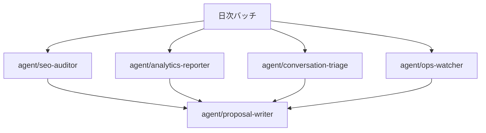
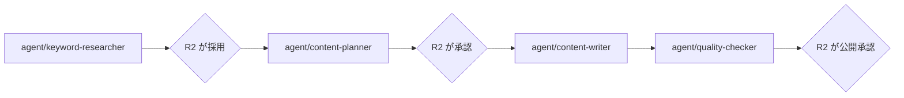

# AA-03 エージェントアーキテクチャ

AA（Application Architecture）層。ID は EA 共通用語集の定義をそのまま使う。

BA-02 が内製化の対象とした 6 種の外部サービスのうち、**AA に引き渡されたのは `CAP-04`（コンテンツ制作代行）・`CAP-05`（Figma / Canva）・`CAP-16`（SEO コンサル）の 3 つ**である。このファイルは、その 3 つを含む実行主体としてのエージェントを定義し、**それぞれに必要最小の権限を割り当てる**。

設計の出発点は既存の MCP サーバの不変条件（`.claude/CLAUDE.md`）であり、そこにある原則をエージェント層にそのまま持ち上げる。

- **`ACCESS_LEVEL` は「許可されないツールを登録しない」ことで実装する**（実行時に拒否しない）。
- **`read_only` ⊂ `read_write` ⊂ `full`。**
- **個人情報の保護は `sanitize()` ではなく `ACCESS_LEVEL` と取得範囲で行う**（DA-05 の 3.3。`sanitize()` は秘匿情報用であって、email も会話本文もそのままモデルに渡る）。

## 1. エージェント一覧

命名は `agent/<kebab-case>`（DA-01 の `E-13` の型定義で `created_by: agent/seo-auditor` という形が既に使われているため、それに合わせる）。

| エージェント | 担う Capability | 責務 | 入力（E-ID / 手段） | 出力（E-ID） |
|---|---|---|---|---|
| `agent/keyword-researcher` | `CAP-02` | キーワード候補の抽出と検索意図の 3 分類（潜在 / 準顕在 / 顕在・指名）の割り当て。**検索ボリュームと SERP を根拠に付ける** | **OpenSEO**（キーワード調査・キーワード指標・SERP・GSC の実績）／ 既存の `E-01` | `E-01`（候補。`status: 候補`。`monthly_volume` を埋める） |
| `agent/knowledge-scout` | `CAP-16` | SEO・BtoB マーケティングの外部知見の調査と要約。**競合ドメインの把握**。採否は `R2` が決める | Web 調査 / **OpenSEO**（SERP 上の競合・ドメイン概要・順位キーワード・被リンク概要）／ `E-12` | 調査メモ（`docs/knowledge/` の Markdown）／ `E-12`（`source: market`） |
| `agent/content-planner` | `CAP-03` | 採用済み `E-01` から構成案を作る | `E-01`（`status: 採用`）／ `E-12` | `E-03`（`plan_state: 起案`） |
| `agent/content-writer` | `CAP-04` | 承認済み企画から記事の初稿を書く。**取材が必要な一次情報は扱わない**（`R4` が素材を用意する） | `E-03`（`plan_state: 承認済`） | `E-04`（`publishedAt` を設定しない下書き） |
| `agent/quality-checker` | `CAP-06` | 機械チェック（BA-04 の 3a）。リンク切れ・表記ゆれ・構造化データ・Lighthouse のしきい値 | `E-04`（下書き）／ `E-12`（`source: lighthouse`） | 指摘一覧（`E-12` として `docs/audits/quality/` に記録） |
| `agent/design-implementer` | `CAP-05` | shadcn/ui と Tailwind のトークンに沿った UI コンポーネントの実装。**デザインの正本はコード側**（BA-02 の内製化方針） | `E-03` `E-06`（表示定義）／ `components.json` | 作業ツリー上のコード差分（コミットはしない） |
| `agent/seo-auditor` | `CAP-09` | Lighthouse CI の結果と、**OpenSEO 経由の GSC の実績・URL 検査・順位計測・サイト監査の結果**を `E-12` に正規化し、劣化を検出する | `.lighthouse/` の JSON ／ **OpenSEO の MCP（参照のみ）** | `E-12`（`source: lighthouse` / `gsc` / `serp` / `site_audit`） |
| `agent/analytics-reporter` | `CAP-10` | 流入・CVR・ファネルの定期集計。**集計値のみを扱い、個々のコンタクト・会話は読まない** | `E-07`（Umami）／ `E-08` `E-11`（PostHog）／ Mautic のフォーム送信集計 | `E-12`（`source: umami` / `posthog` / `mautic`） |
| `agent/lead-ops` | `CAP-11` | BA-04 のトスアップ条件に沿った `E-09` のセグメント追加・スコア加算 | `E-06` `E-09` | 更新された `E-09` |
| `agent/conversation-triage` | `CAP-12` | 未対応・未割り当ての会話の一次切り分けと**社内メモ**の作成。記事化候補の抽出 | `E-10` | 社内メモ（`private=true`）／ `E-12`（`source: chatwoot`） |
| `agent/ops-watcher` | `CAP-13` | PostHog の Error Tracking と各コンテナの状態監視。検知を `E-12` に変換する | `E-12`（`source: posthog`） | `E-12`（`source: posthog`） |
| `agent/proposal-writer` | `CAP-14` | 複数の `E-12` を根拠に `E-13` を起票する。**この基盤で唯一、観測を作用に変換する主体** | `E-12`（全 source） | `E-13`（`docs/proposals/<proposal_id>.md`。`approval.state: draft`） |

**状態はすべて `未着手`。** `.claude/agents/` はリポジトリに存在せず、エージェントの定義ファイルは 1 つも書かれていない。上表は AA が定義した To-Be であり、現在動いているエージェントは 1 つも無い。

### 1.1 一覧の設計上の要点

- **`agent/proposal-writer` を 1 本だけ置く。** 観測系の 4 エージェント（`seo-auditor` / `analytics-reporter` / `conversation-triage` / `ops-watcher`）はいずれも `E-12` までしか作らず、`E-13` を起票しない。BA-02 が「`CAP-14` を単一の合流点にする」と決めた理由（承認ゲートが Capability ごとに分散すると抜け道が増える）を、エージェント層でも**起票できる主体を 1 つに絞る**ことで実装する。
- **`agent/content-writer` は公開しない。** `publishedAt` の設定は `承認` 分類（BA-05）であり、下書きの作成までが `自律`。BA-03 が `R4` をエージェント委任としつつ `A` を `R2` に残した構造が、そのまま権限の境界になる。
- **`agent/analytics-reporter` は個々のコンタクトを読まない。** DA が「個人情報の保護は `ACCESS_LEVEL` と取得範囲で行う」と決めた以上、集計が目的のエージェントに個票を読ませない（2.2 で取得範囲として固定する）。
- **`agent/knowledge-scout` の出力が Markdown なのは、`CAP-16` の知見に対応する `E-ID` が用語集に無いため**（BA-02 の `CAP-16` の成熟度が `未着手` である原因でもある）。勝手にエンティティを増やさず、6 節の未決定事項に記録する。

## 2. 権限設計

### 2.1 エージェント別の `ACCESS_LEVEL`

**`full` を持つエージェントは 1 つも無い。** `full` でのみ公開される操作（`chatwoot_delete_record` / `chatwoot_delete_contact` / `chatwoot_delete_message` / `chatwoot_merge_contacts` / `mautic_delete_record`）はすべて不可逆であり、BA-05 で `承認`（承認者 `R1`）に分類されている。承認を挟む前提であっても、**エージェントの実行環境に `full` の MCP を接続しない**（接続していなければ、承認の取り違えや誤操作が起きる余地そのものが無くなる）。

| エージェント | 接続する MCP | `CHATWOOT_ACCESS_LEVEL` | `MAUTIC_ACCESS_LEVEL` | Strapi 側の権限 | 承認が必要な操作 |
|---|---|---|---|---|---|
| `agent/keyword-researcher` | strapi-mcp ／ **OpenSEO**（2.4） | **接続しない** | **接続しない** | `E-01` の作成・更新（`api::keyword.keyword`） | `E-01` の `status` を `採用` にする（`R2`）／ **見積もり 2,000 クレジット超の調査**（`R2`） |
| `agent/knowledge-scout` | **OpenSEO**（2.4） | **接続しない** | **接続しない** | なし | 知見の採用（`R2`）／ **見積もり 2,000 クレジット超の調査**（`R2`） |
| `agent/content-planner` | strapi-mcp | **接続しない** | **接続しない** | `E-03` の作成・更新 | 企画の採否決定（`R2`。BA-04 のステップ 1） |
| `agent/content-writer` | strapi-mcp | **接続しない** | **接続しない** | `E-04` の**下書きのみ**（`publishedAt` を設定する権限を与えない） | 記事の公開・公開済み記事の更新・削除（`R2`） |
| `agent/quality-checker` | なし（ファイル読み取りのみ） | **接続しない** | **接続しない** | `E-04` の参照のみ | なし（`自律`） |
| `agent/design-implementer` | なし | **接続しない** | **接続しない** | なし | main へのマージ（`R1`）・デプロイ（`R1`） |
| `agent/seo-auditor` | **OpenSEO（費用の発生しない参照系のみ。2.4）**と `.lighthouse/` の読み取り | **接続しない** | **接続しない** | なし | なし（`自律`） |
| `agent/analytics-reporter` | Umami MCP / mautic-mcp / PostHog | **接続しない** | `read_only` | なし | なし（`自律`） |
| `agent/lead-ops` | mautic-mcp | **接続しない** | **`read_write`** | なし | メール送信・キャンペーン開始（`R3`）／レコード削除（`R1`） |
| `agent/conversation-triage` | chatwoot-mcp | **`read_write`** | `read_only` | なし | 顧客への返信（`private=false`。`R3`）／レコード削除（`R1`） |
| `agent/ops-watcher` | なし（PostHog） | **接続しない** | **接続しない** | なし | なし（`自律`） |
| `agent/proposal-writer` | なし（`E-12` のファイル読み取り） | **接続しない** | **接続しない** | なし | 提案の採用と適用（`R2`。BA-05） |

### 2.2 この表の読み方

- **TA-04 の対応表（BA-05 の分類 → `ACCESS_LEVEL`）より一段厳しくしている。** TA-04 は「観測・分析・提案生成を行うエージェントは `read_only` で起動する」としているが、AA ではさらに進めて、**個人情報に触れる必要が無いエージェントには MCP サーバ自体を接続しない**。TA が土台として保証する不変条件（`ACCESS_LEVEL` は登録しないことで実装する／`禁止` 分類はどの `ACCESS_LEVEL` でも到達しない）に依存したうえで、その上に接続の有無というもう 1 段の境界を置く形になる。
- **「接続しない」は `read_only` より強い。** `ACCESS_LEVEL` を `read_only` にすると参照系のツールは登録される。個人情報を扱う必要のないエージェント（12 本中 8 本）は、そもそも Chatwoot と Mautic の MCP サーバを接続しないことで `E-09` `E-10` に到達できなくする（OpenSEO の MCP を接続するエージェントはあるが、OpenSEO は個人情報を持たない。DA-05 の 1.1）。これが DA の「個人情報の保護は `ACCESS_LEVEL` と取得範囲で行う」に対する AA の回答にあたる。
- **書き込み権限を持つエージェントは 2 本だけ**（`agent/lead-ops` の Mautic と `agent/conversation-triage` の Chatwoot）。加えて Strapi 側の書き込みが 3 本（`keyword-researcher` / `content-planner` / `content-writer`）。**残る 7 本は完全な読み取り専用**である。
- **ただし「読み取り専用」と「費用を発生させない」は別である。** `agent/knowledge-scout` は何も書き換えないが、OpenSEO の調査で**取り消せない支出**を生む（ADR-10）。費用を発生させうるエージェントは `keyword-researcher` と `knowledge-scout` の 2 本に限り、`seo-auditor` には費用の発生しないツールだけを許可する。
- **`agent/conversation-triage` だけが会話本文に到達できる。** DA-05 が「`sanitize()` は個人情報を伏せない」と明記している以上、会話本文が読めるエージェントを 1 本に絞ることが唯一の制御になる。このエージェントの出力（社内メモ・`E-12`）に会話本文をそのまま転記しないことを、取得範囲の制約として明記する（3.4）。
- **`agent/analytics-reporter` の Mautic は `read_only` かつレポート系に限定する。** `mautic_list_form_submissions` と `mautic_query_stats` は使うが、`mautic_get_contact` / `mautic_get_contact_activity`（個票とタイムライン）は使わない。**`ACCESS_LEVEL` では区別できない**（どちらも参照系として登録される）ため、これはエージェントの指示側で固定する制約になる。この差は権限の制御としては弱いので、6 節の未決定事項に記録する。

### 2.3 上流側の認証情報の分離

**前提として SSO は導入しない**（`R1` の決定）。調査の結果、Strapi・Chatwoot・n8n は上位エディション、Umami は非対応、PostHog と GitHub は有料プランが必要で、追加費用なしで 1 つの IdP に寄せられるものが無いことが判明したため。当面は「アクセス経路を絞る ＋ パスワード管理 ＋ 担当者変更手順の文書化」で代替する（BA-05 の未決定事項と TA-04 の調査事項に対する結論）。

**この決定はエージェントの権限設計に影響しない。** BA-05 と TA-04 が既に「エージェントの権限は SSO の外側で管理する」と定めており、以下の構成は SSO の有無に依存しない（人間のログイン状態がエージェントの実行可否を左右すると、権限の境界が追えなくなるため、この分離は SSO を導入した後も維持する）。

`ACCESS_LEVEL` は MCP サーバの設定であり、**サーバのプロセスごとに 1 つ**しか持てない。したがって「同じ MCP サーバを、異なる `ACCESS_LEVEL` で複数のエージェントに使わせる」には、**サーバのプロセスを分ける**必要がある。

- stdio トランスポートを使う（エージェントごとに別プロセスが起動し、環境変数も別になる）。**HTTP にすると 1 プロセスを全エージェントが共有することになり、エージェント別の `ACCESS_LEVEL` が成立しない。**
- Chatwoot の `api_access_token` は**ユーザーに紐づく**（権限も操作履歴もそのユーザーのもの）。`agent/conversation-triage` 用の専用エージェントユーザーを Chatwoot 側に作り、そのトークンを使う（DA-05 の 4.1。AI 経由の返信を人手の返信と区別するためでもある）。
- Mautic は OAuth2 client_credentials でユーザーが紐づかないため、**権限は Mautic 側のロールで決まる**。`agent/analytics-reporter` 用に参照専用ロールの API 認証情報を、`agent/lead-ops` 用にコンタクト更新権限を持つ API 認証情報を、**別々に発行する**（同じ認証情報を共有すると `MAUTIC_ACCESS_LEVEL` を下げても上流側の権限が残る）。
- 秘密値は環境変数ファイルの実体で管理し、リポジトリには追跡させない。`PreToolUse` フック（`~/.claude/hooks/protect-secrets.sh`）がエージェントからの読み書きをハード拒否する（`.claude/rules/bash-commands.md`）。**エージェントが自分の認証情報を読めないことが、BA-05 の `禁止` 分類（秘密値の閲覧）の実装にあたる。**

### 2.4 OpenSEO の接続とツールの許可リスト

OpenSEO の MCP は `ACCESS_LEVEL` を持たず、Streamable HTTP の 1 プロセスを全エージェントが共有する（ADR-10）。したがって 2.3 の「プロセスを分けて `ACCESS_LEVEL` を変える」方法が使えない。**代わりに、エージェント定義（`.claude/agents/<name>.md`）の `tools` に、使ってよいツールを許可リストで列挙する。**

ツール名は Claude Code 上では `mcp__openseo__<ツール名>` の形になる。下表はツール名だけを書く。

| エージェント | 許可するツール | 費用 |
|---|---|---|
| 3 本に共通 | `whoami` / `list_projects` / `get_project_context` | 発生しない |
| `agent/seo-auditor` | `get_search_console_performance` / `inspect_urls` / `get_rank_tracker` / `get_audit_status` / `get_audit_issues` / `get_audit_pages` | **発生しない**（GSC は自分の Google アカウントのデータであり計量されない。他は保存済みの結果を読むだけ） |
| `agent/keyword-researcher` | `research_keywords` / `get_keyword_metrics` / `get_domain_keyword_suggestions` / `get_serp_results` / `search_serp_locations` / `get_search_console_performance` / `list_saved_keywords` / `save_keywords` | **発生する**（キーワード調査は 1 シードあたり約 30〜100 クレジット、SERP は 1 キーワードあたり約 5） |
| `agent/knowledge-scout` | `find_serp_competitors` / `get_domain_overview` / `get_ranked_keywords` / `get_backlinks_overview` / `get_serp_results` / `list_saved_keywords` | **発生する**（ドメイン概要は約 100〜300 クレジット、被リンク概要は約 50） |

**どのエージェントにも許可しないツール**と、その理由。

| ツール | 理由 |
|---|---|
| `create_rank_tracker` / `add_rank_tracking_keywords` / `run_rank_tracker` / `estimate_rank_tracker_cost` | **継続課金を生む、または実行のたびに課金する。** ランク追跡の設定は `承認`（`R2`。BA-05）であり、人間が OpenSEO の画面で行う |
| `remove_rank_tracking_keywords` | 追跡対象を減らす。順位の履歴の扱いを確認していないため、人間の操作に限る |
| `run_site_audit` | **引数で任意の URL を監査できる**。自サイト以外の監査は `禁止`（BA-05）だが、許可リストでは引数を縛れない。実行は人間（`R1`）が行う |
| `get_backlinks_profile` | ページ送りで 1 ページごとに課金される（約 30 クレジット）。ページ送りの回数をエージェントが決めると支出が読めない |
| `create_project` / `update_project_context` | OpenSEO のプロジェクトとその記憶は `R1` が設定する（`seo-project-setup` スキルは人間が使う。7 節） |
| `save_report` / `save_report_template` / `get_report` / `list_reports` / `list_report_templates` | レポートの正本は `E-12` と `E-13` であり、OpenSEO の中に 2 つ目のレポート置き場を作らない |
| `get_google_analytics_*`（9 本）／ `get_search_opportunities` | **GA4 は採用しない**（DA-02 の 2 節・ADR-09）。OAuth も接続しない。`get_search_opportunities` は名前に GA4 が現れないが、**Search Console と GA4 の結合を前提にしたツール**である |
| ローカル SEO 系（`get_local_*` / `search_local_businesses` / `get_business_*` / `get_google_business_questions` / `list_business_categories`） | 使わない機能（ADR-09） |

- **この許可リストは ADR-03 の「登録しない」をクライアント側に持ち上げたもの**である。サーバ側で登録しない方式より弱い（エージェント定義を書き換えれば外れる）が、**エージェント定義を Git の管理下に置けば、書き換えても正本にならない**（5.3）。
- **許可リストに無いツールを呼ぶよう指示するスキルがあっても、許可リストが優先する**（7.1「スキルは知識であって権限ではない」）。たとえば `seo-audit` スキルは監査の実行を前提にしているが、`agent/seo-auditor` は結果の参照までしかできない。
- **1 回の見積もりが 2,000 クレジットを超える調査は、実行前に `R2` の承認を求める**（BA-05）。ツールの引数で上限を指定できるのはランク追跡の実行だけであり、他の調査系では**エージェントの指示に書く約束**にとどまる。最後の歯止めは DataForSEO の前払い残高である（ADR-10）。

## 3. 取得範囲の制約（データ契約のエージェント側）

DA-02 の 5 節が定義したデータ契約を、エージェント別に割り当てる。**契約を固定しないと、実行のたびに取得範囲が変わって `E-13` の `evidence` が比較不能になる。**

| エージェント | 取得範囲 | 上限 | 根拠 |
|---|---|---|---|
| `agent/seo-auditor` | `.lighthouse/` の最新ビルド結果 ／ GSC は**直近 35 日のうち 3 日前までの確定データ**（OpenSEO の `get_search_console_performance`。ページ単位） | GSC は 1 回 1,000 行まで（OpenSEO の上限）。`hasMore` が真なら `startRow` で続きを取る | GSC のデータは 2〜3 日遅れて確定する（AA-02 の 3.5） |
| `agent/keyword-researcher` | 1 回の実行で**シード 10 個まで**。市場は日本（日本語）に固定する | 見積もり 2,000 クレジットまで。超えるなら `R2` の承認 | 月次予算 10 USD（ADR-10）を週次の実行で割った値 |
| `agent/knowledge-scout` | 1 回の実行で**競合ドメイン 5 件まで** | 同上 | 同上 |
| `agent/analytics-reporter` | Umami は直近 35 日・ランキングは上位 100 件 ／ Mautic はフォーム送信の集計のみ | `truncation_message` を見たら期間を狭めて取り直す | 前月比較が取れる最小期間（DA-02 の 5.1） |
| `agent/conversation-triage` | **直近の未解決の会話に限定。最大 4 ページ**（会話 25 件／ページのサーバ固定） | 4 ページ | 件数ではなくページ数で上限を書く（Chatwoot のページ件数がサーバ固定のため） |
| `agent/lead-ops` | トスアップ対象の `E-09` のみ（`dateAdded` で絞る） | 一覧の 1 ページ分ずつ | 定期的に全件を舐めない（固定ページ件数のためリクエストが件数に比例する） |
| `agent/ops-watcher` | PostHog の直近 24 時間の例外 | PostHog の API 制限に従う | 日次の観測サイクルに合わせる |

### 3.1 応答の切り詰めを黙って受け入れない

MCP の応答は `CHARACTER_LIMIT`（25,000 文字）に収まるよう一覧の件数が半分ずつ削られ、`truncation_message` が付く。**削られた分は「次のページ」では取得できない**（ページ境界ではなく応答サイズで削るため）。

エージェントは `truncation_message` を見たら、**そのまま判断に進まず、期間や絞り込みを狭めて取り直す**。これを守らないと、`E-12` の値が「たまたま応答に収まった分」になり、再現性の条件（DA-02 の 5.3）を満たさなくなる。取り直しても収まらない場合は、その観測を `E-13` の `evidence` に使わない。

### 3.2 空配列を失敗と誤認しない、失敗を 0 と誤認しない

Mautic は 0 件のとき `[]` を返す（`null` ではない）。**「取得できたが 0 件」と「取得に失敗した」を区別する**のはエージェントの責任であり、`E-12` にはどちらであったかを記録する。

この区別は AA-04 の暴走条件 3（観測データの欠損を改善と誤認する）への直接の歯止めになる。CVR の分子が 0 件だったのか、Mautic に到達できなかったのかを取り違えると、**存在しない改善を報告する提案**が生まれる。

### 3.3 長文の扱い

1,000 文字超の文字列（`LONG_TEXT_LIMIT`）は `include_long_text=true` を指定しない限り省略される。**既定では省略されたまま判断してよい**というのが契約の前提であり、全文が根拠に必要な場合のみ明示的に指定する。

`agent/conversation-triage` が会話本文の全文を必要とする場面は限られる（一次切り分けは要約で足りる）。全文を取るのは、記事化候補として `E-12` に要約を残すときだけにする。

### 3.4 会話本文を転記しない

`agent/conversation-triage` が生成する `E-12` と社内メモには、**会話本文をそのまま貼らない**。要旨と `display_id` だけを残し、本文は Chatwoot 側を見に行かせる。

理由は 2 つ。(1) `E-12` は `E-13` の `evidence` として参照され、`E-13` は Git（GitHub）に置かれるため、**会話本文を転記すると個人情報が越境する**（DA-05 の未決定事項に既出の 2 つ目の越境）。(2) DA-04 が `E-12` について「値そのものを複製せず `ref` と `summary` だけを置く」と決めており、本文の転記はその方針にも反する。

## 4. Claude Code の Agent teams としての編成

### 4.1 並列に走らせられるもの

**観測系の 4 本は並列に走らせられる。** 根拠は 3 つ。

- **読み取り専用である**（`agent/conversation-triage` の Chatwoot だけが `read_write` だが、書くのは社内メモのみで、他のエージェントの読み取り対象に影響しない）。
- **参照する上流が重ならない**（Lighthouse / Umami + PostHog / Chatwoot / PostHog の Error Tracking）。唯一 PostHog が 2 本から参照されるが、どちらも読み取りのため衝突しない。
- **書き込み先ディレクトリが分かれている**（4.3）。

`agent/proposal-writer` は 4 本の完了を**待つ**。並列に走らせると、同じ観測から複数の提案が同時に起票され、`proposal_id` の採番が衝突する。

### 4.2 逐次に依存するもの

**制作の連鎖は逐次で、しかも間に 3 つの人間ゲートが入る。** これは BA-04 の更新ワークフローをそのままエージェントの編成に写したもので、並列化の余地は無い（前工程の出力が後工程の入力になり、かつ人間の決定を待つため）。

`agent/design-implementer` はこの連鎖の外で並列に走らせられる（コードを触り、Strapi のコンテンツを触らないため）。ただし `E-06`（CTA の表示定義）を変える場合は `agent/content-writer` と同じ記事に影響するので、そのときだけ逐次にする。

### 4.3 成果物の衝突をどう避けるか

**書き込み先ディレクトリを 1 エージェント 1 か所に固定する。** 複数のエージェントが同じファイルを書く構成にしない。

| エージェント | 書き込み先 | 状態 |
|---|---|---|
| `agent/seo-auditor` | `docs/audits/lighthouse/` `docs/audits/gsc/` `docs/audits/serp/` `docs/audits/site_audit/` | `未着手`（ディレクトリが未作成） |
| `agent/analytics-reporter` | `docs/audits/analytics/` | `未着手` |
| `agent/conversation-triage` | `docs/audits/conversations/` ／ Chatwoot の社内メモ | `未着手` |
| `agent/quality-checker` | `docs/audits/quality/` | `未着手` |
| `agent/ops-watcher` | `docs/audits/ops/` | `未着手` |
| `agent/proposal-writer` | `docs/proposals/` | `未着手` |
| `agent/knowledge-scout` | `docs/knowledge/` `docs/audits/market/` | `未着手` |
| `agent/design-implementer` | `frontend/verdant-virgo/src/`（作業ツリー） | `未着手` |
| `agent/content-writer` | Strapi の `E-04`（`documentId` 単位） | `未配線` |

衝突回避の規則は 3 つ。

- **1 エージェント 1 ディレクトリ。** 他のエージェントのディレクトリを読むのは自由だが、書かない（`agent/proposal-writer` は 5 つの `docs/audits/*` を読んで `docs/proposals/` にだけ書く）。
- **ファイル名に一意な ID を含める。** `E-12` は `audit_id`、`E-13` は `proposal_id`。同じファイルを 2 回書かない（追記もしない。新しい観測は新しいファイルにする）。
- **Strapi は `documentId` 単位で排他する。** 同じ記事を 2 つのエージェントが同時に編集しない。並列化が必要なら記事ごとにエージェントのインスタンスを分け、`documentId` を引数で渡す。

### 4.4 エージェントの実行を `E-15` として残す

各エージェントの実行は `E-15 AgentRun` として記録する（どの段階で失敗したかを後から特定するため）。ただし **DA-01 が `E-15` の正本を n8n の実行履歴としつつ「n8n を経由しない実行が記録されない」と未決定にしており、本編成では大半のエージェントが Claude Code から直接走る**。したがって現状の設計では `E-15` の大半が記録されない。これは AA だけでは解けない（6 節の未決定事項）。

## 5. git の制約を安全装置として扱う

### 5.1 制約の内容

DA-01 は `E-13 ImprovementProposal` の正本を Git（`docs/proposals/<proposal_id>.md`）とし、**承認を PR のレビュー**と決めた。理由は「履歴・差し戻し・取り消し」を Git / PR が既に持っており、かつ**エージェント自身が書き換えられない外部の承認機構**になるから、である。

一方、リポジトリのルール（`.claude/rules/git.md`）は次のように定めている。

- `git commit` / `git push` / `git merge` / `git rebase` / `git reset` / `git checkout -b` など**リポジトリの状態を変更する git コマンドは使用しない**。
- `git status` / `git log` / `git diff` / `git branch` / `git show` など**参照系のみ使用可能**。

したがって**エージェントはファイルを書けるが、コミットも PR 作成もできない**。

### 5.2 そこから導かれる分担

| 工程 | 主体 | 根拠 |
|---|---|---|
| `E-12` の生成（観測結果をファイルに書く） | エージェント | `自律`（読み取りのみの結果） |
| `E-13` の起票（`docs/proposals/<id>.md` を書く） | エージェント | `自律`（BA-05。提案は提案にすぎず実体に作用しない） |
| コミットとブランチの作成 | **人間**（または明示的な指示を受けた場合） | `.claude/rules/git.md` |
| PR の作成 | **人間**（同上） | 同上 |
| PR のレビュー承認（`E-14`） | **人間（`R2`）** | BA-04 の 3b、BA-05 の `承認` 分類 |
| main へのマージ | **人間（`R1`）** | BA-05 の `承認` 分類 |

### 5.3 この制約が意図せぬ安全装置として機能している

このルールは再帰的自己改善のために書かれたものではない（コミットの主導権を人間に残す、という一般的な運用上の判断である）。しかし結果として、**BA-03 が最も危険だとした「提案の生成から適用までが閉路になる」事態を、手順の約束ではなく実行手段の欠落として防いでいる。**

具体的には次の 3 点が同時に成立する。

- **エージェントは自分の提案を承認できない。** 承認は PR のレビューであり、PR を作れないエージェントはレビューの対象を作ることすらできない。BA-03 の「Accountable をエージェントに置かない」が、権限設定ではなく**到達不能性**として実装されている。
- **エージェントは自分が書いたファイルを正本に昇格させられない。** `docs/proposals/` に書かれただけのファイルは追跡されていない変更であり、Git の履歴に乗って初めて `E-13` の正本になる。**書くことと正本になることが分離している。**
- **エージェントは自分の実行条件を書き換えられない。** `.claude/rules/` も `.claude/CLAUDE.md` も Git の管理下にあり、ファイルを編集してもコミットできなければ次の実行には反映されない（作業ツリーの変更は反映されるが、人間がレビューする前にリポジトリの状態にはならない）。これは BA-05 の `禁止` 分類（エージェント自身の権限・実行条件の変更）と同じ効果を、別の経路で達成している。

**この 3 点は意図的に維持する。** 効率化のためにエージェントへ git の書き込み権限を与えると、上の 3 つが同時に失われる。**利便性の代償が「承認機構そのもの」であることを、判断の前に必ず確認する。**

### 5.4 制約の代償

正直に書くと、この制約には運用上の代償がある。

- **提案が起票されてから PR になるまで、人間の手作業が必ず 1 回入る。** 日次で観測して提案を出しても、人間がコミットしない限り `E-13` は Git の履歴に乗らない。ループの所要時間（BA-01 が「この基盤が最適化する対象」とした値）はこの手作業の頻度に律速される。
- **代替案として n8n から GitHub API で起票する経路（AA-02 の I-13）がある。** ただしこれは制約の回避ではなく、**承認ゲートを迂回する経路になりうる**（BA-05 が n8n のワークフロー作成を `承認` 分類にした理由そのもの）。この経路を作る場合は、n8n が作れるのは PR までで、**レビュー承認とマージには到達できない**ことを GitHub 側の権限で保証する必要がある。

## 6. Accountable をエージェントに置かないことの担保

BA-03 は 16 Capability すべてで `A` を人間のロールに置き、エージェント列に `A` を置かなかった。AA としてこれを設計で担保する方法は次の 4 つ。

| 担保 | 実装 | 効き方 |
|---|---|---|
| **承認操作をエージェントの手の届く場所に置かない** | 承認 = PR のレビュー。エージェントは PR を作れない（5 節） | 到達不能性。権限設定の誤りでも破れない |
| **`full` の MCP を接続しない** | 2.1 の表。削除・統合の操作に到達できない | 到達不能性 |
| **秘密値を読めない** | `PreToolUse` フックがハード拒否する（`.claude/rules/bash-commands.md`） | 到達不能性。permission mode に関わらず効く |
| **`destructiveHint: true` の確認を自動承認しない** | 破壊的操作は MCP クライアント側で確認を求められる。この確認を自動で通す運用にしない（DA-05 の 4.2） | 運用上の約束。**上の 3 つと違い、設定次第で破れる** |

**4 つ目だけが約束にとどまる。** `destructiveHint` の確認をどう扱うかは MCP クライアント側の設定であり、リポジトリでは制御できない。**したがって `destructiveHint` に依存しない**（削除系のツールは `full` を接続しないことで到達不能にしてあり、`destructiveHint` は二重の防御として扱う）。

## 7. 既存の知識資産の使い方

リポジトリには 3 系統のスキルがある。**エージェント定義（`.claude/agents/`）もコマンド（`.claude/commands/`）も存在しない**ため、現時点でエージェントに与えられている知識はこのスキル群だけである。

| 資産 | 所在 | どのエージェントが使うか | 使い方 |
|---|---|---|---|
| n8n 公式スキル 14 本 | リポジトリルートの `.claude/skills/` | `agent/proposal-writer`（起票の搬送ワークフローを設計するとき）／ ワークフローを実装する人間 | **`using-n8n-skills-official` がメタスキル**。まずこれを読み、そこからの振り分けに従う（`middleware/n8n/AGENTS.md` の指示）。個別スキルを直接読みに行かない |
| **OpenSEO スキル 10 本** | リポジトリルートの `.claude/skills/`（`every-app/open-seo` から取り込み。`skills-lock.json`） | 下の 7.3 | **許可リスト（2.4）の範囲でしか動かない。** 許可されていないツールを呼ぶ手順は、その手順で止まる |
| PostHog スキル 4 本 | `backend/.claude/skills/`（Replay Vision 系 3 本）と `backend/strapi-system/.claude/skills/`（`integration-javascript_node`） | `agent/ops-watcher` `agent/analytics-reporter` | Replay Vision のスキャナは**セッションリプレイが記録されていることが前提**で、現状は記録対象が無い。`integration-javascript_node` はブラウザ側 SDK を入れる際（AA-02 の I-06）に参照する |

### 7.1 スキルとエージェントの関係

- **スキルは知識であってエージェントではない。** スキルを読んだからといって権限が増えるわけではなく、`ACCESS_LEVEL` の制約はそのまま効く。
- **n8n を触るエージェントは `agent/proposal-writer` のみ**とし、他のエージェントには n8n スキルを読ませない（読ませても権限が無いため無駄であり、かつ「ワークフローを作れば承認を迂回できる」という経路をモデルに示唆しないため）。
- **n8n ワークフローの作成・変更は `承認` 分類**（BA-05）。エージェントが設計案を出すところまでが `自律` で、実際にワークフローを作るのは承認後の人間の操作になる。

### 7.2 PostHog の Self-driving との関係

PostHog 側では Self-driving（Scout 2 本、Replay Vision スキャナ 2 本、実行予算 1 日 100 回）が稼働している。これは **PostHog の中で完結する別系統の自動化**であり、本 EA のエージェント編成には含めない。

ただし 2 点を設計事項として記録する。

- **PostHog の Self-driving が生成する知見は `E-12` として取り込まれていない。** 取り込むなら `agent/ops-watcher` の入力に加えることになるが、PostHog 側の出力形式が `E-12` の型と揃っていない。
- **実行予算（1 日 100 回）は本 EA の管理下に無い。** AA-04 の安全装置（1 サイクルあたりの変更上限）は `docs/proposals/` 側でしか効かず、PostHog 側の自動化には及ばない。

### 7.3 OpenSEO スキルの割り当て

| スキル | 使う主体 | 扱い |
|---|---|---|
| `keyword-research` | `agent/keyword-researcher` | 使う。**タグ付けと保存は OpenSEO の中の作業場まで**で、採用は Strapi の `E-01`（`R2` の承認） |
| `keyword-clustering` | `agent/keyword-researcher` | 使う。クラスタを既存ページ・予定ページに対応させた結果は、`agent/content-planner` の入力（`E-03` の起案）として `E-01` に残す |
| `competitor-analysis` / `competitive-landscape` | `agent/knowledge-scout` | 使う。出力は `docs/knowledge/` と `E-12`（`source: market`） |
| `seo-audit` | `agent/seo-auditor` | **参照に限る。** 監査の実行（`run_site_audit`）は許可しない。1 ページのレポートという出力形式は採らず、`E-12` に正規化する |
| `link-prospecting` | **使わない** | 連絡先の探索と**アウトリーチ文面の作成**を含む。外部への送信は `承認` 分類（BA-05）であり、被リンク獲得の施策そのものが未決定 |
| `seo-project-setup` | **人間（`R1`）** | OpenSEO のプロジェクト設定と GSC の接続を行う。**プロジェクトの記憶を書き換える**ため、エージェントには使わせない |
| `seo-coach` | 人間 | OpenSEO の使い方の案内。エージェントの編成には含めない |
| `local-seo` | **使わない** | ローカル SEO は対象外（ADR-09） |
| `simple-issue-description` | **使わない** | OpenSEO 上流への Issue 作成用であり、本基盤の業務ではない |

### 7.4 OpenSEO の中の自動実行との関係

OpenSEO には本 EA の外で動く自動実行が 2 つある。**どちらも 7.2 の PostHog の Self-driving と同じく、本ループの安全装置が及ばない。**

| 自動実行 | 扱い |
|---|---|
| **ランク追跡のスケジュール**（日次・週次・月次） | **設定を `承認`（`R2`）にする**（BA-05）。設定の実体は OpenSEO の DB にあり Git の外にある（TA-05 の 6 節）。一度設定すると課金が自動で続く |
| **SAM**（アプリ内の SEO エージェント。OpenRouter を使う） | **有効化しない**（`OPENROUTER_API_KEY` を設定しない。ADR-09）。有効化すると、承認ゲートも費用の上限も知らない 2 つ目のエージェントが同じデータに書き込めるようになる |

## 8. 未決定事項

- **`CAP-16` の知見に対応する `E-ID` が用語集に無い。** `agent/knowledge-scout` の出力を `docs/knowledge/` の Markdown としたが、これは正本としての定義を持たない。`E-12 AuditResult` の `source` に `research` を足すか、新しいエンティティを立てるかは用語集の更新が必要（勝手に増やさない）。
- **`agent/analytics-reporter` の「レポート系に限定する」が `ACCESS_LEVEL` では表現できない。** `mautic_get_contact`（個票）と `mautic_query_stats`（集計）はどちらも参照系として `read_only` に含まれるため、個票を読ませない制約はエージェントの指示側にしか置けない。これを構造的に保証するには、集計専用のツールだけを公開する 3 つ目の MCP サーバ（もしくは `mautic-mcp` への `ACCESS_LEVEL` 追加）が要る。
- **`strapi-mcp` に書き込みを任せる 3 本（`keyword-researcher` / `content-planner` / `content-writer`）の権限保証。** 2.1 の表で Strapi 側の権限を割り当てているが、**`strapi-mcp` はリポジトリ管理外であり、`ACCESS_LEVEL` も `sanitize()` も保証できない**。この 3 本については、表に書かれた権限は「設計した権限」であって「保証された権限」ではない。問題の全体と選択肢は **AA-05 の ADR-07** に集約した（`R1` の判断待ち）。
- **`E-15 AgentRun` の記録手段。** 本編成では大半のエージェントが Claude Code から直接走るため、n8n の実行履歴を正本にしても記録されない。DA-01 と AA-02 の未決定事項と同じ問題で、TA の監視設計を待つ。
- **`R2` への承認の一点集中。** 12 本のエージェントのうち 6 本の出力が `R2` の承認を待つ（`E-01` の採用、企画の採否、記事の公開、提案の採用）。BA-05 が未決定として残した「`R2` が不在のときの代理承認」が決まらない限り、**エージェントを増やすほど `R2` の待ち行列が伸びる**。エージェントの本数はこの待ち行列の長さで制限される（BA-03 の「`R2` が承認できる量を超える生成は行わない」の定量化が必要）。
- **`.claude/agents/` にエージェント定義を置くかどうか。** リポジトリに存在しないため、置けばエージェントの定義が Git の管理下に入り、5.3 の「エージェントは自分の実行条件を書き換えられない」がエージェント定義にも及ぶ。一方で `.claude/` 配下の構成変更は `R1` の判断事項であり、AA では決めない。
- **OpenSEO の許可リストはクライアント側の設定である**（2.4）。ADR-03 の「サーバ側で登録しない」と違い、エージェント定義を書き換えれば外れる。`.claude/agents/` を Git の管理下に置くかどうか（上の項目）が決まらないと、この許可リストの強さも決まらない。
- **`CAP-16` の知見のうち、定量的なもの（競合の順位・検索ボリューム・被リンク数）は `E-12`（`source: market`）に置けるようになった**（DA-01 の 4 節）。定性的な知見メモ（`docs/knowledge/`）に対応する `E-ID` が無いことは変わらない。
