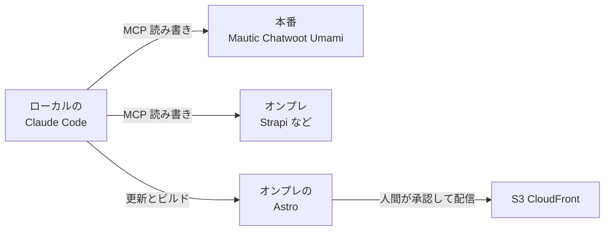

# AA-05 適用判断の記録

AA（Application Architecture）層。ID はそれぞれの正本の定義をそのまま使う（索引は [`docs/README.md` の「ID の採番と正本」](../../README.md)）。**`ADR-xx` の採番の正本は本ファイルである。**

AA-01 から AA-04 で下した判断のうち、**後から「なぜそうしたのか」を問われる 20 件**を、文脈 / 選択肢 / 決定 / 理由 / 帰結の形式で残す。DA が既に決めた事項については、AA の視点から追認し、AA でしか見えない観点を足す。

各決定に状態を付す。`決定済み` = 覆すには新しい根拠が要る。`暫定` = 実データが取れた時点で見直す前提。`未決定` = 決めていない。

## ADR-01 Umami と PostHog を併用する

**状態: `決定済み`**（DA-02 の 3 節・DA-04 の 3 節の決定を AA として追認する）

### 文脈

アクセス解析ツールが 2 つある。どちらもセッション数・参照元・ランディングページを出せるため、**同じ指標に 2 つの数字が存在する**。DA は「指標ごとに正本を 1 つに固定する」（流入・母数系は Umami、行動・実験系は PostHog）と決めた。AA の視点では、この決定は「2 つのアプリケーションを維持し続ける」というコストを伴う判断である。

### 選択肢

| 選択肢 | 利点 | 欠点 |
|---|---|---|
| Umami に一本化する | 自ホストのみで完結し、越境が無くなる。運用するアプリケーションが 1 つ減る | **AB テスト（`E-11`）・ファネル・セッションリプレイ・エラー追跡ができない。** `CAP-10` の「AB テスト設計」（`R3` の責務）が成立しなくなる |
| PostHog に一本化する | 行動分析と実験が 1 か所に揃う。既に Strapi からのイベント連携が動いている | **母数が同意率に左右される。** person の生成は同意に依存するため、同意率が変わるだけで分母が動き、前期間との比較が壊れる。加えて全トラフィックが米国リージョンに越境する |
| **併用し、指標ごとに正本を固定する** | 母数は同意に依存せず安定し、実験と行動分析も持てる | アプリケーションが 2 つ残る。**数字が食い違ったときに「どちらが正しいか」の議論が起きうる** |

### 決定

**併用する。** 指標ごとの正本は DA-02 の 3 節に従い、Umami（流入・母数系）と PostHog（行動・実験系）で固定する。**PostHog のセッション数を KPI に使わない**（デバッグと定性確認に限る）。

### 理由

- **`CVR` の分母が同意率に左右されてはならない**（DA-02 の 1.1）。CVR は BA-01 の KPI ツリーで `CV 数 = セッション数 × CVR` の両辺に現れる中核の指標であり、分母が計測期間や同意率で膨らむと KPI ツリー全体が読めなくなる。
- **AB テストは PostHog にしか無い**（`E-11` の正本）。BA-04 の週次定例に「AB テストの実施」があり、`R3` の責務に「AB テスト設計」がある以上、手段を捨てられない。
- **越境の範囲を最小化できる。** 観測の経路で国外に出るのは PostHog（米国リージョン）だけであり、母数を Umami に置けば、**全トラフィックではなく同意した訪問者の行動だけが越境する**（DA-05 の 1.2）。一本化のどちらの案もこの非対称を失う。**2026-10-01 に越境の先が 2 つになったが（Google Calendar。ADR-19）、増えたのは商談の経路であって観測の経路ではない**ため、この理由は変わらない。

### 帰結

- **アプリケーションを 2 つ運用し続ける**（AA-01 の一覧表）。Umami と PostHog の両方にトラッカーを入れる必要があり、`CAP-09` の Lighthouse スコアへの負荷が 2 つ分になる。
- **数字の食い違いを「どちらが正しいか」の議論にしない規則が必要**になり、それが DA-04 の 3 節の役割分担表である。この表が守られない限り、併用の欠点だけが残る。
- **AB テストの CVR だけは PostHog 内で完結させる**（DA の意図的な例外）。実験の評価を Umami の分母で行うと、バリアント別の分母が取れない。この例外は例外として明示し、他の指標に広げない。
- 両者の数字が実際にどれだけ乖離するかは、両方を配線して計測するまで分からない（DA-04 の未決定事項）。乖離が大きければ役割分担の切り分け方を見直す。

## ADR-02 Chatwoot / Mautic の API を直接叩かず MCP 層を挟む

**状態: `決定済み`**（既に実装されている判断の追認）

### 文脈

エージェントが Chatwoot と Mautic を操作する手段として、(a) API を直接叩く、(b) MCP サーバを挟む、の 2 つがある。このリポジトリは既に (b) を選び、`backend/chatwoot-mcp`（31 ツール）と `backend/mautic-mcp`（17 ツール）を自作している。**自作コードの大半がこの 2 本**である（`.claude/CLAUDE.md`）。

### 選択肢

| 選択肢 | 利点 | 欠点 |
|---|---|---|
| API を直接叩く（HTTP クライアントをエージェントに持たせる） | 実装が不要。上流の全 API に即座に到達できる | **`sanitize()` が無い**（秘匿値がそのままモデルに渡る）／**応答サイズの制御が無い**（`CHARACTER_LIMIT` を超える応答がコンテキストを埋める）／**権限の境界が無い**（`ACCESS_LEVEL` に相当するものがない）／**危険な API を除外できない**（Mautic の SMS 送信 GET に到達できてしまう） |
| 汎用の HTTP ツールに許可リストを付ける | 実装が軽い | 許可リストは URL の形でしか書けず、「この GET は副作用を持つ」といった意味的な区別ができない |
| **MCP サーバを自作して挟む** | 上の 4 点すべてを 1 か所で実装できる。ツール定義がそのまま上流 API のドキュメントになる | **上流 API の 1 割程度しか公開されていない**（意図的だが、必要な操作が無いことがある）／保守が必要 |

### 決定

**MCP サーバを自作して挟む。** 3 つ目の MCP サーバを作る場合も同じ構造に合わせる（`.claude/CLAUDE.md` の「MCP サーバの共通設計」）。

### 理由

- **`sanitize()` をモデルに渡る前の一点に置ける**（DA-05 の 3 節）。エージェントは受け取った値をそのまま別の場所に書き出しうるため（提案の `evidence` に貼る、Chatwoot に返信する）、出口ではなく入口で伏せるのが最も確実。
- **`ACCESS_LEVEL` の実装場所になる**（ADR-03）。API を直接叩く構成では、権限の境界を置く場所が上流側のアカウント権限しかなく、エージェント単位で絞れない。
- **危険な API を「到達できなくする」ことができる**（AA-02 の 2.3）。Mautic の `GET /api/smses/{id}/contact/{cid}/send` は GET なのに SMS を送る。承認ゲートでは分類の網から漏れるこの API を、**ツール一覧に載せないことで防いでいる**。直接 API を叩く構成ではこの防御が不可能。
- **応答サイズを `CHARACTER_LIMIT` に収められる。** `fitToLimit()` が一覧の件数を半分ずつ減らし、`truncation_message` で「次のページでは取れない」ことを伝える。この仕組みが無いと、Chatwoot の会話一覧 1 回でコンテキストが埋まる。
- **上流 API の癖を 1 か所に閉じ込められる。** Mautic の `PATCH` 限定、Chatwoot の `display_id`、チーム変更で担当者が外れる挙動、`Rack::Timeout` の再試行。これらをエージェントの指示側に書くと、エージェントを増やすたびに同じ注意書きを複製することになる。

### 帰結

- **保守の対象が増える。** 上流のバージョンアップでツール定義が壊れる可能性があり、`chatwoot-mcp` の検証ハーネス（`pnpm verify`）はそのための仕組みである。
- **公開されていない API は使えない。** BA-05 が `承認` 分類にした「Mautic からのメール送信・キャンペーンの開始」は、そもそも MCP ツールとして存在しない（AA-02 の 2.2）。**承認ゲート以前に手段が無い**状態であり、必要になったらツールを足す判断が要る。
- **対象外にした API の理由を各 `README.md` の表に残す規約が要る**（`.claude/CLAUDE.md`）。同じ判断を繰り返さないため。
- **リポジトリ管理外の MCP（`strapi-mcp`・Umami MCP・OpenSEO）にはこの利点が及ばない**（AA-01 の 6 節）。だから AA-03 では前の 2 つに書き込みを任せず、OpenSEO には費用の上限を置いている（ADR-10）。

## ADR-03 `ACCESS_LEVEL` を「登録しない」で実装する

**状態: `決定済み`**（既に実装されている判断の追認）

### 文脈

MCP サーバの権限制御には 2 つの実装がある。(a) すべてのツールを登録し、許可されていないものは実行時にエラーを返す。(b) 許可されていないツールは**そもそも登録しない**。このリポジトリは (b) を採り、`chatwoot-mcp` の検証ハーネスが `read_only` ⊂ `read_write` ⊂ `full` の包含関係を実際に検査している。

### 選択肢

| 選択肢 | 利点 | 欠点 |
|---|---|---|
| 実行時に拒否する | エラーメッセージで「権限が足りない」と伝えられる。設定変更が即座に効く | **モデルからツールの存在が見える。** 拒否されたモデルは迂回路を探しはじめる（別のツールで同じことをしようとする、複数回試す）／拒否のログが増え、正常な動作と区別しにくくなる |
| **登録しない** | **モデルからは存在しないように見える**ため、そもそも呼ぼうとしない／ツール一覧がそのまま権限の一覧になり、監査が容易 | 権限を変えるにはサーバの再起動が要る／「なぜこのツールが無いのか」がモデルからは分からない |

### 決定

**登録しない。** `ACCESS_LEVEL` の値に応じて `register*Tools()` の呼び出しを分岐させ、許可されないツールは MCP のツール一覧に現れないようにする。

### 理由

- **拒否を返す設計だと、モデルが迂回路を探しはじめる**（DA-05 の 4.2）。これは実装上の効率の問題ではなく、**エージェントの振る舞いの問題**である。「できない」と伝えられたモデルは、別の手段を試すのが自然な応答であり、その試行の中に設計者が想定していない経路が混ざる。
- **ツール一覧が権限の一覧と一致する**ので、監査が「一覧を見る」だけで済む。実行時拒否だと、一覧と実際にできることが乖離し、`CAP-15`（ガバナンス・アクセス管理）の棚卸しが難しくなる。
- **同じ発想が他の 3 か所でも使われている**（AA-02 の 2.3、AA-03 の 5 節、AA-03 の 6 節）。危険な API を MCP から除外する、git の書き込み権限を与えない、秘密値をフックでハード拒否する。**「分類するのではなく到達できなくする」という一貫した方針**であり、`ACCESS_LEVEL` はその最初の実例にあたる。

### 帰結

- **エージェント別に `ACCESS_LEVEL` を変えるには、MCP サーバのプロセスを分ける必要がある**（AA-03 の 2.3）。`ACCESS_LEVEL` は環境変数でありプロセスごとに 1 つしか持てないため、**stdio トランスポートが前提**になる（HTTP にすると 1 プロセスを全エージェントが共有し、エージェント別の権限が成立しない）。
- **包含関係を検査する仕組みが要る。** `chatwoot-mcp` の `pnpm verify` がこれを担っている。3 つ目の MCP サーバを作る場合も同じ検査が要る（包含が崩れると、`read_write` にしたときに `read_only` のツールが消える、といった事故が起きうる）。
- **`read_only` でも区別できない粒度がある**（AA-03 の 2.2）。`mautic_get_contact`（個票）と `mautic_query_stats`（集計）はどちらも参照系として登録されるため、「集計だけ読ませる」制約は `ACCESS_LEVEL` では表現できない。これは AA-03 の未決定事項に記録した。

## ADR-04 `E-13 ImprovementProposal` の正本を Git に置く

**状態: `決定済み`**（DA-01 の 5.2 の決定を AA として追認し、観点を足す）

### 文脈

`E-13` は観測（`E-12`）を作用（`E-04` 他）に変換する唯一の型であり、承認ゲートが置かれる場所でもある。DA は候補 3 つ（Strapi のコンテンツタイプ / n8n Data Tables / Git 上の Markdown）を比較し、Git を選んだ。理由は「履歴・差し戻し・取り消し」を Git / PR が既に持っていること、コード変更を伴う提案では PR がそのまま適用手段になること、Strapi に置くと公開 API から統制記録が読めてしまう事故があること。

### 選択肢

DA-01 の 5.1 の比較表を参照する。AA としては、そこに**エージェントの権限という観点**を足す。

| 選択肢 | エージェントから見た性質 |
|---|---|
| Strapi のコンテンツタイプ | エージェントは `strapi-mcp` で読み書きできる。**同じ経路で `approval.state` も書き換えられる**（承認の偽造が理論上可能。DA-05 の未決定事項に既出） |
| n8n Data Tables | エージェントが n8n を触れるなら書き換えられる。**n8n のワークフロー自体が承認を迂回する経路になりうる**（BA-05） |
| **Git 上の Markdown** | エージェントはファイルを書けるが、**コミットも PR も作れない**（`.claude/rules/git.md`）。承認は PR のレビューであり、**エージェントには到達手段が無い** |

### 決定

**Git（`docs/proposals/<proposal_id>.md`）を正本とし、承認を PR のレビューとする。**

### 理由

DA の 3 つの理由に加えて、AA として次を足す。

- **エージェント自身が書き換えられない承認機構になる。** 他の 2 案では、提案を書く主体と承認状態を書く主体が同じ経路を使う。Git 案では、提案を書く（ファイルを書く）ことと承認する（PR をレビューする）ことが**別の権限になり、エージェントは後者を持たない**。BA-03 が「最も危険なのは承認の自動化」とし、「人間の Accountable はループを必ず一度切るための楔」と書いた構造が、**権限設定ではなく実行手段の欠落として実装される**（AA-03 の 5.3）。
- **提案の書き込みと正本への昇格が分離する。** `docs/proposals/` に書かれただけのファイルは追跡されていない変更にすぎず、Git の履歴に乗って初めて `E-13` の正本になる。**書くことと正本になることの間に、必ず人間の操作が 1 回入る。**

### 帰結

- **`R2` が GitHub を直接見に行く必要がある**（DA-01 が代償として挙げた点）。**PR の Reviewer に `R2` を指定し、GitHub の標準通知で補う**（`R1` の 2026-09-17 の決定。AA-02 の 3.4）。当初は Chatwoot の社内メモへ流す案だったが、Chatwoot は顧客対応のツールであり、内部統制の記録を持ち込むと `CAP-12` のレポートと `agent/conversation-triage` の取得範囲を汚すため取りやめた。
- **統制の記録が外部 SaaS（GitHub）に出る**（DA-05 の未決定事項）。PostHog に次ぐ 2 つ目の越境であり、AA-01 の 8 節にも記録した。
- **ループの所要時間が人間の手作業の頻度に律速される**（AA-03 の 5.4）。これは代償だが、代償の中身が「承認機構そのもの」であることを判断の前に確認する。
- **件数が増えると検索・集計ができない**（DA-01 の 5.1 の欠点）。提案が数百件を超えたら、frontmatter を集計する手段が別途要る。現時点では 0 件のため問題にならない。
- **Git が保証するのは「提案と承認の履歴」であって「作用の取り消し」ではない。** 適用先が Git 管理下のファイルでない場合（n8n のワークフロー・Mautic のキャンペーン定義・PostHog の設定）、**PR を revert しても実体は戻らない**。この穴の扱いは AA-04 の 3.3.1 で設計事項として定めた（`rollback.reversible: false` を既定にする、`rollback.procedure` に Git の操作を書かない、適用前の状態を Git にコピーしてから触る、n8n は 1 サイクル 1 件まで）。**この 2 つを混同しないことが、ADR-04 を正しく運用する条件にあたる。**

## ADR-05 n8n を挟む

**状態: `暫定`**（n8n のワークフローが 0 件で、実際に挟んだ経験が無いため）。**2026-09-19 の ADR-17 で、「日次のスケジュール起動」と「GitHub への起票（`I-13`）」の主体を n8n から監視アプリ（ローカル）に移した**（ADR-16 で n8n が AWS に移り、ローカルのエージェントを起動できなくなったため）。Webhook の受け口と、エージェントを使わない決定論的な定期処理は n8n のまま。

### 文脈

観測の日次バッチ、webhook の受け口、提案の起票と通知。これらを (a) エージェントが直接行う、(b) n8n のワークフローに寄せる、の 2 つがある。現状 n8n はコンテナと環境変数テンプレートのみでワークフローが 0 件（AA-01）。

### 選択肢

| 選択肢 | 利点 | 欠点 |
|---|---|---|
| エージェントが直接 API を叩く（MCP 経由） | 実装が要らない。既に `chatwoot-mcp` / `mautic-mcp` が動いている | **webhook を受けられない**（エージェントは常駐しない）／**実行のたびに取得範囲が変わりうる**（モデルが期間や件数を判断するため、`E-12` が比較不能になる）／定期実行の仕組みが無い |
| **n8n のワークフローに寄せる** | webhook を受けられる／スケジュール実行ができる／**取得範囲が固定される**（ワークフローに書かれたとおりにしか動かない）／実行履歴が `E-15` の候補になる | ワークフローの作成・変更が `承認` 分類になる（BA-05）／**ワークフロー自体が承認ゲートを迂回する経路になりうる**／n8n を作り直すとワークフローが消える |

### 決定

**webhook の受け口・定期実行・外部 API への搬送は n8n に寄せる。判断と提案の生成はエージェントが行う。**

境界は「**決定論的な処理は n8n、判断を要する処理はエージェント**」で引く。

| 処理 | 主体 |
|---|---|
| webhook の受信と重複排除（AA-02 の I-11 I-12） | n8n |
| 日次のスケジュール起動 | n8n |
| GitHub への起票（I-13）。**通知は GitHub の PR の機能に任せ、n8n は関与しない** | n8n |
| 観測データの取得と `E-12` への正規化 | エージェント（MCP 経由） |
| `E-12` の評価と `E-13` の起票内容の生成 | エージェント |

### 理由

- **取得範囲が実行のたびに変わると `E-13` の `evidence` が比較不能になる**（DA-02 の 5 節のデータ契約）。エージェントが直接ポーリングすると、モデルが「今回は何日分取るか」を判断してしまう。ワークフローに書かれた範囲は変わらない。
- **エージェントは常駐しない。** webhook を受ける主体が必要で、Astro（静的サイト）にも Strapi（自前の API を増やす必要がある）にもその役割を持たせたくない。
- **BA-05 が n8n のワークフロー作成を `承認` 分類にした理由と整合する。** ワークフローは「承認なしで実行される操作の定義」になりうる。エージェントが「記事を公開するワークフロー」を作って自律実行できれば、公開の承認ゲートは事実上無効になる。したがって**ワークフローが行う操作の分類は、エージェントが直接行う場合と同じ分類を適用する**（実行手段を変えても承認要件は変わらない）。
- **n8n を触るエージェントを `agent/proposal-writer` 1 本に限定する**（AA-03 の 7.1）。他のエージェントには n8n スキルを読ませない。

### 帰結

- **`N8N_ENCRYPTION_KEY` を変えると既存の暗号化データを復号できなくなる**（`.claude/CLAUDE.md`）。ワークフローの資格情報が失われるため、鍵の変更はデータの喪失と同義として扱う（BA-05 の `禁止` 分類）。
- **`sandbox-runner-1` は privileged な Docker-in-Docker（ホスト root 相当）**。暗号化キーや DB パスワードを渡さない現在の分離を崩さない。**この分離が崩れると、ワークフローから `禁止` 分類の操作に到達できる**（BA-05）。
- **`n8nio/n8n` と `n8nio/runners` のバージョンを必ず一致させる**（`N8N_VERSION`）。
- **状態を `暫定` にしているのは、ワークフローが 1 件も無いため。** 「取得範囲が固定される」という利点は理屈であって、実際にワークフローを書いてみると n8n の式やノード設定が判断を含んでしまう可能性がある。最初のワークフローを書いた時点で見直す。
- ワークフローを触るときは `middleware/n8n/AGENTS.md` の指示に従い、**まず `using-n8n-skills-official` メタスキルを読む**（個別スキルを直接読みに行かない）。

## ADR-06 Google Search Console が未着手であることの扱い

**状態: `決定済み`**（`R1` の 2026-09-18 の決定。**GSC は OpenSEO に統合して取得する**。取得手段は ADR-09、以下の「2026-09-18 の決定」を見る）

当初この ADR は `未決定` として「着手の判断を `R2` に求める」としていた。文脈と選択肢の記述は判断の経緯として残す。

### 文脈

この事業経営基盤の目的は検索流入を起点とした BtoB のリード獲得であり、`CAP-09`（テクニカル SEO）と `CAP-02`（キーワード戦略）が中核にある。Lighthouse CI の SEO スコアを 1.0 の死守ラインに置いているのも、SEO 対策がこの計測の目的だからである（`.claude/CLAUDE.md`）。

**にもかかわらず、Google Search Console はサイト登録も所有権確認も行われていない。** 結果として `GSC-impressions` / `GSC-ctr` / `GSC-position` のいずれも測れず、BA-01 の KPI ツリーの `平均検索順位` が `未着手` のまま残っている。

### 矛盾を正直に書く

**SEO を目的としながら、検索順位を測る手段が 1 つも無い。** これは実装の遅れではなく、設計上の穴である。具体的には次の 3 つが同時に成立していない。

- **`CAP-02`（キーワード戦略）に入力が無い。** `agent/keyword-researcher` の入力は `E-12`（`source: gsc`）だが、そのデータが存在しない。キーワードの採否を「実際にどう検索されているか」ではなく推測で決めることになる。
- **`CAP-09` の計測が合成のみ。** Lighthouse CI は**自分のサイトの構造が SEO の作法に合っているか**を測るが、**実際に検索結果でどう扱われているか**は測らない。`LH-seo` が 1.0 でも、検索順位が下がっている可能性がある。この 2 つを混同しない。
- **KPI ツリーの `セッション数 ≒ 公開記事数 × 記事あたり表示回数 × CTR` の右辺が測れない**（BA-01）。分解の式はあるが、検証する手段が無い。

### 選択肢

| 選択肢 | 前提 | 得られるもの |
|---|---|---|
| 公開 URL を確定させて GSC に登録する | `CAP-08`（ホスティング先）の選定 | `平均検索順位` `表示回数` `CTR` が測れる。`CAP-02` に実データが入る |
| 順位計測の外部サービスを使う | 費用。所有権確認は不要 | 順位は測れるが、表示回数・CTR・検索クエリは取れない（GSC にしかない） |
| 当面は測らず、`LH-seo` と流入セッション数で代用する | 無し | 「構造は正しい」と「流入が増えた」は分かるが、**その間の因果が分からない** |

### 決定（優先度の提示）

**決定はしない。着手の判断を `R2` に求める。** AA としては優先度の根拠だけを示す。

**優先度は「高いが、1 番ではない」。** 理由は依存関係にある。

1. GSC の登録には**公開 URL の確定**が要り、それには `CAP-08`（ホスティング先の選定。TA の担当）が先行する。
2. 順位を測っても**順位を上げる対象（記事ページ）が存在しない**（Astro に記事描画ページが無い）。
3. したがって着手順は「ホスティング先の選定 → 記事ページの公開 → GSC の登録」であり、AA-02 の 4 節の着手順で 6 番目に置いている。

**ただし「後回しにしてよい」という意味ではない。** AA-04 の最短経路（Lighthouse だけでループを 1 周させる）を採ると、**GSC が無いまま改善ループが回りはじめる**。そのとき起きるのは次のことである。

- ループは `LH-seo` の劣化を検知して直せるが、**検索順位の劣化は検知できない**。
- `E-13` の `expectation.metric` に `GSC-position` を使えないため、**SEO の改善提案の効果を SEO の指標で判定できない**（代わりに `SESSION-count` で代用することになるが、セッション数は SEO 以外の要因でも動く）。
- 暴走条件 #1（偶然の改善を効果と誤認する）が起きやすくなる。

### 2026-09-18 の決定

**GSC を OpenSEO（セルフホスト）に統合する。** GSC の API を n8n やエージェントから直接叩くのではなく、OpenSEO が OAuth で GSC に接続し、エージェントは OpenSEO の MCP 経由で実績を読む（ADR-09・ADR-10、AA-02 の `I-15` `I-22`）。

この決定で、上の「優先度の提示」の前提が 2 つ変わる。

| 当初の前提 | 変わったこと |
|---|---|
| GSC の登録には**公開 URL の確定**（apex か `www` か）が先行する | **ドメインプロパティ（`sc-domain:comegin.com`）で登録すれば、ホスト名の確定を待たない。** 所有権は Route 53 の TXT レコードで確認でき、apex と `www` の両方を 1 つのプロパティで覆う（ドメインは取得済み。TA-02 の 1 節） |
| 認証情報を発行して **n8n の資格情報ストア**に置く | **OpenSEO の DB に暗号化して置く**（鍵は `BETTER_AUTH_SECRET`。TA-04 の 2 節）。n8n に GSC の資格情報を持たせない |

**着手順は 6 番目のまま動かさない**（AA-02 の 4 節）。登録は前倒しできるが、**順位を上げる対象（記事ページ）が存在しない**という 2 つ目の理由は変わらず、データが溜まり始めるのは公開後だからである。ただし**登録と OAuth の接続だけは先に済ませてよい**（GSC は登録した日からしかデータを溜めないため、早く登録するほど後で比較できる期間が長くなる）。

### 帰結

- **GSC が配線されるまで、改善ループは「SEO を目的としながら SEO を測らないループ」として回る。** この事実を AA-04 の 5.4 に「1 周したあとに足すもの」の 4 番目として記録した。**OpenSEO の順位計測（DataForSEO の SERP）は GSC の代わりにならない**（表示回数・CTR・実際の検索クエリは GSC にしかない。ADR-09）。
- **`E-12` の `source: gsc` はデータの出所を表し、取得経路（OpenSEO）を表さない。** 経路は `ref` に書く（DA-01 の 4 節）。型は先に決まっているので、統合によって `source` の値は変わらない。
- **GSC のデータは 2〜3 日遅れて確定する。** 配線時には日次の観測サイクルに混ぜず、「3 日前までの確定データ」を対象にする（AA-02 の 3.5）。この遅延を欠測と混同すると暴走条件 #3 に当たる。OpenSEO のツールも「直近約 3 日は不完全」と明記しており、この前提は統合後も変わらない。
- **所有権確認と OAuth の同意は人間の作業であり、エージェントには実行できない**（BA-05 で `禁止`）。
- **OAuth の接続は静かに切れうる。** Google Cloud の OAuth 同意画面を「外部・テスト中」のまま使うと、**リフレッシュトークンが 7 日で失効する**（Google の公式ドキュメントで確認済み）。`comegin.com` は Google Workspace のため、**同意画面を「内部」にしてこの失効を避ける**（`R1` の 2026-09-18 の確認）。それでも接続したアカウントの無効化や同意の取り消しで `not_connected` が返り、**誰も困らないまま SEO の測定だけが止まる**（DD-07 の「沈黙」）。対処は TA-04 の 8 節と TA-05 の 4 節。

## ADR-07 リポジトリの保証が及ばない MCP 経路の扱い

**状態: `決定済み`（リスク受容）** — 2026-09-17 に `R1` が「現状のまま使い続ける」と判断した。

### 文脈

ADR-02 と ADR-03 で、**`sanitize()` と `ACCESS_LEVEL` を MCP 層に置くことがエージェントの権限設計の土台である**と決めた。TA-04 もこれを「エージェント層の権限の土台であり、AA が設計するエージェントの権限はこの上に載る」と位置づけている。

**ところが、この土台が及ばない MCP 経路が実際に 2 本存在する。**

| 経路 | 実体 | このリポジトリが保証できるか |
|---|---|---|
| `strapi-mcp`（AA-02 の I-16） | Claude Code の環境側の MCP 設定。`backend/` に実体が無い | **できない** |
| Umami MCP（I-17） | 同上 | **できない** |
| **OpenSEO の MCP（I-22）** | `middleware/open-seo-main` の上流コード。**2026-09-18 に追加**。費用の軸を持つため、扱いは **ADR-10** に分けた | **できない** |
| **n8n のインスタンスの MCP（`n8n` / `n8n-prod`）** | n8n 本体に組み込まれた `/mcp-server/http`。**2026-09-19 の ADR-16 で本番用の登録を追加** | **できない** |

`strapi-mcp` と Umami MCP は**実際に呼び出せる状態にある**（本 EA の執筆セッションでツールが利用可能であることを確認した）。`.claude/CLAUDE.md` の命名規則（`<プロダクト>-mcp` はこのリポジトリの自作サーバ）とは別系統であり、リポジトリの追跡外にある。

### これがガバナンス上の穴である理由

**BA-05 と TA-04 は「`禁止` 分類に対応する MCP ツールは存在しない」という前提に立っている。** AA-03 の権限設計もこの前提に依存してよいとされた。しかしその前提が保証されているのは**このリポジトリが管理する 2 本（`chatwoot-mcp` / `mautic-mcp`）に限られる**。管理外の 2 本については、次のいずれも確認されていない。

- **`sanitize()` が通っているか。** 秘匿値がそのままモデルに渡る可能性がある（`chatwoot-mcp` / `mautic-mcp` では `secret` / `token` / `password` / `api_key` / `hmac` を含むキーを `[redacted]` にしている）。
- **`ACCESS_LEVEL` に相当する権限の境界があるか。** `read_only` / `read_write` / `full` の区別が無ければ、**参照のつもりで接続したサーバが削除ツールを公開している**可能性がある。
- **応答が `CHARACTER_LIMIT` に収まるか。** 収まらなければ、一覧の取得 1 回でコンテキストが埋まる。
- **副作用を持つ API が除外されているか。** AA-02 の 2.3 で述べたとおり、Mautic の SMS 送信 GET のような「参照の見た目で外部に露出する API」は、**除外されていること自体が唯一の防御**である。管理外の MCP にこの種の除外が施されているかは分からない。

**さらに問題を重くしているのは、`CAP-04`（コンテンツ制作）の実務がこの経路に依存していること**である。BA-02 は `CAP-04` の成熟度を `部分的` とし、その根拠に「`strapi-mcp` 経由でエージェントが記事を作成・公開できる」ことを挙げている。つまり**内製化の対象として AA に引き渡された 3 つの Capability のうち 1 つが、保証の及ばない経路の上に立っている。**

### 選択肢

| 選択肢 | 利点 | 欠点 |
|---|---|---|
| **現状のまま使い続ける** | 追加の実装が要らない。`CAP-04` の実務が今すぐ動く | 上の 4 点がいずれも未確認のまま残る。`ACCESS_LEVEL` を土台とする権限設計に、土台の無い部分が混ざる |
| **現状のまま使い、上流側の権限で絞る** | 実装が軽い。Strapi の API トークンの権限、Umami のユーザー権限で境界を作れる | **エージェント別の権限にはならない**（トークンは MCP サーバのプロセスに 1 つ）。`sanitize()` と `CHARACTER_LIMIT` の問題は残る |
| **`backend/strapi-mcp` を自作する** | 他の 2 本と同じ構造になり、権限設計の土台が全経路に揃う。`E-01` `E-03` `E-04` の正本を触る経路をリポジトリの管理下に置ける | 実装と保守の負担。Umami MCP 側は別途判断が要る |
| **使わない**（Strapi の REST API を Astro のビルド時取得のみに限定し、記事の作成は人間が管理画面で行う） | 穴が消える | `CAP-04` の内製化が成立しなくなる。BA-02 が AA に引き渡した目的を達成できない |

### 決定

**現状のまま使い続ける**（選択肢 1）。2026-09-17 に `R1` が判断した。

これは**リスクを受容する決定**であり、穴が無いという判断ではない。受容した内容を明示しておく。

| 受容したリスク | 具体的に起こりうること |
|---|---|
| `sanitize()` の有無が不明 | 秘匿値がそのままモデルに渡る |
| `ACCESS_LEVEL` 相当の境界が無い | 参照のつもりの経路が削除ツールを公開している。実際に `strapi-mcp` には `delete_article` / `publish_article` / `update_article` が含まれる |
| `CHARACTER_LIMIT` の有無が不明 | 一覧の取得 1 回でコンテキストが埋まる |
| 副作用を持つ API の除外が不明 | 「参照の見た目で外部に露出する API」が呼べる |

この決定を選ぶ理由は、**`CAP-04`（コンテンツ制作）の実務が今すぐ動くこと**にある。自作（選択肢 3）は権限設計の土台を全経路に揃えられるが、実装と保守の負担が `CAP-04` の着手を遅らせる。使わない（選択肢 4）は穴を消すが、BA-02 が AA に引き渡した内製化の目的そのものを達成できなくなる。

**リスクを下げるために、暫定の扱いはそのまま継続する。**

- **管理外の MCP に書き込みを任せない**（AA-03 の 2.1 の表で、`strapi-mcp` を使う 3 本のエージェントには Strapi 側の API トークンで権限を絞る前提を置いた）。
- **連携点カタログでは `未配線` として扱う**（AA-02 の I-16 I-17）。呼べることと、この EA の管理下にあることは別である。
- **Umami MCP は当面問題にならない**（Umami にデータが 0 件のため、実質的に何も返らない）。したがって**優先して解くべきは `strapi-mcp` の側**である。
- **（2026-09-18 追記）Umami MCP の穴は、`strapi-mcp` より小さくなった。** 接続先を本番の自前の Umami の `/mcp`（Umami v3.4.0 以上に同梱）に決め、**閲覧専用のユーザーで発行した API キー**で接続する（TA-06 の 5.4）。Umami の MCP のツールは読み取り専用で、キーの持ち主の権限の範囲でしか見えず、キーは Umami の設定画面で失効できる。**リポジトリの `sanitize()` と `CHARACTER_LIMIT` が及ばない点は変わらない**ため、管理外の MCP という扱い（本 ADR）は続ける。なお現在のローカルの設定は Umami Cloud（サイト 0 件）を向いており、本番の Umami を立てた後に付け替える。

**再検討の契機**を定めておく（受容した決定は、契機を決めておかないと永続化するため）。

- 管理外の MCP を経由した事故が 1 件でも起きたとき
- `CAP-04` のエージェントに書き込みを任せたくなったとき（暫定の扱いを外すことになるため、その時点で選択肢 3 を再評価する）
- Strapi の正本（`E-01` `E-03` `E-04`）に外部公開の予定が生じたとき

**（2026-09-19 追記）ADR-16 で、3 つ目の契機に当たる状態になった。** 本番の Strapi を AWS に置き、組み込みの MCP（`/mcp`）と Content API（`/api/*`）を ALB の機械向けの経路としてインターネットに出した（TA-06 の 5.4）。変わった点と変わらない点は次のとおり。

- **`ACCESS_LEVEL` 相当の境界は、本番では上流側の権限で作れるようになった**（選択肢 2 に近づいた）。Strapi の MCP のツールは Admin トークンに与えた権限の範囲に絞られるため、`strapi-prod` のトークンには削除の権限を与えない。
- **`sanitize()` と `CHARACTER_LIMIT` が及ばない点、エージェント別の権限にならない点は変わらない。**
- **n8n のインスタンスの MCP も管理外の経路に加わった。** ワークフローの実行・有効化まで持つため、`n8n-prod` で許すツールを「作成と更新まで」に絞る（TA-07 の 3.3。暫定）。
- **契機に当たったことを受けた本 ADR の再検討（選択肢 3 の再評価を含む）は、まだ行っていない**（未決定事項）。

### 帰結

- **「`禁止` 分類に対応する MCP ツールは存在しない」という前提に、例外があることを明示した状態になる。** この前提は BA-05・TA-04・AA-03 の 3 層で参照されているため、例外の存在を一箇所（本 ADR）に集約し、各所からここを参照する形にする。
- **AA-03 の権限表は、管理外の経路については「設計した権限」であって「保証された権限」ではない。** 表の解釈を誤ると、実際より強い保証があると読める。
- **`E-01` `E-03` `E-04` の正本（DA-01 の決定）を触る経路が、リポジトリの管理下にない。** DA が正本を Strapi に集約した判断は妥当だが、その正本への書き込み経路の保証は別の問題として残る。
- **判断が `使わない` になった場合、BA-02 が `CAP-04` の成熟度を `部分的` とした根拠が崩れる**（`未着手` に戻る）。判断の影響は AA に留まらない。

## ADR-08 通知を Amazon SNS に集約する

**状態: `決定済み`**（`R1` の 2026-09-17 の決定）

### 文脈

通知先が 2 系統とも未決定のまま残っていた。**顧客からの要求の通知**（BA-04 のトスアップ条件が「`R3` に即時通知」などと定めているが経路が未指定）と、**監視・障害の通知**（TA-05 が未決定事項として明記）である。

当初はどちらも Chatwoot の社内メモを想定していたが、**Chatwoot は「Web 接客 / チャット」であり顧客対応が用途である**（リポジトリルートの `README.md`）。改善提案の通知については同日に Chatwoot を外し GitHub の PR に一本化したが（AA-02 の 3.4）、**顧客からの要求と監視の通知には GitHub は使えない**（提案ではなく、即時性のある知らせであるため承認ゲートを通す形に合わない）。

### 選択肢

| 選択肢 | 利点 | 欠点 |
|---|---|---|
| Chatwoot の社内メモ | 追加の構成要素が要らない | **`agent/conversation-triage` の取得範囲（直近の未解決の会話・最大 4 ページ）が通知で埋まり、顧客の会話が押し出される。** `CAP-12` のレポートと `E-10` の正本も汚れる。**監視については致命的で、Chatwoot が落ちると通知も届かない**（監視対象が通知経路を兼ねる） |
| メール（Mautic） | 既にメール送信の仕組みがある | **Mautic は MA で顧客向け。** 社内の宛先を `E-09 Contact` として登録することになり正本が汚れる。加えて BA-05 がメール送信を `承認`（`R3`）に分類しているため、**通知のたびに承認が要る** |
| 社内チャットツールを新規導入 | 見落としにくい | **採用ツール一覧に無く、ベンダーが 1 つ増える。** 3 つ目の外部依存になる |
| n8n から直接 SMTP | 顧客ツールを使わない | **本番の送信経路が無い**（MailHog は開発用）。送信元ドメインの設定と SMTP 認証情報が新たに要る。**n8n が落ちると通知も落ちる**（監視に使えない） |
| **Amazon SNS** | **オンプレの外にあるため、監視対象が通知経路を兼ねる問題を解く。** AWS は `CAP-07` `CAP-08` で既に使う前提のため**ベンダーが増えない**。月 1,000 通まで無料 | IAM のアクセスキーが 1 つ増える。**購読の確認が受信者の手作業**。送信元（`no-reply@sns.amazonaws.com`）を変えられない |

### 決定

**Amazon SNS を使う。トピックを 2 本に分ける**（`comegin-lead-alert` / `comegin-ops-alert`）。リージョンは `ap-northeast-1`（東京）。**開発環境では SNS を使わず MailHog に送る。**

### 理由

- **通知経路はオンプレの死活に依存してはならない。** TA-05 が「Chatwoot が落ちると通知も届かない（監視対象が通知経路を兼ねている）」を未決定事項に挙げていた。**この要請を満たせるのは、オンプレの外にある経路だけである。** これは TA-01 の「クラウドに展開するのは製品のみ」という原則の例外ではなく、**原則から導かれる要請**にあたる（TA-01 の 1 節）。
- **ベンダーを増やさない。** TA-01 の 8 節は「SaaS を 2 つ目に増やさない」と定めているが、**AWS は既に `CAP-07` `CAP-08` の配信先として使う前提**であり、SNS は新しい事業者への依存ではない。境界の説明は「製品と通知は AWS、他はオンプレ、観測だけ PostHog」で済む（2026-09-18 に「検索データは Google と DataForSEO から取るだけ」を足した。ADR-09）。
- **顧客向けツールを内部通知に使わない。** Chatwoot と Mautic はどちらも顧客対応の用途であり、内部通知を載せると正本とレポートが汚れる。
- **費用が増えない。** 月 1,000 通まで無料で、CV が月 100 件規模なら $0。CloudFront のフラットレート Free（$0/月）と同じ姿勢を保てる。
- **越境しない。** 東京リージョンを使うため、PostHog（米国）と違い国外には出ない。

### 帰結

- **`sns:Publish` だけを n8n に与える。** `sns:Subscribe` と `sns:SetTopicAttributes` を与えると、**n8n が通知先を自分で書き換えられる＝自分への通知を止められる**（AA-03 の「エージェントは自分の実行条件を変更できない」と同じ形の穴）。設計は TA-04。
- **購読が解除されると通知が静かに止まる。** SNS の通知メールには解除リンクが付いており、**転送を受けた人でも解除できる**。これは DD-07 が「最も気づけない異常」とした沈黙にあたる。対処は 3 つ（確認リンクをメールから踏まずコンソールで確認する／トピックポリシーで `sns:Unsubscribe` を制限する／**購読状態そのものを監視対象にする**。TA-05）。
- **購読の確認を自動化できない。** 受信者が確認操作を行う必要があるため、**担当者変更手順（BA-05）に購読の追加と削除を含める**必要がある。
- **送信元を変えられない。** `no-reply@sns.amazonaws.com` が固定であり、迷惑メールに振り分けられうる。受信側のフィルタ設定が要る（手作業）。
- **保管先が 2 つ増える**（SNS と各運用者のメールボックス）。載せる範囲を最小にすることが唯一の制御であり、**email・氏名・本文を載せず、会社名と ID だけを載せる**と決めた（DA-05 の 1.3）。
- **無料枠を監視通知が食い潰しうる。** 監視は「状態が変わったときだけ」通知する設計にしないと、リード通知の枠まで消費する。

## ADR-09 競合・検索市場調査に OpenSEO（セルフホスト）を使い、GSC を統合する

**状態: `決定済み`**（`R1` の 2026-09-18 の決定）

### 文脈

リポジトリルートの `README.md` の採用ツール一覧に「競合・検索市場調査: OpenSEO」が加わり、上流のコード一式が `middleware/open-seo-main`（追跡ファイル 1,399）として取り込まれた。

それまで次の 2 つの Capability には、担う手段がほとんど無かった。

- **`CAP-02`（キーワード戦略）。** `agent/keyword-researcher` の入力は `E-12`（`source: gsc`）だったが、GSC は未着手で、`E-01` の `monthly_volume`（推定検索ボリューム）を埋める手段も無かった（DA-01 の図 1 に属性だけがある）。
- **`CAP-16`（戦略知見の獲得）。** 外注の模倣対象「SEO / マーケティングコンサル」の内製化先だが、`agent/knowledge-scout` の手段は Web 調査だけだった（BA-02）。

**実行環境には OpenSEO が 2 系統あった**（2026-09-18 に実地確認）。

| 系統 | 実体 | 状態 |
|---|---|---|
| セルフホスト | `middleware/open-seo-main` の Docker（`ghcr.io/every-app/open-seo:latest`、v0.1.8）。`127.0.0.1:3001`。`AUTH_MODE=local_noauth` | 稼働中（healthy）。`/api/health` で DataForSEO は設定済み、GSC は未設定、AI 機能（SAM）は無効 |
| ホスト版 | `app.openseo.so`。Claude Code の MCP 設定（ユーザースコープ）がこちらを向いている | mode `hosted`、残 10,000 クレジット。プロジェクト `Default` はドメイン未設定・市場が米国／英語。GSC 未接続。プロジェクトコンテキストは空 |

### 選択肢

| 選択肢 | 利点 | 欠点 |
|---|---|---|
| **セルフホスト** | プロジェクトのデータと GSC の OAuth トークンがオンプレに留まる。DataForSEO に原価で直接支払う。**ループバックに閉じたまま使える**（ブラウザからも外部の Webhook からも到達を必要としない） | UI と MCP が**無認証**（`local_noauth`）。バックアップと更新を自分で行う。MCP 設定の付け替えが要る |
| ホスト版（openseo.so） | 導入が軽い。既に MCP が繋がっている | **SaaS が 2 社増える**（openseo.so と DataForSEO）。GSC の実績とプロジェクト情報が openseo.so（Cloudflare 上）に置かれる。料金は DataForSEO の原価に 28% 上乗せ |
| 用途で併用する | 各用途に都合のよい方を使える | **正本がどちらにあるかが用途ごとに変わり**、境界の説明が列挙になる |
| GSC だけを API で直接取り、OpenSEO は使わない | 外部依存が GSC だけで済む | `CAP-02` `CAP-16` の手段が無いまま残る。検索ボリューム・競合・SERP が取れない |

### 決定

**セルフホストの OpenSEO を正とする。GSC は OpenSEO の OAuth 連携で接続し、エージェントは OpenSEO の MCP 経由で読む。**

機能ごとに使う・使わないを固定する（使わない機能を先に決めておかないと、ツールがあるという理由だけで使われはじめる）。

| 機能 | 使うか | 担う Capability / 理由 |
|---|---|---|
| Search Console の実績・URL 検査 | **使う** | `CAP-09` `CAP-02`。**GSC はここに統合する**（ADR-06） |
| キーワード調査・キーワード指標 | **使う** | `CAP-02`。`E-01` の `monthly_volume` の取得元になる |
| SERP・競合ドメイン・キーワードギャップ | **使う** | `CAP-16`。外注「SEO / マーケティングコンサル」の内製化先 |
| 順位計測（ランク追跡） | **使う**（継続課金の設定は `承認`。BA-05） | `CAP-09`。GSC にまだ現れない狙いのキーワードの順位を測る |
| 被リンク | **使う**（単発の調査のみ） | `CAP-16` |
| サイト監査（クロール） | **使う**（**自サイトのみ**） | `CAP-09`。Lighthouse CI（1 URL の合成計測）を**サイト全体の構造監査**で補う |
| Google Analytics（GA4）連携 | **使わない** | DA-02 の 2 節で GA4 を採用しないと決めた。接続すると GA4 がランドスケープに戻り、Umami と PostHog に並ぶ 3 つ目の数字が生まれる |
| ローカル SEO（マップ・口コミ） | **使わない** | BtoB SaaS に店舗が無い |
| SAM（アプリ内の SEO エージェント。OpenRouter を使う） | **使わない**（`OPENROUTER_API_KEY` を設定しない） | **本 EA の安全装置の外で動く 2 つ目のエージェント**になる。AA-03 の 7.2 で PostHog の Self-driving について指摘した二重ループと同じ問題 |
| 匿名テレメトリ | **送信を許可する**（`OPENSEO_TELEMETRY_DISABLED` を設定しない。`R1` の 2026-09-18 の判断） | 送るのは件数（インストール数・ユーザー数・プロジェクト数・機能の利用回数）と無作為なインストール ID、失敗した設定チェックの名前と状態だけで、**URL・キーワード・プロンプト・メール・IP 由来の位置情報は含まない**（上流の `docs/SELF_HOSTING_DOCKER.md`）。インストール後 2 時間は 5 分ごと、以後は 1 日 1 回まで。**この基盤はテレメトリに何も依存しない**（止まっても困らない）ため、TA-01 の 8 節の「依存」には数えず、外部送信の一覧（TA-01 の経路 14）にだけ載せる |

### 理由

- **「オンプレ中心」の原則（TA-01 の 1 節）に沿う。** セルフホストなら、プロジェクト情報・順位の履歴・GSC のトークンはオンプレに留まり、**外に出るのは DataForSEO への問い合わせ（キーワード・ドメイン・地域）だけ**になる。ホスト版では同じものが openseo.so にも置かれる。
- **トンネルを増やさない。** OpenSEO はブラウザ（訪問者）からの到達も外部からの Webhook も必要としない。GSC の OAuth のコールバックも運用者のブラウザから `http://localhost:3001` に戻るだけで完結する。**公開経路にも運用経路にも載らない、ホスト内で閉じた構成要素**として置ける（AA-02 の 1.3）。
- **費用が安い。** ホスト版は DataForSEO の原価に 28% を上乗せする（OpenSEO の `README.md`）。
- **既に動いている。** ローカルの Docker は稼働中で、DataForSEO の API キーも設定済みである。

### 帰結

- **外部依存が 1 つ増える（DataForSEO）。** TA-01 の 8 節の「SaaS は PostHog のみ」を、**「自前で持てないデータの取得元」という基準で書き直した**（検索結果の順位や検索ボリュームは Google の外に自前で持つ手段が無い）。DataForSEO に送るのはキーワード・ドメイン・地域コードであり、**個人情報を含まない**（DA-05 の 1.1）。
- **GSC の資格情報の置き場が変わる。** 当初の設計（AA-02 の 3.5）は n8n の資格情報ストアだった。**OpenSEO の DB に `BETTER_AUTH_SECRET` で暗号化して置く**。`BETTER_AUTH_SECRET` を変えると GSC の再接続が要る（TA-04 の 2 節）。
- **OpenSEO の中にあるデータを正本にしない。** 保存済みキーワードは**候補の作業場**であり、`E-01 Keyword` の正本は Strapi のまま変えない（DA-01 の 5.2）。採用したキーワードだけを Strapi に書く（OpenSEO → Strapi の一方向。DA-04 の 2 節）。
- **`local_noauth` のため UI と MCP が無認証になる。** ループバック（`127.0.0.1`）に閉じていることが唯一の防御であり、**トンネルを張らない**（TA-04 の 7 節）。上流の `compose.yaml` は既に `127.0.0.1` にバインドしているため、Umami のような上流無改変との衝突は起きない（TA-04 の 3 節と対照的）。
- **MCP の扱いは ADR-10 に分けた。** OpenSEO の MCP には `ACCESS_LEVEL` も `sanitize()` も無く、**費用を発生させるツール**を含む。
- **Claude Code の MCP 設定をローカルに付け替えた**（2026-09-18。決定の時点ではホスト版を向いていた）。**ローカルにも米国市場の `Default` プロジェクトしか無い**ため、`comegin.com`・日本・日本語のプロジェクトを作ってから調査を始める。作る前に調査を走らせると、米国の検索ボリュームと順位が `E-01` の候補に入る。

## ADR-10 OpenSEO の MCP をリスク受容し、費用の上限で縛る

**状態: `決定済み`（リスク受容）** — `R1` の 2026-09-18 の決定。

### 文脈

ADR-07 は、リポジトリの保証（`ACCESS_LEVEL` と `sanitize()`）が及ばない MCP 経路 2 本（`strapi-mcp` / Umami MCP）のリスクを受容した。**OpenSEO の MCP はこれと同じ性質の 3 本目**であり、さらに**費用**という新しい軸を持つ。

| 性質 | OpenSEO の MCP の実態（コードで確認） |
|---|---|
| 権限の境界 | **無い。** `ACCESS_LEVEL` に相当する仕組みが無く、全ツールが常に登録される |
| 認証 | **無い。** Docker 版は `AUTH_MODE=local_noauth` で、`/mcp` へのリクエストはすべてローカルの管理者として扱われる。Origin の検査は localhost 系の既定に任せている（DNS リバインディング対策として、要求の Host から許可リストを作らない実装） |
| トランスポート | **Streamable HTTP のみ**（`http://127.0.0.1:3001/mcp`）。stdio が無いため、**エージェントごとにプロセスを分けて権限を変えることができない**（ADR-03 の帰結が使えない） |
| 費用 | **調査系のツールは DataForSEO の従量課金を発生させる。** 目安はキーワード調査が 1 シードあたり約 30〜100 クレジット、ドメイン概要が約 100〜300、SERP が 1 キーワードあたり約 5、被リンク概要が約 50（ツールの説明文。1,000 クレジット ＝ 1 USD はホスト版の換算で、セルフホストの原価はその約 78%） |
| 課金の歯止め | **ランク追跡の実行だけが上限額（`maxCostCredits`）と見積もりツールを持つ。** 他の調査系ツールは 1 回の上限を指定できない。セルフホストでは OpenSEO 側でクレジットを計量しない（`whoami` の残高が `null`） |
| 継続課金 | **ランク追跡を日次・週次・月次にしてキーワードを足すと、以後は自動で課金が続く**（ツールの説明文）。設定は OpenSEO の DB にあり、Git の外にある |

### 選択肢

| 選択肢 | 利点 | 欠点 |
|---|---|---|
| **現状のまま使い、接続先と費用の上限で縛る** | 追加の実装が要らない。`CAP-02` `CAP-16` がすぐ動く | 権限の境界がクライアント側（エージェント定義）にしか置けない |
| `backend/openseo-mcp` を自作する（参照系だけを公開し、`ACCESS_LEVEL` と `sanitize()` を持たせる） | 他の自作 MCP 2 本と同じ構造になり、到達不能性で守れる | 実装と保守の負担。上流の更新に追随する必要がある |
| エージェントに繋がない（人間が UI で使い、GSC の実績だけを別経路で取り込む） | 穴が消える | `CAP-02` `CAP-16` の内製化が進まない |

### 決定

**現状のまま使い、次の 4 つで縛る**（選択肢 1）。

| # | 担保 | 実装 | 種別 |
|---|---|---|---|
| 1 | **接続するエージェントを 3 本に限る** | `agent/seo-auditor` / `agent/keyword-researcher` / `agent/knowledge-scout` だけが接続する。残る 9 本には繋がない（AA-03 の 2.4） | 到達不能 |
| 2 | **使ってよいツールをエージェント定義で列挙する** | `.claude/agents/<name>.md` の `tools` に OpenSEO のツールを**許可リストで**書く。**継続課金を生むツール（ランク追跡の作成・キーワード追加・実行、サイト監査の実行）はどのエージェントにも許可しない** | 到達不能に近い（クライアント側の設定。ADR-03 の「サーバ側で登録しない」より弱い） |
| 3 | **費用の絶対上限を DataForSEO の前払い残高にする** | DataForSEO は前払い制（最低チャージ 50 USD）。**残高を超える支出は起きない。** チャージは人間（`R1`）だけが行う（BA-05 で `禁止`） | 到達不能 |
| 4 | **月次の予算と 1 回の上限を置く** | 月 10 USD（暫定）。1 回の調査の見積もりが 2,000 クレジット（約 2 USD）を超える場合は `R2` の承認を要する（BA-05） | 約束（`maxCostCredits` を持つランク追跡を除く） |

**2 が ADR-03 の考え方をクライアント側に持ち上げたもの**にあたる。サーバがツールを登録してしまう以上、「モデルからは存在しないように見える」状態はエージェント定義の許可リストでしか作れない。**エージェント定義を Git の管理下に置く**ことで、エージェント自身がこの許可リストを書き換えても正本にならない（AA-03 の 5.3）。

**3 が最も強い担保にあたる。** 前払い残高は権限設定ではなく**支払いの仕組みそのもの**であり、こちらの設定ミスで破れない（GitHub の「PR の作成者は自分の PR を承認できない」と同じ種類の担保。DD-06 の 2.1）。代償として、**残高が尽きるとランク追跡を含むすべての調査が同時に止まる**（DD-07 の 6 節）。

月 10 USD の根拠（ホスト版のクレジット換算による概算）。

| 用途 | 想定 | 月あたり |
|---|---|---|
| ランク追跡 | 採用キーワード 50 件 × モバイル × 週次 | 約 1,100 クレジット |
| キーワード調査 | 週 10 シード × 約 100 クレジット | 約 4,300 クレジット |
| 競合・ドメイン概要 | 月 10 ドメイン × 約 300 クレジット | 約 3,000 クレジット |
| **合計** | | **約 8,400 クレジット（約 8.4 USD、セルフホストの原価では約 6.6 USD）** |

受容したリスクを明示する。

| 受容したリスク | 具体的に起こりうること |
|---|---|
| `sanitize()` が無い | プロジェクトコンテキスト（自由記述）に書かれた値がそのままモデルに渡る。GSC の実績に検索クエリの文字列が含まれる |
| `ACCESS_LEVEL` 相当の境界が無い | 許可リストを書き忘れたエージェントが、継続課金や削除（ランク追跡のキーワード削除）のツールに到達する |
| MCP が無認証 | ループバックに到達できるプロセスなら誰でも調査を実行できる（**費用が発生する**） |
| 1 回の上限を指定できないツールがある | 引数の誤り（シードの数・深さ）で 1 回の支出が膨らむ。前払い残高が最後の歯止めになる |

**再検討の契機**を定めておく。

- 月次予算を 1 度でも超えたとき
- 管理外の MCP を経由した事故が 1 件でも起きたとき（ADR-07 と共通）
- エージェントに継続課金の操作（ランク追跡の設定）を任せたくなったとき（その時点で選択肢 2 の自作を再評価する）
- OpenSEO をループバックの外（トンネル・別端末）から使いたくなったとき

### 帰結

- **「`禁止` 分類に対応する MCP ツールは存在しない」という前提の例外が 3 本になった**（ADR-07 の 2 本 ＋ OpenSEO）。例外の一覧は ADR-07 に集約し、費用の軸だけを本 ADR に置く。
- **エージェントが費用を発生させる初めての経路になる。** これまでエージェントの操作は「取り消せるか」「外部に露出するか」で分類してきた（BA-05）が、**支出は取り消せない**。BA-05 の分類基準の 2 問目（取り消せるか）が費用にも適用されることを明記した。
- **暴走条件が 1 つ増える**（AA-04 の #11。調査が次の調査を呼び、残高を食い潰す）。
- **OpenSEO 内部の自動実行（ランク追跡のスケジュール）は本 EA の安全装置の外にある。** PostHog の Self-driving と同じ位置づけであり（AA-03 の 7.2）、スケジュールを持つ設定を作ることを `承認`（`R2`）にした理由はここにある。

## ADR-11 Strapi の画像をビルド時に `dist/` へ取り込む

**状態: `決定済み`**（`R1` の 2026-09-18 の決定。仕様は DD-05 の 1.5）

### 文脈

Astro は静的出力であり、記事の本文はビルド時に HTML へ埋め込まれる。そのため Strapi（オンプレ）が止まっても、公開サイトは表示され続け、止まるのは更新の反映だけになる。**唯一の例外が画像だった。** Strapi の既定（ローカルのアップロードプロバイダー）では画像が `http://localhost:1337/uploads/...` から配信され、その URL を HTML に書くと、公開後の訪問者のブラウザが開発機の Strapi を直接取りに行く。

### 選択肢

| 選択肢 | 利点 | 欠点 |
|---|---|---|
| **A. ビルド時に `dist/` へ取り込む** | 構成要素が増えない。WebP 化と `srcset` の生成で performance にも効く。ハッシュ付きのファイル名で TA-02 のキャッシュ方針に乗る | 画像を差し替えるたびに再ビルドが要る。ビルド時間が伸びる |
| B. Strapi のアップロード先を S3 にする | 画像の差し替えが再ビルドなしで公開サイトに効く | Strapi（オンプレ）に AWS への書き込み権限が要り、オンプレに AWS の資格情報が増える |
| C. Strapi をインターネットに公開する | 構成が変わらない | 管理画面と同じプロセスを無認証の経路に置くことになる |

### 決定

**A を採る。** Strapi の画像は `<Image>`（または `getImage()`）でビルド時に最適化し、`dist/_astro/` に書き出す。公開後のページから Strapi へのリクエストを 1 本も出さない。

### 理由

- **「Strapi が止まっても公開サイトの表示に影響しない」を、画像を含めて成立させる。** これで Strapi がオンプレにあることの影響が「更新の反映」だけに限られる。
- **画像の差し替えにも再ビルドが要るのは、記事の本文と同じ扱いになるだけである。** `E-05 Page` への作用は必ず `E-04` かコードを変えて再ビルドする経路を通る（DD-05 の 1.4）という既存の原則とそろう。

### 帰結

- **設定が 1 つ欠けると静かに壊れる。** `<Image>` は許可されていないリモート画像や相対パスを受け取ってもエラーにせず、元の URL のまま出力する。`image.remotePatterns` と絶対 URL への変換の両方が必須になる（DD-05 の 1.5.1）。
- **成果物（`dist/`）に Strapi の URL が残っていないことを、ビルドの最後に検査する**（DD-05 の 1.5.4）。個々の描画経路の正しさに頼らない。
- **画像以外のメディア（動画・PDF）は当面ビルドを失敗させる**（DD-05 の 1.5.3）。扱い方は DD-05 の未決定事項。
- **ADR-12 で Mautic・Chatwoot・Umami を AWS に置いた後も、この決定は変わらない。** Strapi はオンプレに残るためである。
- **ADR-14（2026-09-19）で「本番の Strapi を AWS に置く」と決め、同日の ADR-15 でオンプレだけに戻し、さらに同日の ADR-16 で再び AWS に置いた。どの配置でも、この決定は当初の理由のまま有効である。** ビルドは本番の Strapi（メディアは S3）を読み、画像を `dist/` に取り込む。成果物の検査では、Strapi の URL に加えて S3 のバケットの URL が残っていないことも確かめる（DD-05 の 1.5.4）。 理由の中心は「公開ページから Strapi に実行時のリクエストを 1 本も出さない」ことにあり、公開ページの表示が CloudFront と `dist/` だけで完結する。

## ADR-12 訪問者が直接触れるシステムを AWS に置き、本番のデータストアを AWS のマネージドサービスにする

**状態: `決定済み`**（`R1` の 2026-09-18 の決定。**TA-01 の配置の原則「クラウドに展開するのは製品のみ」を置き換える**）。**配置の基準「訪問者のブラウザが直接触れるか」は、2026-09-19 の ADR-14 で「本番のサービスとその正本はクラウド、開発と管制はオンプレ」に置き換わった**（Strapi も本番として AWS に移った）。本 ADR の実行基盤・データストア・SES・可用性の決定はそのまま有効である。

### 文脈

TA-01 は「クラウドに展開するのは Astro のビルド成果物だけ。ほかはすべてオンプレ（運用担当者の開発機）に置き、訪問者のブラウザから届く必要がある経路は ngrok の常設トンネルで開く」と決めていた（TA-01 の 1 節・7 節）。この決定には、設計を進めるうちに次の 3 つの弱点が積み上がっていた。

- **訪問者から見える機能が開発機の死活に依存する。** Chatwoot のウィジェットと Mautic のフォームは、トンネルか開発機が止まると使えなくなる。**しかも静かに止まる**（TA-01 の 9 節、DD-07 の 2 節）。問い合わせを受け付けられない時間は、そのまま `CAP-11`（リード獲得）と `CAP-12`（Web 接客）の損失になる。
- **同じトンネルに、要件が正反対の経路を同居させる必要があった**（無認証の訪問者向けと要認証の運用者向け。TA-04 の 7 節）。ngrok の認証方式も、固定ドメインのプラン要件も決まっていなかった。
- **顧客向けメールの本番の送信経路が無い。** Mautic と Chatwoot の SMTP は開発用の MailHog にしか向いていない（ADR-08 の選択肢の表）。

### 選択肢

| 選択肢 | 利点 | 欠点 |
|---|---|---|
| 現状維持（製品のみクラウド ＋ ngrok） | 構成要素が増えない。費用がほぼ 0 | 上の 3 つの弱点が残る。開発機 1 台が、訪問者から見える機能の単一障害点になる |
| **訪問者が直接触れるシステムだけを AWS に置く** | 訪問者から見える機能が開発機から切り離される。公開の経路から ngrok が消える | ECS・RDS・ElastiCache・ALB などの構成要素と固定費が増える。管理画面がインターネットに面するため、手前での認証が必須になる |
| 全部を AWS に置く | 開発機への依存が消える | Strapi・n8n・MCP サーバ・OpenSEO は訪問者と接点が無く、クラウドに置く理由が無い。費用と守る対象が最も増える |

### 決定

**訪問者のブラウザが直接触れる 4 つのシステムを AWS に置く。** 構成は TA-06 に書く。

| システム | 訪問者との接点 | AWS での置き場所 |
|---|---|---|
| Astro（ビルド成果物） | ページそのもの | S3 + CloudFront（TA-02。変更なし） |
| Mautic | CTA フォームの送信、トラッキング、配信メール | ECS on Fargate ＋ RDS for MySQL ＋ EFS |
| Chatwoot | チャットウィジェット（HTTPS と WebSocket） | ECS on Fargate ＋ RDS for PostgreSQL ＋ ElastiCache ＋ S3 |
| Umami | トラッカーの配信とイベント受信 | ECS on Fargate ＋ RDS for PostgreSQL |

**本番のデータストアは AWS のマネージドサービスを使う**（RDS・ElastiCache・S3・EFS）。**顧客向けメールは Amazon SES から送る。** **開発環境は今のままローカルの Docker で動かす**（MailHog・ローカルの MySQL / PostgreSQL / Redis）。

**Strapi・n8n・MCP サーバ・OpenSEO・Lighthouse CI・ビルドはオンプレに残す。** どれも訪問者と接点が無い。

### 理由

- **判断基準を「訪問者のブラウザが直接触れるかどうか」の 1 本にする。** 旧原則の「製品のみ」と同じく、境界を 1 文で言える状態を保つ（TA-01 の 8 節で SaaS への依存を基準で絞ったのと同じ理由）。Umami は止まっても訪問者には見えないが、**ブラウザから届く必要がある**点で Chatwoot・Mautic と同じ側に入る。Umami だけオンプレに残すと、公開の経路に ngrok が 1 本だけ残り、トンネルが落ちたときの欠測の問題（DD-07 の 2 節）も残る。
- **ECS on Fargate を選ぶ。** 3 システムとも公式のコンテナイメージがあり（Mautic は取り込んだソースからのビルドも可能）、ローカルの compose と構成が対応する。OS のパッチ管理が要らない。ALB は WebSocket をそのまま通すため、Chatwoot の ActionCable に追加の構成が要らない。EC2 に compose を載せる案は安いが、その 1 台が新しい単一障害点になり、開発機の問題を移し替えるだけになる。
- **データストアをマネージドにする。** 開発機の上ではバックアップも復旧も「運用担当者 1 人」に依存していた（TA-01 の 9 節）。RDS の自動バックアップ（ポイントインタイムリカバリ）で、**訪問者が生んだデータ（`E-07` `E-09` `E-10`）の復旧が人手に依存しなくなる**。
- **ベンダーは増えない。** AWS は既に `CAP-07` `CAP-08`（Astro の配信）と通知（ADR-08）で使っている。SES も同じ AWS アカウントの中のサービスである。

### 帰結

- **TA-01 の配置の原則を書き換える。** 「製品のみクラウド」は「訪問者のブラウザが直接触れるものはクラウド」になる。
- **公開の経路から ngrok が消える。** ngrok に残るのは、クラウドの Mautic / Chatwoot からオンプレの n8n へ届く Webhook（TA-01 の経路 5）と Astro dev サーバーの共有（経路 6）だけになる。**TA-04 の 7 節の「1 つのトンネルに要件が正反対の経路を同居させる」問題は、ALB のパス単位の制御に置き換わる。**許可リストで分ける方針はそのまま引き継ぐ（TA-06 の 5 節）。
- **管理画面と API がインターネットに面する。** 開発機のループバックバインドという関門が無くなるため、**認証を製品の手前（ALB）でかける**という TA-04 の約束が、ngrok ではなく ALB で実現される。**関門は Better Auth を IdP にした ALB の OIDC 認証で、ログインは Google Workspace に決めた**（2026-09-18。ADR-13）。**訪問者側は認証・認可をせず、WAF のレート制限だけをかける。**MCP サーバと n8n（オンプレ）から Chatwoot / Mautic の API へは、**オンプレから AWS への送信**になる。オンプレの送信元 IP は固定ではないため IP では絞らず、**製品側の認証と WAF のレート制限で守る**（TA-06 の 5.4）。**パスワードで入れる API は管理者の認証の外に出さない。** Umami は v3.4.0 以上の API キーと `/mcp` エンドポイントを使い、機械向けに開けるのは `/mcp` だけにする（TA-06 の 5.4）。
- **可用性は単一構成にした**（2026-09-18。TA-06 の 4.6）。止まらないことではなく、止まったことにすぐ気づけることで補う。オンプレの全滅も、ハートビートが途絶えたことを CloudWatch から SNS に直接知らせて検知する（TA-05）。
- **固定費が発生する。** これまでの AWS の費用は CloudFront のフラットレート Free（$0/月）と SNS の無料枠だけだった。ALB・Fargate・RDS 2 台・ElastiCache・EFS・NAT Gateway・ALB に付ける WAF が月額の固定費になる（TA-06 の 9 節）。**CloudFront のフラットレートプランは ALB に適用されない。**
- **Strapi の画像の決定（ADR-11、DD-05 の 1.5）は変わらない。** Strapi はオンプレに残るため、画像をビルド時に `dist/` へ取り込む理由はそのまま成り立つ。
- **PostHog の例外（TA-01 の 8 節）は変わらない。** 個人に関わるデータが国外に出るのは PostHog だけのままである（RDS・ElastiCache・S3 はすべて `ap-northeast-1`）。

## ADR-13 管理画面の関門を Better Auth で作り、ログインを Google Workspace にする

**状態: `決定済み`**（`R1` の 2026-09-18 の決定。仕様は TA-06 の 5.2.1）

### 文脈

ADR-12 で Mautic・Chatwoot・Umami を AWS に置いたことで、**管理画面がインターネットに面するようになった。** TA-04 は「認証は製品の手前でかける」と約束しており（製品ごとに認証の強さがばらつくため）、その手前の関門を何で作るかを決める必要があった。訪問者側は認証・認可をせず、WAF のレート制限だけで守ると同時に決めた。

### 選択肢

| 選択肢 | 利点 | 欠点 |
|---|---|---|
| Amazon Cognito（ALB の `authenticate-cognito`） | 自作のコードが要らない | 運用者のアカウントを Cognito に別途作り、MFA も別に登録する必要がある。Google Workspace の在籍と連動しない |
| ALB から Google を直接 IdP にする | 自作のコードが要らない | **認可が無い。** Workspace のアカウントを持つ人は全員通る。誰を通すかを持つ場所が無い |
| **Better Auth を IdP にし、ログインを Google Workspace にする** | Workspace の在籍と 2 段階認証をそのまま使える。**管理者の許可リスト（認可）を持てる。** ログインの記録を自分の DB に残せる | 自作のサービス（`admin-auth`）が 1 つ増え、保守の対象になる |

### 決定

**Better Auth を OIDC の IdP として動かし（OAuth 2.1 Provider プラグイン）、ALB の `authenticate-oidc` から参照する。Better Auth は Google Workspace の OIDC でログインさせる。** サービス名は `admin-auth`、ホスト名は `auth.comegin.com`。

### 理由

- **認証は Google Workspace に任せ、認可だけを自分で持つ。** Workspace の在籍（離任時の停止）と 2 段階認証の強制は Workspace の管理機能で既に行える。足りないのは「Workspace のうち誰が管理画面に入ってよいか」であり、それを許可リストとして `admin-auth` に持つ。
- **管理画面への通信に自作のコードを挟まない。** `admin-auth` が関わるのはログインのときだけで、その後は ALB のセッション Cookie で判定される。`admin-auth` が止まっても、既存のセッションと訪問者向けの機能は影響を受けない。
- **ベンダーが増えない。** Google Workspace は GSC の OAuth で既に使っている（TA-04 の 8 節）。Better Auth はライブラリで、OpenSEO も内部で使っている。

### 帰結

- **自作のコードが 1 つ増える**（`backend/admin-auth` を想定）。`.claude/CLAUDE.md` の「自作コードと vendor 取り込みの区別」の表に加える必要がある。
- **ID トークンの `hd` クレームをサーバー側で検査する必要がある。** 認可リクエストの `hd` パラメータはログイン画面の候補を絞るだけで、制限にはならない。
- **許可リストの管理が BA-05 の担当者変更手順に加わる。** 離任時は Workspace のアカウントの停止と許可リストからの削除の両方を行う。
- **Better Auth の OAuth 2.1 Provider と ALB の組み合わせは実地で確認していない。** 未決定事項として TA-06 の 11 節に置く。

## ADR-14 本番はすべてクラウド、オンプレは開発環境と管制に分け、エージェントは開発環境だけを操作する

**状態: `決定済み`（一部を ADR-15 で置き換え）**（`R1` の 2026-09-19 の決定。仕様は TA-07。**ADR-12 の配置の基準を置き換える**。MCP の接続先・Strapi の配置・ビルドの読み先は同日の ADR-15 で変わった）

### 文脈

ADR-12 は「訪問者のブラウザが直接触れるシステムをクラウドに置く」を基準にし、Strapi・n8n・MCP サーバ・OpenSEO をオンプレ（開発機）に残した。その結果、**本番のコンテンツの正本（Strapi）が開発機に同居し、エージェントが本番のシステムを直接書き換えられる**構成になっていた。管理者がどこで何を操作するか（オンプレの画面か、クラウドの画面か、エージェント経由か）も決まっていなかった。

### 決定

| 領域 | 置くもの | 役割 |
|---|---|---|
| **本番（AWS）** | **Astro（S3 + CloudFront）・Strapi・Mautic・Chatwoot・Umami** | 訪問者に届くサービスと、その正本のデータ |
| **オンプレ（開発機）** | **上記すべての開発環境**（今のローカルの Docker と dev サーバー）、n8n、MCP サーバ、OpenSEO、Lighthouse CI、**監視アプリ（Next.js）** | 開発・検証と、管理者の操作の起点（管制） |

- **管理者はオンプレの画面だけを操作する。** 操作の起点は監視アプリ（`frontend/next-js`）である。監視アプリから Claude Code に指示を出し、Claude Code が MCP を介して各システムを操作する。
- **Claude Code が MCP で操作するのは開発環境だけである。** 本番の資格情報を MCP の設定に置かない。
- **結果の確認と修正は各製品の管理画面で行う。本番の管理画面も、オンプレの PC のブラウザから開く**（ALB の Better Auth の関門は残す。ADR-13）。Chatwoot での顧客への返信のように、本番でしかできない操作は人間が本番の管理画面で行う。
- **Astro のビルドはオンプレで行う。** オンプレから本番の Strapi の API を読んでビルドし、S3 に配信する（TA-02・DD-05）。

### 理由

- **エージェントが本番を壊せない構造にする。** 「本番には書き込まない」を指示や `ACCESS_LEVEL` で守るのではなく、**本番の資格情報がエージェントの届く場所に無い**ことで守る。ADR-03（許可されないツールは登録しない）と同じ考え方を、接続先の単位に広げたものである。
- **本番の正本を開発機から切り離す。** Strapi（`E-04` の正本）が開発機にあると、開発機の故障がそのまま本番のコンテンツの喪失になる。本番の Strapi を RDS と S3 に置けば、TA-06 のバックアップ（ポイントインタイムリカバリ）で守られる。
- **管理者の操作の起点を 1 か所にする。** 監視アプリに全システムの状態と、エージェントへの指示の口を集める。管理画面は「確認と修正」に役割を絞る。

### 帰結

- **ADR-12 の基準「訪問者のブラウザが直接触れるか」は、「本番のサービスとその正本はクラウド、開発と管制はオンプレ」に置き換わる。** Strapi は訪問者が触れないがクラウドに移る。
- **開発環境で作った変更を本番に移す手段が要る**（TA-07 の 6 節）。コンテンツ（Strapi）・キャンペーン（Mautic）・設定（Chatwoot・Umami）は、エージェントが開発環境で作り、**人間が本番に反映する**。これは BA-05 の承認ゲートと同じ位置にあり、`E-13` の `applied` への遷移は本番への反映をもって行う。
- **改善ループの観測（`E-12`）は本番のデータが必要である。** 本番への書き込みはしないが、本番の計測値（Umami・PostHog・CloudWatch）を**読む**経路は要る。読み取り専用の経路を監視アプリ側に持つか、MCP に読み取り専用の本番接続を例外として持たせるかは未決定（TA-07 の 9 節）。
- **監視アプリはエージェントを動かせる入口になる。** ループバックにだけバインドし、トンネルを張らない（OpenSEO と同じ扱い。TA-04 の 7 節）。
- **本番の Strapi が ECS・RDS・S3 に加わる**（TA-06）。オンプレのビルドから本番の Strapi の API を読むため、Strapi の読み取り用 API トークンを機械向けの API として扱う。

## ADR-15 ローカルの Claude Code が本番の Mautic・Chatwoot・Umami を MCP で読み書きし、Strapi はオンプレに戻す

**状態: `決定済み`（一部を ADR-16 で置き換え）**（`R1` の 2026-09-19 の決定。**ADR-14 の一部を置き換える**。仕様は TA-07。**Strapi の配置とビルドの読み先は同日の ADR-16 で変わった**：Strapi は本番を AWS に置き、ビルドは本番の Strapi を読む）

### 文脈

ADR-14 は「MCP は開発環境だけを操作する」「Strapi も本番としてクラウドに置く」と決めた。その結果、次の 2 つが成り立たなくなった。

- **改善ループが本番のデータを読めない。** 訪問者のセッション数・リード・会話は本番にしか無く、開発環境の Umami・Mautic・Chatwoot には来ない（`SESSION-count` と `CVR` を観測できない）。
- **記事を本番に出すたびに、開発環境の Strapi から本番の Strapi へ人間が移す手間が増える。**

### 決定

**改善ループの流れを次の形にする。**

| 項目 | ADR-14 | ADR-15（現在） |
|---|---|---|
| MCP の接続先 | 開発環境だけ | **開発環境と、本番の Mautic・Chatwoot・Umami** |
| 本番への書き込み | 人間だけ | **Claude Code も MCP で書き込む**（`ACCESS_LEVEL` と BA-05 の承認ゲートの範囲で） |
| Strapi | 本番はクラウド、開発はオンプレ | **オンプレだけ**（記事の正本はオンプレの Strapi） |
| Astro のビルドが読む Strapi | 本番の Strapi | **オンプレの Strapi** |
| 本番への配信 | 人間 | **Claude Code がビルドと計測まで行い、人間が承認して配信する** |

**変えないもの**: 本番の Astro・Mautic・Chatwoot・Umami は AWS。管理者はオンプレの画面だけを操作し、監視アプリから Claude Code に指示する。本番の管理画面はオンプレの PC のブラウザから確認と修正に使う（ALB の Better Auth の関門。ADR-13）。

**MCP は同じプログラムを 2 回登録する。** 接続先は環境変数のファイルで切り替え、コードは変えない（今の登録は `node --env-file=... dist/index.js` の形で、接続先・トークン・`ACCESS_LEVEL` をファイルから読む）。

| 登録名 | 接続先 | 環境変数 |
|---|---|---|
| `chatwoot` / `mautic` / `umami` / `strapi-mcp` | オンプレ（開発環境） | 今の `.env` など |
| `chatwoot-prod` / `mautic-prod` / `umami-prod` | 本番（AWS の ALB） | 本番用の `.env.production`（新設。Git で追跡しない） |

### 理由

- **改善ループの観測と作用が、本番のデータに対して成り立つ。** 訪問者の数字も、リードも、会話も本番にしかない。
- **記事の正本を 1 か所にする。** Strapi を開発と本番に分けると、どちらが正本かが曖昧になり、本番で直した内容が次の転送で上書きされる（ADR-14 で見つかった問題）。Strapi の内容は公開サイトの HTML に焼き込まれて配信されるため、**本番に Strapi を置く理由がそもそも無い**（ADR-11）。
- **配信だけは人間の承認を残す。** 公開サイトへの反映は取り消しても検索エンジンに残りうるため、BA-05 の公開の承認（`R2`）をここに置く。

### 帰結

- **本番に書き込める資格情報がローカルの PC に置かれる。** ADR-14 が「資格情報の不在」で守ろうとした境界は、`ACCESS_LEVEL` と承認ゲートによる守りに戻る。守りは次の 3 つ。
  - **本番の登録は `ACCESS_LEVEL=read_write` を上限にする**（削除・統合を含む `full` は開発環境だけ）。暫定。TA-07 の 9 節。
  - **本番のトークンは専用のアカウントで発行する**（Chatwoot のトークンはユーザーに紐づくため、操作履歴がそのユーザーに残る。AA-02 の 2.1）。人間の管理者のトークンを使わない。
  - **ローカルの PC の守りが本番の守りになる**（ディスクの暗号化、OS のログイン、`.env.production` を Git で追跡しない）。
- **Chatwoot の `read_write` には顧客へのメッセージ送信が含まれる。** BA-05 は顧客への送信を承認の対象にしている。本番の登録で送信系のツールを許すかは TA-07 の 9 節で決める。
- **本番の Strapi は作らない。** ADR-14 で TA-06 に加えた本番の Strapi（ECS・RDS の `strapi` データベース・メディアの S3・`cms.comegin.com`・ビルド用の読み取りトークン）は取り消す。ADR-11（画像はビルド時に `dist/`）は当初の理由のまま有効。
- **n8n（オンプレ）が本番の Chatwoot・Mautic に書き込む設計（`I-17` `I-19`）は、この決定と整合する。**
- **本番の Umami は MCP のエンドポイント（`/mcp`）に API キーで接続する**（TA-06 の 5.4）。ローカルで `@umami/mcp` を動かして本番の `/api` を呼ぶ方式は、ALB で `/api` を開ける必要があるため採らない。
- **改善提案の `applied` は、本番に作用した時点で記録する**（Mautic・Chatwoot は MCP での書き込み、Astro は承認後の配信）。

## ADR-16 正本のデータを持つシステムはすべてクラウドに置き、ローカルには道具だけを残す

**状態: `決定済み`（一部を ADR-17 で補正）**（`R1` の 2026-09-19 の決定。**ADR-15 のうち「Strapi はオンプレだけ」「ビルドはオンプレの Strapi を読む」を置き換え、n8n の配置を変える**。MCP で本番を読み書きする決定はそのまま有効。仕様は TA-06・TA-07）

### 文脈

ADR-15 の後に、2 つの問題が残った。

- **記事の正本（`E-04`）が開発機 1 台にしか無い。** Strapi は SQLite と `public/uploads` で動いており、開発機の故障がそのまま記事の喪失になる。
- **本番の自動化が開発機の起動状態に依存する。** 本番の Chatwoot・Mautic が送る Webhook は、ngrok を通って開発機の n8n に届いている。開発機が止まると、本番の自動化も止まる。

あわせて、TA-07 の 9 節に残っていた 6 つの未決定事項（顧客へのメッセージ送信・`applied_at` の記録者・誤った書き込みの検知・`ACCESS_LEVEL` の上限・PostHog のプロジェクト・開発と本番の設定のずれ）に答えが出た。

### 選択肢

| 選択肢 | 利点 | 欠点 |
|---|---|---|
| ADR-15 のまま（Strapi と n8n はオンプレ） | 固定費が増えない。管理画面をインターネットに出さない | 記事の正本と本番の自動化が開発機に依存する。バックアップが RDS と開発機の 2 系統になる。ngrok が残る |
| **正本のデータを持つものをすべてクラウドに置く** | 開発機が止まっても本番は動き続ける。バックアップが RDS と S3 の 1 系統になる。ngrok が要らなくなる。エージェントの操作経路が「ローカル → クラウド」の 1 種類になる | Fargate のタスクが 2 つ増える。管理画面が 2 つ（Strapi・n8n）インターネットに面する |
| Claude Code も含めてすべてをクラウドに置く | ローカルの PC が不要になる | 管理者の操作の起点（監視アプリ）と開発環境を捨てることになる。本番の資格情報がクラウドの実行環境に集まる |

### 決定

**置き場所の基準を「正本のデータを持つか」にする。** 正本を持つものはクラウド、持たないもの（道具）はローカルに置く。

| 置き場所 | 置くもの |
|---|---|
| **本番（AWS）** | Astro（S3 + CloudFront）・**Strapi**・Mautic・Chatwoot・Umami・**n8n（本体と runners。サンドボックスは置かない）** |
| **ローカル（オンプレ）** | Claude Code、自作の MCP サーバ（`chatwoot-mcp` / `mautic-mcp`。stdio）、監視アプリ（Next.js）、**全システムの開発環境**（n8n のサンドボックスを含む）、OpenSEO、Lighthouse CI、Astro のビルド |

- **n8n は条件付きで Fargate に置く。** `sandbox-runner-1` は privileged な Docker-in-Docker であり、**Fargate は privileged のコンテナを受け付けない**（AWS のドキュメントで確認）。サンドボックスは n8n Assistant がコードを実行するための仕組みで、本番のワークフローの実行には使わない。**本番のワークフローがサンドボックスを必要としない間は、本体と runners だけを Fargate で動かす。** 必要になったら、n8n を EC2 起動タイプの ECS に移す。
- **Astro のビルドはローカルで行い、本番の Strapi を読む。** 画像をビルド時に `dist/` へ取り込む決定（ADR-11）は変えない。
- **Strapi の組み込み MCP（`/mcp`）を本番用に `strapi-prod` として登録する。** 認証は Strapi の管理画面で発行する Admin トークンで、**MCP のツールはトークンに与えた権限の範囲に絞られる。** 本番のトークンには削除の権限を与えない（`read_write` 相当）。**ADR-17 で公開の権限も外し、下書きまでに絞った。**
- **n8n のインスタンスの MCP（`/mcp-server/http`）を本番用に `n8n-prod` として登録する。** ワークフローを開発から本番へ移す経路にする（暫定。TA-07 の 3.3）。

**TA-07 の 9 節の未決定事項への答え:**

| # | 未決定事項 | 決定 |
|---|---|---|
| 1 | 本番の Chatwoot で、エージェントに顧客へのメッセージ送信を許すか | **許す。** `chatwoot-prod` の許可リストから送信系のツールを外さない。送信の分類は BA-05 のとおり `承認`（`R3`）のまま |
| 2 | 配信したあとの `applied_at` を誰が記録するか | **配信した人間が記録する。** n8n のワークフローを本番で有効にした場合も、有効にした人間が記録する |
| 3 | エージェントが本番に誤って書き込んだとき、どう気づくか | **Chatwoot の監査ログと `E-13` を突き合わせる。** 監査ログは Enterprise の `audit_logs` 機能が前提である。使えない場合は、エージェント専用ユーザーのメッセージ（`sender`）と `E-13` を突き合わせる。頻度は未決定。**ADR-17 で、監査ログに頼らずエージェント専用ユーザーの送信の記録で行うことにした** |
| 4 | 本番の `ACCESS_LEVEL` の上限 | **`read_write` で確定する**（暫定を外す）。`strapi-prod` は Admin トークンの権限で同等に絞る |
| 5 | PostHog のプロジェクトを開発と本番で分けるか | **分ける。** 開発環境の Strapi は開発用のプロジェクトに、本番の Strapi は本番用のプロジェクトに送る |
| 6 | 開発環境と本番の設定のずれをどう扱うか | **そろえ続ける。** Claude Code は変更をまず開発用の登録で適用して確かめ、同じ変更を `-prod` の登録で本番に適用する。コードで持つもの（Strapi のコンテンツタイプ・n8n のワークフロー）はデプロイで本番に反映する |

### 理由

- **置き場所の基準を 1 文で言える。** ADR-12 は「訪問者のブラウザが直接触れるか」、ADR-14・ADR-15 は「本番か開発か」を基準にしたが、どちらでも Strapi の扱いが揺れた。**正本のデータを持つかどうか**で分ければ、Strapi も n8n も迷わない。
- **本番が開発機に依存しなくなる。** 開発機が止まっても、止まるのは更新とビルドだけで、訪問者に届くサービスと自動化は動き続ける。オンプレのハートビートの重要度も下がる。
- **自作の MCP サーバはクラウドに置かなくてよい。** stdio で起動し、クラウドの API を呼ぶクライアントだからである。クラウドに増えるリモートの MCP は、製品の組み込みのもの（Umami・Strapi・n8n の `/mcp`）だけで、どれも製品側のトークンで守られる。

### 帰結

- **本番の Strapi と n8n が ECS・RDS・S3 に加わる**（TA-06）。RDS for PostgreSQL の共有インスタンスに `strapi` と `n8n` のデータベースを足す。Strapi のメディアは S3 に置く（`@strapi/provider-upload-aws-s3`）。ホスト名は `cms.comegin.com` と `n8n.comegin.com`（案）。
- **Strapi の開発環境の構成が本番と揃っていない。** 今の Strapi は SQLite で動いており、`pg` と S3 のアップロードプロバイダーが依存関係に無い。本番の前に追加する。
- **ngrok が要らなくなる。** 本番の Chatwoot・Mautic から n8n への Webhook は VPC の中で完結する。ngrok に残るのは Astro dev サーバーの共有だけになる。
- **管理画面が 2 つ増える**（Strapi の `/admin`、n8n のエディター）。どちらも ALB の Better Auth の関門の内側に置く（ADR-13）。**n8n は全システムの資格情報を持つため、狙われたときの被害が最も大きい。**
- **ADR-07 の「`strapi-mcp` には `ACCESS_LEVEL` 相当の境界が無い」は、本番では Admin トークンの権限で埋まる。** ただしリポジトリの管理外の MCP であることは変わらない。
- **Chatwoot の監査ログは Enterprise の機能である**（`backend/chatwoot-mcp/README.md`）。Community 版で運用するなら、突き合わせの主な手段はエージェント専用ユーザーの操作の記録になる。
- **固定費が増える。** Fargate のサービスが 6 つから 8 つになる（TA-06 の 9 節）。

## ADR-17 エージェントの定期実行を監視アプリから起動し、本番への書き込みの範囲を絞る

**状態: `決定済み`**（`R1` の 2026-09-19 の決定。**ADR-05 の「日次のスケジュール起動は n8n」と「GitHub への起票（`I-13`）は n8n」を置き換える**。仕様は TA-07）

### 文脈

ADR-16 で n8n を AWS に移した結果、**AWS からローカルの PC を起動できない**ことが問題になった。ローカルの PC には外から着信を開けないため、本番の n8n からは次の 3 つを起動できない。

- **エージェントの定期実行**（ADR-05 は「日次のスケジュール起動は n8n、観測データの取得はエージェント」としていた）
- **記事の公開をきっかけにしたビルド**（TA-03）
- **改善提案のファイル（`docs/proposals/`）を読んで GitHub に起票すること**（`I-13`）

あわせて、ADR-16 の反映の途中で次の 3 つの穴が見つかった。

- **Chatwoot の社内メモが顧客に送られうる。** `chatwoot_send_message` は社内メモと顧客への送信を 1 つのツールで兼ね、`private` の既定値は `false`（顧客に送信）である（`backend/chatwoot-mcp/src/tools/write-conversations.ts`）。ADR-16 で送信を許したため、社内メモのつもりの呼び出しで `private` を付け忘れると、顧客に届いて取り消せない。
- **`strapi-prod` に記事の公開の権限があると、公開の承認（`R2`）を通らずに記事を公開できる。**
- **Chatwoot の監査ログは Enterprise の機能である。**

### 決定

| # | 論点 | 決定 |
|---|---|---|
| 1 | エージェントの定期実行の起動元 | **監視アプリ（ローカルの PC）から起動する。** 監視アプリがスケジュールを持ち、時刻が来たら Claude Code を起動する |
| 2 | Chatwoot の社内メモと顧客への送信 | **社内メモ用のツールか登録を分ける。** 社内メモのつもりの呼び出しが顧客に届く経路を無くす |
| 3 | `strapi-prod` の権限 | **公開の権限を与えず、下書きまでに絞る。** 公開は人間（`R2`）が本番の Strapi の管理画面で行う |
| 4 | 誤った書き込みの突き合わせ | **エージェント専用ユーザーの送信の記録で行う**（Chatwoot の監査ログ〈Enterprise〉に頼らない） |

**ADR-05 の役割分担は次のとおりに変わる。**

| 処理 | ADR-05 | ADR-17（現在） |
|---|---|---|
| Webhook の受信と重複排除（`I-11` `I-12`） | n8n | **n8n（本番。変わらない）** |
| 決定論的な定期処理（エージェントを使わないもの） | n8n | **n8n（本番。変わらない）** |
| **エージェントを使う定期処理の起動** | n8n | **監視アプリ** |
| GitHub への起票（`I-13`） | n8n | **ローカル**（監視アプリから起動したエージェント、またはローカルの処理。改善提案のファイルがローカルの Git にあるため） |
| 観測データの取得と `E-12` への正規化 | エージェント（MCP 経由） | エージェント（変わらない） |

### 理由

- **起動する側と起動される側を同じ場所に置く。** エージェント（Claude Code）はローカルにしかいない。ローカルに着信を開ければ本番の n8n から起動できるが、それはローカルの PC をインターネットに面させることになり、ADR-16 で ngrok を無くした意味が失われる。
- **監視アプリは既にエージェントの唯一の入口である**（TA-07 の 3.3）。手動の指示と定期実行の両方が監視アプリを通れば、エージェントの実行の記録が 1 か所に集まり、`E-15 AgentRun` の正本の候補になる。
- **社内メモと送信を分けるのは、既定値に頼らないためである。** 取り消せない操作を、引数の付け忘れ 1 つで起こせる形にしない。
- **公開の権限を外すのは、承認を約束ではなく仕組みで守るためである。** トークンに権限が無ければ、エージェントは公開できない（ADR-03 の「許可されないものは登録しない」と同じ考え方）。
- **監査ログに頼らないのは、Community 版で運用できるようにするためである。**

### 帰結

- **ADR-05 の「取得範囲が固定される」という利点を、監視アプリのスケジュールの定義で守る必要がある。** 定期実行の指示に取得の期間と件数を固定して書き、エージェントに範囲を判断させない（ADR-05 の理由の 1 つ目。DA-02 の 5 節）。
- **開発機が止まると、エージェントの定期実行も止まる。** 本番のサービスと n8n の決定論的な処理は止まらない（ADR-16）。止まったことはハートビートで検知する。ADR-16 で下げたハートビートの重要度は、「改善ループが止まっている」ことを知らせる役目として戻る。**ハートビートの送り手を監視アプリにするか**は未決定（TA-07 の 9 節）。
- **記事の公開をきっかけにしたビルドも、監視アプリが起こす。** 本番の Strapi は公開をローカルに知らせられないため、監視アプリが定期的に本番の Strapi を見て、公開された記事があればビルドを起こす（案。TA-03）。
- **記事の公開は 2 段階の人間の操作になる。** エージェントが本番の Strapi に下書きを書く → **人間（`R2`）が管理画面で公開する** → Claude Code がビルドと計測をする → **人間が配信する**。公開と配信を同じ人が続けて行うかは運用で決める。
- **`chatwoot-mcp` に変更が要る**（社内メモ専用のツールを足す場合）。実装はまだ行っていない。ツールで分ける場合は、社内メモだけを使うエージェントの許可リストに社内メモのツールだけを載せ、`chatwoot_send_message` を載せない。
- **Chatwoot の突き合わせで見えるのは送信だけである。** エージェント専用ユーザーの送信の記録からは、会話の属性（担当者・ラベル・状態）の変更は拾えない。拾える範囲の限界は TA-07 の 6.2 に置く。突き合わせの頻度は未決定のまま。

## ADR-18 エージェントの実行記録（`E-15`）の正本を監視アプリ（ローカル）に置き、n8n の Strapi のトークンも下書きまでにする

**状態: `決定済み`**（`R1` の 2026-09-19 の決定。**ADR-16 の置き場所の基準「正本のデータを持つものはクラウド」に例外を 1 つ作る**。仕様は TA-07）

### 文脈

- **`E-15 AgentRun` の正本は、4 層すべてで未解決のまま残っていた唯一の項目だった。** ADR-17 でエージェントの起動元が監視アプリに一本化され、監視アプリの実行記録を正本にする条件が揃った。ただし監視アプリはローカルにあり、ADR-16 の基準（正本はクラウド）に反する。
- **監視アプリをクラウドに置く案も検討した。** 監視アプリ（画面・スケジュール・実行記録）だけをクラウドに置き、ローカルの作業担当（Claude Code）がクラウドに仕事を取りに行く形である。正本はクラウドに揃うが、構成要素が増える。
- **ADR-17 で `strapi-prod` から公開の権限を外したが、本番の n8n に登録する Strapi の資格情報は決めていなかった。** n8n の資格情報に公開の権限があると、ワークフロー経由で記事を公開でき、ADR-17 の歯止めを迂回できる。

### 決定

| # | 論点 | 決定 |
|---|---|---|
| 1 | `E-15 AgentRun` の正本 | **監視アプリの実行記録を正本にする。監視アプリはローカルに置いたまま、実行記録がローカルに保存されることを受け入れる** |
| 2 | 本番の n8n に登録する Strapi の資格情報 | **公開・非公開化・削除の権限を与えない**（`strapi-prod` と同じく下書きまで。記事の公開は人間だけが行う） |

### 理由

- **`E-15` はエージェントの実行と同じ場所で生まれる。** エージェントも監視アプリもローカルにあり、記録だけをクラウドに送る仕組みを作ると、送れなかった記録の扱いが新たな問題になる。
- **監視アプリをクラウドに置く案は、構成要素が増えるわりに得るものが小さい。** ローカルの作業担当とクラウドの監視アプリの間に、仕事の受け渡しの仕組みと認証が要る。開発機が止まればエージェントは動かないため、監視アプリだけがクラウドで生きていても改善ループは止まる。
- **記事の公開を人間だけが行う形を、どの経路でも崩さない。** ADR-17 の歯止めは「公開の権限を持つトークンがエージェントの届く場所に無い」ことで成り立つ。n8n のワークフローはエージェントが `n8n-prod` で作れるため、n8n の資格情報も同じ範囲に絞る必要がある。

### 帰結

- **ADR-16 の基準に例外が 1 つできる。** 正本をローカルに置くのは `E-15` だけである（`E-13` の正本は Git で、リモートは GitHub にある）。
- **開発機のバックアップが再び意味を持つ。** ADR-16 で「開発機のバックアップは本番の復旧に関わらない」としたが、`E-15` を失うとエージェントの実行の履歴が失われる。訪問者へのサービスには影響しないが、誤った書き込みの調査や改善の検証の根拠が消える。開発機の外に写すかは未決定（TA-05 の 5 節）。**→ 追加の決定 5 で S3 に写すと決めた。**
- **実行記録に本番の個人情報が混ざりうる。** エージェントは MCP で本番の Mautic・Chatwoot を読むため、ツールの結果をそのまま記録すると個人情報がローカルに残る。**記録する範囲（ツールの結果を残すか、要約と ID だけにするか）と保持期間を決める必要がある**（DA-05）。**→ 追加の決定 4 で要約と ID だけにした。保持期間は未決定。**削除の請求があったときに `E-15` も対象になる。
- **監視アプリのデータの置き場所が要る**（ローカルの DB。TA-07 の 3.6）。
- **n8n の Strapi の資格情報は、必要になるまで登録しない。** 今の設計で本番の n8n が Strapi に書く処理は無い（記事の公開の Webhook も ADR-17 で使わなくなった）。登録するときは下書きまでの権限で発行する。

### 追加の決定（2026-09-19。`R1`）

ADR-18 の帰結に残した 3 つの論点を、同日に決めた。

| # | 論点 | 決定 |
|---|---|---|
| 3 | 定期実行の定義（取得範囲・頻度・使うエージェントとツール）の置き場所 | **Git で持つ。** 監視アプリは、承認済みの `main` から作った別の場所（作業ツリーとは別のチェックアウト）で定義を読む。**定義の変更は必ず PR を通す**（`E-14` の承認と同じ経路） |
| 4 | 実行記録（`E-15`）に何を残すか | **要約と ID だけを残す。** ツールの結果そのもの（本番の Mautic・Chatwoot から読んだデータ）は残さない |
| 5 | 実行記録を開発機の外に写すか | **写す**（写し先は S3）。4 により記録に個人情報が入らないため、クラウドに写せる |

- **定義を Git に置くのは、エージェントが定義を書き換えても、承認を経ずには次の実行に効かないようにするためである。** エージェントは作業ツリーで定義を編集して PR を作れるが、監視アプリが読むのは承認済みの `main` だけである。調査の範囲を広げて費用を増やすといった変更も、PR のレビューを通る。
- **要約と ID だけにすると、個人情報・削除の請求・写し先の 3 つの論点が同時に軽くなる。** 誤った書き込みの調査では、ID（会話・コンタクト・記事の ID と相関 ID）から本番の管理画面で元のデータを引く。
- **写しは正本ではない。** 正本はローカルの実行記録のまま（ADR-18 の決定 1）で、S3 の写しは開発機を失ったときの復旧に使う。写しを書く資格情報は監視アプリのサーバー側に置き、Claude Code の実行環境には置かない。**写しは追記だけを許し、削除と上書きを許さない**（エージェントが記録を消す経路を作らない）。
- **保持期間は未決定のまま残る**（DA-05）。少なくとも改善の検証の期間（既定 30 日）と `rollback.deadline` を覆う必要がある。

## ADR-19 面談の予約（Cal.com）をセルフホストし、同意の受け口も ALB 配下の ECS に置く。予約の予定は Google Calendar に招待する

**状態: `決定済み`**（ユーザーと `R1` の 2026-10-01 の決定。**ADR-16 の配置の基準と TA-01 の 8 節の SaaS 依存の基準をどちらも変えない**。仕様は TA-06・DD-02）

### 文脈

- **Web サイトのデザインの検討（`docs/BasicDesign/DesignSpec/website/`）で、上位の設計書に無いものが 2 つ現れた。** 商談プロセス（C5）で決まった**オンライン面談の予約**（Cal.com）と、Cookie 同意の決定（K1）で必要になった**同意の状態を受け取るサーバ側の受け口**である。
- **どちらも「訪問者のブラウザが直接触れる新しい到達先」であり、置き場所を決めないと設計できない。** 公開経路の到達先は ADR-12 以降 3 つ（Umami・Chatwoot・Mautic）で固定されていた。
- **Cal.com は TA-01 の 8 節の「SaaS に依存してよい 2 種類」のどちらにも当たらない。** 「自前で持つと観測の一巡が遅くなる機能」でもなく（予約は観測の一巡に関わらない）、「自前で持てないデータの取得元」でもない（**Cal.com は自前で立てられる**）。SaaS として使えば基準に第 3 の種類を足すことになる。
- **公開サイトは静的配信（S3 ＋ CloudFront）で、訪問者から書き込みを受ける動的な口が本番に 1 つも無かった。** ALB の後ろの既存のシステムはいずれも上流の製品であり、同意を預かるエンドポイントを足すには製品に手を入れることになる（上流無改変の取り込み方針に反する）。
- **予約が成立したときに訪問者を Google Calendar の予定に招待するかは、越境の有無を左右する。** 招待すれば氏名・メールアドレス・日時が Google LLC（米国）に渡り、DA-05 の「訪問者・顧客の個人データが国外に出る先は PostHog だけ」が成り立たなくなる。

### 選択肢

| # | 選択肢 | 採否 |
|---|---|---|
| 1 | Cal.com を SaaS として使い、TA-01 の 8 節に第 3 の基準を足す | **不採用**（基準が緩み、「原則を一文で言える状態」が崩れる） |
| 2 | Cal.com をセルフホストし、基準を変えない | **採用**（運用対象が 1 つ増えることを受け入れる） |
| 3 | Cal.com を使わず、面談の日程をメールで調整する | **不採用**（商談プロセスの段 2 が成り立たない。メールの往復が商談の確度を下げる） |
| 4 | 同意の受け口を Lambda 関数 URL か API Gateway に置く | **不採用**（実行基盤が 1 つ増え、デプロイ手順と監視が二重になる） |
| 5 | 同意の受け口を CloudFront Function / Lambda@Edge に置く | **不採用**（同上。加えて ElastiCache〈VPC の中〉に届かせる構成が増える） |
| 6 | 同意の受け口を既存の 6 システムに同居させる | **不採用**（上流の製品に手を入れることになる） |

### 決定

| # | 論点 | 決定 |
|---|---|---|
| 1 | Cal.com の置き場所 | **AWS でセルフホストする**（ECS on Fargate の `calcom`、RDS for PostgreSQL の `calcom` データベース、`cal.comegin.com`〈案〉）。**TA-01 の 8 節の基準は変えない** |
| 2 | 同意の受け口の置き場所 | **ALB の後ろの自作のサービス `consent-api`（ECS on Fargate）**。記録先は**既存の ElastiCache（Valkey）**で、新しいストアも新しい AWS のサービスも足さない |
| 3 | 予約が成立したときに訪問者を Google Calendar の予定に招待するか | **招待する。** 氏名・メールアドレス・面談の日時が **Google LLC（米国）に渡ること**を受け入れる |

### 理由

- **基準を緩めるより、運用対象を 1 つ増やす側を選んだ。** 基準は「次に似たものが現れたときに同じ判断ができる」ことに価値がある。予約ツールのために第 3 の種類を足すと、以後は「自前で立てられるが SaaS のほうが楽なもの」すべてが同じ理由で通る。
- **セルフホストにすると、予約のデータの正本が自分たちの管理下に入る**（`E-16 Booking`。DA-01 の 4.1）。ADR-16 の「正本のデータを持つシステムはクラウド（自分たちの AWS）」とも向きが揃う。
- **実行基盤を ECS に揃えるのは、デプロイ・ログ・監視の扱いを 1 つに保つためである**（TA-06 の 3.1・8 節）。`admin-auth` という自作のサービスの前例があり、`consent-api` もその形に収まる。
- **同意の判定は Cookie で行い、サーバの記録は証跡に使う**（DD-02 の 3.3）。公開サイトは静的配信のため、描画のたびにサーバへ問い合わせると判定が描画より遅れる。**Cookie（同期で読める）とサーバ（Cookie が消えても示せる）の役割を分けた。**
- **招待を選んだのは、訪問者の手元に予定が入らなければ予約の意味が薄いためである。** 招待しなければ越境しないが、訪問者は自分のカレンダーに予定を持てず、日程を忘れても気づけない。**利便のために越境を 1 つ増やす判断**であり、**Cal.com をセルフホストにしたことと矛盾しない**（正本は国内に留まり、Google に渡るのは複製）。

### 帰結

- **公開経路の到達先が 3 つから 5 つに増えた**（AA-02 の 1.3）。**ALB の許可リスト（TA-06 の 5.3）と WAF のレート制限（5.5）の対象も増える。** 許可リスト方式はパスを足し忘れるとその機能が止まる側に倒れるため、デプロイごとの確認（TA-06 の 8 節）の対象に加える。
- **無認証で開く書き込み口が 1 つから 3 つになった**（Mautic のフォーム受付・Cal.com の予約・`consent-api`）。**偽の予約は `R3` の時間枠を直接奪う**ため、WAF のレート制限に加えて Cal.com 側の防御も要る（TA-06 の 5.5・11 節）。
- **ALB の障害で止まるものが増えた。** 面談の予約（`I-25`）が止まり、**同意の受け口も止まるため、新しい訪問者には PostHog も Chatwoot も出なくなる**（DD-02 の 1.3）。**ALB の障害で `I-06` が生き残るのは、同意済みの訪問者に限る。**
- **運用対象が 2 つ増えた**（イメージの更新・DB の移行・Google Calendar の連携の再認可）。**更新を止めると、訪問者に見える機能が古い版で動き続ける。** TA-05 の構成管理の対象に含める。
- **訪問者・顧客の個人データが国外に出る先が 2 つになった**（PostHog と Google Calendar）。**DA-05 の 1.2 の見出しと TA-01 の 8 節を書き換えた。** 境目は「**Cal.com 自体は越境せず、予約の成立後に Google Calendar へ予定を作る部分だけが越境する**」である（DA-05 の 1.2.2、TA-01 の経路 20）。
- **削除請求の対象が 3 つから 5 つになった**（`E-08` `E-09` `E-10` ＋ `E-16` ＋ Google Calendar の予定）。**予約は Cal.com と Google の 2 か所にあり、片方を消しても他方に残る**ため、手順を 2 段に分けた（DA-05 の 2 節）。
- **`E-16 Booking` を新しく立てた**（DA-01 の 4.1）。**`E-01`〜`E-15` で初めての追加**であり、DA-04 の System of Record 表にも行が増えた。**`E-16` は「正本が国内、複製先が国外」という形になる唯一のエンティティ**である。
- **ベンダーは増えていない**（Google Workspace は `admin-auth` と GSC で既に使っている。ADR-08 の見方と同じ）。**ただしベンダーが増えないことと、越境が増えないことは別である。** 増えたのは後者である。
- **Cal.com のライセンスを確かめていない。** 機能によって条件が分かれるため、**使う機能が自前で動かせる範囲に収まるかを確かめるまで動かさない**（TA-06 の 11 節）。確かめた結果が否なら、選択肢 3（メールでの調整）に戻る。
- **Cal.com を Cookie 同意の対象にするかは未決のまま残る。** **セルフホストにしても Cookie を置くかどうかは変わらない**（同一サイトの Cookie になるだけ）。デザイン側は「対象にしない」を暫定とし、ユーザーの確認を待っている（DD-02 の 7.4）。

## ADR-20 マネタイズモデル: 利用者の自前サーバでの採掘（オプトイン、unMineable 経由）と、譲渡不可ポイントの付与（thirdweb）

**状態: `決定済み`**（ユーザーの 2026-10-03 の決定。**本システムの完成後に着手し、承認ゲート G-1〜G-3 を通るまで手を付けない**。spec は `docs/superpowers/specs/2026-10-03-monetization-design.md`、フローは DD-08）

### 文脈

- **ユーザーが新しいマネタイズモデルを指示した。** キャッシュアウトは「利用者: システムを動かすサーバ代・発注代金／ComeGin: デモアプリのサーバ代」、キャッシュインは「利用者: 採掘によって得られたトークンの配布／ComeGin: 採掘によって得られた暗号資産・受注による報酬」。構成は **XMRig（マイニング）・unMineable（マイニングプール。EVM 対応トークンに変換。SaaS）・thirdweb（ウォレット／ダッシュボード。SaaS）**。
- **AWS は全サービスで採掘を禁じている**（AWS Service Terms 1.25: "You will not use, and will not facilitate or allow End Users to use, the Services to mine cryptocurrency."）。本番を AWS に置いた（ADR-12・ADR-16）以上、ComeGin の本番・デモアプリでは採掘できない。
- **クラウドの CPU での採掘は採算が合わない。** 1 vCPU の採掘益は月 $0.7 前後、Fargate の 1 vCPU は月 $37 前後（2026-07 時点）。
- **国内の規制が変わる途中にある。** 改正金商法が 2026-07-15 に成立・07-23 に公布され、暗号資産の根拠法が資金決済法から金商法に移る（公布から 1 年以内に施行）。ユーザーは「外部の取引業者を使う前提で、資金決済法に違反しないスキーム」を求めた。

### 選択肢

| | 内容 | 採否 |
|---|---|---|
| **A** | 採掘の全量を ComeGin が受け取り、利用者には貢献量に比例した**譲渡できないポイント**（発注代金の値引きにだけ使える）を付与する | **採用** |
| B | 利用者が自分のアドレスで直接受け取る（ComeGin の収入は unMineable の紹介報酬 0.25% だけ） | 不採用（ComeGin の収入がほぼ無く、福祉事業者に海外のサービスからの受け取り・ウォレットの管理・換金を求める） |
| C | 譲渡できるトークンを発行し、登録済みの取引業者で上場（IEO） | 不採用（特定暗号資産の発行者として情報公表・監査・JVCEA の審査がかかり、個人事業には現実的でない） |
| — | AWS 上で採掘する、自前の採掘プールを AWS に置く | 不採用（AWS Service Terms 1.25） |
| — | Monero 向けのプールで XMR を受け取る | 不採用（国内の取引業者がプライバシー通貨を扱わず、換金できない） |
| — | thirdweb Engine のセルフホスト ＋ AWS KMS ＋ 既存の RDS・ElastiCache | **2026-10-03 に一度採り、同日にユーザーの指示で SaaS に改めた** |
| — | Amazon Managed Blockchain（AMB）の RPC | 不採用（新規の受付が 2026-10-29 で終わり、既存の顧客も 2027-09-29 以降は使えない） |
| — | AWS 上の自前のノード（AWS Blockchain Node Runners） | 不採用（Polygon PoS の設計図が無い。Base でも `i8ge.6xlarge` で月約 $2,450 ＋ L1 の RPC が要り、月に数百件の書き込みに釣り合わない） |
| — | Amazon QLDB で `E-19` を守る | 不採用（2025-07-31 にサポート終了）。代わりに追記だけの表 ＋ S3 Object Lock |

### 決定

1. **採掘は利用者の自前サーバでだけ、オプトインで動かす。** 既定は無効。ComeGin の AWS（本番・デモアプリ）では採掘しない。XMRig の実行ファイルは配布物に含めず、導入時に公式のリリースをハッシュを固定して取得する。
2. **unMineable（SaaS）の払い出し先は ComeGin のアドレス（thirdweb のサーバウォレット）にする。** トークンは **POL**、ネットワークは **Polygon** に固定する。ComeGin は XMR を一度も持たない。
3. **利用者には譲渡できないポイントを付与する**（スキーム A）。1 ポイント = 発注代金 1 円の値引き。払い戻しはしない。付与量は「その月の ComeGin の採掘収入（円換算）× 利用者の貢献比 × 還元率」。
4. **thirdweb は SaaS で使う**（サーバウォレット〈鍵は Vault〉・API・RPC・ダッシュボード）。`points-api` に渡す資格情報は mint・burn に限り、POL の送金は `R1` がダッシュボードで行う。
5. **換金の経路は「unMineable → ComeGin の thirdweb サーバウォレット → 国内の登録済みの取引業者」の 1 本だけにする。** unMineable から取引業者へ直接送らない（トラベルルールで送付人の情報を確認できず、保留の原因になる）。取引業者には「自分のプライベートウォレットからの送金」として申告する。
6. **`E-19`（付与と消化の台帳）は追記だけの表 ＋ S3 Object Lock で守る**（DA-01 の 4.2）。
7. **TA-01 の 8 節（SaaS 依存の基準）を広げる。** 2 種類目を「自前で持てない外部の台帳（検索データ・ブロックチェーン・採掘プール）」にし、unMineable と Polygon PoS をここに入れる。**AWS で用意でき、かつ費用と運用の負担が用途に釣り合う場合は AWS を優先する。釣り合わない場合は既存のベンダー、新しいベンダーの順に選ぶ。**
8. **thirdweb（SaaS）は 8 節の 2 種類のどちらにも当たらない。ユーザーの決定による例外として記録する**（PostHog が当初の唯一の例外だったのと同じ扱い）。

**着手前の承認ゲート**（BA-05）:

| # | ゲート | 確認すること | 判断者 |
|---|---|---|---|
| G-1 | 弁護士の確認 | 譲渡不可ポイントが、施行前の資金決済法と施行後の金商法で、暗号資産・前払式支払手段・その他の規制対象にあたらないこと。**海外の unMineable に XMR から POL への変換を任せる使い方に問題が無いこと**。ComeGin のサーバウォレットの鍵を thirdweb（米国）が持つことの扱い。景品表示法の扱い。同意文の文言 | ユーザー（外部の弁護士） |
| G-2 | 税理士の確認 | 採掘収入（POL の受け取り）の計上時期と評価額、unMineable の手数料の扱い、ポイントの値引きの会計処理、帳簿の保存期間 | ユーザー（外部の税理士） |
| G-3 | AWS の規約の確認 | `points-api`（unMineable の API を読み、ポイントを付与する）が Service Terms 1.25 の "facilitate" にあたらないこと。必要なら AWS に問い合わせる | `R1` |

### 理由

- **ComeGin が規制対象の行為を 1 つも行わない形にできる。** ComeGin はトークンを売らず、利用者の暗号資産を交換・預かり・移転しない。自分の POL を自分で換金するだけである。弁護士に確認する論点が「ポイントが前払式支払手段にあたるか」と「unMineable の使い方」に絞れる。
- **ポイントの使い道を発注に限ることで、採掘が受注（ComeGin のもう 1 つの収入）につながる。** 観測は `PT-redeem-rate`（DA-02 の 4.5）。
- **unMineable を入れると、ComeGin が XMR を持たなくなり、国内で換金できない問題が構造ごと消える。**
- **thirdweb を SaaS にしたのは、セルフホストの Engine（送信のキュー・nonce・更新の運用）と自前の署名の運用が、月に数百件の書き込みに釣り合わないためである。** RPC・署名・ダッシュボードを 1 社（thirdweb）にまとめる。

### 帰結

- **ベンダーが 2 つ増える**（unMineable・thirdweb）。どちらも SaaS で、unMineable は海外、thirdweb は米国。**氏名・メールアドレスは渡らない**（DA-05 の 1.6）。
- **鍵を thirdweb の Vault が持つ。** TA-04 に明記する。Vault の管理者の鍵は AWS に置かない。
- **消せない記録が 2 つ増える**（公開チェーンと S3 の写し）。削除請求は `E-17` を消して仮名化で応じる（DA-05 の 1.6）。
- **暴走条件が 2 つ増える**（AA-04 の #12・#13）。#13（採掘が利用者の業務を圧迫する）は ComeGin から観測できず、検出は部分的のまま受け入れる。
- **AWS の規約の解釈（G-3）しだいで、`points-api` を AWS の外に出す必要が生じうる。** そのときは ADR を起票する。

## ADR-21 再帰的自己改善の仕組みはオンプレ、成果物（製品）はクラウド、データの置き場は AWS にする

**状態: `決定済み`**（ユーザーの 2026-10-05 の決定。**ADR-16 の配置の基準と、Strapi・n8n を AWS に置く決定を置き換える**。ADR-13・ADR-18・ADR-19 はそのまま有効。仕様は TA-01・TA-06・TA-07）

### 文脈

- ADR-16 は置き場所の基準を「正本のデータを持つか」にし、Strapi と n8n を AWS の ECS に置いた。バックエンド構築（2026-10-04）の SAM もこれに従った。
- **ユーザーが基準を改めた。** 「再帰的自己改善型のシステムはオンプレミスで動かし、成果物（訪問者・顧客に届く製品）がクラウドで動く。クラウドに展開する製品は Astro・Mautic・Chatwoot・Umami だけで、それ以外はオンプレミス。RDS・キャッシュ・オブジェクトストレージなどのデータの置き場は AWS のサービスを使う。」
- **Strapi はビルドのときに Astro に焼き込まれる**（ADR-11・`I-09`）。公開後のページは Strapi にリクエストを出さないため、Strapi は訪問者に届く製品ではなく、成果物を作る道具である。
- ADR-16 が Strapi をクラウドに置いた理由（記事の正本が開発機 1 台にしか無い）は、**データの置き場を AWS（RDS・S3）にすれば、アプリケーションをオンプレに置いたままで解ける。**

### 選択肢

| 選択肢 | 内容 | 採否 |
|---|---|---|
| ADR-16 のまま | Strapi・n8n も ECS | 不採用（ユーザーの基準に合わない） |
| **アプリケーションはオンプレ、データは AWS** | Strapi・n8n はオンプレで動かし、RDS・S3 に WireGuard の経路でつなぐ | **採用** |
| すべてオンプレ（データも） | Strapi は SQLite、n8n はローカルの PostgreSQL | 不採用（開発機の故障がデータの喪失になる。ユーザーの「データの置き場は AWS」に合わない） |

訪問者やクラウドの製品から直接呼ばれる部品（`consent-api`・Cal.com・`admin-auth`）の置き場、オンプレから AWS の非公開のデータストアへの経路も、同日にユーザーが選んだ（下の決定 3・4）。

### 決定

1. **置き場所の基準: 再帰的自己改善の仕組み（観測・判断・提案・作用の道具、記事の制作とビルド、自動化）はオンプレ。成果物（訪問者・顧客に届く製品）はクラウド。データの置き場は AWS。**

   | 置き場所 | 置くもの |
   |---|---|
   | **クラウド（AWS）の製品** | Astro（S3 + CloudFront）・Mautic・Chatwoot・Umami |
   | **クラウド（AWS）の例外**（決定 3） | `consent-api`・Cal.com・`admin-auth` |
   | **クラウド（AWS）のデータの置き場** | RDS（MySQL: `mautic`、PostgreSQL: `chatwoot` `umami` `admin_auth` `calcom` **`strapi` `n8n`**）・ElastiCache・S3（Chatwoot の添付・**Strapi のメディア**・Astro の配信・`E-15` の写し）・EFS（Mautic）・SES・SNS |
   | **オンプレ** | **Strapi（本番）**・**n8n（本番。本体と runners。サンドボックスは開発だけ）**・監視アプリ（control-plane ＋ Next.js）・Claude Code・自作の MCP サーバ・OpenSEO・Lighthouse CI・Astro のビルド・全システムの開発環境 |

2. **Strapi と n8n の本番はオンプレで動かし、データは AWS に置く。** Strapi は RDS の `strapi` データベースと S3 のメディアのバケットを使う。n8n は RDS の `n8n` データベースを使う。オンプレの開発環境（Strapi の SQLite、n8n のローカルの PostgreSQL）とは別のインスタンスとして動かす。
3. **訪問者やクラウドの製品から直接呼ばれる部品はクラウドに置く（例外）。** `consent-api`（訪問者が同意を記録する）・Cal.com（訪問者が予約する）・`admin-auth`（ALB が管理画面のログインに使う）は、公開サイトとクラウドの製品の一部とみなし、ECS に残す。開発機が止まっても、同意・予約・管理画面のログインは止まらない。
4. **オンプレと AWS の VPC を、小さな EC2 の WireGuard でつなぐ。** EC2（`t4g.nano` 程度）を public サブネットに置き、オンプレから外向き（UDP）に接続する。オンプレの IP が変わっても使える。
   - **オンプレ → AWS**: Strapi・n8n が RDS に届く（セキュリティグループで `strapi`・`n8n` のデータベースのポートだけを許す）。
   - **AWS → オンプレ**: クラウドの Mautic・Chatwoot が、オンプレの n8n の Webhook（`I-11` `I-12`）に届く。**WireGuard のアドレスには n8n 本体を開かず、`/webhook/*` だけを n8n に通すリバースプロキシ（5680）だけを開く**（エディター・API・MCP はクラウドから届かない）。WireGuard の許可する宛先とセキュリティグループでも絞る。
   - S3・SNS はインターネット越しの API で使い、トンネルを通さない。オンプレの資格情報は、用途ごとに権限を絞った IAM ユーザー（Strapi のメディアのバケットだけ、SNS の 2 トピックへの発行だけ）にする。
5. **`strapi-prod` と `n8n-prod` の MCP の接続先は、オンプレの本番のインスタンス（`127.0.0.1`）になる。** 権限の絞り方（Strapi は下書きまで、n8n は作成・更新まで）は ADR-16・ADR-17 のとおり変えない。

### 理由

- **ユーザーの基準を 1 文で言える。** 「改善の仕組みはオンプレ、届けるものはクラウド、データは AWS」。Strapi は届けるもの（HTML）を作る道具なので、オンプレに入る。
- **ADR-16 が解いた問題は解けたままになる。** 記事の正本（`E-04`）とワークフローの状態は RDS にあり、開発機を失っても消えない。
- **クラウドの固定費が下がる。** ECS のサービスが 2 つ（Strapi・n8n）減り、EC2 が 1 台増える。管理画面が 2 つインターネットに面しなくなる（`cms.`・`n8n.` のホスト名を ALB から外す）。

### 帰結

- **TA-04 の「AWS からローカルへ向かう線は 1 本も作らない」が成り立たなくなる。** 線は WireGuard の 1 本で、届くのは n8n の Webhook のポートだけに限る。**この線が破られると、オンプレの n8n（全システムの資格情報を持つ）が狙われる**ため、n8n の Webhook の署名の検証（`I-11` `I-12`。2026-10-04 に実装）が引き続き必須である。
- **開発機（または WireGuard）が止まると、クラウドの Mautic・Chatwoot からの Webhook が届かなくなる**（`I-11` `I-12` の欠落）。ADR-16 で解いた問題の一部が戻る。縮退運転は DD-07 で扱う（Mautic の Webhook の再送の有無を確かめる）。訪問者に届くサービスは止まらない。
- **WireGuard の EC2 の運用が増える**（OS の更新、鍵の管理、死活監視）。鍵は Secrets Manager とオンプレの秘匿ファイルにだけ置き、Claude Code には渡さない。
- **オンプレに長期の資格情報（IAM ユーザーのアクセスキー）が増える。** 権限は用途ごとに最小にし、Claude Code の環境変数には引き継がない（control-plane の許可リスト方式の `env` のとおり）。
- **バックエンド構築（2026-10-04）の SAM から、`services/strapi.yaml` と `services/n8n.yaml` を外し、WireGuard のスタックを足す。** ALB の `cms.`・`n8n.` のルールと証明書の名前、関連する Secrets も外す。
- **ポートの割り当てが増える。** オンプレで開発環境と本番の Strapi・n8n を同時に動かすため（`.claude/CLAUDE.md` のポート表）。

## ADR-22 開発環境の Mautic・Strapi・n8n・admin-auth を、保護をかけずに ngrok で公開し続ける（リスク受容）

**状態: `決定済み`（リスク受容）**（ユーザーの 2026-10-05 の決定。**TA-04 の「ngrok は Astro dev サーバーの共有だけ」に対する例外**。本番の経路〈ADR-21 の WireGuard〉には関係しない）

### 文脈

- 開発環境の Mautic（8000）・Strapi（1337）・Astro（4321）・n8n（5678）・admin-auth（3103）が、ngrok の固定ドメイン（`comegin-<名前>-dev.ngrok.app`）で公開されている。claude.ai からの MCP の接続（n8n・strapi-mcp など）がこの URL を使っている。
- TA-04 の 7 節は、ngrok に残すのを Astro dev サーバーの共有だけとしている。**管理画面（Mautic・Strapi・n8n のエディター）と API がインターネットに直接面している**ことは、この方針と食い違う。
- 選択肢は「保護をかけて公開を続ける（ngrok の Traffic Policy で Google OAuth か IP 制限）」「Astro 以外を閉じる」「今のまま」の 3 つで、ユーザーは「今のまま」を選んだ。

### 決定

**開発環境の上の 5 つのエンドポイントは、ngrok の Traffic Policy の保護をかけずに公開を続ける。** 本番（ADR-21）は対象外で、本番の経路に ngrok は使わない。

### 帰結（受け入れたリスク）

- **n8n のエディターと公開 API がインターネットに面する。** 開発環境の n8n は、開発用の資格情報（Mautic の API・Chatwoot の署名鍵など）を持つ。**n8n の API キー（`middleware/n8n/provision` で使う）が漏れると、どこからでも開発環境の n8n を操作できる。** キーは `~/.config/comegin/n8n-provision/` にだけ置き、使い終わったら n8n の画面で失効させることを推奨する。
- **Mautic・Strapi の管理画面のログインがインターネットに面する。** 開発環境の管理者のパスワードは、本番と別の長いものにする。
- n8n の Webhook（`I-11` `I-12`）は署名を検証するので、URL を知られても署名なしでは処理されない（2026-10-04 に実装）。
- **開発環境に本番の個人データを入れない**（開発環境のデータはテスト用のものだけにする）。入れると、上のリスクが個人データの漏えいにつながる。

### 再検討の契機

- 開発環境に本番のデータ（顧客の個人情報）を入れる必要が生じたとき
- 開発環境の n8n に、本番の資格情報（AWS のキーなど）を入れたとき
- ngrok の URL への不審なアクセスが見つかったとき（ngrok のダッシュボードの Traffic Inspector で確かめられる）

保護をかける場合の手段（Traffic Policy の `oauth` アクションで Google にログインさせ、`comegin.com` のメールだけを通す、または `restrict-ips` で IP を絞る）は、ngrok の設定だけで足せる。

## 決定の一覧

| ID | 決定 | 状態 | 覆すのに必要な根拠 |
|---|---|---|---|
| ADR-01 | Umami と PostHog を併用し、指標ごとに正本を固定する | `決定済み` | 両者の数字が実用に耐えない程度に乖離すること、または AB テストを別手段で行えること |
| ADR-02 | Chatwoot / Mautic は MCP 層を挟む | `決定済み` | MCP の保守コストが、`sanitize()` と `ACCESS_LEVEL` を失う危険を上回ること |
| ADR-03 | `ACCESS_LEVEL` は「登録しない」で実装する | `決定済み` | 実行時拒否でもモデルが迂回路を探さないことの実証 |
| ADR-04 | `E-13` の正本は Git、承認は PR レビュー | `決定済み` | エージェントが書き換えられない承認機構が Git 以外に用意できること |
| ADR-05 | 決定論的な処理は n8n、判断はエージェント（エージェントを使う定期処理の起動と `I-13` は ADR-17 で監視アプリに移した） | `暫定` | 最初のワークフローを書いた時点で、境界の引き方を見直す |
| ADR-06 | Google Search Console の着手 | **`決定済み`**（2026-09-18。OpenSEO に統合） | GSC の実績を OpenSEO 経由で取れないこと（OAuth 連携の廃止など） |
| ADR-07 | リポジトリの保証が及ばない MCP 経路（`strapi-mcp` / Umami MCP）の扱い | **`決定済み`（リスク受容）** | 現状のまま使い続ける。暫定の扱い（書き込みを任せない・`未配線` として扱う）は継続し、再検討の契機を 3 つ定めた |
| ADR-08 | 通知を Amazon SNS に集約する（トピック 2 本。開発は MailHog） | **`決定済み`** | 無料枠（月 1,000 通）を恒常的に超えること、または購読解除による欠落が運用で吸収できないこと |
| **ADR-09** | **競合・検索市場調査に OpenSEO（セルフホスト）を使い、GSC を統合する。GA4 連携・SAM は使わない（匿名テレメトリは送信を許可）** | **`決定済み`** | セルフホストの運用負担が調査の価値を上回ること、または DataForSEO に個人情報を送る必要が生じること |
| **ADR-10** | **OpenSEO の MCP をリスク受容し、接続先 3 本・ツールの許可リスト・前払い残高・月次予算で縛る** | **`決定済み`（リスク受容）** | 月次予算の超過、管理外 MCP での事故、継続課金の操作をエージェントに任せたくなったとき（再検討の契機 4 つ） |
| **ADR-11** | **Strapi の画像をビルド時に `dist/` へ取り込む。公開後のページから Strapi へのリクエストを出さない** | **`決定済み`** | 画像の差し替えの頻度が高く、再ビルドを待てなくなること |
| **ADR-12** | **（配置の基準は ADR-14 で置き換え）訪問者が直接触れるシステム（Astro・Mautic・Chatwoot・Umami）を AWS に置き、本番のデータストアを RDS・ElastiCache・S3・EFS、顧客向けメールを SES にする。実行基盤は ECS on Fargate。可用性は単一構成** | **`決定済み`** | 固定費が事業の規模に見合わないこと、またはオンプレに残したシステムが訪問者と接点を持つようになったこと |
| **ADR-13** | **管理画面の関門を Better Auth（`admin-auth`）で作り、ALB の OIDC 認証の IdP にする。ログインは Google Workspace、認可は管理者の許可リスト。訪問者側は認証・認可をせずレート制限だけ** | **`決定済み`** | Workspace 以外の運用者を受け入れる必要が生じること、または `admin-auth` の保守が関門の価値を上回ること |
| **ADR-14** | **（MCP の接続先・Strapi の配置・ビルドの読み先は ADR-15 で置き換え）本番（Astro・Strapi・Mautic・Chatwoot・Umami）はすべてクラウド。オンプレは全システムの開発環境と監視アプリ（Next.js）。管理者は監視アプリから Claude Code に指示し、MCP は開発環境だけを操作する。本番の管理画面は確認と修正に使う。ビルドはオンプレ** | **`決定済み`** | 開発環境から本番への反映の手間が、エージェントの自律性の価値を上回ること |
| **ADR-15** | **（Strapi の配置とビルドの読み先は ADR-16 で置き換え）ローカルの Claude Code が MCP で開発環境と本番の Mautic・Chatwoot・Umami を読み書きする（同じ MCP サーバを本番用に別登録、本番は `read_write` まで）。配信は人間が承認** | **`決定済み`** | エージェントによる本番への書き込みで事故が起き、承認ゲートと `ACCESS_LEVEL` で防げないと分かること |
| **ADR-16** | **（配置の基準と Strapi・n8n の配置は ADR-21 で置き換え）正本のデータを持つシステム（Astro・Strapi・Mautic・Chatwoot・Umami・n8n）はすべてクラウド、ローカルには道具（Claude Code・MCP サーバ・監視アプリ・開発環境・OpenSEO・ビルド）だけ。n8n はサンドボックスを置かずに Fargate。ビルドは本番の Strapi を読む。顧客への送信は許可、本番は `read_write` で確定、PostHog は開発と本番で分け、開発と本番の設定はそろえ続ける** | **`決定済み`** | 固定費が事業の規模に見合わないこと、または本番のワークフローがサンドボックスを必要とすること（EC2 起動タイプへの移行を検討する） |
| **ADR-17** | **エージェントの定期実行は監視アプリ（ローカル）から起動（ADR-05 の一部を置き換え）。Chatwoot の社内メモと顧客への送信はツールか登録を分ける。`strapi-prod` は下書きまで（公開は人間）。誤った書き込みはエージェント専用ユーザーの送信の記録で突き合わせる** | **`決定済み`** | 開発機の停止で改善ループが止まることが許容できなくなること（本番側に起動元を移す検討が要る） |
| **ADR-18** | **`E-15 AgentRun` の正本を監視アプリ（ローカル）の実行記録にする（ADR-16 の基準の例外）。記録は要約と ID だけで、S3 に追記専用で写す。定期実行の定義は Git（承認済みの `main` を読む）。本番の n8n に登録する Strapi の資格情報も下書きまで** | **`決定済み`** | 実行記録の個人情報や喪失の危険が、ローカルに置く利点を上回ること |
| **ADR-19** | **面談の予約（Cal.com）を AWS でセルフホストし、同意の受け口（`consent-api`）も ALB 配下の ECS に置く。予約が成立したら訪問者を Google Calendar の予定に招待する（氏名・メール・日時が Google LLC に渡る）。TA-01 の 8 節の SaaS 依存の基準と ADR-16 の配置の基準はどちらも変えない** | **`決定済み`** | Cal.com のライセンスが自前で動かせる範囲に収まらないこと、セルフホストの運用負担が予約の価値を上回ること、または Google への越境を事業側が受け入れられないこと |
| **ADR-20** | **マネタイズモデル: 利用者の自前サーバでの採掘（オプトイン。XMRig → unMineable〈SaaS〉で POL〈Polygon〉に変換し ComeGin へ）と、譲渡不可ポイントの付与（thirdweb〈SaaS〉）。AWS では採掘しない。換金は ComeGin のウォレットを経由して国内の取引業者へ。`E-19` は追記だけ＋S3 Object Lock。TA-01 の 8 節を「外部の台帳」に広げ、thirdweb は例外。本システムの完成後に着手し、承認ゲート G-1〜G-3 が前提** | `決定済み`（2026-10-03） | G-1〜G-3 のいずれかが否定的な結論を出すこと。unMineable または thirdweb がサービスを終えること。AWS が `points-api` の利用を規約違反と判断すること |
| **ADR-21** | **再帰的自己改善の仕組み（Strapi・n8n・監視アプリ・MCP・ビルド）はオンプレ、成果物（Astro・Mautic・Chatwoot・Umami）はクラウド、データの置き場（RDS・ElastiCache・S3）は AWS。`consent-api`・Cal.com・`admin-auth` はクラウドに置く例外。オンプレと VPC は小さな EC2 の WireGuard でつなぎ、AWS からオンプレへ届くのは n8n の Webhook だけ** | `決定済み`（2026-10-05） | 開発機の停止による Webhook の欠落が許容できなくなること、または WireGuard の EC2 の運用負担が釣り合わなくなること |
| **ADR-22** | **開発環境の Mautic・Strapi・Astro・n8n・admin-auth を、保護をかけずに ngrok で公開し続ける（TA-04 の例外。本番には ngrok を使わない）** | **`決定済み`（リスク受容。2026-10-05）** | 開発環境に本番の個人データや本番の資格情報を入れる必要が生じたとき、または不審なアクセスが見つかったとき |

## 未決定事項

- **Chatwoot 本体（3100）と `mautic-mcp` の HTTP（3100）のポート衝突**（AA-01 の 8 節）。ADR-03 の帰結として MCP は stdio 前提にしており、TA-01 も stdio を既定の運用と決めているため当面は顕在化しない。ただし `mautic-mcp` の `TRANSPORT` の既定は `http` のままであり、既定値を変えるかどうかは決めていない。
- **`CAP-05`（デザイン制作）のラスタ画像の生成手段**（BA-02 の未決定事項）。「デザインの正本をコード側に置く」方針はコンポーネントには適用できるが、アイキャッチ・バナーには適用できない。AA としても手段を決められない（画像生成の手段がリポジトリに無い）。`agent/design-implementer` の責務はコンポーネント実装に限定してある。
- **`CAP-16`（戦略知見の獲得）の記録先**（AA-03 の 8 節）。`agent/knowledge-scout` の出力に対応する `E-ID` が DA-01 に無い（**`E-16` を立てた前例があるため、立てられないわけではない**。DA-01 の 4.1）。
- **Cal.com のライセンスと公式イメージの確認**（ADR-19）。**機能によってライセンスが分かれており、使う機能（予約ページ・埋め込み・Google Calendar の連携）が自前で動かせる範囲に収まるかを確かめていない。** 公式イメージの有無とタグの付け方も未確認である。**確かめずに動かさない**（確認の結果が否なら、ADR-19 の選択肢 3〈メールでの日程調整〉に戻る）。判断者 `R1`。
- **Google Calendar への越境を事業側が受け入れるか**（ADR-19 の決定 3）。**訪問者の氏名・メールアドレス・面談の日時が Google LLC（米国）に渡る**ことは決定済みだが、**プライバシーポリシーでの説明（当該外国の制度の情報を含む）と、保持期間・削除の手順がまだ埋まっていない**（DA-05 の 2 節・5 節）。**説明が成り立たない場合は、予定を招待者なしで作る形に戻す余地がある**（訪問者の手元に予定が入らなくなる）。判断者 ユーザー、`R1`。
- **Cal.com を Cookie 同意の対象にするか**（ADR-19 の帰結）。**判断の基準は明文化された**（「訪問者が何もしなくても動くか」。`docs/BasicDesign/DesignSpec/website/01-content-spec.md` の 8.2.1）。**基準に照らすと対象外**だが、**埋め込みが実際に置く Cookie を実測していない**。判断者 `R1`。
- **（2026-09-19 に ADR-18 で解決）`E-15 AgentRun` の正本**（DA-01・AA-02・AA-03・AA-04 で繰り返し現れていた）。**監視アプリ（ローカル）の実行記録を正本にした。** 残るのは、記録する範囲（個人情報）・保持期間・開発機の外へのバックアップである（TA-07 の 9 節）。
- **（2026-09-19 に ADR-18 の追加の決定で解決）定期実行の定義の置き場所。** Git で持ち、監視アプリは承認済みの `main` から作った別の場所で読む。
- **`E-15` の保持期間**（ADR-18 の追加の決定）。少なくとも検証の期間と `rollback.deadline` を覆う。判断者 `R1`。
- **`R2` への承認の一点集中**（AA-03 の 8 節）。12 本のエージェントのうち 6 本の出力が `R2` の承認を待ち、エージェントを増やすほど待ち行列が伸びる。BA-05 の代理承認の未決定と同じ問題。
- **SFA が未選定のため、受注数を担うアプリケーションが存在しない**（BA-01 の未決定事項）。AA のランドスケープにも該当するアプリケーションが無く、バリューストリームの最終段が空白のまま残っている。
- **ホスト版 OpenSEO のアカウントの扱い**（ADR-09）。残 10,000 クレジットとプロジェクト `Default` が残っている。MCP 設定はローカルに付け替えたため調査結果がそちらに積み上がることは無くなったが、アカウントを閉じるか残すかは決めていない。判断者 `R1`。
- **ADR-07 の再検討**（ADR-16 で再検討の契機の 3 つ目「Strapi の正本の外部公開」に当たった）。本番の Strapi の `/mcp` を Admin トークンの権限で絞る形でリスク受容を続けるか、`backend/strapi-mcp` の自作（選択肢 3）に進むか。`n8n-prod` の扱いも含めて決める。判断者 `R1`。
- **OpenSEO の月次予算 10 USD の根拠が概算にとどまる**（ADR-10）。ツールの説明文にある目安からの積み上げであり、実際の請求額で検証していない。**セルフホストでは OpenSEO が支出を計量しない**ため、月次予算を監視する手段は DataForSEO 側の残高にしかない（TA-05 の 4 節）。判断者 `R1` `R2`。
- **（2026-10-03 に追加。ADR-20）** 還元率・有効期限・1 回の発注での上限、換金先の取引業者の選定（候補は bitbank と SBI VC トレード。GMO コインは未確認。登録番号を金融庁の登録業者一覧で確かめる）、トラベルルールでの入金の申告で署名による所有の確認を求められるか（求められたら thirdweb のサーバウォレットで署名できるか）、thirdweb のプラン（無料枠で本番を回してよいか）、XMRig の寄付の設定（既定で採掘時間の 1%）、Web サイトでの告知（G-1 の結果に依存）。
