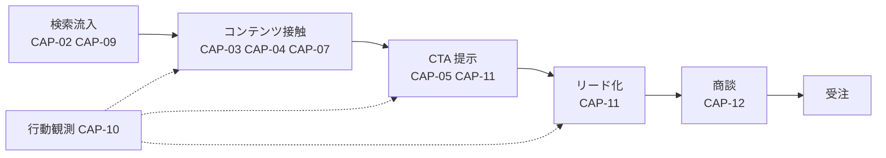
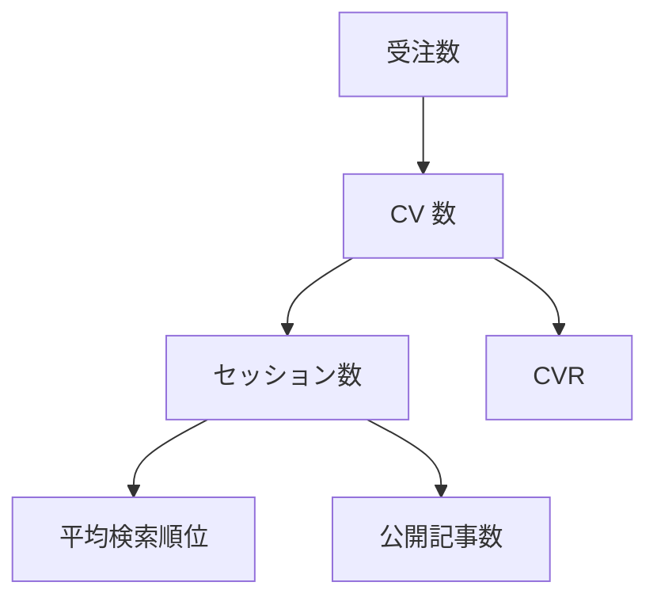

# 01. 事業モデル・バリューストリーム・KPI ツリー

BA（Business Architecture）層。ID（`R1`〜`R4` / `CAP-01`〜`CAP-18` / `E-01`〜`E-20`）はそれぞれの正本の定義をそのまま使う（索引は [`docs/README.md` の「ID の採番と正本」](../../README.md)）。

## 事業の目的とこの基盤が最適化するもの

SaaS システムの販売事業において、検索流入を起点とした BtoB のリード獲得を、人員の増加ではなく基盤そのものの改善によって拡大する。この事業経営基盤が最適化する対象は記事の本数でもツールの数でもなく、**「観測してから改善が作用するまでの一巡に要する時間と人手」**である（一巡が短いほど、同じ人員で回せる PDCA の回転数が上がり、施策あたりの学習量が増えるため）。したがって `CAP-14`（改善提案の生成と承認）がこの基盤の中核であり、他のすべての Capability は `CAP-14` に観測を供給するか、`CAP-14` の出力を実体に作用させるために存在する、と位置づける。

## 現状の要約（As-Is）

ツールの選定と設置はおおむね終わっているが、**ツール間の配線がほとんど行われていない**。この節は事実のみを記す。

| 対象 | 内容 | 状態 |
|---|---|---|
| Strapi → PostHog | `api::article.article` のライフサイクル購読（`article_created` / `article_published` / `article_updated` / `article_deleted`）と、`global::posthog-error` ミドルウェアによる例外送信の 2 本 | `実装済み` |
| chatwoot-mcp / mautic-mcp | Chatwoot・Mautic の API を MCP ツールとして公開する自作サーバ。エージェントからの参照・書き込み経路 | `実装済み` |
| ブラウザ側トラッカー | GA4（2026-10-06 に AA-05 の ADR-25 で Umami から変えた）・PostHog・Chatwoot ウィジェット・Mautic のいずれのスニペットも `frontend/verdant-virgo` に設置されていない | `未着手` |
| n8n ワークフロー | コンテナの compose と環境変数テンプレートのみ。ワークフローは 0 件 | `未配線` |
| Google Search Console | サイト登録・所有権確認ともに行っていない。**OpenSEO に統合して取得すると決めた**（2026-09-18。AA-05 の ADR-06） | `未着手` |
| OpenSEO（競合・検索市場調査） | セルフホストの Docker が稼働し、DataForSEO の API キーも設定済み。MCP の接続先もローカルに付け替えた。**エージェントの定義と `comegin.com` のプロジェクトが未作成** | `未配線` |
| Lighthouse CI | `pnpm lh` でローカル計測できる。結果を継続的に蓄積する仕組みはない | `未配線` |
| 公開サイトの記事 | Astro 側はスキャフォールドの `index.astro` のみで、Strapi の記事を描画するページが存在しない | `未着手` |

つまり現在のバリューストリームは**「コンテンツ接触」以降が一本も通っていない**。以下のバリューストリームと KPI ツリーは To-Be の設計であり、各段に現状の状態を併記する。

## バリューストリーム（To-Be）

図は To-Be を描いている。**現在この図のうち実際に繋がっている段は 1 つも無い**（記事を描画するページ、CTA、ブラウザ側トラッカーのいずれも存在しないため）。段ごとの状態は直後の「各段の詳細」の状態列で確認する。

実線が価値の流れ、破線が観測の流れを表す。観測（`CAP-10`）は価値そのものを生まないが、`CAP-14` への入力となるため図に残す（観測が欠けた段は改善提案を作れず、そこで PDCA が切れるため）。

### 各段の詳細

| 段 | 何が起きるか | 働く Capability | 主なエンティティ | 状態 |
|---|---|---|---|---|
| 検索流入 | 検索意図に沿った記事が検索結果に表示され、クリックされる | `CAP-02` `CAP-09` `CAP-16` | `E-01` `E-02` `E-12` | `未着手`（Google Search Console 未登録、記事ページ自体が無い。**狙うキーワードの調査は OpenSEO で先に始められる**） |
| コンテンツ接触 | 記事を読み、課題の言語化が進む | `CAP-03` `CAP-04` `CAP-07` `CAP-08` | `E-03` `E-04` `E-05` `E-07` | `未配線`（Strapi に記事は置けるが、Astro 側に描画経路が無い） |
| CTA 提示 | 検索意図に応じた CTA が出し分けられる | `CAP-05` `CAP-11` | `E-06` `E-11` | `未着手`（CTA コンポーネントも AB テストも未実装） |
| リード化 | CTA が押され、Mautic のコンタクトになる | `CAP-11` | `E-06` `E-09` | `未着手`（フォーム未作成、トスアップ条件は 04 で定義） |
| 商談 | Chatwoot・メールで接触し、要件を確認する | `CAP-12` | `E-09` `E-10` | `未配線`（Chatwoot 本体と MCP は動くが、ウィジェットがサイトに無い） |
| 受注 | 契約に至る | 対象外（本基盤の範囲外） | 未定 | `未着手`（SFA を未選定。「未決定事項」参照） |

### キャッシュの流れ（2026-10-03 に追加。本システムの完成後に着手）

バリューストリームとは別に、**採掘とポイントによるお金の流れ**を持つ（リポジトリルートの `README.md` の「マネタイズモデル」、AA-05 の ADR-20）。

| 流れ | 利用者 | ComeGin |
|---|---|---|
| キャッシュアウト | 自分のサーバ代、発注代金（ポイントを差し引いた残り） | デモアプリのサーバ代（**デモでは採掘しない**）、`points-api` の実行費、ガス代（POL）、unMineable の手数料（採掘の 1%）、thirdweb の無料枠を超えた分 |
| キャッシュイン | **譲渡できないポイント**（ComeGin への発注代金の値引きにだけ使える。1 ポイント = 1 円） | POL（unMineable から日次。国内の登録済みの取引業者で円に換える）、受注の報酬 |

- **「受注」は引き続き本基盤の対象外である。** ただし**ポイントの消化（発注代金の値引き）だけが受注の境界をまたぐ**。消化の根拠は発注書番号を外部の参照として持ち、発注を表す型は作らない（SFA が未選定のため。DA-01 の 4.2）。
- **採掘は利用者の業務を支える収入ではない。** 1 vCPU の採掘益は月 $0.7 前後で、サーバ代の約 2% にとどまる。**すでに払っているサーバの余った CPU だけを使う**前提にし、「採掘で元が取れる」とは打ち出さない。
- 担う Capability は `CAP-17`（計算資源の受け入れ）と `CAP-18`（ポイントの付与と消化）。どちらも `未着手` で、**承認ゲート G-1〜G-3（BA-05）を通るまで着手しない**。

## KPI ツリー

頂点は受注数。矢印は「上位 KPI を分解した先」を表す（因果の向きは矢印と逆で、下位が動くと上位が動く）。

図は To-Be を描いている。**現在この図のうち実際に測定できるのは `公開記事数` のみ**（他の 5 つはトラッカー未設置・CTA 未実装・Google Search Console 未登録・SFA 未選定のため）。KPI ごとの状態は「KPI 定義と測定可否」の状態列で確認する。

分解の式は次の 2 本だけを正とする（式を増やすと分解の一貫性が崩れ、月次分析で「どの数字を動かしたのか」を言えなくなるため）。

- `CV 数 = セッション数 × CVR`
- `セッション数 ≒ 公開記事数 × 記事あたり表示回数 × CTR`（CTR は平均検索順位の従属変数として扱う）

### KPI 定義と測定可否

| KPI | 定義 | 測定元ツール | 対応エンティティ | 状態 |
|---|---|---|---|---|
| 受注数 | 期間内に契約に至った件数 | 未定（SFA 未選定） | 未定 | `未着手` |
| CV 数 | 期間内の CTA 完了数（ホワイトペーパー DL / 無料トライアル / デモ予約の合計） | Mautic のフォーム送信 ＋ PostHog のイベント | `E-06` `E-09` | `未着手` |
| CVR | `CV 数 ÷ セッション数` | 導出値（GA4 と Mautic の集計値どうしの比。ADR-25 で Umami から変えた。**分母は同意した訪問者だけ、分子は全員**のため同意率で見かけが動く。DA-02 の 1.1） | `E-07` `E-09` | `未着手` |
| セッション数 | 期間内のセッション数（**同意した訪問者だけ**） | **GA4**（2026-10-06。ADR-25。旧版は Umami） | `E-07` | `未着手`（GA4 のプロパティもタグもまだ無い。旧版の Umami は起動できたがサイトにトラッカーが無く 0 件だった） |
| 平均検索順位 | 対象キーワード群の平均掲載順位 | Google Search Console（**OpenSEO 経由で取得**） | `E-01` `E-12` | `未着手` |
| 公開記事数 | `publishedAt` が設定された記事の累計 | Strapi（`api::article.article`）／ PostHog の `article_published` | `E-04` | `実装済み`（**現時点で唯一、機械的に測定できる KPI**） |

`公開記事数` 以外がすべて測定不能である事実は隠さない。この基盤の最初の課題は記事を増やすことではなく、**KPI ツリーの下位から順に測定可能にすること**である（測定できない KPI に対しては `CAP-14` が改善提案を生成できず、再帰的自己改善のループが起動しないため）。

### 測定可能化の順序（To-Be の設計）

順序は「下位 KPI から」ではなく「配線の依存が少ないものから」で決める。

1. セッション数 — GA4 のタグを Astro の `Layout.astro` に設置する（**2026-10-06 に ADR-25 で Umami のトラッカーから変えた**。GA4 は Cookie を使うため、**同意の実装〈`consent-api` とバナー〉が先に要る**。旧版の「依存が他に無く、単独で完結する」は成り立たなくなった）。
2. 公開記事数の可視化 — 既にイベントは飛んでいるので、PostHog 側でダッシュボード化するだけでよい。
3. 平均検索順位 — Google Search Console にドメインプロパティを登録し、OpenSEO から OAuth で接続する。**ドメインプロパティなら公開 URL（apex か `www` か）の確定を待たずに登録できる**（データが溜まり始めるのは記事の公開後）。
4. CV 数 — CTA コンポーネントと Mautic フォームの実装（04 のトスアップ条件の確定が前提）。
5. CVR — 上記 1 と 4 が揃った時点で導出できる。
6. 受注数 — SFA の選定後。

具体的な指標定義（計測対象イベント名・粒度・集計期間）は DA 層、実装手段は AA / TA 層に引き渡す。

## 未決定事項

- **受注数の正本となる SFA が未選定。** README の「MA/SFA へ即時トスアップ」という記述に対し、組み込むツール群の一覧に SFA が含まれていない。Mautic のステージで代用するか、別途 SFA を導入するかで `E-09` の意味と受注数の測定手段が変わるため、BA では決めずに残す。
- **「記事あたり表示回数」と「CTR」を KPI ツリーの正式なノードにするか。** Google Search Console で両方とも取得でき、**OpenSEO への統合でエージェントから取れる経路も決まった**（ページ単位の `GSC-impressions` と `GSC-ctr`。DA-02 の 4.3）が、指示された 5 つの下位 KPI に含まれておらず、DA-01 にも対応する `E-ID` が無い。ノードを勝手に増やすと層をまたいだ参照がずれるため、DA-01 の判断を待つ。
- **（2026-10-06 に ADR-25 で解決）セッション数を Umami と PostHog のどちらで数えるか。** 両方がセッションを持つ（`E-07` は Umami、`E-08` は PostHog）。二重計上を避けるには正本を一つに決める必要があるが、これは DA 層の指標定義の範囲である。**GA4 を正本にし、Umami をやめ、PostHog のセッションは報告に使わないと決めた**（DA-02 の 3 節）。
- **（2026-10-03 に追加）ポイントの規則の数値。** 還元率・有効期限・1 回の発注で使える上限が未定（spec の 2.3。決めるのはユーザーと `R1`）。付与量の式は「その月の ComeGin の採掘収入（円換算）× 利用者の貢献比 × 還元率」で確定している。
