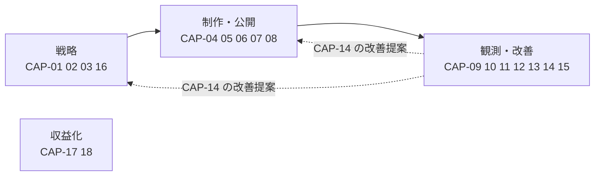
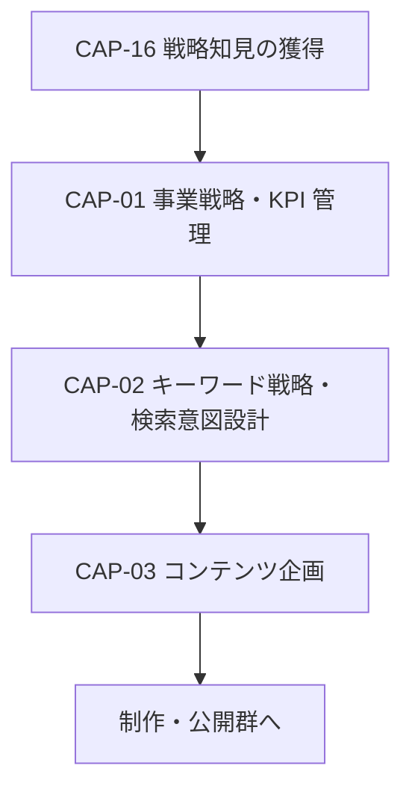
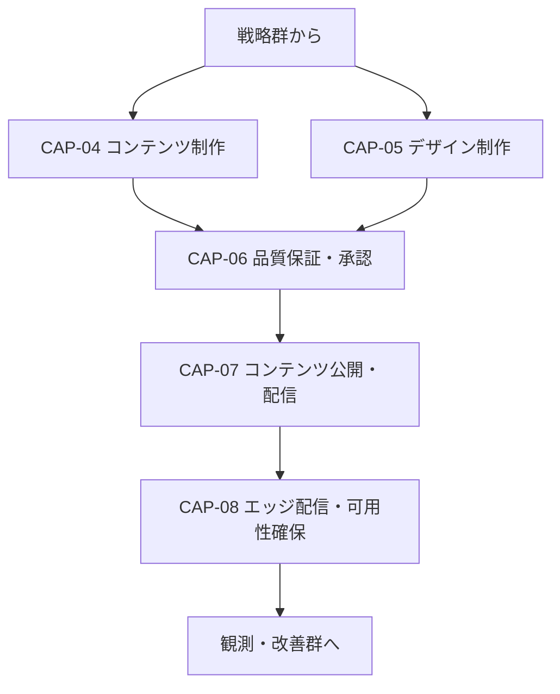
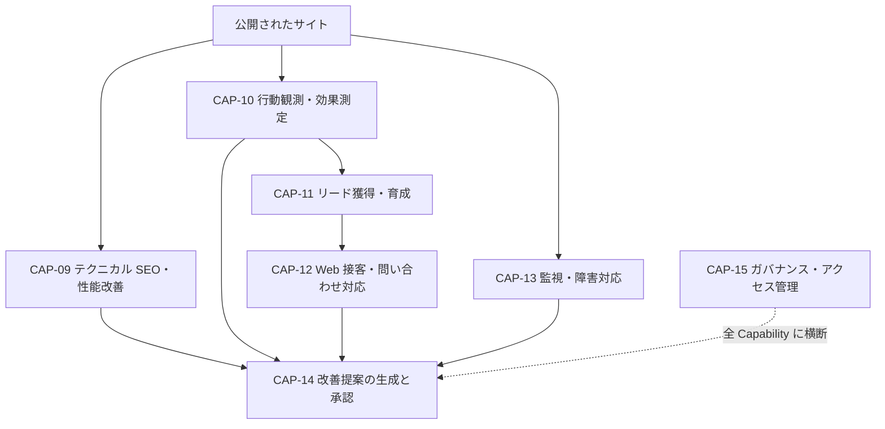

# 02. ケイパビリティマップ

BA（Business Architecture）層。**Capability の ID・名称・主担当ロールの採番の正本は本ファイルである**（索引は [`docs/README.md` の「ID の採番と正本」](../../README.md)）。ここで新たに定義するのは **グルーピング**、**成熟度**、**外注 → 内製の対応**の 3 つ。

## グルーピングの考え方

18 の Capability を、バリューストリーム（01 参照）に対する関わり方で 4 群に分ける。

図は To-Be を描いている。**現在このループは閉じていない**（観測・改善群の出力である `E-13` の格納先が未定で、戦略群・制作公開群に戻る経路が存在しないため）。群ごとの実態は「Capability 一覧と成熟度」の成熟度列で確認する。

収益化群は 2026-10-03 に追加。未着手で、他の群とは矢印で結ばない（独立した流れのため）。

破線が再帰的自己改善のループにあたる。観測・改善群の出力（`E-13` `ImprovementProposal`）が戦略群と制作・公開群への入力に戻ることで、基盤が自分自身を書き換える（このループが閉じていない限り、個々の Capability をいくら強化しても自己改善型にはならないため、ループの存在を図の第一階層に置く）。

`CAP-15`（ガバナンス・アクセス管理）は本来 4 群すべてに横断して効くが、図の階層を増やさないために観測・改善群に置く（運用開始後は権限の棚卸しという「観測」として回るため）。

## 群ごとの内訳

### 戦略群

図は To-Be を描いている。**この群で実際に稼働している Capability は 1 つも無い**（`CAP-01` は測定できる KPI が 1 つしかなく、`CAP-03` は記録先そのものが未定のため）。**`CAP-02` と `CAP-16` は OpenSEO によって調べる手段だけは揃った**が、調べた結果を記録する先（`api::keyword.keyword`、知見メモの型）がまだ無い。

### 制作・公開群

図は To-Be を描いている。**この群で実際に繋がっているのは `CAP-04` の下書き経路（Strapi と `strapi-mcp`）と `CAP-06` の機械チェック側（Lighthouse CI）だけ**で、`CAP-07` 以降は経路が存在しない。

`CAP-06` は `CAP-07` の直前に必ず入る（ここが人間の承認ゲートで、04 で詳述する）。

### 観測・改善群

図は To-Be を描いている。**この群にはまだ入力が届いていない**（ブラウザ側トラッカーが 1 つも設置されておらず、`CAP-10` の観測データが 0 のため）。唯一動いているのは `CAP-13` のうち Strapi の例外を PostHog に送る経路だけ。

`CAP-14` はこの群の合流点であり、基盤全体の合流点でもある。観測系の Capability（`CAP-09` `CAP-10` `CAP-12` `CAP-13`）はすべて `CAP-14` に流れ込み、`E-13` `ImprovementProposal` という単一の型に変換されてから戦略群・制作公開群に戻る（型を一つに絞らないと、承認ゲートを Capability ごとに作ることになり、承認の抜け道が増えるため）。

### 収益化群（2026-10-03 に追加）

採掘とポイントによるマネタイズモデル（AA-05 の ADR-20）を担う。**本システムの完成後に着手し、承認ゲート G-1〜G-3（BA-05）を通るまで手を付けない。**

| ID | Capability | 中身 |
|---|---|---|
| `CAP-17` | 計算資源の受け入れ（採掘） | 利用者の同意（オプトイン）と撤回の受付、利用者のサーバでの XMRig の有効化、unMineable の貢献量の取り込み、ComeGin の POL の受け取りと換金 |
| `CAP-18` | ポイントの付与と消化 | 月次の締めと付与（承認つき）、発注時の消化、付与率の管理、チェーンと台帳の突き合わせ |

- **他の群に入れなかった理由。** 既存の 3 群は「検索流入を起点にリードを獲得する」流れのどこかを担う。収益化群はその流れとは別の、**利用者（すでに基盤を立てた事業者）との関係**を扱うため、群を分けた。

## Capability 一覧と成熟度

成熟度は `未着手`（着手していない） / `部分的`（手段の一部が存在するが業務として回っていない） / `確立`（定義された手順で反復できている）の 3 値。

| ID | Capability | 主担当 | 成熟度 | 根拠 |
|---|---|---|---|---|
| `CAP-01` | 事業戦略・KPI 管理 | `R2` | `未着手` | KPI ツリーは 01 で定義したが、測定できるのは公開記事数のみで管理サイクルが回っていない |
| `CAP-02` | キーワード戦略・検索意図設計 | `R2` | `部分的` | 検索意図の 3 分類は README にあり、`E-01` の正本は Strapi に決まった（DA-01 の 5.2）。**OpenSEO（セルフホスト）でキーワード調査と検索ボリュームの取得ができる状態になった**（2026-09-18）。ただし `api::keyword.keyword` が未作成で、調査結果を記録する先が無い |
| `CAP-03` | コンテンツ企画 | `R2` | `未着手` | `E-03` `ContentPlan` の格納先が未定で、企画を記録する場所が無い |
| `CAP-04` | コンテンツ制作（執筆・取材） | `R4` | `部分的` | Strapi の `api::article.article` が用意され、`strapi-mcp` 経由でエージェントが記事を作成・公開できる（開発環境）。**本番（`strapi-prod`）ではエージェントは下書きまでで、公開は `R2` が管理画面で行う**（AA-05 の ADR-17）。ただし執筆の手順と品質基準が未定義 |
| `CAP-05` | デザイン制作 | `R1` | `部分的` | shadcn/ui（style `base-nova`）＋ Tailwind v4 が導入済みで、UI の一貫性を保つ土台はある。バナー・アイキャッチの制作手段は無い |
| `CAP-06` | 品質保証・承認（ダブルチェック） | `R2` | `部分的` | Lighthouse CI がしきい値（SEO は 1.0）で機械的にゲートできる。人間側の承認手順は未定義（04 で設計する） |
| `CAP-07` | コンテンツ公開・配信 | `R1` | `未着手` | Astro 側に Strapi の記事を描画するページが無く、公開経路が成立していない |
| `CAP-08` | エッジ配信・可用性確保 | `R1` | `未着手` | ホスティング先が未定。現状はローカルの dev サーバーのみ |
| `CAP-09` | テクニカル SEO・パフォーマンス改善 | `R1` | `部分的` | `pnpm lh` で 4 カテゴリを計測でき、`SITE_URL` 未設定のビルドを止める仕組みもある。計測結果を継続的に蓄積・比較する仕組みは無い。**検索結果での扱い（GSC の実績・インデックス登録）とサイト全体の構造監査は OpenSEO で取る**と決めたが未接続 |
| `CAP-10` | 行動観測・効果測定 | `R3` | `未着手` | Umami・PostHog ともにブラウザ側トラッカーが 1 つも設置されていない。取得できている行動データは 0 |
| `CAP-11` | リード獲得・育成 | `R3` | `未着手` | CTA コンポーネントも Mautic のフォームも未作成 |
| `CAP-12` | Web 接客・問い合わせ対応 | `R3` | `部分的` | Chatwoot 本体と `chatwoot-mcp`（31 ツール）が動く。サイトにウィジェットが無いため流入が 0 |
| `CAP-13` | 監視・障害対応 | `R1` | `部分的` | Strapi の例外は `global::posthog-error` で PostHog に送られる。それ以外のシステムの監視・通知経路は無い |
| `CAP-14` | 改善提案の生成と承認 | `R2` | `未着手` | `E-13` `ImprovementProposal` の格納先が未定。入力となる観測データもほぼ存在しない |
| `CAP-15` | ガバナンス・アクセス管理 | `R1` | `部分的` | MCP サーバ側は `ACCESS_LEVEL` による権限制御と固定 Bearer 認証が実装済み。人間の側は SSO が無く、各システムが個別アカウント（05 で詳述） |
| `CAP-16` | 戦略知見の獲得 | `R2` | `部分的` | **競合・SERP・被リンクを OpenSEO で調べられる**（DataForSEO 設定済み）。知見を蓄積する場所（`docs/knowledge/` の型）と、採否を決める手順は無い |
| `CAP-17` | 計算資源の受け入れ（採掘） | `R1` | `未着手` | 2026-10-03 に追加。手段（XMRig・unMineable）を決めただけで、何も置いていない。承認ゲート G-1〜G-3 が前提 |
| `CAP-18` | ポイントの付与と消化 | `R1` | `未着手` | 2026-10-03 に追加。手段（`points-api`・thirdweb）を決めただけで、何も置いていない。承認ゲート G-1〜G-3 が前提 |

`確立` に達している Capability は 1 つも無い。これは基盤の構築段階として妥当だが、**成熟度の底上げは `CAP-10` から始める**（観測が 0 のままでは `CAP-14` が起動せず、他の Capability の成熟度を上げても改善が自己増殖しないため）。

## 外注 → 内製の対応

README の「再帰的自己改善として模倣する組織・サービス 6 種」を、内製する Capability に対応づける。対応は本ファイルで定義した `CAP-04` / `05` / `08` / `09` / `13` / `16` に従う。

| README の外部サービス | 内製する Capability | 実現手段の方針 | 引き渡し先 | 状態 |
|---|---|---|---|---|
| SaaS/BtoB 特化型コンテンツ制作代行 | `CAP-04` | 構成案・初稿の作成をエージェントに委任し、Strapi（`E-04`）を唯一の正本とする。取材が必要な記事は人間（`R4`）が素材を用意し、エージェントは構成と文章化に限定する | AA | `部分的` |
| Figma（プロトタイプ共有・共同編集）／ Canva・Adobe CC（バナー・アイキャッチ） | `CAP-05` | デザインの正本を外部ツールではなくコード側（shadcn/ui のコンポーネントと Tailwind のトークン）に置き、レビューは実際のページで行う（デザインファイルとコードの二重管理をなくすため）。ラスタ画像の生成手段は別途決める | AA | `部分的` |
| Cloudflare / Vercel（高速化・DDoS 対策・SSL 自動化） | `CAP-08` | Astro の静的ビルド成果物をエッジ配信し、TLS 発行を自動化する。配信先の具体は TA が選定する | TA | `未着手` |
| テクニカル SEO 開発代行（Core Web Vitals・構造化データ） | `CAP-09` | Lighthouse CI のしきい値（performance / accessibility / best-practices が 0.9、SEO は 1.0）を公開の必須ゲートにし、構造化データは Astro のレイアウトで生成する | TA | `部分的` |
| 保守・セキュリティ代行（サーバー監視・障害時対応） | `CAP-13` | 監視と一次対応を n8n のワークフローに寄せ、検知を `E-13` に変換して `CAP-14` に流す。エージェントは検知と提案までを担い、復旧操作は承認ゲートの対象とする（05 参照） | TA | `部分的` |
| SEO / マーケティングコンサル（戦略立案・キーワード選定） | `CAP-16` | 外部知見の調査をエージェントに委任し、採否の判断は `R2` が行う。採用した知見は `CAP-01` `CAP-02` の入力として記録する。**調査の手段は OpenSEO**（競合・SERP・検索ボリューム。README の「競合・検索市場調査」）。コンサルが持つ有料の SEO ツールを、**従量課金の API と月次予算**で置き換える（AA-05 の ADR-09・ADR-10） | AA | `部分的` |

内製化の共通方針として、**外部サービスの「成果物」ではなく「判断基準」を内製する**（成果物だけを真似ると、基準を持たないまま生成物が増え、`CAP-06` の承認が形骸化するため）。Lighthouse CI のしきい値はこの方針の既存の実例にあたる。

## 未決定事項

- **`CAP-05` のラスタ画像（アイキャッチ・バナー）の生成手段が未定。** コード側に正本を置く方針はコンポーネントには適用できるが、画像には適用できない。画像生成 API を使うか、素材サービスを使うかで `E-04` に持たせるフィールドが変わるため、DA の判断を待つ。
- **`CAP-15` を横断 Capability として独立させるか。** 現在は観測・改善群に含めているが、実際には 4 群すべてに効く。グルーピングは本ファイルで新たに定義したものであり（Capability の ID・名称・主担当とは別の軸）、BA 側の判断として暫定的に置いている。
- **成熟度の判定基準を定量化するか。** 現在の 3 値は根拠列の記述に依存しており、次の棚卸し時に同じ判定を再現できる保証がない。`CAP-01` の KPI が測定可能になった段階で、成熟度を KPI の測定可否に紐づけて再定義する余地がある。
