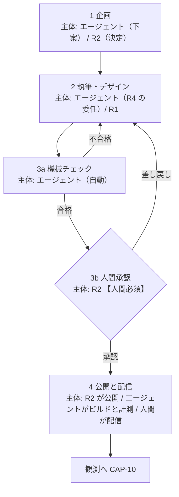

# 04. 業務プロセス

BA（Business Architecture）層。ロール ID・Capability ID・エンティティ ID は EA 共通用語集の定義をそのまま使う。

このファイルで定義する 3 つのプロセスは、いずれも **To-Be の設計**である。現状はどれも業務として稼働していない（記事を描画するページが無く、CTA も無く、観測データも 0 のため）。各表に状態列を設けて、どこまでが既存実装に支えられているかを示す。

## 更新ワークフロー

README の「企画 → 執筆/デザイン → 承認（ダブルチェック） → 公開」を、実行主体と人間ゲートの位置まで含めて具体化する。

図は To-Be を描いている。**現在このワークフローで実際に実行できるのは、ステップ 2（下書きの作成）と 3a の一部（Lighthouse CI による計測）だけ**で、3b の承認記録と 4 の公開経路は存在しない。ステップごとの状態は直後の「ステップ定義」の状態列で確認する。

**ダブルチェックは「機械チェック（3a）＋ 人間承認（3b）」の 2 段で構成する。** README の「ダブルチェック」を人間 2 人による確認と解釈すると、兼務の体制では成立しない（03 の未決定事項を参照）。機械が検証できる項目（リンク切れ、しきい値、構造化データ、表記ゆれ）と人間にしか判断できない項目（事実の正確さ、主張の妥当性、公開してよいか）を分けることで、片方が自動化されても検証の層は 2 枚残る。

### ステップ定義

| # | ステップ | 実行主体 | 入力 | 出力 | 人間必須 | 状態 |
|---|---|---|---|---|---|---|
| 1 | 企画 | エージェントが下案、`R2` が決定 | `E-01` `E-02` `E-12` | `E-03` `ContentPlan` | **必須**（採否の決定は `R2`） | `未着手`（`E-03` の格納先が未定） |
| 2 | 執筆・デザイン | エージェント（`R4` の委任）、UI 実装は `R1` | `E-03` | `E-04` `Content`（下書き） | 不要 | `部分的`（Strapi と `strapi-mcp` で下書きは作れる） |
| 3a | 機械チェック | エージェント（自動） | `E-04` | 指摘一覧 | 不要 | `部分的`（Lighthouse CI は動く。原稿側のチェックは未実装） |
| 3b | 人間承認 | `R2` | `E-04` ＋ 3a の指摘一覧 | `E-14` `ApprovalRecord` | **必須** | `未着手`（`E-14` の記録場所が未定） |
| 4 | 公開と配信 | **`R2` が本番の Strapi の管理画面で公開する → エージェントがビルドと計測を行う → 人間が配信する**（AA-05 の ADR-15・ADR-17。当初は「`R1`、または承認後にエージェント」としていた） | 承認済みの `E-04` | `E-05` `Page` | **必須**（公開と配信は人間の操作。ADR-17 でエージェントのトークンに公開の権限を与えないことにした） | `未着手`（Astro に記事描画ページが無い） |

### 人間ゲートの位置を固定する理由

再帰的自己改善型の基盤で最も危険な失敗は、**承認の過剰自動化**である（生成・チェック・承認・公開がすべて自動化されると、誤りが誰にも気づかれないまま実体に反映され、その結果が次の観測データになって誤りを強化する）。したがって次の 2 点を設計事項として固定し、後から効率化の名目で外さない。

- **人間必須のゲートは 3b（人間承認）と、企画の採否決定（1）の 2 か所。** ここを跨ぐ自動化は行わない。**ADR-15・ADR-17 で、4 の公開（`R2`）と配信（人間）も人間の操作になった**（ゲートというより、実行手段を人間に残した操作である）。
- **ステップ 4（公開）をエージェントが実行してよいのは、3b の承認が記録されている場合に限る。** 「承認を得てから公開する」ではなく「承認の記録が無ければ公開操作が成立しない」形にする（手順としての約束ではなく、状態としての前提にするため）。実装手段は AA / TA に引き渡す。
  - **（2026-09-19 に AA-05 の ADR-17 で決着）AA / TA の回答は「エージェントに公開させない」である。** 本番の Strapi に書くエージェントのトークンに公開の権限を与えず、公開は承認者の `R2` が本番の管理画面で自ら行う。承認と公開の操作が同じ人間に揃うため、「承認の記録が無ければ公開操作が成立しない」は、エージェントについては実行手段の欠落として成り立つ（Strapi 5 で公開だけを外せるかは実装時に確認する）。その後のビルドと計測はエージェントが行い、配信は人間が行う。
- 3a（機械チェック）は完全に自動化してよい。合格が公開の必要条件であって十分条件ではない（3a の合格は 3b をスキップする根拠にならない）。

## PDCA の定例

| サイクル | 実施内容 | 入力データ | 出力 | 主担当 | 状態 |
|---|---|---|---|---|---|
| 週次 | コンテンツ投入（企画済みの記事を更新ワークフローに載せて公開する） | `E-03` `E-04` | 公開された `E-05`、次週の企画残 | `R2` | `未着手` |
| 週次 | AB テストの実施（CTA の文言・配置・出し分けの検証） | `E-05` `E-06` `E-11` | `E-11` `Experiment` の結果 | `R3` | `未着手`（PostHog のトラッカー未設置） |
| 週次 | 問い合わせの棚卸し（未対応・未割り当ての会話を消化する） | `E-10` | 対応済みの `E-10`、記事化候補 | `R3` | `未配線`（Chatwoot は動くがウィジェット未設置） |
| 週次 | キーワード候補の調査（OpenSEO で候補と検索ボリュームを出し、採否を決める） | `E-01` `E-12`（`source: market`） | 採用された `E-01`（`status: 採用`） | `R2` | `未配線`（OpenSEO は稼働中。エージェントから未接続） |
| 月次 | 順位・流入・CVR 分析 | `E-12`（`source: gsc` / `serp` を含む）`E-07` `E-08` `E-09` | 分析結果、`E-13` の候補 | `R3` | `未着手` |
| 月次 | 過去記事のリライト（順位が伸びない記事・情報が古い記事の改稿） | `E-12` `E-04` `E-07` | 改稿された `E-04`（更新ワークフローの 2 に戻す） | `R2` | `未着手` |
| 月次 | 内部リンク構造の最適化 | `E-04` `E-05` `E-07` | リンク構成の変更 | `R1` | `未着手` |
| 月次 | 改善提案の採否決定 | 上記すべての出力 | `E-13` `ImprovementProposal` と `E-14` `ApprovalRecord` | `R2` | `未着手`（`CAP-14` の中核） |

### 定例の設計方針

- **週次は「作用」、月次は「学習」に割り当てる。** 週次は既に決まった企画を実行に移す回転で、意思決定を含まない。月次は観測結果から方針を書き換える回転で、`CAP-14` が働く。両者を同じサイクルに混ぜない（毎週方針を変えると、施策の効果が出る前に条件が変わって因果が読めなくなるため）。
- **月次の 4 項目はすべて `E-13` に集約してから承認する。** 分析・リライト・内部リンクをそれぞれ個別に承認すると、承認ゲートが 3 つに分散して抜けやすくなる。`CAP-14` が単一の合流点である理由はここにある（02 参照）。
- **各定例の入力データがすべて `未着手` または `未配線` である。** 定例を先に設定しても入力が空なので、実務上は 01 の「測定可能化の順序」が先行する。

## キーワード＆ CV 設計の標準化

### 検索意図の 3 分類

README の分類をそのまま使う（分類名を変えると README との対応が取れなくなるため）。

| 分類 | 読者の状態 | 検索の例 | 記事タイプ |
|---|---|---|---|
| 潜在（課題探求） | 課題は感じているが、解決手段の存在を知らない | 「〇〇 属人化」「〇〇 工数 削減」 | 課題の言語化、業界動向、失敗事例 |
| 準顕在（手法比較） | 解決手段のカテゴリは知っており、やり方を比べている | 「〇〇 自動化 方法」「〇〇 ツール 比較」 | 手法解説、選定基準、比較記事 |
| 顕在・指名（サービス比較・導入検討） | 具体的な製品を検討している | 「〇〇（製品名） 料金」「〇〇 導入事例」 | 事例、料金の考え方、導入手順 |

### 検索意図の割り当ての根拠（OpenSEO）

キーワードを 3 分類のどれに割り当てるかを、推測ではなくデータで下案にする。OpenSEO（DataForSEO）はキーワードごとに**検索意図の 4 分類**を返すため、次の対応を**暫定の既定**として使う。割り当ての確定は `R2` が行う（`E-01` の採否と同じ承認）。

| DataForSEO の検索意図 | この基盤の分類（既定） | 注意 |
|---|---|---|
| informational（情報収集） | 潜在 | 課題の言語化を求める検索。「〇〇 とは」も含む |
| commercial（比較検討） | 準顕在 | 「〇〇 ツール 比較」「おすすめ」 |
| transactional（取引） | 顕在・指名 | 「料金」「導入」「無料トライアル」 |
| navigational（指名） | 顕在・指名 | **自社名・製品名の場合だけ**。競合の製品名の場合は準顕在に置く（比較の途中にいるため） |

- **対応は 1 対 1 ではない。** DataForSEO の分類は Google 全体の検索行動からの推定であり、BtoB の文脈を知らない。**既定を機械的に適用せず、`R2` が採否のときに上書きする**前提で置く。
- **意図が返らない市場がある。** Google Ads のデータで代用される国では検索意図が `null` になる（OpenSEO のツール説明）。日本語の市場で実際に返るかは未確認（未決定事項）。

### CTA 出し分けマトリクス

CTA は README の 3 種（ホワイトペーパー / 無料トライアル / デモ予約）を使う。**1 ページに主 CTA は 1 つだけ置く**（複数の主 CTA を並べると、どの意図に効いたのかが AB テストで分離できなくなるため）。副 CTA は補助で、主 CTA より視覚的な重みを下げる。

| 検索意図 | 主 CTA | 副 CTA | 置かない CTA | 根拠 |
|---|---|---|---|---|
| 潜在 | ホワイトペーパー | なし | 無料トライアル、デモ予約 | 製品を知らない段階で商談系 CTA を出すと直帰する。まず匿名のまま持ち帰れる形にする |
| 準顕在 | ホワイトペーパー | 無料トライアル | デモ予約 | 比較段階では自分で試せる選択肢を添える。人と話す前提の CTA は早い |
| 顕在・指名 | デモ予約 | 無料トライアル | なし（ホワイトペーパーは副次的に残してよい） | 検討段階では人と話すほうが速い。トライアルは自走したい読者の逃げ道として残す |

状態: すべて `未着手`（CTA コンポーネントも Mautic のフォームも未作成）。

### MA へのトスアップ条件

どの CTA が押されたら Mautic（`E-09` `Contact`）の何になるかを明文化する。この表が **DA の指標定義（`E-06` `E-09` のフィールド設計）と AA の Mautic 連携（フォーム・セグメント・キャンペーンの設計）への引き渡し物**にあたる。

| CTA | 発火条件 | Mautic で起きること | 通知 | 後続 |
|---|---|---|---|---|
| ホワイトペーパー DL | Mautic フォームの送信完了（メールアドレス必須） | `E-09` を作成または既存に統合。セグメント `wp-download` に追加。ポイント `+10`。カスタムフィールドに DL した資料名と流入記事の URL を保存 | なし（即時通知しない） | ナーチャリングメールのキャンペーンに投入 |
| 無料トライアル申込 | Mautic フォームの送信完了（会社名・メールアドレス必須） | `E-09` のステージを `trial` に更新。セグメント `trial-signup` に追加。ポイント `+30` | `R3` に当日中に通知 | トライアル期間中の利用状況に応じたフォローアップ |
| デモ予約 | Mautic フォームの送信完了（会社名・氏名・メールアドレス必須） | `E-09` のステージを `demo-requested` に更新。セグメント `demo-request` に追加。ポイント `+50` | `R3` に**即時**通知 | Chatwoot の会話（`E-10`）または直接連絡で商談へ |
| （共通） | 累計ポイントが `50` 以上に到達 | セグメント `mql` に追加 | `R3` に通知 | 商談化の判断対象にする |

**通知の経路を `R1` が 2026-09-17 に決定した。** 上表の「通知」列はすべて、**運用者のメールアドレスへ届ける**（本番は Amazon SNS のトピック `comegin-lead-alert`、開発は MailHog）。設計は AA-02 の `I-21` と TA-01 の経路 10 にある。

- **通知に載せるのは「種別・会社名・各システムの ID」だけとする。** 氏名・メールアドレス・問い合わせ本文は載せず、詳細は Mautic / Chatwoot を見に行く（DA-05 の 1.3）。会社名を載せるのは、**メールを見た時点で優先度を判断できるようにする**ため。
- **Chatwoot の社内メモは通知に使わない。** Chatwoot は顧客対応の用途であり、内部通知を載せると `agent/conversation-triage` の取得範囲と `CAP-12` のレポートを汚す（AA-02 の 3.4）。

トスアップ条件の設計上の約束。

- **CV の判定は「CTA のクリック」ではなく「フォームの送信完了」で行う。** クリックは PostHog 側で計測するが、`E-09` を作るのは送信完了時のみ（クリックだけでコンタクトを作ると、実体のないコンタクトが増えて CVR が実態より高く出るため）。
- **ポイントの加算値（10 / 30 / 50）と MQL のしきい値（50）は暫定値。** 実データが取れるまで妥当性を検証できない。運用開始後に `CAP-14` の対象として見直す前提で置く。
- **流入記事の URL を必ずコンタクトに保存する。** これが無いと「どの記事が CV を生んだか」を月次分析で辿れず、KPI ツリーの `公開記事数 → CV 数` の経路が検証できない。
- **通知の即時性は CTA の温度感に比例させる。** デモ予約だけ即時通知にするのは、顕在層の検討タイミングが短いため。

状態: すべて `未着手`（Mautic のフォーム・セグメント・キャンペーンはいずれも未作成。`mautic-mcp` 経由で作成する手段はある）。

## 未決定事項

- **`E-13` `ImprovementProposal` と `E-14` `ApprovalRecord` の格納先が未定。** 承認ゲート（3b）を「記録が無ければ公開できない」形にするには、承認記録を機械が参照できる場所に置く必要がある。Strapi のコンテンツタイプにするか、別のストアにするかで実装が変わるため、DA の決定を待つ。
- **`E-01` `Keyword` と `E-03` `ContentPlan` の正本が未定。** 企画ステップの入出力がどこに書かれるかが決まらないと、週次・月次の定例が入力を参照できない。
- **AB テストの実施主体が PostHog のフィーチャーフラグか、Astro のビルド時分岐かが未定。** 静的サイトで AB テストを行う方式によって、`E-11` の粒度と `CAP-10` の計測方法が変わる。TA の判断事項。
- **CTA のフォームを Mautic のフォームで作るか、Astro 側のフォームから Mautic の API を叩くかが未定。** 前者は実装が軽いが埋め込みの表示速度が `CAP-09` のしきい値に影響し、後者は `E-06` の正本が Strapi 側に寄る。AA の判断事項。
- **ダブルチェックを人間 2 人で行う体制に戻す余地。** 本ファイルでは「機械 ＋ 人間」の 2 段としたが、これは兼務を前提とした妥協である。`R2` と `R4` が別の人間で埋まった場合、3b を人間 2 名の確認に強化する選択肢が生じる。
- **DataForSEO の検索意図と 3 分類の対応が妥当か。** 上の対応表は暫定の既定であり、日本語・BtoB のキーワードで検索意図が実際に返るか、返った値が 3 分類と噛み合うかを確かめていない。キーワード調査を実際に回してから見直す。判断者 `R2`。
