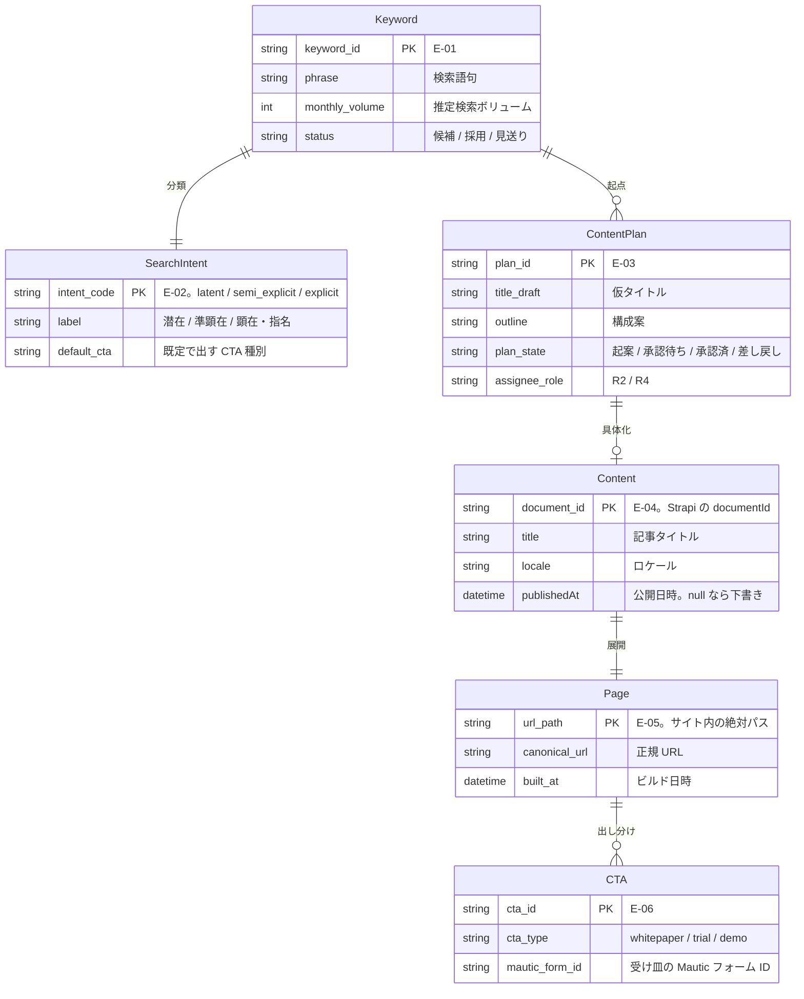
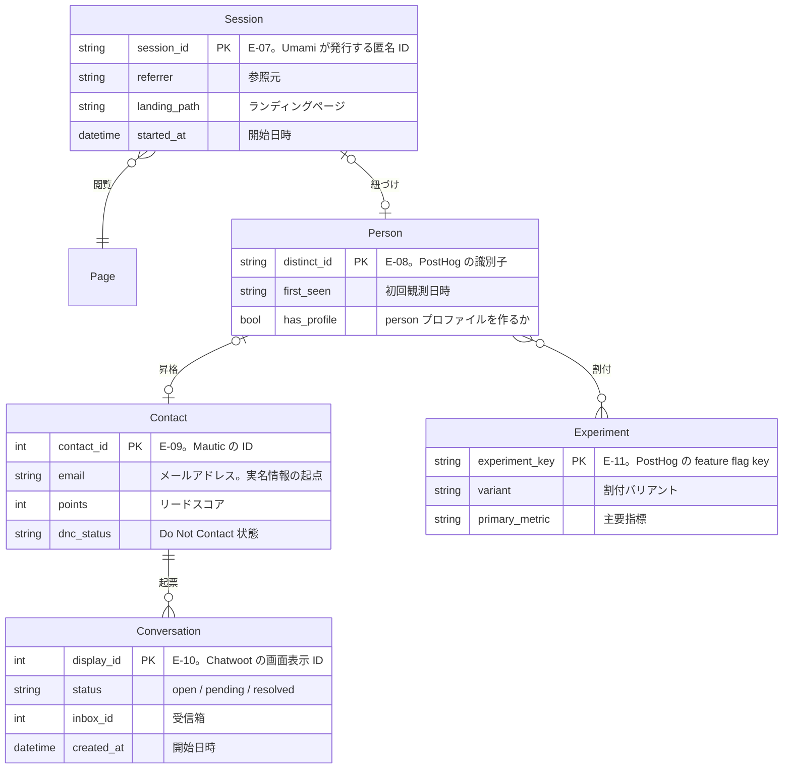
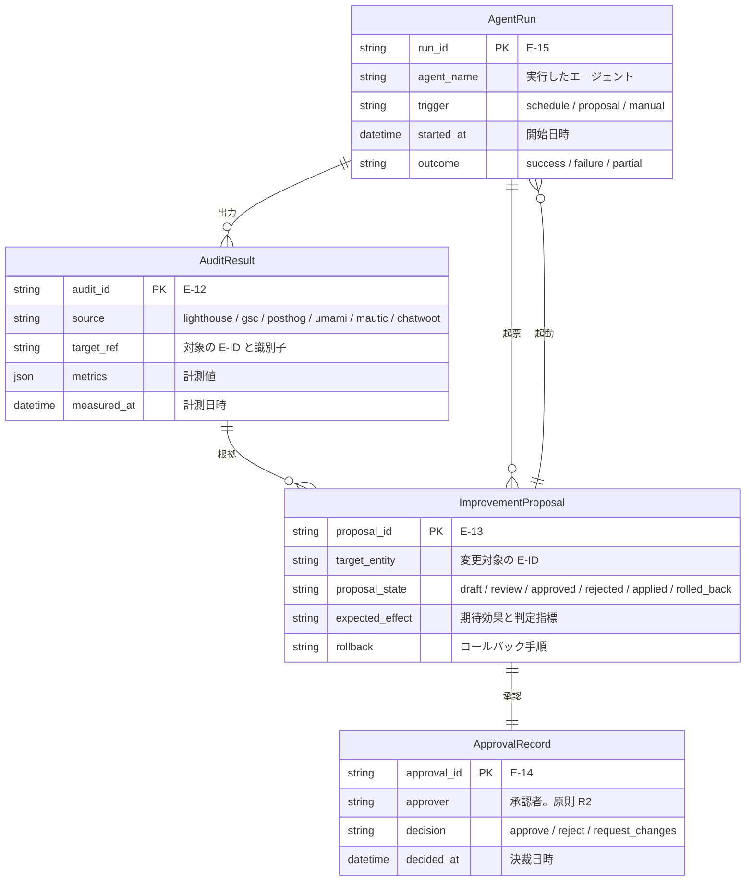
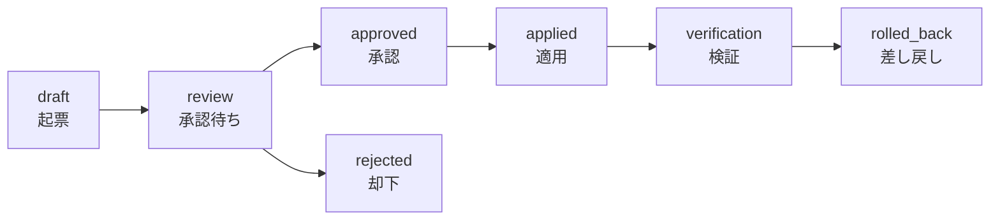

# DA-01 概念データモデル

EA 共通用語集の `E-01`〜`E-15` を、関連・主要属性・正本（System of Record）の 3 点で定義する。
物理スキーマ（テーブル定義・カラム型）は TA の担当であり、ここでは「どの概念が、どのツールに、どの形で存在するか」だけを決める。

図は 1 図あたりのノード数を抑えるため 3 枚に分割する（用語集の表記ルールに従う）。

- 図 1 コンテンツ系: `E-01` `E-02` `E-03` `E-04` `E-05` `E-06`
- 図 2 行動・顧客系: `E-07` `E-08` `E-09` `E-10` `E-11`
- 図 3 改善系: `E-12` `E-13` `E-14` `E-15`

## 1. 図 1 コンテンツ系（企画から公開まで）



図は To-Be を描いている。現在この図のうち実際に存在するのは `E-04 Content`（Strapi の `api::article.article`）と `E-05 Page`（Astro のビルド成果物）の 2 つと、両者の関連だけ。
`E-01` `E-02` `E-03` `E-06` はスキーマも実体も無い（各エンティティの状態は 4 節の表の「状態」列を参照）。

## 2. 図 2 行動・顧客系（匿名から実名まで）



図は To-Be を描いている。現在この図のうち実際に存在するインスタンスは 1 件も無い。ブラウザ側のトラッカーが 1 つも設置されておらず（`frontend/verdant-virgo/src/layouts/Layout.astro`）、`E-07 Session` も `E-08 Person` も発生していないため、昇格の連鎖が起点から始まっていない（詳細は DA-03 の 1 節）。

## 3. 図 3 改善系（観測から作用まで）

`CAP-14`（改善提案の生成と承認）を成立させる 4 型。ここが再帰的自己改善のループそのものになる。



図は To-Be を描いている。現在この図のうち実際に生成されているのは `E-12 AuditResult` の一部（Lighthouse CI の計測結果が `frontend/verdant-virgo/.lighthouse/` にファイルとして出ているもの）だけ。
`E-13` `E-14` `E-15` は型の定義のみで実体が無く、**ループはまだ 1 周も回っていない**。

## 4. エンティティ定義と正本

正本は「その値を書き換えてよい唯一の場所」を指す。複製先での書き換えは禁止し、同期方向は DA-04 の System of Record 表で一方向に固定する。

| ID | エンティティ | 主要属性 | 正本（System of Record） | 格納形式 | 状態 |
|---|---|---|---|---|---|
| `E-01` | `Keyword` | `phrase` / `monthly_volume` / `status` / `intent_code` | Strapi（`api::keyword.keyword`） | コンテンツタイプ | 未着手 |
| `E-02` | `SearchIntent` | `intent_code` / `label` / `default_cta` | `E-01` の属性（enum） | 列挙値 | 未着手 |
| `E-03` | `ContentPlan` | `title_draft` / `outline` / `plan_state` / `assignee_role` | Strapi（`api::content-plan.content-plan`） | コンテンツタイプ | 未着手 |
| `E-04` | `Content` | `documentId` / `title` / `locale` / `publishedAt` | Strapi（`api::article.article`） | コンテンツタイプ | 実装済み |
| `E-05` | `Page` | `url_path` / `canonical_url` / `built_at` | Astro のビルド成果物（`frontend/verdant-virgo/dist/`） | 静的ファイル + `sitemap` | 実装済み |
| `E-06` | `CTA` | `cta_type` / 表示文言・配置 / `mautic_form_id` | 表示定義は Strapi のコンポーネント、受付定義は Mautic のフォーム | 分割保持 | 未着手 |
| `E-07` | `Session` | `session_id` / `referrer` / `landing_path` / `started_at` | Umami | PostgreSQL（`middleware/umami-master`） | 未配線 |
| `E-08` | `Person` | `distinct_id` / `first_seen` / プロパティ | PostHog（SaaS。project 610214） | クラウド | 未配線 |
| `E-09` | `Contact` | `email` / `points` / `dnc_status` / カスタムフィールド | Mautic | MySQL（`backend/mautic-system`） | 未配線 |
| `E-10` | `Conversation` | `display_id` / `status` / `inbox_id` / ラベル | Chatwoot | PostgreSQL（`backend/chatwoot-system`） | 未配線 |
| `E-11` | `Experiment` | `experiment_key` / `variant` / `primary_metric` | PostHog | クラウド | 未着手 |
| `E-12` | `AuditResult` | `source` / `target_ref` / `metrics` / `measured_at` | Lighthouse CI（`frontend/verdant-virgo/.lighthouse/`）／Google Search Console | JSON ファイル／API | Lighthouse は実装済み、GSC は未着手 |
| `E-13` | `ImprovementProposal` | 後述の 12 項目 | Git（`docs/proposals/` の Markdown。PR で承認） | Markdown + YAML frontmatter | 未着手 |
| `E-14` | `ApprovalRecord` | `approver` / `decision` / `decided_at` / `comment` | `E-13` に従属（PR のレビュー承認） | Git / GitHub | 未着手 |
| `E-15` | `AgentRun` | `agent_name` / `trigger` / `started_at` / `outcome` | n8n の実行履歴（`middleware/n8n`） | PostgreSQL（`execution_entity`） | 未配線 |

- `E-04` の `documentId` は Strapi 5 系の識別子であり、`id` とは別物（ロケール違い・下書き / 公開の版をまたいで同じ値を持つ）。名寄せのキーには `documentId` を使う。
- `E-06` を分割保持にするのは、CTA の見た目（`R1` が編集）と受け皿のフォーム定義（`R3` が編集）で更新者もツールも異なるため。両者は `mautic_form_id` で結合し、この対応表自体は Strapi 側のコンポーネントに持たせる（片方向の参照にして循環を避ける）。
- `E-12` の `source` に `posthog` / `umami` / `mautic` / `chatwoot` を含めるのは、監査結果を「Lighthouse の結果」に限定せず、あらゆる観測の共通の入れ物にするため（`E-13` の根拠参照先を 1 種類の型に統一できる）。

## 5. 正本が未定だったエンティティの決定

用語集で「未定（DA で決定する）」としていた `E-01` / `E-03` / `E-13` の正本を、この層で決定する。

### 5.1 候補の比較

| 候補 | 利点 | 欠点 |
|---|---|---|
| Strapi のカスタムコンテンツタイプ | `E-04 Content` と同じ DB にあるため relation を張れる。管理画面で `R2` が直接編集できる。REST / GraphQL と `strapi-mcp` でエージェントが読み書きできる。ライフサイクルフック（`backend/strapi-system/src/index.ts`）で PostHog にイベントを出せる | スキーマ変更にコード変更とデプロイが必要。差分レビュー・履歴が弱い（draft / publish の 2 状態しかない） |
| n8n Data Tables | 画面からスキーマを変更でき、ワークフローから直接読み書きできる。配線が最短 | 実行基盤に正本を置くことになり、n8n を作り直すと消える（`N8N_ENCRYPTION_KEY` を変えると復号できない制約もある）。relation が無く、履歴・レビューの機構も無い |
| Git 上の Markdown | 差分・レビュー・履歴・差し戻し・revert が標準で付く。コード変更を伴う提案なら、提案そのものが適用手段（PR）になる | 件数が増えると検索・集計ができない。`R2` が Git / GitHub を使う前提になる。Strapi 側の relation とは結合できない |

### 5.2 決定

| ID | 決定した正本 | 根拠 |
|---|---|---|
| `E-01 Keyword` | Strapi（`api::keyword.keyword`） | 「どのキーワードで、どの記事を書いたか」の結合が必要で、`E-04 Content` と relation を張れる候補は Strapi しかない（n8n Data Tables と Git は結合を持てず、対応表を二重管理することになる）。キーワードは `R2` が日常的に編集するため、管理画面がある点も条件に合う |
| `E-03 ContentPlan` | Strapi（`api::content-plan.content-plan`） | `E-01` と `E-04` の両方に relation を張る中間型であり、3 つを同じ DB に置くのが最も単純（正本が分かれると企画から記事への追跡が API 跨ぎになる）。企画の承認は Strapi の draft / publish にそのまま対応させられる。さらに既存のライフサイクル購読を流用して企画イベントを PostHog に送れる |
| `E-13 ImprovementProposal` | Git（`docs/proposals/<proposal_id>.md`。承認は PR のレビュー） | 提案の要件は「履歴が残る」「差し戻せる」「取り消せる」の 3 つで、これらは Git / PR が既に持っている。適用対象が Astro のコード・Strapi のコンテンツ・Mautic の設定と多岐にわたり、コード変更を伴う提案では PR がそのまま適用手段になるため、提案と作用が同じ場所に収まる。Strapi に置くと「外部に公開するコンテンツ」の正本に内部統制の記録が混ざり、権限設計が複雑になる（公開 API から統制記録が読めてしまう事故を避ける） |

`E-13` を Git に置く代償として、`R2` が GitHub を直接見に行く必要が生じる。これは n8n から GitHub API で起票し、**PR の Reviewer に `R2` を指定して GitHub の標準通知で補う**（`R1` の 2026-09-17 の決定。AA-02 の 3.4）。`E-14 ApprovalRecord` の正本が PR のレビューであるため、**承認を求める通知も正本と同じ場所から出る**ことになる。

## 6. `E-13 ImprovementProposal` の型定義

この型が無い場合、観測からの変更は単なる自動化になる。すなわち「なぜその変更をしたのか」「誰が承認したのか」「効果はあったのか」「どう戻すのか」が一切残らず、失敗したときに元に戻す手段も、成功したときに再現する手段も無い。
`ImprovementProposal` は、観測（`E-12`）を作用（`E-04` `E-05` `E-06` などの変更）に変換する**唯一の経路**として定義する。この型を経由しない変更は仕組み上の例外とし、DA-05 の監査対象にする。

### 6.1 格納形式

`docs/proposals/<proposal_id>.md` に、YAML frontmatter（機械が読む項目）＋ 本文（人間が読む説明）の形で置く。
frontmatter を型の正本とし、本文は根拠の再掲や補足に使う（エージェントは frontmatter だけを読めば判断できる）。

```yaml
---
proposal_id: PRP-2026-0042
created_at: 2026-09-16T10:00:00+09:00
created_by: agent/seo-auditor
agent_run_id: RUN-2026-0913-0007
evidence:
  - audit_id: AUD-2026-0915-lighthouse-0031
    source: lighthouse
    ref: .lighthouse/lhr-1757900000000.json
    summary: "/blog/saas-kpi の SEO スコアが 0.96 で、しきい値 1.0 を下回る"
  - audit_id: AUD-2026-0915-umami-0012
    source: umami
    ref: "websiteId=<id>&startAt=2026-08-01&endAt=2026-08-31"
    summary: "同ページのセッション数 1,284 / CV 3 件（CVR 0.23%、サイト中央値の 1/4）"
target:
  entity: E-04
  identifier: "documentId=abcdef123456"
  also_affects: [E-05, E-06]
change:
  kind: content_rewrite
  description: "meta description を追加し、本文冒頭に検索意図（準顕在）に沿う要約を置く。CTA をホワイトペーパーからデモ予約に差し替える"
  diff_ref: "PR #128"
expectation:
  metric: CVR-demo
  baseline: 0.23
  target: 0.80
  judge_after: 2026-10-16
  judge_by: R3
risk:
  level: low
  description: "CTA 変更により、既存のホワイトペーパー経由のリード数が一時的に減る可能性がある"
  blast_radius: "対象 1 ページのみ"
approval:
  state: approved
  approver: R2
  decided_at: 2026-09-17T09:30:00+09:00
  record_ref: "PR #128 review"
applied_at: 2026-09-17T11:00:00+09:00
verification:
  state: pending
  verified_at: null
  result: null
  audit_ref: null
rollback:
  procedure: "PR #128 を revert し、Strapi の当該 documentId を版 v12 に戻したうえで再ビルドする"
  reversible: true
  deadline: 2026-11-16
---
```

### 6.2 項目定義

| 項目 | 必須 | 意味 | 無い場合に壊れること |
|---|---|---|---|
| `proposal_id` | 必須 | 提案の一意 ID（`PRP-<西暦>-<連番>`） | 同じ提案の重複起票を検出できない |
| `created_at` | 必須 | 起票日時（ISO 8601、タイムゾーン付き） | 観測から作用までの所要時間を測れない |
| `created_by` | 必須 | 起票エージェントの識別子（人間起票は `R1`〜`R4`） | どのエージェントの提案が採用されやすいかを評価できず、エージェント自体の改善ができない |
| `agent_run_id` | 必須 | 起票した実行の `E-15 AgentRun` への参照 | 提案の生成過程（入力・プロンプト・失敗）を追えない |
| `evidence[]` | 必須（1 件以上） | 根拠となる `E-12 AuditResult` への参照。`audit_id` / `source` / `ref` / `summary` | 根拠の無い提案が通り、承認者が妥当性を判断できない。**この配列が空の提案は承認しない** |
| `target.entity` | 必須 | 変更対象の E-ID | どの正本を触るかが不明なまま適用され、権限の検査ができない |
| `target.identifier` | 必須 | 対象の具体的な識別子（`documentId` / `url_path` / `cta_id` など） | 適用対象を機械的に特定できない |
| `target.also_affects[]` | 任意 | 波及する E-ID | 検証範囲を見落とす |
| `change.kind` | 必須 | 変更の種別（`content_rewrite` / `cta_swap` / `internal_link` / `technical_seo` / `experiment_start` / `config_change`） | 種別ごとの適用手順・承認権限を割り当てられない |
| `change.description` | 必須 | 変更内容（何を、どう変えるか） | 承認が形骸化する |
| `change.diff_ref` | 適用時に必須 | 実際の差分への参照（PR 番号 / Strapi の版） | 提案と実物の対応が切れる |
| `expectation.metric` | 必須 | 判定に使う指標（DA-02 の指標一覧の ID） | 効果を測れず、成功の定義が無い |
| `expectation.baseline` / `target` | 必須 | 適用前の値と目標値 | 「良くなった」を主観で判定することになる |
| `expectation.judge_after` | 必須 | 判定を行う日（データが溜まるまでの期間を明示する） | 早すぎる判定でノイズを効果と誤認する |
| `expectation.judge_by` | 必須 | 判定責任を持つロール（原則 `R3`） | 判定が誰の仕事でもなくなる |
| `risk.level` | 必須 | `low` / `medium` / `high` | 承認の重さを変えられない |
| `risk.description` / `blast_radius` | 必須 | 想定される悪影響と影響範囲 | 影響範囲を見誤り、一括適用で広域に壊す |
| `approval.state` | 必須 | `draft` / `review` / `approved` / `rejected` / `applied` / `rolled_back` | ループの現在地が分からない |
| `approval.approver` / `decided_at` / `record_ref` | 承認時に必須 | `E-14 ApprovalRecord` の実体 | **人間の承認ゲート（`CAP-06`）が記録として存在しなくなる** |
| `applied_at` | 適用時に必須 | 実際に作用させた日時 | 効果測定の起点が定まらない |
| `verification.state` | 必須 | `pending` / `improved` / `no_change` / `degraded` | 検証されない提案が放置され、ループが閉じない |
| `verification.result` / `audit_ref` | 検証時に必須 | 判定値と、判定に使った `E-12` への参照 | 判定の根拠を後から確認できない |
| `rollback.procedure` | 必須 | 具体的な手順（コマンド・PR 番号・版番号まで書く） | **戻せない変更になる。これが最も重い欠落** |
| `rollback.reversible` | 必須 | 戻せるか（`false` の場合は `risk.level` を `high` 扱いにする） | 不可逆な変更を通常の承認で通してしまう |
| `rollback.deadline` | 必須 | この日を過ぎるとロールバックが現実的でなくなる期日 | いつまで戻せるのかが曖昧になる |

### 6.3 状態遷移



図のノードは `E-13` の `approval.state` / `verification.state` が取る値であり、実装の進捗を表すものではない。この遷移を実行する仕組みは現在どこにも無い（`E-13` 自体が未着手）。

- `review` → `approved` の遷移だけは**人間（`R2`）が行う**（`CAP-06` の承認ゲート。エージェントはこの遷移を実行できない）。
- `verified` の結果が `degraded` の場合は `rollback.procedure` を実行して `rolled_back` に落とす。`no_change` の場合は `rolled_back` にせず、その事実を次の提案の `evidence` として残す（効果が無かったという観測も観測である）。
- 却下された提案も削除せず `rejected` のまま残す（同じ提案の再起票を検出するため）。

## 7. 未決定事項

- `E-01 Keyword` の検索順位・表示回数の時系列をどこに持つか。Google Search Console が未着手（`others` に認証情報キーもサイト所有権確認ファイルも無い）のため、取得手段が確定するまで属性として定義できない。GSC の配線後に `E-12 AuditResult`（`source: gsc`）として持つか、`E-01` の従属エンティティにするかを決める。
- `E-11 Experiment` の割付単位を `E-07 Session` にするか `E-08 Person` にするか。PostHog の feature flag は `distinct_id` 単位で割り付けるが、ブラウザ側トラッカーが 1 つも設置されていない現状（`frontend/verdant-virgo/src/layouts/Layout.astro` に該当スクリプトが無い）では `distinct_id` の発生源自体が無く、実データで検証できない。DA-03 の ID 統合を実装した後に決める。
- `E-15 AgentRun` の正本を n8n の実行履歴にするかどうか。n8n を経由しないエージェント実行（開発者が手元で走らせる MCP 経由の操作）が記録されないため、正本として不完全。統一的な実行ログの置き場所は TA の監視設計と併せて決める必要がある。
- `E-03 ContentPlan` の承認状態を Strapi の draft / publish で表すか、独立した `plan_state` フィールドで表すか。draft / publish は 2 値しかなく「差し戻し」を表現できないため、`plan_state` を別に持つ案が有力だが、二重管理になる懸念がある。Strapi のコンテンツタイプを実装する際に確定させる。
