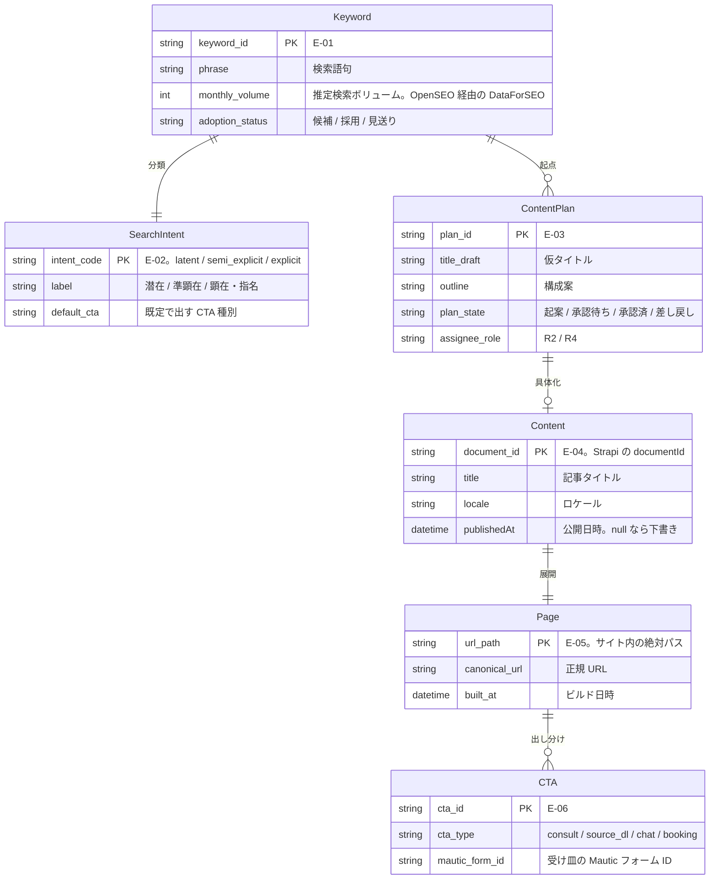
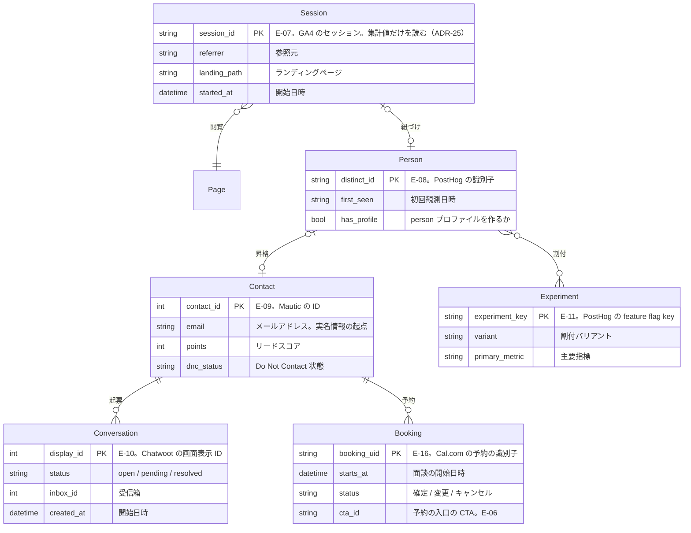
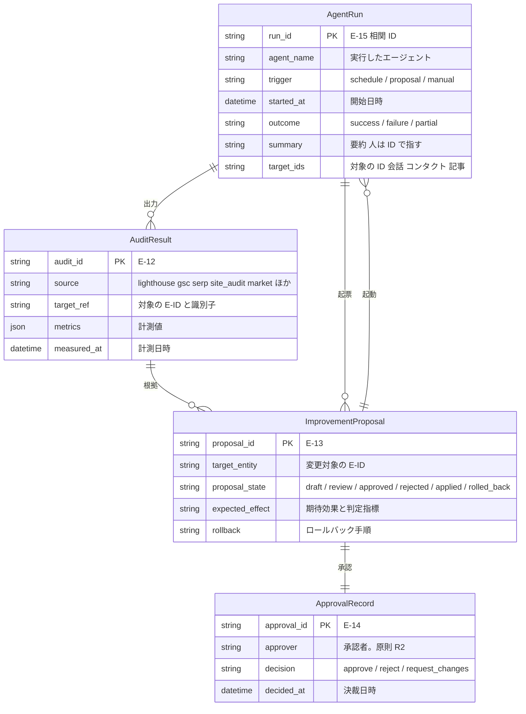
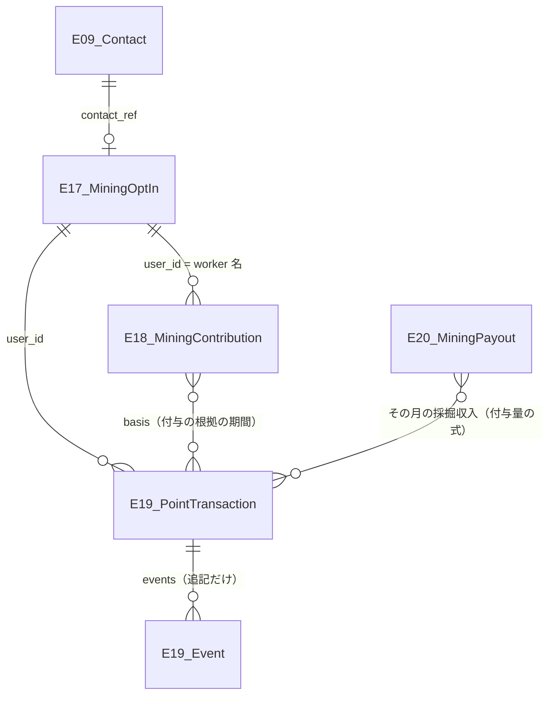
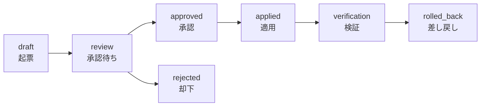

# DA-01 概念データモデル

**エンティティ ID `E-01`〜`E-20` の採番の正本は本ファイルである**（索引は [`docs/README.md` の「ID の採番と正本」](../../README.md)）。`E-01`〜`E-15` と、本ファイルで追加した **`E-16`**（2026-10-01。4.1）・**`E-17`〜`E-20`**（2026-10-03。4.2）を、関連・主要属性・正本（System of Record）の 3 点で定義する。
物理スキーマ（テーブル定義・カラム型）は TA の担当であり、ここでは「どの概念が、どのツールに、どの形で存在するか」だけを決める。

図は 1 図あたりのノード数を抑えるため 3 枚に分割する（`docs/README.md` の「書式の規約」の 1 図 7±2 ノードに従う）。

- 図 1 コンテンツ系: `E-01` `E-02` `E-03` `E-04` `E-05` `E-06`
- 図 2 行動・顧客系: `E-07` `E-08` `E-09` `E-10` `E-11` **`E-16`**
- 図 3 改善系: `E-12` `E-13` `E-14` `E-15`

## 1. 図 1 コンテンツ系（企画から公開まで）



図は To-Be を描いている。現在この図のうち実際に存在するのは `E-04 Content`（Strapi の `api::article.article`）と `E-05 Page`（Astro のビルド成果物）の 2 つと、両者の関連だけ。
`E-01` `E-02` `E-03` `E-06` はスキーマも実体も無い（各エンティティの状態は 4 節の表の「状態」列を参照）。

## 2. 図 2 行動・顧客系（匿名から実名まで）



図は To-Be を描いている。現在この図のうち実際に存在するインスタンスは 1 件も無い。ブラウザ側のトラッカーが 1 つも設置されておらず（`frontend/verdant-virgo/src/layouts/Layout.astro`）、`E-07 Session` も `E-08 Person` も発生していないため、昇格の連鎖が起点から始まっていない（詳細は DA-03 の 1 節）。

**`E-16 Booking` は 2026-10-01 に足した**（4 節の表と 4.1）。商談プロセスの段 2（BA-04）が設計されたことで、**`E-09` では表せないもの（いつ・どの枠で面談するか）**が生まれたためである。

## 3. 図 3 改善系（観測から作用まで）

`CAP-14`（改善提案の生成と承認）を成立させる 4 型。ここが再帰的自己改善のループそのものになる。



図は To-Be を描いている。現在この図のうち実際に生成されているのは `E-12 AuditResult` の一部（Lighthouse CI の計測結果が `frontend/verdant-virgo/.lighthouse/` にファイルとして出ているもの）だけ。
`E-13` `E-14` `E-15` は型の定義のみで実体が無く、**ループはまだ 1 周も回っていない**。`E-15` の正本は監視アプリ（ローカル）の実行記録に決まった（ADR-18。記録は要約と ID だけで、S3 に追記専用で写す）が、監視アプリには画面も記録の仕組みもまだ無い。

## 4. エンティティ定義と正本

正本は「その値を書き換えてよい唯一の場所」を指す。複製先での書き換えは禁止し、同期方向は DA-04 の System of Record 表で一方向に固定する。

| ID | エンティティ | 主要属性 | 正本（System of Record） | 格納形式 | 状態 |
|---|---|---|---|---|---|
| `E-01` | `Keyword` | `phrase` / `monthly_volume` / `adoption_status` / `intent_code` | Strapi（`api::keyword.keyword`） | コンテンツタイプ | 未着手 |
| `E-02` | `SearchIntent` | `intent_code` / `label` / `default_cta` | `E-01` の属性（enum） | 列挙値 | 未着手 |
| `E-03` | `ContentPlan` | `title_draft` / `outline` / `plan_state` / `assignee_role` | Strapi（`api::content-plan.content-plan`） | コンテンツタイプ | 未着手 |
| `E-04` | `Content` | `documentId` / `title` / `locale` / `publishedAt` | Strapi（`api::article.article`） | コンテンツタイプ | 実装済み |
| `E-05` | `Page` | `url_path` / `canonical_url` / `built_at` | Astro のビルド成果物（`frontend/verdant-virgo/dist/`） | 静的ファイル + `sitemap` | 実装済み |
| `E-06` | `CTA` | `cta_type` / 表示文言・配置 / `mautic_form_id` | 表示定義は Strapi のコンポーネント、受付定義は Mautic のフォーム | 分割保持 | 未着手 |
| `E-07` | `Session` | `session_id` / `referrer` / `landing_path` / `started_at`（**エージェントが読めるのはチャネル別・参照元別・ページ別の集計値だけ**。個々のセッションは読まない） | **GA4**（SaaS。Google LLC・米国。本番のプロパティ 1 つ）〔**2026-10-06 ADR-25: Umami から変えた**。旧版は Umami〈PostgreSQL。`middleware/umami-master`〉〕 | クラウド（Google のサーバー） | 未配線 |
| `E-08` | `Person` | `distinct_id` / `first_seen` / プロパティ | PostHog（SaaS。project 610214） | クラウド | 未配線 |
| `E-09` | `Contact` | `email` / `points` / `dnc_status` / カスタムフィールド | Mautic | MySQL（`backend/mautic-system`） | 未配線 |
| `E-10` | `Conversation` | `display_id` / `status` / `inbox_id` / ラベル | Chatwoot | PostgreSQL（`backend/chatwoot-system`） | 未配線 |
| `E-11` | `Experiment` | `experiment_key` / `variant` / `primary_metric` | PostHog | クラウド | 未着手 |
| `E-12` | `AuditResult` | `source` / `target_ref` / `metrics` / `measured_at` | Lighthouse CI（`frontend/verdant-virgo/.lighthouse/`）／**OpenSEO**（GSC の実績・順位計測・サイト監査・市場データ）／各ツールの API | JSON ファイル／API | Lighthouse は実装済み、OpenSEO 経由の 4 種は未配線 |
| `E-13` | `ImprovementProposal` | 後述の 12 項目 | Git（`docs/proposals/` の Markdown。PR で承認） | Markdown + YAML frontmatter | 未着手 |
| `E-14` | `ApprovalRecord` | `approver` / `decision` / `decided_at` / `comment` | `E-13` に従属（PR のレビュー承認） | Git / GitHub | 未着手 |
| `E-15` | `AgentRun` | `agent_name` / `trigger` / `started_at` / `outcome` / **`summary`（要約）/ `target_ids`（対象の ID）**。**ツールの結果は属性に持たない**（ADR-18 の追加の決定） | **監視アプリ（`frontend/next-js`。ローカル）の実行記録**（ADR-18。**ADR-16 の「正本はクラウド」の唯一の例外**）。当初は n8n の実行履歴としていた（下の注記） | 監視アプリのローカルの DB（種類は未決定。TA-07 の 3.6）。**S3 に追記専用で写す**（写しは正本ではない。TA-06 の 4.7） | 未着手 |
| **`E-16`** | **`Booking`** | `booking_uid` / `starts_at` / `duration` / `status`（確定 / 変更 / キャンセル）/ `invitee_email`（**個人情報**）/ `cta_id` | **本番の Cal.com**（セルフホスト。RDS for PostgreSQL の `calcom` データベース。TA-06 の 3.1・4.1）**〔2026-10-06 ADR-24: SaaS の Cal.com〈cal.com。米国〉に変わった。RDS の `calcom` は作らない〕** | **製品の DB** | 未着手（**2026-10-01 に追加**。4.1） |
| `E-17` | `MiningOptIn`（2026-10-03 に追加） | `user_id` / `contact_ref`（`E-09` への参照）/ `consent_version` / `consented_at` / `revoked_at` / `max_threads` | `points-api` の DB（RDS for PostgreSQL の `points`。本番: AWS） | テーブル（**削除できる**。削除請求に応じるため） | 未着手 |
| `E-18` | `MiningContribution`（2026-10-03 に追加） | `user_id`（unMineable の worker 名）/ `date` / `hashrate` / `accepted_shares` | `points-api` の日次スナップショット（発生源は unMineable の `/v1/workers`） | テーブル | 未着手 |
| `E-19` | `PointTransaction`（2026-10-03 に追加） | `tx_id` / `kind`（`grant` / `redeem` / `reversal`）/ `user_id` / `amount` / `basis`（`E-18` の期間、発注書番号、または打ち消す `tx_id`）/ `approved_by` / `idempotency_key` / `correlation_id` / `chain_tx_hash`。**状態は出来事の列（`events[]`）から求める** | `points-api` の DB（**追記だけ**） | テーブル（INSERT だけ。出来事も行として追記） | 未着手 |
| `E-20` | `MiningPayout`（2026-10-03 に追加） | `payout_uuid`（unMineable）/ `chain_tx_hash` / `amount_pol` / `jpy_at_receipt` / `conversion`（換金の tx hash・約定・円の金額） | **チェーン上の ComeGin のウォレットへの入金**（unMineable の `/v1/payments` と突き合わせる） | チェーン（換金の記録は `points-api` の DB） | 未着手 |

- **正本の「Strapi」「Mautic」「Chatwoot」「Umami」は本番（AWS）のインスタンスを指す**（`R1` の 2026-09-19 の決定。AA-05 の ADR-16）。**（2026-10-06 の注記）ADR-25 で Umami をやめ、`E-07` の正本は GA4（SaaS。本番のプロパティだけ。開発環境には GA4 を置かない）になった。以下の Umami の記述は ADR-25 より前のもの。****正本のデータを持つシステムはすべてクラウドに置く**、が ADR-16 の配置の基準である（例外は `E-15` だけ。ADR-18。下の注記）。オンプレの Strapi・Mautic・Chatwoot・Umami は**開発環境**であり、そのデータは正本でも複製先でもない（開発環境の Strapi は試験用で、記事を開発と本番の間で移さない。TA-07 の 6 節）。`E-01` `E-03` `E-04` の正本は本番の Strapi（RDS for PostgreSQL、メディアは S3）で、エージェントの MCP（`strapi-prod`）での書き込みがそのまま正本の更新になる。**ただしエージェントが書けるのは下書きまでで、`E-04` の `publishedAt` を設定する（公開する）のは `R2` が本番の管理画面で行う**（ADR-17）。公開サイトへの反映はその後の配信で行う（TA-07 の 7 節）。`E-06`（Mautic のフォーム）はエージェントが MCP で本番に書き込む。格納形式の列のパス（`backend/...`・`middleware/...`）は開発環境のものである。
- **`E-04` の正本の所在の経緯。** ADR-14 で本番の Strapi（AWS）とし、同日の ADR-15 でオンプレの Strapi に戻し（記事は HTML に焼き込まれて配信されるため、本番に Strapi を置く理由が無いとした）、さらに同日の ADR-16 で本番の Strapi に戻した（正本が開発機 1 台にしか無く、開発機の故障がそのまま記事の喪失になるため）。
- **`E-15` の正本の所在の経緯。** 当初は n8n の実行履歴を正本とし、ADR-16 で本番の n8n の実行履歴（RDS for PostgreSQL の `n8n` データベース）を指すことにした。**ADR-17 で、エージェントを使う定期処理の起動が n8n から監視アプリに移った**ため、n8n の実行履歴に残るのは n8n 自身のワークフロー（Webhook と決定論的な定期処理）だけになり、エージェントの実行は 1 件も記録されなくなった。エージェントの起動元は手動・定期とも監視アプリに一本化され、監視アプリの実行記録を正本にする条件が揃った。**ADR-18（`R1` の 2026-09-19 の決定）で、監視アプリの実行記録を `E-15` の正本にした。** **n8n の実行履歴は `E-15` の正本ではない**（エージェントの実行が残らない）。
- **`E-15` の正本はローカルにある。** 監視アプリはローカルに置いたまま、実行記録もローカルに保存する（ADR-16 の基準「正本のデータを持つものはクラウド」の**唯一の例外**。監視アプリをクラウドに置く案は採らない。ADR-18）。記録は**監視アプリのサーバー側だけが書き**、エージェント（Claude Code）には書かせない（エージェントが自分の実行の記録を書き換えられないようにする。AA-04 の暴走条件 #7）。**1 回の起動（手動の指示・定期実行）を 1 件**とし、相関 ID（ULID。DD-01 の 3 節）で `E-13`・`E-14`・本番への書き込みと結ぶ（TA-07 の 3.6）。
- **`E-15` の属性は要約と ID に限る**（ADR-18 の追加の決定 4）。ADR-18 の反映では「`E-15` には本番の個人情報が混ざりうる（エージェントが MCP で本番の Mautic・Chatwoot から読んだ `E-09` `E-10`）」とし、記録する範囲を未決定にしていた。**追加の決定で、残すのは要約（`summary`）・対象の ID（`target_ids`。`E-09` の `id`、`E-10` の `display_id`、`E-04` の `documentId` など）・相関 ID（`run_id`）・成否（`outcome`）・起動の種類（`trigger`）だけとし、ツールの結果（本番の Mautic・Chatwoot から読んだデータ）は残さない**と決めた。**`summary` にも個人情報を書かない**（人は ID で指す。AA-03 のエージェント定義の規則と、監視アプリの記録前の検査。DA-05 の 1.5）。誤った書き込みの調査では、`target_ids` から本番の管理画面で元のデータを引く。保持期間は DA-05 の 2 節（未決定）、開発機の外への写し（S3。追記専用）は TA-05 の 5 節と TA-06 の 4.7 が扱う。
- **`E-15` の `run_id` と `E-13` の `agent_run_id` は相関 ID（ULID）で結ぶ**（TA-07 の 3.6）。`agent_run_id` の形式（`RUN-...` に移すか ULID のままか）は 7 節の未決定事項。
- `E-04` の `documentId` は Strapi 5 系の識別子であり、`id` とは別物（ロケール違い・下書き / 公開の版をまたいで同じ値を持つ）。名寄せのキーには `documentId` を使う。
- `E-06` を分割保持にするのは、CTA の見た目（`R1` が編集）と受け皿のフォーム定義（`R3` が編集）で更新者もツールも異なるため。両者は `mautic_form_id` で結合し、この対応表自体は Strapi 側のコンポーネントに持たせる（片方向の参照にして循環を避ける）。
- **`E-06` の `cta_type` の値を 2026-10-01 に改めた**（`whitepaper` / `trial` / `demo` → **`consult` / `source_dl` / `chat` / `booking`**）。デザインの検討で**サイトに実在する CTA と値が合っていないことが分かった**ため、ユーザーが「名前を実態に合わせる」と決め、値をデザイン側が定めた（`docs/BasicDesign/DesignSpec/website/01-content-spec.md` の 6.1、同 10.3 の F7・F7'）。**`cta_type` の正本は本ファイルであり、ここが改まって食い違いが解消した。**

| 旧 | 新 | 理由 |
|---|---|---|
| `demo` | **`consult`** | サイトに「デモ」は無い。実際に申し込まれるのは**無料相談**である |
| `whitepaper` | **`source_dl`** | サイトに「ホワイトペーパー」は無い。配布しているのは**環境構築のソースコード**である |
| `trial` | **使わない**（値は残す） | 無料トライアルはサイトに無い。**値を消さずに「使わない」として残す**のは、将来トライアルを始めたときに意味が変わらないようにするためである |
| （未定） | **`chat`** | チャットでの相談（`CVR-assist`。CTA の数には入れない） |
| （無し） | **`booking`** | **オンライン面談の予約**（`I-25`。BA-04 の商談プロセスの段 2。2026-10-01 に増えた） |

- **命名の規則は「訪問者の側から見た、申し込む／受け取るものの種類を 1 語の小文字の `snake_case` で表す」。** 社内の呼び方（デモ・ホワイトペーパー）や送信先の製品名（Mautic・Cal.com）を値に使わない。
- **`cta_type` は PostHog のイベントのプロパティとしても送る**（DA-02 の 4.4）。**Mautic のフォームの別名（`consult` / `source_dl`）とは別物である**（たまたま語が同じになっている。2026-10-05 に alias を `source-dl` から `source_dl` に改めた。Mautic のフォームの結果は alias を名前に含む表に入るため、英数字と `_` だけにする。片方を変えるときにもう片方を一緒に変えない）。
- **DA-02 の指標 ID は `cta_type` とは別系統の識別子**であり、この改名で自動的には変わらない。**2026-10-01 に DA-02 側でも改めた**（`CVR-wp` → `CVR-source-dl`、`CVR-demo` → `CVR-consult`、`CVR-trial` は廃止。DA-02 の 1.3）。**6.2 の例の `metric` もこれに合わせてある。**
### 4.1 `E-16 Booking` を立てた理由（2026-10-01 の決定）

**オンライン面談の予約を表す型を新しく立てた。** `E-01`〜`E-15` のどれでも表せないことが、商談プロセス（BA-04）の設計で分かったためである。

| 検討した案 | 採否 | 理由 |
|---|---|---|
| **`E-16` として新しく立てる** | **採用** | 正本が明確（本番の Cal.com）で、他の型と関連を結べる。**セルフホストにしたため正本が自分たちのクラウドにあり、ADR-16 の基準（正本のデータを持つシステムはクラウド）を満たす**（**2026-10-06 ADR-24 で、この理由は成り立たなくなった。正本は SaaS にあり、ADR-16・ADR-21 の基準の例外としてユーザーが決めた。TA-01 の 8 節**） |
| `E-09 Contact` の属性で持つ | 不採用 | **1 人が複数回予約しうる**（変更・再予約・2 回目の面談）。属性にすると最後の 1 件しか残らず、`status` の遷移も持てない |
| 型を立てずに未決のまま残す | 不採用 | **`I-25` の payload（AA-02 のカタログ）と、`form_submitted` → `booking_scheduled` の歩留まり（DA-02 の 4.4）が、どちらも参照先の無い記述になる。** `CAP-15` の監査ログで実際に起きた「型が無いので仕組みを設計できない」と同じ行き止まりを繰り返さない |

- **正本は本番の Cal.com**（RDS for PostgreSQL の `calcom` データベース）。**（2026-10-06 ADR-24: 正本は SaaS の Cal.com〈米国〉。RDS の `calcom` は作らない。以下は ADR-19 の記述）** **Google Calendar の予定は複製先であって正本ではない**（Cal.com が予定を作る。予定を直接消しても予約の記録は Cal.com に残る）。Mautic にも写さない（写すなら `E-09` のカスタムフィールドだが、1 対多を持てないため採らない）。
- **`E-09` との関連は email で結ぶ**（小文字化して突合する。`I-19` と `I-08` と同じ規則。DD-02 の 5.3）。**予約だけが先に成立することは無い**（`I-08` のフォームの送信が先にあり、`E-09` が必ず存在する。DD-02 の 7.2）。
- **`invitee_email` は実名情報である。** `E-09` `E-10` と同じ区分として扱い、**DA-05 の個人情報の区分・保持期間・削除請求の対象に加える必要がある**（7 節。本ファイルでは DA-05 を変更していない）。
- **`cta_id` を持つのは、どの入口からの予約かを残すためである**（いまは完了画面の `booking_thanks_embed` だけだが、将来ほかの画面に予約の入口を置いたときに分けられる。`E-06` を参照する）。
- **`E-16` を KPI にするかは DA-02 の判断**（`form_submitted` → `booking_scheduled` の歩留まり。DA-02 の 6 節）。型があることと指標にすることは別である。

- **（2026-10-06 の注記）`umami` は ADR-25 で廃止した。** 流入の観測の出所は GA4 になった。**なお、実装（`backend/control-plane/src/constants/audit-sources.ts`・`.claude/agents/analytics-reporter.md`）は GA4・Mautic・PostHog の集計をまとめて `source: analytics` に入れており、下の 9 値（`posthog` / `umami` / `mautic` を分ける）と ADR-25 より前から食い違っている**（7 節の未決定事項）。
- **`E-12` の `source` は 9 値とする**（2026-09-18 に 3 値を追加）。`lighthouse` / `gsc` / `posthog` / `umami` / `mautic` / `chatwoot` に、OpenSEO の追加で `serp` / `site_audit` / `market` を足し、GSC を OpenSEO 経由に変えた。**`source` はデータの出所を表し、取得経路を表さない**（GSC を OpenSEO 経由で取っても `source: gsc` のまま。経路は `ref` に書く）。

| `source` | 出所 | 取得経路 | 中身 |
|---|---|---|---|
| `gsc` | Google Search Console | OpenSEO の MCP | ページ・クエリ単位の表示回数・クリック・CTR・平均掲載順位、URL 検査の結果 |
| `serp` | DataForSEO（Google の検索結果） | OpenSEO のランク追跡 | 対象キーワードの計測時点の順位 |
| `site_audit` | OpenSEO のクローラ（自サイト） | OpenSEO の MCP | リンク切れ・タイトル重複・canonical の問題などの件数 |
| `market` | DataForSEO | OpenSEO の MCP | 検索ボリューム・競合ドメインの順位キーワード・被リンク数 |

- **OpenSEO の中のデータは正本にしない。** 保存済みキーワードは `E-01` の候補の作業場、プロジェクトコンテキストは OpenSEO の作業用の記憶であり、いずれも複製先にも正本にも数えない（AA-05 の ADR-09）。`E-12` として取り込んだ時点の値と `ref`（再取得できる問い合わせ）だけを残す。
- `E-12` の `source` に `posthog` / `umami`（**ADR-25 で廃止**） / `mautic` / `chatwoot` を含めるのは、監査結果を「Lighthouse の結果」に限定せず、あらゆる観測の共通の入れ物にするため（`E-13` の根拠参照先を 1 種類の型に統一できる）。

### 4.2 `E-17`〜`E-20` を立てた理由（2026-10-03 の決定）

マネタイズモデル（AA-05 の ADR-20）で、**利用者の同意・貢献量・ポイントの台帳・ComeGin の受け取り**を表す型が要った。既存の型に属性として足さなかった理由は次のとおり。

- **`E-17` を `E-09 Contact` の属性にしない。** 同意には版と撤回の履歴があり、削除請求のときに `E-17` だけを消して、消せない記録（チェーン・S3 の写し）を誰のものか特定できなくする必要がある（DA-05 の 1.6）。実名は `E-09` にだけ置き、`E-17` は `contact_ref` で指す。
- **`E-18` の正本を unMineable にしない。** unMineable の履歴の保持期間をこちらで決められず、付与の根拠が後から消える。日次で自前のスナップショットを取る（`E-12` が Lighthouse の JSON を手元に貯めるのと同じ考え方）。
- **`E-19` の正本をチェーンにしない。** チェーンには「なぜ付与したか」「誰が承認したか」を書けない。正本は `points-api` の DB に置き、チェーンの残高は公開の写しとして日次で突き合わせる。
- **`E-19` を追記だけにする。** Amazon QLDB は 2025-07-31 に提供を終えたため、AWS の推奨構成（PostgreSQL ＋ S3）に沿って 2 段で守る。（1）DB ユーザーに INSERT と SELECT だけを許し、状態の変化も訂正も新しい行として追記する。（2）日次で S3 に写し、Object Lock のコンプライアンスモードで保管期間中は消せず上書きもできないようにする（TA-06 の 4.9）。
- **`E-20` の正本をチェーン上の入金にする。** unMineable の画面の数字ではなく、実際に ComeGin のウォレットに入った POL を収入とする（税務の根拠を外部の SaaS の表示に置かない）。
- **発注を表す型（`Order`）は作らない。** SFA が未選定（BA-01）。消化の根拠は発注書番号を外部の参照として `E-19` の `basis` に持つ。



図は To-Be を描いている。状態はすべて `未着手`（4 節の表）。

## 5. 正本が未定だったエンティティの決定

正本を「未定（DA で決定する）」としていた `E-01` / `E-03` / `E-13` を、この層で決定する。

### 5.1 候補の比較

| 候補 | 利点 | 欠点 |
|---|---|---|
| Strapi のカスタムコンテンツタイプ | `E-04 Content` と同じ DB にあるため relation を張れる。管理画面で `R2` が直接編集できる。REST / GraphQL と `strapi-mcp` でエージェントが読み書きできる。ライフサイクルフック（`backend/strapi-system/src/index.ts`）で PostHog にイベントを出せる | スキーマ変更にコード変更とデプロイが必要。差分レビュー・履歴が弱い（draft / publish の 2 状態しかない） |
| n8n Data Tables | 画面からスキーマを変更でき、ワークフローから直接読み書きできる。配線が最短 | 実行基盤に正本を置くことになり、n8n を作り直すと消える（`N8N_ENCRYPTION_KEY` を変えると復号できない制約もある）。relation が無く、履歴・レビューの機構も無い |
| Git 上の Markdown | 差分・レビュー・履歴・差し戻し・revert が標準で付く。コード変更を伴う提案なら、提案そのものが適用手段（PR）になる | 件数が増えると検索・集計ができない。`R2` が Git / GitHub を使う前提になる。Strapi 側の relation とは結合できない |

### 5.2 決定

| ID | 決定した正本 | 根拠 |
|---|---|---|
| `E-01 Keyword` | Strapi（`api::keyword.keyword`） | 「どのキーワードで、どの記事を書いたか」の結合が必要で、`E-04 Content` と relation を張れる候補は Strapi しかない（n8n Data Tables と Git は結合を持てず、対応表を二重管理することになる）。キーワードは `R2` が日常的に編集するため、管理画面がある点も条件に合う |
| `E-03 ContentPlan` | Strapi（`api::content-plan.content-plan`） | `E-01` と `E-04` の両方に relation を張る中間型であり、3 つを同じ DB に置くのが最も単純（正本が分かれると企画から記事への追跡が API 跨ぎになる）。企画の承認は Strapi の draft / publish にそのまま対応させられる。さらに既存のライフサイクル購読を流用して企画イベントを PostHog に送れる |
| `E-13 ImprovementProposal` | Git（`docs/proposals/<proposal_id>.md`。承認は PR のレビュー） | 提案の要件は「履歴が残る」「差し戻せる」「取り消せる」の 3 つで、これらは Git / PR が既に持っている。適用対象が Astro のコード・Strapi のコンテンツ・Mautic の設定と多岐にわたり、コード変更を伴う提案では PR がそのまま適用手段になるため、提案と作用が同じ場所に収まる。Strapi に置くと「外部に公開するコンテンツ」の正本に内部統制の記録が混ざり、権限設計が複雑になる（公開 API から統制記録が読めてしまう事故を避ける） |

`E-13` を Git に置く代償として、`R2` が GitHub を直接見に行く必要が生じる。これはローカルから GitHub API で起票し（監視アプリの定期実行が起こす。ADR-17。当初は n8n から起票するとしていた）、**PR の Reviewer に `R2` を指定して GitHub の標準通知で補う**（`R1` の 2026-09-17 の決定。AA-02 の 3.4）。`E-14 ApprovalRecord` の正本が PR のレビューであるため、**承認を求める通知も正本と同じ場所から出る**ことになる。

## 6. `E-13 ImprovementProposal` の型定義

この型が無い場合、観測からの変更は単なる自動化になる。すなわち「なぜその変更をしたのか」「誰が承認したのか」「効果はあったのか」「どう戻すのか」が一切残らず、失敗したときに元に戻す手段も、成功したときに再現する手段も無い。
`ImprovementProposal` は、観測（`E-12`）を作用（`E-04` `E-05` `E-06` などの変更）に変換する**唯一の経路**として定義する。この型を経由しない変更は仕組み上の例外とし、DA-05 の監査対象にする。

### 6.1 格納形式

`docs/proposals/<proposal_id>.md` に、YAML frontmatter（機械が読む項目）＋ 本文（人間が読む説明）の形で置く。
frontmatter を型の正本とし、本文は根拠の再掲や補足に使う（エージェントは frontmatter だけを読めば判断できる）。

```yaml
---
proposal_id: PRP-2026-0042
created_at: 2026-09-16T10:00:00+09:00
created_by: agent/seo-auditor
agent_run_id: RUN-2026-0913-0007
evidence:
  - audit_id: AUD-2026-0915-lighthouse-0031
    source: lighthouse
    ref: .lighthouse/lhr-1757900000000.json
    summary: "/blog/saas-kpi の SEO スコアが 0.96 で、しきい値 1.0 を下回る"
  - audit_id: AUD-2026-0915-analytics-0012
    source: analytics
    ref: "openseo get_google_analytics_page_performance startDate=2026-08-01&endDate=2026-08-31&channel=all"
    summary: "同ページの views 1,284 / CV 3 件（集計値どうしの比 0.23%、サイト中央値の 1/4。GA4 は同意した訪問者だけ）"
target:
  entity: E-04
  identifier: "documentId=abcdef123456"
  also_affects: [E-05, E-06]
change:
  kind: content_rewrite
  description: "meta description を追加し、本文冒頭に検索意図（準顕在）に沿う要約を置く。CTA を無料 DL から無料相談に差し替える"
  diff_ref: "PR #128"
expectation:
  metric: CVR-consult
  baseline: 0.23
  target: 0.80
  judge_after: 2026-10-16
  judge_by: R3
risk:
  level: low
  description: "CTA 変更により、既存のホワイトペーパー経由のリード数が一時的に減る可能性がある"
  blast_radius: "対象 1 ページのみ"
approval:
  state: approved
  approver: R2
  decided_at: 2026-09-17T09:30:00+09:00
  record_ref: "PR #128 review"
applied_at: 2026-09-17T11:00:00+09:00
verification:
  state: pending
  verified_at: null
  result: null
  audit_ref: null
rollback:
  procedure: "PR #128 を revert し、Strapi の当該 documentId を版 v12 に戻したうえで再ビルドする"
  reversible: true
  deadline: 2026-11-16
---
```

### 6.2 項目定義

| 項目 | 必須 | 意味 | 無い場合に壊れること |
|---|---|---|---|
| `proposal_id` | 必須 | 提案の一意 ID（`PRP-<西暦>-<連番>`） | 同じ提案の重複起票を検出できない |
| `created_at` | 必須 | 起票日時（ISO 8601、タイムゾーン付き） | 観測から作用までの所要時間を測れない |
| `created_by` | 必須 | 起票エージェントの識別子（人間起票は `R1`〜`R4`） | どのエージェントの提案が採用されやすいかを評価できず、エージェント自体の改善ができない |
| `agent_run_id` | 必須 | 起票した実行の `E-15 AgentRun` への参照 | 提案の生成過程（どの起動の、どのエージェントが、成否はどうだったか。要約と対象の ID）を追えない。**`E-15` はツールの結果を残さない**（ADR-18 の追加の決定）ため、入力そのものは `evidence[]` の `E-12` と本番の元のデータを見に行く |
| `evidence[]` | 必須（1 件以上） | 根拠となる `E-12 AuditResult` への参照。`audit_id` / `source` / `ref` / `summary` | 根拠の無い提案が通り、承認者が妥当性を判断できない。**この配列が空の提案は承認しない** |
| `target.entity` | 必須 | 変更対象の E-ID | どの正本を触るかが不明なまま適用され、権限の検査ができない |
| `target.identifier` | 必須 | 対象の具体的な識別子（`documentId` / `url_path` / `cta_id` など） | 適用対象を機械的に特定できない |
| `target.also_affects[]` | 任意 | 波及する E-ID | 検証範囲を見落とす |
| `change.kind` | 必須 | 変更の種別（`content_rewrite` / `cta_swap` / `internal_link` / `technical_seo` / `experiment_start` / `config_change`） | 種別ごとの適用手順・承認権限を割り当てられない |
| `change.description` | 必須 | 変更内容（何を、どう変えるか） | 承認が形骸化する |
| `change.diff_ref` | 適用時に必須 | 実際の差分への参照（PR 番号 / Strapi の版） | 提案と実物の対応が切れる |
| `expectation.metric` | 必須 | 判定に使う指標（DA-02 の指標一覧の ID） | 効果を測れず、成功の定義が無い |
| `expectation.baseline` / `target` | 必須 | 適用前の値と目標値 | 「良くなった」を主観で判定することになる |
| `expectation.judge_after` | 必須 | 判定を行う日（データが溜まるまでの期間を明示する） | 早すぎる判定でノイズを効果と誤認する |
| `expectation.judge_by` | 必須 | 判定責任を持つロール（原則 `R3`） | 判定が誰の仕事でもなくなる |
| `risk.level` | 必須 | `low` / `medium` / `high` | 承認の重さを変えられない |
| `risk.description` / `blast_radius` | 必須 | 想定される悪影響と影響範囲 | 影響範囲を見誤り、一括適用で広域に壊す |
| `approval.state` | 必須 | `draft` / `review` / `approved` / `rejected` / `applied` / `rolled_back` | ループの現在地が分からない |
| `approval.approver` / `decided_at` / `record_ref` | 承認時に必須 | `E-14 ApprovalRecord` の実体 | **人間の承認ゲート（`CAP-06`）が記録として存在しなくなる** |
| `applied_at` | 適用時に必須 | 実際に作用させた日時。**本番に作用した日時**（Mautic・Chatwoot は MCP での書き込みの完了、Astro と Strapi の記事は承認後の配信の完了、n8n は本番での有効化の完了）であり、開発環境で作業した日時ではない（ADR-15・ADR-16）。**記録するのは作用させた主体**で、配信と n8n の有効化は実行した人間、MCP での書き込みは Claude Code が完了と同時に記録する（ADR-16）。**Strapi の記事は `R2` が管理画面で公開した時点ではなく、その後の配信の完了で記録する**（ADR-17） | 効果測定の起点が定まらない |
| `verification.state` | 必須 | `pending` / `improved` / `no_change` / `degraded` | 検証されない提案が放置され、ループが閉じない |
| `verification.result` / `audit_ref` | 検証時に必須 | 判定値と、判定に使った `E-12` への参照 | 判定の根拠を後から確認できない |
| `rollback.procedure` | 必須 | 具体的な手順（コマンド・PR 番号・版番号まで書く）。**本番の Strapi・Mautic・Chatwoot・n8n に対しては本番側で何をするかを、公開サイトに対しては戻す版の配信を書く**（開発環境を戻しても本番は戻らない。ADR-15・ADR-16）。**公開済みの記事を戻す場合、戻した版の公開は `R2` が本番の管理画面で行う**（エージェントのトークンに公開・非公開化の権限が無い。ADR-17） | **戻せない変更になる。これが最も重い欠落** |
| `rollback.reversible` | 必須 | 戻せるか（`false` の場合は `risk.level` を `high` 扱いにする） | 不可逆な変更を通常の承認で通してしまう |
| `rollback.deadline` | 必須 | この日を過ぎるとロールバックが現実的でなくなる期日 | いつまで戻せるのかが曖昧になる |

### 6.3 状態遷移



図のノードは `E-13` の `approval.state` / `verification.state` が取る値であり、実装の進捗を表すものではない。この遷移を実行する仕組みは現在どこにも無い（`E-13` 自体が未着手）。

- **`approved` → `applied` の遷移は、本番に作用した時点で行う**（ADR-15。AA-04 の 2 節）。Mautic・Chatwoot はエージェントの MCP での書き込みの完了、Astro と Strapi の記事は人間が承認した配信の完了、n8n は人間が本番でワークフローを有効にした時点をもって `applied` にする（ADR-16。TA-07 の 6・7 節）。配信と有効化の場合、`applied_at` を書くのは実行した人間である。**Strapi の記事は、エージェントの下書き → `R2` が管理画面で公開 → 監視アプリの定期実行が公開を見つけてビルドと計測 → 人間が配信、の順に進み、`applied` は最後の配信で付ける**（ADR-17）。
- `review` → `approved` の遷移だけは**人間（`R2`）が行う**（`CAP-06` の承認ゲート。エージェントはこの遷移を実行できない）。
- `verified` の結果が `degraded` の場合は `rollback.procedure` を実行して `rolled_back` に落とす。`no_change` の場合は `rolled_back` にせず、その事実を次の提案の `evidence` として残す（効果が無かったという観測も観測である）。
- 却下された提案も削除せず `rejected` のまま残す（同じ提案の再起票を検出するため）。

## 7. 未決定事項

- **（2026-09-18 に一部解決）`E-01 Keyword` の検索順位・表示回数の時系列をどこに持つか。** 取得手段は OpenSEO に決まった（AA-05 の ADR-06）。**時系列は `E-01` の属性にせず、`E-12`（`source: gsc` / `serp`）として持つ**（観測は `E-12` に集める、という 4 節の方針と揃う）。残るのは `E-12` の `target_ref` にキーワードをどう書くか（`E-01` の `keyword_id` を使うか、検索語句そのものを使うか）で、`api::keyword.keyword` の実装時に決める。
- `E-11 Experiment` の割付単位を `E-07 Session` にするか `E-08 Person` にするか。PostHog の feature flag は `distinct_id` 単位で割り付けるが、ブラウザ側トラッカーが 1 つも設置されていない現状（`frontend/verdant-virgo/src/layouts/Layout.astro` に該当スクリプトが無い）では `distinct_id` の発生源自体が無く、実データで検証できない。DA-03 の ID 統合を実装した後に決める。
- **（2026-09-19 に AA-05 の ADR-18 で解決）`E-15 AgentRun` の正本を n8n の実行履歴にするかどうか。** n8n を経由しないエージェント実行（開発者が手元で走らせる MCP 経由の操作）が記録されないため、正本として不完全だった。ADR-14・ADR-15 の時点では「エージェントの起動元が監視アプリ（`frontend/next-js`）に一本化されるなら、監視アプリの実行記録を正本の候補にできる」という条件付きで、ADR-17 で定期実行も監視アプリから起動することになり、起動元は一本化された。残っていたのは「監視アプリはローカルにあり、そのまま正本にすると ADR-16 の基準に反する」「実行記録に本番の個人情報が混入しうる」の 2 点で、実行記録をクラウドに送るか、基準の例外にするかを決める必要があった。**ADR-18 で、監視アプリの実行記録を正本とし、ローカルに置くことを ADR-16 の基準の例外として受け入れた**（4 節。TA-07 の 3.6）。
- **（2026-09-19 に AA-05 の ADR-18 の追加の決定で一部解決）`E-15` に記録する範囲と保持期間**（ADR-18 で生じた論点）。ツールの結果をそのまま残すか、要約と ID（`E-09` の `id`、`E-10` の `display_id` など）だけにするか。前者は調査に強いが本番の個人情報がローカルに残り、削除請求の対象になる（DA-05 の 2 節・5 節）、としていた。**記録する範囲は要約と ID だけに決まった**（4 節の注記。属性に `summary` と `target_ids` を加えた）。**残るのは保持期間**で、少なくとも改善の検証の期間（既定 30 日）と `rollback.deadline` を覆う（S3 の写しの保持も合わせて決める。DA-05 の 5 節）。判断者 `R1`。
- **`E-13` の `agent_run_id` の形式**（ADR-18 で生じた論点）。DD-01 の 3.4 は「`E-15` の正本が決まるまで」相関 ID（ULID）を暫定で入れ、正本が決まったら `RUN-...` 形式に置き換えるとしていた。ADR-18 で正本が決まり、監視アプリの実行記録は 1 件ごとに相関 ID（ULID）を持つ（TA-07 の 3.6）。**`RUN-...` 形式に移すか、ULID をそのまま `agent_run_id` の正式な値にするか**を決める（後者なら 6.1 の例の `RUN-...` を改める）。判断者 `R1`。
- **開発環境のデータの寿命と扱い**（ADR-15・ADR-16）。開発環境の Strapi・Mautic・Chatwoot に溜まる検証用のデータをいつ消すかが未定。Strapi は ADR-15 でオンプレの Strapi が正本になったため一度この項目の対象外にしたが、**ADR-16 で本番の Strapi が正本になり、開発環境の Strapi は試験用に戻ったため、再び対象に入る**。今の開発環境の Strapi にある記事（6 件。すべてスキャフォールドのサンプルで `draft`）を本番に移さないことは決まっている（TA-07 の 6 節）。判断者 `R1`。
- **（2026-10-01 に反映済み）`E-16 Booking` を他の層に反映する。** 本ファイルで新しく立てた型のため、他のファイルの `E-01`〜`E-15` という書き方が古くなっていた。**DA-04 の System of Record 表**（正本と同期方向の行）と **DA-05 の個人情報の区分・保持期間・削除請求**に反映し、`docs/README.md` の「ID の採番と正本」にも採番の範囲を書いた（**用語集は作らないと決まった**。同日のユーザーの決定）。**残るのは `invitee_email`（実名情報）の保持期間と、Cal.com の予約を削除請求の対象に含めるか**で、どちらも DA-05 の 5 節にある。判断者 `R1`。
- **`E-16` の保持期間**（4.1）。面談の予約は商談の記録であり、`E-09`（24 か月。DA-05 の 2 節）と揃えるか、面談の実施後に短く切るかを決めていない。**Google Calendar 側の予定の保持は Cal.com の保持と別である**（予定を消しても予約の記録は残る）ため、両方を決める必要がある。判断者 `R1` `R3`。
- **（2026-10-06 に追加）`E-12` の `source` の値が実装と食い違っている**（4.1 の注記）。本ファイルは出所ごとに `posthog` / `umami` / `mautic` を分けるが、実装は `analytics-reporter` の観測をまとめて `analytics` にしている。ADR-25 で `umami` が無くなったのを機に、**本ファイルを実装に合わせて `analytics` にするか、実装を出所ごと（`ga4` / `posthog` / `mautic`）に分けるか**を決める。判断者 `R1`。
- `E-03 ContentPlan` の承認状態を Strapi の draft / publish で表すか、独立した `plan_state` フィールドで表すか。draft / publish は 2 値しかなく「差し戻し」を表現できないため、`plan_state` を別に持つ案が有力だが、二重管理になる懸念がある。Strapi のコンテンツタイプを実装する際に確定させる。
- **（2026-10-03 に追加）`E-19` の出来事（event）の保存の形。** 同じテーブルに状態の行を追記するか、取引と出来事の 2 テーブルに分けるか。どちらでも「UPDATE・DELETE を許さない」は守れる（DD-08 で決める）。
