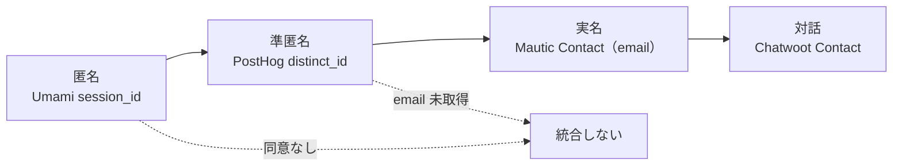
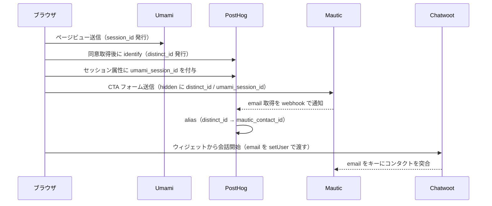

# DA-03 ID 統合（Identity Resolution）

匿名の訪問者を、どの時点で・どのキーで・どこまで同一人物として繋ぐかを定義する。
`E-07 Session` → `E-08 Person` → `E-09 Contact` → `E-10 Conversation` の 4 段階の昇格が、そのまま個人情報の取り扱い区分の変わり目になる（DA-05 と対応させる）。

## 1. As-Is（現状）

### 1.1 匿名 ID の発生源が存在しない

**ブラウザ側のトラッカーが 1 つも設置されていない。**
`frontend/verdant-virgo/src/layouts/Layout.astro` に、Umami のトラッキングスクリプト・PostHog の `posthog-js`・Chatwoot の Web ウィジェット・Mautic のトラッキングピクセルのいずれも存在しない。
`@astrojs/partytown` は導入済みだが、サードパーティスクリプトを 1 つも載せていないため空回りしている。

結果として次の状態にある。

- `E-07 Session` は 1 件も生成されていない（Umami が何も受け取っていない）。
- `E-08 Person` の元になるブラウザ側 `distinct_id` が発生していない。
- Mautic の `mtc_id`（コンタクト追跡 cookie）も発行されていない。
- Chatwoot の `source_id`（ウィジェットの訪問者識別子）も発行されていない。

**つまり、統合すべき ID がそもそも 1 つも無い。** ID 統合は設計としては必要だが、現時点で実装できる接続点が無い。

### 1.2 PostHog に person が 1 件も存在しない

唯一 PostHog にデータを送っているのは Strapi のサーバ側連携（`backend/strapi-system/src/index.ts`、`backend/strapi-system/src/middlewares/posthog-error.ts`）だが、以下の理由で person は作られない。

| 送信元 | `distinct_id` | person の生成 |
|---|---|---|
| 記事ライフサイクル（`article_created` / `article_published` / `article_updated` / `article_deleted`） | 固定値 `strapi_cms` | **作らない**（プロパティに `$process_person_profile: false` を付けている） |
| 例外送信（`capturePostHogException`） | `strapi-user-<id>` または `strapi_server` | 作られうるが、これは**サイト訪問者ではなく CMS の運用者**を指す |

- 記事イベントの `distinct_id` が固定値 `strapi_cms` なのは意図的な設計（CMS の運用イベントに訪問者の person を作らないため）。したがって**執筆者別の内訳は取れず、訪問者との突合もできない**。
- 例外送信の `strapi-user-<id>` は Strapi 管理画面のユーザー ID であり、`E-08 Person`（サイト訪問者）とは名前空間が異なる。**両者を同じ `distinct_id` 空間として扱ってはならない。**

### 1.3 As-Is のまとめ

| ID | 発生源 | 現状 | 状態 |
|---|---|---|---|
| Umami の `session_id` | ブラウザのトラッキングスクリプト | 発生していない | 未配線 |
| PostHog の `distinct_id`（訪問者） | `posthog-js` | 発生していない | 未配線 |
| PostHog の `distinct_id`（運用者） | Strapi のサーバ側連携 | `strapi_cms` / `strapi-user-<id>` / `strapi_server` のみ | 実装済み |
| Mautic の `mtc_id` | Mautic のトラッキングスクリプト | 発生していない | 未配線 |
| Mautic の `email` | フォーム送信 | フォーム未設置 | 未着手 |
| Chatwoot の `source_id` | Web ウィジェット | 発生していない | 未配線 |

## 2. To-Be（ID 昇格の設計）

### 2.1 昇格の 4 段階

図は To-Be を描いている。現在この図の `A`（Umami の `session_id`）自体が発生していないため、**昇格は 1 段階目から始まっていない**。各 ID の発生状況は 1.3 の表の「状態」列を参照。

- 匿名（`A`）から準匿名（`B`）への昇格は**同意の取得**が条件（PostHog は person を作るため）。
- 準匿名（`B`）から実名（`C`）への昇格は**メールアドレスの取得**が条件。ここが個人情報の取り扱い区分の変わり目になる（DA-05 の 1 節と対応）。
- 昇格できなかった訪問者は統合せずに終わる。統合できないことは失敗ではなく、既定の状態として扱う。

### 2.2 昇格のシーケンス

図は To-Be を描いている。現在このシーケンスで実際に流れているメッセージは**1 本も無い**（ブラウザ側のスクリプトが 1 つも設置されていないため、`ブラウザ` からの送信がすべて発生しない）。各経路の状態は 2.3 の表の「状態」列を参照。

- Umami へは同意の前でも送る（cookie を置かず個人を識別しないため。DA-02 で母数の正本に選んだ理由と同じ）。
- PostHog の `identify` は同意の後にのみ呼ぶ。
- Mautic のフォームに `distinct_id` と `umami_session_id` を hidden field で載せるのが、**分母（Umami）と分子（Mautic）を後から突合できる唯一の接続点**になる（DA-02 の 1.4 で「集計値どうしの比」に留まると書いた制約は、この配線で初めて解消される）。
- Chatwoot → Mautic は email をキーにした突合。Chatwoot が先に email を取る場合もあるため、両方向で突合できるようにする。

### 2.3 結合キーの定義

| 段階 | 結合キー | キーの持ち主 | キーが無い場合の扱い | 状態 |
|---|---|---|---|---|
| Umami → PostHog | `umami_session_id`（PostHog のイベントプロパティとして送る） | ブラウザ（同一ページ内で両方のスクリプトが動く） | **統合しない。** Umami 側は集計値のみに使う（Umami に外から ID を書き戻すことはできない） | 未配線 |
| PostHog → Mautic | `distinct_id`（フォームの hidden field で送る） | ブラウザ | Mautic のコンタクトは作られるが、流入元・行動履歴とは繋がらない。CV としては数え、経路分析からは除外する | 未配線 |
| Mautic ↔ PostHog（逆方向） | `mautic_contact_id` を PostHog の person プロパティに書く | Mautic の webhook | 書き戻さない。PostHog 側は匿名のまま残る | 未着手 |
| Mautic ↔ Chatwoot | `email`（完全一致・小文字化して比較） | 訪問者の入力 | Chatwoot 側に `E-09 Contact` を作らず、会話だけを匿名で残す。後から email が判明した時点で `chatwoot_merge_contacts` で統合する | 未配線 |
| Chatwoot 内の重複 | `email` または `phone_number` | Chatwoot | `chatwoot_merge_contacts` は `full` アクセスレベルでのみ公開される（統合されたコンタクトは削除される、不可逆な操作） | 未配線 |
| Strapi → PostHog | 統合しない | — | CMS の運用イベントであり、訪問者と結合してはならない | 実装済み |

### 2.4 制約

- **Umami はクロスサイトの識別子を持たない。** プライバシー重視の設計上、cookie も広告 ID も使わないため、Umami 側から個人を追跡することはできず、Umami に外部の ID を書き込むこともできない。したがって Umami との結合は「ブラウザ側で PostHog のイベントに `umami_session_id` を添えて送る」という**片方向のみ**成立する。Umami を起点に他システムを引くことはできない。
- **Chatwoot の `api_access_token` はユーザーに紐づく。** MCP 経由の統合・更新はそのユーザーとして記録され、権限もそのユーザーのロールで決まる（`backend/chatwoot-mcp/README.md`）。したがって ID 統合のための自動処理には**専用のエージェントユーザー**を作る（人手の操作と自動処理の操作履歴を分けるため）。
- **Chatwoot の会話 ID は画面表示の `display_id`** であり内部 ID とは別。他システムに会話 ID を保存するときは必ず `display_id` を使う（後から人間が画面で照合できるようにするため）。
- **Mautic の更新は `PATCH` 相当のみ**（`PUT` は存在しない ID で新規作成してしまう）。ID 統合でコンタクトに `distinct_id` を書き込む際も `mautic_update_record` を使う。
- PostHog は SaaS（クラウド）であり、他のツールと違ってデータが外部に出る。`distinct_id` に email をそのまま入れない（DA-05 の 1 節を参照）。

### 2.5 昇格タイミングと個人情報区分

| 段階 | 保持する情報 | 個人情報の区分 | 対応する DA-05 の方針 |
|---|---|---|---|
| 匿名（Umami のみ） | セッション・参照元・閲覧ページ | 個人情報に該当しない（識別子を持たない） | 同意不要。国内の自ホストに留まる |
| 準匿名（PostHog の person） | `distinct_id` と行動履歴、セッションリプレイ | 単体では個人を特定しないが、**識別子付きの行動履歴**として扱う | 同意が必要。**PostHog は SaaS のため越境する** |
| 実名（Mautic の Contact） | email・氏名・会社名・リードスコア | 個人情報 | 取得時に利用目的を明示。自ホストに保持 |
| 対話（Chatwoot の Contact） | 会話本文（相談内容を含む） | 個人情報。内容によっては要配慮情報を含みうる | 自ホストに保持。エージェントに渡す前に `sanitize()` を通す |

**準匿名から実名への昇格の瞬間が、区分の変わり目になる。** この瞬間に同時に起きることを明示する。

- Mautic に `E-09 Contact` が作られ、以降は個人情報として扱う。
- PostHog の person に `mautic_contact_id` が書かれる（PostHog 側にも個人に辿れる手がかりが増える）。したがって**この書き戻しを行うかどうかは、越境の可否と併せて判断する**（DA-05 の 3 節の未決定事項）。
- 削除要求が来たときの対象範囲が、Mautic だけでなく PostHog にも広がる。

### 2.6 同意の撤回と昇格の巻き戻し（2026-10-01 の決定）

**撤回は「これ以降の取得を止める」意思表示として扱い、過去に送ったイベントを撤回だけでは削除しない**（ユーザーとデザイン側の 2026-10-01 の決定。DD-02 の 3.4、`docs/BasicDesign/DesignSpec/website/01-content-spec.md` の 10.4 の K2）。2.1 の昇格の 4 段階に対して、撤回は**段階を戻す操作ではなく、以後の昇格を止める操作**である。

| 順 | 撤回のときに行うこと | 2.1 の段階への影響 |
|---|---|---|
| 1 | PostHog への送信を止める | 準匿名（`B`）への**新しい昇格が起きなくなる** |
| 2 | `reset()` 相当の操作で `distinct_id` を切る | **以後のイベントが同じ person に紐づかない**（既存の person は残る） |
| 3 | Chatwoot のウィジェットを隠す（同意の対象に加えたため。DD-02 の 4.4） | 対話（`D`）の経路が閉じる |
| 4 | Cookie とサーバ側の記録（DD-02 の 3.3）を `denied` に更新する | 次回の来訪で同意を求め直す |

- **既存の `E-08 Person` は残る。** 削除を一律に行うと、**PostHog（米国の SaaS）への個別の削除を撤回のたびに走らせることになり**、DA-05 の 5 節で未決のままの削除請求の手順が撤回ごとに必要になる。**撤回と削除請求を別の操作として扱う**。
- **削除を希望する訪問者は、削除請求の窓口で受ける**（プライバシーポリシーに明記。DA-05 の 2 節）。撤回した訪問者の `E-08` も、保持期間（最終観測から 12 か月。DA-05 の 2 節）でいずれ消える。
- **実名（`C`）まで昇格した訪問者の撤回は、`E-09` の削除ではない。** フォームを送って `E-09` ができていれば、それは**別の意思表示**（相談の申し込み）に基づく。Cookie の同意の撤回で `E-09` を消さない（消すなら削除請求として受ける）。**メールの受信の希望は `email_optin` と Do Not Contact で別に管理する**（DD-02 の 5.3、DA-05）。
- **`distinct_id` を切った後に同じ訪問者が再び同意した場合、新しい `distinct_id` になる。** 同一人物の行動が 2 つの person に分かれるため、**撤回を挟んだ訪問者のファネルは繋がらない**。これは受け入れる（繋ぐには撤回しても識別子を保持することになり、撤回の意味が無くなる）。

### 2.7 利用者の ID の対応（2026-10-03 に追加）

マネタイズモデル（AA-05 の ADR-20）では、訪問者ではなく**利用者（基盤を自前のサーバに立てた事業者）**を識別する。訪問者の昇格（2.1）とは別系統の ID である。

| ID | 発行元 | 置き場所 | 個人情報 |
|---|---|---|---|
| 利用者 ID（`user_id`） | `points-api`（オプトインのとき） | `E-17` `E-18` `E-19` | 仮名 |
| Mautic のコンタクト ID（`contact_ref`） | Mautic（`E-09`） | `E-17` だけ | 実名への入口（実名は `E-09` にある） |
| unMineable の worker 名 | 利用者 ID をそのまま使う | 利用者のサーバの XMRig の設定（`POL:<ComeGin のアドレス>.<user_id>`）、unMineable | 仮名 |
| ポイントのアドレス | `points-api` が thirdweb のサーバウォレットで作る | `E-17` に対応を持つ。チェーン | 仮名（対応を消せば特定できない） |

- **実名につながる対応は `E-17` の `contact_ref` だけに置く。** 削除請求では `E-17` を消し、チェーンと S3 の写し（消せない記録）を誰のものか特定できなくする（DA-05 の 1.6）。
- **worker 名に実名・メールアドレス・社名を使わない。** unMineable（海外）に渡るため。

## 3. 未決定事項

- 同意取得（consent management）の実装方法。Umami は同意前でも送る／PostHog は同意後のみという方針は決めた。**2026-10-01 に、保存場所（Cookie ＋ サーバ〈ElastiCache〉）・受け口（ALB 配下の自作のサービス `consent-api`）・撤回の反映方法（2.6）・同意の対象（PostHog と Chatwoot）が決まった**（DD-02 の 3.3・3.4・4.4・8 節、TA-06 の 4.8）。**残るのは同意の UI（自作か外部ライブラリか）と、同意の記録を `E-09 Contact` の属性にするか独立した型にするか**である。**フォームを送った訪問者の同意（ポリシーへの同意）は `E-09` の属性として持つことが決まった**（`privacy_consent_at` / `privacy_consent_version` / `email_optin` の 3 フィールド。DD-02 の 5.3、`01-content-spec.md` の 5.1 の F5）。**決まっていないのは、匿名の訪問者の Cookie の同意をどの型に持つか**である（いまは Cookie とサーバの記録として持ち、`E-xx` を与えていない。そのため AA-02 のカタログにも載せていない。DD-02 の 8.5）。判断者 `R1` `R3`。
- PostHog の person に `mautic_contact_id` を書き戻すかどうか。書き戻すと経路分析が繋がる一方、SaaS 側に個人へ辿れる手がかりを増やすことになる。事業側の個人情報方針が確定するまで保留する。
- Chatwoot のウィジェットで匿名のまま会話が始まった場合の、後追いの名寄せ手順。`chatwoot_merge_contacts` は不可逆（統合されたコンタクトは削除される）であり、誤統合の取り消し手段が無いため、自動実行の可否を決めかねている。
- `E-11 Experiment` の割付単位（DA-01 の未決定事項と同じ）。PostHog の feature flag は `distinct_id` 単位だが、同意していない訪問者は `distinct_id` を持たないため、実験の対象から外れる。この偏りを許容するか、Umami のセッション単位で別途割り付けるかが未定。
- Mautic の `mtc_id`（Mautic 自身のトラッキング cookie）を使うかどうか。使えば Mautic 単体で匿名から実名への昇格を追えるが、識別子が 1 つ増えて統合が複雑になる。PostHog の `distinct_id` に一本化する案が有力だが、Mautic のキャンペーン機能が `mtc_id` を前提にしている箇所の調査が済んでいない。
