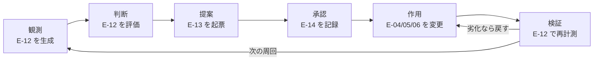
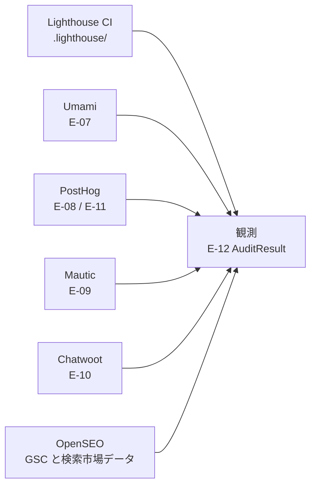
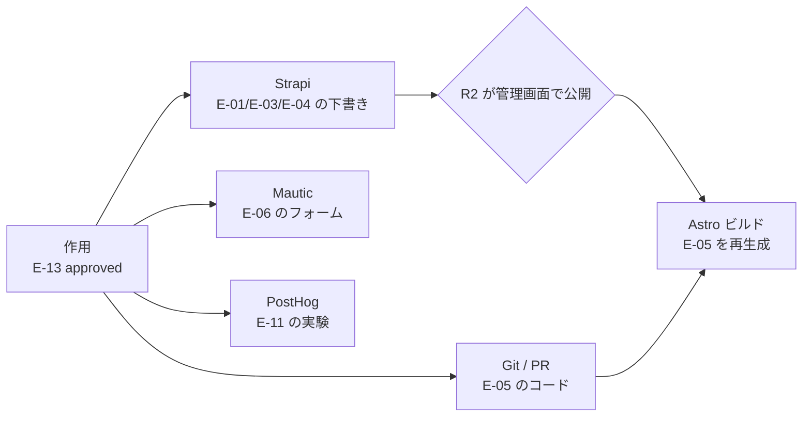
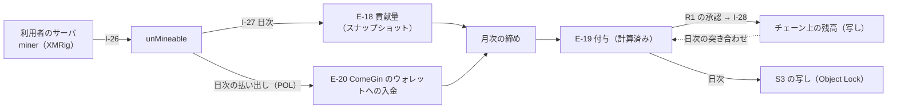

# DA-04 データフロー

`CAP-14`（改善提案の生成と承認）を成り立たせるデータの流れを定義する。
「観測 → 判断 → 提案 → 承認 → 作用 → 検証」の 6 段階を 1 周するのが再帰的自己改善のループであり、**どの段階でどの `E-ID` が生成・参照されるか**を固定することでループを追跡可能にする。

## 1. 改善ループのデータフロー

### 1.1 ループ本体

図は To-Be を描いている。現在実際に動いているのは `OBS`（観測）の一部だけで、Lighthouse CI がビルドのたびに計測結果を出力し、Strapi が記事イベントと例外を PostHog に送っている。`JDG` から先の 5 段階を実行する仕組みはどこにも無く、**ループは閉じていない**（段階ごとの状態は 4 節の鮮度要件の表を参照）。

- 各段階の実行は `E-15 AgentRun` として記録する（どの段階で失敗したかを後から特定するため）。**記録するのは監視アプリのサーバー側で、1 回の起動（手動の指示・定期実行）を 1 件とする**（AA-05 の ADR-18、TA-07 の 3.6）。**記録するのは要約と ID だけで、各段階でツールが読んだデータ（本番の `E-09` `E-10` など）は記録しない**（ADR-18 の追加の決定。DA-05 の 1.5）。記録は S3 に追記専用で写す（写しは正本ではない）。
- **`OBS`（観測）と `PRP`（提案）の定期実行は、監視アプリ（ローカル）が起動する**（`R1` の 2026-09-19 の決定。AA-05 の ADR-17、TA-07 の 3.5）。ADR-05 は日次のスケジュール起動を n8n に置いていたが、ADR-16 で n8n が AWS に移り、ローカルのエージェントを起動できなくなった。取得の範囲はスケジュールの定義に固定する（DA-02 の 5 節の契約を、監視アプリの側で守る）。**定義は Git で持ち、監視アプリは承認済みの `main` のチェックアウトで読む。変更は PR を通す**（ADR-18 の追加の決定）。
- **`APR`（承認）だけは人間（`R2`）が行う**（`CAP-06` の承認ゲート。エージェントはこの遷移を実行できない）。
- `VRF` から `ACT` への戻りは `E-13` の `rollback.procedure` に書かれた手順を実行する経路。

### 1.2 観測の入力元

図は To-Be を描いている。現在この 6 本のうち実際にデータが流れているのは `LH`（Lighthouse CI）と `PH`（PostHog。ただし Strapi のサーバ側イベントと例外のみ）の 2 本。
`UM` `MA` `CW` は各ツールに観測対象のデータがまだ無い。`OS`（OpenSEO）は稼働しているが、GSC は未接続で、エージェントからの接続も無い（各経路の状態は DA-02 の 4 節・5.1 節の表を参照）。

- **GSC は OpenSEO の内側に入った**（AA-05 の ADR-06）。当初この図は `Search Console` を直接の入力元として描いていたが、GSC の実績も DataForSEO の順位・市場データも、**OpenSEO という 1 つの取得口**を通って `E-12` になる。`source` は出所ごとに分ける（`gsc` / `serp` / `site_audit` / `market`。DA-01 の 4 節）。

- Lighthouse CI の結果は `frontend/verdant-virgo/.lighthouse/` にファイル出力される（`target: 'filesystem'`。外部公開を避けるため）。エージェントはこのファイルを直接読む（API を経由しない唯一の観測元）。

### 1.3 作用の出力先

**作用はエージェントが本番に直接行い、公開サイトへの反映は人間が配信を承認する**（`R1` の 2026-09-19 の決定。AA-05 の ADR-15・ADR-16、TA-07 の 6・7 節。同日の ADR-14 の「開発環境で作って人間が反映する」を置き換えた）。下図の `ST`（Strapi）と `MAU`（Mautic）はどちらも本番（AWS）の正本を指し、エージェントは MCP でどちらにも書き込む（本番は `read_write` まで。Strapi は `strapi-prod` で、Admin トークンの権限で**下書きまで**に絞る。ADR-17）。**ADR-15 の時点では `ST` はオンプレの正本だったが、ADR-16 で本番の Strapi に移った。** **記事の公開は `R2` が本番の管理画面で行う**（ADR-17。図の `PUB`）。

図は To-Be を描いている。現在動いているのは `ST` → `BLD` と `GIT` → `BLD`（Strapi のコンテンツ変更とコード変更を Astro のビルドが取り込む経路）だけで、その起点となる `ACT`（承認済みの `E-13` にもとづく作用）は存在しない。人手の変更が直接 `ST` / `GIT` に入っている状態（各要素の状態は 2 節の System of Record 表を参照）。`PUB`（公開）は現在も人手で行えるが、公開された記事を見つけてビルドを起こす仕組み（監視アプリの定期実行）は無い。

- **`ST` → `BLD` のビルドはオンプレで行い、本番の Strapi を読む**（ADR-16。読み取り専用の API トークンで Content API を読む。DD-05 の 1 節）。ADR-15 ではオンプレの Strapi を読んでいた。画像は本番の Strapi のメディア（S3）から取得して `dist/` に取り込む（ADR-11）。
- **`PUB` → `BLD` のきっかけは、監視アプリの定期実行が本番の Strapi を見て、前回から公開された記事を見つけることである**（ADR-17。案。TA-07 の 3.5・7 節）。本番の Strapi（AWS）はローカルに公開を通知できないため、当初の「Strapi の Webhook → n8n → ビルド」（TA-03）は使わない。下書きの記事はビルドに入らない（Content API が公開済みだけを返すため）。**配信は人間が行い、`E-13` の `applied` は配信の完了をもって記録する**（`R2` の公開の時点ではない。DA-01 の 6.3）。
- **図に描いていない作用先として、本番の n8n のワークフローがある**（ADR-16）。エージェントは `n8n-prod` でワークフローを置き（作成と更新）、**人間（`R1`）が本番で有効にした時点で作用になる**。ワークフローは E-ID を持たないため図に含めないが、`E-13` の適用先には含まれる（AA-04 の 3.3.1）。
- `E-05 Page` は直接書き換えられない（Astro のビルド成果物のため）。`E-04 Content` かコードのどちらかを変えて再ビルドすることでしか変わらない。
- `SITE_URL` 未設定のビルドは意図的に例外で停止する（未設定だと sitemap と canonical に localhost が焼き込まれ、警告なく公開されてしまうため）。作用の適用手順にはこの環境変数の設定を必ず含める。

### 1.4 収益化のデータフロー（2026-10-03 に追加）

改善ループとは別の流れ。**エージェントはこの流れに関与しない**（AA-03 の 2.6）。

図は To-Be を描いている。状態は 2 節の表で確認する。

## 2. System of Record 表

正本は「その値を書き換えてよい唯一の場所」。**正本のシステム名は、Strapi・Mautic・Chatwoot・Umami・n8n とも本番（AWS）のインスタンスを指す**（ADR-16。開発環境の Strapi・Mautic・Chatwoot・Umami・n8n のデータは正本でも複製先でもない。DA-01 の 4 節）。ADR-15 の時点では Strapi だけがオンプレの Strapi を指していた。複製先での書き換えは禁止し、同期は常に正本からの一方向にする（双方向同期はどちらが勝つかの規則が必要になり、規則を間違えたときに静かにデータが壊れるため）。

| ID | エンティティ | 正本 | 複製先 | 同期方向 | 同期手段 | 状態 |
|---|---|---|---|---|---|---|
| `E-01` | `Keyword` | Strapi（`api::keyword.keyword`） | OpenSEO のランク追跡の対象（**採用したものだけ**） | 正本 → 複製先 | **人間（`R2`）が OpenSEO の画面で登録する**（ランク追跡の設定は `承認`。BA-05） | 未着手 |
| `E-02` | `SearchIntent` | `E-01` の属性 | `E-06` の出し分け条件 | 正本 → 複製先 | ビルド時に埋め込む | 未着手 |
| `E-03` | `ContentPlan` | Strapi（`api::content-plan.content-plan`） | なし | — | — | 未着手 |
| `E-04` | `Content` | Strapi（`api::article.article`。本番） | `E-05`（ビルド成果物）、PostHog のイベント（**本番用のプロジェクト**。ADR-16） | 正本 → 複製先 | Astro のビルド／ライフサイクルフック（`backend/strapi-system/src/index.ts`） | 実装済み |
| `E-05` | `Page` | Astro のビルド成果物 | 配信先（静的ホスティング） | 正本 → 複製先 | デプロイ | 実装済み |
| `E-06` | `CTA` | 表示定義は Strapi、受付定義は Mautic | `E-05` に埋め込まれる | 正本 → 複製先 | ビルド時に埋め込む | 未着手 |
| `E-07` | `Session` | Umami | 集計値のみ `E-12` に転記 | 正本 → 複製先 | Umami MCP で取得 | 未配線 |
| `E-08` | `Person` | PostHog | なし | — | — | 未配線 |
| `E-09` | `Contact` | Mautic | Chatwoot の `E-10` に email で対応付け | 正本 → 複製先 | email をキーにした突合 | 未配線 |
| `E-10` | `Conversation` | Chatwoot | なし | — | — | 未配線 |
| `E-11` | `Experiment` | PostHog | `E-13` の `expectation` に転記 | 正本 → 複製先 | 提案起票時に転記 | 未着手 |
| **`E-16`** | **`Booking`**（面談の予約。2026-10-01 に DA-01 の 4.1 で追加） | **Cal.com**（**セルフホスト**。本番。RDS for PostgreSQL の `calcom` データベース） | **Google Calendar の予定**（Google LLC。**越境する**。DA-05 の 1.2.2）／`E-09` に email で対応付け | **正本 → 複製先** | **Cal.com が予約の成立時に Google Calendar API で予定を作り、訪問者を招待する**（TA-01 の経路 20）。`E-09` との対応は email をキーにした突合（小文字化。`I-19` と同じ規則） | 未着手 |
| `E-12` | `AuditResult` | Lighthouse は `.lighthouse/` の JSON、GSC・順位・サイト監査・市場データは OpenSEO、他は各ツールの API | `E-13` の `evidence[]` に参照として転記 | 正本 → 複製先 | 起票時に `ref` を記録（値そのものは複製しない） | 一部実装済み |
| `E-13` | `ImprovementProposal` | Git（`docs/proposals/` の Markdown） | **なし**（通知は GitHub の PR の機能に任せ、複製を作らない） | — | — | 未着手 |
| `E-14` | `ApprovalRecord` | Git / GitHub の PR レビュー | `E-13` の frontmatter に転記 | 正本 → 複製先 | n8n から書き戻す（**ADR-17 で `I-13` がローカルに移ったため、書き戻しの主体も見直しが要る**。5 節） | 未着手 |
| `E-15` | `AgentRun` | **監視アプリの実行記録**（ローカルの DB。**監視アプリのサーバー側だけが書く**。ADR-18、TA-07 の 3.6。ADR-16 の「正本はクラウド」の唯一の例外）。当初は n8n の実行履歴（`execution_entity`）とし、ADR-14・ADR-15 で監視アプリの実行記録を候補にし、ADR-17 でエージェントの起動元が監視アプリに一本化された（n8n の実行履歴に残るのは n8n 自身のワークフローだけで、`E-15` ではない） | `E-13` の `agent_run_id` に参照として転記。**S3 の写し**（追記だけ。削除と上書きを許さない。開発機を失ったときの復旧用。ADR-18 の追加の決定。TA-06 の 4.7） | 正本 → 複製先 | 起票時に ID（相関 ID。ULID）を記録。S3 への写しの頻度と形式は未決定（TA-07 の 9 節） | 未着手 |
| `E-17` | `MiningOptIn` | `points-api` の DB（AWS） | 利用者のサーバの環境変数 `MINER_ENABLED`（既定 `false`）と `MINER_MAX_THREADS` | 正本 → 複製先 | **利用者が自分で設定する**（ComeGin から書き込まない） | 未着手 |
| `E-18` | `MiningContribution` | `points-api` の日次スナップショット（AWS） | なし（発生源の unMineable は正本ではない） | 発生源 → 正本 | `I-27`（日次。n8n が起動） | 未着手 |
| `E-19` | `PointTransaction` | `points-api` の DB（AWS。**追記だけ**） | チェーン上の残高、S3 の写し（Object Lock） | 正本 → 複製先 | `I-28`（付与・消化）、日次の書き出し | 未着手 |
| `E-20` | `MiningPayout` | チェーン上の ComeGin のウォレットへの入金 | `points-api` の月次の円換算表 | 正本 → 複製先 | チェーンの読み取り（thirdweb の RPC）。unMineable の `/v1/payments`（`I-27`）と突き合わせる | 未着手 |

- **開発環境と本番の間でデータを同期しない**（ADR-15・ADR-16）。ADR-15 で Strapi をオンプレだけに戻した時点で、ADR-14 で定めた「開発環境 → 本番の反映」（`strapi transfer` など）は不要になった。**ADR-16 で本番に Strapi を戻した後も、記事は本番にだけ書き、開発環境の Strapi（試験用）との間で移さない。** Strapi・Mautic・Chatwoot はエージェントが本番に直接書き込み、開発環境は検証の場として独立させる。
- **設定と構造は、開発環境と本番でそろえ続ける**（ADR-16、TA-07 の 6.1）。これはデータの同期ではなく、同じ変更を 2 回適用する運用である（開発用の登録で確かめ、`-prod` の登録で本番に適用する。Strapi のコンテンツタイプと n8n の版はデプロイ、n8n のワークフローは `n8n-prod` で置いて人間が有効化する）。
- **OpenSEO の保存済みキーワードは `E-01` の正本でも複製先でもない。** エージェントが調査の途中で候補を置く**作業場**であり、`R2` が採用したものだけを Strapi に書く（OpenSEO → Strapi）。逆向きの「採用した `E-01` をランク追跡の対象にする」（Strapi → OpenSEO）は、**継続課金を生むため人間が行う**。両方向の流れがあるが、**運ぶものが違う**（候補と採用済み）ため、同じ値を双方向に同期する形にはならない。
- **`E-16` は「正本が国内、複製先が国外」という形になる、個人情報（実名）を含むエンティティでは唯一のものである**（2026-10-01 に追加。`E-19`〈仮名。チェーンの写し〉もこの形だが、実名を含まない）。`E-08` `E-11` は正本そのものが国外（PostHog）にあり、他は正本も複製先も国内にある。**`E-16` だけが境界をまたいで複製される**ため、削除請求では**両方を消す**必要がある（片方を消しても他方に残る。DA-05 の 2 節の手順）。
- **Google Calendar の予定を「複製先」と呼ぶのは、書き換えてよい場所が Cal.com だけであることを示すためである。** Google のカレンダーで予定の時刻を直接動かしても、Cal.com の `E-16` は変わらない（**正本が静かに食い違う**）。**予約の変更は Cal.com 側で行う**（訪問者が予約ページから変更するか、`R3` が Cal.com の画面で行う）。この規則を守らないと、双方向同期を禁じた理由（どちらが勝つかの規則が無いまま静かに壊れる）がそのまま当てはまる。
- `E-12` を「参照として転記」するのは、観測値そのものを提案にコピーすると元データが更新されたときに矛盾が生じるため。`E-13` には `ref`（再取得できるクエリ）と `summary`（人間が読む要約）だけを置く。
- **`E-13` の通知は GitHub の PR の機能に任せ、複製を作らない**（**`R1` の 2026-09-17 の決定**。5 節の未決定事項を解決した）。PR の Reviewer に `R2` を指定すれば、起票・レビュー依頼・マージ・クローズが GitHub の標準通知で届く。`E-14` の正本が PR のレビューであるため、**承認を求める通知も正本と同じ場所から出る**。
- 当初案の Chatwoot の社内メモは採らない。Chatwoot は顧客対応のツールであり、内部統制の記録を持ち込むと `CAP-12` のレポート（未解決件数・応答時間）と `E-10 Conversation` の正本が汚れる。加えて `agent/conversation-triage` の取得範囲（直近の未解決の会話）が承認待ちの提案で埋まる。
- **`private` を固定する規則そのものは残る。** `agent/conversation-triage` が顧客対応の中で書く社内メモでは `private` を固定値 `true` とする（`private=false` は顧客に即時送信されるため）。**ADR-17 で、この規則が `chatwoot-mcp` で実装されていないことが分かった**（`chatwoot_send_message` は社内メモと送信を兼ね、`private` の既定値が `false`）。社内メモ専用のツールか登録を分け、社内メモだけを使うエージェントに送信のツールを見せない（方法は未決定。実装はまだ。TA-07 の 3.3）。
- **（2026-10-03 に追加）`E-19` は「正本が DB、複製先が公開チェーンと消せない写し」という形になる唯一のエンティティである。** 残高の改ざんはチェーンとの突き合わせで、理由・承認者の改ざんは追記だけの表と S3 の写しで防ぐ。ずれたら SNS で通知し、`R1` が `E-19` を正として補正の取引を起こす（DD-08）。

## 3. Umami と PostHog の役割分担

両者ともアクセス解析の機能を持つ。**重複を放置すると、同じ指標に 2 つの数字が存在し、月次会議が「どちらが正しいか」の議論で止まる。**
DA-02 の 3 節で決めたとおり、指標ごとに正本を 1 つに固定する。

| 領域 | 正本 | 使わない側 | 理由 | 状態 |
|---|---|---|---|---|
| セッション数・PV | **Umami** | PostHog のセッション数は KPI に使わない（デバッグのみ） | Umami は cookie を置かず個人を識別しないため、同意の有無によらず全トラフィックを数えられる。母数の定義が同意率に左右されない | 未配線 |
| 参照元・チャネル | **Umami** | PostHog の流入元は参考値 | 上と同じ理由。チャネル分類も Umami の分類に統一する | 未配線 |
| ランディングページ別の流入 | **Umami** | — | 上と同じ理由 | 未配線 |
| Core Web Vitals（実測） | **Umami**（`get_performance`） | — | 実ユーザーの計測は Umami、合成計測は Lighthouse CI と役割を分ける | 未配線 |
| ファネル通過率・経路 | **PostHog** | Umami にもファネル機能があるが使わない | AB テストと同じ場所で見ないと、バリアント別のファネルが出せない | 未着手 |
| AB テスト・feature flag | **PostHog** | Umami には機能が無い | `E-11 Experiment` の正本 | 未着手 |
| エラー・例外追跡 | **PostHog** | Umami には機能が無い | Strapi 側は配線済み（`backend/strapi-system/src/middlewares/posthog-error.ts`） | 一部実装済み |
| セッションリプレイ | **PostHog** | Umami には機能が無い | 現状は有効だが記録対象が無い（ブラウザ側 SDK が未設置） | 未配線 |
| 合成パフォーマンス監査 | **Lighthouse CI** | 両者とも使わない | しきい値付きで失敗させられるのは Lighthouse CI だけ（`frontend/verdant-virgo/lighthouserc.cjs`） | 実装済み |

**KPI の正本は Umami。** ただしこれは「流入・母数系の KPI」に限る。行動・実験系の KPI の正本は PostHog であり、両者は競合しない（同じ指標を両方から出さない、という規則で切り分ける）。

## 4. データの鮮度要件

フローごとに必要な鮮度を定める。必要以上に速くすると、上流 API の制約（Chatwoot の `Rack::Timeout` 15 秒、固定ページ件数）に当たって取得自体が失敗する。

| フロー | 鮮度 | 根拠 | 状態 |
|---|---|---|---|
| `E-04` 変更 → PostHog のイベント | リアルタイム（ライフサイクルフックで即時 `flush`） | 既に実装済み。`capturePostHogEvent` が `flush()` まで待つ | 実装済み |
| 例外発生 → PostHog の Error Tracking | リアルタイム | 障害対応（`CAP-13`）の起点になるため遅延させられない | 実装済み |
| `E-07` `E-08` の収集 | リアルタイム（ブラウザからの送信） | トラッカーの性質上そうなる | 未配線 |
| 観測（`E-12` の生成） | **日次**（監視アプリの定期実行。ADR-17） | 日次より細かくしても改善のサイクルが追いつかず、Chatwoot の 15 秒打ち切りに当たるリスクだけが増える。**開発機が止まっている日は走らない**（未観測。取得の範囲が固定されているため後から実行できる。TA-07 の 3.5） | 未配線 |
| Lighthouse CI の計測 | ビルドごと + 週次 | ビルドで劣化を検知し、週次で定点観測する（3 回計測の中央値を取るため 1 回が重い） | 実装済み |
| GSC の実績（OpenSEO 経由） | **日次。ただし対象期間を 3 日ずらす** | GSC のデータは 2〜3 日遅れて確定する。他の観測と同じ日次バッチで取り、`range.to` を 3 日前にする | 未着手 |
| 順位計測（`serp`） | **週次** | 順位は日々揺れるが、判定は 30 日後であり日次の粒度は要らない。日次にすると費用が約 7 倍になる | 未配線 |
| サイト監査（`site_audit`） | 週次（実行は人間） | 構造の問題はビルドごとにしか変わらない | 未着手 |
| 市場データ（`market`） | 必要時（キーワード調査・競合調査のたび） | 同じ問い合わせでも毎回費用がかかる。定期的に取り直さない | 未配線 |
| 判断・提案（`E-13` の起票） | **日次**（バッチ。監視アプリの定期実行。GitHub への起票〈`I-13`〉もローカルから行う。ADR-17） | 観測が日次のため、それ以上速くしても新しい根拠が無い | 未着手 |
| 承認（`E-14`） | 人間の応答次第（SLA は週次会議まで） | `R2` の判断を待つ。自動化しない | 未着手 |
| 公開された記事の確認（本番の Strapi → ビルドと計測） | **定期**（監視アプリの定期実行。頻度は未決定。ADR-17） | `R2` が管理画面で公開してから配信までの遅れがこの頻度で決まる。公開は Strapi からローカルに通知できないため、見に行くしかない | 未着手 |
| 誤った書き込みの突き合わせ（エージェント専用ユーザーの送信 ↔ `E-13`） | **定期**（監視アプリの定期実行。頻度は未決定。ADR-17） | 頻度が低いほど、誤った送信に気づくまでの時間が延びる。送信は取り消せないため、気づいてもできるのは事後の対応だけである | 未着手 |
| 作用（本番の Strapi・Mautic・Chatwoot へは MCP で直接／記事は本番の Strapi に下書き → **`R2` が公開** → ローカルで再ビルド → **人間が配信**／n8n は `n8n-prod` で置いて**人間が有効化**） | 適用のたび | `E-05` はビルドしないと変わらない。本番に作用するまで `applied` にしない（ADR-15）。`applied_at` は作用させた主体が記録する（ADR-16）。記事の `applied` は `R2` の公開ではなく配信の完了（ADR-17） | 一部実装済み |
| 検証（`E-13` の `verification`） | **`expectation.judge_after` に従う**（既定は 30 日後） | 短すぎる観測期間で判定するとノイズを効果と誤認する | 未着手 |
| `E-09` `E-10` の参照（エージェントの読み取り） | 必要時（オンデマンド） | 定期的に全件を舐めない（固定ページ件数のため件数に比例してリクエストが増える） | 未配線 |

- 「観測は日次、判定は 30 日後」という非対称は意図的。**観測は頻繁に、判定は慎重に**というのがこのループの基本方針（早い判定が最も壊しやすい）。
- リアルタイムを要求するのは、既に実装済みの 2 本（記事イベント・例外）とブラウザからの送信だけ。それ以外は日次で足りる。

## 5. 未決定事項

- **（2026-09-19 に ADR-15 で解決）観測の入力元が本番であるのにエージェントの接続先が開発環境だけであること、本番で直した記事の上書き。** MCP の本番用の登録で本番を読み、Strapi はオンプレだけに戻した。ADR-16 で本番に Strapi を戻した後も、記事を本番にだけ書くため上書きは起きない。
- **（2026-09-19 に ADR-16 で解決）本番の Mautic・Chatwoot と開発環境の設定の食い違い。** **そろえ続ける**と決めた。エージェントは変更をまず開発用の登録で適用して確かめ、同じ変更を `-prod` の登録で本番に適用する（2 節、TA-07 の 6.1）。そろえる対象は設定と構造で、データではない。
- **（2026-09-19 に ADR-17 で解決）観測の日次バッチをどこで走らせるか。** 当初は n8n のスケジュールトリガーが有力としていた（`E-15 AgentRun` の正本を n8n にするかどうか自体が未確定だった。**ADR-18 で監視アプリの実行記録に決まった**）。ADR-16 の反映で、**本番の n8n は AWS に移ったため、本番の n8n のスケジュールからローカルの Claude Code（観測エージェント）を直接起動する経路が無い**（ローカルへの着信を開けない）ことが分かり、エージェントの起動を監視アプリか開発環境の n8n（ローカル）のどちらから行うかを未決定にしていた。**ADR-17 で、エージェントを使う定期処理は監視アプリが起動すると決めた**（TA-07 の 3.5）。本番の n8n は Webhook の受け口と、エージェントを使わない決定論的な定期処理だけを行う。開発環境の n8n はエージェントを起動しない（担うのはオンプレのハートビートの送信だけで、それも監視アプリに移すかを検討中。TA-07 の 8 節）。
- **（2026-09-19 に ADR-15・ADR-17 で一部決着）作用の自動適用をどこまで許すか。** `content_rewrite`（Strapi のコンテンツ変更）は承認後に自動適用できるとしていたが、**ADR-17 で `strapi-prod` は下書きまでになり、自動で適用できるのは下書きの更新まで**になった。公開は `R2` が管理画面で行い、配信は人間が行う（ADR-15）。`technical_seo`（コード変更）もマージと配信を人間が行う（AA-04 の 2.2）。残るのは、Mautic・Chatwoot の `自律` 分類の書き込みを、承認後にエージェントが続けて行ってよいか（人間の確認を挟むか）である。
- **`E-14` を `E-13` の frontmatter に書き戻す主体**（ADR-17 で生じた論点）。2 節の表は「n8n から書き戻す」としているが、`E-13` はローカルの Git（`docs/proposals/`）にあり、ADR-17 はまさにその理由で `I-13` をローカルに移した。書き戻しも Git への書き込み（コミット）を伴うため、本番の n8n（AWS）で行うなら GitHub への書き込みの資格情報を n8n に持たせることになる。`I-13` と同じくローカル（監視アプリの定期実行）で行うか、PR のマージの時点で人間が書くかを決める。判断者 `R1`。
- **公開された記事の確認の頻度**（ADR-17。4 節の表）。頻度が低いと、`R2` が公開してから配信までの間が延びる（その間、本番の Strapi では公開済みでも公開サイトには出ていない）。高くすると本番の Strapi への読み取りが増える。判断者 `R1` `R2`。
- **（2026-09-18 に解決）Google Search Console の配線後、`E-12` の日次取得に GSC を含めるかどうか。** 含める。ただし**対象期間を 3 日ずらす**（4 節の表。DD-06 の 4.2）。取得経路は OpenSEO に決まった（AA-05 の ADR-06）。
- Umami と PostHog の数字が実際にどれだけ乖離するかは、両方を配線して計測するまで分からない。乖離が大きい場合、役割分担の切り分け方（特に Core Web Vitals を Umami に寄せた判断）を見直す必要がある。
