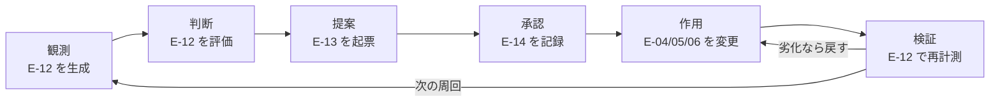
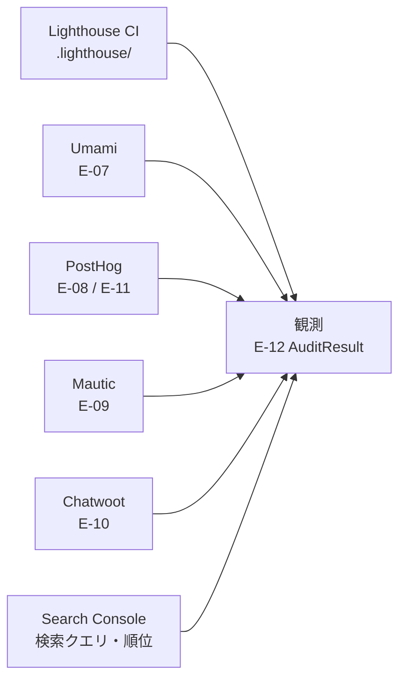
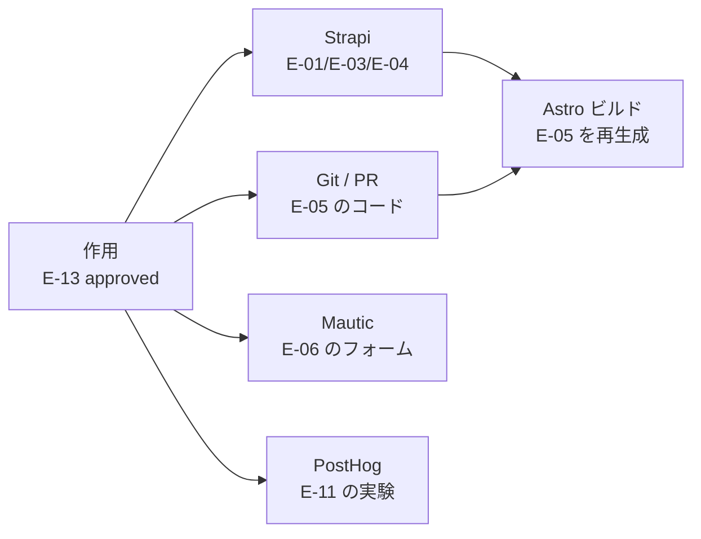

# DA-04 データフロー

`CAP-14`（改善提案の生成と承認）を成り立たせるデータの流れを定義する。
「観測 → 判断 → 提案 → 承認 → 作用 → 検証」の 6 段階を 1 周するのが再帰的自己改善のループであり、**どの段階でどの `E-ID` が生成・参照されるか**を固定することでループを追跡可能にする。

## 1. 改善ループのデータフロー

### 1.1 ループ本体

図は To-Be を描いている。現在実際に動いているのは `OBS`（観測）の一部だけで、Lighthouse CI がビルドのたびに計測結果を出力し、Strapi が記事イベントと例外を PostHog に送っている。`JDG` から先の 5 段階を実行する仕組みはどこにも無く、**ループは閉じていない**（段階ごとの状態は 4 節の鮮度要件の表を参照）。

- 各段階の実行は `E-15 AgentRun` として記録する（どの段階で失敗したかを後から特定するため）。
- **`APR`（承認）だけは人間（`R2`）が行う**（`CAP-06` の承認ゲート。エージェントはこの遷移を実行できない）。
- `VRF` から `ACT` への戻りは `E-13` の `rollback.procedure` に書かれた手順を実行する経路。

### 1.2 観測の入力元

図は To-Be を描いている。現在この 6 本のうち実際にデータが流れているのは `LH`（Lighthouse CI）と `PH`（PostHog。ただし Strapi のサーバ側イベントと例外のみ）の 2 本。
`UM` `MA` `CW` は各ツールに観測対象のデータがまだ無く、`GSC` は認証情報もサイト所有権確認ファイルも存在しない（各経路の状態は DA-02 の 4 節・5.1 節の表を参照）。

- Lighthouse CI の結果は `frontend/verdant-virgo/.lighthouse/` にファイル出力される（`target: 'filesystem'`。外部公開を避けるため）。エージェントはこのファイルを直接読む（API を経由しない唯一の観測元）。

### 1.3 作用の出力先

図は To-Be を描いている。現在動いているのは `ST` → `BLD` と `GIT` → `BLD`（Strapi のコンテンツ変更とコード変更を Astro のビルドが取り込む経路）だけで、その起点となる `ACT`（承認済みの `E-13` にもとづく作用）は存在しない。人手の変更が直接 `ST` / `GIT` に入っている状態（各要素の状態は 2 節の System of Record 表を参照）。

- `E-05 Page` は直接書き換えられない（Astro のビルド成果物のため）。`E-04 Content` かコードのどちらかを変えて再ビルドすることでしか変わらない。
- `SITE_URL` 未設定のビルドは意図的に例外で停止する（未設定だと sitemap と canonical に localhost が焼き込まれ、警告なく公開されてしまうため）。作用の適用手順にはこの環境変数の設定を必ず含める。

## 2. System of Record 表

正本は「その値を書き換えてよい唯一の場所」。複製先での書き換えは禁止し、同期は常に正本からの一方向にする（双方向同期はどちらが勝つかの規則が必要になり、規則を間違えたときに静かにデータが壊れるため）。

| ID | エンティティ | 正本 | 複製先 | 同期方向 | 同期手段 | 状態 |
|---|---|---|---|---|---|---|
| `E-01` | `Keyword` | Strapi（`api::keyword.keyword`） | なし | — | — | 未着手 |
| `E-02` | `SearchIntent` | `E-01` の属性 | `E-06` の出し分け条件 | 正本 → 複製先 | ビルド時に埋め込む | 未着手 |
| `E-03` | `ContentPlan` | Strapi（`api::content-plan.content-plan`） | なし | — | — | 未着手 |
| `E-04` | `Content` | Strapi（`api::article.article`） | `E-05`（ビルド成果物）、PostHog のイベント | 正本 → 複製先 | Astro のビルド／ライフサイクルフック（`backend/strapi-system/src/index.ts`） | 実装済み |
| `E-05` | `Page` | Astro のビルド成果物 | 配信先（静的ホスティング） | 正本 → 複製先 | デプロイ | 実装済み |
| `E-06` | `CTA` | 表示定義は Strapi、受付定義は Mautic | `E-05` に埋め込まれる | 正本 → 複製先 | ビルド時に埋め込む | 未着手 |
| `E-07` | `Session` | Umami | 集計値のみ `E-12` に転記 | 正本 → 複製先 | Umami MCP で取得 | 未配線 |
| `E-08` | `Person` | PostHog | なし | — | — | 未配線 |
| `E-09` | `Contact` | Mautic | Chatwoot の `E-10` に email で対応付け | 正本 → 複製先 | email をキーにした突合 | 未配線 |
| `E-10` | `Conversation` | Chatwoot | なし | — | — | 未配線 |
| `E-11` | `Experiment` | PostHog | `E-13` の `expectation` に転記 | 正本 → 複製先 | 提案起票時に転記 | 未着手 |
| `E-12` | `AuditResult` | Lighthouse は `.lighthouse/` の JSON、他は各ツールの API | `E-13` の `evidence[]` に参照として転記 | 正本 → 複製先 | 起票時に `ref` を記録（値そのものは複製しない） | 一部実装済み |
| `E-13` | `ImprovementProposal` | Git（`docs/proposals/` の Markdown） | **なし**（通知は GitHub の PR の機能に任せ、複製を作らない） | — | — | 未着手 |
| `E-14` | `ApprovalRecord` | Git / GitHub の PR レビュー | `E-13` の frontmatter に転記 | 正本 → 複製先 | n8n から書き戻す | 未着手 |
| `E-15` | `AgentRun` | n8n の実行履歴（`execution_entity`） | `E-13` の `agent_run_id` に参照として転記 | 正本 → 複製先 | 起票時に ID を記録 | 未配線 |

- `E-12` を「参照として転記」するのは、観測値そのものを提案にコピーすると元データが更新されたときに矛盾が生じるため。`E-13` には `ref`（再取得できるクエリ）と `summary`（人間が読む要約）だけを置く。
- **`E-13` の通知は GitHub の PR の機能に任せ、複製を作らない**（**`R1` の 2026-09-17 の決定**。5 節の未決定事項を解決した）。PR の Reviewer に `R2` を指定すれば、起票・レビュー依頼・マージ・クローズが GitHub の標準通知で届く。`E-14` の正本が PR のレビューであるため、**承認を求める通知も正本と同じ場所から出る**。
- 当初案の Chatwoot の社内メモは採らない。Chatwoot は顧客対応のツールであり、内部統制の記録を持ち込むと `CAP-12` のレポート（未解決件数・応答時間）と `E-10 Conversation` の正本が汚れる。加えて `agent/conversation-triage` の取得範囲（直近の未解決の会話）が承認待ちの提案で埋まる。
- **`private` を固定する規則そのものは残る。** `agent/conversation-triage` が顧客対応の中で書く社内メモでは `private` を固定値 `true` とする（`private=false` は顧客に即時送信されるため）。

## 3. Umami と PostHog の役割分担

両者ともアクセス解析の機能を持つ。**重複を放置すると、同じ指標に 2 つの数字が存在し、月次会議が「どちらが正しいか」の議論で止まる。**
DA-02 の 3 節で決めたとおり、指標ごとに正本を 1 つに固定する。

| 領域 | 正本 | 使わない側 | 理由 | 状態 |
|---|---|---|---|---|
| セッション数・PV | **Umami** | PostHog のセッション数は KPI に使わない（デバッグのみ） | Umami は cookie を置かず個人を識別しないため、同意の有無によらず全トラフィックを数えられる。母数の定義が同意率に左右されない | 未配線 |
| 参照元・チャネル | **Umami** | PostHog の流入元は参考値 | 上と同じ理由。チャネル分類も Umami の分類に統一する | 未配線 |
| ランディングページ別の流入 | **Umami** | — | 上と同じ理由 | 未配線 |
| Core Web Vitals（実測） | **Umami**（`get_performance`） | — | 実ユーザーの計測は Umami、合成計測は Lighthouse CI と役割を分ける | 未配線 |
| ファネル通過率・経路 | **PostHog** | Umami にもファネル機能があるが使わない | AB テストと同じ場所で見ないと、バリアント別のファネルが出せない | 未着手 |
| AB テスト・feature flag | **PostHog** | Umami には機能が無い | `E-11 Experiment` の正本 | 未着手 |
| エラー・例外追跡 | **PostHog** | Umami には機能が無い | Strapi 側は配線済み（`backend/strapi-system/src/middlewares/posthog-error.ts`） | 一部実装済み |
| セッションリプレイ | **PostHog** | Umami には機能が無い | 現状は有効だが記録対象が無い（ブラウザ側 SDK が未設置） | 未配線 |
| 合成パフォーマンス監査 | **Lighthouse CI** | 両者とも使わない | しきい値付きで失敗させられるのは Lighthouse CI だけ（`frontend/verdant-virgo/lighthouserc.cjs`） | 実装済み |

**KPI の正本は Umami。** ただしこれは「流入・母数系の KPI」に限る。行動・実験系の KPI の正本は PostHog であり、両者は競合しない（同じ指標を両方から出さない、という規則で切り分ける）。

## 4. データの鮮度要件

フローごとに必要な鮮度を定める。必要以上に速くすると、上流 API の制約（Chatwoot の `Rack::Timeout` 15 秒、固定ページ件数）に当たって取得自体が失敗する。

| フロー | 鮮度 | 根拠 | 状態 |
|---|---|---|---|
| `E-04` 変更 → PostHog のイベント | リアルタイム（ライフサイクルフックで即時 `flush`） | 既に実装済み。`capturePostHogEvent` が `flush()` まで待つ | 実装済み |
| 例外発生 → PostHog の Error Tracking | リアルタイム | 障害対応（`CAP-13`）の起点になるため遅延させられない | 実装済み |
| `E-07` `E-08` の収集 | リアルタイム（ブラウザからの送信） | トラッカーの性質上そうなる | 未配線 |
| 観測（`E-12` の生成） | **日次** | 日次より細かくしても改善のサイクルが追いつかず、Chatwoot の 15 秒打ち切りに当たるリスクだけが増える | 未配線 |
| Lighthouse CI の計測 | ビルドごと + 週次 | ビルドで劣化を検知し、週次で定点観測する（3 回計測の中央値を取るため 1 回が重い） | 実装済み |
| 判断・提案（`E-13` の起票） | **日次**（バッチ） | 観測が日次のため、それ以上速くしても新しい根拠が無い | 未着手 |
| 承認（`E-14`） | 人間の応答次第（SLA は週次会議まで） | `R2` の判断を待つ。自動化しない | 未着手 |
| 作用（Strapi / コードの変更 → 再ビルド） | 適用のたび | `E-05` はビルドしないと変わらない | 一部実装済み |
| 検証（`E-13` の `verification`） | **`expectation.judge_after` に従う**（既定は 30 日後） | 短すぎる観測期間で判定するとノイズを効果と誤認する | 未着手 |
| `E-09` `E-10` の参照（エージェントの読み取り） | 必要時（オンデマンド） | 定期的に全件を舐めない（固定ページ件数のため件数に比例してリクエストが増える） | 未配線 |

- 「観測は日次、判定は 30 日後」という非対称は意図的。**観測は頻繁に、判定は慎重に**というのがこのループの基本方針（早い判定が最も壊しやすい）。
- リアルタイムを要求するのは、既に実装済みの 2 本（記事イベント・例外）とブラウザからの送信だけ。それ以外は日次で足りる。

## 5. 未決定事項

- 観測の日次バッチをどこで走らせるか。n8n のスケジュールトリガーが有力だが、`E-15 AgentRun` の正本を n8n にするかどうか自体が未確定（DA-01 の未決定事項）。
- 作用の自動適用をどこまで許すか。`change.kind` が `content_rewrite`（Strapi のコンテンツ変更）なら承認後に自動適用できるが、`technical_seo`（コード変更）はビルドとデプロイを伴うため、人間の実行を挟むかどうかが未定。
- Google Search Console の配線後、`E-12` の日次取得に GSC を含めるかどうか。GSC のデータは 2〜3 日遅れて確定するため、日次の観測に混ぜると「昨日のデータが無い」状態が常態化する。遅延を前提にした別サイクルにする必要があるかもしれない。
- Umami と PostHog の数字が実際にどれだけ乖離するかは、両方を配線して計測するまで分からない。乖離が大きい場合、役割分担の切り分け方（特に Core Web Vitals を Umami に寄せた判断）を見直す必要がある。
