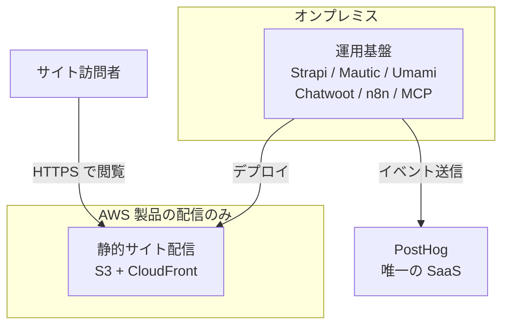
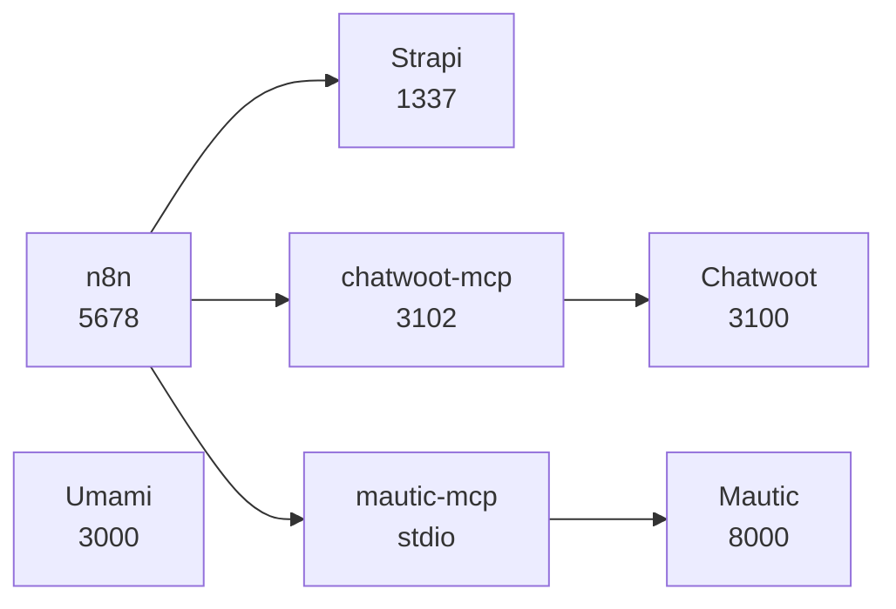
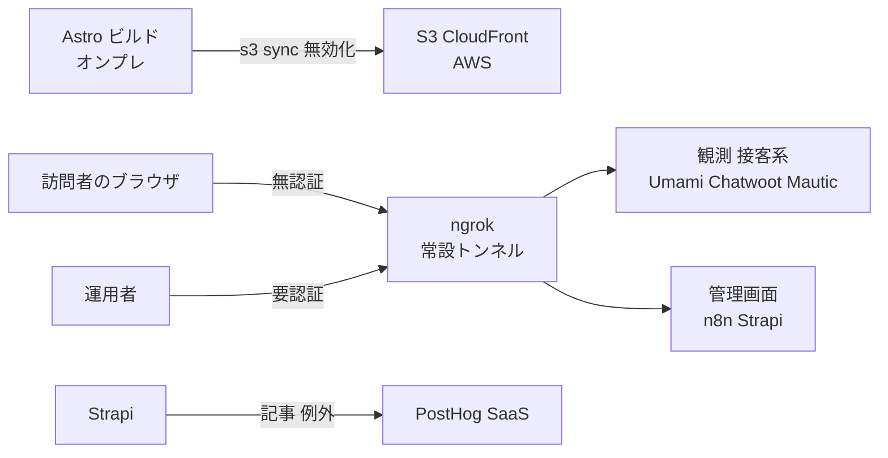

# 01. デプロイメント配置図

TA（Technology Architecture）層。ロール ID・Capability ID・エンティティ ID は EA 共通用語集の定義をそのまま使う。
ファイルパスは `MarketingDepartment/WebsiteOperations/` を起点とした相対で書く。

## 1. 配置の原則

**クラウドに展開するのは製品（Astro のビルド成果物）のみ。それ以外の構成要素はすべてオンプレミスに置く。**

この制約は本層の設計の出発点であり、以降のすべての判断がここから導かれる（配信するものと運用するものを分けることで、**常時すべての訪問者に開いている面を「静的ファイルの配信」1 点に絞り込める**。運用基盤の側は既定では外部に面しておらず、必要な経路だけをトンネルとして明示的に開く形になる。開いた経路は 7 節で 1 本ずつ列挙できる数に収まる）。

| 層 | 対象 | 配置先 | 状態 |
|---|---|---|---|
| 製品 | Astro のビルド成果物（`E-05` `Page`） | AWS（S3 + CloudFront）。設計は TA-02 | `未着手` |
| 制作・配信の裏側 | Strapi（`E-04` の正本）、Mautic、Chatwoot、Umami、n8n、MCP サーバ | オンプレミス（開発機のローカルホスト） | `実装済み`（各スタックは起動できる） |
| 観測の一部 | PostHog | SaaS（唯一の例外。後述） | `部分的` |
| 監査 | Lighthouse CI | オンプレミス（結果は `frontend/verdant-virgo/.lighthouse/`） | `実装済み` |

「オンプレミス」はここでは**専用のデータセンターではなく、運用担当者の開発機**を指す。構成上の意味は「AWS 以外のどこか」ではなく「**インターネットから直接は到達できず、到達させたい経路だけをトンネルで明示的に開く場所**」である（この定義が後述のバインドアドレスの表と、7 節の ngrok による露出の両方に直結する。ループバックバインドが既定であり、外部から見える経路はトンネルとして 1 本ずつ定義した分だけ存在する、という構造になっている）。

## 2. 図 1 配置境界の全体像（To-Be）

図は To-Be を描いている。**As-Is では AWS 境界の中身が存在しない**（`cloud/` は空ディレクトリで、公開サイトそのものが無い）。現在実際に動いている線は「運用基盤 → PostHog」の 1 本だけで、これは Strapi のライフサイクル購読と例外送信にあたる（`backend/strapi-system/src/index.ts`、`backend/strapi-system/src/middlewares/posthog-error.ts`）。訪問者の線は届く先が無い。

## 3. 図 2 オンプレミス側の内訳（To-Be）

図は To-Be を描いている。**As-Is では n8n から出る線が 1 本も存在しない**（ワークフローが 0 件のため。TA-03 の 6 節で詳述する）。MCP サーバから上流 API への線（`chatwoot-mcp` → Chatwoot、`mautic-mcp` → Mautic）だけが実装済みで、これはエージェントが直接 MCP を呼ぶ経路として機能している。

Umami が図の中で孤立しているのは作図の都合ではなく事実である。**Umami は他のどの構成要素とも配線されていない**（ブラウザ側トラッカーが未設置のため入力が無く、出力を読む経路も未実装）。この孤立は後述のセキュリティ上の非対称（Umami だけが全インターフェースに公開されている）と同じ原因、すなわち上流の compose をそのまま取り込んだまま手を入れていないことに由来する。

## 4. 図 3 境界を越える通信（To-Be）

図は To-Be を描いている。**As-Is で通っているのは最下段の 1 本（Strapi → PostHog）だけ**である。デプロイ経路は未着手、ngrok のトンネルは設定の受け皿（`middleware/n8n/.env.example` の `N8N_WEBHOOK_URL`、`frontend/verdant-virgo/astro.config.mjs` の `vite.server.allowedHosts`、MCP サーバの `MCP_ALLOWED_HOSTS`）だけが用意されている状態にあたる。Astro dev サーバーの共有（経路 6）のみ実装済みだが、これは開発用であり図には含めていない。

図の中央で 2 本の線が 1 つのトンネル機構に入り、別々の行き先に分かれている点が本層の設計の要点にあたる。**入口が同じで要件が正反対**（訪問者は無認証でなければ到達できず、運用者は認証が無ければ守られない）であるため、この分離は運用の工夫ではなく構成として作り込む必要がある（TA-04 の 7 節）。

## 5. ポート割当

複数スタックを同時に起動する前提で調整済みの割当。新しくポートを使うときはこの表を崩さない。

| ポート | 用途 | 定義箇所 | 状態 |
|---|---|---|---|
| 1025 | Mautic の MailHog（SMTP） | `backend/mautic-system/docker/compose.yaml` | `実装済み` |
| 1337 | Strapi | `backend/strapi-system` | `実装済み` |
| 3000 | Umami | `middleware/umami-master/docker-compose.yml` | `実装済み` |
| 3100 | Chatwoot 本体（`CHATWOOT_PORT`） | `backend/chatwoot-system/docker-compose.yaml` | `実装済み` |
| 3100 | **mautic-mcp の HTTP 既定値**（衝突。後述） | `backend/mautic-mcp/src/config.ts` | `実装済み` |
| 3102 | chatwoot-mcp（HTTP 時） | `backend/chatwoot-mcp/src/config.ts` | `実装済み` |
| 3306 | Mautic の MySQL 8.4 | `backend/mautic-system/docker/compose.yaml` | `実装済み` |
| 4321 | Astro dev | `frontend/verdant-virgo` | `実装済み` |
| 4322 | Lighthouse CI が使う preview（固定） | `frontend/verdant-virgo/lighthouserc.cjs` | `実装済み` |
| 5432 | Chatwoot の PostgreSQL（pgvector pg16） | `backend/chatwoot-system/docker-compose.yaml` | `実装済み` |
| 5433 | n8n の PostgreSQL 18 | `middleware/n8n/compose.yml` | `実装済み` |
| 5678 | n8n | `middleware/n8n/compose.yml` | `実装済み` |
| 6379 | Chatwoot の Redis | `backend/chatwoot-system/docker-compose.yaml` | `実装済み` |
| 8000 | Mautic（PHP ビルトインサーバー） | `backend/mautic-system/dev/serve.sh` | `実装済み` |
| 8025 | Mautic の MailHog（UI） | `backend/mautic-system/docker/compose.yaml` | `実装済み` |
| 8026 | Chatwoot の MailHog（UI） | `backend/chatwoot-system/docker-compose.yaml` | `実装済み` |

### 3100 の衝突と回避策

Chatwoot 本体（`CHATWOOT_PORT` の既定 3100）と `mautic-mcp` の HTTP 既定ポート（`backend/mautic-mcp/src/config.ts` の `PORT` 既定 3100）が衝突する。
`mautic-mcp` は `TRANSPORT` の既定が `http` であるため（`chatwoot-mcp` は既定が `stdio` で、2 つのサーバは既定トランスポートが逆）、**何も指定せずに `pnpm start` すると 3100 を掴みにいく**。Chatwoot が先に起動していれば bind に失敗し、起動していなければ後から Chatwoot が失敗する。

採る回避策は次の優先順で決める。

1. **`mautic-mcp` を stdio で動かす**（`pnpm start:stdio`）。エージェントがローカルから使う限り HTTP は不要で、stdio ならポートを一切使わず認証も不要になる（`MCP_AUTH_TOKEN` はトランスポートが HTTP のときだけ必須。`backend/mautic-mcp/src/config.ts` の `refine`）。これを既定の運用とする。
2. HTTP が必要な場合（遠隔のクライアントから使う場合）は **`PORT=3101` を与える**（3101 は本表のどこにも使われていない）。
3. Chatwoot 側の `CHATWOOT_PORT` は動かさない（変更すると `FRONTEND_URL` と Web サイトに埋め込むウィジェットのスクリプト URL まで追随が必要になり、影響範囲が MCP 側の変更よりはるかに広いため）。

## 6. バインドアドレスの非対称

ホストへ公開するポートのバインド先を一覧にする。**Umami だけが全インターフェースに公開されている。**

| ポート | サービス | バインド | 定義箇所 |
|---|---|---|---|
| 3000 | Umami | **`0.0.0.0`（全インターフェース）** | `middleware/umami-master/docker-compose.yml` の `"3000:3000"` |
| 3100 | Chatwoot（rails） | `127.0.0.1` | `backend/chatwoot-system/docker-compose.yaml` |
| 5432 | Chatwoot の PostgreSQL | `127.0.0.1` | 同上 |
| 6379 | Chatwoot の Redis | `127.0.0.1` | 同上 |
| 8026 | Chatwoot の MailHog | `127.0.0.1` | 同上 |
| 5678 | n8n | `127.0.0.1` | `middleware/n8n/compose.yml` |
| 5433 | n8n の PostgreSQL | `127.0.0.1` | 同上 |
| 3306 | Mautic の MySQL | `127.0.0.1` | `backend/mautic-system/docker/compose.yaml` |
| 1025 / 8025 | Mautic の MailHog | `127.0.0.1` | 同上 |
| 8000 | Mautic（PHP ビルトイン） | `127.0.0.1`（`HOST` の既定） | `backend/mautic-system/dev/serve.sh` |
| （なし） | Umami の PostgreSQL | ホストへ公開しない | `middleware/umami-master/docker-compose.yml` |
| （なし） | n8n の `sandbox-api` / `sandbox-runner-1` / `runners` / `searxng` | ホストへ公開しない | `middleware/n8n/compose.yml` |

n8n・Chatwoot・Mautic の compose にはいずれも「外部ネットワークに公開しないようループバックのみにバインド」というコメントが明示的に付いている。すなわち**この非対称は設計思想の違いではなく、Umami にだけ同じ判断が適用されていないという欠落**である。原因は Umami が上流の compose を無改変で取り込んだ唯一のスタックであることにある（`middleware/umami-master` は上流 1,677 ファイルをそのまま取り込んでいる）。

この項目を含む Umami の 4 つの課題と、上流無改変の方針との衝突は TA-04 の 3 節で扱う。ここでは配置上の事実として記録するにとどめる。

## 7. 境界を越える通信の一覧

| # | 経路 | 方向 | 内容 | 保護 | 状態 |
|---|---|---|---|---|---|
| 1 | オンプレ → AWS | 送信 | `astro build` の成果物を S3 へ同期し、CloudFront を無効化する | IAM（デプロイ専用の権限）。設計は TA-02 | `未着手` |
| 2 | AWS → オンプレ | 受信 | CloudFront / S3 のアクセスログを回収し `E-12` の材料にする | 取得は読み取りのみ | `未着手` |
| 3 | 訪問者 → AWS | 受信 | 公開サイトの閲覧 | ACM の TLS、AWS WAF | `未着手` |
| 4 | 訪問者のブラウザ → オンプレ（ngrok） | 受信 | Umami のトラッカー配信とイベント受信、Chatwoot ウィジェット、Mautic のフォーム受付とトラッキング | **無認証**（訪問者が到達できないと `CAP-10` が成立しないため）。ngrok の常設トンネル ＋ パス単位の制御。設計は TA-04 の 7 節 | `未着手` |
| 5 | 外部 → オンプレ（ngrok） | 受信 | n8n の Webhook 受け口（`N8N_WEBHOOK_URL`、`N8N_PROXY_HOPS`） | ngrok のトンネル ＋ n8n の Webhook パス | `未配線` |
| 6 | 外部 → オンプレ（ngrok） | 受信 | Astro dev サーバーの共有（`comegin-astro-dev.ngrok.app`） | Vite の `allowedHosts` による Host 照合 | `実装済み` |
| 7 | 運用者 → オンプレ（ngrok） | 受信 | 各製品の管理画面（Umami / Chatwoot / Mautic / n8n / Strapi） | **要認証**（ngrok 側の認証。設計は TA-04 の 7 節） | `未着手` |
| 8 | オンプレ → PostHog | 送信 | 記事ライフサイクルのイベントと例外 | `POSTHOG_PROJECT_TOKEN` | `実装済み` |
| 9 | オンプレ → 上流 API | 送信 | MCP サーバから Chatwoot / Mautic の API | Chatwoot は `api_access_token`、Mautic は OAuth2 client_credentials | `実装済み` |

### オンプレ側の露出は ngrok の常設トンネルで行う（決定）

経路 4 は本層の最大の未解決点だったが、**方式が決定した。オンプレ側は ngrok の常設トンネルで露出する。**

- **「製品のみクラウド」の原則は保つ。** 新たに AWS へ展開するシステムは無く、TA-02 の構成要素表は変わらない（Umami や Chatwoot を AWS 側に出す案は採らない。1 つでも出すと「製品のみ」という境界の説明が列挙になり、判断基準が失われる。これは 8 節で PostHog を SaaS の唯一の例外に固定しているのと同じ理由である）。
- **既存の実践の延長であり、新しい依存を増やさない。** ngrok は既にこの基盤で使われている。`frontend/verdant-virgo/astro.config.mjs` の `vite.server.allowedHosts` には `comegin-astro-dev.ngrok.app` という固定ドメインが書かれており（経路 6、実装済み）、`middleware/n8n/.env.example` には `N8N_WEBHOOK_URL` と `N8N_PROXY_HOPS` がコメントアウトの形で用意されている（経路 5 の受け皿）。MCP サーバにも `MCP_ALLOWED_HOSTS` が用意されている。**トンネルを前提とした設定項目が既に 3 か所に存在する**のであり、決定はそれらを使う側に倒しただけである。
- **経路 4 と経路 7 は要件が正反対である。** 経路 4 は無認証でなければ成立せず（訪問者にログインを求めることはできない）、経路 7 は認証が無ければ成立しない（管理画面が誰でも開ける状態になる）。**同じ ngrok 機構でこの 2 種類を分離する設計が必須**であり、TA-04 の 7 節で扱う。
- **常設トンネルには固定ドメインが要る。** 動的に払い出される URL では、`SITE_URL`・`N8N_WEBHOOK_URL`・`MCP_ALLOWED_HOSTS`・Vite の `allowedHosts` の 4 か所が再起動のたびに変わる。固定ドメインは ngrok の有料プランの機能にあたる（**本セッションでは ngrok のプラン要件を実地に確認していない**ため、着手前に確認すること）。
- この決定により、`CAP-10`（行動観測・効果測定）の着手を妨げていた前提が解けた。残る作業は経路の分離（TA-04 の 7 節）とトラッカーの設置である。

## 8. SaaS 依存は PostHog のみ

オンプレミス中心の構成の中で、PostHog だけが外部の SaaS である。これは例外として意識的に扱う。

- **例外を認める理由**: PostHog に求めている機能（セッションリプレイ、エラー追跡、Scout による自動巡回）は、自前で立てると運用対象が 1 つ増えるうえ、Scout やリプレイ解析は自己ホスト版でも同等に動くとは限らない。観測基盤の運用に人手を取られると、この事業基盤が最適化しようとしている「観測から改善までの一巡の時間」がかえって延びる（BA-01 の目的と直接矛盾する）。
- **例外であることの帰結**: `E-08` `Person`（PostHog）と `E-11` `Experiment`（PostHog）の正本が外部にある。すなわち**この 2 つのエンティティだけは、オンプレのバックアップを取っても復旧できない**（TA-05 の 5 節で扱う）。
- **PostHog に送るデータの範囲**: DA-05 の `sanitize()` 方針と保持期間の判断に従う。Strapi のライフサイクルイベントは `$process_person_profile: false` を付けて person を作らない（`backend/strapi-system/src/index.ts`）。
- **PostHog を増やさない**: 「SaaS が 1 つ入っているのだから 2 つ目も」という拡張は行わない（例外を 1 つに限定しているからこそ、境界の説明が「製品は AWS、他はオンプレ、観測だけ PostHog」の一文で済む。2 つ目を認めると境界が列挙になり、判断基準が失われる）。

## 9. 未決定事項

- **ngrok の固定ドメインのプラン要件を実地に確認していない。** 常設トンネルに固定ドメインが要ることは設計上の前提だが、必要なプランと費用を本セッションでは確認していない。経路 4・5・7 の着手前に確認する。
- **ngrok のトンネルが落ちたときの影響範囲の合意が無い。** 経路 4 が止まると観測データの収集が止まり、経路 7 が止まると管理画面に到達できなくなる。**しかもどちらも静かに止まる**（訪問者からは何も見えず、運用者は次にログインしようとするまで気づかない）。監視項目としては TA-05 の 4 節に追加したが、「止まってよい時間」の合意は無い。
- **AWS 側のアクセスログを回収する手段が未定（経路 2）。** CloudFront の標準ログを S3 に出すところまでは決まるが、それをオンプレに引き込んで `E-12` に変換する経路（定期取得か、PostHog / Umami 側に寄せるか）は DA-04 の鮮度要件（観測は日次）と合わせて決める必要がある。
- **オンプレミスの実体が単一の開発機であることの可用性上の扱いが未定。** 現状は運用担当者の 1 台にすべての運用基盤が載っており、その 1 台が落ちると `CAP-12`（問い合わせ対応）と `CAP-14`（改善提案）が止まる。製品（AWS 側）は影響を受けないため公開は継続するが、「止まってよい時間」の合意が無い。TA-05 のバックアップ方針だけでは埋まらない（復旧手順があっても、復旧を始める人が 1 人しかいない）。
- **Umami を 3000 のままループバックに変更するか、ポートごと見直すかが未定。** ループバック化は TA-04 の対処方針に含めるが、実施すると上流 compose との差分が生じる。差分を持つ方針に切り替えるかどうかは TA-04 の 3 節の判断と一体で決める。
