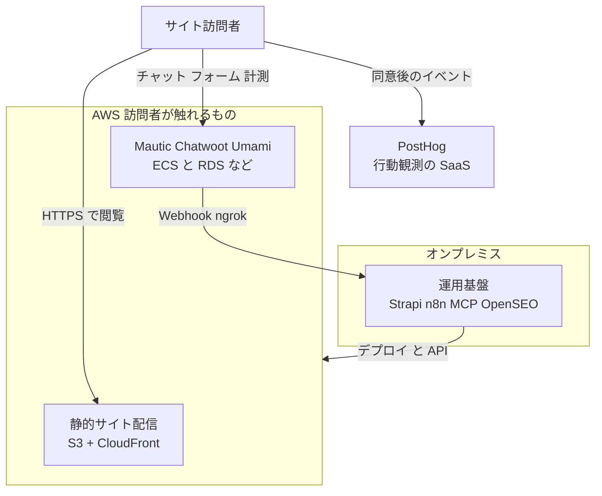
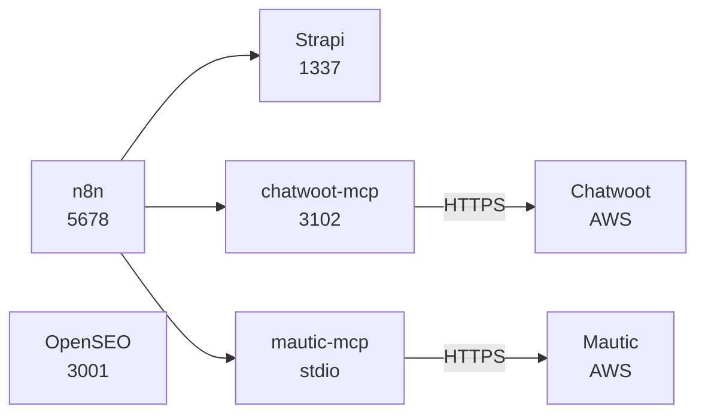
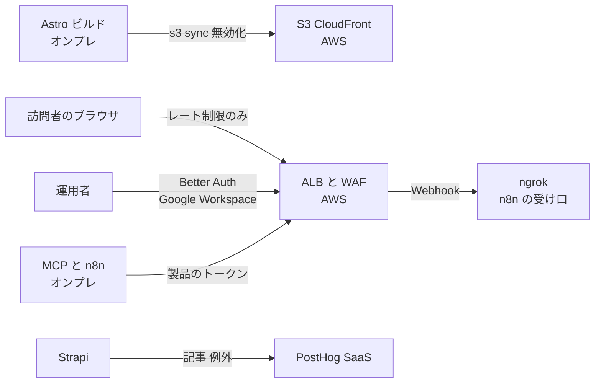

# 01. デプロイメント配置図

TA（Technology Architecture）層。ロール ID・Capability ID・エンティティ ID は EA 共通用語集の定義をそのまま使う。
ファイルパスは `MarketingDepartment/WebsiteOperations/` を起点とした相対で書く。

## 1. 配置の原則

**訪問者のブラウザが直接触れるシステムはクラウド（AWS）に置く。それ以外の構成要素はすべてオンプレミスに置く。**（AA-05 の ADR-12。2026-09-18 に `R1` が決定）

**当初の原則は「クラウドに展開するのは製品（Astro のビルド成果物）のみ」だった。** 訪問者から届く必要がある Chatwoot・Mautic・Umami はオンプレに置き、ngrok の常設トンネルで開く設計にしていた。この設計には「訪問者から見える機能が開発機 1 台の死活に依存し、しかも静かに止まる」という弱点があり（旧 9 節）、ADR-12 で原則を置き換えた。**判断基準を 1 文で言える状態は保っている。** 基準は「訪問者のブラウザが直接触れるかどうか」の 1 本である。

| 層 | 対象 | 配置先 | 状態 |
|---|---|---|---|
| 製品 | Astro のビルド成果物（`E-05` `Page`） | AWS（S3 + CloudFront）。設計は TA-02 | `未着手` |
| **訪問者が触れるシステム** | **Mautic・Chatwoot・Umami** | **AWS（ECS on Fargate ＋ RDS・ElastiCache・S3・EFS）。設計は TA-06** | `未着手`（開発環境はローカルの Docker で `実装済み`） |
| 制作・運用の裏側 | Strapi（`E-04` の正本）、n8n、MCP サーバ、OpenSEO | オンプレミス（開発機のローカルホスト） | `実装済み`（各スタックは起動できる） |
| 観測の一部 | PostHog | SaaS（行動観測の例外。後述） | `部分的` |
| **検索データの取得元** | **Google Search Console、DataForSEO**（どちらも OpenSEO から呼ぶ） | SaaS（**自前で持てないデータの取得元**。8 節） | `部分的`（DataForSEO のみ設定済み） |
| 監査 | Lighthouse CI | オンプレミス（結果は `frontend/verdant-virgo/.lighthouse/`） | `実装済み` |
| **通知** | **Amazon SNS**（`comegin-lead-alert` / `comegin-ops-alert`） | **AWS（`ap-northeast-1`）。設計は ADR-08** | `未着手` |
| **顧客向けメール** | **Amazon SES**（Mautic・Chatwoot のメール） | **AWS（`ap-northeast-1`）。設計は TA-06 の 6 節** | `未着手`（サンドボックスのまま） |

**Umami は止まっても訪問者には見えないが、クラウドに置く。** 判断基準は「止まったときに訪問者に見えるか」ではなく「訪問者のブラウザから届く必要があるか」である。Umami だけをオンプレに残すと、公開の経路に ngrok が 1 本だけ残り、トンネル断による欠測（DD-07 の 2 節）も残る。

**通知が AWS にあるのは原則からの要請にあたる。** 通知経路がオンプレにあると、オンプレが落ちたときに「落ちた」という通知も届かない（監視対象が通知経路を兼ねる。TA-05 の 4 節）。**ベンダーは増えていない**（AWS は製品の配信先として既に使っている。8 節）。

**本番と開発で置き場所が違う。** 訪問者が触れる 3 システムは、**開発環境では今のまま開発機のローカルの Docker で動かす**（5 節・6 節のポートとバインドアドレスは開発環境の事実である）。本番の構成は TA-06 に書く。

「オンプレミス」はここでは**専用のデータセンターではなく、運用担当者の開発機**を指す。構成上の意味は「**インターネットから直接は到達できず、到達させたい経路だけをトンネルで明示的に開く場所**」である。ADR-12 の後にトンネルとして開くのは、**クラウドの Mautic・Chatwoot からオンプレの n8n へ届く Webhook**（7 節の経路 5）と、Astro dev サーバーの共有（経路 6）だけになった。

## 2. 図 1 配置境界の全体像（To-Be）

図は To-Be を描いている。**As-Is では AWS 境界の中身が存在しない**（`cloud/` は空ディレクトリで、公開サイトそのものが無い）。現在実際に動いている線は「オンプレ → PostHog」（Strapi のライフサイクル購読と例外送信。`backend/strapi-system/src/index.ts`、`backend/strapi-system/src/middlewares/posthog-error.ts`）と「オンプレ → 検索データの取得元」（OpenSEO → DataForSEO）の 2 本で、いずれも図では省いた。訪問者の線は届く先が無い。

**AWS とオンプレの間の線の向きが変わった。** 旧設計では訪問者の通信がオンプレに**入ってくる**線（ngrok）が主だった。ADR-12 の後は、オンプレから AWS へ**出ていく**線（デプロイ・MCP サーバと n8n からの API 呼び出し）が主になり、入ってくる線は Webhook の 1 種類だけになる。

## 3. 図 2 オンプレミス側の内訳（To-Be）

図は To-Be の**本番**を描いている。**As-Is では n8n から出る線が 1 本も存在しない**（ワークフローが 0 件のため。TA-03 の 6 節で詳述する）。MCP サーバから上流 API への線だけが実装済みで、**現在の接続先は開発機のローカルの Chatwoot・Mautic** である。本番では接続先の URL が AWS の ALB に変わる（TA-06 の 5 節）。

**OpenSEO は孤立しているが、これが正しい状態である。** OpenSEO はオンプレの他の構成要素とデータをやりとりしない設計であり（入力は外部の GSC と DataForSEO、読み手は Claude Code の MCP 呼び出しで、どちらもこの図の外）、採用したキーワードを Strapi に書くのはエージェントであって OpenSEO ではない（DA-04 の 2 節）。

**Umami はこの図から外れた。** 旧版では「どの構成要素とも配線されていないため孤立している」と記していたが、ADR-12 で AWS 側に移った。Umami の読み手である Umami MCP は、**本番の Umami の `/mcp` エンドポイントに API キーで接続する**（TA-06 の 5.4。2026-09-18 に決定）。現在のローカルの設定は Umami Cloud を向いており、本番の Umami を立てた後に付け替える。

## 4. 図 3 境界を越える通信（To-Be）

図は To-Be を描いている。**As-Is で通っているのは最下段の 1 本（Strapi → PostHog）だけ**である。

**旧版の図の要点は「入口が同じで要件が正反対の 2 本の線が、1 つのトンネル機構に入る」ことだった**（訪問者は無認証、運用者は要認証）。ADR-12 の後も、**要件が正反対の主体が同じ入口（ALB）に入る構造は変わらない**。変わったのは分離の手段で、ngrok の設定ではなく **ALB のリスナールール**で経路ごとに分ける（TA-06 の 5.2）。許可リストで分ける方針（TA-04 の 7 節）はそのまま引き継ぐ。

## 5. ポート割当

**開発環境（開発機のローカル）の割当である。** 本番では Mautic・Chatwoot・Umami は AWS の ALB の後ろで動き、この表のポートは使わない（TA-06）。複数スタックを同時に起動する前提で調整済みの割当。新しくポートを使うときはこの表を崩さない。

| ポート | 用途 | 定義箇所 | 状態 |
|---|---|---|---|
| 1025 | Mautic の MailHog（SMTP） | `backend/mautic-system/docker/compose.yaml` | `実装済み` |
| 1337 | Strapi | `backend/strapi-system` | `実装済み` |
| 3000 | Umami | `middleware/umami-master/docker-compose.yml` | `実装済み` |
| **3001** | **OpenSEO**（UI と MCP の `/mcp`） | `middleware/open-seo-main/compose.yaml`（`PORT` の既定。上流のまま） | `実装済み` |
| 3100 | Chatwoot 本体（`CHATWOOT_PORT`） | `backend/chatwoot-system/docker-compose.yaml` | `実装済み` |
| 3100 | **mautic-mcp の HTTP 既定値**（衝突。後述） | `backend/mautic-mcp/src/config.ts` | `実装済み` |
| 3102 | chatwoot-mcp（HTTP 時） | `backend/chatwoot-mcp/src/config.ts` | `実装済み` |
| **3103** | **`admin-auth`（管理画面の関門。Better Auth）の開発サーバー**（本番は ALB の後ろ。TA-06 の 5.2.1） | 未作成（`backend/admin-auth` を想定） | `未着手` |
| 3306 | Mautic の MySQL 8.4 | `backend/mautic-system/docker/compose.yaml` | `実装済み` |
| 4321 | Astro dev | `frontend/verdant-virgo` | `実装済み` |
| 4322 | Lighthouse CI が使う preview（固定） | `frontend/verdant-virgo/lighthouserc.cjs` | `実装済み` |
| 5432 | Chatwoot の PostgreSQL（pgvector pg16） | `backend/chatwoot-system/docker-compose.yaml` | `実装済み` |
| 5433 | n8n の PostgreSQL 18 | `middleware/n8n/compose.yml` | `実装済み` |
| 5678 | n8n | `middleware/n8n/compose.yml` | `実装済み` |
| 6379 | Chatwoot の Redis | `backend/chatwoot-system/docker-compose.yaml` | `実装済み` |
| 8000 | Mautic（PHP ビルトインサーバー） | `backend/mautic-system/dev/serve.sh` | `実装済み` |
| 8025 | Mautic の MailHog（UI） | `backend/mautic-system/docker/compose.yaml` | `実装済み` |
| 8026 | Chatwoot の MailHog（UI） | `backend/chatwoot-system/docker-compose.yaml` | `実装済み` |

### 3100 の衝突と回避策

Chatwoot 本体（`CHATWOOT_PORT` の既定 3100）と `mautic-mcp` の HTTP 既定ポート（`backend/mautic-mcp/src/config.ts` の `PORT` 既定 3100）が衝突する。
`mautic-mcp` は `TRANSPORT` の既定が `http` であるため（`chatwoot-mcp` は既定が `stdio` で、2 つのサーバは既定トランスポートが逆）、**何も指定せずに `pnpm start` すると 3100 を掴みにいく**。Chatwoot が先に起動していれば bind に失敗し、起動していなければ後から Chatwoot が失敗する。

採る回避策は次の優先順で決める。

1. **`mautic-mcp` を stdio で動かす**（`pnpm start:stdio`）。エージェントがローカルから使う限り HTTP は不要で、stdio ならポートを一切使わず認証も不要になる（`MCP_AUTH_TOKEN` はトランスポートが HTTP のときだけ必須。`backend/mautic-mcp/src/config.ts` の `refine`）。これを既定の運用とする。
2. HTTP が必要な場合（遠隔のクライアントから使う場合）は **`PORT=3101` を与える**（3101 は本表のどこにも使われていない）。
3. Chatwoot 側の `CHATWOOT_PORT` は動かさない（変更すると `FRONTEND_URL` と Web サイトに埋め込むウィジェットのスクリプト URL まで追随が必要になり、影響範囲が MCP 側の変更よりはるかに広いため）。

## 6. バインドアドレスの非対称

**開発環境の事実である**（本番の Mautic・Chatwoot・Umami は private サブネットに置き、ALB だけがインターネットに面する。TA-06 の 5.6）。ホストへ公開するポートのバインド先を一覧にする。**Umami だけが全インターフェースに公開されている。**

| ポート | サービス | バインド | 定義箇所 |
|---|---|---|---|
| 3000 | Umami | **`0.0.0.0`（全インターフェース）** | `middleware/umami-master/docker-compose.yml` の `"3000:3000"` |
| **3001** | **OpenSEO** | **`127.0.0.1`** | `middleware/open-seo-main/compose.yaml`（上流のまま） |
| 3100 | Chatwoot（rails） | `127.0.0.1` | `backend/chatwoot-system/docker-compose.yaml` |
| 5432 | Chatwoot の PostgreSQL | `127.0.0.1` | 同上 |
| 6379 | Chatwoot の Redis | `127.0.0.1` | 同上 |
| 8026 | Chatwoot の MailHog | `127.0.0.1` | 同上 |
| 5678 | n8n | `127.0.0.1` | `middleware/n8n/compose.yml` |
| 5433 | n8n の PostgreSQL | `127.0.0.1` | 同上 |
| 3306 | Mautic の MySQL | `127.0.0.1` | `backend/mautic-system/docker/compose.yaml` |
| 1025 / 8025 | Mautic の MailHog | `127.0.0.1` | 同上 |
| 8000 | Mautic（PHP ビルトイン） | `127.0.0.1`（`HOST` の既定） | `backend/mautic-system/dev/serve.sh` |
| （なし） | Umami の PostgreSQL | ホストへ公開しない | `middleware/umami-master/docker-compose.yml` |
| （なし） | n8n の `sandbox-api` / `sandbox-runner-1` / `runners` / `searxng` | ホストへ公開しない | `middleware/n8n/compose.yml` |

n8n・Chatwoot・Mautic の compose にはいずれも「外部ネットワークに公開しないようループバックのみにバインド」というコメントが明示的に付いている。すなわち**この非対称は設計思想の違いではなく、Umami にだけ同じ判断が適用されていないという欠落**である。原因は Umami が上流の compose を無改変で取り込んでいることにある（`middleware/umami-master` は上流の v3.4.0 の 2,026 ファイルをそのまま取り込んでいる）。

**OpenSEO も上流の compose を無改変で使うが、こちらは上流が最初から `127.0.0.1` にバインドしている**（`middleware/open-seo-main/compose.yaml` の `"127.0.0.1:${PORT:-3001}:${PORT:-3001}"`）。上流の作者が「Docker 版は認証が無いので、自分の認証の後ろ以外に出すな」と明記しており（`docs/SELF_HOSTING_DOCKER.md`）、**上流の既定がこの基盤の方針と一致している**。上流無改変という方針とセキュリティ要件が衝突するかどうかは、上流の既定次第で決まる。

この項目を含む Umami の 4 つの課題と、上流無改変の方針との衝突は TA-04 の 3 節で扱う。ここでは配置上の事実として記録するにとどめる。

## 7. 境界を越える通信の一覧

**本番（ADR-12 の後）の一覧である。** 開発環境では、訪問者が触れる 3 システムもオンプレのローカルで動くため、経路 4・7・9 は開発機の中で完結する。

| # | 経路 | 方向 | 内容 | 保護 | 状態 |
|---|---|---|---|---|---|
| 1 | オンプレ → AWS | 送信 | `astro build` の成果物を S3 へ同期し、CloudFront を無効化する | IAM（デプロイ専用の権限）。設計は TA-02 | `未着手` |
| 2 | AWS → オンプレ | 受信 | CloudFront / S3 のアクセスログを回収し `E-12` の材料にする | 取得は読み取りのみ | `未着手` |
| 3 | 訪問者 → AWS（CloudFront） | 受信 | 公開サイトの閲覧 | ACM の TLS、AWS WAF | `未着手` |
| 4 | **訪問者のブラウザ → AWS（ALB）** | 受信 | Umami のトラッカー配信とイベント受信、Chatwoot のウィジェットと WebSocket、Mautic のフォーム受付とトラッキング、**配信メールの開封・クリック計測** | **認証・認可をしない。WAF のレート制限だけ**（訪問者が到達できないと `CAP-10` `CAP-11` `CAP-12` が成立しないため。`R1` の 2026-09-18 の決定）。**ALB のリスナールールでパス単位の許可リスト**。設計は TA-06 の 5 節 | `未着手` |
| 5 | **AWS（Mautic・Chatwoot）→ オンプレ（ngrok）** | 受信 | n8n の Webhook 受け口（`N8N_WEBHOOK_URL`、`N8N_PROXY_HOPS`）。**ADR-12 の後、公開の経路で ngrok を通るのはこの 1 種類だけ** | ngrok のトンネル ＋ n8n の Webhook パス | `未配線` |
| 6 | 外部 → オンプレ（ngrok） | 受信 | Astro dev サーバーの共有（`comegin-astro-dev.ngrok.app`） | Vite の `allowedHosts` による Host 照合 | `実装済み` |
| 7 | **運用者 → AWS（ALB）** | 受信 | Mautic・Chatwoot・Umami の管理画面 | **要認証**（ALB の OIDC 認証。IdP は自作の `admin-auth`（Better Auth）で、ログインは Google Workspace。2 段階認証は Workspace で必須。TA-06 の 5.2.1）。各製品のログインはその後ろ | `未着手` |
| 8 | オンプレ → PostHog | 送信 | 記事ライフサイクルのイベントと例外 | `POSTHOG_PROJECT_TOKEN` | `実装済み` |
| 9 | **オンプレ → AWS（ALB）** | **送信** | MCP サーバと n8n から Chatwoot / Mautic の API、Umami MCP から Umami の `/mcp`（**Umami で開けるのは `/mcp` だけ**。TA-06 の 5.4） | Chatwoot は `api_access_token`、Mautic は OAuth2 client_credentials、Umami は API キー。**ALB の認証は通さず、製品側の認証と WAF のレート制限で守る**（送信元 IP では絞らない。オンプレの IP が固定ではないため） | `実装済み`（**接続先は開発機のローカル**。本番の接続先は `未着手`） |
| 10 | オンプレ → AWS（SNS） | 送信 | n8n から通知を発行する（顧客からの要求・監視の検知）。設計は AA-02 の `I-21` | IAM（**`sns:Publish` のみ**。対象トピックを限定。TA-04 の 1 節） | `未着手` |
| 11 | オンプレ → DataForSEO | 送信 | OpenSEO からの検索データの問い合わせ（キーワード・ドメイン・地域コード）。AA-02 の `I-23` | `DATAFORSEO_API_KEY`。**前払い残高が支出の上限** | `実装済み` |
| 12 | オンプレ → Google（Search Console API） | 送信 | OpenSEO が OAuth で自サイトの検索実績を取得する。AA-02 の `I-15` | OAuth（スコープ `webmasters.readonly`）。トークンは OpenSEO の DB に `BETTER_AUTH_SECRET` で暗号化 | `未着手` |
| 13 | オンプレ → AWS（公開サイト） | 送信 | OpenSEO のサイト監査のクロール。AA-02 の `I-24` | 自サイトのみ（BA-05） | `未着手` |
| 14 | オンプレ → OpenSEO 開発元の PostHog（米国） | 送信 | OpenSEO の匿名テレメトリ。送るのは件数（インストール数・ユーザー数・プロジェクト数・機能の利用回数）と無作為なインストール ID、失敗した設定チェックの名前と状態だけで、**URL・キーワード・プロンプト・メール・IP 由来の位置情報は含まない**（上流の `docs/SELF_HOSTING_DOCKER.md`）。インストール後 2 時間は 5 分ごと、以後は 1 日 1 回まで | **無し（送信を許可する。`R1` の 2026-09-18 の判断。AA-05 の ADR-09）** | `実装済み`（既定で有効） |
| **15** | **AWS（Mautic・Chatwoot）→ 顧客（SES）** | **送信** | **顧客向けメール**（Mautic の配信・フォームの自動返信、Chatwoot のメール） | SES の SMTP 認証情報。送信元ドメイン `comegin.com` の DKIM・SPF・DMARC。**送るかどうかは BA-05 の承認ゲート**（TA-06 の 6 節） | `未着手`（サンドボックスのまま） |
| **16** | **オンプレ → AWS（CloudWatch）** | **送信** | **n8n が 5 分ごとにハートビート（生存信号）を送る。** 途絶えると CloudWatch のアラームが SNS の `comegin-ops-alert` に直接通知する（TA-05） | IAM（`cloudwatch:PutMetricData` のみ。名前空間 `ComeGin/Onprem` に限定。TA-04 の 1 節） | `未着手` |
| **17** | **AWS（`admin-auth`）→ Google Workspace** | **送信** | 管理者のログイン。Better Auth が Google の OIDC で認証し、`hd` クレームと管理者の許可リストを検査する（TA-06 の 5.2.1） | Google Cloud の OAuth クライアント（「内部」）。クライアントシークレットは Secrets Manager | `未着手` |

**OpenSEO は外から中への経路を 1 本も必要としない。** 経路 11〜14 はすべて中から外への送信であり、GSC の OAuth のコールバックも運用者のブラウザから `http://localhost:3001` に戻るだけで完結する。**OpenSEO の UI と MCP にトンネルを張らない**（TA-04 の 7 節）。

**経路 4 と経路 7 は要件が正反対である。** 経路 4 は無認証でなければ成立せず（訪問者にログインを求めることはできない）、経路 7 は認証が無ければ成立しない。**同じ ALB でこの 2 種類を分離する設計が必須**であり、TA-06 の 5 節で扱う。経路 9（オンプレのサーバーからの API）は、ブラウザでのログインができないため、3 つ目の主体として**パスで分け、製品側の認証に任せる**。

### オンプレ側の露出は ngrok の常設トンネルで行う（2026-09-18 に範囲を縮小）

**旧版の決定は「訪問者向けの経路 4 と運用者向けの経路 7 を、オンプレから ngrok の常設トンネルで露出する」だった。** ADR-12 によって経路 4・7 は AWS の ALB に移り、**ngrok に残るのは経路 5（n8n の Webhook）と経路 6（Astro dev サーバー）だけになった。**

- **経路 5 のために固定ドメインは引き続き要る。** Mautic と Chatwoot の Webhook の送信先に n8n の URL を登録するため、再起動のたびに URL が変わると登録し直しになる。ngrok の固定ドメインのプラン要件は引き続き未確認である（9 節）。
- **トンネルが落ちたときの影響が小さくなった。** 旧設計ではトンネル断で計測・チャット・フォームが同時に止まった。ADR-12 の後は、止まるのは n8n への Webhook（`I-11` など）だけで、**訪問者から見える機能は止まらない。** ただし Webhook の取りこぼしは静かに起きるため、監視の対象から外さない（TA-05 の 4 節）。

## 8. SaaS 依存の基準

**当初この節は「SaaS 依存は PostHog のみ」としていた。** 2026-09-18 に OpenSEO（セルフホスト）を採用し、その取得元として DataForSEO が加わったことで、この一文は成り立たなくなった（AA-05 の ADR-09）。**原則を一文で言える状態を保つために、例外を列挙するのではなく、認める基準を書き直す。**

**外部の SaaS に依存してよいのは、次の 2 種類に限る。**

| 種類 | 該当するもの | 基準の意味 |
|---|---|---|
| **自前で持つと観測の一巡が遅くなる機能** | PostHog（行動観測・実験・エラー追跡） | 当初からの唯一の例外（下記） |
| **自前で持てないデータの取得元** | Google Search Console、DataForSEO | 検索結果での扱い・検索ボリューム・競合の順位は**Google の外に存在しない**。自前で立てる選択肢そのものが無い |

加えて、**既存のベンダーの中のサービスはベンダーを増やさない**（Amazon SNS。ADR-08）。境界の説明は**「訪問者が触れるものと通知・顧客向けメールは AWS、他はオンプレ、行動観測は PostHog、検索データは Google と DataForSEO から取るだけ」**の一文に収まる（ADR-12 で「製品と通知は AWS」から書き換えた）。

### PostHog を例外とする理由

- **例外を認める理由**: PostHog に求めている機能（セッションリプレイ、エラー追跡、Scout による自動巡回）は、自前で立てると運用対象が 1 つ増えるうえ、Scout やリプレイ解析は自己ホスト版でも同等に動くとは限らない。観測基盤の運用に人手を取られると、この事業基盤が最適化しようとしている「観測から改善までの一巡の時間」がかえって延びる（BA-01 の目的と直接矛盾する）。
- **例外であることの帰結**: `E-08` `Person`（PostHog）と `E-11` `Experiment`（PostHog）の正本が外部にある。すなわち**この 2 つのエンティティだけは、オンプレのバックアップを取っても復旧できない**（TA-05 の 5 節で扱う）。
- **PostHog に送るデータの範囲**: DA-05 の `sanitize()` 方針と保持期間の判断に従う。Strapi のライフサイクルイベントは `$process_person_profile: false` を付けて person を作らない（`backend/strapi-system/src/index.ts`）。

### 検索データの取得元を認める条件

- **取得元にとどめ、正本を置かない。** GSC と DataForSEO から取った値は、OpenSEO（オンプレ）と `E-12` に残る。**DataForSEO には何も保管させない**（問い合わせを送って結果を受け取るだけ）。
- **個人情報を送らない。** DataForSEO に送るのはキーワード・ドメイン・地域コードだけである（DA-05 の 1.2.1）。**個人に関わるデータが越境する SaaS は依然として PostHog だけ**であり、その点で PostHog の例外は 1 つのまま保たれている。
- **テレメトリは依存に数えない。** 経路 14（OpenSEO の匿名テレメトリ）は OpenSEO 開発元の PostHog への送信だが、**この基盤はその送信から何も受け取らず、止まっても何も困らない**。8 節の基準は「依存してよい SaaS」を絞るものであり、依存の無い送信は 7 節の一覧で管理する（送るものに個人情報を含まないことが条件。DA-05 の 1.2.1）。
- **取得元を増やさない。** 「検索データの取得元」を理由に、同じ役割の別サービス（別の SEO データ提供元）を足さない。足すなら基準そのものを見直す。
- **OpenSEO 自体は SaaS 版を使わない。** OpenSEO のホスト版（openseo.so）は検索データの取得元ではなく**処理と保管の場所**であり、この基準に当たらない（ADR-09 でセルフホストを選んだ理由）。

### 境界に関わるその他の約束

- **PostHog を増やさない**: 「行動観測の SaaS が 1 つ入っているのだから 2 つ目も」という拡張は行わない。
- **Amazon SNS は新しい事業者への依存ではない**（ADR-08）。`CAP-07` `CAP-08` の配信先として既に使う AWS アカウント内のサービスだからである。判断基準は「ベンダーを増やさないこと」であり、「AWS のサービスを増やさないこと」ではない。

## 9. 未決定事項

- **ngrok の固定ドメインのプラン要件を実地に確認していない。** ADR-12 の後も経路 5（n8n の Webhook）のために固定ドメインが要る。必要なプランと費用を本セッションでは確認していない。
- **ngrok のトンネルが落ちたときの影響範囲の合意が無い。** ADR-12 で影響は n8n への Webhook だけに縮んだが、**静かに止まる**点は変わらない（Mautic・Chatwoot の側では送信の失敗しか残らない）。監視項目は TA-05 の 4 節にある。
- **AWS 側のアクセスログを回収する手段が未定（経路 2）。** CloudFront の標準ログを S3 に出すところまでは決まるが、それをオンプレに引き込んで `E-12` に変換する経路は DA-04 の鮮度要件（観測は日次）と合わせて決める必要がある。
- **オンプレミスの実体が単一の開発機であることの可用性上の扱い。** ADR-12 で、訪問者が触れる機能（`CAP-11` `CAP-12` の入口）は開発機から切り離された。**開発機が落ちて止まるのは、制作（Strapi）・自動化（n8n）・エージェント（MCP）・調査（OpenSEO）になった。** `CAP-14`（改善提案）は止まるが、訪問者からは見えない。**止まったことは経路 16 のハートビートで検知できるようになった**が、「止まってよい時間」の合意はまだ無い。
- **Umami MCP の接続設定の付け替えと、取り込み済みの Umami の 3.4.0 への更新**（TA-06 の 11 節）。判断者 `R1`。
- **（2026-09-18 に決定）AWS 側の可用性は単一構成**（TA-06 の 4.6）、**オンプレの送信元 IP による許可は採らない**（経路 9）、**管理画面の関門は Better Auth（Google Workspace）を IdP にした ALB の OIDC 認証**（経路 7・17。ADR-13）、**訪問者側は認証・認可をせずレート制限だけ**（経路 4）、**オンプレの全滅は CloudWatch から SNS へ直接知らせる**（経路 16）。
- **OpenSEO を開発機の外から使う方法が無い。** Docker 版は無認証（`local_noauth`）であり、トンネルを張らないと決めた（7 節）。運用者が 2 名を超えて別の端末から使いたくなった場合、**ngrok の認証の後ろに置く**か、OpenSEO の Cloudflare 版（Cloudflare Access の認証付き）に移るか、ADR-12 と同じく AWS に置くかを決める必要がある。判断者 `R1`。
- **旧版の「Umami を 3000 のままループバックに変更するか」は、本番では解消した**（本番の Umami は ALB の後ろの private サブネットに置く。TA-06）。**開発環境の Umami が `0.0.0.0` にバインドされている問題は残る**（6 節）。対処は TA-04 の 3 節の判断と一体で決める。
