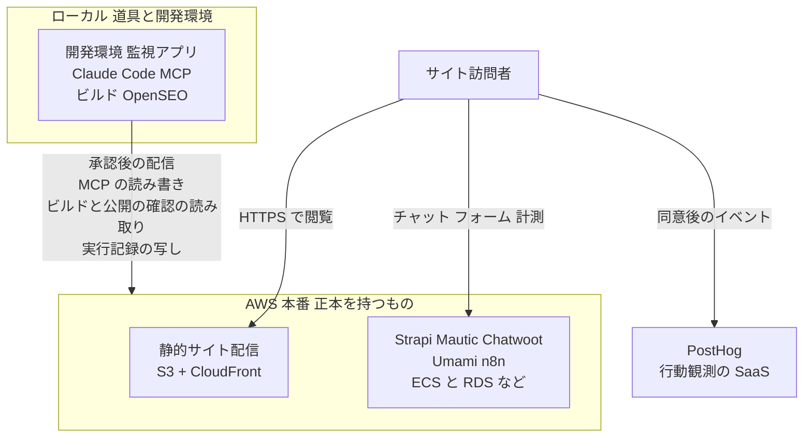
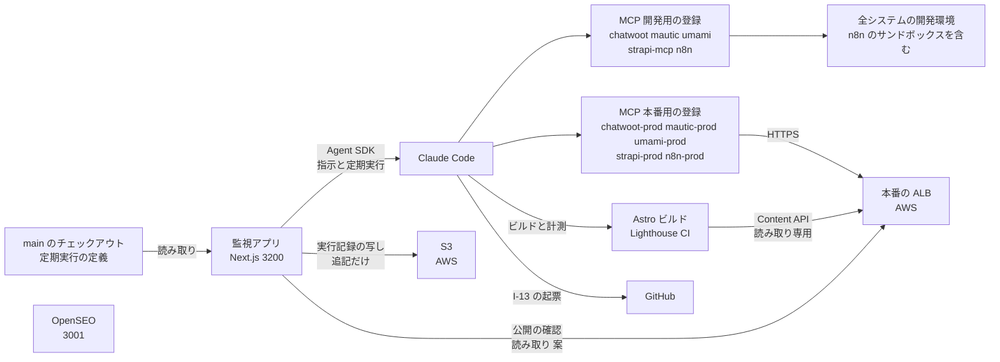
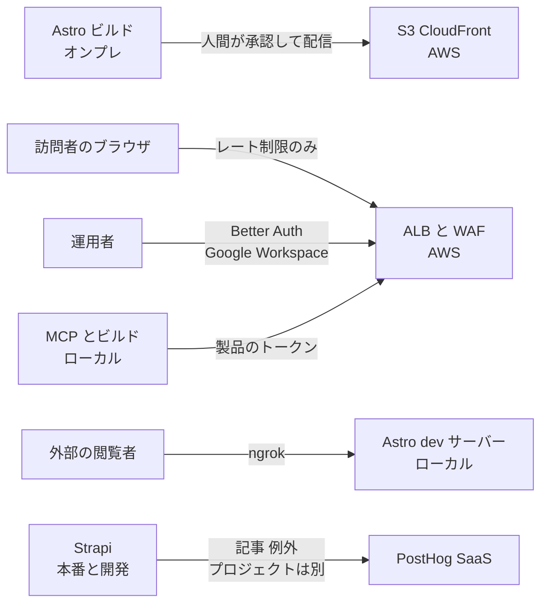

# 01. デプロイメント配置図

TA（Technology Architecture）層。ロール ID（正本は BA-03）・Capability ID（BA-02）・エンティティ ID（DA-01）はそれぞれの正本の定義をそのまま使う（索引は [`docs/README.md` の「ID の採番と正本」](../../README.md)）。
ファイルパスは `MarketingDepartment/WebsiteOperations/` を起点とした相対で書く。

## 1. 配置の原則

**正本のデータを持つシステムはすべてクラウド（AWS）に置き、ローカル（オンプレミス）には道具と全システムの開発環境だけを残す。**（AA-05 の ADR-16。2026-09-19 に `R1` が決定。ADR-14・ADR-15 の配置を置き換えた）

**原則はこれまでに 4 度変わった。** 当初は「クラウドに展開するのは製品（Astro のビルド成果物）のみ」だった。ADR-12（2026-09-18）で「訪問者のブラウザが直接触れるシステムはクラウド」に変え、ADR-14（2026-09-19）で「本番のサービスとその正本はクラウド、開発と管制はオンプレ」にした。同日の ADR-15 で **Strapi をオンプレだけに戻し、ローカルの Claude Code が MCP で本番の Mautic・Chatwoot・Umami も読み書きする**形にし、さらに同日の ADR-16 で基準を**「正本のデータを持つか」**に改め、**Strapi（記事の正本）と n8n（本番の自動化）を再び AWS に置いた**。MCP で本番を読み書きする ADR-15 の決定はそのまま有効である。

**ADR-18 で、この基準に例外が 1 つできた。** `E-15 AgentRun`（エージェントの実行記録）の正本は、監視アプリ（ローカル）の実行記録にする。記録はエージェントの実行と同じ場所で生まれ、監視アプリをクラウドに置いても開発機が止まればエージェントは動かないため、監視アプリはローカルに置いたまま、記録もローカルに保存する（TA-07 の 3.6）。**ローカルに正本を置くのは `E-15` だけである。** **ADR-18 の追加の決定で、この記録を AWS の S3 に追記専用で写すことにした**（写しは正本ではなく、開発機を失ったときの復旧に使う。記録は要約と ID だけ。経路 19。TA-06 の 4.7）。

| 層 | 対象 | 配置先 | 状態 |
|---|---|---|---|
| **本番** | **Astro のビルド成果物**（`E-05` `Page`） | AWS（S3 + CloudFront）。設計は TA-02 | `未着手` |
| **本番** | **Strapi（`E-04` の正本）・Mautic・Chatwoot・Umami・n8n（本体と runners。サンドボックスは置かない）** | **AWS（ECS on Fargate ＋ RDS・ElastiCache・S3・EFS）。設計は TA-06**（Strapi と n8n は ADR-16 で加えた） | `未着手` |
| **本番** | **`points-api`**（採掘の貢献量の取り込みと譲渡不可ポイントの付与。自作。`E-17` `E-19` の正本。**2026-10-03 に追加。本システムの完成後**） | **AWS（ECS on Fargate ＋ RDS ＋ S3〈Object Lock〉）。設計は TA-06** | `未着手` |
| **開発環境** | **上記すべての開発環境**（ローカルの Docker と dev サーバー。**n8n のサンドボックスを含む**） | オンプレミス（開発機のローカルホスト） | `実装済み`（各スタックは起動できる） |
| **ローカルだけ（道具）** | **Claude Code、自作の MCP サーバ（stdio）、監視アプリ（Next.js。`frontend/next-js`）**、OpenSEO、Lighthouse CI、Astro のビルド | オンプレミス。設計は TA-07。**ADR-15 ではここに Strapi と n8n も置いていたが、ADR-16 で本番を AWS に移した**。**監視アプリは `E-15` の正本（実行記録）を持つ**（ADR-18。1 節の例外） | 監視アプリは `未着手`（雛形と Better Auth の導入のみ） |
| **利用者環境** | **`miner`（XMRig。採掘のコンテナ）**（**2026-10-03 に追加**。ComeGin は運用しない） | **AWS 以外（無料 DL したソースコードで基盤を立てた利用者のサーバ）**。ComeGin は観測しない。この節の「利用者環境」 | `未着手` |
| 観測の一部 | PostHog | SaaS（行動観測の例外。後述） | `部分的` |
| **検索データの取得元** | **Google Search Console、DataForSEO**（どちらも OpenSEO から呼ぶ） | SaaS（**自前で持てない外部の台帳**。8 節。2026-10-03 に「データの取得元」から広げた） | `部分的`（DataForSEO のみ設定済み） |
| **外部の台帳と SaaS（収益化）** | **unMineable（採掘プール）・Polygon PoS（ブロックチェーン）・thirdweb（ウォレット／ダッシュボード）**（**2026-10-03 に追加**。`points-api` から呼ぶ） | SaaS とパブリックチェーン（**自前で持てない外部の台帳**。8 節。thirdweb は AWS を優先する基準の例外） | `未着手` |
| 監査 | Lighthouse CI | オンプレミス（結果は `frontend/verdant-virgo/.lighthouse/`） | `実装済み` |
| **通知** | **Amazon SNS**（`comegin-lead-alert` / `comegin-ops-alert`） | **AWS（`ap-northeast-1`）。設計は ADR-08** | `未着手` |
| **顧客向けメール** | **Amazon SES**（Mautic・Chatwoot のメール） | **AWS（`ap-northeast-1`）。設計は TA-06 の 6 節** | `未着手`（サンドボックスのまま） |

**管理者の操作経路は 3 つに分かれる**（TA-07）。

| 経路 | 使う場面 | 対象 |
|---|---|---|
| 監視アプリ → Claude Code → MCP | エージェントに作業させる（**管理者の指示と、監視アプリの定期実行**。ADR-17） | **開発環境と、本番の Strapi・Mautic・Chatwoot・Umami・n8n**（本番は `read_write` まで。ADR-15 で暫定、ADR-16 で確定。Strapi と n8n の本番用の登録は ADR-16 で加えた。**`strapi-prod` は下書きまで**。ADR-17） |
| 各製品の管理画面（オンプレの PC のブラウザから） | 結果の確認と修正。**本番の記事の公開**（`R2`。ADR-17） | 開発環境と本番の両方。本番は ALB の Better Auth の関門を通る（ADR-13。Strapi の `/admin` と n8n のエディターも含む。ADR-16） |
| 本番への配信 | Astro の更新を公開する | **Claude Code がオンプレでビルドと計測を行い、人間が承認して配信する**（TA-07 の 7 節）。**ビルドは本番の Strapi を読む**（ADR-16）。記事の公開をきっかけにしたビルドは、**監視アプリの定期実行が本番の Strapi を読んで公開を見つけて起こす**（案。ADR-17。TA-03 の 3.1） |

**Umami は止まっても訪問者には見えないが、クラウドに置く。** 判断基準は「止まったときに訪問者に見えるか」ではなく「訪問者のブラウザから届く必要があるか」である。Umami だけをオンプレに残すと、公開の経路に ngrok が 1 本だけ残り、トンネル断による欠測（DD-07 の 2 節）も残る。

**通知が AWS にあるのは原則からの要請にあたる。** 通知経路がオンプレにあると、オンプレが落ちたときに「落ちた」という通知も届かない（監視対象が通知経路を兼ねる。TA-05 の 4 節）。**ベンダーは増えていない**（AWS は製品の配信先として既に使っている。8 節）。

**本番と開発で置き場所が違う。** 本番の 7 システム（Astro・Strapi・Mautic・Chatwoot・Umami・n8n ＋ `points-api`〈2026-10-03 に追加。本システムの完成後〉）は、**開発環境では今のまま開発機のローカルの Docker と dev サーバーで動かす**（5 節・6 節のポートとバインドアドレスは開発環境の事実である）。本番の構成は TA-06 に書く。**開発機が止まっても、本番のサービス・記事の正本・自動化は止まらない**（ADR-16。止まるのは開発環境・ビルドと配信・エージェントの作業・OpenSEO だけ）。**ADR-17 でエージェントの定期実行を監視アプリから起動することにしたため、止まる「エージェントの作業」には定期実行（観測の日次バッチ・改善提案の起票など）が含まれる。** 開発機の停止は改善ループの停止を意味する（本番の n8n の決定論的な定期処理は止まらない）。

「オンプレミス」はここでは**専用のデータセンターではなく、運用担当者の開発機**を指す。構成上の意味は「**インターネットから直接は到達できず、到達させたい経路だけをトンネルで明示的に開く場所**」である。ADR-12 の後にトンネルとして開くのは、**クラウドの Mautic・Chatwoot からオンプレの n8n へ届く Webhook**（7 節の経路 5）と、Astro dev サーバーの共有（経路 6）だけになった。**ADR-16 で n8n も AWS に移り、経路 5 は VPC の中で完結して ngrok を通らなくなった。トンネルとして開くのは経路 6（Astro dev サーバーの共有）だけである。** **監視アプリ（ADR-14）にもトンネルを張らない**（TA-07 の 3.4）。

### 利用者環境（2026-10-03 に追加）

**ComeGin が運用しない 4 つ目の境界**として「利用者環境」を置く（AA-05 の ADR-20）。無料 DL したソースコードで基盤を立てた利用者のサーバで、ここでだけ採掘（`miner`。XMRig）が動く。

- **ComeGin の AWS（本番・デモアプリ）とローカルでは採掘しない**（AWS Service Terms 1.25）。
- **ComeGin は利用者環境を観測しない。** `I-26`（miner → unMineable）は利用者のサーバの中で完結する（AA-04 の暴走条件 #13）。
- **配布物には XMRig の実行ファイルを含めない。** 導入時に公式のリリースをハッシュを固定して取得する定義だけを含める。

## 2. 図 1 配置境界の全体像（To-Be）

図は To-Be を描いている。**As-Is では AWS 境界の中身が存在しない**（`cloud/` は空ディレクトリで、公開サイトそのものが無い）。現在実際に動いている線は「オンプレ → PostHog」（開発環境の Strapi のライフサイクル購読と例外送信。`backend/strapi-system/src/index.ts`、`backend/strapi-system/src/middlewares/posthog-error.ts`）と「オンプレ → 検索データの取得元」（OpenSEO → DataForSEO）の 2 本で、いずれも図では省いた。訪問者の線は届く先が無い。

**旧版の図にあった「AWS → オンプレ（Webhook。ngrok）」の線は、ADR-16 で消えた。** 本番の Chatwoot・Mautic から n8n への Webhook は、n8n が AWS に移ったため VPC の中で完結する（図では AWS の枠の中に収まるため描かない）。

**AWS とオンプレの間の線の向きが変わった。** 旧設計では訪問者の通信がオンプレに**入ってくる**線（ngrok）が主だった。ADR-12 の後は、オンプレから AWS へ**出ていく**線（承認後の配信・ローカルの Claude Code の MCP と n8n からの API 呼び出し）が主になり、入ってくる線は Webhook の 1 種類だけになった（ADR-15）。**ADR-16 の後は、AWS からオンプレに入ってくる線は 1 本も無い。** 線はすべてローカルから AWS へ出ていく（承認後の配信・MCP の読み書き・ビルドが本番の Strapi を読む経路）。**ADR-17 はこの性質を保つための決定である。** 本番の n8n（AWS）からローカルのエージェントを起動するにはローカルに着信を開ける必要があるため、エージェントの定期実行の起動元をローカルの監視アプリに置いた。記事の公開も、本番の Strapi から知らせるのではなく、監視アプリが定期的に本番の Strapi を読んで見つける（出ていく線。経路 9）。**ADR-18 の追加の決定で加わった実行記録の写し（経路 19）も、ローカルから AWS へ出ていく線である。**

## 3. 図 2 オンプレミス側の内訳（To-Be）

図は To-Be を描いている（ADR-14・ADR-15・ADR-16・ADR-17。設計は TA-07）。**エージェントの操作の起点は監視アプリで、同じ MCP サーバを開発用と本番用に 2 回登録する**（TA-07 の 3.3）。本番用の登録は、ADR-15 では Mautic・Chatwoot・Umami の 3 つだったが、**ADR-16 で Strapi（`strapi-prod`。Strapi の組み込みの `/mcp`）と n8n（`n8n-prod`。n8n の `/mcp-server/http`。暫定）が加わり 5 つになった**。`ACCESS_LEVEL` は `read_write` まで（`strapi-prod` は Admin トークンの権限で絞る。ADR-16 では `read_write` と同等としたが、**ADR-17 で公開・非公開化・削除の権限を外し、下書きまでに絞った**。`n8n-prod` はワークフローの作成と更新まで）。**ADR-17 で、監視アプリは管理者の指示に加えてエージェントの定期実行も起動する**（TA-07 の 3.5）。図の「公開の確認」は、監視アプリの定期実行が本番の Strapi を読み、公開された記事があればビルドと計測を起こす経路である（案。読むためのトークンは未決定。9 節）。**改善提案の起票（`I-13`。ローカルの `docs/proposals/` から GitHub へ PR を作る）もローカルで行う**（ADR-17。ADR-05 では n8n だった。経路 18）。**ビルドは本番の Strapi の Content API を読み取り専用の API トークンで読む**（ADR-16。ADR-15 ではオンプレの Strapi を読んでいた）。**n8n は開発環境だけがオンプレに残る**（サンドボックスを含む）。**ADR-18 の追加の決定で、監視アプリは定期実行の定義（取得範囲・頻度・使うエージェントとツール）を、承認済みの `main` から作った別のチェックアウトで読む**（Claude Code が編集する作業ツリーとは分ける。TA-07 の 3.5）。**実行記録の写しは監視アプリが S3 に追記だけで書く**（経路 19）。**As-Is では監視アプリに画面が無く**、MCP サーバは Claude Code から直接呼ばれている。**As-Is では n8n から出る線が 1 本も存在しない**（ワークフローが 0 件のため。TA-03 の 6 節で詳述する）。

**OpenSEO は孤立しているが、これが正しい状態である。** OpenSEO はオンプレの他の構成要素とデータをやりとりしない設計であり（入力は外部の GSC と DataForSEO、読み手は Claude Code の MCP 呼び出しで、どちらもこの図の外）、採用したキーワードを Strapi に書くのはエージェントであって OpenSEO ではない（DA-04 の 2 節）。

**本番の Umami の読み手は `umami-prod`（本番の `/mcp` にリモート接続）である**（ADR-15。TA-06 の 5.4）。開発環境の Umami（3000）には `umami` の登録で接続する。

## 4. 図 3 境界を越える通信（To-Be）

図は To-Be を描いている。**As-Is で通っているのは「外部の閲覧者 → Astro dev サーバー」（ngrok）と「Strapi → PostHog」（開発環境の Strapi から）の 2 本だけ**である。

**旧版の図にあった「ALB → ngrok（n8n の受け口）」の線は ADR-16 で消えた**（n8n が AWS に移り、Webhook は VPC の中で届く。境界を越えない）。**PostHog のプロジェクトは開発と本番で分ける**（ADR-16）。本番の Strapi（AWS）は本番用のプロジェクトに、開発環境の Strapi（ローカル）は開発用のプロジェクトに送る。

**旧版の図の要点は「入口が同じで要件が正反対の 2 本の線が、1 つのトンネル機構に入る」ことだった**（訪問者は無認証、運用者は要認証）。ADR-12 の後も、**要件が正反対の主体が同じ入口（ALB）に入る構造は変わらない**。変わったのは分離の手段で、ngrok の設定ではなく **ALB のリスナールール**で経路ごとに分ける（TA-06 の 5.2）。許可リストで分ける方針（TA-04 の 7 節）はそのまま引き継ぐ。

## 5. ポート割当

**開発環境（開発機のローカル）の割当である。** 本番では Strapi・Mautic・Chatwoot・Umami・n8n は AWS の ALB の後ろで動き（Strapi は ADR-15 でオンプレだけに戻したが、ADR-16 で n8n とともに本番を AWS に置いた）、この表のポートは使わない（TA-06）。1337（Strapi）と 5678（n8n）も開発環境のポートである。複数スタックを同時に起動する前提で調整済みの割当。新しくポートを使うときはこの表を崩さない。

| ポート | 用途 | 定義箇所 | 状態 |
|---|---|---|---|
| 1025 | Mautic の MailHog（SMTP） | `backend/mautic-system/docker/compose.yaml` | `実装済み` |
| 1337 | Strapi | `backend/strapi-system` | `実装済み` |
| 3000 | Umami | `middleware/umami-master/docker-compose.yml` | `実装済み` |
| **3001** | **OpenSEO**（UI と MCP の `/mcp`） | `middleware/open-seo-main/compose.yaml`（`PORT` の既定。上流のまま） | `実装済み` |
| 3100 | Chatwoot 本体（`CHATWOOT_PORT`） | `backend/chatwoot-system/docker-compose.yaml` | `実装済み` |
| 3100 | **mautic-mcp の HTTP 既定値**（衝突。後述） | `backend/mautic-mcp/src/config.ts` | `実装済み` |
| 3102 | chatwoot-mcp（HTTP 時） | `backend/chatwoot-mcp/src/config.ts` | `実装済み` |
| **3103** | **`admin-auth`（管理画面の関門。Better Auth）の開発サーバー**（本番は ALB の後ろ。TA-06 の 5.2.1） | 未作成（`backend/admin-auth` を想定） | `未着手` |
| **3104** | **`consent-api`（Cookie 同意の受け口）の開発サーバー**（本番は ALB の後ろ。TA-06 の 4.8。AA-05 の ADR-19。**番号はユーザーが 2026-10-01 に承認**） | 未作成（`backend/consent-api` を想定） | `未着手` |
| **3105** | **Cal.com（オンライン面談の予約。セルフホスト）**（本番は ALB の後ろ。TA-06 の 3.1。同じ ADR-19。**番号はユーザーが 2026-10-01 に承認**） | 未作成（`backend/calcom-system` を想定。公式イメージ ＋ compose） | `未着手` |
| **3106** | **`points-api`（採掘の貢献量の取り込みと譲渡不可ポイントの付与）の開発サーバー**（本番は ALB の後ろ。TA-06 の 3.1。AA-05 の ADR-20。2026-10-03 に追加） | `backend/points-api`（想定） | `未着手` |
| **3200** | **監視アプリ（Next.js）の開発サーバー**（Next.js の既定 3000 は Umami と衝突するため。TA-07 の 4 節） | `frontend/next-js`（`dev` スクリプトに `-p 3200` を付けるか `PORT` で渡す。**未設定**） | `未着手` |
| 3306 | Mautic の MySQL 8.4 | `backend/mautic-system/docker/compose.yaml` | `実装済み` |
| 4321 | Astro dev | `frontend/verdant-virgo` | `実装済み` |
| 4322 | Lighthouse CI が使う preview（固定） | `frontend/verdant-virgo/lighthouserc.cjs` | `実装済み` |
| 5432 | Chatwoot の PostgreSQL（pgvector pg16） | `backend/chatwoot-system/docker-compose.yaml` | `実装済み` |
| 5433 | n8n の PostgreSQL 18 | `middleware/n8n/compose.yml` | `実装済み` |
| 5678 | n8n | `middleware/n8n/compose.yml` | `実装済み` |
| 6379 | Chatwoot の Redis | `backend/chatwoot-system/docker-compose.yaml` | `実装済み` |
| 8000 | Mautic（PHP ビルトインサーバー） | `backend/mautic-system/dev/serve.sh` | `実装済み` |
| 8025 | Mautic の MailHog（UI） | `backend/mautic-system/docker/compose.yaml` | `実装済み` |
| 8026 | Chatwoot の MailHog（UI） | `backend/chatwoot-system/docker-compose.yaml` | `実装済み` |

### 3100 の衝突と回避策

Chatwoot 本体（`CHATWOOT_PORT` の既定 3100）と `mautic-mcp` の HTTP 既定ポート（`backend/mautic-mcp/src/config.ts` の `PORT` 既定 3100）が衝突する。
`mautic-mcp` は `TRANSPORT` の既定が `http` であるため（`chatwoot-mcp` は既定が `stdio` で、2 つのサーバは既定トランスポートが逆）、**何も指定せずに `pnpm start` すると 3100 を掴みにいく**。Chatwoot が先に起動していれば bind に失敗し、起動していなければ後から Chatwoot が失敗する。

採る回避策は次の優先順で決める。

1. **`mautic-mcp` を stdio で動かす**（`pnpm start:stdio`）。エージェントがローカルから使う限り HTTP は不要で、stdio ならポートを一切使わず認証も不要になる（`MCP_AUTH_TOKEN` はトランスポートが HTTP のときだけ必須。`backend/mautic-mcp/src/config.ts` の `refine`）。これを既定の運用とする。
2. HTTP が必要な場合（遠隔のクライアントから使う場合）は **`PORT=3101` を与える**（3101 は本表のどこにも使われていない）。
3. Chatwoot 側の `CHATWOOT_PORT` は動かさない（変更すると `FRONTEND_URL` と Web サイトに埋め込むウィジェットのスクリプト URL まで追随が必要になり、影響範囲が MCP 側の変更よりはるかに広いため）。

## 6. バインドアドレスの非対称

**開発環境の事実である**（本番の Strapi・Mautic・Chatwoot・Umami・n8n は private サブネットに置き、ALB だけがインターネットに面する。TA-06 の 5.6）。ホストへ公開するポートのバインド先を一覧にする。**Umami だけが全インターフェースに公開されている。**

| ポート | サービス | バインド | 定義箇所 |
|---|---|---|---|
| 3000 | Umami | **`0.0.0.0`（全インターフェース）** | `middleware/umami-master/docker-compose.yml` の `"3000:3000"` |
| **3001** | **OpenSEO** | **`127.0.0.1`** | `middleware/open-seo-main/compose.yaml`（上流のまま） |
| 3100 | Chatwoot（rails） | `127.0.0.1` | `backend/chatwoot-system/docker-compose.yaml` |
| **3200** | **監視アプリ（Next.js）** | **`127.0.0.1` にする**（エージェントを動かせる入口のため。TA-07 の 3.4）。**未設定**（`next dev` の既定は全インターフェース） | `frontend/next-js` |
| 5432 | Chatwoot の PostgreSQL | `127.0.0.1` | 同上 |
| 6379 | Chatwoot の Redis | `127.0.0.1` | 同上 |
| 8026 | Chatwoot の MailHog | `127.0.0.1` | 同上 |
| 5678 | n8n | `127.0.0.1` | `middleware/n8n/compose.yml` |
| 5433 | n8n の PostgreSQL | `127.0.0.1` | 同上 |
| 3306 | Mautic の MySQL | `127.0.0.1` | `backend/mautic-system/docker/compose.yaml` |
| 1025 / 8025 | Mautic の MailHog | `127.0.0.1` | 同上 |
| 8000 | Mautic（PHP ビルトイン） | `127.0.0.1`（`HOST` の既定） | `backend/mautic-system/dev/serve.sh` |
| （なし） | Umami の PostgreSQL | ホストへ公開しない | `middleware/umami-master/docker-compose.yml` |
| （なし） | n8n の `sandbox-api` / `sandbox-runner-1` / `runners` / `searxng` | ホストへ公開しない | `middleware/n8n/compose.yml` |

n8n・Chatwoot・Mautic の compose にはいずれも「外部ネットワークに公開しないようループバックのみにバインド」というコメントが明示的に付いている。すなわち**この非対称は設計思想の違いではなく、Umami にだけ同じ判断が適用されていないという欠落**である。原因は Umami が上流の compose を無改変で取り込んでいることにある（`middleware/umami-master` は上流の v3.4.0 の 2,026 ファイルをそのまま取り込んでいる）。

**OpenSEO も上流の compose を無改変で使うが、こちらは上流が最初から `127.0.0.1` にバインドしている**（`middleware/open-seo-main/compose.yaml` の `"127.0.0.1:${PORT:-3001}:${PORT:-3001}"`）。上流の作者が「Docker 版は認証が無いので、自分の認証の後ろ以外に出すな」と明記しており（`docs/SELF_HOSTING_DOCKER.md`）、**上流の既定がこの基盤の方針と一致している**。上流無改変という方針とセキュリティ要件が衝突するかどうかは、上流の既定次第で決まる。

この項目を含む Umami の 4 つの課題と、上流無改変の方針との衝突は TA-04 の 3 節で扱う。ここでは配置上の事実として記録するにとどめる。

## 7. 境界を越える通信の一覧

**本番（ADR-12・ADR-15・ADR-16 の後）の一覧である。** 開発環境への MCP の通信（開発用の登録）は開発機の中で完結し、この一覧に現れない。本番用の登録の通信とビルドが本番の Strapi を読む通信は経路 9 に含む（ADR-17 で加えた「監視アプリの定期実行が本番の Strapi を読む通信」も経路 9 に含む）。**経路 18（ローカルから GitHub への起票）は ADR-17 で加えた。****経路 19（実行記録の写し）は ADR-18 の追加の決定で加えた。****経路 5・10 は ADR-16 で n8n が AWS に移ったため境界を越えなくなったが、番号を他の文書が参照しているため行を残す。****経路 20（Cal.com から Google Calendar）は 2026-10-01 の決定で加えた。** 同日に加わった 2 つの到達先（Cal.com の予約の枠と同意の受け口）は、**どちらも訪問者のブラウザから ALB に入るため経路 4 に含む**（新しい番号を振らない。到達の主体と保護が経路 4 と同じであるため）。

| # | 経路 | 方向 | 内容 | 保護 | 状態 |
|---|---|---|---|---|---|
| 1 | オンプレ → AWS | 送信 | `astro build` の成果物を S3 へ同期し、CloudFront を無効化する。**人間が承認して実行する**（ADR-15。TA-07 の 7 節） | IAM（デプロイ専用の権限。Claude Code には渡さない）。設計は TA-02 | `未着手` |
| 2 | AWS → オンプレ | 受信 | CloudFront / S3 のアクセスログを回収し `E-12` の材料にする | 取得は読み取りのみ | `未着手` |
| 3 | 訪問者 → AWS（CloudFront） | 受信 | 公開サイトの閲覧 | ACM の TLS、AWS WAF | `未着手` |
| 4 | **訪問者のブラウザ → AWS（ALB）** | 受信 | Umami のトラッカー配信とイベント受信、Chatwoot のウィジェットと WebSocket、Mautic のフォーム受付とトラッキング、**配信メールの開封・クリック計測**、**Cal.com の予約の枠（`I-25`）**、**同意の受け口（`consent-api`）**（後ろの 2 つは 2026-10-01 に追加。TA-06 の 3.1・4.8）、**`points-api` の利用者ポータル（`I-29`。2026-10-03 に追加）** | **認証・認可をしない。WAF のレート制限だけ**（訪問者が到達できないと `CAP-10` `CAP-11` `CAP-12` が成立しないため。`R1` の 2026-09-18 の決定）。**ALB のリスナールールでパス単位の許可リスト**。設計は TA-06 の 5 節 | `未着手` |
| 5 | **AWS（Mautic・Chatwoot・Strapi）→ AWS（n8n）**（**ADR-16 で境界を越えなくなった**。旧: AWS → オンプレ〈ngrok〉） | VPC の中 | n8n の Webhook 受け口（`N8N_WEBHOOK_URL`）。ADR-12〜ADR-15 では公開の経路で ngrok を通る唯一の線だったが、**ADR-16 で n8n が AWS に移り、VPC の中で届く。ALB にも出さない**（TA-06 の 5.3）。内部の名前の付け方（ECS Service Connect か Cloud Map か）は TA-06 の 11 節 | セキュリティグループ（n8n のタスクは Chatwoot・Mautic・Strapi のタスクからだけ受ける）＋ n8n の Webhook パス | `未配線` |
| 6 | 外部 → オンプレ（ngrok） | 受信 | Astro dev サーバーの共有（`comegin-astro-dev.ngrok.app`） | Vite の `allowedHosts` による Host 照合 | `実装済み` |
| 7 | **運用者 → AWS（ALB）** | 受信 | Mautic・Chatwoot・Umami の管理画面、**Strapi の `/admin` と n8n のエディター**（ADR-16）（**オンプレの PC のブラウザから開く**。ADR-14） | **要認証**（ALB の OIDC 認証。IdP は自作の `admin-auth`（Better Auth）で、ログインは Google Workspace。2 段階認証は Workspace で必須。TA-06 の 5.2.1）。各製品のログインはその後ろ | `未着手` |
| 8 | **AWS（本番の Strapi）→ PostHog**（開発環境の Strapi はオンプレ → PostHog） | 送信 | 記事ライフサイクルのイベントと例外。**本番の Strapi は本番用のプロジェクトに、開発環境の Strapi は開発用のプロジェクトに送る**（ADR-16。旧版は「オンプレ → PostHog」の 1 本だった） | `POSTHOG_PROJECT_TOKEN`（本番用は Secrets Manager。TA-06 の 7 節） | `実装済み`（開発環境のみ） |
| 9 | **オンプレ → AWS（ALB）** | **送信** | **ローカルの Claude Code の MCP（本番用の登録。読み書き。ADR-15・ADR-16）**: `chatwoot-prod`・`mautic-prod` から Chatwoot / Mautic の API、`umami-prod` から Umami の `/mcp`、**`strapi-prod` から Strapi の `/mcp`、`n8n-prod` から n8n の `/mcp-server/http`**（TA-06 の 5.4）。**ローカルのビルドが本番の Strapi の Content API（`/api/*`）を読む**（ADR-16）。**監視アプリの定期実行が本番の Strapi を読み、公開された記事を見つける**（案。ADR-17。TA-03 の 3.1）。**n8n から Chatwoot / Mautic への API は ADR-16 で VPC の中に移り、この経路から外れた** | Chatwoot は `api_access_token`、Mautic は OAuth2 client_credentials、Umami は API キー、**Strapi の MCP は Admin トークン（ADR-16 では削除の権限を与えないとし、ADR-17 で公開・非公開化の権限も外して下書きまでに絞った）、ビルドは読み取り専用の API トークン、n8n は MCP のアクセストークン**（いずれもエージェント専用のアカウント。MCP は `read_write` まで）。**監視アプリが公開の確認に使うトークンは未決定**（ビルド用の読み取り専用の API トークンを使うか。9 節）。**ALB の認証は通さず、製品側の認証と WAF のレート制限で守る**（送信元 IP では絞らない。オンプレの IP が固定ではないため） | `未着手`（MCP サーバの開発環境への接続は `実装済み`） |
| 10 | **AWS（n8n）→ AWS（SNS）**（**ADR-16 で境界を越えなくなった**。旧: オンプレ → AWS） | 送信 | 本番の n8n から通知を発行する（顧客からの要求・監視の検知）。設計は AA-02 の `I-21` | **タスクロール**（**`sns:Publish` のみ**。対象トピックを限定。アクセスキーを発行しない。TA-04 の 1 節・TA-06 の 7 節） | `未着手` |
| 11 | オンプレ → DataForSEO | 送信 | OpenSEO からの検索データの問い合わせ（キーワード・ドメイン・地域コード）。AA-02 の `I-23` | `DATAFORSEO_API_KEY`。**前払い残高が支出の上限** | `実装済み` |
| 12 | オンプレ → Google（Search Console API） | 送信 | OpenSEO が OAuth で自サイトの検索実績を取得する。AA-02 の `I-15` | OAuth（スコープ `webmasters.readonly`）。トークンは OpenSEO の DB に `BETTER_AUTH_SECRET` で暗号化 | `未着手` |
| 13 | オンプレ → AWS（公開サイト） | 送信 | OpenSEO のサイト監査のクロール。AA-02 の `I-24` | 自サイトのみ（BA-05） | `未着手` |
| 14 | オンプレ → OpenSEO 開発元の PostHog（米国） | 送信 | OpenSEO の匿名テレメトリ。送るのは件数（インストール数・ユーザー数・プロジェクト数・機能の利用回数）と無作為なインストール ID、失敗した設定チェックの名前と状態だけで、**URL・キーワード・プロンプト・メール・IP 由来の位置情報は含まない**（上流の `docs/SELF_HOSTING_DOCKER.md`）。インストール後 2 時間は 5 分ごと、以後は 1 日 1 回まで | **無し（送信を許可する。`R1` の 2026-09-18 の判断。AA-05 の ADR-09）** | `実装済み`（既定で有効） |
| **15** | **AWS（Mautic・Chatwoot）→ 顧客（SES）** | **送信** | **顧客向けメール**（Mautic の配信・フォームの自動返信、Chatwoot のメール） | SES の SMTP 認証情報。送信元ドメイン `comegin.com` の DKIM・SPF・DMARC。**送るかどうかは BA-05 の承認ゲート**（TA-06 の 6 節） | `未着手`（サンドボックスのまま） |
| **16** | **オンプレ → AWS（CloudWatch）** | **送信** | **開発環境の n8n が 5 分ごとにハートビート（生存信号）を送る**（暫定。本番の n8n は AWS に移ったため、オンプレの生存を知らない。TA-07 の 8 節）。途絶えると CloudWatch のアラームが SNS の `comegin-ops-alert` に直接通知する（TA-05）。**ADR-16 で重要度は下がった**（本番が開発機に依存しなくなった）。**ADR-17 でエージェントの定期実行が監視アプリに移り、途絶えることは「改善ループが止まっている」ことを意味するようになった**（重要度が戻った）。**送り手を監視アプリにすることを検討する**（未決定。TA-07 の 9 節。今の送り手では、開発環境の n8n が動いていて監視アプリだけが止まった状態を検知できない） | IAM（`cloudwatch:PutMetricData` のみ。名前空間 `ComeGin/Onprem` に限定。TA-04 の 1 節） | `未着手` |
| **17** | **AWS（`admin-auth`）→ Google Workspace** | **送信** | 管理者のログイン。Better Auth が Google の OIDC で認証し、`hd` クレームと管理者の許可リストを検査する（TA-06 の 5.2.1） | Google Cloud の OAuth クライアント（「内部」）。クライアントシークレットは Secrets Manager | `未着手` |
| **18** | **オンプレ → GitHub**（**ADR-17 で加えた**） | **送信** | **改善提案の起票（AA-02 の `I-13`）。** 監視アプリの定期実行が、ローカルの `docs/proposals/` の `E-13` から GitHub に PR を作る。ADR-05 では n8n が起票する想定で、ADR-16 の反映では本番の n8n（AWS）に GitHub の資格情報を置く形になっていた。**改善提案のファイルがローカルの Git にあるため、ローカルから行う**（ADR-17） | GitHub の資格情報を**ローカルの PC に置く**（本番の n8n に置かない）。**PR の作成だけを許し、マージを許さない**（マージは `R2` の承認。`E-14`）。どのアカウントで発行するかは未決定（TA-04 の 9 節） | `未着手` |
| **19** | **オンプレ（監視アプリ）→ AWS（S3）**（**ADR-18 の追加の決定で加えた**） | **送信** | **実行記録（`E-15`）の写し。** 正本はローカルの監視アプリの実行記録のままで、写しは開発機を失ったときの復旧に使う。中身は要約と ID だけ（本番の個人情報を含まない前提）。ALB を通らず S3 の API に直接書く。頻度と形式は未決定（TA-07 の 9 節） | **写し用の資格情報**（監視アプリのサーバー側だけ。Claude Code に渡さない。`s3:PutObject` だけで削除の権限なし。TA-04 の 1 節）。バケットはパブリックアクセスを全ブロック・バージョニング有効・削除と上書きを許さない（TA-06 の 4.7） | `未着手` |
| **20** | **AWS（`calcom`）→ Google Workspace（Google Calendar API）**（**2026-10-01 の決定で加えた**） | **送信** | **オンライン面談の予約**（AA-02 の `I-25`。BA-04 の商談プロセスの段 2）。**ComeGin のカレンダーの空き時間を読み**、予約が成立したら**予定を作って訪問者を招待する**。**招待により、訪問者の氏名・メールアドレス・面談の日時が Google LLC（米国）に渡る**（ユーザーの決定。**越境する**。DA-05 の 1.2.2）。**予定の説明欄に相談内容を書かない**（渡すのは氏名・メールアドレス・日時だけ） | Google Cloud の OAuth クライアント（Google Workspace の中で発行。**`admin-auth`〈経路 17〉のクライアントと共用しない**。スコープはカレンダーの読み書き）。クライアントシークレットは Secrets Manager（TA-06 の 7 節）。**開発環境は本番のカレンダーを指さない**（TA-06 の 10 節） | `未着手` |
| **21** | （2026-10-03 に追加）**利用者環境 → unMineable**（`miner`〈XMRig〉→ `rx.unmineable.com:3333`〈Stratum〉） | 送信 | 採掘の share、worker 名（利用者 ID） | ComeGin は観測しない（利用者のサーバの中で完結する。AA-04 の暴走条件 #13） | `未着手` |
| **22** | （2026-10-03 に追加）**AWS → unMineable**（`points-api` → unMineable の API〈HTTPS〉） | 送信 | 貢献量と払い出しの履歴の取得 | API キーと秘密（HMAC 署名）。参照系だけ（TA-04 の「収益化の秘匿値と権限」） | `未着手` |
| **23** | （2026-10-03 に追加）**AWS → thirdweb**（`points-api` → thirdweb の API〈HTTPS〉） | 送信 | ポイントの mint・burn | thirdweb の秘密鍵。ポイントのコントラクトへの mint・burn だけ（TA-04 の「収益化の秘匿値と権限」） | `未着手` |

**訪問者・顧客の個人データが国外に出るのは経路 8（PostHog）と経路 20（Google Calendar）の 2 本だけである**（2026-10-01 に 1 本増えた。8 節、DA-05 の 1.2）。**経路 20 で越境するのは「予定」という複製であり、予約の正本（`E-16`）は `ap-northeast-1` の Cal.com に留まる**（Cal.com はセルフホスト。経路 4 で受けた予約は境界を越えない）。

**OpenSEO は外から中への経路を 1 本も必要としない。** 経路 11〜14 はすべて中から外への送信であり、GSC の OAuth のコールバックも運用者のブラウザから `http://localhost:3001` に戻るだけで完結する。**OpenSEO の UI と MCP にトンネルを張らない**（TA-04 の 7 節）。

**経路 4 と経路 7 は要件が正反対である。** 経路 4 は無認証でなければ成立せず（訪問者にログインを求めることはできない）、経路 7 は認証が無ければ成立しない。**同じ ALB でこの 2 種類を分離する設計が必須**であり、TA-06 の 5 節で扱う。経路 9（ローカルの Claude Code の MCP とビルドからの API）は、ブラウザでのログインができないため、3 つ目の主体として**パスで分け、製品側の認証に任せる**。

### オンプレ側の露出は ngrok の常設トンネルで行う（2026-09-18 に範囲を縮小、2026-09-19 に Astro dev サーバーだけに縮小）

**旧版の決定は「訪問者向けの経路 4 と運用者向けの経路 7 を、オンプレから ngrok の常設トンネルで露出する」だった。** ADR-12 によって経路 4・7 は AWS の ALB に移り、**ngrok に残るのは経路 5（n8n の Webhook）と経路 6（Astro dev サーバー）だけになった。** さらに ADR-16 で n8n が AWS に移り、**経路 5 は VPC の中で完結するようになった。ngrok に残るのは経路 6（Astro dev サーバーの共有）だけである。**

- **（ADR-16 で不要になった）経路 5 のための固定ドメイン。** ADR-12〜ADR-15 では、Mautic と Chatwoot の Webhook の送信先に n8n の URL を登録するため、再起動で URL が変わらない固定ドメインが要るとしていた。ADR-16 で送信先は VPC の中の n8n になり、ngrok の固定ドメインに依存しなくなった。経路 6 は既に固定ドメイン（`comegin-astro-dev.ngrok.app`）で運用している。
- **トンネルが落ちても本番には影響しない。** 旧設計ではトンネル断で計測・チャット・フォームが同時に止まった。ADR-12 の後は n8n への Webhook（`I-11` など）だけが止まるようになり、**ADR-16 の後は Astro dev サーバーの共有だけが止まる**（開発中の画面を共有できなくなるだけ）。Webhook の取りこぼしは、ngrok ではなく本番の n8n の停止で起きうる。監視は TA-05 の 4 節の項目 12・15。

## 8. SaaS 依存の基準

**当初この節は「SaaS 依存は PostHog のみ」としていた。** 2026-09-18 に OpenSEO（セルフホスト）を採用し、その取得元として DataForSEO が加わったことで、この一文は成り立たなくなった（AA-05 の ADR-09）。**原則を一文で言える状態を保つために、例外を列挙するのではなく、認める基準を書き直す。**

**外部の SaaS に依存してよいのは、次の 2 種類に限る。**

| 種類 | 該当するもの | 基準の意味 |
|---|---|---|
| **自前で持つと観測の一巡が遅くなる機能** | PostHog（行動観測・実験・エラー追跡） | 当初からの唯一の例外（下記） |
| **自前で持てない外部の台帳**（2026-10-03 に「データの取得元」から広げた。ADR-20） | Google Search Console、DataForSEO、**Polygon PoS（ブロックチェーン）、unMineable（採掘プール）** | 検索結果での扱い・検索ボリューム・競合の順位は**Google の外に存在しない**。チェーンの残高と採掘の成果も、その台帳の外に存在しない。自前で立てる選択肢そのものが無いか、立てても用途に釣り合わない |

加えて、**既存のベンダーの中のサービスはベンダーを増やさない**（Amazon SNS。ADR-08。**Google Calendar も同じ扱い**。下記）。境界の説明は**「正本のデータを持つ本番と通知・顧客向けメールは AWS、道具と開発環境はローカル、行動観測は PostHog、検索データは Google と DataForSEO から取るだけ、面談の予定は Google カレンダーに入れる、採掘の台帳は外部（unMineable・Polygon PoS）から読み、ポイントは thirdweb（例外）で扱い、採掘そのものは ComeGin の外の利用者環境で動く」**の一文に収まる（ADR-12 で「製品と通知は AWS」から、ADR-14 で「訪問者が触れるもの」から書き換えた。Strapi は ADR-15 でオンプレに戻り、ADR-16 で n8n とともに AWS に置いた。**面談の句は 2026-10-01 に、採掘の句は 2026-10-03 に足した**）。

### 面談の予約（Cal.com）をこの基準にどう当てたか（2026-10-01）

**Cal.com は SaaS として使わず、セルフホストにした。** この節の基準を変えないためである。

- **Cal.com は上の 2 種類のどちらにも当たらない。** 「自前で持つと観測の一巡が遅くなる機能」でもなく（予約は観測の一巡に関わらない）、「自前で持てないデータの取得元」〈2026-10-03 に「自前で持てない外部の台帳」に広げた〉でもない（**Cal.com は自前で立てられる**）。したがって SaaS として使えば、**基準に第 3 の種類を足すことになる**。
- **基準を緩めるより、運用対象を 1 つ増やす側を選んだ**（ユーザーの決定）。ECS の `calcom` と RDS の `calcom` データベースが増える（TA-06 の 3.1・4.1、AA-02 の 3.9）。
- **Google Calendar への予定の作成は「ベンダーを増やす」話ではない**（Google Workspace は `admin-auth` のログインと GSC の OAuth で既に使っている。TA-04 の 8 節）。**ただしベンダーが増えないことと、越境が増えないことは別である。** **2026-10-01 に増えたのは後者**で、訪問者・顧客の個人データ（氏名・メールアドレス・面談の日時）が初めて Google に渡る（DA-05 の 1.2・1.2.2）。**これまで Google に渡っていたのは社内の担当者のアカウントだけだった。**
- **予約の正本（`E-16`）は `ap-northeast-1` に留まる。** Google に渡るのは予定という複製である。**正本と複製を取り違えない**（DA-05 の 1.2.2）。

### PostHog を例外とする理由

- **例外を認める理由**: PostHog に求めている機能（セッションリプレイ、エラー追跡、Scout による自動巡回）は、自前で立てると運用対象が 1 つ増えるうえ、Scout やリプレイ解析は自己ホスト版でも同等に動くとは限らない。観測基盤の運用に人手を取られると、この事業基盤が最適化しようとしている「観測から改善までの一巡の時間」がかえって延びる（BA-01 の目的と直接矛盾する）。
- **例外であることの帰結**: `E-08` `Person`（PostHog）と `E-11` `Experiment`（PostHog）の正本が外部にある。すなわち**この 2 つのエンティティだけは、自前のバックアップ（本番の RDS・S3 とオンプレ）を取っても復旧できない**（TA-05 の 5 節で扱う）。
- **PostHog に送るデータの範囲**: DA-05 の `sanitize()` 方針と保持期間の判断に従う。Strapi のライフサイクルイベントは `$process_person_profile: false` を付けて person を作らない（`backend/strapi-system/src/index.ts`）。
- **プロジェクトは開発と本番で分ける**（ADR-16）。開発環境のイベントと例外を本番のデータに混ぜない。ベンダーは増えない（同じ PostHog の中のプロジェクトが 1 つ増えるだけ）。

### 検索データの取得元を認める条件

- **取得元にとどめ、正本を置かない。** GSC と DataForSEO から取った値は、OpenSEO（オンプレ）と `E-12` に残る。**DataForSEO には何も保管させない**（問い合わせを送って結果を受け取るだけ）。
- **個人情報を送らない。** DataForSEO に送るのはキーワード・ドメイン・地域コードだけである（DA-05 の 1.2.1）。**この経路で個人データは越境しない。**
  - **ただし 2026-10-01 に、訪問者・顧客の個人データが国外に出る先が 2 つになった**（PostHog と **Google Calendar**）。面談の予約（`I-25`）が成立したときに**訪問者を Google Calendar の予定に招待する**と決めたためで、**氏名・メールアドレス・面談の日時が Google LLC（米国）に渡る**（ユーザーの決定。DA-05 の 1.2・1.2.2）。**この節の基準（SaaS に依存してよい 2 種類）は変えていない**（下記）。
- **テレメトリは依存に数えない。** 経路 14（OpenSEO の匿名テレメトリ）は OpenSEO 開発元の PostHog への送信だが、**この基盤はその送信から何も受け取らず、止まっても何も困らない**。8 節の基準は「依存してよい SaaS」を絞るものであり、依存の無い送信は 7 節の一覧で管理する（送るものに個人情報を含まないことが条件。DA-05 の 1.2.1）。
- **取得元を増やさない。** 「検索データの取得元」を理由に、同じ役割の別サービス（別の SEO データ提供元）を足さない。足すなら基準そのものを見直す。
- **OpenSEO 自体は SaaS 版を使わない。** OpenSEO のホスト版（openseo.so）は検索データの取得元ではなく**処理と保管の場所**であり、この基準に当たらない（ADR-09 でセルフホストを選んだ理由）。

### AWS を優先する条件と、thirdweb の例外（2026-10-03。ADR-20）

- **AWS で用意でき、かつ費用と運用の負担が用途に釣り合う場合は AWS を優先する。** 釣り合わない場合は既存のベンダー、新しいベンダーの順に選ぶ。判断と理由は ADR に残す。
- **この基準を初めて当てたのがチェーンの RPC である。** Amazon Managed Blockchain は提供を終える（新規の受付は 2026-10-29 まで）。AWS 上の自前のノードは月約 $2,450 以上で、月に数百件の書き込みに釣り合わない。
- **thirdweb（SaaS。サーバウォレット・API・RPC・ダッシュボード）は 2 種類のどちらにも当たらない。ユーザーの決定による例外とした**（PostHog が当初の唯一の例外だったのと同じ扱い）。鍵は thirdweb の Vault が持つ（TA-04）。

### 境界に関わるその他の約束

- **PostHog を増やさない**: 「行動観測の SaaS が 1 つ入っているのだから 2 つ目も」という拡張は行わない。
- **Amazon SNS は新しい事業者への依存ではない**（ADR-08）。`CAP-07` `CAP-08` の配信先として既に使う AWS アカウント内のサービスだからである。判断基準は「ベンダーを増やさないこと」であり、「AWS のサービスを増やさないこと」ではない。

## 9. 未決定事項

- **（ADR-16 で解消）ngrok の固定ドメインのプラン要件。** ADR-12〜ADR-15 では経路 5（n8n の Webhook）のために固定ドメインが要るとしていたが、ADR-16 で経路 5 は VPC の中に移った。ngrok に残る経路 6 は既に固定ドメインで運用しており、新たに確認する必要は無くなった。
- **（ADR-16 で解消）ngrok のトンネルが落ちたときの影響範囲の合意。** ADR-12 で影響は n8n への Webhook だけに縮み、ADR-16 で本番の経路は ngrok を通らなくなった。**代わりに、VPC の中の Webhook が本番の n8n の停止で静かに取りこぼされうる**（本番の Chatwoot・Mautic の側では送信の失敗しか残らない）。監視項目は TA-05 の 4 節の項目 15。
- **AWS 側のアクセスログを回収する手段が未定（経路 2）。** CloudFront の標準ログを S3 に出すところまでは決まるが、それをオンプレに引き込んで `E-12` に変換する経路は DA-04 の鮮度要件（観測は日次）と合わせて決める必要がある。**ADR-16 で n8n が AWS に移ったため、変換を本番の n8n（S3 を読める）で行うか、ローカルで行うかの選択肢が増えた。**
- **オンプレミスの実体が単一の開発機であることの可用性上の扱い。** ADR-12 で、訪問者が触れる機能（`CAP-11` `CAP-12` の入口）は開発機から切り離された。ADR-12 の後に開発機が落ちて止まるのは、開発環境・ビルドとデプロイ・自動化（n8n）・エージェント（監視アプリと MCP）・調査（OpenSEO）だった。ADR-15 で Strapi（`E-04` の正本）がオンプレだけに戻り、開発機の故障が記事の正本の喪失につながる状態になった。**ADR-16 で Strapi と n8n を AWS に置いたため、開発機の故障で失われる正本は無くなり、自動化（n8n）も止まらなくなった。**（**ADR-18 で `E-15` の正本〈監視アプリの実行記録〉が開発機に置かれ、開発機の故障で失われる正本が 1 つ戻った。** 訪問者へのサービスには影響しないが、誤った書き込みの調査と改善の検証の根拠が失われる。開発機の外に写すかは TA-05 の 8 節で未決定としていたが、**ADR-18 の追加の決定で S3 に追記専用で写すことにした**〈経路 19〉。失われるのは最後に写した後の分だけになる） 開発機が落ちて止まるのは、開発環境・ビルドと配信・エージェント（監視アプリと MCP）・調査（OpenSEO）である。公開中のサイトはビルド済みの静的ファイルのため止まらない。`CAP-14`（改善提案）は止まるが、訪問者からは見えない。**止まったことは経路 16 のハートビートで検知できる**が、「止まってよい時間」の合意はまだ無い（ADR-16 で重要度は下がった。通知の重大度を下げるかは TA-07 の 9 節）。**ADR-17 でエージェントの定期実行（観測の日次バッチ・`I-13` の起票・公開された記事の確認・誤った書き込みの突き合わせ）の起動元が監視アプリになり、開発機の停止は改善ループそのものの停止になった。** 「止まってよい時間」は、改善ループが何日止まってよいかとして合意する必要がある。**監視アプリだけが止まった場合は、今の送り手（開発環境の n8n）のハートビートでは検知できない**（送り手を監視アプリにするかは TA-07 の 9 節）。判断者 `R1`。
- **（2026-09-19 に ADR-16 で決定）本番の Chatwoot で、エージェントに顧客へのメッセージ送信を許す**（経路 9。`chatwoot-prod` から送信系のツールを外さない。送信の分類は BA-05 のとおり `承認`・`R3`）。**ADR-17 で、社内メモと顧客への送信をツールか登録で分け、社内メモだけを使うエージェントに送信のツールを見せないことにした**（TA-04 の 5 節・TA-07 の 3.3）。
- **（2026-09-19 に ADR-15 で決定）本番の計測値は MCP の本番用の登録で読む**、**Strapi は本番に置かない**（旧経路 18 は削除）、**n8n の本番への書き込み（経路 9）は認める**。**このうち「Strapi は本番に置かない」は同日の ADR-16 で覆り**、本番の Strapi を AWS に置いた（ビルドが本番の Strapi を読む通信は経路 9 に含めた）。n8n の本番への書き込みは、ADR-16 で n8n が AWS に移ったため VPC の中で行う（経路 9 から外れた）。
- **（2026-09-19 に ADR-16 で決定）配置の基準は「正本のデータを持つか」**（1 節）、**本番の n8n はサンドボックスを置かずに Fargate で動かす**、**Webhook は VPC の中で完結する**（経路 5）、**本番の `ACCESS_LEVEL` は `read_write` で確定**（経路 9）、**PostHog のプロジェクトは開発と本番で分ける**（経路 8）。
- **（2026-09-19 に ADR-17 で決定）エージェントの定期実行はローカルの監視アプリから起動する**（AWS からオンプレに入ってくる線を作らない。2 節）、**記事の公開をきっかけにしたビルドは監視アプリの定期実行が本番の Strapi を読んで起こす**（案。経路 9）、**`I-13` の起票はローカルから行う**（経路 18）、**`strapi-prod` は下書きまで**（経路 9）。
- **（2026-09-19 に ADR-18 で決定）`E-15 AgentRun` の正本は監視アプリ（ローカル）の実行記録**（1 節の基準の唯一の例外。この決定だけでは経路は増えない）、**本番の n8n に登録する Strapi の資格情報も下書きまで**（必要になるまで登録しない）。**同日の追加の決定で、実行記録を S3 に追記専用で写す**（経路 19 を加えた）、**記録は要約と ID だけ**、**定期実行の定義は Git で持ち、監視アプリは承認済みの `main` のチェックアウトで読む**（3 節）。
- **監視アプリが本番の Strapi を読むためのトークン**（経路 9。ADR-17）。公開の確認はビルドと同じ Content API を読むため、ビルド用の読み取り専用の API トークンを使えるが、監視アプリのサーバー側と Claude Code の実行環境のどちらに置くかで守りが変わる。TA-04 の 9 節と一体で決める。判断者 `R1`。
- **GitHub を 8 節の SaaS 依存の基準にどう位置づけるか**（経路 18。ADR-17）。改善提案の承認（`E-14`）は GitHub の PR で行う（AA-05 の ADR-04）ため、GitHub への依存は以前からあったが、8 節の基準にも 7 節の一覧にも現れていなかった。ADR-17 で起票がローカルから GitHub への経路として明示されたため、8 節の 2 種類に当てはまらない依存であることが見えるようになった。基準に 3 つ目の種類（**正本〈`E-13` の履歴と `E-14`〉を置くコードホスティング**）を足すか、Git の正本はローカルと GitHub の両方にあるとして例外にするかを決める（**本ファイルが見つけた論点**）。判断者 `R1`。
- **VPC の中で Webhook を届ける方法と、n8n のホスト名。** 経路 5 の送信先（`N8N_WEBHOOK_URL`）を ECS Service Connect か Cloud Map の内部の名前にするか、ALB の内部向けのリスナーを置くか。n8n の管理画面のホスト名 `n8n.comegin.com` は案である。いずれも TA-06 の 11 節。判断者 `R1`。
- **（2026-09-18 に決定）AWS 側の可用性は単一構成**（TA-06 の 4.6）、**オンプレの送信元 IP による許可は採らない**（経路 9）、**管理画面の関門は Better Auth（Google Workspace）を IdP にした ALB の OIDC 認証**（経路 7・17。ADR-13）、**訪問者側は認証・認可をせずレート制限だけ**（経路 4）、**オンプレの全滅は CloudWatch から SNS へ直接知らせる**（経路 16）。
- **OpenSEO を開発機の外から使う方法が無い。** Docker 版は無認証（`local_noauth`）であり、トンネルを張らないと決めた（7 節）。運用者が 2 名を超えて別の端末から使いたくなった場合、**ngrok の認証の後ろに置く**か、OpenSEO の Cloudflare 版（Cloudflare Access の認証付き）に移るか、ADR-12 と同じく AWS に置くかを決める必要がある。判断者 `R1`。
- **旧版の「Umami を 3000 のままループバックに変更するか」は、本番では解消した**（本番の Umami は ALB の後ろの private サブネットに置く。TA-06）。**開発環境の Umami が `0.0.0.0` にバインドされている問題は残る**（6 節）。対処は TA-04 の 3 節の判断と一体で決める。
- **（2026-10-03 に追加）AWS の規約の解釈（承認ゲート G-3）。** `points-api` が unMineable の API を読みポイントを付与することが、AWS Service Terms 1.25 の "facilitate" にあたるか。あたるなら `points-api` を AWS の外に出す（ADR を起票する）。
