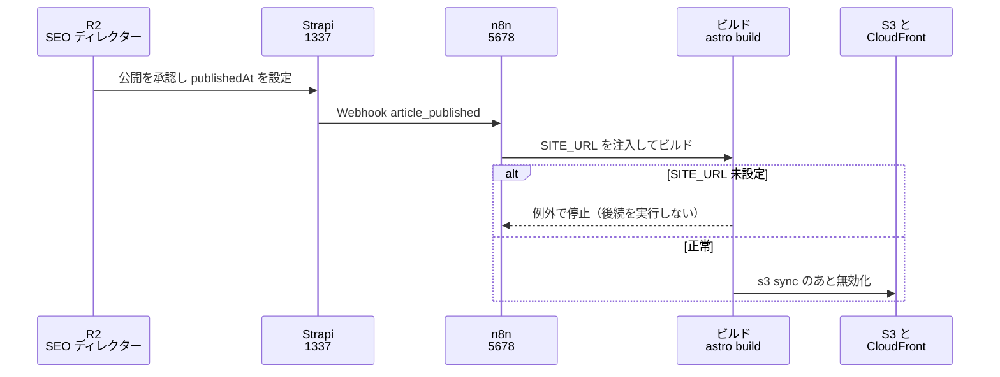
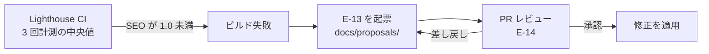

# 03. トリガーと CI/CD

TA（Technology Architecture）層。ID は EA 共通用語集の定義をそのまま使う。
ファイルパスは `MarketingDepartment/WebsiteOperations/` を起点とした相対で書く。

## 1. トリガーの 4 系統

この基盤で「何かが自動的に動き出す」きっかけを 4 系統に分類する。分類する目的は、**系統ごとに失敗の性質が違い、対処も違う**ためである。

| 系統 | 定義 | 主な失敗の性質 | 対処の方向 |
|---|---|---|---|
| Event | あるシステムの内部で起きた出来事が、同じプロセス内のコードを呼ぶ | 送信先が落ちていても発生源は成功してしまう（欠損に気づかない） | 送信の成否を発生源側でログに残す |
| Webhook | あるシステムが HTTP で別のシステムを呼ぶ | 受け口が到達不能・URL の変更・再送の重複 | 受け口の URL を設定として一元管理し、冪等に作る |
| スケジュール | 時刻で起動する | 静かに止まる（動いていないことが観測されない） | 実行そのものを観測対象にする |
| CI-CD | コードやコンテンツの変更を検証し、配信に反映する | しきい値を緩めて通してしまう | しきい値を設定ファイルに置き、変更を PR に乗せる |

## 2. トリガー一覧

| トリガー名 | 種別 | 発火源 | 処理 | 作用先 | 頻度 | 状態 |
|---|---|---|---|---|---|---|
| `article_created` / `article_updated` / `article_deleted` | Event | Strapi のライフサイクル（`backend/strapi-system/src/index.ts`） | PostHog にイベントを送る（`$process_person_profile: false`） | PostHog | 記事の変更ごと | `実装済み` |
| `article_published` | Event | 同上 | 同上 | PostHog | 公開ごと | `実装済み` |
| Strapi の例外 | Event | `global::posthog-error`（`backend/strapi-system/src/middlewares/posthog-error.ts`） | `captureException`。`ApplicationError` と 4xx の `HttpError` は送らない | PostHog | 例外ごと | `実装済み` |
| 記事公開 → 再ビルド | Webhook | Strapi の Webhook 設定 | n8n がビルドとデプロイを起動する | AWS（S3 / CloudFront） | 公開ごと | `未着手` |
| Mautic のフォーム送信 | Webhook | Mautic（本番は AWS。ADR-12） | BA-04 のトスアップ処理（セグメント追加・ポイント加算・通知） | Mautic / **Amazon SNS**（`comegin-lead-alert`） | CV ごと | `未着手` |
| Chatwoot の会話イベント | Webhook | Chatwoot（本番は AWS。ADR-12） | 一次対応と記事化候補の抽出、**顧客からの要求の通知** | n8n / Chatwoot の社内メモ / **Amazon SNS**（`comegin-lead-alert`） | 会話ごと | `未着手` |
| n8n の Webhook 受け口 | Webhook | AWS 上の Mautic・Chatwoot（ngrok 経由、`N8N_WEBHOOK_URL`。TA-01 の経路 5。**ADR-12 の後、公開の経路で ngrok を通るのはこれだけ**） | 対応するワークフローの実行 | 各システム | 随時 | `未配線` |
| PostHog Scout の検知 | Event | PostHog の Scout・Replay Vision スキャナ | 検知を受け取り `E-13` の候補にする | `docs/proposals/` | Scout の実行に依存（1 日 100 回の予算） | `未配線` |
| 日次 観測の収集 | スケジュール | n8n の Schedule Trigger | Umami・PostHog・Lighthouse から `E-12` を集める | `E-13` の `evidence[]` | 日次（DA-04 の鮮度要件） | `未着手` |
| 日次 GSC の実績の取得 | スケジュール | 日次の観測バッチ（`agent/seo-auditor`） | OpenSEO の MCP で GSC の実績を読み、`E-12`（`source: gsc`）にする。**対象期間を 3 日ずらす** | `docs/audits/gsc/` | 日次 | `未着手` |
| 週次 コンテンツ投入 | スケジュール | n8n | 承認済みの企画を更新ワークフローに載せる | Strapi | 週次 | `未着手` |
| 週次 キーワード候補の調査 | スケジュール | `agent/keyword-researcher` | OpenSEO で候補と検索ボリュームを取り、`E-01` の候補にする（**費用が発生する**。1 回 2,000 クレジットまで） | Strapi（`E-01` の候補） | 週次 | `未配線` |
| **OpenSEO のランク追跡** | スケジュール | **OpenSEO 内部の cron**（`*/5 * * * *` で期限が来た追跡を実行する作り） | DataForSEO で採用キーワードの順位を計測する（**自動で課金される**） | OpenSEO の DB | 週次（設定は `R2` の承認） | `未着手`（**Docker 版で cron が発火するかは、実機で初めて週次の追跡を設定したときに確認する**。`R1` の 2026-09-18 の判断） |
| 週次 サイト監査 | スケジュール | **人間（`R1`）** が OpenSEO の画面から実行 | 自サイトをクロールし問題を列挙する | OpenSEO の DB → `E-12`（`source: site_audit`） | 週次 | `未着手`（公開サイトが無い） |
| 週次 AB テスト | スケジュール | n8n | `E-11` の開始・状況確認 | PostHog | 週次 | `未着手` |
| 週次 問い合わせの棚卸し | スケジュール | n8n | 未対応・未割り当ての会話を一覧化する | Chatwoot | 週次 | `未配線` |
| 週次 Lighthouse の定点計測 | スケジュール | n8n または CI | `pnpm lh` を実行する | `frontend/verdant-virgo/.lighthouse/` | 週次 | `未配線` |
| 月次 順位・流入・CVR 分析 | スケジュール | n8n | 観測を集約し `E-13` の候補を生成する | `docs/proposals/` | 月次 | `未着手` |
| 月次 改善提案の採否 | スケジュール | 人間（`R2`） | PR のレビューで承認・差し戻し | `E-14` | 月次 | `未着手` |
| n8n ワークフローの定期エクスポート | スケジュール | n8n の API / CLI | ワークフロー JSON を書き出して Git に入れる | リポジトリ | 日次 | `未着手` |
| `SITE_URL` 未設定時のビルド停止 | CI-CD | `frontend/verdant-virgo/astro.config.mjs` | 例外を投げてビルドを止める | ビルドの成否 | ビルドごと | `実装済み` |
| Lighthouse CI のしきい値判定 | CI-CD | `frontend/verdant-virgo/lighthouserc.cjs` | 4 カテゴリのスコアを判定する（SEO は 1.0） | ビルドの成否 | ビルドごと | `実装済み`（ローカル実行のみ） |
| PR の作成 → レビュー | CI-CD | GitHub | `E-14` `ApprovalRecord` を記録する | `docs/proposals/` | 提案ごと | `未着手` |
| `main` へのマージ → デプロイ | CI-CD | GitHub | ビルド → S3 同期 → CloudFront 無効化 | AWS | マージごと | `未着手` |
| **Mautic・Chatwoot・Umami の本番デプロイ** | CI-CD | **人間（`R1`）** | イメージを ECR に置く → DB の移行を 1 回だけのタスクで実行 → ECS サービスを更新 → 訪問者向けのパスと管理画面の関門を確認（TA-06 の 8 節） | AWS（ECS・RDS） | 製品の更新ごと | `未着手` |

**実装済みは 5 行しかなく、そのすべてが Event 系統か、ローカルのビルド時判定である。**
Webhook 系統とスケジュール系統には実装済みの行が 1 つも無い。これは n8n のワークフローが 0 件であることと同義である（6 節）。

## 3. 主要フローの設計

### 3.1 公開フロー

図は To-Be を描いている。**As-Is で動くのは 1 本目（`R2` が Strapi で公開する）と、3 本目のビルドをローカルで手実行する部分だけ**である。Strapi から n8n への Webhook は設定されておらず、デプロイ先も存在しない。

設計上の要点。

- **`publishedAt` の設定は人間（`R2`）が行う。** BA-05 は記事の公開を `承認`（承認者 `R2`）に分類している。ここを n8n のスケジュールで自動化すると、承認ゲートがワークフローに迂回される（6 節）。
- **ビルドの失敗は必ず後続を止める。** `SITE_URL` 未設定の停止（TA-02 の 7 節）とテクニカル SEO のしきい値違反（3.2）は、どちらも「止めること自体が目的」であり、握りつぶさない。
- **Webhook は冪等にする。** Strapi の Webhook は再送されうるため、同じ記事に対して複数回ビルドが走っても結果が変わらないようにする（静的サイトの全ビルドは元々冪等なので、必要なのは同時実行の抑止だけ。ビルドが重なると S3 の状態が交錯するため、実行中は後続をキューに入れる）。

### 3.2 Lighthouse CI のしきい値違反

図は To-Be を描いている。**As-Is では左端の計測だけが動く。** しきい値違反でビルドが落ちるところまでは `frontend/verdant-virgo/lighthouserc.cjs` に実装されているが、それを `E-13` の起票に繋げる経路は存在しない。

- しきい値は performance / accessibility / best-practices が `minScore: 0.9`、**SEO は `minScore: 1`（死守ライン）**。SEO だけ満点を要求するのは、この計測の目的が SEO 対策そのものであるため。
- **しきい値違反を `E-13` にするのは、SEO が 1.0 を割った場合を最優先にする。** 他の 3 カテゴリは 0.9 という余地のあるしきい値であり、実測のベースラインが 0.98〜1.00 のため、違反したときの意味が「劣化した」であって「不足している」ではない。SEO の 1.0 割れだけは、割れた瞬間に公開物の品質が要件を満たしていない状態になる。
- 起票先は Git（`docs/proposals/<proposal_id>.md`）。DA-01 の 5.2 で `E-13` の正本を Git に決めているため、しきい値違反の記録と修正の PR が同じ場所に収まる。
- 計測結果そのもの（`E-12`）は `.lighthouse/` に出るが**これは Git 管理外**（`frontend/verdant-virgo/.gitignore` で除外）。したがって `E-13` には値そのものではなく参照と要約だけを書く（DA-04 の 2 節の方針と一致する）。

### 3.3 スケジュール実行

BA-04 の PDCA 定例をトリガーに落とす。**週次は「作用」、月次は「学習」**という BA-04 の割り当てをそのまま保つ。

| 定例 | 実装手段 | エージェントが行う範囲 | 人間が行う範囲 | 状態 |
|---|---|---|---|---|
| 日次 観測の収集 | n8n の Schedule Trigger | すべて（読み取りのみ。BA-05 で `自律`） | なし | `未着手` |
| 週次 コンテンツ投入 | n8n の Schedule Trigger | 承認済みの企画から下書きを作るところまで | 公開の承認（`R2`） | `未着手` |
| 週次 AB テスト | n8n ＋ PostHog | 実験の状況確認と停止（停止は `自律`） | 実験の開始（`R3` の承認） | `未着手` |
| 週次 問い合わせの棚卸し | n8n ＋ `chatwoot-mcp` | 未対応会話の一覧化、社内メモの作成（`private=true` は `自律`） | 顧客への返信（`R3` の承認） | `未配線` |
| 週次 Lighthouse の定点計測 | n8n または CI | すべて（`自律`） | なし | `未配線` |
| 月次 順位・流入・CVR 分析 | n8n ＋ Umami / PostHog の MCP | 分析と `E-13` の起票（生成は `自律`） | 採否の決定（`R2` の承認） | `未着手` |

- **定例の実行そのものを観測対象にする。** スケジュール系統の失敗は「静かに止まる」ことであり、止まっていても誰も気づかない。実行のたびに `E-15` `AgentRun` が n8n の実行履歴に残るため、**「今日の日次収集が走ったか」を確認する監視が要る**（TA-05 の 1 節に引き渡す）。
- **観測は日次、判定は 30 日後**という DA-04 の非対称を崩さない。スケジュールを細かくしたくなっても、判定の側を速くしない（早い判定が最も壊しやすい）。

## 4. 承認ゲートとの整合

BA-05 の承認ゲート一覧に対して、本ファイルのトリガーがどう対応するかを明示する。**トリガーが承認ゲートを跨ぐ場合、跨ぐ箇所で必ず人間が入る。**

| トリガー | BA-05 の分類 | 承認者 | 実装上の扱い |
|---|---|---|---|
| 日次 観測の収集 | `自律`（観測データの参照・集計） | — | 全自動でよい |
| `E-13` の起票 | `自律`（提案の生成） | — | 全自動でよい。提案は実体に作用しない |
| `E-13` の採用と適用 | `承認` | `R2` | **PR のマージが承認の記録**（`E-14`）になる。自動マージを設定しない |
| 記事の公開 | `承認` | `R2` | 3.1 のとおり `publishedAt` の設定を自動化しない |
| 記事の下書き作成 | `自律` | — | 週次のコンテンツ投入で自動化してよい |
| AB テストの開始 | `承認` | `R3` | ワークフローから開始しない |
| AB テストの停止 | `自律` | — | ワークフローから停止してよい |
| Chatwoot の社内メモ | `自律` | — | `private=true` を必ず付ける |
| Chatwoot の顧客への返信 | `承認` | `R3` | ワークフローから `private=false` のメッセージを送らない |
| Mautic のメール送信・キャンペーン開始 | `承認` | `R3` | ワークフローから開始しない |
| `main` へのマージ | `承認` | `R1` | 自動マージを設定しない |
| 本番環境へのデプロイ | `承認` | `R1` | **マージ後のデプロイは自動でよい**（マージ時点で承認済みのため。承認を 2 度求めない） |
| **Mautic・Chatwoot・Umami の本番デプロイ**（ECS・DB の移行） | `承認` | `R1` | **運用者が実行する。** エージェントやワークフローに ECS・RDS の変更権限を渡さない（TA-06 の 8 節。BA-05 の `禁止`「エージェントが自分の権限や実行条件を変える操作」に到達させない） |
| **n8n ワークフローの新規作成・変更** | `承認` | `R1` | 6 節のエクスポート方針で、変更が PR として現れるようにする |
| OpenSEO の調査（1 回 2,000 クレジット以下） | `自律` | — | 週次のキーワード調査で自動化してよい。費用の上限は DataForSEO の前払い残高（AA-05 の ADR-10） |
| **ランク追跡のスケジュールの設定** | `承認` | `R2` | **n8n のワークフローと同じ性質を持つ**（一度設定すると承認なしに実行と課金が続く）。エージェントのツール許可リストから外してある（AA-03 の 2.4） |
| 権限・`ACCESS_LEVEL` の変更 | `禁止` | — | ワークフローから到達させない。TA-04 の 4 節の分離を維持する |

**OpenSEO のランク追跡は、n8n の外にある 2 つ目のスケジュール実行である。** 2 節の表のとおり、スケジュール系統の実行主体はこれまで n8n だけだったが、OpenSEO の内部にも課金を伴うスケジュールがある。**「静かに止まる」（1 節）だけでなく「静かに続く」失敗もありうる**（誰も見ていない順位の計測に費用が払われ続ける）。そのため設定を `承認` にし、支出を TA-05 の項目 11 で監視する。

**「本番環境へのデプロイ」だけが、承認ゲートがあるのに自動化してよい項目である。** これは承認の対象がデプロイという操作ではなく、デプロイされる内容（`main` の状態）だからである（マージの承認が済んでいれば、その内容を配信することに追加の判断は無い。ここで 2 度目の承認を求めると、承認が形式化して 1 度目の判断まで雑になる）。

## 5. CI の設計と実装の保留

**`.github/workflows/` は今回作らない。**
`.claude/rules/devops-testing.md` に「GitHub Actions のワークフローファイルは、明確な指示がない限り作成しない」とあり、本タスクにその指示は含まれていない。したがって**以下は設計の記述にとどめ、実装は明示指示を待つ**。

現在リポジトリに `.github/` は存在しない。

### 実装する場合のジョブ構成（設計のみ）

| ジョブ | 起動条件 | 内容 | 失敗時 |
|---|---|---|---|
| 検証 | PR の作成・更新 | `pnpm install` → `pnpm typecheck` → `SITE_URL` を注入して `pnpm build` → `lhci autorun` | PR をマージ不可にする |
| デプロイ | `main` へのマージ | `SITE_URL` を注入して `pnpm build` → `aws s3 sync` → CloudFront の無効化 | 通知する。自動ロールバックはしない（S3 のバージョニングから手で戻す。自動で戻すと、壊れた原因が消えたように見えて調査できなくなるため） |
| ワークフローのエクスポート | 日次 | n8n から JSON を書き出し、差分があれば PR を作る | 通知する |

- **`SITE_URL` は必ず CI の環境変数から注入する**（TA-02 の 7 節）。
- **AWS の認証情報は長期のアクセスキーではなく、OIDC による一時認証を使う**（長期キーを CI の秘密値に置くと、失効の管理が人の記憶に依存する）。ただし本セッションでは AWS 側を検証できていないため、実装時に確認する。
- **Lighthouse CI の結果を CI から外部にアップロードしない。** `lighthouserc.cjs` は `upload.target: 'filesystem'`、`outputDir: './.lighthouse'` を指定しており、既定の `temporary-public-storage` はレポートを外部に公開するため使っていない。CI に移しても同じ方針を保つ（公開サイトの構造と計測結果が第三者から読める状態になるのを避けるため）。
- **単体テスト・結合テストのジョブは入れない**（`.claude/rules/devops-testing.md` により、テストコードの作成・実行には明示指示が要る）。

## 6. n8n ワークフローが Git 管理外である問題

### 事実

`middleware/n8n/` に追跡されているファイルは 7 つ（`compose.yml`、`README.md`、`AGENTS.md`、環境変数のテンプレート、`.gitignore`、`dev/init-env.sh`、`searxng-settings.yml`）であり、**`workflows/` ディレクトリもワークフローの JSON も 1 件も無い**。ワークフローの実体は n8n の DB（`db-data` の PostgreSQL 18）と `n8n-data` ボリュームの中だけに存在する。

現時点ではワークフローが 0 件のため実害は出ていない。しかしこれは「問題が無い」のではなく「まだ何も作っていないから顕在化していない」だけである。

### なぜこれが設計上の欠陥なのか

再帰的自己改善システムでは、**エージェントが自分の作用経路そのものを書き換える**。この基盤において作用経路とは n8n のワークフローであり、`CAP-14` が生む改善提案の適用先には「ワークフローの変更」が当然含まれる（BA-05 が「n8n ワークフローの新規作成・変更」を `承認` 分類として明記していることが、それを前提にしている証拠にあたる）。

その作用経路がバージョン管理外にあると、次の 3 つが成立しない。

1. **改善の履歴が追えない。** 「いつ、誰が、なぜワークフローを変えたか」が残らない。n8n 自身のバージョン履歴は UI から見られるが、リポジトリの変更履歴とは切り離されており、コード側の変更と時系列で突き合わせられない。
2. **ロールバックできない。** DA-01 の `E-13` 型は「取り消せる」ことを要件に挙げており、Git / PR がそれを提供するという理由で `E-13` の正本を Git に置いている。ワークフローだけがその外側にあると、**提案の一部だけが取り消せないという歪な状態**になる。
3. **`E-13` の `verification` が変更前の状態を参照できない。** 30 日後に効果を判定するとき、比較対象となる「変更前のワークフロー」が残っていない。

つまり、ワークフローが Git 管理外であることは運用の不便ではなく、**`CAP-14` の改善ループを原理的に閉じさせない構造的欠陥**である。

### エクスポート方針の設計

| 項目 | 方針 | 理由 |
|---|---|---|
| 手段 | n8n の Public API（`/api/v1/workflows`）または CLI（`docker compose exec n8n n8n export:workflow --backup --output=...`） | どちらも n8n に標準で備わる。CLI は認証設定なしでコンテナ内から実行でき、API は n8n 自身のワークフローから呼べる。**まず CLI で始める**（API キーを新たに管理する対象を増やさないため） |
| 置き場 | `middleware/n8n/workflows/<workflow_id>.json` | compose と同じディレクトリに置き、スタックの定義と作用の定義を同じ場所で読めるようにする |
| 頻度 | 日次 ＋ 変更のたび | 日次だけだと「作って壊して直した」履歴が 1 日分に潰れる |
| 差分の安定化 | `updatedAt` / `versionId` / ピン留めデータなど、実行のたびに変わるフィールドを書き出し前に除去する | 除去しないと毎日意味の無い差分が出て、レビューが形骸化する（差分が常にあると、差分があることが情報でなくなる） |
| クレデンシャル | **エクスポートしない。** JSON に残るのは ID の参照だけ | `n8n export:credentials` は復号された値を出力しうる。秘密値をリポジトリに入れない方針と両立させる |
| 反映の方向 | **Git → n8n の自動インポートは行わない。** 一方向（n8n → Git）のみ | インポートで本番のワークフローを上書きすると、UI 上で行われた編集が黙って消える。復旧時は人間が意図を持って手でインポートする |
| 承認 | エクスポートされた JSON の差分を PR に載せ、`R1` がレビューする | BA-05 の「n8n ワークフローの新規作成・変更は `承認`」を、手順としての約束ではなく**変更が PR として現れる仕組み**に変える |

### `N8N_ENCRYPTION_KEY` との関係

`N8N_ENCRYPTION_KEY` は保存済みクレデンシャルの復号に必要で、**失うと登録済みの認証情報を復元できない**（`middleware/n8n/README.md` の運用上の注意、`middleware/n8n/dev/init-env.sh` の冒頭コメント）。

ここから、ワークフローの復旧には**構造と資格情報の 2 つが揃う必要がある**ことがわかる。

| 要素 | 何を失うと何が起きるか | 守り方 |
|---|---|---|
| ワークフローの構造（JSON） | 失うと、何をしていたかが分からなくなる | **Git**（本節のエクスポート方針） |
| クレデンシャルの暗号文（`db-data`） ＋ `N8N_ENCRYPTION_KEY` | どちらか一方を失うと、ワークフローの形が残っていても接続先に繋がらない | **Git の外**（環境変数ファイルのバックアップとボリュームのバックアップ。TA-05 の 5 節） |

**この分離はむしろ好都合である。** 構造だけを Git に置けば、リポジトリに秘密値が入らないまま、改善の履歴とロールバックの手段が手に入る。逆にクレデンシャルまで Git に入れようとすると、秘密値を追跡しない方針と正面から衝突する。

## 7. 未決定事項

- **Strapi から n8n への Webhook の到達手段が未定。** 両方ともローカルホストにあるため、`localhost` で直接繋ぐか、Docker ネットワークを跨ぐか、ngrok を経由するかで設定が変わる（Strapi はホストのプロセス、n8n はコンテナ内であり、コンテナから見たホストの `1337` への到達方法を決める必要がある）。
- **ビルドの実行場所が未定。** ローカルの開発機で走らせるか、CI（GitHub Actions）で走らせるかが決まっていない。前者なら開発機が落ちている間は公開が止まり、後者なら 5 節の実装に明示指示が要る。この判断は TA-01 の未決定事項（オンプレが単一の開発機であることの可用性上の扱い）と同じ根を持つ。なお Strapi がオンプレにある限り、CI で走らせても記事の取得（`I-09`）のために CI から Strapi へ到達する経路が要る点は変わらない。
- **AWS 上の Mautic・Chatwoot から n8n への Webhook は、ngrok のトンネル断で取りこぼされうる。** ADR-12 で Mautic・Chatwoot は AWS に移ったが、受け口の n8n はオンプレに残ったため、この 2 種類の Webhook だけが ngrok を通る。製品側に再送の仕組みがあるか、失敗がどこに記録されるかは確認していない（TA-05 の 4 節の監視と合わせて決める）。
- **`E-13` の起票を誰が行うかが未定。** n8n から GitHub API を叩く前提で書いているが、GitHub の認証情報を n8n に持たせることの是非（`sandbox-runner-1` との分離を保ったまま渡せるか）を TA-04 の 4 節と合わせて検討していない。
- **ワークフローのエクスポートで除去すべきフィールドの具体が未確定。** 「実行のたびに変わるフィールド」の実際の一覧は、ワークフローを 1 件作って 2 回エクスポートし差分を見ないと確定できない。ワークフローが 0 件の現時点では検証できない。
- **同時実行の抑止をどこで行うかが未定。** ビルドの重複実行を防ぐ必要があるが、n8n 側の設定で行うか、デプロイスクリプト側のロックで行うかを決めていない。
- **PostHog Scout の検知を `E-13` に変換する経路が未定。** Scout は PostHog の inbox に findings を出すが、そこから Git の `docs/proposals/` に持ってくる手段（API で取りに行くか、通知を受けるか）を決めていない。Scout の実行予算が 1 日 100 回であることから、取りに行く側の頻度は日次で足りる。
