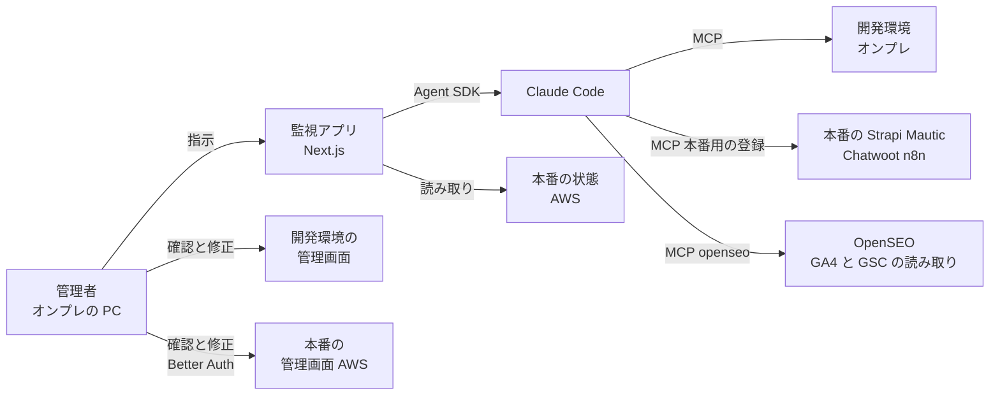
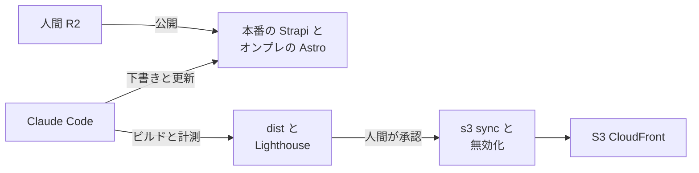

# 07. オンプレの管制環境（開発環境と監視アプリ）

TA（Technology Architecture）層。ID はそれぞれの正本の定義をそのまま使う（索引は [`docs/README.md` の「ID の採番と正本」](../../README.md)）。
ファイルパスは `MarketingDepartment/WebsiteOperations/` を起点とした相対で書く。

AA-05 の ADR-14〜ADR-18 で、**正本のデータを持つシステム（Astro・Strapi・Mautic・Chatwoot・Umami〈ADR-25 で廃止〉・n8n）は本番としてクラウド、オンプレには全システムの開発環境と道具（Claude Code・MCP サーバ・監視アプリ・OpenSEO・ビルド）**を置き、**ローカルの Claude Code が MCP で開発環境と本番の両方を読み書きする**と決めた。本ファイルはオンプレ側、とくに**管理者の操作の起点になる監視アプリ（Next.js）**を扱う。本番の実行環境は TA-06、Astro の配信は TA-02 が扱う。

**状態: 未着手。** 監視アプリは `frontend/next-js` に雛形（Next.js 16.3.5）と Better Auth の導入だけがある。本ファイルの内容はすべて To-Be の設計である。

> **（2026-10-05）ADR-21 による変更。本ファイルの本文より、この注記を優先する。**
> - **オンプレに本番の Strapi と n8n が加わる**（開発環境とは別のインスタンス）。データは AWS の RDS（`strapi` `n8n`）と S3（Strapi のメディア）に置き、WireGuard の経路で RDS に届く。構成は `onprem/`（WireGuard の設定の雛形・本番の Strapi と n8n の compose）。
> - `strapi-prod` と `n8n-prod` の MCP の接続先は、オンプレの本番のインスタンス（`127.0.0.1`）。記事の公開は `R2` がオンプレの本番の Strapi の管理画面で行う（ADR-17 のとおり）。`I-09` のビルドはオンプレの本番の Strapi を読む。
> - 開発機（または WireGuard）が止まると、クラウドの Mautic・Chatwoot からの Webhook（`I-11` `I-12`）も届かなくなる。

> **（2026-10-05）ADR-23 による変更。本ファイルの本文（とくに「トンネルを張らない」「認証の方式は 9 節で決める」の記述）より、この注記を優先する。**
> - **開発環境の監視アプリは ngrok で公開してよい**（`https://comegin-next-js-dev.ngrok.app`）。開発サーバーは `127.0.0.1:3200` にだけバインドし、外からはトンネルだけを通る。
> - **ログインは Google（Workspace）だけ。** メールとパスワードのログインと `/setup`（最初の管理者の作成）は廃止した。`hd`・`email_verified`・許可リスト `CONTROL_ADMIN_EMAILS` の 3 段で通す（admin-auth と同じ考え方）。9 節の「本番の関門に合わせるか」は、Google Workspace に合わせると決めたことになる。

> **（2026-10-06）ADR-25〈AA-05〉による変更。本ファイルの本文より、この注記を優先する。**
> - **Umami を廃止した。** 開発環境の Umami（`middleware/umami`・3000）と、MCP の登録 `umami`・`umami-prod` を外した。**ポート 3000 は空き**（3200 は変えない）。開発機に残る Docker のボリューム（`umami_db-data`・`umami_umami-db-data`・`umami-master_umami-db-data`）・`~/.config/comegin/setup/dev.state.json` の `UMAMI_*`・`~/.config/comegin/mcp/umami-dev.env` は**ユーザーが片付ける**。
> - **アクセス解析の正本は GA4（SaaS）。** 本番のプロパティは 1 つで、**開発環境にはプロパティもタグも無い**。**エージェントは GA4 をオンプレの OpenSEO の MCP（`openseo`。`127.0.0.1:3001/mcp`）で読む**（3.3・3.7）。OpenSEO は ADR-09 のとおりオンプレのローカルだけで動く。
> - 本文の Umami の記述（1・2・3.2・3.3・4・6・6.1 と決定の表）は ADR-14〜ADR-21 の記述である。

## 1. 管理者の操作経路

**管理者はオンプレの画面だけを操作する。** 操作の経路は 3 つある。

図は To-Be を描いている。**As-Is では監視アプリに画面が 1 つも無い**（`app/page.tsx` は雛形のまま）。（**2026-10-06 ADR-25: 本番の登録の先から Umami を外し、GA4 を読む `openseo` の線を足した**）

| 経路 | 使う場面 | 対象 | 書き込み |
|---|---|---|---|
| **監視アプリ → Claude Code → MCP** | エージェントに作業させる | **開発環境と、本番の Strapi・Mautic・Chatwoot・n8n**（ADR-15・ADR-16）。**本番の GA4 は `openseo` で読むだけ**（**2026-10-06 ADR-25: Umami を外した**） | する（開発環境は `full` まで、本番は `read_write` まで。BA-05 の承認ゲートに従う） |
| **各製品の管理画面** | 結果の確認と修正 | 開発環境と本番の両方 | する（人間が行う） |
| **監視アプリの表示** | 全システムの状態を見る | 開発環境と本番の両方 | **しない**（読み取りだけ） |

- **本番の Strapi・Mautic・Chatwoot・n8n には、Claude Code も MCP で書き込む**（ADR-15・ADR-16）。承認が要る操作（BA-05。顧客へのメール・メッセージの送信・キャンペーンの開始など）は、承認を得てから実行する。
- **公開サイト（Astro）への反映だけは、配信を人間が承認する**（7 節）。

## 2. 開発環境

**本番の全システムの開発環境と、管制の構成要素のすべてをオンプレで動かす。** 今のローカルの構成をそのまま使う（ポートは TA-01 の 5 節）。

| システム | オンプレでの動かし方 | 本番 |
|---|---|---|
| Astro | `astro dev`（4321）、preview（4322） | S3 + CloudFront（TA-02） |
| Strapi | `strapi develop`（1337） | ECS ＋ RDS ＋ S3（TA-06。**記事の正本は本番の Strapi**。ADR-16） |
| Mautic | PHP ビルトインサーバー（8000）＋ Docker の MySQL | ECS ＋ RDS ＋ EFS（TA-06） |
| Chatwoot | Docker compose（3100） | ECS ＋ RDS ＋ ElastiCache ＋ S3（TA-06） |
| **GA4**（**2026-10-06 ADR-25。旧: Umami〈Docker compose〈3000〉・本番は ECS ＋ RDS〉**） | **無し**（開発環境ではタグを出さない。プロパティも作らない） | **SaaS**（本番のプロパティ 1 つ。AWS に何も置かない） |
| n8n | Docker compose（5678）。**サンドボックスを含む** | ECS ＋ RDS（TA-06。**サンドボックスは置かない**。ADR-16） |
| MCP サーバ・OpenSEO・Lighthouse CI | 今のまま | **本番に置かない**（道具。正本を持たない） |
| **監視アプリ** | `next dev`（**3200**。4 節） | **本番に置かない** |

- **（2026-10-03 に追加）収益化の開発環境。** thirdweb は**開発用のプロジェクト**と **Polygon の Amoy テストネット**を使う。XMRig は **unMineable に繋がないベンチマークの起動だけ**を行い、開発機で採掘しない。`points-api` の開発サーバーは 3106。

## 3. 監視アプリ（Next.js）

### 3.1 役割

| 役割 | 内容 |
|---|---|
| **状態の表示** | 開発環境と本番の全システムの死活・主要な数値を 1 画面に集める |
| **エージェントへの指示** | 管理者の指示を Claude Code に渡し、実行の経過と結果を表示する |
| **エージェントの定期実行の起動** | スケジュールを持ち、時刻が来たら Claude Code を起動する（ADR-17。3.5） |
| **管理画面への導線** | 各製品の管理画面（開発・本番）へのリンクを置く。**操作は管理画面で行い、監視アプリで代替しない** |

### 3.2 表示する状態（案）

| 対象 | 開発環境 | 本番 |
|---|---|---|
| 死活 | 各ポートへのヘルスチェック（OpenSEO の `/api/health` など。**旧版の例の Umami の `/api/heartbeat` は ADR-25 で廃止**） | CloudWatch のアラームの状態（TA-05。項目 12〜16） |
| ハートビート | — | オンプレのハートビートのアラーム（TA-05 の項目 16） |
| 数値 | — | Claude Code が MCP の本番用の登録と `openseo`（GA4・GSC）で読んだ結果（ADR-15。**ADR-25 で `umami-prod` を `openseo` に置き換えた**） |
| エージェント | 実行の履歴・結果・失敗 | — |

### 3.3 Claude Code への指示の渡し方

**監視アプリのサーバー側で Claude Agent SDK を使い、Claude Code を動かす**（推奨。実装時に SDK の現行の仕様を確認する）。

- **MCP は同じプログラムを開発環境用と本番用の 2 回登録する**（ADR-15）。接続先・トークン・`ACCESS_LEVEL` は環境変数のファイルで切り替え、コードは変えない。

| 登録名 | 接続先 | `ACCESS_LEVEL` | 環境変数 |
|---|---|---|---|
| `chatwoot` / `mautic` | オンプレの開発環境 | `full` まで | 今のファイル |
| `chatwoot-prod` / `mautic-prod` | 本番（ALB の機械向けの API。TA-06 の 5.4） | **`read_write` まで**（削除・統合を出さない） | `.env.production`（新設。Git で追跡しない） |
| **`openseo`**（**2026-10-06 ADR-25 で GA4 の読み手になった**。旧: `umami`〈オンプレの Umami〉・`umami-prod`〈本番の Umami の `/mcp`〉は**廃止**） | **オンプレのローカルの OpenSEO の `/mcp`**（`127.0.0.1:3001`。開発と本番の区別が無い 1 つの登録。**OpenSEO が接続する GA4 は本番のプロパティだけ**） | —（OpenSEO は無認証〈`local_noauth`〉。**GA4 の OAuth のスコープは `analytics.readonly` で、GA4 に書く経路は無い**。費用の出るツールも同じ登録に載るため、**使えるツールはエージェント定義の許可リストで絞る**〈3.7〉） | 無し（OpenSEO の環境変数ファイルは OpenSEO 自身が読む。Claude Code には渡さない） |
| `strapi-mcp` | オンプレの Strapi の `/mcp` | —（開発環境の Admin トークンの権限） | 今のまま |
| `strapi-prod` | 本番の Strapi の `/mcp`（`cms.comegin.com`。リモート接続） | **Admin トークンの権限で下書きまでに絞る**（作成・読み取り・更新だけ。**公開・非公開化・削除の権限を与えない**。ADR-17） | 本番の Strapi で発行した Admin トークン |
| `n8n` | オンプレの n8n のインスタンスの MCP | — | 今のまま |
| `n8n-prod` | 本番の n8n の `/mcp-server/http`（**暫定**） | **ワークフローの作成と更新まで。有効化（publish）と実行は許さない** | 本番の n8n で発行したアクセストークン |

- **本番のトークンは専用のアカウントで発行する。** Chatwoot のトークンはユーザーに紐づき、操作履歴がそのユーザーに残る。人間の管理者のトークンを使わず、エージェント専用のユーザーを作る。**これが誤った書き込みを見つける手がかりになる**（6.2）。
- **Chatwoot の社内メモと顧客への送信を分ける**（ADR-17）。`chatwoot_send_message` は両方を兼ね、`private` の既定値が `false`（顧客に送信）であるため、社内メモのつもりの呼び出しが顧客に届きうる。**社内メモ専用のツールを `chatwoot-mcp` に足す**か、**社内メモ用の登録を分ける**かのどちらかで、社内メモだけを使うエージェントに `chatwoot_send_message` が見えないようにする。どちらにするかは実装時に決める（9 節）。
- **本番の記事を公開するのは人間である**（ADR-17）。`strapi-prod` のトークンに公開の権限が無いため、エージェントは下書きまでしか書けない。公開は `R2` が本番の Strapi の管理画面で行う。
- **本番の n8n のワークフローを有効にするのは人間である。** `n8n-prod` はワークフローを本番に置くところまでとし、有効化は人間が本番のエディターで行う（Astro の配信と同じ位置づけ。7 節）。
- **本番に書き込める資格情報はローカルの PC に置かれる**（ADR-15 の帰結）。ADR-14 の「資格情報の不在で守る」は取り消し、`ACCESS_LEVEL` の上限（**`read_write` で確定。ADR-16**）・専用アカウント・承認ゲートの 3 つで守る。
- **使ってよいツールを許可リストで渡す。** エージェント定義（AA-03）の許可リストと同じものを使い、監視アプリの側で広げない。本番の登録のツールを使えるエージェントは、定義で明示したものに限る。
- **1 回の指示 = 1 回の実行とし、実行ごとに相関 ID（ULID）を振る**（DD-01 の 3 節）。定期実行も 1 回の起動を 1 回の実行として同じ形で記録する（3.5）。**実行の記録は `E-15 AgentRun` の正本である**（ADR-18。3.6）。
- **ブラウザから Claude Code を直接呼ばない。** 指示はサーバー側で受け、サーバーが SDK を呼ぶ。ブラウザには経過と結果だけを返す。

### 3.4 監視アプリ自身の守り

**監視アプリは「エージェントを動かせる入口」である。** 到達できる人は、開発環境に対して MCP の書き込み権限の範囲で何でもできる。

- **ループバック（`127.0.0.1`）にだけバインドし、トンネルを張らない**（OpenSEO と同じ扱い。TA-04 の 7 節）。
- **ログインは Better Auth で行う**（導入済み）。オンプレの開発機を共有する運用者が増えた場合に備える。認証の方式は本番の関門（ADR-13。Google Workspace）に合わせるかどうかを決める（9 節）。
- **Anthropic の API キー（または Claude Code の認証情報）はサーバー側の環境変数に置き、ブラウザに出さない。**
- **（2026-10-06）監視アプリのサーバー側だけが持つ秘密値**: CloudWatch・S3 の資格情報（`ControlPlanePolicy`）、GitHub の資格情報（`I-13`・`n8n-export`）、**本番の n8n の API キー（`CONTROL_N8N_EXPORT_API_KEY`）**。いずれも Claude Code の実行環境（許可リスト方式の `env`：`PATH`・`HOME`・`ANTHROPIC_API_KEY`）に渡さない。

### 3.5 エージェントの定期実行（ADR-17）

**エージェントを使う定期処理は、監視アプリが起動する。** 本番の n8n（AWS）からはローカルの PC に着信できないため、エージェント（ローカルの Claude Code）を起動できない（ADR-16 の帰結）。

| 定期処理（案） | 内容 | 以前の起動元 |
|---|---|---|
| 観測の日次バッチ | 本番の計測値を MCP で読み、`E-12` に正規化する | n8n（ADR-05） |
| 改善提案の起票（`I-13`） | ローカルの `docs/proposals/` の `E-13` から GitHub に PR を作る | n8n（ADR-05） |
| 公開された記事の確認 | 本番の Strapi を読み、前回から公開された記事があればビルドと計測を起こす（7 節） | 本番の Strapi の Webhook → n8n（TA-03） |
| 誤った書き込みの突き合わせ | エージェント専用ユーザーの送信の記録と `E-13` を照らし合わせる（6.2） | — |

**定期処理の全体の一覧は TA-03 の 2 節にある**（上の 4 つに加え、GSC の実績の取得・週次のコンテンツ投入・キーワード候補の調査・AB テストの確認・Lighthouse の定点計測・月次の分析）。

- **定期実行の定義は Git で持つ**（ADR-18 の追加の決定）。取得範囲・頻度・使うエージェントとツールを書いた定義をリポジトリに置き、**監視アプリは承認済みの `main` から作った別のチェックアウトで読む**。エージェントが作業ツリーで定義を書き換えても、PR が承認されて `main` に入るまで次の実行には効かない。
- **取得の範囲はスケジュールの定義に固定して書く。** 期間と件数をエージェントに判断させない（ADR-05 の理由。実行のたびに範囲が変わると `E-13` の `evidence` が比較できなくなる）。
- **同じ定期処理を重ねて起動しない。** 前回の実行が終わっていなければ次の起動を見送り、見送ったことを記録する。
- **エージェントを使わない定期処理は、これまでどおり本番の n8n が行う**（ADR-05 の「決定論的な処理は n8n」は変わらない）。
- **（2026-10-06）エージェントを使わず、監視アプリ自身が実行する定期処理もある（`kind: builtin`。`ops/schedules/*.yaml`）。** 実装済みは `heartbeat`（8 節）・`daily-silence-check`・`runlog-flush`（`E-15` の S3 への写し）・`daily-i13-file`（`I-13`）・`daily-miswrite-check`・`published-article-check`・`weekly-lighthouse`、そして **`n8n-export`**（`daily-n8n-export.yaml`。毎日 08:45。**`enabled: false`**）。
- **`n8n-export`（2026-10-06。TA-03 の 6 節の決着）。** 監視アプリのサーバー側が、**オンプレの本番の n8n の Public API**（`CONTROL_N8N_EXPORT_URL`。例 `http://127.0.0.1:5679`）でワークフローを読み、正規化して承認済み `main` のチェックアウトの JSON と比べ、差分があれば GitHub に PR を作る（`I-13` と同じ GitHub の資格情報。**作業ツリーには書かない**）。**API キー（`CONTROL_N8N_EXPORT_API_KEY`）は監視アプリのサーバー側の環境変数だけに置き、Claude Code（エージェント）の実行環境には渡さない**（許可リスト方式の `env` に入れない。エージェントに書き出しを担わせると、書き出しが作用の経路になる）。どちらかの変数が未設定ならジョブは `skipped` になる。**コミュニティ版の n8n ではキーのスコープを絞れず全権限になる**ため、有効化の前にユーザーが判断する（TA-04 の 9 節）。n8n の `workflow:read` で読むだけで、n8n には書かない（Git → n8n の自動インポートは行わない）。
- **スケジュールの仕組み**（監視アプリのプロセスの中に持つか、OS のタイマーから監視アプリを呼ぶか）は実装時に決める（9 節）。前者は監視アプリが止まると定期実行も止まり、後者は OS の設定が監視アプリの外に増える。
- **開発機が止まると、定期実行も止まる。** 止まったことはハートビートで知る（8 節）。止まっていた間の分を取り戻すかは、処理ごとに決める（観測の日次バッチは取得の範囲が固定されているため、欠けた日の分を後から実行できる）。

### 3.6 実行記録（`E-15` の正本。ADR-18）

**監視アプリの実行記録を `E-15 AgentRun` の正本にする。** 監視アプリはローカルに置いたままで、記録もローカルに保存する（ADR-16 の「正本はクラウド」の例外）。

| 項目 | 内容 |
|---|---|
| 記録する単位 | 1 回の起動（手動の指示・定期実行）を 1 件とする。相関 ID（ULID）で改善提案（`E-13`）・承認（`E-14`）・本番への書き込みと結ぶ |
| 置き場所 | 監視アプリのローカルの DB（種類は未決定） |
| 誰が書くか | **監視アプリのサーバー側だけ。** エージェント（Claude Code）には書き込ませない（エージェントが自分の実行の記録を書き換えられないようにする。BA-05 の `禁止` 分類「エージェントが自分の実行条件を変える操作」と同じ考え方） |
| 使い道 | 誤った書き込みの突き合わせ（6.2）、定期実行の成否と見送りの表示（3.5）、改善の検証の根拠 |

- **記録するのは要約と ID だけである**（ADR-18 の追加の決定）。エージェントが MCP で読んだ本番の Mautic・Chatwoot のデータ（ツールの結果）は残さない。残すのは、何をしたかの要約、対象の ID（会話・コンタクト・記事など）、相関 ID、成否、起動の種類（手動・定期）である。**これで記録に個人情報が入らない。** 誤った書き込みの調査では、ID から本番の管理画面で元のデータを引く。保持期間は未決定（9 節。DA-05）。
- **要約にも個人情報を書かない。** 要約はエージェントの出力であり、顧客の氏名・メールアドレスなどを書いてしまいうる。人は ID で指す規則をエージェント定義（AA-03）に置き、監視アプリが記録する前にメールアドレスや電話番号の形の文字列を検査する（検査の方法は未決定。9 節）。
- **記録は S3 に写す**（ADR-18 の追加の決定）。開発機を失ったときの復旧に使う。**写しは正本ではない**（正本はローカルの実行記録）。写しを書く資格情報は監視アプリのサーバー側だけに置き、Claude Code の実行環境には置かない。**写しは追記だけを許し、削除と上書きを許さない**（S3 のバケットのポリシーとバージョニング。TA-06）。写す頻度は未決定（9 節）。

### 3.7 OpenSEO の GA4 接続（2026-10-06 に追加。ADR-25）

**GA4 の数字は、オンプレのローカルの OpenSEO が Google の API で読み、エージェントは OpenSEO の MCP（`openseo`）で受け取る。** GA4 のための常駐のプロセスや資格情報はオンプレに増えない（OpenSEO の中に OAuth のトークンが 1 つ増えるだけ）。出典は `middleware/open-seo-main/docs/SELF_HOSTING_GOOGLE_ANALYTICS.md`（手順）と `middleware/open-seo-main/src/shared/ga4.ts`（スコープ）。

| 項目 | 値 |
|---|---|
| 動く場所 | **オンプレのローカルだけ**（`127.0.0.1:3001`。UI と `/mcp`。トンネルを張らない。TA-04 の 8.2） |
| MCP の登録名 | `openseo`（GSC・DataForSEO と同じ登録） |
| OAuth クライアント | **GSC と同じ**（Google Cloud のプロジェクト・Web アプリケーションのクライアント。同意画面は「内部」。TA-04 の 8.3）。同意は GA4 の接続で改めて取る |
| Google Cloud で有効にする API | **Google Analytics Admin API**（接続のときにプロパティを一覧する）と **Google Analytics Data API**（レポートを取る） |
| リダイレクト URI | **`http://localhost:3001/api/ga4/oauth/callback` を足す**（GSC の `/api/gsc/oauth/callback` は残す） |
| スコープ | **`https://www.googleapis.com/auth/analytics.readonly`**（参照のみ） |
| 接続の操作 | OpenSEO のプロジェクトの画面（または Project settings → Analytics）の **Connect with Google** → **本番のプロパティだけを選ぶ**（人が画面で行う） |
| トークンの置き場 | OpenSEO の DB（Better Auth の account テーブル）に `BETTER_AUTH_SECRET` で暗号化。GA4 を外しても GSC は外れない |
| setup の設定キー | `OPENSEO_GA4_CONNECTED=yes`（接続済み）／`OPENSEO_SKIP_GA4=yes`（接続しない）。プロパティの値は `GA4_PROPERTY_ID`（数字）・`GA4_MEASUREMENT_ID`（`G-…`）。**どれも秘密値ではない**。**`~/.config/comegin/setup/prod.conf` に書き、`--target prod` で扱う**（2026-10-06。開発〈`--target dev`〉は公開サイトが AWS に無いので、Search Console と GA4 の手順を飛ばす。`setup/manual-steps.md` の 7.4・7.5） |
| エージェントが使うツール | **`agent/analytics-reporter` だけ**が次を持つ: `mcp__openseo__list_projects`・`get_project_context`・`get_google_analytics_traffic_acquisition`・`get_google_analytics_page_performance`・`get_google_analytics_organic_landing_pages`・`get_google_analytics_organic_overview`・`get_google_analytics_measurement_health`。**持たせない**: `get_google_analytics_audience_breakdown`・`ecommerce_performance`・`site_search`・`key_events`（CV の正本は Mautic）・`get_search_opportunities`、費用の出る OpenSEO のツールすべて（AA-03 の 2.4） |

- **開発機が止まると GA4 も読めない。** 計測そのもの（ブラウザ → Google）は止まらず、GA4 の側にデータは残る。読めないのは止まっている間だけで、観測の期間（直近 35 日・終端は 3 日前）の中なら後から取り直せる。
- **接続が切れる原因**: 接続した Google アカウントがプロパティの権限を失う・離任する・同意を取り消す。テスト中（Testing）の同意画面では短期で失効しうる（上流の手順書の Troubleshooting）。「内部」にしていれば 7 日の失効は起きない（TA-04 の 8.3）。気づき方は TA-05 の 4 節の項目 21。

## 4. ポート

**監視アプリの開発サーバーは 3200 にする**（TA-01 の 5 節の表で空いている番号）。

- **Next.js の既定の 3000 は Umami と衝突する。**（**2026-10-06 ADR-25 で Umami を廃止し、3000 は空いた。3200 は変えない**） 今の `frontend/next-js/.env.example` の `BETTER_AUTH_URL` は `http://localhost:3000` のままであり、3200 に合わせて直す必要がある。
- `package.json` の `dev` スクリプトに `-p 3200` を付けるか、環境変数 `PORT` で渡す。

## 5. 開発環境と本番の対応を監視アプリが知る方法

監視アプリは「どのシステムの、開発と本番がどこにあるか」を 1 か所の設定で持つ。

| 項目 | 例 |
|---|---|
| システム名 | `chatwoot` |
| 開発環境の URL | `http://localhost:3100` |
| 本番の URL | `https://chat.comegin.com` |
| 開発環境のヘルスチェック | `/api` など |
| 本番の監視元 | CloudWatch のアラーム名 |

**この設定に資格情報を入れない。** URL と監視の方法だけを持つ。

## 6. 本番への作用の経路

ADR-15・ADR-16 で、エージェントの作業が本番に届く経路はシステムごとに次のとおりになった。

| システム | 作用の経路 | 承認 |
|---|---|---|
| **Astro** | Claude Code が本番の Strapi とオンプレの Astro のコードを更新してビルドし、**人間が承認して配信する**（7 節） | 配信の承認（`R2`） |
| **Strapi** | Claude Code が本番に MCP（`strapi-prod`）で**下書き**を書く。これが正本の更新になる。**公開は人間（`R2`）が本番の管理画面で行い**（ADR-17）、公開サイトへの反映は Astro の配信で行う | 公開（`R2` が自分で行う）と配信の承認（`R2`） |
| **Mautic** | Claude Code が本番に MCP で書き込む | BA-05 の分類に従う（メール送信・キャンペーンの開始は `R3`） |
| **Chatwoot** | Claude Code が本番に MCP で書き込む。**顧客へのメッセージ送信も許す**（ADR-16） | BA-05 の分類に従う（顧客への返信は `承認`・`R3`） |
| **GA4**（**2026-10-06 ADR-25。旧: Umami〈読み取りだけ〉**） | **読み取りだけ**（OpenSEO の OAuth のスコープが `analytics.readonly`）。**GA4 の設定（プロパティ・データ保持・権限）は人間が GA4 の画面で行う**（あるべき値は `middleware/ga4/README.md`） | — |
| **n8n** | Claude Code が本番に MCP（`n8n-prod`。**ADR-21: オンプレの `127.0.0.1:5679`**）でワークフローを置き、**人間が有効にする**。**本番のワークフローの変更は、監視アプリの `n8n-export`（3.5）が PR として Git に書き出し、`R1` がレビューする**（BA-05 の「n8n ワークフローの新規作成・変更は `承認`」を変更が PR として現れる仕組みにする。エージェントは書き出しに関わらない） | 有効化の承認（`R1`）と、書き出しの PR のレビュー（`R1`） |

- **改善提案の `applied` は、本番に作用した時点で記録する**（ADR-15）。Astro と Strapi（記事）は配信の完了、n8n は有効化の完了、Mautic・Chatwoot は本番への書き込みの完了。**Strapi は書き込みの完了では `applied` にしない。** 公開ページは Strapi を実行時に参照しないため（ADR-11）、記事が訪問者に届くのは配信の後であり、書き込みの時点で `applied` にすると効果の無い期間を効果の検証に数えてしまう（DD-01 の 8.3 の判断を上位層に取り込んだ）。
- **`applied_at` を記録するのは、本番に作用させた主体である**（ADR-16）。Astro の配信（Strapi の記事を含む）と n8n の有効化は**実行した人間が記録する**。Mautic・Chatwoot への MCP での書き込みは Claude Code が書き込みの完了と同時に記録する。
- **記事の正本は本番の Strapi だけにある**（ADR-16）。開発環境の Strapi は試験用で、本番の記事を開発環境に写したり、開発環境の記事を本番に移したりしない。ADR-14 で問題にした「`strapi transfer` の上書き」は、この運用で生じない。

### 6.1 開発環境と本番をそろえ続ける（ADR-16）

**開発環境と本番の設定はずらさない。** Claude Code は、設定を変えるときに次の順で行う。

| # | 手順 | 対象 |
|---|---|---|
| 1 | 開発用の登録（`chatwoot` / `mautic` など）で変更を適用し、動作を確かめる | Mautic・Chatwoot の設定（Umami は ADR-25 で廃止。GA4 は本番だけで、開発環境が無いため対象外） |
| 2 | 同じ変更を本番用の登録（`-prod`）で本番に適用する | 同上 |
| 3 | コードで持つものは、開発環境で確かめたうえでデプロイで本番に反映する（TA-06 の 8 節） | Strapi のコンテンツタイプ・n8n の版 |
| 4 | n8n のワークフローは、開発環境で確かめたものを `n8n-prod` で本番に置き、人間が有効にする | n8n のワークフロー |

- **そろえる対象は設定と構造で、データではない。** 記事・コンタクト・会話・計測値は本番にだけあればよい。
- **資格情報はそろえない。** 開発環境と本番で別の値を使う（TA-06 の 7 節）。
- **PostHog のプロジェクトは開発と本番で分ける**（ADR-16）。開発環境の Strapi のイベントと例外は開発用のプロジェクトに送り、本番のデータに混ぜない。

### 6.2 本番への誤った書き込みに気づく（ADR-16・ADR-17）

**エージェント専用ユーザーの送信の記録と改善提案（`E-13`）を突き合わせる**（ADR-17）。エージェント専用のユーザーが送ったメッセージ（`sender`）のうち、どの `E-13` にも対応しないものを「誤った書き込みの候補」として監視アプリに出す。

- **Chatwoot の監査ログ（Enterprise の `audit_logs` 機能）には頼らない**（ADR-17）。ADR-16 では監査ログを使う形にしたが、Community 版で運用できるように、送信の記録を使う形に改めた。
- **エージェント専用のユーザーが前提になる**（3.3）。人間の管理者と同じトークンを使うと、操作の主体を区別できない。
- **拾えるのは送信だけである。** 会話の属性（担当者・ラベル・状態）の変更は送信の記録に残らないため、この方法では見つからない。属性の変更の誤りは、各会話の履歴を人間が見て気づくことになる。
- **突き合わせは定期実行の 1 つとして監視アプリから起動する**（3.5）。頻度は未決定（9 節）。

## 7. ビルドとデプロイ（オンプレ → 本番）

**Astro のビルドはオンプレで行い、本番の Strapi を読む**（ADR-15 のビルドの場所を保ち、読み先を ADR-16 で本番に変えた）。

| # | 手順 | 実行者 |
|---|---|---|
| 1 | 本番の Strapi に記事の下書きを書き（`strapi-prod`）、Astro のコードを更新する | Claude Code（MCP とファイル編集） |
| 2 | **本番の Strapi の管理画面で記事を公開する** | **人間（`R2`）**（ADR-17。トークンに公開の権限が無い） |
| 3 | 公開された記事を見つけ、`astro build` と Lighthouse の計測（`pnpm lh`）を行う | 監視アプリの定期実行（3.5）が起こし、Claude Code が行う |
| 4 | 計測の結果と変更点を監視アプリに表示し、配信の承認を求める | 監視アプリ |
| 5 | **配信（`s3 sync` と CloudFront の無効化）** | **人間が承認して実行する** |
| 6 | `E-13` の `applied_at` を記録する | **配信した人間**（ADR-16） |

- **記事の公開と配信は、どちらも人間の操作である**（手順 2 と 5）。公開と配信を同じ人が続けて行うかは運用で決める。Astro のコードだけの変更は手順 2 を飛ばす。
- **配信用の IAM は Claude Code に渡さない。** 配信は承認した人間の操作で行う（手順 5）。監視アプリに「承認して配信」の操作を置く場合も、配信の資格情報はサーバー側にだけ置き、Claude Code の実行環境には置かない。
- **画像はビルド時に `dist/` に取り込む（ADR-11）。** 本番の Strapi のメディア（S3）をビルドが取得し、公開ページから Strapi と S3 へのリクエストは 1 本も出さない。**ビルドが読むのは Strapi の Content API だけで、読み取り専用の API トークンを使う**（TA-06 の 5.4）。
- **下書きの記事はビルドに入らない。** 本番の Strapi にエージェントが書いた下書きは、人間が公開するまで公開サイトに出ない。エージェントのトークンには公開の権限が無いため、これは約束ではなく仕組みで守られる（ADR-17）。
- **オンプレが止まると、公開サイトの更新（ビルドと配信）とエージェントの作業（定期実行を含む）が止まる。** 本番のサービス・記事の正本・n8n の決定論的な処理は止まらない（ADR-16・ADR-17）。

## 8. 監視（ハートビートとの関係）

> **（2026-10-06）ADR-21 の整理で、ハートビートは 2 本に決着した（TA-05 の項目 3・16・17、TA-04 の 1 節と同じ）。次の 2 本を優先し、その下の本文（ADR-16・ADR-17 の記述）は旧版として残す。**
> - **`ComeGin/Onprem`・`Heartbeat`（改善ループの生存）の送り手は監視アプリ。** builtin `heartbeat`（`ops/schedules/heartbeat.yaml`。5 分ごと。**`enabled: false`** で、有効化は人間）。IAM は `ControlPlanePolicy`（名前空間 `ComeGin/Onprem` に限る `cloudwatch:PutMetricData` と `E-15` の写しへの追記）で、資格情報は監視アプリのサーバー側の環境変数だけに置く。**「送り手を移すか」は移したものとして決着した。** 監視アプリが止まれば信号が途絶え、項目 17（監視アプリの死活）を兼ねる。
> - **`ComeGin/OnpremN8n`・`ScheduleHeartbeat`（本番の n8n のスケジュール実行の生存）の送り手はオンプレの本番の n8n。** n8n のワークフロー `n8n-schedule-heartbeat.json`（5 分ごと。未公開。`ops_settings` の `heartbeatEnabled` が `true` のときだけ。実装中）が、IAM ユーザー `comegin-<env>-onprem-n8n-sns` で送る。名前空間を分けるのは、n8n が監視アプリの生存を偽れないようにするため。
> - アラームは 2 つ（`comegin-<env>-onprem-heartbeat`・`comegin-<env>-onprem-n8n-schedule-heartbeat`）で、通知のスイッチは共有する。**残る論点は重大度と、開発機の夜間・休日の停止の扱い**（DD-07 の 8 節）。**ハートビートで分からない停止がある**（プロキシだけの停止・ワークフローの未公開など。TA-05 の項目 15）。

**オンプレのハートビート（TA-05 の項目 16）は、開発環境の n8n が送る**（暫定。本番の n8n は AWS に移ったため、オンプレの生存を知らない）。

**ADR-16 でハートビートの重要度は下がり、ADR-17 で役目が変わった。** 訪問者への影響は無いが、エージェントの定期実行が監視アプリに移ったため、ハートビートが途絶えることは**「改善ループが止まっている」**ことを意味するようになった。

- **ハートビートの送り手を監視アプリにすることを検討する**（9 節）。定期実行の起動元が監視アプリなので、監視アプリが生きていることこそ知りたい状態である。開発環境の n8n が生きていても、監視アプリが止まっていれば定期実行は動かない。

## 9. 未決定事項

- **（2026-10-06 に追加。ADR-25）`openseo` の登録のツールを絞る手段。** OpenSEO の MCP は 1 つの登録で GA4・GSC・費用の出るツールをすべて公開する。`agent/analytics-reporter` が GA4 の 5 本だけを使う守りは、エージェント定義の許可リスト（使えるが使わせない）であり、ADR-03 の「登録しない」より弱い。登録を分ける手段が OpenSEO 側に無いことを受け入れるか。判断者 `R1`。
- **（2026-10-06 に追加。ADR-25）GA4 の BigQuery エクスポートを使うか。** 今は使わない（OpenSEO の集計値で足りるかを観測の運用で確かめる）。判断者 `R1`。
- **（2026-10-03 に追加）unMineable の API を開発環境で試す方法。** unMineable にはテスト用の環境が無いため、本番のアカウントの参照系を開発機から読むか、応答を固定したスタブで代えるか。
- **誤った書き込みの突き合わせの頻度**（6.2・3.5）。判断者 `R1`。
- **Chatwoot の社内メモの分け方**（3.3）。社内メモ専用のツールを `chatwoot-mcp` に足すか、社内メモ用の登録を分けるか。ツールを足す場合は `chatwoot-mcp` のコードの変更と README の更新が要る。判断者 `R1`。
- **定期実行のスケジュールの仕組み**（3.5）。監視アプリのプロセスの中に持つか、OS のタイマーから呼ぶか。
- **監視アプリが本番の Strapi を読むための資格情報**（3.5 の公開の確認）。ビルド用の読み取り専用トークンを共用するか分けるか。置き場所は監視アプリのサーバー側で、Claude Code の実行環境に引き継がれないことを確かめる（TA-04 の 1 節）。
- **公開の確認で、非公開化と削除をどう検知するか**（3.5）。公開された記事の差分だけを見ると、人間が管理画面で非公開にした記事が公開サイトに残り続ける（TA-03 の 3.1）。
- **`I-13` で使う GitHub の資格情報**（3.5）。PR の作成だけを許し、マージを許さない形にする。人間の `gh` の認証を使うと、エージェントが PR をマージでき、`E-14` の承認（PR レビュー）を迂回できる（TA-04 の 1 節）。
- **GitHub の SaaS 依存上の位置づけ**（3.5）。`I-13` がローカルから GitHub に書き込むようになったが、TA-01 の 8 節の SaaS 依存の基準に GitHub が載っていない。
- **Strapi の Admin トークンで「公開だけを外す」権限の設定ができるか**（3.3）。Strapi 5 の管理画面の権限の粒度を、実装時に確かめる。できない場合は、エージェントが公開できてしまう状態で運用するか、自作の MCP に切り替えるかを決め直す（AA-05 の ADR-07）。
- **`n8n-prod` で許すツールの範囲**（3.3）。暫定で「作成と更新まで」とした。n8n のインスタンスの MCP のツールの一覧を、実装時に公式ドキュメントで確かめる。
- **（2026-10-06 に送り手は決着）ハートビートの送り手**（8 節）。監視アプリに移した（builtin `heartbeat`）。n8n は別の名前空間で送る。**残るのは重大度**（`comegin-ops-alert` の即時の通知のままか）。以下は旧版の記述。
- **ハートビートの送り手と重大度**（8 節）。開発環境の n8n が送るのを続けるか、監視アプリ（ADR-17 で定期実行の起動元になった）に移すか。
- **監視アプリに「承認して配信」の操作を置くか**（7 節）。置かない場合、人間は端末で配信のコマンドを実行する。
- **実行記録（`E-15`）の保持期間**（3.6）。少なくとも改善の検証の期間（既定 30 日）と `rollback.deadline` を覆う。S3 の写しの保持期間も合わせて決める。判断者 `R1`。
- **実行記録を S3 に写す頻度と、写しの形式**（3.6）。
- **要約に個人情報が入っていないことの検査の方法**（3.6）。形で検出できるもの（メールアドレス・電話番号）と、できないもの（氏名）がある。
- **監視アプリが読む `main` のチェックアウトを、いつ更新するか**（3.5）。マージのたびか、定期的か。更新するのは人間か監視アプリか。
- **監視アプリのログインの方式**（3.4）。本番の関門（Google Workspace）に合わせるか、オンプレ専用にするか。
- **Claude Agent SDK の仕様の確認**（3.3）。MCP の接続先・許可するツール・権限モードを実行ごとに渡せるかを、実装時に公式ドキュメントで確認する。

### 2026-09-19 に ADR-15 で解決したこと

| 旧未決定事項 | 決着 |
|---|---|
| 本番の計測値を読む経路 | **MCP の本番用の登録で読む**（`umami-prod` など）（**2026-10-06 ADR-25: GA4 を `openseo` で読む形に変わった**） |
| Strapi のコンテンツを開発から本番へ移す手段 | **不要になった**（Strapi はオンプレだけ）。ADR-16 で本番に Strapi を置いた後も、記事は本番にだけ書くため不要のまま |
| Mautic・Chatwoot・Umami の設定の反映手順 | **Claude Code が MCP で本番に直接行う**（承認ゲートに従う）（Umami は ADR-25 で廃止） |
| 本番の Strapi のメディアの S3 をビルドがどう読むか | **不要になった**（本番の Strapi を作らない）。**ADR-16 で本番の Strapi を置いたため、再び論点になった**（TA-06 の 11 節） |

### 2026-09-19 に ADR-16 で解決したこと

| 旧未決定事項 | 決着 |
|---|---|
| 本番の Chatwoot で、エージェントに顧客へのメッセージ送信を許すか | **許す**（送信系のツールを外さない。分類は BA-05 のとおり `承認`・`R3`） |
| 配信したあとの `applied_at` を誰が記録するか | **配信した人間**（n8n の有効化も同じ。6 節） |
| エージェントが本番に誤って書き込んだときの気づき方 | **Chatwoot の監査ログと `E-13` を突き合わせる**（6.2。頻度は未決定）。**ADR-17 でエージェント専用ユーザーの送信の記録に改めた** |
| 本番の `ACCESS_LEVEL` の上限 | **`read_write` で確定** |
| PostHog のプロジェクトを開発と本番で分けるか | **分ける**（6.1） |
| 開発環境と本番の設定のずれ | **そろえ続ける**（6.1） |
| 記事の正本が開発機 1 台にしかない | **本番の Strapi を AWS に置いた**（RDS と S3 で守る） |

### 2026-09-19 に ADR-17 で解決したこと

| 旧未決定事項（ADR-16 の反映で見つかったもの） | 決着 |
|---|---|
| AWS の n8n からローカルのエージェントを起動できない | **エージェントの定期実行は監視アプリから起動する**（3.5） |
| 記事の公開をきっかけにしたビルドの起動 | **監視アプリの定期実行が本番の Strapi を見て起こす**（案。3.5・7 節） |
| `I-13` を本番の n8n では動かせない | **ローカルで動かす**（監視アプリの定期実行。3.5） |
| Chatwoot の社内メモが顧客に送られうる | **社内メモ用のツールか登録を分ける**（3.3。どちらにするかは未決定） |
| `strapi-prod` に公開の権限を与えるか | **与えない。下書きまで**（3.3・7 節） |
| 誤った書き込みの突き合わせに監査ログ（Enterprise）を使うか | **使わない。エージェント専用ユーザーの送信の記録で行う**（6.2） |

### 2026-09-19 に ADR-18 で解決したこと

| 旧未決定事項 | 決着 |
|---|---|
| `E-15 AgentRun` の正本を監視アプリの実行記録にするか | **する。監視アプリはローカルのまま、記録もローカルに保存する**（3.6。ADR-16 の基準の例外）。監視アプリをクラウドに置く案は採らない |
| 本番の n8n に登録する Strapi の資格情報の権限 | **公開・非公開化・削除の権限を与えない**（下書きまで）。必要になるまで登録しない |
| 定期実行の定義の置き場所 | **Git。監視アプリは承認済みの `main` から作った別のチェックアウトで読む**（追加の決定。3.5） |
| 実行記録に何を残すか | **要約と ID だけ**（ツールの結果は残さない。追加の決定。3.6） |
| 実行記録を開発機の外に写すか | **S3 に追記専用で写す**（写しは正本ではない。追加の決定。3.6） |

### 2026-10-06 に ADR-25 で決まったこと

| 項目 | 決定 |
|---|---|
| アクセス解析の正本 | **GA4（SaaS）**。Umami を廃止し、`umami`・`umami-prod` の登録を外した |
| GA4 の読み手 | **オンプレの OpenSEO の MCP（`openseo`）**。OAuth は GSC と同じクライアント、スコープは `analytics.readonly`、接続するのは本番のプロパティだけ（3.7） |
| 開発環境の GA4 | **無し**（タグを出さない。プロパティを作らない） |
| ポート 3000 | **空き**（以前は Umami。監視アプリの 3200 は変えない） |
