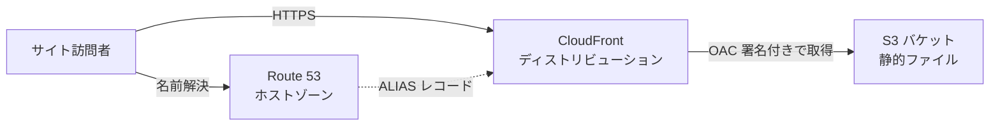
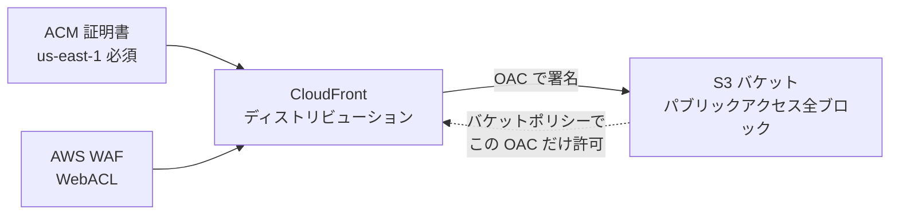
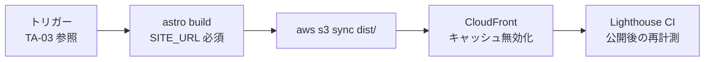

# 02. 製品（Astro）の AWS 配信設計

TA（Technology Architecture）層。ID は EA 共通用語集の定義をそのまま使う。
ファイルパスは `MarketingDepartment/WebsiteOperations/` を起点とした相対で書く。

**状態: 未着手（`cloud/` ディレクトリは空）。** 本ファイルの内容はすべて To-Be の設計であり、AWS 上に存在するリソースは 1 つも無い。

## 1. 前提と検証の限界

**本セッションでは AWS MCP が認証情報の期限切れで接続できず、AWS 構成の実地検証は実施していない。**
したがって以下はドキュメントと既存コードの読み取りに基づく設計であり、次の 2 点は未検証である。

- 各サービスの設定値・制約（リージョン制約、クォータ、機能の組み合わせ可否）を実際の API で確認していない。特に「CloudFront 用の ACM 証明書は us-east-1 でしか発行できない」という制約は設計の前提に置いているが、本セッションでは確認していない。
- **コスト見積りは未実施。** AWS Pricing API を叩いていないため、月額の概算も提示しない（根拠の無い数字を置くと、それが以後の判断の前提として一人歩きするため）。コストの検討は AWS への接続が回復してから、TA の追補として行う。

この注記は設計の不備ではなく、検証の範囲を明示するために置く。実装に着手する前に、本ファイルの構成要素表を AWS の実 API に対して 1 度検証すること。

## 2. 図 1 リクエスト経路（To-Be）



図は To-Be を描いている。**As-Is ではこの図のリソースが 1 つも存在しない。**
ドメインも未取得で、`frontend/verdant-virgo/.env.example` の `SITE_URL` は `https://example.com` のままである。

## 3. 図 2 CloudFront に付随する保護（To-Be）



図は To-Be を描いている。**As-Is では未着手。**
この図の要点は S3 と CloudFront の間の双方向の縛りにある。S3 側はパブリックアクセスを全ブロックしたうえで、バケットポリシーで**この CloudFront ディストリビューションの OAC だけ**を許可する。CloudFront 側は OAC で署名して取得する。こうすると S3 の URL を直接叩く経路が存在しなくなり、**WAF と TLS を迂回してオリジンに到達する裏口が塞がれる**（S3 の静的ウェブサイトホスティング機能を使うとバケットを公開せざるをえず、この裏口が開いたままになるため、その機能は使わない）。

## 4. 構成要素表

| 要素 | 役割 | 決めておく設定 | 状態 |
|---|---|---|---|
| S3 バケット | `astro build` の成果物（`E-05` `Page`）の置き場 | パブリックアクセスを 4 項目とも全ブロック。静的ウェブサイトホスティングは**使わない**（上記のとおり公開が必須になるため）。バージョニングを有効にする（誤ったデプロイからの復旧手段になる） | `未着手` |
| CloudFront | エッジ配信と TLS 終端 | オリジンは S3 の REST エンドポイント。OAC を使う。既定ルートオブジェクトは `index.html`。404 / 403 を Astro の 404 ページに割り当てる | `未着手` |
| OAC（Origin Access Control） | CloudFront から S3 への署名付きアクセス | SigV4。バケットポリシーでこの OAC のみ許可 | `未着手` |
| ACM 証明書 | CloudFront の TLS | **`us-east-1` で発行する**（CloudFront に関連付けられる証明書はこのリージョンのものだけ。他リージョンで発行すると関連付けの段階で失敗する。※本セッションでは未検証） | `未着手` |
| Route 53 | 公開ドメインの名前解決 | ホストゾーンと、CloudFront への ALIAS レコード。ACM の DNS 検証用 CNAME もここに置く（同じホストゾーンにあると証明書の自動更新が無人で回る） | `未着手` |
| AWS WAF | L7 の防御 | CloudFront に関連付ける WebACL。静的サイトなので**レート制限を主目的**にする（フォームも管理画面も無いため、SQL インジェクション等のルールの出番は少ない） | `未着手` |
| キャッシュ方針 | 配信の速度と更新の反映 | `_astro/` 配下のハッシュ付き資産は長期キャッシュ ＋ `immutable`、HTML は短期または都度検証（ファイル名が変わらないため） | `未着手` |

### 経路 4 の決定が AWS 側に与える影響（無し）

TA-01 の経路 4（訪問者のブラウザからオンプレの観測系・接客系への到達）は **ngrok の常設トンネルで解決すると決まった**。この決定が AWS 側に与える影響を明示しておく。

- **上の構成要素表は変わらない。** Umami・Chatwoot・Mautic を AWS へ移す案は採らないため、AWS に置くリソースは S3 / CloudFront / OAC / ACM / Route 53 / WAF のままである。
- **CloudFront をトラッキングの中継に使わない。** オリジンを増やして `/umami/*` のようなパスをオンプレへ転送する案（リバースプロキシとしての利用）も採らない。採ると CloudFront が製品の配信とオンプレへの中継という 2 つの役割を持ち、**キャッシュ方針を役割ごとに分ける必要が生じる**（トラッキングのリクエストはキャッシュしてはならず、静的ファイルはキャッシュしなければならない）。設定の複雑さに見合う利点が無い。
- **結果として、公開サイトのページからは 2 つのドメインにリクエストが出る。** 製品本体は CloudFront のドメイン、トラッカーとウィジェットは ngrok の固定ドメインである。この非対称は意図した結果であり、`CAP-09`（テクニカル SEO・パフォーマンス）の観点では**外部ドメインへの接続が増えることになる**。Lighthouse の performance しきい値（`minScore: 0.9`）に影響しうるため、トラッカー設置後に再計測して確認する（現在の実測ベースラインは 0.98〜1.00 で余裕があるが、余裕の幅は計測してみないと分からない）。

## 5. Cloudflare / Vercel の代替対応（`CAP-08` の引き渡し分）

README が外注の模倣対象として挙げる機能を、AWS の何がどう満たすかを 1 行ずつ対応させる。
**満たせない項目と追加コストがかかる項目は正直に書く**（内製化の判断は、できることの一覧ではなくできないことの一覧を見て行うため）。

| README が挙げる機能 | Cloudflare / Vercel での提供 | AWS での対応 | 差分・追加で必要になるもの | 状態 |
|---|---|---|---|---|
| 表示速度の高速化 | エッジキャッシュ、圧縮、HTTP/3 が既定で有効 | CloudFront のエッジキャッシュ、gzip / Brotli 圧縮、HTTP/3 | **機能としては同等。ただし既定では最適にならない。** キャッシュポリシー・圧縮・`Cache-Control` を自分で設計する必要がある（`_astro/` と HTML で寿命を分ける設計が必須） | `未着手` |
| DDoS 攻撃対策（L3 / L4） | 無料プランに含まれる | AWS Shield Standard（CloudFront に自動適用、追加料金なし） | 同等。設定作業も不要 | `未着手` |
| DDoS 攻撃対策（L7 / アプリケーション層） | Cloudflare は無料プランでも一定のレート制限を含む | **AWS WAF が必要** | **同等ではない。有料。** WebACL の月額とリクエスト数の従量課金が乗る。Shield Advanced はさらに高額で、この事業規模では採らない（費用が守る資産の価値を上回るため） | `未着手` |
| SSL の自動化 | 証明書の発行・更新が自動 | ACM の DNS 検証と自動更新 | 同等かつ証明書自体は無料。**ただし `us-east-1` 制約がある**ため、他のリソースと同じリージョンに置けない（構成管理上の例外として記録が要る） | `未着手` |
| （README に無いが Vercel では既定）PR ごとのプレビュー環境 | Vercel の標準機能 | **標準では存在しない** | **満たせない。** 別バケット ＋ 別ディストリビューション ＋ 別ドメインを自前で組む必要がある。今回は作らない（レビューはローカルの `astro dev` と、既に実装済みの ngrok 経由の dev 共有（TA-01 の経路 6）で行えるため、AWS 側にプレビューを重ねる必要が無い） | `未着手` |
| （README に無いが Vercel では既定）Git 連携の自動デプロイ | push / merge で自動 | **自前で組む** | CI を設計する必要がある。TA-03 に引き渡す | `未着手` |
| （README に無いが Cloudflare では既定）WAF のマネージドルール | 無料〜低額 | AWS WAF のマネージドルールグループ | 有料。静的サイトでは費用対効果が薄いため、まずはレート制限のみで始める | `未着手` |

### この対応表から読み取れること

**「Cloudflare / Vercel を AWS で置き換える」は機能的には成立するが、無料で成立はしない。** 差分が出るのは L7 の防御（AWS WAF）と、プレビュー環境・自動デプロイのような開発体験の部分であり、配信そのもの（速度・TLS・L3/L4 防御）は AWS でも同等かつ追加設定なしで得られる。

内製化の判断として、**まず L7 の WAF を入れずに始め、実際に攻撃トラフィックを観測してから入れる**（静的ファイルの配信しかしないサイトに対する L7 攻撃は、成立しても被害が「配信コストの増加」に限られる。観測なしに先回りして月額を払うより、CloudFront のリクエスト数を監視して必要になってから入れるほうが、この規模では合理的）。この判断は BA-02 の「外部サービスの成果物ではなく判断基準を内製する」方針の適用例にあたる。

## 6. デプロイ手順の設計



図は To-Be を描いている。**As-Is で動くのは 2 番目のビルドと 5 番目の計測だけ**で、いずれもローカル実行にとどまる（`frontend/verdant-virgo/package.json` の `pnpm build` と `pnpm lh`）。

| # | 手順 | 内容 | 失敗したときの扱い |
|---|---|---|---|
| 1 | トリガー | 記事の公開、または `main` へのマージ。詳細は TA-03 | — |
| 2 | ビルド | `SITE_URL` を注入して `pnpm build` | **`SITE_URL` が無ければ例外で停止する**（後述）。ここで止まった場合は後続を実行しない |
| 3 | 同期 | `aws s3 sync dist/ s3://<bucket> --delete` | 部分的に同期された状態になりうる。`--delete` を付けるのは古いページを残さないため（残すと sitemap に載らない孤児ページが公開され続ける） |
| 4 | 無効化 | CloudFront のキャッシュ無効化 | 無効化には無料枠があり、毎回 `/*` を投げるより変更された HTML のパスを列挙するほうが枠に収まりやすい（枠の正確な数量は本セッションでは未検証）。ハッシュ付きの `_astro/` は無効化不要（ファイル名が変わるため） |
| 5 | 検証 | 公開 URL に対して Lighthouse CI を再計測 | しきい値違反は `E-13` の起票につながる。TA-03 の 3 節 |

### 同期と無効化の順序を入れ替えない

必ず「S3 へ同期 → 無効化」の順で行う。逆にすると、無効化の直後から次の同期が終わるまでの間、CloudFront が**古い内容をオリジンから取り直してキャッシュし直す**ため、更新が一巡遅れる。

### デプロイに使う権限

デプロイ用の IAM は、対象バケットへの `s3:PutObject` / `s3:DeleteObject` / `s3:ListBucket` と、対象ディストリビューションへの `cloudfront:CreateInvalidation` に限る。バケットポリシーの変更権限やディストリビューションの設定変更権限は渡さない（デプロイ経路が構成そのものを書き換えられると、BA-05 の `禁止` 分類「エージェントが自分の権限や実行条件を変える操作」に実質的に到達できてしまうため）。

## 7. `SITE_URL` 未設定時のビルド停止を手順に織り込む

`frontend/verdant-virgo/astro.config.mjs` は、Vite の `loadEnv` で `SITE_URL` を明示的に読み込み、**ビルド時に未設定であれば例外を投げてビルドを停止する**。

```
const isBuild = process.argv.includes('build');
if (isBuild && !SITE_URL) { throw new Error(...) }
```

この停止は不具合ではなく事故防止のための設計である（未設定のままビルドすると `site` が `http://localhost:4321` にフォールバックし、`sitemap.xml` の全 URL と各ページの canonical に localhost が焼き込まれる。しかも警告は出ないため、公開してから検索エンジンに拾われるまで誰も気づかない）。

したがって CI 側の扱いは次のとおり。

- **CI では `SITE_URL` を必ず注入する。** 環境変数を CI の設定に置き、ビルドコマンドに渡す。
- **この停止を回避する仕組みを CI に入れない。** 既定値を埋めたり、`|| true` で握りつぶしたりしない（停止の目的は「設定漏れに気づかせること」であり、回避策を用意した時点で目的が失われる）。
- **dev サーバー（`astro dev`）は停止しない。** `isBuild` の判定で `build` のときだけ止めているため、開発中は `SITE_URL` 無しで動く。この非対称は意図的（開発の摩擦を増やさずに、公開物の事故だけを防ぐ）。
- 値は環境ごとに変える。本番の公開ドメインと、将来プレビュー環境を作る場合のドメインを取り違えると、canonical が別ドメインを指す（`SITE_URL` は sitemap と canonical の両方の基点であるため、間違いが SEO に直結する）。

## 8. コストの扱い

**本セッションではコスト見積りを実施していない**（AWS MCP が接続できず、Pricing API を叩けなかったため）。

見積りを行う際に対象とする項目だけを列挙しておく。

| 項目 | 課金の性質 | 備考 |
|---|---|---|
| S3 のストレージ | 容量 | 静的サイトのため極小 |
| S3 のリクエスト | 回数 | CloudFront がキャッシュするため、オリジンへのリクエストは訪問数に比例しない |
| CloudFront のデータ転送 | 転送量 | 主要な変動費 |
| CloudFront のリクエスト | 回数 | 同上 |
| CloudFront の無効化 | パス数（無料枠あり） | 手順 4 の設計と直結する |
| Route 53 のホストゾーン | 月額固定 ＋ クエリ数 | |
| ACM の証明書 | CloudFront 用途は無料 | |
| AWS WAF | WebACL の月額 ＋ ルール ＋ リクエスト数 | 5 節の判断（当面入れない）に直結する |

## 9. 未決定事項

- **公開ドメインが未取得。** `SITE_URL` が決まらないと Route 53 のホストゾーンも ACM の証明書も作れず、この設計は 1 つも着手できない。着手の起点はドメインの決定にある。
- **AWS アカウントの構成が未確認。** 単一アカウントで進めるか、本番を分けるかが決まっていない。本セッションでは AWS MCP が接続できず既存のアカウント状況も確認できなかったため、前提を置かずに保留する。
- **IaC を使うか手動で作るかが未定。** CloudFormation / CDK / Terraform のいずれを使うかで、TA-05 の構成管理表に載る行が変わる（IaC を使えば AWS 側の構成が Git 管理下に入り、TA-05 の「管理外」の一覧が 1 項目減る。これは再帰的自己改善の観点では小さくない差である）。リポジトリの `cloud/` が空の枠として用意されていることから IaC の置き場は想定されているが、選定はされていない。
- **プレビュー環境を将来作るかどうか。** 5 節では「作らない」と判断したが、これは公開面を増やさない原則を優先した結果であり、`R2` の公開承認（BA-05）を実物で行いたいという要求が出た場合は再検討の余地がある。
- **ACM の us-east-1 制約を実 API で確認していない。** 設計の前提としては広く知られた制約だが、本セッションでは検証していない。着手前に確認する。
- **CloudFront のアクセスログを `E-12` に変換する経路が未定。** TA-01 の経路 2 と同じ論点であり、DA-04 の鮮度要件（観測は日次）と合わせて決める。
