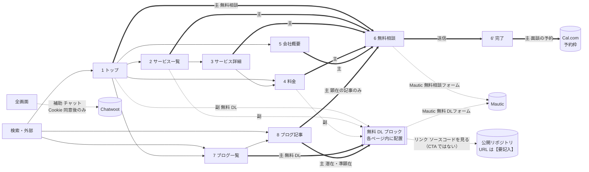

# 01. コンテンツ仕様（情報設計・コピー・CTA・計測）

担当: `ia-copy`。前提は [00-brief.md](00-brief.md)。builder はこの文書の文言をそのまま Figma に流し込む。
根拠にした文書: `BA/01-business-model.md`、`BA/04-business-processes.md`、`AA/04-recursive-improvement-loop.md`、`DA/01-conceptual-data-model.md`、`DA/02-metrics-and-kpi.md`、`DetailedDesign/02-public-path-flows.md`、ルート `README.md`。

**状態: ゲート G2 承認済み（2026-09-20）。** 承認時のユーザーの決定（F1〜F4・F6・C1・C2・C4・C7 と計測イベント）は反映済み。
**2026-10-01 にユーザーが未決事項を追加で確定した**（会社情報 U1〜U8、支払いと契約 U6、商談プロセス C5、クラウド利用料 C10、著作権の譲渡 C11、FAQ C8、カテゴリ名 C6、Cookie 同意 K1・K3・K4、`cta_type` F7、および ia-copy に委ねられた C9・F3'・F5・F9・K2）。**法務 2 ページの本文（U9）も起草した**（§4.10）。10 節の「決定済み」を参照。
**2026-10-08 に、創業計画書の改訂（GTM・バリュープロポジション。comegin `805aafc`）とブランドガイドライン v1.3（comegin `c4530ee`）を反映した。** ユーザーの決定 D-A〜D-D と G-A は確定事項、ia-copy が書いた文言は **2026-10-08 にゲート G-B でユーザーが承認した**（判断の結果は 10.0.3）。計画は `docs/superpowers/plans/2026-10-08-website-figma-gl13-gtm.md`、前提は `00-brief.md` の 0'' 節。
**2026-10-13 に、創業計画書の改訂（体験の約束。comegin `d3f96ab`）とブランドガイドライン v1.4 を反映した。** ユーザーの決定 E-1〜E-4 と、ia-copy の役で書いた文言は 10.0.4。**Figma には反映していない**（E-4。差分の一覧は `03-handoff.md` の 0' 節）。
**2026-10-14 にユーザーの指示で改訂した**: ミッション・業務理念の「IT」→「IT 人材」、コンサルを DX 推進が主軸の内容へ差し替え（§4.3.2）、「初回相談は無料」の削除、お支払いの時期にクレジットカード払いを追加、料金の起点（契約締結日または発注日の、いずれか遅い日）、「バイブコーディングのみ」の契約条件（C12'）、「法人番号」の行の削除（U11）、「ソースコードを無料 DL」の動き（zip のダウンロード ＋ 無料相談へ遷移。§1 の注）、公開リポジトリの URL（F3-R の①）、画像枠の写真への差し替え（1-3・5-3・5-7・8-7・§4.3+）。**Figma には反映していない。**
**2026-10-18 に、JIS X 8341-3:2016 の AA を目標にした改修と方針・試験結果の公開（ユーザーの決定 U-1〜U-5。対応度は G-2 と A-6 の判断で「一部準拠」）に合わせて文言を足した**（計画は `docs/superpowers/plans/2026-10-18-jis-x-8341-3-accessibility.md`、仕様は `04-accessibility-spec.md` と `05-motion-spec.md`）。新しい画面 2 つ（§4.11 `/accessibility/`・§4.12 `/sitemap/`）、フッターのリンク 2 つ（§1.4）、姓・名の見えるラベルとエラーの要約の文（§5.1）、読み上げ用の文言（§12。新設）。決定の一覧は 10.0.5。**この日に足した文言は、2026-10-18 にゲート G-1 でユーザーが承認し、すべて確定した**（承認待ちの印は外した。結果は 10.0.5）。**Figma には反映しない**（E-4 と同じ扱い）。
**2026-10-08 からの正本**: ブランドガイドライン ＝ `~/ComeGin/comegin/documents/ブランドガイドライン.md`（v1.3。**2026-10-13 から v1.4**。v1.4 の変更は介護労働実態調査の引用〈令和7年度版〉だけ）、創業計画書 ＝ `~/ComeGin/comegin/documents/創業計画書.md`（2026年10月8日 改訂。**2026-10-13 から 2026年10月13日 改訂**）。以下で「GL」と書くときは v1.3 を指す（それより前の注記の「GL」は版 1.2 を指す）。

## 0. この文書の読み方と表記ルール

### 0.1 builder への約束

- **`【要記入】` と `【要確認】` は、そのまま Figma に文字として置く**（消さない・埋めない）。`【要記入】` はユーザーが値を入れる箇所、`【要確認】` は内容の妥当性をユーザーが確かめる箇所。どちらも 10 節の未決事項に対応する。
  - 本文・回答文に掛かるものは、その文の末尾に置く。括弧内の説明（「構築先の環境＝…を確認する」など）は設計上の注記なので画面には出さない。
  - **見出しに掛かるものは、見出しの文に混ぜない。** 見出しの右に `Badge`（Outline、小）「要確認」「要記入」を置く（h2 は SEO の見出しでもあるため）。**Figma で組む画面での該当は 3-5「こんな方に向いています」だけ**（2-6「ご利用の流れ」は 2026-10-01 に C5 が確定したため外した）。Figma では組まないサービス詳細 3 ページ（§4.3.1〜4.3.3）の同じ見出しにも、実装時に同じバッジを付ける（10.2 の C15）。
- **`（準備中）` `（サンプル）` の付いた文言は、明示したダミー**である。架空の社名・人名・証言・数値に置き換えない。
- `Button - Nova` のラベルは TEXT プロパティではないため、instance 内の TEXT ノードを書き換える（00-brief の 3 節）。
- 各 CTA には、6 節の表の `cta_id` とイベント名を Figma の注記（dev annotation）に書き写す。
- **本文・補足・エラー文など読ませる文字を載せる面は白（`card`）にし、`muted` の面には読ませる文字を置かない。** `muted`（#f5f5f5）の上に `muted foreground`（#737373）を載せると 4.35:1 で WCAG AA の 4.5:1 に届かないため（白の上なら 4.74:1 で満たす）。セクションを区切るための装飾だけの面（文字を載せない帯など）は `muted` のままでよい。面を分けたいときは、白 ＋ `border` の枠で分ける。
- **画面に出る文に URL やパスを書かない。** リンクにしたい語そのものをリンクにする（例: ×「料金ページ（`/pricing`）に記載のとおりです。」 ○「料金ページに記載のとおりです。」＋「料金ページ」をリンクにする）。この文書の本文で `（`/pricing`）` のように書いてある遷移先は、**builder への指示であって画面の文字ではない**。
- **仕様書のセクション番号（`1-4`、`§4.2` など）を画面に出す文に書かない。** 訪問者には何も指さない。位置で指す書き方（「先に挙げた」「前の」）も、ナビやアンカーで途中から来た訪問者には伝わらないため、**指したい中身を名指しする**。
- **文字色は役割トークン（`role/...`）の名前で書く。primitive（`brand.blue.500` など）で書かない。** `02-component-map.md` §2.1 の「当てるのは `ComeGin / tokens` の役割トークンだけで、primitives を直接指定しない」は、**この仕様書の書き方にも掛かる**。仕様書が primitive で書けば builder はそのとおりに作る（2026-10-01 にタグラインの色で実際に起きた）。
  - **地の色・図版の色・ロゴの背景の説明は primitive でよい**（役割トークンが無く、濃淡の範囲を示す必要があるため）。該当は §1.4 のロゴの背景ルールと §7.1 の OGP の地の色。
  - 文書全体の文字色は**すべて役割トークンで書いてある**（§4.1 の 1-3 ＝ `role/text-brand`、1-4a ＝ `role/text-muted` / `role/text-heading`、§4.7 の 7-3 ＝ `role/text-muted`）。走査のしかたは **§0.4**。
  - **文字色に使える役割トークンは 9 件で、一覧と値は `02-component-map.md` の §2.2・§9.1 にある。** 値をこの文書に写さない（2 か所に書くと必ず食い違う）。
  - **`tokens.json` に対応項目が無い寸法は、GL の PDF 本文が唯一の出典になる**（版面・画像の寸法がこれにあたる。この文書では §7.1 の OGP だけ）。その場合は**出典を「GL §x.x の本文だけ」と書き分ける**。**「`tokens.json` に裏がある」と書かない**（PDF 本文の側が古い例が実際にあるため）。
  - **寸法も同じ。色・サイズ・余白の正本は `Assets/tokens/tokens.json` と `02-component-map.md` で、GL の PDF 本文の数値を写さない。** GL §10.3-5 が「PDF の本文と食い違ったら JSON を正とする」と定めており、**実際に食い違っている箇所がある**（11.6 の R-3。§4.4 のロゴの最小サイズは PDF 本文が 144px、JSON が 160px）。コピーを書くときに迷うのは次の 3 つだけなので、ここに残す。
    - **`role/text-link` はリンクにだけ使う。** 「押せる文字」を示す色なので、リンクでない文字に当てると誤解させる。**下線とセットでなければ検査に引っかかる**（2026-10-01 にタグラインで実際に起きた）
    - **リンクではない青は `role/text-brand`**（`blue.700` #045D9D、6.87:1）
    - **補足・キャプション・出典は `role/text-muted`**、**見出しと大きい数字は `role/text-heading`**
  - **コントラストが足りていても、primitive で書いてよいことにはならない。** 役割トークンは値を後から変えられる場所であり、primitive を直接指すとその経路が切れる。
- **枠（プレースホルダ）は「枠の中に入る文字」と「dev annotation に書く説明」を分けて書く。** 1 つの文に混ぜると、**説明の全文が枠に入る文言の指定に読める**（2026-10-01 に §1.5 のチャットの枠で実際に起きた。56px の円に 20 字を入れる指定と読めた）。枠の中の文字は**枠に物理的に入る長さ**にする。
- 「部品」欄は shadcn/ui の名前で書く。kit では `<名前> - Nova`（例 `Card - Nova`）。サイト固有の複合部品（`SiteHeader` など）は design-system の `02-component-map.md` の名前に合わせる（9 節）。

### 0.2 文字の表記

**2026-10-01 にブランドガイドライン（版 1.2。以下「GL」）の全面適用が決まり、この表を改訂した。** GL と食い違っていた 2 項目（単位の前のスペース、代表者名）は GL に合わせた。
**2026-10-08 に GL v1.3 の 2 項目（宛名の例「〇〇株式会社様」、「OSS」の言い換え）を足した**（A-7）。表記の規則（和欧間・単位・一文 60 字・禁止表現）は v1.3 でも変わっていない。

| 項目 | ルール | 例 |
|---|---|---|
| 文体 | です・ます調。見出しは体言止めか短い文 | 「料金」 |
| 和欧間 | 和文と半角英数字の間に半角スペースを入れる（GL §6.4-2 の四分アキ）。**略語も例外にしない** | 「AI エージェント」「ComeGin の提案」「ソースコードを無料 DL」 |
| | ⚠ **Figma の半角スペースは、四分アキ（0.25em）の手書きの代わりである。** GL §6.4-2 は「CSS では `text-spacing-trim`／手動の場合は半角スペース」と書いており、**実装で CSS に任せるなら、文字としての半角スペースは入れない**（入れると二重に空く）。**Figma のテキストをそのままコピーして実装に貼らない**。判断は `03-handoff.md` で lead が決める | |
| **単位・助数詞** | **数字に密着させる。間にスペースを入れない**（GL §6.4-4）。**助数詞（つ・件・名・社・枚・回など）も単位と同じ扱いにする** | 「23,000円」「1日」「60〜90日」「3営業日」「75.4%」「4つ」「3件」「代表 1名」 |
| 和欧間との関係 | **密着させるのは「数字と、その後ろの単位・助数詞」の間だけ。** 数字の**手前**の和欧間のスペースは残す | ○「サービスは 4つです」／×「サービスは4つです」／×「サービスは 4 つです」 |
| | **置換するときは、数字の後ろだけを対象にする**（経緯は §0.4） | |
| 金額 | 3 桁区切りのカンマ ＋「円」（**スペースなし**）。月額は全角スラッシュ「／月」 | 「500,000円／月」 |
| 期間の範囲 | 全角の波ダッシュ「〜」 | 「60〜90日」 |
| 数字 | 半角（GL §6.4-3） | 「2026年9月27日」 |
| **日付・住所の例外** | **日付と住所は、和文と数字の間にスペースを入れない。** GL §6.4-3 の例「2026年11月1日」に合わせる。住所は U3 の原文どおり | 「2026年9月27日」「令和6年度」「2025年5月〜2026年11月」「大阪府大阪市城東区蒲生4-19-3 ロイヤルアシュリー蒲生502」 |
| お客さまの呼び方 | 「お客さま」「事業者さま」（「お客様各位」「御社様」は二重敬語・不要な一般化として使わない。GL §8.3）。**宛名を書くときは「〇〇株式会社様」「〇〇法人様」「〇〇事業所様」**（2026-10-08 に GL v1.3 §8.3 で「〇〇株式会社様」が加わった。販売の対象が業界を限らない企業に広がったため） | |
| **OSS** | **画面の文字には「OSS」と書かない。「無料で公開しているソースコード」「公開しているソースコード」と書く**（GL v1.3 §8.3「相手が技術者でない場合」。2026-10-08 に追加）。このサイトの読者（GL §2.8 のペルソナ A〜D）はいずれも技術者ではないため、画面では例外を作らない。**この文書の注記では使ってよい** | ○「無料で公開しているソースコード」／×「OSS で公開」 |
| 社名・サービス名 | 「ComeGin」。**法人格（株式会社など）を付けない**（個人事業のため。GL §3.3）。和文併記が要る場面は「ComeGin（カメギン）」 | |
| **一人称** | **「ComeGin」または「当方」。「弊社」「当社」は使わない**（個人事業であり会社ではないため。GL §3.3・§8.3） | |
| **代表者名** | **「亀谷 銀大」（姓名の間に半角スペース）。読みは「カメヤ ギンタ」**（GL §3.1） | |
| ボタン | 動詞で終える（「〜する」「〜を受け取る」）。15 字以内 | 「無料で相談する」 |
| **一文の長さ** | **60 字以内**（GL §6.4-9）。超えるなら分ける | |
| **行長** | **35〜45 字**（GL §6.4-1）。Desktop の本文幅 720px がこれにあたる | |
| **強調** | **太字だけ。** 下線・斜体・傍点・色文字を使わない（GL §6.4-8） | |
| **箇条書き** | 語尾をそろえる。体言止めなら全部体言止め（GL §6.4-10） | |

**GL と食い違ったときの扱い**

| # | 項目 | 旧（この文書の元の規則） | 新 | 根拠 |
|---|---|---|---|---|
| 1 | 単位の前のスペース | 「23,000 円」「1 日」（**ブリーフの料金表の原文に合わせていた**） | 「23,000円」「1日」 | GL §6.4-4。2026-10-01 にユーザーが決定（D-1）。§2 の例外 2 |
| 2 | 代表者名 | 「亀谷銀大」（**U2 の原文**） | 「亀谷 銀大」 | GL §3.1。2026-10-01 に lead が決定（D-2）。同じ名前の組み方の問題であり、名前そのものを変えてはいない |
| 3 | 助数詞の**前**のスペース | 「4 つ」「代表 1 名」（**D-1 の 1 回目の適用で「件」だけ密着させ、「つ」「名」を取りこぼしていた**） | 「4つ」「代表 1名」（**直すのは「1」と「名」の間だけ。「代表」と「1」の間の和欧間のスペースは残す**） | 2026-10-01 に builder-sales が不統一を指摘。GL §6.4-4 の「単位」に助数詞を含めて統一した |

**一文 60 字の例外（D-3。2026-10-01 に lead が決定）**

- **法務 2 ページ（§4.10 の 10-A・10-B）と Cookie 同意バナーの本文（§8.1）だけは、一文 80 字まで許す。**
- 理由: これらは権利と義務の範囲を定める文で、**60 字で割ると係り受けが切れて読み違いが起きる**（「〜を除き、提供しません」の条件と帰結が別の文になるなど）。読み違いの害のほうが、1 文の長さの害より大きい。
- **例外はこの 2 か所だけ**で、ほかの画面には広げない。

### 0.3 段組みと折り返しの規則

- **Desktop で本文（説明文が付くカードやステップ）を横に並べるときは、1 列あたり 1 行 20 字以上入る幅を目安にする。** 20 字を下回ると、語の途中で改行されて読みにくくなる。足りないときは段を分ける（4 つなら 2 列 ×2 段、5 つなら 3 列 ＋ 2 列、6 つなら 3 列 ×2 段）。
- **ただし 3 列は下限として許容する。** 3 列のカードは本文幅 318px なので、**本文 16px の `IconCard` を 3 列で使うと約 19.3 字**になり、目安を 1 字下回る（該当は 1-4 と 5-4）。この幅を満たそうとすると 3 列のセクションがすべて 2 列になってしまうため、19.3 字は許容する。**5 列（約 13 字）で起きたような語の途中での改行は、19.3 字では起きていない**（qa-reviewer の確認）。本文 14px の `ServiceCard`・`PricingCard`・`BlogCard` は 3 列でも約 22.7 字で、目安を満たす。
- **4 列以上（1 列 270px、本文幅 222px）は、本文を載せない場合に限る。**
- 計算の前提（**qa-reviewer が部品を実測した値**）:
  - コンテンツ幅 1152px、列の間隔 24px。1 列の幅は 3 列で 368px、4 列で 270px、5 列で 218px、6 列で 172px（368×3 ＋ 24×2 ＝ 1152）。
  - **カードの左右の余白は各 24px。** 本文幅は 1 列の幅 − 48px で、3 列＝318px、4 列＝222px、5 列＝170px、6 列＝124px。
  - **字数は本文の文字サイズで決まる。** 1 行の字数はおよそ「本文幅 ÷ 文字サイズ」。3 列なら 14px で約 22.7 字、16px で約 19.3 字。4 列なら 14px で約 15.9 字、16px で約 13.9 字。
  - 本文が 16px なのは `IconCard` だけで、`ServiceCard`・`PricingCard`・`BlogCard` は 14px。**「3 列だから 19 字」ではなく「`IconCard` を 3 列で使うと 19.3 字」**である。1 列の幅が広ければ 16px でも足りる（Contact の `IconCard` は 1 列 384px で約 20.4 字）。
  - `03-handoff.md` の H-5 と同じ前提。どちらかを直すときは両方を直す。
- 文字を持たない枠（ロゴ枠など）と、1〜2 語の短いリンクだけを並べる列（フッター）はこの規則の対象外。

### 0.4 走査と置換のときに守ること

**2026-10-01 に lead が確定した規則。** `02-component-map.md` と `03-handoff.md` の §10 にも同じ 2 文を置いてある（共通の置き場所を 1 つにすると、どの担当も「自分の文書ではない」と読まなくなるため、**短い規則は重複して置く**）。

> 1. **検査・走査の結果を報告するときは、母数と対象範囲を添える。** 何件中の何件か、どこを見てどこを見ていないか。
> 2. **一括置換をしたら、置換後に「逆向きの条件」で走査する。** 直したものを数えるのではなく、**直しすぎたもの**を探す。
> 3. **当たった 1 件ずつが本当に該当するかを、現物で確かめてから直す。** 語が一致しただけでは該当しない。

**3 文に分かれているのは、失敗が 3 種類あるためである。**

| # | 失敗の形 | 塞ぐもの | なぜほかの規則で防げないか |
|---|---|---|---|
| 1 | **網が狭すぎて見落とした** | 母数と範囲を添える | — |
| 2 | **網が広すぎて壊した** | 逆向きの条件で走査する | **1 では防げない。** 下の #2 では母数を添えて報告しており、件数も正しく、置換もすべて正しそうに見えた |
| 3 | **網は正しいが、判定の基準が間違っている** | 1 件ずつ現物で確かめる | **1 でも 2 でも防げない。** 範囲も件数も正しく、当たった語も実在する。間違っているのは「当たった ＝ 直すべき」という判定のほう |

**#3 の実例**（2026-10-01 に `design-system` が部品ページで経験）: 旧トークン名を語で走査したところ **25 件当たったが、本物は 3 件**で、22 件は現行の名前だった。**機械的に直していれば 4 件を壊していた。**

> **トークン名を語で検索して一括で直してはいけない。** 差し替えは**役割ごと**なので、同じ色名が現行と旧表記の両方で出る。**その名前の変数が現存するかを確かめてから直す。**

- 例: `role/surface-brand` は blue.600 に動いたが、**`role/focus-ring` は blue.500 を指し続けている**（UI 部品の境界は 3:1 で足りるため）。したがって**「この色はもう使わない」という言い方が成立しない**。
- **`role/text-accent-subtle` も現行である**（退役させたのは emerald の `accent/*` だけ）。

**この文書で実際に起きた 4 件**（`02-component-map.md` に `design-system` の 8 件、`03-handoff.md` の §10 に 13 件の内訳がある）:

| # | 何をしたか | 出た誤り | どちらの形か |
|---|---|---|---|
| 1 | 文字色の primitive を `blue.500` で検索した | 「1 か所だけ」と数えた（実際は 4 か所。`neutral.600` と `brand.navy.700` が対象外だった） | 網が狭い |
| 2 | D-1 で「4 つ」→「4つ」を一括置換した | **数字の手前の和欧間の空きまで消し、14 か所を壊した**（「サービスは 4つです」→「サービスは4つです」）。`qa-reviewer` と lead の指摘で逆向きに走査して発見 | **網が広い** |
| 3 | 単位の密着で「件」だけを置換した | 「つ」「名」を取りこぼした（`builder-site` が発見） | 網が狭い |
| 4 | GL §7.4 の記述をそのまま写した | primitive 名（`neutral.600`）のまま 3 か所残った | 網が狭い |

- **#2 は、母数を添えても見つからない。** 「136 か所を密着表記にした」という報告は正しく、置換の 1 件 1 件も正しく見えた。見つかったのは **lead が「`DL` 以外の和欧間も点検せよ」と指示し、逆向きの条件で走査した**ときである。
- **一括置換は、画面に出る文字と「変更の記録」の両方に当たる。** 2026-10-01 に `亀谷銀大` → `亀谷 銀大` の全置換が §11 の V-8 と D-2 の**旧側まで書き換え**、新旧の対比が成り立たなくなった（`qa-reviewer` が発見）。**before / after を書くときは、旧側をコードスパンで囲って置換の対象から外す。**
**表記の検査は 3 方向に分ける**（2026-10-01 に `builder-site` が整理し、lead が確定）

**§0.2 は、隣り合う位置に逆向きの規則を 3 つ置いている。** ① だけを検査すると ② と ③ を素通りする。

| # | 規則 | 検査するもの |
|---|---|---|
| ① | **和欧間に半角スペースを入れる** | 和文と半角英数字が直結していないか |
| ② | **数字の「手前」の空きは残す** | 和文と数字が直結していないか（`サービスは4つです` のような形） |
| ③ | **数字と「後ろ」の単位・助数詞は密着** | 数字と単位の間に空きが無いか（`23,000 円` のような形） |

- **② と ③ は向きが逆なので、1 つの正規表現では書けない。** ③ だけを直そうとして ② を壊したのが、下の #2 である。
- **除外するもの（3 方向とも共通）**: **日付**（`2026年9月27日` `令和6年度` `2025年5月〜2026年11月` `YYYY年M月D日`。元号 ＋ 年・年度を含む）と**住所**（`大阪府大阪市城東区蒲生4-19-3`）。§0.2 の「日付・住所の例外」のとおり、**これらは和文と数字が直結するのが正しい**ので、①②で検出しても直さない。
- **`YYYY年M月D日` は 15 Blog に 50 件ある**（§4.7 の 7-4 の日付のダミー）。`YYYY` と `年` の境目が ① に見えるため**偽陽性になりやすい**。§4.7 が「実在の日付を入れない」と確定させているダミーなので、**四分アキを入れると仕様違反になる**。

- **走査から除外した範囲が、そのまま穴になる。** 2026-10-01 の走査では、§0.2 を**意図的に対象から外していた**（規則の例として「直す前の形」を載せている節なので、違反として検出されるのを避けるため）。その結果、**§0.2 の例示そのものが D-1 の置換で壊れていたこと**（`代表 1名` が `代表1名` になっていた。**この引用をコードスパンで囲ってあるのは、§0.4 の「旧側を置換の対象から外す」を自分に適用したものである**）を見落とし、`builder-site` の指摘で見つかった。**除外した範囲は、別の方法で確かめる**（この場合は、規則の本文と例示が互いに矛盾していないかを人が読む）。
- **機械的な一括置換より、手で書き写したほうが壊れた。** 2026-10-01 に、この文書の 14 か所の壊れが Figma へ転記されて **55 instance** に広がった（`builder-site` 38・`builder-sales` 17）。`builder-sales` が切り分けたところ、**正規表現による置換（`(\d[,\d]*)\s+(単位)`）は数字の後ろの空きしか消さないので無傷で、壊れていたのは確定文言を手で転記した箇所だけ**だった。サービス一覧 2-3 が無事だったのは、置換を通ったためである。**置換を疑う前に、転記を疑う。**
- **画面に出ない情報は、誰も確かめない。** 2026-10-01 までに 4 種類が実際に壊れた: **部品の既定値**（`CTABanner` の `Body` が消えた旧文言のまま）、**dev annotation**、**レイヤー名**、**パスの大文字小文字**（§7.1 の `Assets/logo/favicon/` を `assets/...` と書いていた）。
  - **パスの大文字小文字はとくに危ない。** Linux は大文字小文字を区別するので辿れないが、**ローカルの開発環境が macOS なら動いてしまう**（区別しない）。**Linux のビルドで初めて落ちる。**
  - この文書で使う大文字始まりのパス: **`Assets/tokens/tokens.json`** / **`Assets/tokens/tokens.css`** / **`Assets/brand.css`** / **`Assets/logo/`**（`favicon/`・`png/` を含む）/ `RequirementDefinition/...` / `DetailedDesign/...`。**小文字始まりは `backend/` `middleware/` `frontend/` `dev/` `.claude/`。**
- **規則で塞げないものがある。** この 4 件のうち #2 は「和欧間の点検」という**別の目的の検査**が見つけた。`design-system` の例でも、単位スペースの検査が既定値の分類の誤りを見つけている。**検査を増やすこと自体に、狙っていない誤りを見つける効果がある。**

## 1. サイトマップとナビゲーション

### 1.1 画面一覧（10 画面 ＋ 状態）

| # | 画面 | URL | Figma ページ | 担当 | index | 主 CTA |
|---|---|---|---|---|---|---|
| 1 | トップ | `/` | 10 Top | builder-sales | index | 無料相談 |
| 2 | サービス一覧 | `/services` | 11 Services | builder-sales | index | 無料相談 |
| 3 | サービス詳細（テンプレート。例: 受託開発） | `/services/development` | 11 Services | builder-sales | index | 無料相談 |
| 4 | 料金 | `/pricing` | 12 Pricing | builder-sales | index | 無料相談 |
| 5 | 会社概要 | `/about` | 13 About | builder-site | index | 無料相談 |
| 6 | 無料相談（フォーム） | `/contact` | 14 Contact | builder-site | index | 無料相談 |
| 6' | 無料相談（完了） | `/contact/thanks` | 14 Contact | builder-site | **noindex** | **オンライン面談の予約**（Cal.com の埋め込み。4.6 の 6'-1） |
| 7 | ブログ一覧 | `/blog` | 15 Blog | builder-site | index | **無料 DL**（4.3 節） |
| 8 | ブログ記事（テンプレート） | `/blog/<slug>` | 15 Blog | builder-site | index | 検索意図で切り替え（4.3 節）。Figma の例は **無料 DL** |
| 9 | 404 | （存在しない URL すべて） | 16 System | builder-site | **noindex** | なし |
| 10 | 法務（テンプレート） | `/legal/privacy`、`/legal/tokushoho` | 16 System | builder-site | index | なし |
| **11** | **ウェブアクセシビリティ方針** | `/accessibility` | （なし） | pages | index | なし（§4.11）。**2026-10-18 に新設** |
| **12** | **サイトマップ** | `/sitemap` | （なし） | pages | index | なし（§4.12）。**2026-10-18 に新設** |

- **画面 11・12 は Figma に置かない**（E-4 と同じ扱い。実装と仕様書だけ）。担当の欄は 2026-10-18 の Agent team の名前（`pages`）。どちらも sitemap.xml に載せる。

**トップのセクション順（2026-10-08 に 1-4c、2026-10-13 に 1-4d を足した。`01 Sitemap` の正本。**1-4d は Figma に未反映**）**

| 順 | セクション | 分類 | 備考 |
|---|---|---|---|
| 1 | 1-1 告知バナー | `HERO` | 副 CTA |
| 2 | 1-2 ヘッダー | `NAV` | |
| 3 | 1-3 ヒーロー | `HERO` | h1 ＝ ミッション（2026-10-08） |
| 4 | 1-4a 業務理念と 5つの方法 | `CONTENT` | 2026-10-08 に 4 枚 → 5 枚 |
| 5 | 1-4b こんなことが起きていませんか | `CONTENT` | |
| 6 | **1-4c 選ばれる理由**（画面の見出しは「ComeGin がお約束すること」） | `TRUST` | **2026-10-08 に新設**（B-2） |
| 7 | **1-4d 体験の約束**（小見出しは「体験のお約束」） | `TRUST` | **2026-10-13 に新設**（E-1） |
| 8 | 1-5 仕組み | `CONTENT` | |
| 9 | 1-6 使うツール | `CONTENT` | |
| 10 | 1-7 サービス | `CONTENT` | |
| 11 | 1-8 導入事例（ダミー） | `TRUST` | |
| 12 | 1-9 無料 DL ブロック | `CONV` | 副 CTA ＋「ソースコードを見る（GitHub）」のリンク（2026-10-08） |
| 13 | 1-10 よくある質問 | `CONTENT` | 2026-10-08 に Q6 を追加 |
| 14 | 1-11 CTA バナー | `CONV` | 主 CTA |
| 15 | 1-12 フッター | `FOUND` | |
| — | 1-13 Cookie 同意バナー | `FOUND` | 重ねた状態の別フレーム |

- `01 Sitemap` は G-B の承認後（2026-10-08）に、この表に合わせて ia-copy が更新する。

サービス詳細テンプレートを使う URL（Figma で組むのは `development` だけ）:

| URL | サービス |
|---|---|
| `/services/environment-setup` | 環境構築 |
| `/services/development` | 受託開発（Figma の例） |
| `/services/consulting` | コンサル |
| `/services/partnership` | 業務提携（福祉・介護・教育事業者） |

### 1.2 画面遷移と CTA の導線



- 太線は主 CTA、点線は副 CTA・補助・送信先。**無料 DL は独立したページを持たず、各ページの中の「無料 DL ブロック」（`#source-dl`）で完結する**（ページ遷移を挟まないため離脱が少なく、フォームがメール 1 項目で済むため）。
- 他ページから無料 DL へ誘導するリンクは、同じページ内に無料 DL ブロックがあればそこへ、無ければトップの `/#source-dl` へ飛ばす。
- **2026-10-14 にユーザーの指示で変えた**: 「ソースコードを無料 DL」の CTA（`cta_type` が `source_dl` の `<a>`）を押すと、**別のタブで GitHub の zip（タグ `test-v0.1` のアーカイブ）を開いてダウンロードを始め、元のタブは無料相談（`/contact?cta=<cta_id>&from=<パス>`）へ移る**。無料相談・完了の画面では遷移しない。**ラベルが「受け取る」「構築の手順書を受け取る」のもの（`dl_top_banner`・`dl_article_inline`）は、これまでどおり無料 DL ブロック（手順書のメール登録）へ移る。** JS が動かないときは `<a>` の href（`#source-dl`）のまま。実装は `frontend/verdant-virgo/src/modules/source-dl`、zip の URL は `site-content/nav.ts` の `SOURCE_ZIP_URL`
- **商談プロセス（2026-10-01 にユーザーが確定した C5）**: ① Web サイトや資料請求で興味を持ってもらう → ② **ComeGin の Google Calendar の空き時間で、オンライン面談の枠を予約してもらう（Cal.com 連携）** → ③ 契約を**電子署名**で締結 → ④ サービスの提供。
- **②の予約は、無料相談フォームを置き換えない。** フォームを送信した先の完了画面（`/contact/thanks`）に Cal.com の予約枠を埋め込む（lead の実装方針）。**フォームを廃止して直接予約にはしない**（予約まで進まなかった方の連絡先を残すため）。③の電子署名と④の提供はサイトの外で行うため、画面としては持たない（「ご利用の流れ」の文言にだけ現れる）。
- **無料相談 ＝ 無料の業務棚卸し（2026-10-08 の D-D①。B-3）。順序は ia-copy の案を、2026-10-08 に G-B でユーザーが承認した。** 順序: ① フォームを送信 → ② 完了画面で**オンライン面談**（30分程度。【要確認】は C14 のまま）を予約 → ③ オンライン面談でご相談の内容を確かめ、**現場での業務棚卸しの日程**を決める → ④ **現場で無料の業務棚卸し**（経営者へのヒアリング 30分 → 現場の観察 2時間 → 業務時間の棚卸し 1時間 → 振り返り 30分。計 4時間。創業計画書 別紙1 の 4-1）→ ⑤ 「業務棚卸しレポート」を当日か翌営業日にお渡しし、ご提案 → ⑥ 電子署名で契約 → ⑦ 提供。
  - **オンラインを先にする理由**: 創業計画書 別紙1 の 3-3 が「無料相談の前に、ICP に当てはまるかを確認する」（従業員数・IT の独立部署・経営者の同席・現場を見せられるか）と定めている。4時間の現地作業の前に、この確認と日程の調整をオンラインで済ませる。**C5 の②（Cal.com の予約）とフォームの位置は変えずに済む**ので、完了画面・`cta_type: booking`・計測の設計は変えない。
  - **「オンライン面談」の名前は変えない**（プライバシーポリシー 2(7)・3 節、§6.1 の `booking`、6'-2 の見出しがこの名前で書かれているため）。変えるのは「面談で何をするか」の説明だけである。
  - 対案: 面談をやめ、完了画面で棚卸しの日時を直接予約する（Cal.com のイベントを 4時間にする）。ICP の確認と移動の調整ができないため推奨しない。

### 1.3 グローバルナビ（`SiteHeader`）

| 並び | 表示 | リンク先 | 備考 |
|---|---|---|---|
| 左 | ロゴ（**シンボル単体 `Lockup=Symbol`、35.79 × 32px。ヘッダーの高さは 56px**〈32 ＋ 上下 12 × 2〉。下端は 1px 罫線） | `/` | **2026-10-01 にユーザーが確定した値**（判断の記録は `02-component-map.md` §6「判断の記録: ヘッダーのロゴ」、`03-handoff.md`）。背景 `neutral.0`、下に 1px `neutral.200`（GL §9.5）。アイソレーションはシンボルの高さ 32px × 0.25 ＝ 8px で、上下 12px の余白に収まる（GL §4.3）。**GL §4.4 の「最小幅を割る場合はその組みを使わずシンボル単体に切り替える」をヘッダーに当てた結果で、GL §9.5 の「高さ 32px」とも合う**<br>**ヘッダー以外のロゴ（フッター・OGP など）は横組みのまま**（高さに余裕があり、横組みの最小幅 160px〈`tokens.json` の `logo.minWidth`〉を満たせるため。§1.4・§7.1）<br>**2026-10-08 に、撤回前の記述が残っていたのを直した**（lead の指示。`01 Sitemap` の確認で見つかった）。旧版（撤回済み）: ロゴ `Assets/logo/comegin-logo-horizontal.svg`、**幅 160px（高さ 49.16px）、ヘッダーの高さ 74.16px**。旧版の理由は「GL §9.5 の高さ 32px では横組みが幅 104px になり、§4.4 の最小幅 160px を割る」で、**§4.4 の切り替えの指示を読み落としていた**（`02-component-map.md` §6「当初の判断は誤りだった」）。旧版の注記の全文: 2026-10-01 にロゴ一式がそろったため、文字ロゴの仮置きをやめた（U10 は決着）。背景 `neutral.0`、下に 1px `neutral.200`（GL §9.5）。アイソレーション（ロゴの高さの 33.6%。`tokens.json` の `logo.isolation.ratioOfHeight` ＝ 0.336 と一致。`design-system` が確認済み）の内側に文字・罫線を入れない（GL §4.3）<br>GL §9.5 の「高さ 32px」は採らない（2026-10-01 に lead が確定）。横組みの縦横比 3.2549:1 では、高さ 32px は幅 104px にしかならず、GL §4.4 の画面での最小幅 160px（絶対下限 136px）を割る。GL §4.4 の判断の基準は「カタカナ『カメギン』が読めるかどうか」で、104px では読めない。160px / 136px は `Assets/tokens/tokens.json` の `logo.minWidth` の値（GL §10.3-5 により、PDF 本文と食い違う場合は JSON が正。PDF 本文は 144px / 120px のまま古い。11.6 の R-3）。可読性を優先して 160 × 49.16px を採用した。判断の記録は `02-component-map.md` §6、`03-handoff.md` §4 |
| 中央〜右 | サービス | `/services` | 現在地のページは `aria-current="page"`（Figma では active の見た目） |
| | 料金 | `/pricing` | |
| | 会社概要 | `/about` | |
| | ブログ | `/blog` | |
| 右端 | ボタン「無料相談」（主 CTA。`Button` Small。**強さは画面で切り替える**。下の表） | `/contact` | ヘッダーの「無料相談」は各ページの主 CTA の種類に数えない（00-brief の 4 節） |

**ヘッダーの「無料相談」の強さ（G2 の決定 F2）**

| 画面 | ヘッダーの「無料相談」 | 理由 |
|---|---|---|
| ブログ一覧（7）、ブログ記事（8） | **`Button` Outline**（弱める） | ブログの主 CTA は無料 DL。BA-04 の「潜在には商談系 CTA を置かない」に近づけるため、ヘッダーの無料相談を本文の主 CTA より目立たせない |
| 上記以外のすべての画面 | `Button` Primary | |

- Mobile の Sheet の中の「無料相談」ボタン（下の 4）も同じ規則に従う（ブログ一覧・記事では Outline、それ以外は Primary）。
- **Desktop**: 上の並びを 1 行。`Navigation Menu` の項目 4 つ ＋ `Button`。高さは design-system の `SiteHeader` に従う。
- **Mobile**: ロゴ（左）＋ ハンバーガー（右。`Icon Button` ＋ `Lucide / menu`、aria-label「メニューを開く」）。**ヘッダーの「無料相談」ボタンは Mobile では出さず、Sheet の中に入れる**（390px では並べるとロゴとタップ領域が窮屈になるため）。
- **Mobile の Sheet（右から開く）**の中身（上から）:
  1. 見出しなし。閉じるボタン（`Lucide / x`、aria-label「メニューを閉じる」）
  2. リンク 4 つ（サービス／料金／会社概要／ブログ）。各行 48px 以上
  3. `Separator`
  4. ボタン「無料相談」（主。全幅。ブログ一覧・記事では Outline、それ以外は Primary）
  5. テキストリンク「ソースコードを無料 DL」（副。`Button` Link）→ `/#source-dl`
- **ナビの名前（2026-10-18 に追加）**: Desktop のナビと Mobile の Sheet の中のナビは、どちらも名前を「メイン」にする（同じ役割のランドマークに同じ名前。同時には出ない）。Sheet（`dialog`）そのものの名前は「メニュー」のまま。文言の一覧は §12 の S-5〜S-8
- **スキップリンク**: 全画面の先頭に「本文へ移動」（Tab を押すと見える。既存の文言。§12 の S-1）。押すと本文（`main`）にフォーカスが移る
- **Desktop のナビの動き（2026-10-18。`05-motion-spec.md`）**: 現在地を示す形が、指した先・フォーカスした先へ流れる（`MotionNav`）。文言は変えない

### 1.4 フッター（`SiteFooter`）

| 列 | 見出し | リンク |
|---|---|---|
| 1 | ロゴ（`comegin-logo-horizontal-white.svg` または `-navy.svg`。**背景の濃さで選ぶ**。GL §4.5） | 説明文「社内に IT 人材がいなくても、1人分の予算で実現する業務改善。システム開発と IT コンサルティング。」（2026-10-04 に業務理念へ差し替え。旧文「福祉の業務と技術の設計を、一人で引き受けます。…」） |
| 2 | サービス | 環境構築（`/services/environment-setup`）／受託開発（`/services/development`）／コンサル（`/services/consulting`）／業務提携（`/services/partnership`）／料金（`/pricing`） |
| 3 | ComeGin について | 会社概要（`/about`）／ブログ（`/blog`）／無料相談（`/contact`）／ソースコード無料 DL（`/#source-dl`）／**ソースコード（GitHub）**（公開リポジトリ `https://github.com/kamegin4-aws/systematization-of-the-business-foundation`。2026-10-14 に決定。外部リンク・新しいタブ。2026-10-08 に G-A で追加） |
| 4 | 規約・ポリシー | プライバシーポリシー（`/legal/privacy`）／特定商取引法に基づく表記（`/legal/tokushoho`）／**ウェブアクセシビリティ方針**（`/accessibility`）／**サイトマップ**（`/sitemap`）／Cookie 設定（Cookie 同意バナーを再表示するボタン）。**太字の 2 つは 2026-10-18 に追加**。旧版: `プライバシーポリシー／特定商取引法に基づく表記／Cookie 設定` |
| 下段 | — | 「© 2026 ComeGin」（U1 の確定により差し替えは不要） |

- **Desktop**: 4 列を横並び。下段に `Separator` とコピーライト。
- **Mobile**: 列 1 を全幅、列 2〜4 を縦積み（Accordion にはしない。リンク数が少なく、畳むとフッターから辿れる導線が見えなくなるため）。
- 部品: `Separator`、`Button`（Link）。「Cookie 設定」はリンクの見た目の `button` 要素（ページ遷移しない）。
- **フッターの「ソースコード無料 DL」だけは「を」を入れない**（列 3 のリンクは「会社概要／ブログ／無料相談／ソースコード無料 DL」と**体言止めでそろえている**ため。GL §6.4-10「箇条書きの語尾をそろえる」）。**ほかの 16 か所は「ソースコードを無料 DL」**で、こちらは単独のリンクやボタンなので動詞で終える（§0.2 の「ボタンは動詞で終える」）。Mobile の Sheet のテキストリンク（1.3 の 5）も、`Separator` とボタンの下に単独で置くので「を」を入れる。**2026-10-01 に `design-system` から「取りこぼしか意図か」の確認があったため明記した**
- **列 4 に足した 2 つ（2026-10-18）**: 「ウェブアクセシビリティ方針」は h1 と同じ語、「サイトマップ」も h1 と同じ語（体言止めで列の語尾がそろう）。並びは「ページ → ページ → 操作（Cookie 設定）」にし、ページでない「Cookie 設定」を最後に残した。**列の見出し（サービス／ComeGin について／規約・ポリシー）は見出しの要素（h2）にする**（文言は変えない。`04-accessibility-spec.md` の 1.3.1）
- **フッターの公開リポジトリへのリンクは「ソースコード（GitHub）」と体言止めにする**（2026-10-08 の ia-copy 案を G-B で承認）。G-A は「ソースコードを見る（GitHub）」と名付けたが、列 3 は体言止めでそろえているため（上の「ソースコード無料 DL」と同じ理由）。**無料 DL ブロックの中のリンクは「ソースコードを見る（GitHub）」**のまま（単独のリンクなので動詞で終える）。どちらも **CTA ではない**（`cta_id`・`cta_type` を付けない。§6.3.1）
- **タグライン「現場の言葉と、技術の言葉を。」はフッターに置かない**（旧版のタグライン `福祉の言葉と、技術の言葉を。` の時から同じ扱い。2026-10-08 に GL v1.3 §2.4 でタグラインが変わった。D-4。GL §2.4 の「1 制作物につき 1 回まで」を 1 ページ ＝ 1 制作物と数えるため、全ページに出るフッターに置くと全ページで使い切ってしまう）。置き場所はトップのヒーローだけ（§4.1 の 1-3）。
- ロゴの背景ルール（GL §4.5）: 白・`neutral.25〜100` の地ならフルカラー版、`neutral.200〜400` の淡色なら単色ネイビー版、`navy.700〜900` / `blue.500` 以上の濃色なら単色白版。**選ぶ基準は「透けるか」ではなく「コントラストが足りるか」**（ロゴの最濃部が背景に対して 3:1）。

### 1.5 全画面に共通する要素

| 要素 | 分類 | 置き場所 | 仕様 |
|---|---|---|---|
| `SiteHeader` | Site Navigation & Headers | 全画面の最上部 | 1.3 |
| パンくず（`Breadcrumb`） | Site Navigation & Headers | トップ・404 以外のすべての画面。ヘッダー直下 | 「ホーム / 親 / 現在のページ」。現在のページはリンクにしない。Mobile も同じ（長い記事タイトルは 1 行で省略「…」） |
| `SiteFooter` | Website Foundations | 全画面の最下部 | 1.4 |
| Cookie 同意バナー（`CookieBanner`） | Website Foundations | 初回訪問時に全画面の下部に重ねる | 8 節。Figma では Top の Desktop・Mobile にだけ重ねた状態のフレームを置き、他の画面には置かない |
| チャット（Chatwoot のウィジェット） | Pricing & Conversion（補助） | 全画面の右下。**Cookie の利用に同意した訪問者にだけ読み込む**（K3） | **Chatwoot が描画するため Figma の部品は作らない**。位置を示すため Top と Contact にだけ 56px の円の枠を置く。**枠の中の文字は「チャット」**（56px の円に入る長さ）。**残りの説明は dev annotation に書く**: 「Chatwoot のウィジェットが描画する。Figma では部品を作らない（位置の目安だけを示す枠）」。ウィジェット自体の文言は 8.3。**同意バナーを表示している間はランチャーを隠す**（K4。8.1）<br>**2026-10-01 に lead が確定。** 旧版は「「チャット（Chatwoot ウィジェット）」と書いた 56px の円の枠」と 1 文で書いており、**56px の円に入らない 20 字の文言指定とも読めた**（Figma の実装が正しく、仕様書を実態に合わせた） |

## 2. 料金（正本）

**2026-10-04 にユーザーの指示で改訂した**（創業計画書と同じ商品構成にそろえた）。変更点: バイブコーディングの期間 5日→7日、要件定義〜運用保守に「定期常駐」と保守 150,000円／月を追加、コンサルを月額（125,000円／月・4日／月）から回数制（31,250円／回・4時間／回、初回相談は無料、4回から）へ、業務提携の対象を「福祉業界のみ」から「福祉・介護・教育事業を行う中小企業・社会福祉法人・非営利団体」へ広げ、**「開発費は基本的に ComeGin が負担」を削除して「レベニューシェアによる回収計画」に改めた**。

**この表の金額・期間・備考は、ブリーフの表と一字一句同じにする。** ただし**例外が 1 つある**（2026-10-04 の改訂で備考自体を差し替えたため、以下は経緯として残す）: 業務提携の備考は、ブリーフの原文が「開発費は基本的に弊社負担」だが、**ブランドガイドライン §3.3・§8.3 が「弊社」「当社」を禁止している**（個人事業であり会社ではないため）。2026-10-01 にユーザーが**「開発費は基本的に ComeGin が負担」に直す**と決定したため、この表では直した形を正本とする（`00-brief.md` の料金表は lead の担当ファイルなので ia-copy は直していない。11.1 の V-1）。 画面のどこに出すときもこの表から写す（言い換え・省略・「〜」の置き換えをしない）。

| プロダクト | 金額（税込） | 期間 | 備考 |
|---|---|---|---|
| 本プロジェクトの環境構築 | 23,000円 | 1日 | ソースコードは無料で配布 |
| 受託開発：バイブコーディングのみ | 50,000円 | 7日 | |
| 受託開発：要件定義〜運用保守 | 500,000円／月 | 60〜90日 | 保守のみ 150,000円／月 |
| コンサル | 31,250円／回 | 4時間／回 | 4回から |
| 業務提携 | 要相談 | — | レベニューシェアによる回収計画 |

- **注記「表示価格はすべて税込です。」を、料金を出すすべての箇所（料金カード群の直下、比較表の直下、サービスカード群の直下）に置く。**
- ブリーフの環境構築の備考「ソースコードは無料で配布（副 CTA と連動）」のうち、括弧内は設計上の注記であり画面には出さない（画面では「ソースコードは無料で配布」の後ろに副 CTA のリンクを置くことで連動を表す）。この扱いは G2 で承認済み（10.0 の C1）。
- **例外 2（2026-10-01、D-1）**: 上の表の金額と期間は、ブリーフの原文では「23,000 円」「1 日」「60〜90 日」のように数字と単位の間に半角スペースがある。**GL §6.4-4 が「単位は数字に密着させる」と定めているため、この文書と全画面では「23,000円」「1日」「60〜90日」と書く。** 数値・通貨・期間そのものは 1 つも変えていない（変えたのは組み方だけ）。`00-brief.md` の料金表は lead の担当ファイルのため、ia-copy は直していない（11.1 の V-1）。
- プロダクト名「本プロジェクトの環境構築」は原文のまま出す。訪問者には「本プロジェクト」が何を指すか伝わりにくいため、カードでは名前の下に補足「ComeGin の事業経営基盤一式を、お客さまのクラウドまたは端末に構築します。」を添える（名前自体は変えない）。

## 3. 6 分類の対応

| 分類 | この文書で使う略号 |
|---|---|
| Hero, Banners & Landing Intros | `HERO` |
| Site Navigation & Headers | `NAV` |
| Trust & Social Proof | `TRUST` |
| Content & Editorial | `CONTENT` |
| Pricing & Conversion | `CONV` |
| Website Foundations | `FOUND` |

## 4. 画面ごとのセクション仕様

各セクションは上から順に並べる。「D/M」は Desktop（1440px）と Mobile（390px）で構成が変わる点。書いていないものは縦積みにするだけ。

### 4.1 画面 1 トップ（`/`）

**読者（2026-10-04 に変更）: 業界を限らない BtoB・BtoC 企業（社内に IT 人材がいない中小企業）。** 福祉・介護・教育事業を行う中小企業・社会福祉法人・非営利団体は**販売ではなく業務提携の相手**として、1-7 の業務提携カードと 1-10 の Q4 で呼びかける。
**2026-10-04 にユーザーの指示で書き直した。** h1 を業務理念にし、1-4a を「業務理念を実現する 4つの方法」に差し替えた（旧 1-4a の介護労働実態調査の数字はトップから外し、ブログ一覧 7-3 にだけ残す）。**変えていないもの**: CTA の設計（主＝無料相談／副＝無料 DL）、1-5 と 1-6 の中身、タグライン「福祉の言葉と、技術の言葉を。」（GL §2.4。読者が変わっても変えないと 2026-10-04 にユーザーが決定。会社概要の h1 のミッションも同様に据え置く）。
旧版（2026-10-01、読者 A ＝ 福祉事業所の理事長・管理者）の h1 は「ソフトは入っている。効いていない。」。

**2026-10-08 に改訂した**（GL v1.3 と創業計画書の GTM。計画の A-1・A-2・A-5・B-1・B-2・B-3・B-6）。
- **読者 ＝ GL v1.3 §2.8 のペルソナ A・B**（A: 中小企業の経営者〈従業員 21〜100人・DX 推進の部署なし〉／B: 小規模事業者の経営者・店主〈20人以下〉）。どちらも**信用**を探している（費用・効果・「小さく試せるか」）。業務提携の相手（ペルソナ D）には、引き続き 1-7 の業務提携カードと 1-10 の Q4 で呼びかける
- **h1 をミッションにした**（D-A）。業務理念は 1-4a の見出しへ移した。**タグラインを GL v1.3 §2.4 の「現場の言葉と、技術の言葉を。」に変えた**。上の段落の「タグラインは読者が変わっても変えない（2026-10-04 にユーザーが決定）」は、**GL v1.3 がタグライン自体を改めたため効力を失った**（旧タグラインは GL が「使わない」と定めている）
- 1-4a を 5 枚に、**1-4c「選ばれる理由」を新設**、1-9・1-10 をソースコードの公開（G-A）に合わせ、1-11 と 1-10 の Q6 を無料の業務棚卸しに合わせた
- **変えていないもの**: CTA の設計（主＝無料相談／副＝無料 DL。ボタンのラベルと `cta_type`）、1-4b、1-5、1-6、1-7、1-8

**2026-10-13 に改訂した**（創業計画書 第3項「体験の約束」。E-1〜E-3）。**1-4d「体験の約束」を新設**し、1-10 の Q6 に費用の概算の 1 文を足した。**1-4c は変えていない**（創業計画書でもバリュープロポジションと体験の約束は別の表のため）。

**h1**: 社内に IT 人材がいなくても、1人分の予算で業務を変える。（ミッション。GL v1.3 §2.2。2026-10-08）
旧版（2026-10-04〜10-08）の h1 は業務理念「社内に IT がいなくても、1人分の予算で実現する業務改善。」（1-4a の見出しに移した）。

#### 1-1 告知バナー（`HERO`、副 CTA）

- 部品: `AnnouncementBanner`（`Badge` ＋ テキスト ＋ `Button` Link）
- Badge: 「無料公開中」（2026-10-08。旧版 `無料配布中`）
- 本文（2 文。**2026-10-18 に書き直した**。1-9 がメールのフォームでなくなったため）: 「ComeGin が使っている基盤のソースコードを、無料で公開しています。」「構築の手順書も同梱しています。」
  - 2026-10-08〜10-18 の版: `ComeGin が使っている基盤のソースコードを、無料で公開しています。` `構築の手順書は、メールアドレスだけで受け取れます。`
  - 旧版（2026-10-04〜10-08）: `自分の手で立ち上げたい方へ、ソースコードと構築の手順をお渡しします。` `メールアドレスだけで受け取れます。`。**ソースコードは公開リポジトリで誰でも見られるようになり（D-B）、メールで渡すのは構築の手順書になった（G-A）ため**、「お渡しします」を「公開しています」と「手順書は…受け取れます」に分けた
  - **画面は公開後の状態で書く**（G-A）。公開リポジトリの URL と公開時期は未定（10.3 の F3-R）。**公開の前にこの画面を出さない**（「公開しています」が事実でなくなるため）
  - **渡すものの事実だけを書く。** 「立ち上げられます」「簡単に構築できます」とは書かない（実際に自力で立ち上げられる水準かを確認できていないため。GL §8.4-1・§8.4-2）
  - 「OSS」と書かない（§0.2。GL v1.3 §8.3）
- ボタン: 「受け取る」（Link。`Lucide / arrow-right` を右に）→ `#source-dl`（**変えていない**。受け取るのは手順書で、ラベルはそのまま成り立つ）
- 置き場所: ヘッダーの**上**。閉じるボタンは付けない（閉じた状態の保存に同意が要らない `sessionStorage` を使う案もあるが、要素を増やさないため）
- D/M: Mobile は Badge を省き、本文を「ソースコードと手順書を無料公開中」に短縮して 1 行に収める（2026-10-18。2026-10-08 版 `ソースコード公開中・手順書を無料配布`、旧版 `ソースコードと構築の手順を無料配布中`）

#### 1-2 ヘッダー（`NAV`）

1.3 のとおり。

#### 1-3 ヒーロー（`HERO`、主 CTA ＋ 副 CTA）

- 部品: タグライン（1 行のテキスト）、見出し、本文、`Button` ×2、画像枠
- **タグライン（h1 の上、1 行）: 「現場の言葉と、技術の言葉を。」**（GL v1.3 §2.4。2026-10-08）
  - 旧版: `福祉の言葉と、技術の言葉を。`。**GL v1.3 が「旧タグラインは使わない」と定めた**（販売の対象を業界不問の中小企業に広げたため。「現場」は製造・小売・サービス・福祉のいずれにも当てはまる）。**Figma の全フレーム（状態フレームの複製を含む）から旧タグラインを消す**
  - 1 行に収まらないときだけ「現場の言葉と、／技術の言葉を。」で割る（GL §2.4。14px なら Desktop・Mobile とも 1 行に収まる）
  - **サイト全体でここ 1 か所にだけ置く**（D-4。GL §2.4 は「1 制作物につき 1 回まで」。1 ページ ＝ 1 制作物と数える）。句点を含めて 1 セットで、語尾を変えない
  - `Badge` にしない（GL §2.4 はロゴのアイソレーションの外側に置くとしており、バッジに入れるとロゴの一部のように見える）
  - **文字スタイル: `JP/Desktop/Small` / `JP/Mobile/Small`（14px / 400 / 行送り 1.75）。色: `role/text-brand`**（2026-10-01 に lead が確定）
    - **14px にする意図**: h1 の上に置く導入句なので、**h1 の下のリード文（本文 16px）と同じ大きさにしない**。同じだと、どちらが本文でどちらが導入句か読み分けられない
    - **サイズを文字スタイル名と数値で書くのは、相対指定が守られなかったため。** 旧版は「本文より 1 段小さく」と書いており、実測は 16px（本文と同じ）だった。**相対指定は読む人が毎回解釈するので、ずれても誰も気づかない**
    - **色に `brand.blue.500` を使わない**: 白背景で 4.06:1 しかなく、本文サイズの文字には足りない（GL §5.5-3）。GL §5.3 が blue.500 を許すのは **18.66px 以上の太字または 24px 以上**の見出しだけで、14px のタグラインは対象外である
    - **`role/text-link` も使わない**: あれは「押せる文字」であることを示す色で、**リンクでない文字に当てると誤解させる**（一度そう指定して撤回した経緯がある）
    - `role/text-brand` は `brand-blue/700`（#045D9D）への alias。白背景 6.87:1（`design-system` が実測。scope は `TEXT_FILL` のみ）
  - **旧 Badge「BtoB の集客から商談までを、ひとつの基盤に」は外した**（タグラインと役割が重なるため）
- h1: 「社内に IT 人材がいなくても、1人分の予算で業務を変える。」（**ミッション。GL v1.3 §2.2 のまま。2026-10-08 の D-A**）
  - 改行位置を指定する。Desktop は「社内に IT 人材がいなくても、／1人分の予算で業務を変える。」、Mobile は「社内に IT 人材がいなくても、／1人分の予算で／業務を変える。」（自動の折り返しだと「予算／で」「業／務」のように語の途中で切れるため）。2026-10-14 に「IT」→「IT 人材」に改めた（ユーザーの指示。改行位置は変えない）
  - 旧版（2026-10-04〜10-08）: h1 は業務理念 `社内に IT がいなくても、1人分の予算で実現する業務改善。`（改行は Desktop「…、／1人分の予算で実現する業務改善。」、Mobile「…、／1人分の予算で実現する／業務改善。」）。**GL v1.3 のミッションが業務理念とほぼ同じ文になり、トップに 2 つ並べると読み分けられないため、h1 をミッション（顧客への約束）にし、業務理念は 1-4a の見出し（その実現方法の見出し）へ回した**（D-A）
- **本文（h1 の直後。h1 の「1人分」が何を指すかを受ける）**:
  - 「足りないのは予算ではなく、予算を使って業務に合わせられる人です。」
  - 「ComeGin は人を雇わず、外部委託もせず、その 1人分を引き受けます。」
  - 「福祉と IT の両方の現場で培った、再現性の高い作り方でお応えします。」
  - 1 文目は GL §2.1 の「『予算がない』ことではない。『予算を使える人がいない』ことである」を、業界を限らない言い方にしたもの
  - **2026-10-08 に h1 をミッションに変えても、この 3 文は変えていない。** ミッションの「1人分の予算」を受ける文として、そのまま成り立つため（GL v1.3 §2.2 の説明「人を雇わず外部委託もしないため、IT 人材を1人雇うより低い予算で…」と同じことを言っている）
- ボタン（主）: 「無料で相談する」（Primary / Large）→ `/contact`
- ボタン（副）: 「ソースコードを無料 DL」（Ghost / Large、`Lucide / download` を左に）→ zip のダウンロード ＋ 無料相談へ遷移（**2026-10-14 に変更。§1 の注**）
  - **ラベルは変えていない**（C17 の③の対象は見出しと本文で、ここは §6.3 の CTA 一覧に載るラベルである。ラベルを画面ごとに変えると、同じ `cta_type` の CTA が画面ごとに違う名前で呼ばれ、集計の読み替えが要る）。**宛先はこのすぐ上の h1 と本文が言っている**
- 補足（ボタンの下、小さい文字）: 「相談は無料です。しつこい営業はいたしません。」（G2 で承認済み）
- 写真: 「車いすの男性が、オフィスの机でノートパソコンに向かい、同僚と話している」写真（右側。4:3。2026-10-14 に画像枠「画像（準備中）：ループの図」から差し替え。写真はユーザーが用意した `就労支援2.png`。alt の正本は `frontend/verdant-virgo/src/modules/media/lib/photos.ts`）
- D/M: Desktop はテキスト左・画像枠右の 2 カラム。Mobile は 1 カラムで画像枠を本文の下に置き、ボタン 2 つを全幅で縦積み（主を上）

#### 1-4 業務理念と、こんなことが起きていませんか、選ばれる理由、体験の約束（`CONTENT` ／ 1-4c・1-4d は `TRUST`。1-4c は 2026-10-08、1-4d は 2026-10-13 に追加）

**1-4a 業務理念と、それを実現する 5つの方法（`CONTENT`）**

**2026-10-04 に差し替えた**（ユーザーの指示）。旧版は「導入率と実感の差」（介護労働実態調査の 75.4%／49.4%）で、読者が福祉事業所だった時の唯一の一次資料の数字だった。読者が業界を限らない企業に変わったため、トップからは外した（数字そのものはブログ一覧 7-3 に残す）。

**2026-10-08 に 4 枚 → 5 枚にした**（創業計画書 第1項「業務理念は次の5つの方法で実現する」。B-1）。あわせて、h1 から外した業務理念をこのセクションの見出しに置いた（D-A）。**このセクションは「ComeGin の運営の仕方」を書く。** お客さまが得るもの（著作権を受け取れる、低い予算、効果測定など）は 1-4c に書き、**同じ文を 2 か所に置かない**。

- 部品: `IconCard` ×5（1-4b と同じ部品）
- 小見出し（h2 の上、1 行）: 「ComeGin の業務理念」（文字スタイル `JP/Desktop/Small` / `JP/Mobile/Small`、色 `role/text-brand`。1-3 のタグラインと同じ組み方）
- セクション見出し（h2）: 「社内に IT 人材がいなくても、1人分の予算で実現する業務改善。」（**創業計画書 第1項の業務理念と一字一句同じ。句点まで含める**）
  - 改行: Desktop は「社内に IT 人材がいなくても、／1人分の予算で実現する業務改善。」、Mobile は「社内に IT 人材がいなくても、／1人分の予算で実現する／業務改善。」（旧 h1 と同じ位置）
- リード（h2 の直下）: 「この業務理念を、次の 5つの方法で実現します。」
- 旧版（2026-10-04〜10-08）の見出し: `1人分の予算で実現する、4つの方法`（Mobile は「、」の後で改行）。業務理念が h1 にあったため、見出しは方法の数だけを言っていた
- カード 1（`Lucide / user-round-check`）: 見出し「人を雇いません」／本文「外部委託もしません。要件定義から運用保守まで、すべての責任を ComeGin が一人で負います。」（変更なし）
- カード 2（`Lucide / repeat`）: 見出し「再現性の高い作り方」／本文「福祉と IT の両方の現場経験から、聞き取りから定着までを同じ手順で繰り返せる形にしています。」（変更なし）
- カード 3（`Lucide / coins`）: 見出し「採掘への協力を、ポイントで還元」（変更なし）／本文「公開しているソースコードの利用者が、希望した場合だけ、サーバの余った処理能力で暗号資産の採掘に協力できます。協力分は、ご発注の代金に使えるポイントで還元します（準備中）。いつでも止められます。」（2026-10-08）
  - 旧版: `サーバの余った処理能力で暗号資産の採掘にご協力いただくと、ご発注の代金に使えるポイントで還元します（準備中）。`。創業計画書 第1項の方法 3 が「**OSS の利用者に、任意（オプトイン）で**サーバの余剰リソースを提供いただく」「**いつでも停止できる設計**」に改まったため、**誰が・任意で・止められる**の 3 点を足した。「OSS の利用者」は「公開しているソースコードの利用者」と書く（§0.2）
  - **「キャッシュバック」と書かない。** マネタイズの設計（`docs/superpowers/specs/2026-10-03-monetization-design.md` の 2.3）では、還元するのは**譲渡も換金もできないポイント**（1 ポイント＝発注代金 1 円の値引き）であり、現金は戻らない
  - **還元額・還元率を書かない。** 採掘で回収できるのはサーバ代の約 2% で、還元率も未決定（同 spec の 1 節・7 節）。「採掘で元が取れる」と読める書き方をしない（創業計画書 第3項も「打ち出さない」と書いている）
  - 「（準備中）」を外すのは、同 spec の承認ゲート（弁護士・税理士・AWS 規約の確認）を通り、`points-api` が動いてから
- カード 4（`Lucide / gift`）: 見出し「自社のシステムは、無料で公開」／本文「ComeGin が自社で開発したシステムは、ソースコードを無料で公開します。お客さまのために開発したシステムは、公開しません。」（2026-10-08）
  - 旧版: 見出し `プロダクトを、順次無料で提供`／本文 `マーケティングから事業管理までを目指す事業経営基盤を、順次無料で公開します。`。創業計画書 第1項の方法 4 が「**自社開発のシステムは OSS で公開／顧客先で開発したシステムは公開せず、著作権を顧客に譲渡**」に改まり、「順次」が無くなった（D-B で公開リポジトリに切り替えた）
  - **「著作権ごとお渡しします」はここに書かず 1-4c のカード 4 に書く**（お客さまが得るもの）。ここに書くのは「公開する／公開しない」という運営の線引きだけ
  - アイコンは `gift` のまま（kit にあることを確認済みのため。意味は「無料で差し出す」で引き続き合う）
- カード 5（`Lucide / scale`。kit に無ければ kit にある天秤・上限を表すアイコンで代える）: 見出し「利益は 1人分まで」／本文「代表 1人が暮らし、事業を続けられるだけの利益を上限にします。それを超える見込みが立ったら、新しいご契約の価格を下げ、無料で公開するシステムの開発に回します。」（**2026-10-08 に新設**。創業計画書 第1項の方法 5）
  - **上限の金額（創業計画書 第3項の「約954万円」）は書かない。** 創業計画書の計画値であり、GL §2.6-2 の一次資料ではないため。「1人分」で十分に伝わる
  - 「OSS の開発」は「無料で公開するシステムの開発」と書く（§0.2）
- D/M: **Desktop は 3 列 ＋ 2 列の 2 段**（上段に 1〜3、下段に 4〜5。1-5 と同じ組み方。0.3 の規則で 4 列以上には本文を載せない。H-11）。カードの高さは段ごとにそろえる。Mobile 1 列
  - 旧版（4 枚）は Desktop 2 列 ×2 段

**1-4b こんなことが起きていませんか（`CONTENT`）**

- 部品: `IconCard` ×3（アイコン ＋ 見出し ＋ 本文）
- セクション見出し: 「こんなことが起きていませんか」
- カード 1（`Lucide / file-text`）: 見出し「同じことを、二度書いている」／本文「業務ソフトに入れた内容を、請求や報告のために別の様式へ書き写している。」（2026-10-04 に「記録ソフト」を「業務ソフト」に改めた）
- カード 2（`Lucide / unplug`）: 見出し「問い合わせが電話だけで、記録が残らない」／本文「商談や相談の連絡が電話とメールに散らばり、誰にいつ何を伝えたかを後から辿れない。」（2026-10-04 に「見学」を「商談」に改めた）
- カード 3（`Lucide / user-round`）: 見出し「相談できる相手が、社内にいない」／本文「何をどう直せばよいかを判断できる人がいないため、提案を受けても良し悪しを決められない。」
- **3 枚はサービスと 1 対 1 で対応させている**（カード 1 ＝ 受託開発、カード 2 ＝ 環境構築、カード 3 ＝ コンサル）。並べ替えるときは 1-7 のサービスの順も合わせる
- カード 3 は GL §2.1 の存在理由（「予算を使える人がいない」）をそのまま課題の形にしたもので、**h1 と対になる**。外さない
- D/M: Desktop 3 列、Mobile 1 列

**1-4c 選ばれる理由（`TRUST`。2026-10-08 に新設。B-2）**

**創業計画書 第3項「バリュープロポジション」の 6 行を、お客さまが得るものとして書く。** 1-4a（ComeGin の運営の仕方）と**同じ文を置かない**（1-4a は「なぜそうできるか」、1-4c は「お客さまに何が届くか」）。**2026-10-08 に G-B で承認**（カード 1 の数字は対案を採用。下の注）。

- 部品: `IconCard` ×6（1-4b と同じ部品）。カード 1 だけ、本文の直下に出典の `Caption`
- 「選ばれる理由」は**仕様書と `01 Sitemap` での呼び名**で、画面の見出しには使わない（下の注）
- セクション見出し（h2）: 「ComeGin がお約束すること」
- リード: 「費用、進め方、成果物の扱いについて、次の 6つをお約束します。」
  - **「選ばれる理由」を画面に出さない理由**: 開業前で、まだ選ばれた実績が無い（GL §8.1-3「誇張しない」、§8.3「導入実績多数 → 書けないなら書かない」）。約束なら、実績が無くても事実として書ける。実績が出たら見出しを見直す（1-8 の「導入事例（準備中）」と同じ扱い）
- カード 1（`Lucide / wallet`）: 見出し「IT 人材 1人分より、低い予算で」／本文「IT 人材を 1人雇うと、年収だけで平均 516.6万円かかります。たとえば受託開発 3か月と保守 9か月なら、ComeGin は 1年で 285万円（税込）です。」（**2026-10-08 の G-B で確定**。C18 はユーザーが対案〈285万円の例を添える〉を採った）
  - **注記（`Caption` 12px、色 `role/text-muted`。本文の直下。GL §7.4）**: 4 行。
    - 「出典: 厚生労働省「令和6年賃金構造基本統計調査」（ソフトウェア作成者・企業規模 10〜99人）」
    - 「年収は月の給与の 12か月分と年間賞与の合計で、法定福利費と採用費は含みません。」
    - 「285万円は、ComeGin の料金表からの試算です。」
    - 「受託開発 500,000円／月 × 3か月と、保守 150,000円／月 × 9か月の合計です。」
  - 数字の出どころ: 516.6万円は創業計画書 第3項のバリュープロポジション「経費を抑えたい」の裏付けと、別紙2 の数値の出典 27。**年収は統計の公表値ではなく、公表値（きまって支給する現金給与額 ×12 ＋ 年間賞与その他特別給与額）から算出した値**なので、注記にその旨を書いた。285万円は同じ行の「ComeGin の初年度の例：受託開発3ヶ月 150万円＋保守9ヶ月 135万円＝285万円（約55%）」で、§2 の料金（500,000円／月・保守のみ 150,000円／月）からの試算。**一次資料ではないので出典とは書かず、試算であることと条件を書いた**
  - **「約 55%」は画面に出さない**（2 つの数字を並べれば読み手が比べられ、割合を足すと注記がもう 1 行増える）
  - 旧案（G-B 前）の本文 2 文目: `ComeGin は、要件定義から運用保守までを、それより低い予算でお引き受けします。`。285万円の例で条件を見せる形に替えた（受託開発を 1年の大半続けると 516.6万円を超えるため、条件を示さない約束は避けた）
  - 1-4c のカード群の直下に「表示価格はすべて税込です。」を置く（§2 の規則。カード 1 が料金からの金額を出すため）
- カード 2（`Lucide / map-pin`）: 見出し「現場に伺ってから作ります」／本文「現場に伺って業務を観察し、現場とのずれが少ないシステムを作ります。」
  - 創業計画書の「現場に赴いて業務を観察し、現場との乖離が少ないシステムを作る」。「乖離」を「ずれ」に開いた。裏付けの 54.5%（東京商工会議所）は**画面に出さない**（GL v1.3 §2.6-2 の一次資料の範囲〈省庁・公的研究機関・公益法人・上場企業〉に商工会議所が入るかが読み切れないため）
- カード 3（`Lucide / ruler`）: 見出し「効果を、数字でお見せします」／本文「着手の前に業務時間の基準値を測り、導入の後に同じ方法で測り直してお見せします。」
  - 無料の業務棚卸し（§4.6）とサービス詳細の進め方の「効果測定」（3-6）につながる約束
- カード 4（`Lucide / key-round`）: 見出し「契約が終わっても、使い続けられます」／本文「開発したシステムの著作権は、代金のお支払いを確認した時点でお客さまに譲渡します。ほかの開発会社や社内に、そのまま引き継げます。」
  - 1 文目は 3-7 の Q4（C11）と同じ内容。**譲渡の時期（支払いの確認後）を落とさない**
- カード 5（`Lucide / target`）: 見出し「受託開発は、常に 1社だけ」／本文「同時にお受けする受託開発は 1社だけです。その 1社に、ComeGin の稼働を集中させます。」
- カード 6（`Lucide / handshake`）: 見出し「使い方の設計まで、伴走します」／本文「ComeGin が自社で使う事業経営基盤を、無償でお使いいただけます。マーケティングから事業管理まで、使い方の設計をご一緒します。」
  - 1-4a のカード 4（「自社のシステムは、無料で公開」）は運営の線引き、こちらは「使い方の設計までご一緒する」というお客さまが得るもの
- アイコンは**候補**。kit（`Lucide / <name>`）に無いものは、kit にある近い意味のものに代えてよい（builder の判断。代えたら注記に書く）
- 実績・速さ・満足度の主張を書かない。架空の数値を書かない
- D/M: **Desktop は 3 列 ×2 段**（0.3 の規則。`IconCard` の 3 列は約 19.3 字で許容範囲）。カードの高さは段ごとにそろえる。Mobile 1 列

**1-4d 体験の約束（`TRUST`。2026-10-13 に新設。E-1）**

**創業計画書 第3項「体験の約束（差別化の軸）」の 3 つの軸を、そのまま 3 枚のカードにする。** 1-4c（バリュープロポジション）とは**カードを混ぜない**（創業計画書でも別の表。E-1 でユーザーが「新セクションを足す」を選んだ）。1-4c のカード 4（著作権の譲渡＝成果物の権利）と 1-4d のカード 1（辞め方の事前合意＝解約の条件）は、**権利と手続きの別の話**なので両方を残す。**Figma には未反映**（E-4）。

- 部品: `IconCard` ×3（1-4b と同じ部品。`Caption` なし）
- 小見出し（h2 の上、1 行）: 「体験のお約束」（`JP/Desktop/Small` / `JP/Mobile/Small`、色 `role/text-brand`。1-4a の小見出しと同じ組み方）
- セクション見出し（h2）: 「買う前に値段と効果が見え、使い始めて迷わず、辞めるときに困らない」（**創業計画書 第3項の一言を一字一句そのまま。原文に句点が無いので付けない**）
  - 改行: Desktop は「買う前に値段と効果が見え、／使い始めて迷わず、辞めるときに困らない」、Mobile は「買う前に値段と効果が見え、／使い始めて迷わず、／辞めるときに困らない」
- リード: 「ご契約の前から、使っている間、辞めるときまで。お客さまがそれぞれの場面で経験することを、先にお約束します。」
  - 創業計画書の「買う前・契約・使う間・辞めるとき」を、お客さま向けの言い方に開いた
- カード 1（`Lucide / door-open`）: 見出し「辞め方を、契約の前に決めておきます」／本文「解約の条件と、解約のときにお渡しするものを、見積書と契約書に書きます。お渡しするのは、ソースコード、CSV などの標準形式のデータ、手順書、設定情報です。違約金はいただきません。料金を改定しても、締結済みのご契約には適用しません。」
  - 創業計画書の約束 1（購買体験）。**通知期限（2026-10-13 にユーザーが「前月末まで」と決定。U17）はカードには書かず、4-6 の箇条書きと各 FAQ に書く**（カードの本文を長くしないため）
  - 引渡し物の並び（ソースコード、CSV などの標準形式のデータ、手順書、設定情報）は、4-6 の箇条書き・3-7 の Q5 と**同じ語・同じ順**にする
- カード 2（`Lucide / smartphone`）: 見出し「新しいアプリを、覚えなくて済みます」／本文「LINE や Excel、紙の帳票など、現場がいま使っているものを入口にして、その裏に仕組みを作ります。新しい画面を足すときは、現場で使っている言葉を、そのまま画面の言葉にします。」
  - 創業計画書の約束 2（利用体験）。「現場の用語」を「現場で使っている言葉」に開いた（タグライン「現場の言葉と、技術の言葉を。」と響き合う）
  - LINE を入口にできるかは案件ごとに確かめる（創業計画書 別紙2 の要確認事項 11）。本文は「現場がいま使っているものを入口に」と書き、LINE を必ず使うとは書いていない
- カード 3（`Lucide / accessibility`）: 見出し「障がいのある方も、同じ画面で働けます」／本文「受託開発の要件定義〜運用保守のプランで納品する画面は、ウェブアクセシビリティの規格に沿って作ります。JIS X 8341-3:2016 の適合レベル AA を標準の仕様とし、追加の料金はいただきません。」
  - 創業計画書の約束 3（利用体験）。読者は技術者ではないため、規格番号の前に「ウェブアクセシビリティの規格」と言い換えを置いた
  - **対象は「要件定義〜運用保守」のプランだけ**（2026-10-13 にユーザーが決定。C23）。「バイブコーディングのみ」はテストと品質保証を含まない（3-7 の Q2）ため対象外。環境構築・コンサル・業務提携は ComeGin が画面を納品するサービスではない。旧案 `納品するシステムの画面は、ウェブアクセシビリティの規格に沿って作ります。`
- **裏付けの数字（公取委の 79.2%、介護労働実態調査の 37.2%、法定雇用率 2.7% など）は画面に出さない。** 公取委の調査は売上 50億円以上の事業者が対象で中小企業ではなく（創業計画書 別紙2 の出典 30 の注）、約束は事実として書けるため。数字を出すと出典の `Caption` が 3 枚とも要り、カードの高さがそろわない
- 実績・速さ・満足度の主張を書かない。架空の数値を書かない
- D/M: Desktop 3 列（0.3 の規則。約 19.3 字で許容範囲）。カードの高さはそろえる。Mobile 1 列

#### 1-5 仕組み（`CONTENT`）

- 部品: ステップ（番号付きの `Card` ×5 を矢印でつなぐ）、`Separator`、`Card`（約束の枠）
- セクション見出し: 「観測から検証までを、ひとつのループに」
- **つなぎの 1 文（セクション見出しの上）: 「ComeGin が自分の事業で回している仕組みを、そのままお渡しします。」**（1-4 の課題から、いきなり仕組みの説明に飛ばないため。2026-10-01 に追加）
- リード: 「ComeGin の事業経営基盤は、次の 5つのステップを繰り返します。AI エージェントが観測と改善案の下書きを担います。採用するかどうかは人が決めます。ここは自動化しません。」
- ステップ（番号・見出し・本文）:
  1. 「観測」—「検索順位、流入、問い合わせ、表示速度などのデータを、毎日決まった範囲で集めます。」
  2. 「提案」—「AI エージェントが、観測結果から改善案を下書きします。根拠のデータと、元に戻す手順を添えます。」
  3. 「承認」—「改善案を採用するかどうかは、人が決めます。この判断は自動化しません。」
  4. 「反映」—「承認された改善だけを、サイトの記事や問い合わせの導線に反映します。」
  5. 「検証」—「反映からおよそ 30日後に効果を測り、その結果を次の改善の根拠にします。」
- 約束の枠（`Card`。**面は白（`card`）＋ `border`**。0.1 のコントラストの規則。builder-sales の実装もこの形）:
  - 見出し: 「暴走させないための、設計上の約束」
  - 箇条書き:
    - 「記事の公開や配信など、外部に出る操作は人が行います。」
    - 「1か月に反映する改善は 3件まで。どの変更が効いたのかを後から説明できるようにします。」
    - 「SEO の品質スコアが基準を下回ったら、改善の反映を止めます。」
    - 「すべての改善案に、元に戻す手順を先に書きます。」
- D/M: **Desktop は 3 列 ＋ 2 列の 2 段（上段に 1〜3、下段に 4〜5）**。段の中は横向きの矢印（`Lucide / arrow-right`）でつなぐ。Mobile は縦 1 列（矢印 `Lucide / arrow-down`）
  - 5 つを横 1 列にしない理由: 5 列では 1 列 218px・本文幅 170px で、14px の和文が 1 行およそ 12 字になり、「問い合わ／せ」のように語の途中で改行される。3 列なら 1 列 368px・本文幅 318px で、14px なら約 22.7 字、16px でも約 19.3 字になる（0.3 の折り返しの規則）

#### 1-6 つなぐツール（`CONTENT`）

- 部品: `Badge`（Outline）×10 を折り返して並べる。**各ツールのロゴは使わない**（商標の扱いを避け、画像を使わない方針に合わせる）
- セクション見出し: 「使うツール」
- リード: 「用途ごとに実績のあるツールを組み合わせ、データの正本を用途ごとに 1つに決めてつなぎます。」
- **（2026-10-06）ADR-25 で「Umami（アクセス解析）」を「Google アナリティクス（アクセス解析）」に差し替えた。** 数は 10 のまま。Figma の Badge も差し替える（builder）
- Badge（表示順）: 「Astro（サイト）」「Strapi（CMS）」「Mautic（MA）」「Google アナリティクス（アクセス解析）」「PostHog（行動分析・AB テスト）」「Chatwoot（チャット）」「n8n（ワークフロー）」「OpenSEO（検索市場調査）」「Google Search Console」「Lighthouse CI（品質監査）」

#### 1-7 サービス（`CONTENT`）

- 部品: `ServiceCard` ×4（`Card` ＋ `Badge` ＋ 価格の行 ＋ `Button` Link）
- セクション見出し: 「サービス」
- リード（2 文）: 「自分で立ち上げたい方から、作り込みと運用まで任せたい方まで、4つの関わり方があります。」「二度書き、問い合わせの記録、相談相手。この 3つに、それぞれ対応します。」
  - **2026-10-01 に 2 文目を書き直した**（builder-sales の指摘）。旧版は「**1-4 で挙げた** 3つのことに、それぞれ対応します。」で、**「1-4」はこの仕様書のセクション番号であり、訪問者には何も指さない**。画面に出す文に仕様書の内部参照を入れたのは ia-copy の誤りである
  - **「先に挙げた 3つ」ではなく、3つを名指しした**。理由: ナビやアンカーから直接このセクションに来た訪問者は 1-4b を読んでいないため、位置で指す書き方（「先に挙げた」「前の」）だと何も伝わらない。**名指しなら、どこから来ても意味が通る**
  - 3 つの語は 1-4b の 3 枚のカードを短くしたもの（カード 1 ＝ 二度書き ＝ 受託開発、カード 2 ＝ 問い合わせの記録 ＝ 環境構築、カード 3 ＝ 相談相手 ＝ コンサル）。**1-4b のカードを書き換えるときは、この 3 語も合わせる**
- カードの中身は 4.2 の 2-4 と同じ文言（価格の行を含む）。各カードのボタン「詳しく見る」（Link、`Lucide / arrow-right`）→ 各サービス詳細
- 環境構築のカードの副 CTA リンク「ソースコードを無料 DL」（→ `#source-dl`）の `cta_id` は **`dl_top_card`**（サービス一覧の同じリンクは `dl_services_card`。6.3 の 8 行目）
- **カードの本文は 2-4 と共有しているため、C17 の③では変えていない**（変えるとサービス一覧も福祉の言葉になり、D-5 と食い違う）。トップでの宛先は、このセクションのリード（上）と 1-1・1-9 が言っている
- カード群の直下: 「表示価格はすべて税込です。」
- セクション末尾のリンク: 「料金の一覧を見る」（Link）→ `/pricing`
- D/M: **Desktop は 2 列 ×2 段**（4 列に並べると 1 列 270px・本文幅 222px で、本文が 1 行 16 字を切るため。0.3 の折り返しの規則）、Mobile 1 列

#### 1-8 導入事例（`TRUST`、ダミー）

- 部品: `LogoCloud`（ダミー）、`TestimonialCard`（ダミー）×3、実績数値の枠 ×3、`Badge`
- セクション見出し: 「導入事例」 ＋ `Badge`「準備中」
- リード: 「導入事例とお客さまの声は、掲載の許可をいただいたものから順に公開します。現在は準備中です。」
- ロゴ枠 ×6: 各枠に「ロゴ（準備中）」
- お客さまの声 ×3: 各カードに「お客さまの声（準備中）」と「掲載準備中です。」。**人名・社名・肩書き・星の数を入れない**
- 実績数値 ×3: ラベル「導入社数」「公開記事数」「改善の反映件数」、値はすべて「—」、下に「公開準備中」
- D/M: ロゴ枠は Desktop 6 列 → Mobile 3 列 ×2 行。声と数値は Mobile で 1 列

#### 1-9 無料 DL ブロック（`CONV`、副 CTA。`id="source-dl"`）

**2026-10-18 にユーザーの判断で、メールのフォームをやめて CTA にした。** ボタン「ソースコードを無料 DL」（`Button` Outline・Large、`Lucide / download`。Mobile は全幅）を 1 つ置き、押すと **zip のダウンロードと無料相談のフォーム（`/contact?cta=dl_top_section&from=/`）への遷移が同時に起きる**（ほかの「ソースコードを無料 DL」と同じ動き。`source-dl` モジュール）。JS が動かない環境では zip だけが開く。部品は `source-dl` の `SourceDlBlock`（枠は控えめ版と同じ）。構築の手順書は zip に同梱している（`setup/README.md`）ので、メールで渡す必要がなくなった。メール登録のフォームはブログ（7-5・8-8）に残る。

- 本文（3 文。2026-10-18）: 「公開しているのは、ComeGin が自分の事業で使っている基盤一式です。」「構築の手順書も、ソースコードに同梱しています。」「構築を任せたい場合は、環境構築サービス（23,000円・1日、税込）もご利用いただけます。」
- ボタンの下（2026-10-18）: 「押すとダウンロードが始まり、無料相談のフォームが開きます。構築でお困りのことは、そのままご相談ください。」
- リンク「ソースコードを見る（GitHub）」は変えない（CTA ではない）
- D/M: Desktop は左に見出し・本文・リンク、右にボタンと注記（440px）。Mobile は縦積み
- 以下は 2026-10-18 より前の記録（フォーム版）

- 部品: `SourceDownloadBlock`（**控えめ版**。**面は白（`card`）＋ `border`**、`Input`、`Checkbox`、`Button` Secondary）
  - 「控えめ」は面の色ではなく、枠線とボタンの variant（Secondary）で表す（0.1 のコントラストの規則）
**2026-10-01 に C17 の③で、トップ専用の文言にした。** それまでは、この節の文言をサービス一覧（2-7）・料金（4-7）・環境構築の詳細ページが参照していた。**トップは福祉の言葉で書き、ほかの 3 か所は業界を限らない書き方のままにする**（D-5）ため、**参照の向きを変えた**。中立版の文言の正本は **2-7** に置いた。

**2026-10-08 に G-A（ソースコードの公開）で書き直した。** ソースコードは公開リポジトリで誰でも見られ、**メール登録（`cta_type: source_dl`）で渡すのは「構築の手順書（公開リポジトリの案内つき）」**になった。フォームと `cta_type` は残す（リード獲得とナーチャリングを続けるため。G-A）。

- 見出し: 「自分の手で立ち上げたい方へ、ソースコードを無料で公開しています」（2026-10-08）
- 本文（3 文）: 「公開しているのは、ComeGin が自分の事業で使っている基盤一式です。」「構築の手順書は、メールアドレスを入力するとお受け取りいただけます。」「構築を任せたい場合は、環境構築サービス（23,000円・1日、税込）もご利用いただけます。」（2026-10-08）
- **リンク（本文の直下。CTA ではない）**: 「ソースコードを見る（GitHub）」（`Button` Link、`Lucide / external-link` を右に）→ 公開リポジトリ（URL は `【要記入】`。新しいタブ）。**`cta_id`・`cta_type` を付けない**（§6.3.1）。G-A で「フォームを通さずにソースコードを見られる」ために置く
- **旧版（2026-10-04〜10-08）**:
  - 見出し: `自分の手で立ち上げたい方へ、ソースコードと構築の手順をお渡しします`（2026-10-04 に「事業所へ」を「方へ」に改めた）
  - 本文（2 文）: `お渡しするのは、ComeGin が自分の事業で使っている基盤一式です。` `構築を任せたい場合は、環境構築サービス（23,000円・1日、税込）もご利用いただけます。`
  - 変えた理由: ソースコードは「お渡し」するものではなく、公開して誰でも見られるものになった（D-B・G-A）。メールで渡すのは手順書だけになった
  - **以下の 2026-10-01 の注記は旧版の見出しについてのもの**（語順の統一の考え方は新版にも引き継いでいる: 1-1・2-7・7-5・8-6 は「ソースコードは公開／手順書はメール」の順で書く）
  - **2026-10-01 に見出しを直した**（builder-sales の指摘）。旧版は「構築の手順**ごと**お渡しします」で、**「ごと」が掛かる相手（何を渡すのか）が文に無く、意味が決まらなかった**。ia-copy の誤りである
  - あわせて**語順を「ソースコードと構築の手順」に統一した**（1-1・7-5・8-6 と同じ。GL §1.3 の優先順位 2「同じであること — 新しい表現を毎回発明しない」）。ボタンのラベル「ソースコードを受け取る」とも先頭がそろう
  - 本文 1 文目は、見出しと同じことを繰り返さない形に変えた（旧版は見出しと本文が両方「ソースコードと構築の手順をお渡しします」になっていた）
  - 注: 本文中の「23,000円」「1日」は 2 節の値。「・」「、税込」は文中の接続であり料金表の表記ではない
  - **渡すものの事実だけを書く**（1-1 と同じ理由）。受け取った人が立ち上げられるかどうかは書かない
- フォーム: 5.2 節（メールアドレス ＋ 同意）
- ボタン: 「構築の手順書を受け取る」（Secondary。2026-10-08。旧版 `ソースコードを受け取る`）
  - **ラベルを変えた理由**: メールで届くのはソースコードではなく手順書になった（G-A）。「ソースコードを受け取る」のままだと、押した人が期待するものと届くものが食い違う。`cta_id`・`cta_type`（`source_dl`）は変えない（§6.3）
  - **ほかの画面の「ソースコードを無料 DL」（1-3 の副ボタン、1-7・2-4・4-4 のカードのリンク、Sheet、6-5、6'-3）は変えない。** 飛び先のこのブロックから、ソースコードを GitHub で見られ、手順書も受け取れるので、ラベルはそのまま成り立つ。変えると §6.3 の 16 か所の文言と Figma の注記を読み替えることになる（10.2 の C19 で確認）
- D/M: Desktop は左に見出しと本文とリンク、右にフォームの 2 カラム。Mobile は縦積み（見出し → 本文 → リンク → フォーム）、入力欄とボタンは全幅

#### 1-10 よくある質問（`CONTENT`）

- 部品: `Accordion`（最初の 1 件だけ開いた状態）
- セクション見出し: 「よくある質問」
- Q1「ソースコードは本当に無料ですか？」— A「はい。ComeGin が自社で開発したシステムは、ソースコードを無料で公開しています。お客さまのために開発したシステムは公開しません。構築の手順書も、ソースコードに同梱しています。ご自身での構築が難しい場合は、環境構築サービスをご利用ください。」（2026-10-08 に G-A で改訂）
  - 旧版: A `はい。環境構築に使うソースコードは無料で配布しています。ご自身での構築が難しい場合は、環境構築サービスをご利用ください。`。公開リポジトリに切り替えたため（D-B）。2 文目は創業計画書 別紙1 の 5-3「自社のシステムが公開されるのでは」への返し方で、公開を知った訪問者が最初に抱く不安に先に答える
- Q2「AI が勝手にサイトを書き換えることはありませんか？」— A「ありません。AI エージェントが行うのは、観測、改善案の作成、記事の下書きまでです。記事の公開や配信など外部に出る操作は、人が承認してから行います。」
- Q3「料金は税込ですか？」— A「はい。表示価格はすべて税込です。」
- Q4「業務提携の対象を教えてください」— A「福祉・介護・教育事業を行う中小企業、社会福祉法人、非営利団体の皆さまです。開発の費用はレベニューシェアで回収する計画を、ご相談のうえ個別に決めます。」（2026-10-04 に改訂）
  - **2026-10-08 に B-8 で照合した**: GL v1.3 §2.5「福祉・介護・教育事業者には、レベニューシェアによる業務提携で応える」と食い違わない。**変更なし**
- Q5「採掘への協力は必須ですか？」— A「いいえ。無料で公開しているソースコードをお使いの方が、ご希望の場合だけ有効にできます。有効にしない限り、採掘は行いません。いつでも止められます。還元するポイントはご発注の代金にだけ使え、譲渡や換金はできません。開始は準備中です。」（2026-10-04 に追加。1-4a のカード 3 の補足。**2026-10-08 に G-A と創業計画書 第3項で改訂**）
  - 旧版: A `いいえ。ご希望の方だけが有効にでき、いつでも止められます。還元するポイントはご発注の代金にだけ使え、譲渡や換金はできません。開始は準備中です。`。協力できるのが「公開しているソースコードの利用者」であること（創業計画書 第1項の方法 3）と、「利用者の同意なく採掘を行うことは一切なく」（第3項）を足した。「一切」は GL §8.4-1 の趣旨（保証できないことを保証しない）に掛かりうるため、「有効にしない限り、行いません」と仕組みで言った
- Q6「無料相談では何をしますか？」— A「ComeGin が現場に伺い、4時間で業務を棚卸しします。経営者の方へのヒアリング、現場の観察、業務時間の棚卸し、振り返りの順に進めます。振り返りでは、費用の概算もお伝えします。結果は『業務棚卸しレポート』にまとめ、当日か翌営業日にお渡しします。」（**2026-10-08 に追加**。B-3。中身は創業計画書 別紙1 の 4-1・4-4）
  - **2026-10-13 に 3 文目「振り返りでは、費用の概算もお伝えします。」を足した**（E-3。創業計画書 別紙1 第8章「業務棚卸しの当日に概算を示す」）
  - 末尾に足したのは、既存の Q1〜Q5 の並びと「最初の 1 件だけ開く」を崩さないため。主 CTA に直結する Q なので、Q1 に上げる案もある（G-B では末尾のまま承認）
- 注: 旧 Q3「どのサービスから始めればよいですか？」は **2026-10-01 に C8 の決定で Q ごと削除した**（回答が「始める方が多い想定です」という実績でない表現に依存していたため）。実績が出たら、その数値を根拠にして改めて置く。
- D/M: 構成は同じ。Mobile は全幅

#### 1-11 CTA バナー（`CONV`、主 CTA）

- 部品: `CTABanner`（Primary 版。反転背景またはアクセント背景は design-system の決定に従う）
- 見出し: 「どこに時間がかかっているかを、一緒に数えます」（2026-10-08）
- 本文: 「現場に伺い、業務時間を数えるところから始めます。相談は無料です。」（2026-10-08）
- ボタン: 「無料で相談する」（Primary / Large）→ `/contact`（**ラベルと `cta_type: consult` は変えない**。§6.3 の集計を読み替えないため。B-3）
- 旧版（2026-10-01〜10-08）: 見出し `どこが詰まっているかから、お聞かせください`／本文 `整理できていない段階でもかまいません。相談は無料です。`。**無料相談が「無料の業務棚卸し」（現場に伺って業務時間を数える）になったため**（D-D①）、「お聞かせください」（こちらが聞く）を「一緒に数えます」（現場で測る）に改めた。本文の「相談は無料です。」で終える形は、ほかの 4 画面の CTA バナーとそろえたまま（§9.1）
- D/M: Desktop は見出しと本文が左、ボタンが右。Mobile は縦積み、ボタン全幅
- **動きの装飾と一時停止のボタン（2026-10-18 に追加）**: バナーの右側に装飾の動き（`MotionBlobs`。React Bits の MetaBalls。文字の後ろには置かない）。**右下に一時停止のボタン**（`MotionPause`）を置き、名前は動いている間「動きを止める」、止めた後「動きを再開する」（§12 の S-11）。**md 以上の幅だけ**に出し、Mobile では装飾もボタンも出さない。振る舞いは `05-motion-spec.md`

#### 1-12 フッター（`FOUND`）

1.4 のとおり。

#### 1-13 Cookie 同意バナー（`FOUND`、重ねた状態の別フレーム）

8 節のとおり。Top の Desktop・Mobile それぞれに「Cookie バナー表示中」のフレームを 1 枚ずつ追加で置く。

### 4.2 画面 2 サービス一覧（`/services`）

**読者（2026-10-08 に GL v1.3 §2.8 に合わせて明記）: ペルソナ A・B**（中小企業の経営者／小規模事業者の経営者・店主）。業務提携のカード（2-4 のカード 4）だけはペルソナ D に向く。

**h1**: サービス：事業経営基盤の構築から運用まで

#### 2-1 ヘッダー（`NAV`）／2-2 パンくず（`NAV`）

パンくず: 「ホーム / サービス」

#### 2-3 導入ヒーロー（`HERO`）

- 部品: 見出し、本文（下層ページ共通の `PageIntro`）
- h1: 「サービス：事業経営基盤の構築から運用まで」
- 本文: 「ComeGin のサービスは 4つです。ソースコードを使ってご自身で立ち上げる、構築を任せる、自社向けに作り込む、DX の進め方を一緒に決める。いまの状況に合わせてお選びください。」
- ボタンなし（主 CTA はページ下部に集める）

#### 2-4 サービスカード（`CONTENT` ＋ `CONV`）

- 部品: `ServiceCard` ×4
- カード 1「環境構築」
  - Badge: 「ソースコード無料配布」
  - 本文: 「ComeGin の事業経営基盤一式を、お客さまのクラウドまたはお客さまの端末に構築します。ソースコードは無料で配布しているため、ご自身で構築することもできます。」（2026-09-20 にユーザーが確定。構築先はご希望に合わせて選べる）
  - 価格の行: プロダクト名「本プロジェクトの環境構築」／「23,000円」／「1日」
  - ボタン: 「詳しく見る」（Link）→ `/services/environment-setup`
  - 追加リンク（副）: 「ソースコードを無料 DL」（Link、`Lucide / download`）→ `#source-dl`
- カード 2「受託開発」
  - 本文: 「7日間で動くものを作る『バイブコーディングのみ』と、要件定義から運用保守までを定期常駐で担うプランがあります。保守は 150,000円／月です。」（2026-10-04 に改訂）
  - 価格の行（2 行）: 「受託開発：バイブコーディングのみ」／「50,000円」／「7日」、「受託開発：要件定義〜運用保守」／「500,000円／月」／「60〜90日」
  - ボタン: 「詳しく見る」→ `/services/development`
- カード 3「コンサル」
  - 本文: 「DX の推進を、バイブコーディングで小さく作って確かめながら進めます。業務の棚卸しから試作、検証、社内への定着までを伴走します。4回からお申し込みいただけます。」（2026-10-14 に差し替え。§4.3.2 の注）。**料金ページのカード 4 と同じ文**
  - 価格の行: 「コンサル」／「31,250円／回」／「4時間／回」
  - ボタン: 「詳しく見る」→ `/services/consulting`
- カード 4「業務提携」
  - Badge: 「福祉・介護・教育」
  - 本文: 「福祉・介護・教育事業を行う中小企業、社会福祉法人、非営利団体の皆さまと提携します。回収の計画は個別にご相談のうえ決めます。」**料金ページのカード 5 と同じ文**（2026-10-04 に改訂）
  - 価格の行: 「業務提携」／「要相談」／「—」／備考「レベニューシェアによる回収計画」
  - ボタン: 「詳しく見る」→ `/services/partnership`
- カード群の直下: 「表示価格はすべて税込です。」
- D/M: Desktop 2×2、Mobile 1 列

#### 2-5 どれを選べばよいか（`CONTENT`）

- 部品: `Table`（Desktop）／`Card` の縦並び（Mobile）
- セクション見出し: 「どれを選べばよいか」
- 表（列: こんなとき／おすすめ）
  - 「まずは自分の手で試してみたい」／「ソースコードの無料 DL」
  - 「基盤の立ち上げを任せたい」／「環境構築」
  - 「自社の業務に合わせて作り込みたい」／「受託開発」
  - 「DX を何から進めるか、一緒に決めてほしい」（2026-10-14 に改訂）／「コンサル」
  - 「福祉・介護・教育の事業者として、提携して取り組みたい」／「業務提携」
- D/M: **Mobile は表をやめ、行ごとに `Card`（上に「こんなとき」、下に「おすすめ」）にする**
  - Mobile では Desktop の列見出しが消えるため、**下の行に「おすすめ：」を前置する**（例「おすすめ：ソースコードの無料 DL」）。上の行はラベルを付けず、文だけを置く（文そのもので読めるため）

#### 2-6 ご利用の流れ（`CONTENT`）

**2026-10-01 に C5 が確定したため、4 ステップから 5 ステップに改め、【要確認】を外した。**

- 部品: ステップ（番号付き）×5
- セクション見出し: 「ご利用の流れ」
- 1「無料相談のお申し込み」—「フォームから、いまの状況とご相談内容をお送りください。」
- 2「オンライン面談のご予約」—「送信後の画面で、空いている日時をお選びいただけます。日程が決まらない場合も、3営業日以内に担当者からメールでご連絡します。」
- 3「業務の棚卸しとご提案」—「オンライン面談で日程を決め、現場に伺って 4時間で業務を棚卸しします。結果はレポートにまとめ、合うサービスと進め方をご提案します。」（**2026-10-08 に B-3 で改訂。順序は ia-copy の案を G-B で承認**。§1.2）
  - 旧版: 3 `ご提案` — `オンラインでお話を伺い、合うサービスと進め方をご提案します。`。無料相談が無料の業務棚卸し（現場で 4時間）になったため（D-D①）。**ステップの数（5）と Desktop の 3 列 ＋ 2 列は変えない**（棚卸しと提案を 1 つのステップにまとめた）
- 4「ご契約」—「内容にご納得いただけたら、電子署名でご契約を締結します。」
- 5「実施と振り返り」—「実施後に結果を一緒に確かめ、次の改善につなげます。」
  - **5 は変えていない**（2026-10-08）。サービス一覧の流れは 4 サービス共通で、1日で終わる環境構築や回数制のコンサルにも当てはまる書き方にしておく。受託開発の段階（キックオフ〜保守・拡大）はサービス詳細の 3-6 に書く
- D/M: **Desktop は 3 列 ＋ 2 列の 2 段**（上段に 1〜3、下段に 4〜5。各ステップに説明が付くため 5 列に並べない。0.3 の折り返しの規則）、Mobile 縦 1 列
- ステップ 2 の文は、完了画面（6'-1）の案内と食い違わないようにする（どちらも「送信後の画面で予約できる」「予約しなくても 3営業日以内に連絡が来る」を伝える）
- **ステップ 3 の文は、無料相談の 6-3・6-5 と 1-10 の Q6 と食い違わないようにする**（どれも「オンライン面談 → 現場で 4時間の棚卸し → レポートとご提案」の順。2026-10-08）

#### 2-7 無料 DL ブロック（`CONV`、副、控えめ版）— **2026-10-18 に廃止**

**2026-10-18 にユーザーの判断でやめた（2-7・4-7・§4.3.1 の 3 か所とも置かない）。** 「ソースコードを無料 DL」の CTA が zip のダウンロードと無料相談（`/contact`）への遷移になり、ブロックの役目が無料相談と重なるため。**この 3 画面の主 CTA は無料相談**（ページ末の CTA バナー）。カードの副リンク「ソースコードを無料 DL」は残し、遷移先（JS が動かない場合の `href`）はトップの `/#source-dl` にする。以下は廃止前の記録。

**中立版（業界を限らない書き方）の文言の正本はここである**（2026-10-01 に C17 の③でトップが福祉の言葉になったため、正本を 1-9 からここへ移した。D-5）。料金（4-7）と環境構築の詳細ページ（§4.3.1）はこの節を参照する。

- 部品: `SourceDownloadBlock`（控えめ版）。`id="source-dl"`
- 見出し: 「環境構築のソースコードを無料で公開しています」（2026-10-08）
- 本文: 「この基盤をご自身の手で立ち上げたい方へ。構築の手順書を、メールアドレスだけでお渡しします。構築を任せたい場合は、環境構築サービス（23,000円・1日、税込）もご利用いただけます。」（2026-10-08）
  - 注: 本文中の「23,000円」「1日」は 2 節の値。「・」「、税込」は文中の接続であり料金表の表記ではない
- 旧版（2026-10-01〜10-08）: 見出し `環境構築のソースコードを無料で配布しています`／本文 `この基盤をご自身の手で立ち上げたい方へ。ソースコード一式を無料でお渡しします。構築を任せたい場合は、…`。G-A でソースコードは公開リポジトリで見られ、メールで渡すのは手順書になったため
- フォーム・ボタン（「構築の手順書を受け取る」）・リンク（「ソースコードを見る（GitHub）」）・D/M は 1-9 と同じ（**変わるのは見出しと本文の 2 つだけ**）

#### 2-8 CTA バナー（`CONV`、主）

- 見出し: 「どのサービスが合うか、一緒に考えます」
- 本文: 「迷っている段階でもかまいません。相談は無料です。」
- ボタン: 「無料で相談する」→ `/contact`

#### 2-9 フッター（`FOUND`）

### 4.3 画面 3 サービス詳細テンプレート（例: `/services/development`）

**h1**: 受託開発：バイブコーディングから要件定義〜運用保守まで

**読者（2026-10-08 に明記）: ペルソナ A・B。** 受託開発の主な相手は A（創業計画書 第3項の一次 ICP。パターン B「IT 担当 1人分の代わり」）、バイブコーディングのみは B（入口 ICP。パターン A「まず 1業務だけ」）。

テンプレートの枠: パンくず → 導入ヒーロー → プラン（料金カード）→ こんな方に → 進め方 → よくある質問 → 関連記事 → CTA バナー。他の 3 サービスも同じ枠に文言を差し替えて使う。**3 サービスの文言は §4.3.1〜4.3.3 に書いた**（2026-10-01 に C9 として ia-copy が決めた。Figma では組まず、実装時に使う）。

#### 3-1 ヘッダー（`NAV`）／3-2 パンくず（`NAV`）

パンくず: 「ホーム / サービス / 受託開発」

#### 3-3 導入ヒーロー（`HERO`、主 CTA）

- 部品: `PageIntro`、`Badge`、`Button`
- Badge: 「受託開発」
- h1: 「受託開発：バイブコーディングから要件定義〜運用保守まで」
- 本文（3 文。**2026-10-01 に 1 文 82 字を割った**。GL §6.4-9）:
  - 「プランは 2つです。」
  - 「『バイブコーディングのみ』は、短い期間で動くものを作ります。」
  - 「『要件定義〜運用保守』は、何を作るかの整理からリリース後の運用保守までを一貫して担います。」
- ボタン（主）: 「無料で相談する」（Primary）→ `/contact?service=development`
- D/M: Mobile はボタン全幅

#### 3-4 プラン（`CONV`）

- 部品: `PricingCard` ×2（`Card` ＋ `Badge` ＋ 金額 ＋ 期間 ＋ 箇条書き ＋ `Button`）
- セクション見出し: 「プラン」
- カード A
  - プロダクト名: 「受託開発：バイブコーディングのみ」
  - 金額: 「50,000円」 期間: 「7日」
  - 説明: 「AI コーディングエージェントと対話しながら短いサイクルで実装し、動くものをお渡しします。」（文はユーザーが確定。**「のみ」が何を含まないかは G2 の C3 ②で確定し、3-7 の Q2 に書いた**）
  - ボタン: 「このプランで相談する」（Primary）→ `/contact?service=development-vibe`
- カード B
  - Badge: 「要件定義から一貫対応」
  - プロダクト名: 「受託開発：要件定義〜運用保守」
  - 金額: 「500,000円／月」 期間: 「60〜90日」 備考: 「保守のみ 150,000円／月」
  - 説明: 「定期常駐で、何を作るかの整理から、設計、開発、テスト、リリース、リリース後の運用保守までを担当します。」（「定期常駐で、」は 2026-10-04 に追加）
  - ボタン: 「このプランで相談する」（Primary）→ `/contact?service=development-full`
- カードの直下: 「表示価格はすべて税込です。」
- D/M: Desktop 2 列、Mobile 1 列

#### 3-5 こんな方に（`CONTENT`）

- 部品: `Card` ×2（カード A・B に対応）、箇条書き（`Lucide / check`）
- セクション見出し: 「こんな方に向いています」 **【要確認】**（対象の妥当性）
- バイブコーディングのみ:
  - 「作りたいものの仕様が、ある程度まで決まっている」
  - 「まずは動く試作品を短期間で手に入れたい」
- 要件定義〜運用保守:
  - 「何を作るべきかの整理から相談したい」
  - 「リリース後の運用や保守まで任せたい」

#### 3-6 進め方（`CONTENT`）

**2026-10-08 に、創業計画書 別紙1 の 6-1「Customer Success Guide」の段階に差し替えた**（D-D③。B-4）。開発の工程（要件定義・設計・開発…）ではなく、**お客さまの業務がどう変わっていくか**の段階で書く。

- 部品: ステップ ×5（要件定義〜運用保守のプラン）。各ステップに番号・見出し・期間（小さい文字。`role/text-muted`）・本文
- セクション見出し: 「進め方（要件定義〜運用保守のプラン）」（変更なし）
- 1「キックオフ」（期間「契約〜1週間」）—「棚卸しで測った業務時間を基準値として確定し、何をもって成功とするかを書面で取り決めます。」
- 2「導入」（期間「〜30日」）—「最初の 1業務を稼働させ、現場で実際に使われる状態にします。」
- 3「定着」（期間「〜90日」）—「現場の声を集めて改修します。研修を行い、担当の方が手順書だけで操作できるようにします。」（**2026-10-13 に「研修を行い」を足して 2 文にした**。E-3。創業計画書 別紙1 第8章「研修と手順書を料金に含める」。旧版 `現場の声を集めて改修し、担当の方が手順書だけで操作できるようにします。`）
- 4「効果測定」（期間「90日」）—「基準値と同じ方法で測り直し、削減できた業務時間を経営者の方にご報告します。」
- 5「保守・拡大」（期間「90日〜」）—「保守契約（150,000円／月）に移り、次の業務へ広げます。」
  - 「150,000円／月」は §2 の「保守のみ 150,000円／月」と同じ値。組み方も §2 に合わせる
- **創業計画書の段階 5「推奨」（事例の公開と紹介の依頼）は画面に出さない。** ComeGin の側の段階で、お客さまの業務の段階ではないため（計画の B-4）
- 期間は創業計画書 6-1 の値をそのまま写す（契約〜1週間／〜30日／〜90日／90日／90日〜）。**60〜90日（§2 の期間）の内訳ではない**ので、期間の合計を料金の期間と突き合わせない
- **この段階は「要件定義〜運用保守」のプランだけのもの。** 「バイブコーディングのみ」（7日）は短いプランで段階が当てはまらないため、**このプランの進め方は画面に出さない**（3-4 のカード A の説明と 3-7 の Q2 で足りる）
- 旧版（〜2026-10-08）: ステップ ×6 `要件定義`—`業務と目的を伺い、作るものと作らないものを決めます。`／`設計`—`画面、データ、外部サービスとのつなぎ方を設計します。`／`開発`—`設計にもとづいて実装します。`／`テスト`—`要件どおりに動くかを確かめます。`／`リリース`—`本番環境に反映し、公開します。`／`運用保守`—`リリース後の不具合の対応と、改善の相談を受けます。`。注記「期間ごとの内訳は書かない（60〜90日のどこに何日を割くかが未定のため）」は、段階の期間を書くことにしたため外した（開発の工程の内訳はいまも未定で、書いていない）
- D/M: **Desktop は 3 列 ＋ 2 列の 2 段**（上段 1〜3、下段 4〜5。0.3 の折り返しの規則。旧版は 6 ステップで 3 列 ×2 段）、Mobile 縦 1 列

#### 3-7 よくある質問（`CONTENT`）

- 部品: `Accordion`
- Q1「バイブコーディングとは何ですか？」— A「AI コーディングエージェントと対話しながら、短いサイクルで実装を進める開発のやり方です。」
- Q2「『バイブコーディングのみ』には何が含まれますか？」— A「含まれるのは、AI コーディングエージェントと対話しながら短いサイクルで実装し、動くものをお渡しするところまでです。要件定義と設計、テストと品質保証、インフラの構築とデプロイ、リリース後の運用保守は含まれません。これらも含めてお任せいただく場合は、要件定義〜運用保守（500,000円／月）をご利用ください。」
- Q3「期間が 60〜90日と幅があるのはなぜですか？」— A「作るものの規模によって変わるためです。無料相談で内容を伺い、目安をお伝えします。」
- Q4「開発したソースコードの権利はどうなりますか？」— A「代金のお支払いを確認した時点で、開発したソースコードの著作権をお客さまに譲渡します。」（**2026-10-01 に C11 として確定**。譲渡の時期は「支払い後」）
- Q5「解約するときは、どうなりますか？」— A「違約金はいただきません。解約のお申し出は、解約する月の前月末までにお願いします。解約のときは、ソースコード、CSV などの標準形式のデータ、手順書、設定情報をお渡しします。ほかの開発会社や社内に、そのまま引き継げます。」（**2026-10-13 に追加**。E-2。創業計画書 第3項「体験の約束」1）
  - 他の 3 ページの「契約の期間と解約を教えてください」と**同じ質問にしなかった**。「バイブコーディングのみ」の契約条件が `【要記入】`（C12'）で、同じ質問にすると回答に印が入り、`faq.json`（faq-bot）から外れるため。2 文目の通知期限は 2026-10-13 にユーザーが「前月末まで」と決めた（U17）
- Q6「研修や手順書には、別の料金がかかりますか？」— A「かかりません。要件定義〜運用保守のプランでは、研修と手順書を料金に含みます。最初の 1業務から始め、段階的に広げます。」（**2026-10-13 に追加**。E-3。創業計画書 別紙1 第8章）
  - 「バイブコーディングのみ」は運用保守を含まない（Q2）ため、プランを名指しした
- Q5・Q6 を**末尾に足した**のは、`faq.json` の id（ページ内の順番）を動かさないため

#### 3-8 関連記事（`CONTENT`）

- 部品: `BlogCard` ×3（ダミー。4.7 の 7-4 と同じ中身）
- セクション見出し: 「関連する記事」
- D/M: Desktop 3 列、Mobile 1 列（または横スクロールしない縦積み）

#### 3-9 CTA バナー（`CONV`、主）

- 見出し: 「作りたいものを、まずはお聞かせください」
- 本文: 「仕様が固まっていなくてもかまいません。相談は無料です。」
- ボタン: 「無料で相談する」→ `/contact?service=development`

#### 3-10 フッター（`FOUND`）

### 4.3+ サービス詳細の残り 3 サービス（C9。2026-10-01 に ia-copy が決定）

**Figma では組まない**（00-brief の 4 節で「サービス詳細テンプレートは受託開発を例にする」と決めている）。§4.3 の枠に、下の文言を差し替えて実装する。

共通の規則:

- 枠は §4.3 と同じ（パンくず → 導入ヒーロー → プラン → こんな方に → 進め方 → よくある質問 → 関連記事 → CTA バナー）。
- 金額・期間・備考は §2 の表から一字一句写す。カードの直下に「表示価格はすべて税込です。」を置く。
- 主 CTA は 4 ページとも無料相談（Primary）。**無料 DL ブロックは環境構築のページにだけ置く**（ソースコードと直接つながるのはこのサービスだけで、他の 2 ページに置くと副 CTA が本題から離れるため）。
- 実績・速さ・満足度の主張は書かない。架空の社名・人名・数値を入れない。
- **「こんな方に向いています」の見出しには、§4.3 の 3-5 と同じ `Badge`「要確認」を付ける**（対象の妥当性がまだ確認されていない。10.2 の C15）。
- **進め方に、3-6 の段階（キックオフ〜保守・拡大）を使わない**（2026-10-08。B-4）。段階は受託開発の「要件定義〜運用保守」のプランのためのもので、**環境構築（1日で終わる）・コンサル（回数制）・業務提携（レベニューシェアを個別に設計する）には当てはまらない**。3 ページの進め方は下の文言のまま。受託開発の「バイブコーディングのみ」（7日）にも段階を出さない（3-6 の注）
- **3 ページの読者**（2026-10-08 に明記）: 環境構築・コンサル ＝ ペルソナ A・B、業務提携 ＝ ペルソナ D（GL v1.3 §2.8）。

#### 4.3.1 環境構築（`/services/environment-setup`）

- パンくず: 「ホーム / サービス / 環境構築」
- Badge: 「ソースコード無料配布」
- **h1**: 環境構築：事業経営基盤を 1日で立ち上げます
- 本文: 「ComeGin の事業経営基盤一式を、お客さまのクラウドまたはお客さまの端末に構築します。ソースコードは無料で配布しているため、ご自身で構築することもできます。」（§4.2 の 2-4 カード 1 と同じ文）
- ボタン（主）: 「無料で相談する」（Primary）→ `/contact?service=environment-setup`
- プラン（`PricingCard` ×1）: 「本プロジェクトの環境構築」／「23,000円」／「1日」／備考「ソースコードは無料で配布」／1 行説明「ComeGin の事業経営基盤一式を、お客さまのクラウドまたは端末に構築します。」／ボタン「このサービスを相談する」→ `/contact?service=environment-setup`／追加リンク（副）「ソースコードを無料 DL」→ `#source-dl`
- こんな方に向いています（`Lucide / check`）:
  - 「ソースコードは受け取ったが、構築に時間を取れない」
  - 「まず動く状態を見てから、使い方を決めたい」
  - 「自社のクラウドに置いて、社内から使いたい」
- 進め方（ステップ ×4。Desktop は 2 列 ×2 段）:
  1. 「ヒアリング」—「構築先（クラウドまたはお客さまの端末）と、使うツールの範囲を伺います。」
  2. 「ご準備」—「必要なアカウントと接続情報をご用意いただきます。」
  3. 「構築」—「ソースコード一式を構築し、ひととおり動くことを確認します。」
  4. 「お引き渡し」—「起動と停止の手順をお伝えし、運用を引き継ぎます。」
- ~~無料 DL ブロック~~ **2026-10-18 に廃止**（§4.2 の 2-7 の注のとおり。カードの副リンクの遷移先はトップの `/#source-dl`）。以下は廃止前の記録: 無料 DL ブロック（控えめ版。`id="source-dl"`。**文言は §4.2 の 2-7（中立版）と同じ**。トップの 1-9 ではない。2026-10-08 の G-A で、ボタン「構築の手順書を受け取る」とリンク「ソースコードを見る（GitHub）」も 2-7 と同じになった）を「進め方」の後に置く
- よくある質問:
  - Q1「クラウドと手元の端末のどちらに構築できますか？」— A「どちらでも構築できます。ご希望に合わせてお選びください。」
  - Q2「クラウドの利用料は料金に含まれますか？」— A「含まれません。クラウド（サードパーティのライセンスを含む）の利用料は、お客さまのご負担です。」（C10）
  - Q3「ソースコードが無料で公開されているのに、このサービスを使う意味は何ですか？」— A「構築の作業を ComeGin が行う点です。ソースコードは公開し、構築の手順書も無料でお渡ししているため、ご自身で構築することもできます。」（2026-10-08 に G-A で改訂）
    - 旧版: Q `ソースコードを無料で受け取れるのに、このサービスを使う意味は何ですか？` — A `構築の作業を ComeGin が行う点です。ソースコードはご自身で構築できる形でお渡ししています。`
  - Q4「構築した後の運用は誰が行いますか？」— A「お客さまです。基盤を使った DX の進め方を一緒に決めたい場合は、コンサルをご利用ください。（2026-10-14 に改訂）」
  - Q5「契約の期間と解約を教えてください」— A「業務委託基本契約書と発注書を取り交わします。契約期間は 1年で、自動更新です。解約は契約解除合意書のお申し出によります。お申し出は、解約する月の前月末までにお願いします。違約金はいただきません。料金を改定しても、締結済みのご契約には適用しません。」（U6。**2026-10-13 に末尾の 3 文を足した**。E-2・U17）
- CTA バナー: 見出し「どこに構築するかから、ご相談ください」／本文「構築先が決まっていなくてもかまいません。相談は無料です。」／ボタン「無料で相談する」→ `/contact?service=environment-setup`

#### 4.3.2 コンサル（`/services/consulting`）

**2026-10-18 にユーザーの指示で役割分担を明記した。** ComeGin は調査（業務に合うツールや進め方）と既存の知見（バイブコーディングなど）を提供し、**実務（棚卸し・判断・試作・検証・定着）はお客さまの責務**とする。本文・1 行説明・進め方・Q1・Q4・SEO の説明文を書き直した。

**2026-10-14 にユーザーの指示で内容を差し替えた。** このソースコード（事業経営基盤）の運用の話ではなく、**DX 推進を主軸にする**。バイブコーディングなら作って確かめるまでの工数が小さく済む点を軸にした。「初回相談は無料」は無料相談（画面 6）と重なるため、このページ・料金・SEO から外した。1回の時間は 4時間のまま。旧版（KPI の設計・記事と CTA の設計・月次の改善会議）は git の履歴を参照。

- パンくず: 「ホーム / サービス / コンサル」
- Badge: 「DX 推進」
- **h1**: コンサル：DX を、小さく作って確かめながら進めます
- 本文（2 段落）:
  - 「DX の推進を、計画書づくりで終わらせないための伴走です。ComeGin は、業務に合うツールや進め方の調査と、バイブコーディング（AI コーディングエージェントと対話しながら作るやり方）の知見をご提供します。」
  - 「業務の棚卸し、どの業務から置き換えるかの判断、試作と現場での検証、社内への定着といった実務は、お客さまに進めていただきます。1回 4時間で、調べた結果と知見をもとに、その進め方を一緒に確かめます。」
- 写真: VR ゴーグルの写真（右側。4:3。元は `VRゴーグル.png`）
- ボタン（主）: 「無料で相談する」（Primary）→ `/contact?service=consulting`
- プラン（`PricingCard` ×1）: 「コンサル」／「31,250円／回」／「4時間／回」／備考「4回から」／1 行説明「DX の推進を、バイブコーディングで小さく作って確かめながら進めるための伴走です。ComeGin は調査と知見をご提供し、実務はお客さまに進めていただきます。4回からお申し込みいただけます。」／ボタン「このサービスを相談する」→ `/contact?service=consulting`
- こんな方に向いています:
  - 「DX を進めたいが、何から手を付ければよいかが決まらない」
  - 「開発会社に頼む前に、まず小さく作って効果を確かめたい」
  - 「社内に IT 人材がいないまま、DX の判断をしなければならない」
- 進め方（ステップ ×5。Desktop は 3 列 ＋ 2 列の 2 段）:
  1. 「業務の棚卸し」—「お客さまが業務ごとの時間と手順を数えます。ComeGin は、置き換えの候補になる事例とツールを調べてお伝えします。」
  2. 「優先順位づけ」—「効果と手間の見込みから、最初に手を付ける業務をお客さまが 1つ決めます。判断の材料は ComeGin がそろえます。」
  3. 「小さく試作」—「お客さまがバイブコーディングで、その業務の試作品を作ります。ComeGin は、作り方とつまずきやすい点をお伝えします。」
  4. 「現場で検証」—「試作品を現場で使い、業務時間がどれだけ減るかをお客さまが測ります。測り方は ComeGin がご提案します。」
  5. 「定着と次の一手」—「効果を確かめられたものをお客さまが社内に定着させ、次に置き換える業務を決めます。ComeGin は、ほかの事例をもとに助言します。」
- よくある質問:
  - Q1「1回 4時間の使い方は決まっていますか？」— A「決まっていません。調べた結果のご報告、棚卸しや試作、検証の振り返りなど、その時点で必要なことに充てます。配分はご相談のうえ決めます。」
  - Q2「バイブコーディングとは何ですか？」— A「AI コーディングエージェントと対話しながら、短いサイクルで実装を進める開発のやり方です。仕様を固めてから開発するやり方に比べて、試作品ができるまでの工数を小さく抑えられます。」（1 文目は §4.3 の 3-7 Q1 と同じ文）
  - Q3「社内に IT 人材がいなくても依頼できますか？」— A「はい。社内に IT の担当者がいない企業さまを前提にしています。専門用語に頼らず、現場の言葉で進めます。」
  - Q4「受託開発とは何が違いますか？」— A「コンサルでは、ComeGin が調査と知見をご提供し、DX の進め方の判断や試作などの実務はお客さまに進めていただきます。開発の実務を任せたい場合は、受託開発をご利用ください。」
  - Q5「契約の期間と解約を教えてください」— A「コンサルティング契約書と発注書を取り交わします。契約期間は 1か月で、自動更新です。解約は契約解除合意書のお申し出によります。お申し出は、解約する月の前月末までにお願いします。違約金はいただきません。料金を改定しても、締結済みのご契約には適用しません。」（U6・E-2・U17。旧版の Q2 のまま）
- CTA バナー: 見出し「DX を、どこから始めるかをお聞かせください」／本文「まだ何も決まっていない段階からご一緒します。相談は無料です。」／ボタン「無料で相談する」→ `/contact?service=consulting`

#### 4.3.3 業務提携（`/services/partnership`）

**2026-10-14 に写真を足した**: ヒーローの右に手を添える介護の写真（元は `NursingCare/手を添える.png`）、ヒーローの直後に写真の並び「提携する事業」（Desktop 3 列・Mobile 1 列。「福祉（障がい福祉・就労支援）」「介護」「教育（児童・放課後の支援）」。元は `就労支援.png`・`レクリエーション.png`・`児童デイ.png`）。環境構築・受託開発のヒーローにも写真を置いた（`スマートウォッチ.png`・`スマートグラス.png`）。写真の一覧と alt の正本は `frontend/verdant-virgo/src/modules/media/lib/photos.ts`

**2026-10-18 に「提携する事業」を `MorphGallery`（React Bits の MorphSlider）に置き換える**（リードの決定。トップには新しい節を作らない。振る舞いは `05-motion-spec.md`）。見出し「提携する事業」と 3 分野の語（キャプション）は変えない。**操作はネイティブのラジオ 3 つ**（ラベルは既存の 3 分野の語、まとまりの名前は見出しを `aria-labelledby` で指す。§12 の S-12・S-13）で、**新しい文言は無い**。前へ・次へのボタンと切り替えの通知は置かない。**自動では切り替えない。** WebGL が使えないときは今の写真の並び（Desktop 3 列・Mobile 1 列）のまま出す

- パンくず: 「ホーム / サービス / 業務提携」
- Badge: 「福祉・介護・教育」
- **h1**: 業務提携：福祉・介護・教育の事業者さまと、一緒に作ります
- 本文: 「福祉・介護・教育事業を行う中小企業、社会福祉法人、非営利団体の皆さまと提携します。回収の計画は個別にご相談のうえ決めます。」（§4.2 の 2-4 カード 4・§4.4 の 4-4 カード 5 と同じ文。2026-10-04 に改訂）
- ボタン（主）: 「無料で相談する」（Primary）→ `/contact?service=partnership`
- プラン（`PricingCard` ×1）: 「業務提携」／「要相談」／「—」／備考「レベニューシェアによる回収計画」／1 行説明「福祉・介護・教育事業を行う中小企業、社会福祉法人、非営利団体の皆さまと提携します。回収の計画は個別にご相談のうえ決めます。」／ボタン「このサービスを相談する」→ `/contact?service=partnership`
- こんな方に向いています:
  - 「福祉・介護・教育の事業者として、提携して取り組みたい」
  - 「自社の業務に合う仕組みを、一緒に作る形で進めたい」
- 進め方（ステップ ×4。Desktop は 2 列 ×2 段）:
  1. 「無料相談」—「事業の内容と、取り組みたいことを伺います。」
  2. 「条件のすり合わせ」—「役割の分担、レベニューシェアによる回収の計画、成果の扱いを個別に決めます。」
  3. 「ご契約」—「業務提携契約書と発注書を、電子署名で取り交わします。」
  4. 「実施と振り返り」—「進めながら、定期的に結果を一緒に確かめます。」
- よくある質問:
  - Q1「福祉・介護・教育以外の事業者でも相談できますか？」— A「業務提携は福祉・介護・教育事業を行う中小企業、社会福祉法人、非営利団体に限ります。環境構築、受託開発、コンサルは業界を限っていません。」
  - Q2「開発の費用はどう支払いますか？」— A「レベニューシェアで回収する計画を、ご相談のうえ個別に決めます。」（2026-10-04 に「開発費は ComeGin が負担」の Q を差し替えた）
  - Q3「クラウドの利用料はどうなりますか？」— A「クラウド（サードパーティのライセンスを含む）の利用料は、お客さまのご負担です。」（C10）
  - Q4「契約の期間と解約を教えてください」— A「業務提携契約書と発注書を取り交わします。契約期間は 1年で、自動更新です。解約は契約解除合意書のお申し出によります。」（U6）
    - **2026-10-13 も変えていない（C24。ユーザーが承認）。** 業務提携はレベニューシェアで開発の費用を回収する契約で、途中で解約したときの未回収分の扱いと「違約金なし」が結びつくため、体験の約束 1 の対象から外した（10.2 の C24）
- CTA バナー: 見出し「取り組みたいことを、お聞かせください」／本文「条件が決まっていない段階からご相談いただけます。相談は無料です。」／ボタン「無料で相談する」→ `/contact?service=partnership`
- **2026-10-08 に B-8 で照合した**: このページの文言は GL v1.3 §2.5「福祉・介護・教育事業者には、レベニューシェアによる業務提携で応える」・創業計画書 第3項（提携 ICP、パターン E）と食い違わない。**変更なし**。読者はペルソナ D（福祉事業所の理事長・管理者。提携の条件・実績・信用を最初に見る）
  - **進め方 1「無料相談」は、無料の業務棚卸しにしていない**（案）。創業計画書は業務棚卸しを販売の GTM（一次・入口 ICP）の手順として書いており、提携 ICP の入口は「業界内の口コミ・紹介」である。提携の相談も棚卸しにするかは G-B で確認する（10.2 の C20）

#### 4.3.4 3 ページの CTA 一覧（§6.3 の表の続き）

**§6.3 の表は「builder が Figma の注記に写す表」なので、Figma で組まないこの 3 ページは分けてここに置く。** `cta_id` の形式と「同じ `cta_id` を 2 つの画面で使わない」規則は §6.3 と同じ。

| 画面 | 配置 | 文言 | 主/副 | `cta_id` | `cta_type` | 遷移先 / 送信先 | イベント |
|---|---|---|---|---|---|---|---|
| 環境構築 | 導入ヒーロー | 無料で相談する | **主** | `consult_environment_setup_hero` | `consult` | `/contact?service=environment-setup&cta=…&from=…` | `cta_viewed` `cta_clicked` |
| 環境構築 | プランのカード | このサービスを相談する | **主** | `consult_environment_setup_card` | `consult` | 同上 | `cta_viewed` `cta_clicked` |
| 環境構築 | プランのカード | ソースコードを無料 DL | 副 | `dl_environment_setup_card` | `source_dl` | `#source-dl` | `cta_clicked` |
| ~~環境構築~~ | ~~無料 DL ブロック~~（**2026-10-18 に廃止**） | 構築の手順書を受け取る（2026-10-08。旧 `ソースコードを受け取る`） | 副 | ~~`dl_environment_setup_section`~~ | `source_dl` | Mautic 無料 DL フォーム | §6.3 の 9 行目と同じ（フォームのイベント一式） |
| 環境構築 | CTA バナー | 無料で相談する | **主** | `consult_environment_setup_banner` | `consult` | `/contact?service=environment-setup&cta=…&from=…` | `cta_viewed` `cta_clicked` |
| コンサル | 導入ヒーロー | 無料で相談する | **主** | `consult_consulting_hero` | `consult` | `/contact?service=consulting&cta=…&from=…` | `cta_viewed` `cta_clicked` |
| コンサル | プランのカード | このサービスを相談する | **主** | `consult_consulting_card` | `consult` | 同上 | `cta_viewed` `cta_clicked` |
| コンサル | CTA バナー | 無料で相談する | **主** | `consult_consulting_banner` | `consult` | 同上 | `cta_viewed` `cta_clicked` |
| 業務提携 | 導入ヒーロー | 無料で相談する | **主** | `consult_partnership_hero` | `consult` | `/contact?service=partnership&cta=…&from=…` | `cta_viewed` `cta_clicked` |
| 業務提携 | プランのカード | このサービスを相談する | **主** | `consult_partnership_card` | `consult` | 同上 | `cta_viewed` `cta_clicked` |
| 業務提携 | CTA バナー | 無料で相談する | **主** | `consult_partnership_banner` | `consult` | 同上 | `cta_viewed` `cta_clicked` |

### 4.4 画面 4 料金（`/pricing`）

**h1**: 料金：環境構築・受託開発・コンサル・業務提携

**読者（2026-10-08 に明記）: ペルソナ A・B**（A は費用・効果・信用、B は「小さく試せるか」「いくらか」を最初に見る。GL v1.3 §2.8）。
**2026-10-08 に B-8 で料金 5 行を照合した**: 創業計画書 別紙2 が「売上・経費の数値（第8〜10項）は変更していない」と書いているとおり、§2 の金額・期間・備考は**変えていない**。この画面で変えたのは 4-7（G-A）と 4-8 の Q6 だけ。
**2026-10-13 に、4-5a「見積もりの計算のしかた」を新設し、4-6 の契約の表の下に箇条書きを足した**（E-2・E-3）。§2 の金額・期間・備考は変えていない。

#### 4-1 ヘッダー（`NAV`）／4-2 パンくず（`NAV`）

パンくず: 「ホーム / 料金」

#### 4-3 導入ヒーロー（`HERO`）

- h1: 「料金：環境構築・受託開発・コンサル・業務提携」
- 本文: 「すべてのサービスの金額と期間です。表示価格はすべて税込です。」

#### 4-4 料金カード（`CONV`、主 CTA ＋ 副 CTA）

- 部品: `PricingCard` ×5
- 各カードの中身（2 節の表の 1 行 ＝ 1 カード。文言は 2 節から写す）:

| カード | プロダクト名 | 金額 | 期間 | 備考 | ボタン（主） | 追加リンク（副） |
|---|---|---|---|---|---|---|
| 1 | 本プロジェクトの環境構築 | 23,000円 | 1日 | ソースコードは無料で配布 | 「このサービスを相談する」→ `/contact?service=environment-setup` | 「ソースコードを無料 DL」→ `#source-dl` |
| 2 | 受託開発：バイブコーディングのみ | 50,000円 | 7日 | （なし） | 「このサービスを相談する」→ `/contact?service=development-vibe` | — |
| 3 | 受託開発：要件定義〜運用保守 | 500,000円／月 | 60〜90日 | 保守のみ 150,000円／月 | 「このサービスを相談する」→ `/contact?service=development-full` | — |
| 4 | コンサル | 31,250円／回 | 4時間／回 | 4回から | 「このサービスを相談する」→ `/contact?service=consulting` | — |
| 5 | 業務提携 | 要相談 | — | レベニューシェアによる回収計画 | 「このサービスを相談する」→ `/contact?service=partnership` | — |

- **5 枚とも、プロダクト名の下に 1 行説明を置く**（長さをそろえるため 33〜46 字。カード 1 の文は 2 節の補足と同じ）:

| カード | 1 行説明 |
|---|---|
| 1 本プロジェクトの環境構築 | 「ComeGin の事業経営基盤一式を、お客さまのクラウドまたは端末に構築します。」 |
| 2 受託開発：バイブコーディングのみ | 「AI コーディングエージェントと対話しながら短いサイクルで実装し、動くものをお渡しします。」 |
| 3 受託開発：要件定義〜運用保守 | 「定期常駐で、何を作るかの整理から、設計、開発、テスト、リリース、リリース後の運用保守までを担当します。」 |
| 4 コンサル | 「DX の推進を、バイブコーディングで小さく作って確かめながら進めます。業務の棚卸しから試作、検証、社内への定着までを伴走します。4回からお申し込みいただけます。」（2026-10-14） |
| 5 業務提携 | 「福祉・介護・教育事業を行う中小企業、社会福祉法人、非営利団体の皆さまと提携します。回収の計画は個別にご相談のうえ決めます。」 |

- カード 2・3 の説明は §4.3 の 3-4 のプランの説明と同じ文にする。カード 4・5 の説明は §4.2 の 2-4 のサービスカードと同じ文にする（同じ内容が画面ごとに食い違わないようにするため）。
- 説明に期間・金額を書かない（カードの金額と期間の欄と重複するため）。実績・速さ・満足度の主張も書かない。
- カード 5 に `Badge`「福祉・介護・教育」
- 期間のラベルは「期間」、金額のラベルは付けない（金額を最も大きく表示）
- カード群の直下: **「表示価格はすべて税込です。」**
- D/M: Desktop は 3 列 ＋ 2 列（上段 1〜3、下段 4〜5）。Mobile は 1 列

#### 4-5 料金一覧表（`CONV`）

- 部品: `Table`
- セクション見出し: 「料金一覧」
- 表: 2 節の表をそのまま（列「プロダクト」「金額（税込）」「期間」「備考」）
- 表の直下: **「表示価格はすべて税込です。」**
- D/M: **Mobile ではこの表を出さない**（4-4 のカードと同じ情報で、390px では 4 列の表が読めないため。カードが Mobile での一覧の役割を担う）

#### 4-5a 見積もりの計算のしかた（`CONV`。2026-10-13 に新設。E-3）

創業計画書 別紙1 第8章「料金表と見積の計算式を Web で公開し、業務棚卸しの当日に概算を示す」。**式は §2 の金額と単位（定額・／月・／回）から組み立てたもので、創業計画書に式そのものは書かれていない**（10.2 の C25。2026-10-13 にユーザーが承認）。**Figma には未反映**（E-4）。

- 部品: `Table`（2 列。見出し行あり）
- セクション見出し: 「見積もりの計算のしかた」
- リード（2 文）: 「見積もりは、料金表の金額を次の式に当てはめて出します。」「無料の業務棚卸しの当日に、この式で費用の概算をお伝えします。」

| プロダクト | 計算のしかた |
|---|---|
| 本プロジェクトの環境構築 | 23,000円（定額） |
| 受託開発：バイブコーディングのみ | 50,000円（定額） |
| 受託開発：要件定義〜運用保守 | 500,000円／月 × 開発の月数 ＋ 150,000円／月 × 保守の月数 |
| コンサル | 31,250円／回 × 回数（4回から） |
| 業務提携 | レベニューシェアによる回収計画を、個別に決めます。 |

- 表の直下（本文 2 行）: 「例: 受託開発を 3か月、保守を 9か月ご契約の場合」「500,000円／月 × 3か月 ＋ 150,000円／月 × 9か月 ＝ 2,850,000円」
  - 1-4c のカード 1 の「285万円」と同じ例。1 文にすると 60 字を超えるため、条件と式を 2 行に分けた
- その下: 「表示価格はすべて税込です。」
- 金額は §2 から写す（実装では `pricing.ts` の値を読む）。プロダクト名も §2 のまま
- D/M: **Mobile も 2 列の表のまま**（列が 2 つで、4-6 のお支払いの表と同じ組み方）。4-5 と違い Mobile でも出す（計算式はカードに無い情報のため）

#### 4-6 お支払いと契約について（`CONTENT`）

**2026-10-01 に U6（支払い・契約）と C10（クラウドの利用料）が確定した。** 表を 2 つに分ける（支払いは全サービス共通、契約はサービスごとに違うため）。

- 部品: `Table` ×2
- セクション見出し: 「お支払いと契約について」
- 小見出し（h3）: 「お支払いについて」

| 項目 | 内容 |
|---|---|
| お支払い方法 | クレジットカード、銀行振込 |
| お支払いの時期 | 銀行振込は、月末締め、翌月末払いです。クレジットカード払いは、お申し込みの日に初回を決済し、その後は 1か月ごとに決済します。（2026-10-14 にクレジットカード払いを追加） |
| 料金以外に必要な費用 | クラウド（サードパーティのライセンスを含む）の利用料は、お客さまのご負担です。 |

- 小見出し（h3）: 「ご契約について」

| サービス | 契約の書類 | 契約期間 | 解約 |
|---|---|---|---|
| 本プロジェクトの環境構築 | 業務委託基本契約書 ＋ 発注書 | 1年（自動更新） | 契約解除合意書のお申し出による |
| 受託開発：バイブコーディングのみ | 業務委託基本契約書 ＋ 発注書 | 1年（自動更新） | 契約解除合意書のお申し出による |
| 受託開発：要件定義〜運用保守 | システム開発委託契約書 ＋ 発注書 | 成果物の納品（検収終了）まで | 契約解除合意書による |
| コンサル | コンサルティング契約書 ＋ 発注書 | 1か月（自動更新） | 契約解除合意書のお申し出による |
| 業務提携 | 業務提携契約書 ＋ 発注書 | 1年（自動更新） | 契約解除合意書のお申し出による |

- **契約の表の直下の箇条書き（2026-10-13 に追加。E-2。創業計画書 第3項「体験の約束」1）**:
  - 「環境構築、受託開発、コンサルの解約に、違約金はいただきません。業務提携は、回収の計画とあわせて個別に決めます。」
  - 「解約のお申し出は、解約する月の前月末までにお願いします。」（通知期限。**2026-10-13 にユーザーが「前月末まで」と決定**。10.1 の U17）
  - 「ご契約の後に料金を改定しても、締結済みのご契約には適用しません。」
  - 「解約のときは、ソースコード、CSV などの標準形式のデータ、手順書、設定情報をお渡しします。」
  - 表の「解約」の列の値（U6）は**変えていない**。列に足すと 4 列の表のセルが長くなり、Mobile のカードでも同じ文が 5 回繰り返されるため、表の下に 1 回だけ書いた
  - **業務提携を違約金なしの対象から外した**（10.2 の C24。2026-10-13 にユーザーが承認）
  - 特定商取引法に基づく表記（4.10 の 10-B）の「キャンセル・解約について」は**変えていない**（E-2。法務の文書のため、弁護士の確認〈U9'・要確認事項 6〉を待つ）
- 表の下: 「表示価格はすべて税込です。」
- **2026-10-01 にユーザーが C12 を確定した**: U6 の「受託開発（定期常駐）」が指すのは**「受託開発：要件定義〜運用保守」（500,000円／月）だけ**である。表ではプラン名を料金表（§2）の表記にそろえた。
- **2026-10-14 にユーザーが C12' を決めた（環境構築と同じ条件）。** 以下は決まる前の記録: 「受託開発：バイブコーディングのみ」（50,000円・7日）の契約条件はまだ決まっていないため、行を空けずに `【要記入】` で置く（10.2 の C12'）。**行ごと消さない**: 料金表に 5 プランあるのに契約の表に 4 行しか無いと、どのプランの条件が抜けているのかが読み手に分からなくなる
- D/M: Mobile も 2 列の表のまま（項目名が短いため）。**契約の表は 4 列あるため、Mobile では行ごとに `Card`（上にサービス名、下に「契約の書類」「契約期間」「解約」をラベル付きで縦積み）にする**（2-5 と同じ扱い。0.3 の折り返しの規則）

#### 4-7 無料 DL ブロック（`CONV`、副、控えめ版）— **2026-10-18 に廃止**（2-7 の注のとおり）

**2-7（中立版）と同じ。** `id="source-dl"`。2026-10-08 の G-A の改訂（見出し・本文・ボタン「構築の手順書を受け取る」・リンク「ソースコードを見る（GitHub）」）も 2-7 に従う。

#### 4-8 よくある質問（`CONTENT`）

- Q1「表示価格は税込ですか？」— A「はい。表示価格はすべて税込です。」
- Q2「お支払いの方法と時期を教えてください」— A「クレジットカードまたは銀行振込でお願いしています。銀行振込は、月末締め、翌月末払いです。クレジットカード払いは、お申し込みの日に初回を決済し、その後は 1か月ごとに決済します。」（2026-10-14）
- Q3「月額のプランの料金は、いつから発生しますか？」— A「料金が発生し始める起点は、契約締結日または発注日の、いずれか遅い日です。銀行振込は、月末締め、翌月末払いです。クレジットカード払いは、お申し込みの日に初回を決済し、その後は 1か月ごとに決済します。」（2026-10-14 にユーザーが起点を決めた。`【要記入】` とマーカーを外した）
- Q4「クラウドの利用料は料金に含まれますか？」— A「含まれません。クラウド（サードパーティのライセンスを含む）の利用料は、お客さまのご負担です。」
- Q5「業務提携の条件を教えてください」— A「福祉・介護・教育事業を行う中小企業、社会福祉法人、非営利団体の皆さまです。開発の費用はレベニューシェアで回収する計画を、ご相談のうえ個別に決めます。」
- Q6「ソースコードの無料公開と環境構築サービスの違いは何ですか？」— A「ソースコードは無料で公開し、構築の手順書もお渡ししているため、ご自身で構築することもできます。環境構築サービスでは、その構築作業を ComeGin が 1日で行います。」（2026-10-08 に G-A で改訂）
  - 旧版: Q `ソースコードの無料配布と環境構築サービスの違いは何ですか？` — A `ソースコードは無料でお渡しするため、ご自身で構築できます。…`。「構築できます」を「構築することもできます」に弱めたのは、受け取った方が自力で立ち上げられる水準かを確かめていないため（1-1 の「渡すものの事実だけを書く」と同じ理由）
  - **§2 の備考「ソースコードは無料で配布」と 2-4 の Badge「ソースコード無料配布」は変えていない**（料金 5 行は変えない B-8。公開は配布の一つの形なので、事実としても食い違わない）

#### 4-9 CTA バナー（`CONV`、主）

- 見出し: 「見積もりの前に、まずはご相談ください」
- 本文: 「どのプランが合うかを一緒に整理します。相談は無料です。」
- ボタン: 「無料で相談する」→ `/contact`

#### 4-10 フッター（`FOUND`）

### 4.5 画面 5 会社概要（`/about`）

**読者（2026-10-08 に GL v1.3 §2.8 に合わせて改めた）: ペルソナ A・B・D**（中小企業の経営者／小規模事業者の経営者・店主／福祉事業所の理事長・管理者〈業務提携〉）。3 人とも**信用**を探している。この画面が答えるのは「この人に任せて大丈夫か」の 1 点である（GL §1.1・§2.8）。
旧版の読者: A（GL 版 1.2 の A ＝ 福祉事業所の理事長・管理者。**v1.3 では D**）。**この節の 2026-10-01 の注記に出てくる「読者 A」は、この旧い A（現 D）を指す。**
**2026-10-01 に書き直した。**
**2026-10-08 に改訂した**（A-3・A-4・A-6・A-5）。h1 をビジョンにし（D-A）、5-3 にミッションとの関係を書き、5-4 を 4 枚に、5-6 の事業内容を GL v1.3 §3.4 の短縮の言い方にした。

> **D-5 との関係（ia-copy の解釈。lead の確認がほしい）**
> D-5 は「サービス詳細・料金・会社概要は業界を限らない書き方のまま」と定めている。一方で、§11.4 で承認された方針と lead の指示は「会社概要の h1 をミッションにする」「FDE の経歴を 5-5 に載せる」であり、ミッションにも経歴にも「福祉」「介護」が入る。
> **この 2 つは「誰であるか」と「何を誰に売るか」を分ければ両立する**と解釈した。**ComeGin 自身の出自と目的は福祉の言葉で書き、サービスの対象は業界を限らない**と明記する（5-3 の 3 文目）。業務提携だけが福祉業界限定、という構成は変えていない。
> 違う読み方を取るなら、h1 を旧「人を増やすのではなく、仕組みを育てる。」に戻すだけで済む（ほかの節は影響しない）。
>
> **2026-10-08 の追記**: h1 はビジョン「障がいの有無にかかわらず、働く者に等しく賃金が渡る社会。」になった（D-A）。h1 に福祉の文脈（工賃・障がい）が入る点は旧 h1 と同じなので、**この解釈と 5-3 の「業界を限らずお受けしています」の 1 文は引き続き要る**（計画の A-3）。なお D-5 のうち「トップとブログだけ福祉の言葉」の部分は、2026-10-04（トップ）と 2026-10-08（ブログ。D-C）で効力を失い、残るのは「『大阪府』を書かない」だけである（10.0.1 の D-5 の行）。

**h1**: 障がいの有無にかかわらず、働く者に等しく賃金が渡る社会。（**ビジョン。GL v1.3 §2.3 のまま。2026-10-08 の D-A**）
旧版（2026-10-01〜10-08）の h1: `福祉事業者が稼ぐ力を、技術で底上げする。`（GL 版 1.2 のミッション）。**GL v1.3 でミッションが「社内に IT がいなくても、1人分の予算で業務を変える。」に変わり、旧ミッションの文は §2.3 の「ミッションとビジョンの関係」の中の到達点の説明に移った。** 新ミッションはトップの h1 に置いたため、会社概要の h1 はビジョン（到達点）にし、ミッション（手段）との関係を 5-3 で示す（D-A）。

#### 5-1 ヘッダー（`NAV`）／5-2 パンくず（`NAV`）

パンくず: 「ホーム / 会社概要」

#### 5-3 導入ヒーロー（`HERO`）

- Badge: 「会社概要」
- h1: 「障がいの有無にかかわらず、働く者に等しく賃金が渡る社会。」（**GL v1.3 §2.3 のビジョンそのまま。2026-10-08**）
  - 改行位置: Desktop は「障がいの有無にかかわらず、／働く者に等しく賃金が渡る社会。」、Mobile は「障がいの有無に／かかわらず、／働く者に等しく／賃金が渡る社会。」（4 行。語の途中で切らないため）
  - **Mobile を 4 行にした理由（2026-10-08 に lead の依頼で修正。builder-site が実測）**: `JP/Mobile/H1`（30px・字間 −1%）では、本文幅 358px に入る全角は 1 行 11 字まで。旧指定の 3 行（`障がいの有無にかかわらず、／働く者に等しく／賃金が渡る社会。`）は 1 行目が全角 13 字で、語の途中で折り返していた。トップの h1 の Mobile の 1 行目（「社内に IT がいなくても、」）は半角の「IT」を含むため、同じ字数でも幅が狭く収まる。**文字スタイルは変えない**
  - **Mobile の h1・h2 の改行指定は、1 行を全角 11 字以内にする**（半角は 0.5 字で数える目安）。2026-10-08 に確かめた残りの指定: トップの h1（最長 全角 10 字 ＋ 半角）、1-4a の h2（最長 全角 10 字 ＋ 半角 1 字。`JP/Mobile/H2` は H1 より小さい）はいずれも収まる
  - 旧版（2026-10-01〜10-08）: h1 `福祉事業者が稼ぐ力を、技術で底上げする。`（GL 版 1.2 §2.2 のミッションそのまま）
  - **「障害者」とは書かない。自社の地の文では「障がいのある方」**（GL §8.3）。ただし制度・統計の正式名称（障害福祉サービス、就労継続支援 B 型など）はそのまま使う
- 本文（4 文。1 文 60 字以内。**2026-10-08 も変えていない**）:
  - 「ComeGin は、代表 1名の個人事業です。」
  - 「人を雇わず、外部委託もせず、要件定義から運用保守まですべての責任を一人で負います。」（2026-10-04 に追加。業務理念の実現方法 1）
  - 「業務の話と技術の話の間に翻訳ロスが生じません。」
  - 「福祉の現場を起点にしていますが、環境構築・受託開発・コンサルは業界を限らずお受けしています。」
  - ⚠ **最後の文（2026-10-01 の時点では 3 文目）を削らない。** **D-5 の解釈（「誰であるか」と「何を誰に売るか」を分ける）は、この 1 文だけで支えられている**（2026-10-01 に lead が承認）。これが無いと、h1 にある福祉の文脈（2026-10-01〜10-08 はミッションの「福祉事業者」、2026-10-08 からはビジョンの「障がい」「賃金」）が、サービスの対象の限定に読める。短くしたくなっても、**「業界を限らずお受けしています」の部分は残す**（2026-10-08 の計画 A-3 でも残すと決めている）
- **ミッション（本文の下、引用の体裁で 1 行。2026-10-08）**: 小見出し「ミッション」（`JP/Desktop/Small` / `JP/Mobile/Small`、`role/text-brand`）＋ 引用「社内に IT 人材がいなくても、1人分の予算で業務を変える。」（GL v1.3 §2.2 のまま）
  - ミッションの下に補足 2 文: 「業務改善の仕事で積んだ実績と収益を、福祉・介護・教育の事業者さまとの業務提携に注ぎます。」「工賃は事業所の収益から支払われます。だから、先に事業所の収益力を上げます。」
  - 1 文目は GL v1.3 §2.3 の「ミッションとビジョンの関係」（ミッション〈販売〉で積んだ実績と収益を、福祉・介護・教育事業者との業務提携〈レベニューシェア〉に注ぐ）を、**手段（ミッション）から到達点（h1 のビジョン）へ**つなぐ文にしたもの（D-A）。「販売」は訪問者には通じないので「業務改善の仕事」と言い換えた
  - 2 文目は旧版のビジョンの補足をそのまま残した（計画の A-3「工賃は事業所の収益から…の補足は残す」）。**h1 のビジョンだけを置くと、なぜ受託開発とコンサルをしているのかが読者につながらない**ため、この 2 文で手段と到達点をつなぐ
  - **旧版（2026-10-01〜10-08）**: ここには**ビジョン**の引用 `障がいの有無にかかわらず、働く者に等しく賃金が渡る社会。` と補足 1 文（上の 2 文目と同じ）を置いていた。ビジョンが h1 に上がったため、引用はミッションに入れ替えた（**同じ文を h1 と引用の 2 か所に置かない**）
  - トップの h1（ミッション）とこの引用は同じ文である。**別のページなので重複にはあたらない**（トップは約束として、会社概要は到達点への手段として示す）
- 写真: 「車いすの女性が、明るい部屋の机でノートパソコンを使って仕事をしている」写真（Desktop のみ右側。Mobile は置かない。2026-10-14 に画像枠から差し替え。元は `フリーライター.png`）

#### 5-4 運営方針（`CONTENT`）

- 部品: `Card` ×4（2026-10-08 に 3 枚 → 4 枚。部品は同じ）
- セクション見出し: 「大切にしていること」
- **2026-10-01 に GL §2.6 のバリューに差し替えた**（旧版の 3 枚は改善のループの運用の話で、同じ内容が 1-5 の「暴走させないための、設計上の約束」にある。読者 A がこの画面で知りたいのは仕組みの運用ではなく、**任せる相手の判断の基準**である）
- **2026-10-08 に GL v1.3 §2.6 のバリュー 6「囲い込まない」を足し、カード 2 に「上場企業の開示資料」を足した**（A-4）
- カード 1（`Lucide / footprints`）「現場から始める」—「判断の出発点は、技術のトレンドではなく、現場の業務です。先に製品を決めて、現場をそれに合わせることはしません。」（変更なし）
- カード 2（`Lucide / file-check`）「一次資料で語る」—「数字は省庁・公的研究機関・公益法人の公表資料と、上場企業の開示資料に限って引用し、出典と年度を添えます。業界メディアの孫引きはしません。」（2026-10-08）
  - 旧版: `数字は省庁・公的機関・公益法人の公表資料に限って引用し、出典と年度を添えます。業界メディアの孫引きはしません。`。GL v1.3 §2.6-2 が「公的機関」を「公的研究機関」に改め、「上場企業の開示資料」を足したため（1 文目は 52 字で 60 字以内）
- カード 3（`Lucide / messages-square`）「翻訳ロスをつくらない」—「聞く人と作る人を分けません。お客さまの言葉を、そのまま要件に落とします。」（変更なし）
- カード 4（`Lucide / lock-open`。kit に無ければ kit にある近い意味のものに代える）「囲い込まない」—「契約が終わっても使い続けられる形で納め、権利や保守でお客さまを縛りません。自社で開発したシステムはソースコードを公開し、お客さまのシステムは著作権ごとお渡しします。」（**2026-10-08 に新設**。GL v1.3 §2.6-6 の「意味」「やること」「やらないこと」から）
  - 画面に番号（GL の「6」）は出さない。並びは GL の番号順（1・2・3・6）
  - 「OSS で公開」は「ソースコードを公開」と書く（§0.2）
  - トップの 1-4a のカード 4・1-4c のカード 4 と内容が重なるが、**別のページで、ここは「判断の基準」として示す**ので残す。同じ文にはしていない
- **GL §2.6 の残り 2 つのバリュー（「払える値段にする」「作って終わりにしない」）は、引き続きこの画面に置かない。** 料金（§4.4）とコンサル（§4.3.2）、トップの 1-4a のカード 5「利益は 1人分まで」（v1.3 で「払える値段にする」に足された内容）と 1-4c のカード 3「効果を、数字でお見せします」が実物で示す。**同じことを 2 か所で言わない**
- D/M: **Desktop 2 列 ×2 段**（2026-10-08。4 列は本文を載せられないため。0.3 の規則・H-11。旧版は 3 列）、Mobile 1 列

#### 5-5a これまでにやってきたこと（`TRUST`）

**2026-10-01 に新設。** ユーザーが「FDE の経歴を、企業名を伏せて載せる」と確定した。**この画面で、読者 A が探している「信用」に直接効く唯一の実在の材料である**（ほかはすべて「準備中」のダミーである）。

- 部品: `Card`（**面は白（`card`）＋ `border`**。0.1 のコントラストの規則）
- 見出し: 「介護事業の現場に入って、作ってきました」
- 本文（3 文。**1 文 60 字以内に割った**。GL §6.4-9）:
  - 「介護事業者の現場に入り、社内の業務改善システムを構築しました（2025年5月〜2026年11月）。」
  - 「担当したのは、業務課題の特定から、設計、実装、デプロイ、現場への定着までです。」
  - 「職種はフォワードデプロイドエンジニア（FDE）、現場に入って作る技術者です。」
- 補足（小さい文字）: 「事業者名は、掲載の許可をいただいたものから順に公開します。」
- ⚠ **本文の 1 文目と 2 文目は、§4.8 の 8-7（ブログ記事の著者カード）と一字一句同じにする。** 片方を直したらもう片方も直す。
- **GL §8.5 の「実績の書き方」に従っている**:
  - **期間と担当範囲を添える**（2025年5月〜2026年11月／課題の特定からデプロイ・定着まで）
  - **固有名詞は許可を得た範囲でのみ出す** → いまは許可が無いので**事業者名を書かない**。「大手」「有名な」などの形容で匂わせることもしない
  - **数字を書かない**（削減率・件数などの実績値は出典のある一次資料ではないため。GL §8.4-6）
- **「FDE（フォワードデプロイドエンジニア）」は読者 A には通じない語**なので、**括弧で職務を言い直す**か、見出しの文（「現場に入って、作ってきました」）で意味が取れるようにする。GL §8.2 の「理事長・経営者への提案書では技術用語を使わない」に合わせる

#### 5-5b 自社での運用（`TRUST`）

- 部品: `Card`（**面は白（`card`）＋ `border`**）、`Badge`
- 見出し: 「この基盤は、ComeGin 自身のために作りました」
- 本文: 「このサイトの記事、問い合わせ、チャットは、ここで紹介している事業経営基盤の上で運用するために設計しています。運用の結果は、準備が整いしだいブログで公開します。」
- Badge: 「運用実績（準備中）」
- 注: 「運用しています」とは書かない（改善のループはまだ 1 周も回っていない。`AA/04` の 5 節）。運用が始まったら書き換える（10.0 の C7）。**5-5a の経歴が入っても、この節の「準備中」は据え置く**（別のことを言っているため。経歴は過去の受託の実績、ここは自社運用の実績である）

#### 5-6 会社情報（`FOUND`）

- 部品: `Table`（2 列。項目／内容）
- セクション見出し: 「会社情報」
- 行（**2026-10-01 に U1〜U5 が確定**）:

| 項目 | 内容 |
|---|---|
| 会社名 | ComeGin |
| 代表者 | 亀谷 銀大 |
| 所在地 | 大阪府大阪市城東区蒲生4-19-3 ロイヤルアシュリー蒲生502 |
| 設立 | 2026年9月27日 |
| 事業内容 | 現場の業務改善／システム開発・IT コンサルティング |
| 電話番号 | 080-5257-9787 |
| メールアドレス | kamegin4@comegin.com |
| お問い合わせ | 無料相談フォーム（`/contact` へのリンク） |
| 適格請求書発行事業者の登録番号 | 【要記入】 |

- **事業内容は GL v1.3 §3.4 の「短縮（名刺・SNS）」の言い方をそのまま写す**（2026-10-08。A-6）。旧版: `福祉 × IT ／システム開発・IT コンサルティング`（GL 版 1.2 §3.4）
  - **「／」の前後に空白を入れない**（GL §3.4 の表の表記のまま。「業務改善」と「／」はどちらも全角なので和欧間の空きも要らない）。旧版の「IT ／」の空白は、「IT」（半角）と「／」の間の和欧間の空きだった。GL の名刺の図（§9.1）は「現場の業務改善 ／ システム開発…」と前後に空白を入れているが、**表（§3.4）を正にする**（10.2 の C21）
- 所在地は原文のまま出す（番地と建物名の間は半角スペース 1 個。0.2 の「半角英数字の前後に半角スペース」の規則はこの住所には適用しない）
- 設立の日付は原文のまま「2026年9月27日」と出す（0.2 の金額・期間の表記規則は日付に適用しない）
- **「適格請求書発行事業者の登録番号」は値が未提供のため `【要記入】` のまま置く。「法人番号」の行は 2026-10-14 に削除した**（法人成りは未定のため。10.1 の U11）
- D/M: Mobile も 2 列の表（項目列を 96px 程度に固定。所在地と登録番号は内容列で折り返す）

#### 5-7 メンバー（`TRUST`。2026-10-14 にダミーから代表 1名のカードへ差し替え）

- 見出し: 「メンバー」
- 本文: 「ComeGin は、代表 1名で運営しています。」
- 枠: `Card` ×1（Desktop は写真左 240px・紹介文右、Mobile は縦積み）。写真はユーザーが用意した `コーポレートポーズ.png`（3:4 で切り抜く）。小見出し「代表」（`role/text-brand`）／名前「亀谷 銀大」／紹介文は 5-5a の経歴の 2 文（`careerSentences`。5-5a・8-7 と一字一句同じ）。8-7 の著者カードの 96 角の画像枠にも同じ写真を入れる

#### 5-8 CTA バナー（`CONV`、主）

- 見出し: 「考え方に共感いただけたら、まずはお話ししましょう」
- 本文: 「いまの体制のままで何ができるかを一緒に考えます。相談は無料です。」
- **この 2 文は書き直していない**（読者 A に向けた言い方として既に成立しており、GL の禁止表現にも当たらないため。変える理由が無いものは変えない）
- ボタン: 「無料で相談する」→ `/contact`

#### 5-9 フッター（`FOUND`）

### 4.6 画面 6 無料相談（`/contact`）と 6' 完了（`/contact/thanks`）

**h1**: 無料相談・お問い合わせ

#### 6-1 ヘッダー（`NAV`）／6-2 パンくず（`NAV`）

パンくず: 「ホーム / 無料相談」

#### 6-3 導入ヒーロー（`HERO`）

**読者（2026-10-08 に明記）: ペルソナ A・B・D**（申し込む人すべて）。

- h1: 「無料相談・お問い合わせ」（変更なし）
- **本文の前半（3 文。2026-10-08 に追加。B-3「無料相談 ＝ 無料の業務棚卸し」。2026-10-08 に G-B で承認）**:
  - 「無料相談では、ComeGin が現場に伺い、業務の棚卸しを行います。」
  - 「結果は『業務棚卸しレポート』にまとめ、当日か翌営業日にお渡しします。」
  - 「棚卸しの日程は、フォームの送信後にご予約いただくオンライン面談で決めます。」
- 本文の後半（2 文。**2026-10-01 に「お気軽に」を外した**。GL §8.4-7「相手にとって気軽ではない」。2026-10-08 も変えていない）:
  - 「事業経営基盤の構築、受託開発、コンサル、業務提携についてのご相談を受け付けています。」
  - 「内容を確認し、3営業日以内に ComeGin からメールでご連絡します。」
  - **この画面は D-5 により業界を限らない書き方のままにしている**ため、福祉に寄せた案（「記録・請求・集客のどこが詰まっているか…」）は採らなかった（§11.1 の V-3 の案 B）
- **業務棚卸しの内容（本文の下。2026-10-08 に追加）**: 4 項目を、所要時間（`role/text-heading`）・名前・説明 1 文で並べる（部品は `Card` ×4 か、番号付きのステップ。builder の判断）
  1. 「30分」「経営者の方へのヒアリング」—「3年後にどうなっていたいか、いま一番困っていることを伺います。」
  2. 「2時間」「現場の観察」—「業務の流れを見せていただき、紙や Excel、二重入力、待ち時間を確かめます。LINE など、現場で使い慣れているものも確かめます。障がいのある方が働いている場合は、お使いの支援技術も伺います。」（**2026-10-13 に 2・3 文目を足した**。創業計画書 別紙1 の 4-1 の観察項目に「現場が使い慣れた入口」「障がいのある従業員の有無と使っている支援技術」が加わったため）
     - 「障がいのある従業員の有無」を問う形にせず、「働いている場合は」と条件にした（有無そのものを聞き出す画面ではないため）
  3. 「1時間」「業務時間の棚卸し」—「業務ごとに、1回の時間 × 月の回数 × 担当人数を数えます。」
  4. 「30分」「振り返り」—「数字をお見せし、どこから手を付けるかを経営者の方に選んでいただきます。費用の概算も、その場でお伝えします。」（**2026-10-13 に 2 文目を足した**。E-3。創業計画書 別紙1 第8章「業務棚卸しの当日に概算を示す」）
  - 項目の下に 1 行: 「合わせて 4時間です。」
  - 中身と時間は創業計画書 別紙1 の 4-1 の表、レポートの渡し方は 4-4 の末尾（「相談の当日か翌営業日に渡す」）から写した。**レポートの中身（A4 2枚：現状の業務時間、上位3課題、推奨する提案パターン）は画面に書かない**（「提案パターン」は社内の呼び名で、枚数は運用で変わりうるため）
  - **経営者の同席と、現場の見学をお願いすることになる。** 創業計画書 別紙1 の 3-3 は、無料相談の前に「経営者が同席できるか」「現場を見せてもらえるか」を確認するとしている。画面でははっきり条件にせず、上の 4 項目（経営者へのヒアリング・現場の観察）で伝え、確認はオンライン面談で行う（§1.2 の案）
  - **「大阪府」と書かない（D-5）。** 現場に伺える地域は書かず、オンライン面談で確かめる
  - D/M: Desktop は 2 列 ×2 段（説明 1 文が付くため 4 列にしない。0.3 の規則）、Mobile 1 列
- ボタンのラベル（6-4 の「無料相談を申し込む」）、ヘッダー・各画面の「無料で相談する」、`cta_type: consult` は**変えない**（§6.3 の集計を読み替えないため。計画の B-3）

#### 6-4 相談フォーム（`CONV`、主 CTA）

- 部品: `ContactForm`（`Input`、`Select`、`Radio Group`、`Textarea`、`Checkbox`、`Button`、`Alert`、`Badge`。`Select` と `Radio Group` と「任意」の `Badge` は 2026-10-08 に B-5 で追加）
- フォームの項目・文言・状態: 5.1 節
- 送信ボタン: 「無料相談を申し込む」（Primary / Large）
- Figma のフレーム: 通常 ／ 入力エラー ／ 送信中 ／ 送信失敗 の 4 状態を Desktop に並べる（Mobile は通常と入力エラーの 2 状態）

#### 6-5 サイドの案内（`CONTENT`）

- 部品: `Card` ×3
- カード 1「ご相談の流れ」（**2026-10-01 に C5・U7 が確定したため【要確認】を外した**。**2026-10-08 に B-3 で 5 段 → 6 段に改めた。順序は ia-copy の案を G-B で承認**。§1.2）
  1. 「フォームの送信」
  2. 「オンライン面談のご予約（送信後の画面で）」
  3. 「オンライン面談（30分程度）」 ← **【要確認】**（面談の所要時間。Cal.com の枠の長さと合わせる。10.2 の C14）
  4. 「現場での業務棚卸し（4時間）」
  5. 「棚卸しのレポートとご提案」
  6. 「電子署名でのご契約」
  - カードの下に小さい文字で: 「日程が決まらない場合も、3営業日以内に担当者からメールでご連絡します。」（変更なし）
  - **6 項目とも体言止めにそろえた**（GL §6.4-10。旧版は動詞止めと体言止めが混ざっていた）
  - 旧版（2026-10-01〜10-08）: `フォームを送信` → `送信後の画面で、オンライン面談の日時を選ぶ` → `オンラインでお話を伺う（30分程度）`【要確認】 → `ご提案` → `電子署名でご契約`
- カード 2「チャットでも受け付けています」— 本文「ちょっとした質問なら、画面右下のチャットからどうぞ。」／ボタン「チャットで質問する」（Outline、`Lucide / message-circle`）→ Chatwoot のウィジェットを開く
  - **注記（小さい文字）: 「チャットは、Cookie の利用に同意いただいた場合に表示されます。」**（K3 で Chatwoot を同意の対象にしたため、同意していない訪問者にはウィジェットが無い。このカードだけが出ているとボタンを押しても何も起きない）
  - 同意していない状態では、ボタンを `Disabled` にせず**押すと同意バナーを再表示する**（フッターの「Cookie 設定」と同じ動き）。ラベルは「チャットで質問する」のまま
- カード 3「まずは自分で試したい方へ」— 本文「環境構築のソースコードを、無料で公開しています。」（2026-10-08 に G-A で改訂。旧版 `環境構築のソースコードを無料で配布しています。`）／リンク「ソースコードを無料 DL」（Link）→ `/#source-dl`（変更なし）
- D/M: Desktop はフォーム（左 2/3）と案内（右 1/3）の 2 カラム。**Mobile はフォームを先に、案内を下に縦積み**

#### 6-6 フッター（`FOUND`）

#### 6'-1 完了画面（`CONV`、主 CTA ＝ オンライン面談の予約）

**2026-10-01 の C5 で、この画面が商談プロセスの 2 段目（面談の予約）を担うことになった。** Cal.com の予約枠をこの画面に埋め込む（lead の実装方針）。**この画面だけが主 CTA に「面談の予約」を持つ**（6.3 の注）。

- URL: `/contact/thanks`（noindex）。パンくず「ホーム / 無料相談 / 受付完了」
- 部品: アイコン（`Lucide / circle-check`）、見出し、本文、`BookingEmbed`（新しい部品。9 節）、`Card` ×3、`Button`
- h1: 「ご相談を受け付けました」
- 本文: 「お問い合わせいただき、ありがとうございます。このあと、オンライン面談のご希望の日時をお選びいただけます。日程が決まらない場合も、担当者から 3営業日以内にメールでご連絡します。」
- 本文 2: 「ご入力のメールアドレスに、受付確認のメールをお送りしました。届かない場合は、迷惑メールフォルダもご確認ください。」
  - **2026-10-11 に C16 を「送る」で閉じた（ユーザーの決定）ので、`【要確認】` を外した。** 送るメールは下の 6'-1a

#### 6'-1a 無料相談の自動返信メール（2026-10-11 に追加。C16）

Mautic のフォーム `consult` の送信の後に、入力されたメールアドレスへ送る（フォームのアクション「コンタクトにメールを送る」＝ `email.send.lead`）。メールの名前は `consult_auto_reply`。

- **入力の値（氏名・会社名・相談内容）を本文に入れない。** 宛先は検証していない入力なので、入力の値を差し込むと、他人のアドレスを入れて任意の文を当方のドメインから送らせる踏み台になる。固定の文だけを送る
- 件名: 「【ComeGin】無料相談のお申し込みを受け付けました」
- 返信先: kamegin4@comegin.com
- 本文:

```text
ComeGin の無料相談にお申し込みいただき、ありがとうございます。
お申し込みを受け付けました。

担当者から 3営業日以内に、このメールアドレスへご連絡します。
オンライン面談の日時は、お申し込みの後に表示された画面からお選びいただけます。

このメールにお心当たりがない場合は、お手数ですが破棄してください。
ご不明な点は kamegin4@comegin.com までご連絡ください。

ComeGin
```

#### 6'-2 オンライン面談の予約（`CONV`、主 CTA。`id="booking"`）

- 部品: `BookingEmbed`（見出し ＋ 本文 ＋ Cal.com の埋め込みの枠 ＋ 代替の案内）
- 見出し（h2）: 「オンライン面談の日時をお選びください」
- 本文: 「ComeGin の空いている日時が表示されます。ご都合のよい枠をお選びいただくと、確認のメールが届きます。面談では、ご相談の内容を確かめ、現場での業務棚卸しの日程を決めます。」（3 文目は 2026-10-08 に B-3 で追加。ia-copy の案を G-B で承認。§1.2）
  - ⚠ **「ComeGin からお送りします」とは書かない。** `design-docs` の回答（2026-10-01）によれば、**確認のメールの送信経路が未確定**で（予約システムが送るのか、Google の招待通知として届くのか、SES を通るのか）、**二重に届く可能性もある**。「届きます」なら、どの経路でも、1 通でも 2 通でも成立する（10.5 の B7）
- 埋め込みの枠: **Figma では枠だけを置く**（Cal.com が描画するため部品は作らない。Chatwoot のウィジェットと同じ扱い）
  - **枠の中の文字: 「予約枠」**
  - **dev annotation に書く説明**: 「Cal.com の埋め込みが描画する。Figma では部品を作らない（位置と大きさの目安だけを示す枠）」
  - 大きさ: Desktop は本文幅 720px・**最小の高さ** 640px、Mobile は全幅・**最小の高さ** 560px。時間枠が出ると、枠は埋め込みと一緒に下へ伸び、ページでスクロールする
    - **2026-10-19 に固定の高さから最小の高さに改めた**（integrations）。固定の高さだと枠の中の `div` がスクロールし、その `div` がフォーカスを受けないためキーボードで中身に届かなかった（JIS X 8341-3 の 2.1.1）。旧版: `Desktop は本文幅 720px・高さ 640px、Mobile は全幅・高さ 560px`
  - **2026-10-01 に §1.5 と同じ形に分けた**（旧版は「「予約枠（Cal.com の埋め込み）」と書いた枠を置く」の 1 文だった）
- 枠の下の注記（小さい文字）: 「予約の受付は、米国の事業者が提供する外部の予約サービスで行います。」「ご予約が成立すると、面談の予定をお知らせするために、お名前・メールアドレス・日時を Google カレンダーに送ります。」「くわしくはプライバシーポリシーをご覧ください。」（「プライバシーポリシー」は `/legal/privacy` へのリンク。新しいタブ）
  - **2 文目を必ず置く**（2026-10-01 にユーザーが「予約が成立したら訪問者を Google カレンダーの予定に招待する」と確定したため）。**予約のボタンを押す前に、外に出る情報を知らせる**のがこの注記の役目で、押したあとに知らせても意味がない
  - **1 文目は 2026-10-08 に確定した**（lead の依頼。builder-site が食い違いを指摘）。旧文 `予約の受付は、ComeGin が運営する予約システムで行います。` は、2026-10-01 のセルフホストの時の文で、**下の 2026-10-06 の注記（ADR-24 で SaaS になったので「外部の予約サービス」と書く）を書いたときに、この文の差し替えを取りこぼしていた**。プライバシーポリシー 10-A の 2(7)（「Cal.com, Inc.（米国）が提供する予約サービスを当ウェブサイトに埋め込んで行います」）と 5 節の表に合わせ、**「外部の予約サービス」であることと、事業者が米国にあること**を、入力の前に知らせる。製品名・事業者名は画面に出さない（下の注のとおり。事業者名はポリシーに書く）。**cal.eu（EU）を選んだら「米国」を直す**（10-A の 2(7) の仕様上の注意の 1 と同じ）
  - **2026-10-01 に Cal.com がセルフホストで確定したため、「外部のサービス」という書き方をやめた**（事実と違うため）。製品名（Cal.com）を画面に出さないのは、訪問者にとって運営者が誰かのほうが重要で、製品名は判断の材料にならないため
  - **（2026-10-06）ADR-24 で Cal.com は SaaS（cal.com）に変わった。** 予約は再び外部のサービス（Cal.com, Inc.〈米国〉）で受け付けるので、画面とプライバシーポリシー（10-A の 2(7)・5 節・6 節）には「外部の予約サービス」と書く。製品名を画面に出さない方針は変えない（ポリシーには事業者名として出す）
- 読み込みに失敗したときの代替（`Alert`。通常）: 見出し「予約枠を表示できませんでした」、本文「お手数ですが、担当者からのメールで日程を調整させてください。3営業日以内にご連絡します。お急ぎの場合は kamegin4@comegin.com までご連絡ください。」
  - **代替の案内を置く。** 埋め込みが落ちると、この画面が商談プロセスの唯一の入口であるため、予約もメールもできない行き止まりになる
  - セルフホストにしたことで、**予約システムは ALB の後ろの他の 3 システムと同時に落ちうる**（`DetailedDesign/02` の 1.3）。SaaS 直接のときより代替の案内が効く場面が増える**（2026-10-06 の ADR-24 で SaaS に戻ったため、この連動は無くなった。代わりに Cal.com 側の障害で単独で止まる。`DetailedDesign/07` の 6 節）**
- D/M: Desktop は中央寄せで本文幅いっぱい。Mobile は全幅

#### 6'-3 ご連絡までの間に（`CONTENT`）

- 見出し 2: 「ご連絡までの間に」
- カード 1「ブログを読む」—「事業経営基盤づくりの考え方を紹介しています。」→ `/blog`
- カード 2「料金を確認する」—「すべてのサービスの金額と期間を掲載しています。」→ `/pricing`
- カード 3（副）「ソースコードを無料 DL」—「ご自身で先に試すこともできます。」→ `/#source-dl`
- ボタン: 「トップページへ戻る」（Outline）→ `/`
- D/M: カードは Desktop 3 列、Mobile 1 列
- **並び順**: h1 と本文 → 6'-2 予約 → 6'-3 カード → ボタン。予約をカードより上に置く（この画面の目的が予約であり、カードは待ち時間の案内にすぎないため）

### 4.7 画面 7 ブログ一覧（`/blog`）

**読者（2026-10-08 に GL v1.3 §2.8 に合わせて改めた）: ペルソナ C（現場の責任者・担当者。福祉ではサービス管理責任者）。** 最初に見るのは「自分の困りごとが書いてあるか」である。**サイトで唯一、共感が入口の画面**である。旧版の読者: B（GL 版 1.2 の B ＝ 現場のサービス管理責任者。**v1.3 では C** に広がった）。**この節と §4.8 の 2026-10-01 の注記の「読者 B」は、この旧い B（現 C）を指す。**
**2026-10-01 に福祉特化へ書き直した。** 変えていないもの: カテゴリ名（C6 で確定）、`BlogCard` のダミー、主 CTA ＝ 無料 DL、ヘッダーの「無料相談」を Outline に弱める扱い（F2）。
**2026-10-08 に業界を限らない書き方に改めた（D-C。B-7）。** 7-3 の数字の主を IPA の 50.8% にし、介護の 75.4%／49.4% は「もっとも鋭く現れる例」として残した。**「大阪府」は書かない（D-5 は維持）**。7-5 は G-A に合わせた。

**h1**: ブログ

**このページの主 CTA は無料 DL**（ブログの読者は検索意図が潜在・準顕在の段階にいることが多く、BA-04 の出し分けではホワイトペーパー相当＝無料 DL を主に置くため。4.8 と 6.1 も参照）。

#### 7-1 ヘッダー（`NAV`）／7-2 パンくず（`NAV`）

ヘッダーの「無料相談」は **Outline**（Mobile の Sheet の中も Outline。1.3 の F2）。

パンくず: 「ホーム / ブログ」

#### 7-3 導入ヒーロー（`HERO`）

- h1: 「ブログ」
- 本文（**2026-10-08 に D-C で改訂。3 段落・6 文。1 文 60 字以内**）:
  - 段落 1:
    - 「現場で起きている困りごとと、その直し方を書いています。」（変更なし）
    - 「情報セキュリティなど IT の困りごとを相談する先が『特にない』中小企業は、全国で 50.8% です。」（51 字。2026-10-08 の G-B で C22 を確定。旧案 `IT の困りごとを相談する先が『特にない』中小企業は、全国で 50.8% です。`）
    - **出典（`Caption`。段落 1 の直下）**: 「出典: IPA（情報処理推進機構）「2024年度 中小企業における情報セキュリティ対策に関する実態調査」（2025年）」
  - 段落 2:
    - 「この問題がもっとも鋭く現れるのが、介護の現場です。」
    - 「介護ソフトは、72.2% の事業所で日常的に使われています。」（**2026-10-13 に令和7年度版に更新**。旧版 `介護ソフトは、75.4% の事業所に入っています。`）
    - 「しかし、業務負担の軽減に効果があったとする事業所は 53.8% にとどまります。」（2026-10-13。旧版の数字は `49.4%`）
    - **出典（`Caption`。段落 2 の直下）**: 「出典: 公益財団法人介護労働安定センター「令和7年度 介護労働実態調査」」（2026-10-13。旧版 `令和6年度`）
    - **2026-10-13 の更新**: 創業計画書 第1項と GL v1.4 §2.1 が令和7年度版（2026年7月、事業所 n=8,899）に改めたため。1 文目は GL v1.4 の「日常的に使われている」に合わせた（調査項目が「日常的に利用している事業所」のため、旧版の「入っています」より正確）。GL v1.4 に加わった 37.2%（「現場職員が技術的に使いこなせない可能性が高い」）は**足していない**（7-3 は 1 文 60 字・6 文の組み方を保つ）
  - 段落 3:
    - 「どこで詰まり、どう直すのかを、課題の整理、手法の比較、導入の進め方の 3つの段階に分けてお届けします。」
- **出典の組み方（`Caption` 12px。数字の直下。GL §7.4）（色は **`role/text-muted`**〈`neutral/600` #546274、白背景 6.22:1〉。`02-component-map.md` §9.1 が用途を「補足・キャプション」と定めており、出典はこれにあたる。GL §7.4 は primitive で `neutral.600` と書いているが、§0.1 の規則によりこの文書では役割トークン名で書く）**。**数字が 2 つになったので出典も 2 つにし、それぞれの数字の段落の直下に置く**（1 か所にまとめると、どの数字の出典かが読み取れない）
- 文の出どころ: GL v1.3 §2.1 の存在理由（「IT の困りごとを相談する先が『特にない』企業は、全国で 50.8% にのぼる」「この構造がもっとも鋭く現れるのが福祉・介護の現場である」「介護ソフトは既に `75.4%` の事業所に入っている。しかし…`49.4%` にとどまる」）。**2026-10-13 から GL v1.4 §2.1**（「介護ソフトは既に 72.2% の事業所で日常的に使われている。しかし…53.8% にとどまり」）。**数字・調査名・年度は GL と創業計画書 別紙2 の出典 5・11 のとおり**
  - ⚠ **50.8% の設問は「情報セキュリティの困りごと」の相談先である**（創業計画書 別紙2 の出典 11 は「IT（情報セキュリティ）の困りごとの相談先」と書いている）。GL §2.1 は「IT の困りごと」と書いているが、**2026-10-08 の G-B でユーザーが「情報セキュリティなど IT の困りごと」と正確に書くと決めた**（C22）。7-3 とブログ一覧の SEO の description の 2 か所が対象で、ほかに 50.8% を使っている画面は無い
  - 「全国で」と書き、「大阪府」とは書かない（D-5 は維持）。GL §2.1 の大阪府の 46.8%（DX 推進の部署がない）は、地域を名指しすることになるため使わない
- **旧版（2026-10-01〜10-08）の本文（3 文）**: `現場で起きている困りごとと、その直し方を書いています。` `介護ソフトは 75.4% の事業所に入っていますが、業務負担の軽減に効果があったとする事業所は 49.4% です。` `この差がどこで生まれるのかを、課題の整理、手法の比較、導入の進め方の 3つの段階に分けてお届けします。`。読者を業界を限らない現場の担当者（ペルソナ C）にしたため（D-C）、主の数字を業界を限らない IPA の 50.8% にし、介護は例に下げた。3 文目の「この差」は介護の数字を指していたので、どの業界にも当てはまる言い方に改めた
- **介護の数字（2026-10-13 から 72.2%／53.8%）を置くのはここ 1 か所だけ**（D-6。2026-10-04 にトップの 1-4a から外れたため、2 か所から 1 か所になった。2026-10-08 も変えない）。記事の本文で繰り返さない。**50.8% も、画面ではここだけに置く**
- 1 文目を最初に置くのは、**読者（ペルソナ C）が探しているのが数字ではなく「自分のことが書いてあるか」だから**である（GL §2.8）。数字はそのあとの裏づけとして出す

#### 7-4 カテゴリと記事一覧（`CONTENT`）

- 部品: `Tabs`（カテゴリ）、`BlogCard` ×9、`Pagination`
- タブ: 「すべて」「課題を知る」「手法を比べる」「導入を検討する」（**2026-10-01 に C6 として確定。【要確認】を外した**。検索意図の 3 分類＝潜在／準顕在／顕在・指名に対応）
- `BlogCard` の中身（9 枚とも同じダミー）:
  - 画像枠: 「画像（準備中）」（16:9）
  - Badge: 「課題を知る」（3 枚ずつ「手法を比べる」「導入を検討する」にしてカテゴリの見た目を示す）
  - タイトル: 「記事タイトル（サンプル）」
  - 要約: 「記事の要約が入ります。CMS の要約欄の文章を 2行まで表示します。」
  - 日付: 「YYYY年M月D日」（**実在の日付を入れない**）
- ページ送り: 「前へ」「1」「2」「3」「次へ」
- D/M: Desktop 3 列 ×3 行。Mobile 1 列、`Tabs` は**折り返す**（各タブの語は途中で切らない。幅 320px では 2 行になる）、ページ送りは「前へ」「次へ」と現在ページだけ
  - **2026-10-18 に横スクロールから折り返しに改めた**（pages の実装。リードに判断として伝達済み）。幅 320px で「導入を検討する」が横スクロールの枠の外にはみ出したため（JIS X 8341-3 の追加の基準 1.4.10 リフロー。verifier の指摘。`04-accessibility-spec.md` の §2.2）。旧版: `` `Tabs` は横スクロール（折り返さない） ``

#### 7-5 無料 DL ブロック（`CONV`、**主 CTA。強調版**）

- 部品: `SourceDownloadBlock`（**強調版**。`Button` Primary）
- 見出し: 「記事で紹介している仕組みは、ソースコードを無料で公開しています」（2026-10-08 に G-A で改訂）
- 本文: 「読むだけで終わらせたくない方へ。構築の手順書は、メールアドレスだけで受け取れます。」（2026-10-08 に G-A で改訂）
  - **2026-10-01 に C17 の③で書き直した。** 読者 B（現場のサービス管理責任者）に向けて宛先を言い直しつつ、**渡すものの事実だけを書く**（「動かしてみたい方へ」は、受け取った人が動かせる前提に立つ言い方だったため外した）
  - 旧版（2026-10-01〜10-08）: 見出し `記事で紹介している仕組みのソースコードと構築の手順を、無料でお渡しします`／本文 `読むだけで終わらせたくない方へ。メールアドレスだけで受け取れます。`。ソースコードは公開リポジトリで見られ、メールで渡すのは手順書になったため（G-A）
- リンク（本文の直下。CTA ではない）: 「ソースコードを見る（GitHub）」→ 公開リポジトリ（`【要記入】`。新しいタブ。1-9 と同じ。§6.3.1）
- フォーム: 5.2 節。ボタン「構築の手順書を受け取る」（Primary。2026-10-08。旧版 `ソースコードを受け取る`）
- `id="source-dl"`
- D/M: 1-9 と同じ

#### 7-6 フッター（`FOUND`）

### 4.8 画面 8 ブログ記事テンプレート（`/blog/<slug>`）

**h1**: （記事ごと）Figma では「記事タイトルのサンプル（32字前後を想定）」

**主 CTA は記事の検索意図で切り替える**（BA-04 の CTA 出し分けマトリクスを、このサイトの 2 種の CTA に写したもの。G2 で承認済み）。

**読者（2026-10-08 に GL v1.3 §2.8 に合わせた）**: 潜在・準顕在の記事 ＝ ペルソナ C（共感）、顕在の記事 ＝ ペルソナ A・B（信用）。業界を限らない書き方にする（D-C）。

| 記事の検索意図（BA-04） | カテゴリ（7-4） | 主 CTA | 副 CTA | 置かない |
|---|---|---|---|---|
| 潜在（課題探求） | 課題を知る | 無料 DL | なし | 無料相談（本文中には置かない） |
| 準顕在（手法比較） | 手法を比べる | 無料 DL | なし | 無料相談（本文中には置かない） |
| 顕在・指名（導入検討） | 導入を検討する | 無料相談 | 無料 DL | なし |

- **Figma では「潜在・準顕在」の形（主 ＝ 無料 DL）で組む。** 顕在の記事の形は、8-6 と 8-8 の差し替え文言だけを注記で示す。
- ヘッダーの「無料相談」はどの記事でも残る（00-brief の 4 節で数えない扱い）が、**ブログ記事では Outline に弱める**（G2 の決定 F2。1.3）。顕在の記事でもヘッダーは Outline のまま（記事本文の主 CTA が Primary を担う）。

#### 8-1 ヘッダー（`NAV`）／8-2 パンくず（`NAV`）

ヘッダーの「無料相談」は **Outline**（Mobile の Sheet の中も Outline。1.3 の F2）。

パンくず: 「ホーム / ブログ / 記事タイトルのサンプル（32字前後を想定）」（Mobile は現在のページを 1 行で省略）

#### 8-3 記事ヘッダー（`HERO`）

- 部品: `Badge`、見出し、メタ情報、画像枠
- Badge: 「手法を比べる」
- h1: 「記事タイトルのサンプル（32字前後を想定）」
- メタ情報: 「公開日 YYYY年M月D日」「更新日 YYYY年M月D日」「著者 亀谷 銀大」（**2026-10-01 に U8 として確定**。個人名を出す）
- アイキャッチ枠: 「画像（準備中）」（16:9、本文幅いっぱい）

#### 8-4 目次（`NAV`）

- 部品: Desktop はリンクのリスト（本文の右に固定表示）、Mobile は `Accordion`（見出し「目次」、閉じた状態）
- 項目（ダミー）: 「見出し 2 のサンプル」「見出し 2 のサンプル」「見出し 2 のサンプル」「まとめ」
- D/M: **Desktop は右サイドの目次（スクロール追従）、Mobile は本文の前の `Accordion`**

#### 8-5 本文（`CONTENT`）

- 部品: 本文の組み（`shadcn/typeset` 相当。design-system の文字スタイル）、`Table`、`Separator`
- 並び（すべてダミー。**欧文のダミー文は使わず、下の和文をそのまま置く**）:
  - リード文: 「ここには記事のリード文が入ります。記事の本文は CMS（Strapi）から読み込み、この組みで表示します。」
  - h2: 「見出し 2 のサンプル」
  - 段落: 「本文のサンプルです。1行の長さは全角 35〜40字程度を目安にし、段落の間は 1行分あけます。」
  - h3: 「見出し 3 のサンプル」
  - 箇条書き: 「箇条書きのサンプル 1」「箇条書きのサンプル 2」「箇条書きのサンプル 3」
  - 引用: 「引用のサンプルです。」
  - 表（3 列 ×3 行）: 見出し行「項目」「内容」「備考」、本文は「サンプル」
  - コード: `pnpm install`（1 行）
  - h2: 「まとめ」／段落「まとめのサンプルです。」

#### 8-6 記事中 CTA（`CONV`、主）

- 置き場所: 最初の h2 の直前（リード文のすぐ後）
- 部品: `CTABanner`（小型・インライン版）
- 潜在・準顕在（Figma で組む形）:
  - 見出し: 「この記事で紹介する仕組みの、構築の手順書を無料でお渡しします」（2026-10-08 に G-A で改訂。旧版 `この記事で紹介する仕組みのソースコードと構築の手順を、無料でお渡しします`〈2026-10-01 に C17 の③で書き直したもの〉）
  - ボタン: 「構築の手順書を受け取る」（Primary）→ 同じページの `#source-dl`（2026-10-08。旧版 `ソースコードを受け取る`）
  - インラインの小型版なので、「ソースコードを見る（GitHub）」のリンクは置かない（飛び先の 8-8 のブロックにある）
- 顕在（注記だけ）:
  - 見出し: 「導入の進め方を、具体的にご相談いただけます」
  - ボタン: 「無料で相談する」（Primary）→ `/contact`

#### 8-7 著者（`TRUST`）

- 部品: `Card`（画像枠 ＋ 名前 ＋ 紹介文）
- 画像枠: 「画像（準備中）」
- 名前: 「亀谷 銀大」（U8）
- 紹介文（3 文）:
  - 「ComeGin 代表。」
  - 「介護事業者の現場に入り、社内の業務改善システムを構築しました（2025年5月〜2026年11月）。」
  - 「担当したのは、業務課題の特定から、設計、実装、デプロイ、現場への定着までです。」
- **2026-10-01 に「著者の紹介文（準備中）」から差し替えた**（lead が承認）。記事の著者が誰かは、読者 B にとって信用の材料になる。
- ⚠ **2 文目と 3 文目は、§4.5 の 5-5a と一字一句同じにする。** 同じ経歴を 2 か所に書いているため、**片方を直したらもう片方も直す**（食い違うと、どちらが正しいのか読み手に分からなくなる）。2026-10-01 に差分（「構築してきました」と「構築しました」、担当範囲の列挙の違い）を見つけて 5-5a にそろえた。
- **FDE の職種の説明（「職種はフォワードデプロイドエンジニア（FDE）…」）は 5-5a にだけ置く。** 著者カードは短いほうがよく、職種の説明は記事の読者には要らない。**事実を足すのではなく減らしているだけ**なので、2 か所の食い違いにはあたらない。
- 事業者名を書かない・数字を書かない・期間と担当範囲を添える、は 5-5a と同じ（GL §8.5）。

#### 8-8 記事末 CTA（`CONV`、主）

- 潜在・準顕在（Figma で組む形）: 無料 DL ブロック（**強調版**。7-5 と同じ文言。2026-10-08 の G-A の改訂〈見出し・本文・リンク・ボタン〉も 7-5 に従う。`id="source-dl"`）
- 顕在（注記だけ）: CTA バナー（見出し「導入をご検討中なら、無料でご相談ください」、ボタン「無料で相談する」）＋ その下に無料 DL ブロックの**控えめ版**

#### 8-9 関連記事（`CONTENT`）

- 部品: `BlogCard` ×3（7-4 と同じダミー）
- 見出し: 「関連する記事」

#### 8-10 フッター（`FOUND`）

### 4.9 画面 9 404

**h1**: ページが見つかりません

- 部品: 見出し、本文、`Button` ×2（パンくずは置かない）
- 9-1 ヘッダー（`NAV`）
- 9-2 本文（`FOUND`）
  - 表示: 「404」（大きい数字。Inter）
  - h1: 「ページが見つかりません」
  - 本文: 「お探しのページは、移動または削除された可能性があります。URL に誤りがないかをご確認ください。」
  - ボタン: 「トップページへ戻る」（Primary）→ `/`、「ブログを見る」（Outline）→ `/blog`
  - **CTA（無料相談・無料 DL）は本文に置かない**（迷っている訪問者に商談を促さない。ヘッダーからは辿れる）
- 9-3 フッター（`FOUND`）
- D/M: Mobile はボタンを全幅で縦積み

### 4.10 画面 10 法務テンプレート

**2026-10-01 にユーザーから本文の起草の依頼（U9）があったため、本文を書いた。** それまでの方針（「法的な本文は創作しない」）はこの依頼で置き換わった。

- **本文は、弁護士など専門家の確認を受けてから公開する**（10.1 の U9'）。この注記は仕様書側の申し送りであり、**Figma にも画面にも出さない**。
- 本文に書いたのは、**U1〜U8 で確定した事実**と、**このリポジトリの設計書で裏が取れるデータの扱い**だけである（`DetailedDesign/02-public-path-flows.md`、`RequirementDefinition/DA/05-data-governance.md`）。それ以外は `【要記入】` のまま残した。
- 下の本文は **builder がそのまま流し込める形**で書いてある。`「…」` で囲っていない段落・箇条書き・表の中身は、そのまま画面の文字になる。
- 見出しの階層: ページタイトルが h1、番号付きの節が h2、節の中の小見出しが h3。
- **h2 には番号を付けて出す**（「1. 事業者の名称と所在地」のように）。目次も同じ番号で並べる。本文の中で「5 をご覧ください」「10 の窓口へ」と番号で参照しているため、**番号が画面に出ていないと参照先に辿り着けない**（2026-10-01 に builder-site が補ったものを、仕様として確定した）。

共通の枠: ヘッダー（`NAV`）→ パンくず（`NAV`）→ タイトルと制定日（`FOUND`）→ 目次（`FOUND`。Desktop は本文の左に固定、Mobile は本文の前に `Accordion`）→ 本文（`FOUND`）→ フッター（`FOUND`）。CTA は置かない。本文の幅は 720px（`03-handoff.md` の H-4）。

- **特商法のページには目次を置かない**（本文が表 1 つで、目次が表の見出しを繰り返すだけになるため）。
- **英語の部分に `lang="en"` を付けない**（2026-10-18。integrations が確かめた）。法務 2 ページの英語は固有名詞（Google LLC など）だけで、英語だけの段落が無いため（JIS X 8341-3 の 3.1.2 の例外。`04-accessibility-spec.md`）。英語の段落を足すときは `lang="en"` を付ける。
- **外部リンクの末尾に、読み上げ用の「（新しいタブで開きます）」を付ける**（2026-10-18。§12 の S-2。画面には見えない）。

#### 10-A プライバシーポリシー（`/legal/privacy`）

- パンくず: 「ホーム / プライバシーポリシー」
- h1: 「プライバシーポリシー」
- 制定日・改定日（h1 の下、小さい文字）: 「制定日 【要記入】」「最終改定日 【要記入】」
- 目次（h2 の 11 項目を並べる）

**前文**

> ComeGin（カメギン。以下「ComeGin」といいます）は、当ウェブサイトの運営およびサービスの提供にあたり、お客さまからお預かりする個人情報を適切に取り扱います。本プライバシーポリシーは、ComeGin が取得する情報の取り扱いについて定めたものです。定めているのは、情報の種類、利用目的、第三者への提供、保存期間、およびお客さまからのご請求への対応です。

**1. 事業者の名称と所在地**

| 項目 | 内容 |
|---|---|
| 名称 | ComeGin |
| 代表者 | 亀谷 銀大 |
| 所在地 | 大阪府大阪市城東区蒲生4-19-3 ロイヤルアシュリー蒲生502 |
| 個人情報の取り扱いの責任者 | 亀谷 銀大 |

**2. 取得する情報**

> ComeGin は、次の場面で次の情報を取得します。

- **(1) 無料相談フォーム**: 次の情報を取得します。
  - 会社名
  - 従業員数（任意の項目です）
  - 社内の IT の担当部署の有無（任意の項目です）
  - 氏名（姓・名）
  - メールアドレス
  - ご相談内容
  - 本ポリシーへの同意の記録（同意した日時）
  - ⚠ **仕様上の注意（画面には出さない）**: 2026-10-08 に B-5 で無料相談フォームに任意の 2 項目（§5.1）を足したため、従業員数と IT の担当部署の有無を足した。並びはフォームの項目順に合わせた。**`16 System` のプライバシーポリシー（Figma）にも反映が要る**（builder-site。lead 経由）
- **(2) 構築の手順書の無料ダウンロードのフォーム**: 次の情報を取得します。
  - ⚠ **仕様上の注意（画面には出さない）**: 2026-10-08 に G-A で見出しを改めた（旧版 `ソースコードの無料ダウンロードのフォーム`）。ソースコードは公開リポジトリで誰でも見られるようになり、このフォームで渡すのは構築の手順書になったため。取得する情報は変わらない
  - メールアドレス
  - 本ポリシーへの同意の記録（同意した日時）
  - お知らせメールの受信をご希望かどうか（任意の項目です）
- **(3) チャットでのお問い合わせ**: 次の情報を取得します。
  - お客さまが送信されたメッセージの内容
  - やり取りの日時
  - お客さまのブラウザが送信する接続情報（IP アドレスを含みます）
- **(4) アクセス数の集計（Cookie の利用に同意いただいた場合に限ります）**: 次の情報を取得します。
  - 閲覧されたページの URL とタイトル
  - 参照元の URL
  - ページのスクロール、外部のサイトへのリンクのクリックなどの操作
  - ブラウザの言語、画面の大きさ、端末の種類
  - お客さまのブラウザが送信する接続情報（IP アドレスを含みます）から推定される地域
  - Cookie に保存する識別子
  - **この集計には、Google LLC（米国）が提供する Google アナリティクスを使います。** くわしくは 5 と 6 をご覧ください。
  - ⚠ **仕様上の注意（画面には出さない）**: 2026-10-06 にアクセス解析は Umami（自社運営・Cookie なし）から **GA4（Google アナリティクス）** に変わった（`AA/05` の ADR-25。ユーザーの決定による例外）。**旧版の見出し「(4) アクセス数の集計」と「この集計では Cookie を使わず、個人を識別しません。」・項目「ホスト名」は事実でなくなったので使わない。** 項目は gtag.js の既定の送信（ページビューと拡張計測）に合わせた（`DetailedDesign/02` の 2.3）。**文面の最終確認はユーザー**（10.6 の G-8）。公開の前に次の 2 点を確かめ、本文と合わせる。
    1. **拡張計測の設定**: 2026-10-06 にリードが決めた（`DetailedDesign/02` の 2.3）。オンはページビュー・スクロール・離脱クリック・サイト内検索・ファイルのダウンロード、オフはフォームの操作と動画。3 つめの項目（「ページのスクロール、外部のサイトへのリンクのクリックなどの操作」）はこれに合っている。本番のプロパティの設定が実際にこのとおりかを公開の前に確かめる。
    2. **広告の機能を使っていないこと**: Google シグナル オフ・広告のリンクなし・ユーザー提供データの収集 オフ（`middleware/ga4/README.md`）。どれかを有効にしたら、この項と 5 節・6 節を書き直す。
- **(5) 行動の分析（Cookie の利用に同意いただいた場合に限ります）**: 次の情報を取得します。
  - 当ウェブサイト内での閲覧・クリックなどの操作
  - 滞在した時間
  - ComeGin が払い出す識別子
  - IP アドレスから推定される地域
- **(6) メールの配信**: 次の情報を取得します。
  - メールアドレス
  - お送りしたメールを開封・クリックされた記録
  - 当ウェブサイトでの閲覧の記録
- **(7) オンライン面談のご予約**: ご予約の際にご入力いただく氏名、メールアドレス、ご希望の日時。
  - **ご予約の受付は、Cal.com, Inc.（米国）が提供する予約サービスを当ウェブサイトに埋め込んで行います。** ご入力いただいた情報は同社のサーバーに保存されます。ご予約の画面でお伺いするのは、お名前、メールアドレス、ご希望の日時だけです。くわしくは 5 をご覧ください。
  - **ご予約が成立したときは、予約サービスを通じて、お名前、メールアドレス、面談の日時を Google LLC（米国）へ提供します。目的は、面談の予定を作成してお知らせすることです。** 予定の作成に必要なこの 3つだけを提供し、**ご相談の内容は提供しません**。
  - ⚠ **仕様上の注意（画面には出さない）**: 2026-10-06 に予約システムはセルフホストから **Cal.com の SaaS（cal.com）** に変わった（`AA/05` の ADR-24。ユーザーの決定による例外）。**旧版の「ComeGin が管理する日本国内（東京リージョン）のサーバーに保存します」は事実でなくなったので使わない。** 公開の前に次の 3 点を確かめ、本文と合わせる。
    1. **データの置き場**: cal.com（米国）か cal.eu（EU）か（ADR-24 の未決定事項）。cal.eu を選んだら、この項・5 節・6 節の「米国」を直す。
    2. **予約のフォームの項目**: Cal.com のイベントの設定で、お名前・メールアドレス・日時のほかに「メモ」「追加の質問」などの入力欄を出さない。出すなら 2(7) に足し、「ご相談の内容は提供しません」を見直す。
    3. **埋め込みが使う Cookie・ストレージ**: 実測する（ADR-24・`DetailedDesign/02` の 7・8 節）。Cookie などを使うなら 6 節の「同意」の列を見直す。

> ComeGin は、お客さまの電話番号、クレジットカードの番号、および銀行口座の情報を、当ウェブサイトのフォームでは取得しません。

**3. 利用目的**

> ComeGin は、取得した情報を次の目的で利用します。

- ご相談・お問い合わせへの回答およびご連絡
- 構築の手順書のお届けと、ソースコードの公開先のご案内
  - ⚠ **仕様上の注意（画面には出さない）**: 2026-10-08 に G-A で改めた（旧版 `ソースコードのダウンロードのご案内`）
- サービスのご提案、お見積り、ご契約および提供
- オンライン面談の日程の調整
- ご希望いただいた方への、ComeGin のサービスに関するお知らせメールの配信
- 当ウェブサイトの改善（どのページや導線がご利用されているかの把握、表示品質の確認）
- お問い合わせ対応の品質の確認
- 法令にもとづく対応

> 上記の目的の範囲を超えて利用する必要が生じた場合は、あらためてお客さまの同意をいただきます。

**4. 第三者への提供**

> ComeGin は、次の場合を除き、お客さまの個人情報を第三者に提供しません。

- 法令にもとづく場合
- 人の生命、身体または財産の保護のために必要がある場合
- お客さまの同意をいただいた場合

> ComeGin は、2 に挙げた情報の取り扱いの一部を、各ツールおよびサービスの提供事業者に委託しています。委託先に対しては、必要かつ適切な監督を行います。
>
> 社内での連絡・通知には、お客さまのメールアドレス、氏名、お問い合わせの本文を載せません（お問い合わせの種別、会社名、識別子、受付時刻のみを扱います）。

**5. 外国にある第三者への提供**

> ComeGin は、次のサービスの利用にともない、外国にある事業者に個人データを取り扱わせています。

| 事業者 | 所在する国 | 送られる情報 | 送られる条件 | 目的 |
|---|---|---|---|---|
| Google LLC（Google アナリティクス） | 米国 | 2(4) の情報 | **Cookie の利用に同意いただいた場合に限ります** | アクセス数の集計と当ウェブサイトの改善 |
| PostHog, Inc. | 米国 | 2(5) の情報 | **Cookie の利用に同意いただいた場合に限ります** | 行動の分析と当ウェブサイトの改善 |
| Cal.com, Inc. | 米国 | 2(7) の情報（お名前、メールアドレス、ご希望の日時）と、予約の画面を表示するための接続情報（IP アドレスを含みます） | **ご予約の画面を表示された場合、およびご予約の操作を行われた場合** | オンライン面談の予約の受付と日程の調整 |
| Google LLC | 米国 | お名前、メールアドレス、面談の日時 | **ご予約が成立した場合** | オンライン面談の予定の共有と通知 |

> 行動の分析とアクセス数の集計には、お客さまのメールアドレス、氏名、会社名、ご相談内容、およびチャットの本文を送りません。
>
> Google アナリティクスは、アクセス数の集計にだけ使います。**広告のための機能（Google シグナル、広告サービスとの連携）は使っていません。**
>
> **オンライン面談のご予約は、Cal.com, Inc. の予約サービスで受け付けます。** ご予約の画面でお伺いするのは、お名前、メールアドレス、ご希望の日時だけで、**ご相談の内容はお伺いせず、同社にも Google LLC にも提供しません。** Google LLC へは、ご予約が成立したあとに面談の予定を作成するために必要な 3つの項目（お名前、メールアドレス、面談の日時）だけを提供します。
>
> 空いている日時をお調べするためにカレンダーを参照する際は、お客さまの情報を送信しません。
>
> 米国には、日本の個人情報の保護に関する法律に相当する、連邦の包括的な法律はありません。分野ごとの連邦法と、州ごとの法律（カリフォルニア州消費者プライバシー法など）があります。また、事業者に政府の情報収集活動への協力を義務づける制度（外国情報監視法 第702条など）があります。詳しくは、[個人情報保護委員会「外国制度（アメリカ合衆国）」](https://www.ppc.go.jp/enforcement/infoprovision/laws/offshore_report_america/)をご覧ください。（2026-10-18。U16。個人情報保護委員会の 2021年10月時点の調査にもとづく）
>
> 次のシステムは、いずれも ComeGin が管理する日本国内（東京リージョン）のサーバーで動かしています。
>
> - チャット（Chatwoot）
> - メールの配信（Mautic）
>
> **ComeGin がこれらに取得した情報を、上の表以外の外国の事業者へ提供することはありません。**

- ⚠ **仕様上の注意（画面には出さない）**: 2026-10-06 の ADR-25 で、表に「Google LLC（Google アナリティクス）」の行を足し、国内で動かすシステムの一覧から「アクセス数の集計（Umami）」を外した（Umami は廃止）。**Google LLC の行が 2 つになる**（アクセス数の集計と、面談の予定）。送られる情報と条件が違うため、1 行にまとめない。「広告のための機能は使っていません」は、プロパティの設定（Google シグナル オフ・広告のリンクなし）が事実である間だけ書ける（2(4) の仕様上の注意の 2）。

**6. Cookie などによる外部送信と行動の分析**

> 当ウェブサイトでは、Cookie および類似の技術を使って情報を外部に送信します。初めてご訪問いただいたときに、同意を確認する表示をお出しします。**同意いただいた場合に限り、アクセス数の集計（Google アナリティクス）、行動の分析（PostHog）、チャット（Chatwoot）を読み込みます。**

| 送信先 | 送信される情報 | 目的 | 同意 |
|---|---|---|---|
| Google LLC（米国。Google アナリティクス） | 2(4) の情報 | アクセス数の集計 | **必要**（Cookie〈`_ga`、`_ga_` で始まる名前のもの。有効期間 2年〉で訪問者を区別するため） |
| PostHog, Inc.（米国） | 2(5) の情報 | 行動の分析と当ウェブサイトの改善 | **必要** |
| Chatwoot（ComeGin が日本国内で運営） | 2(3) の情報 | チャットでのお問い合わせ対応 | **必要**（ウィジェットが訪問者の識別に Cookie などを使うため） |
| Mautic（ComeGin が日本国内で運営） | 2(1) 2(2) 2(6) の情報 | お問い合わせへの対応とメールの配信 | フォームを送信された場合に送られます |
| Cal.com, Inc.（米国） | 2(7) の情報と、予約の画面を表示するための接続情報（IP アドレスを含みます） | オンライン面談の予約の受付と日程の調整 | 不要（お申し込みの完了画面で、ご予約の画面を表示された場合に送られます） |
| Google LLC（米国） | お名前、メールアドレス、面談の日時 | 面談の予定の共有と通知 | **ご予約が成立した場合**に、予約サービスから送られます |

> 同意の状態そのものを記録するための Cookie は、当ウェブサイトの動作に必要なものとして、同意の有無にかかわらず使用します。

**Google アナリティクスについて**

> Google アナリティクスによる集計は、次のどちらかの方法で止められます。
>
> - ページ下部の「Cookie 設定」から、同意を撤回する
> - Google が提供する「Google アナリティクス オプトアウト アドオン」を、お使いのブラウザに導入する
>
> Google によるデータの取り扱いは、Google のポリシーをご覧ください。

- ⚠ **仕様上の注意（画面には出さない）: リンクにする語とリンク先**（2026-10-08 に lead が決定。§0.1「画面に出る文に URL やパスを書かない。リンクにしたい語そのものをリンクにする」に合わせた）
  - 「Google アナリティクス オプトアウト アドオン」（かぎ括弧の中の語だけ）→ https://tools.google.com/dlpage/gaoptout
  - 「Google のポリシー」→ https://policies.google.com/technologies/partner-sites
  - どちらも外部のサイトなので新しいタブで開く。リンクの見た目は `role/text-link` ＋ 下線（GL §9.5）
  - 旧版（2026-10-06〜10-08）: 2 文とも URL を括弧で本文に書いていた（`…オプトアウト アドオン」（https://tools.google.com/dlpage/gaoptout）を、…` `…Google のポリシー（https://policies.google.com/technologies/partner-sites）をご覧ください。`）。§0.1 と食い違い、URL のために一文 80 字（D-3）も超えていた

- ⚠ **仕様上の注意（画面には出さない）**: 2026-10-06 の ADR-25 で足した小見出し。**オプトアウトの方法を 2 つ（同意の撤回とアドオン）書いた**。2 つの URL は Google が公開しているページで、**公開の前に開いて、ページ名と URL が変わっていないかを確かめる**（このリポジトリのツールでは確かめていない）。Cookie の名前と有効期間（`_ga`・`_ga_<ID>`、2年）の出典は https://developers.google.com/analytics/devguides/collection/ga4/tag-options の「gtag.js cookie usage」。

**同意の撤回**

> ページ下部の「Cookie 設定」から、いつでも同意の状態を変更できます。同意を撤回された場合、**以後のアクセス数の集計と行動の記録は行いません。チャットも読み込まれなくなります。**
>
> 撤回の時点より前に送信された記録は、撤回だけでは削除されません。削除をご希望の場合は、9 のご請求として 10 の窓口へご連絡ください。

**7. 保存期間**

| 対象 | 保存期間 |
|---|---|
| アクセス数の集計の記録 | 14か月 |
| 行動の分析の記録 | 最後に観測した時点から 12か月 |
| 画面の記録（セッションリプレイ。利用する場合） | 30日 |
| お問い合わせ・お申し込みの情報 | お取引またはご連絡の関係が続く間。メールの配信停止のお申し出をいただいた後は 24か月で削除します |
| チャットの記録 | 対応の完了から 24か月 |
| オンライン面談のご予約と、作成した予定の記録 | 面談の日時から 12か月 |

> データベースの自動のバックアップ、およびファイルの旧い版には、削除したあとも一定の期間、記録が残ります。削除は、この期間が経過した時点で完了します。

- ⚠ **仕様上の注意（画面には出さない）**: 2026-10-06 の ADR-25 で「アクセス数の集計の記録」を **25か月（旧版。Umami の `E-07` の保持。`DA/05` の 2 節）から 14か月（GA4 のデータ保持の設定）** に改めた（`middleware/ga4/README.md`）。**GA4 のデータ保持が集計済みのレポートにも効くかは確かめていない**（AA-05 の ADR-25 の未決定事項）。効かない場合、「14か月」は個々の訪問者の記録の期間で、集計済みの数値はそれより長く残る。確かめてから、この行の書き方（例「訪問者ごとの記録は 14か月」）を決める。`DA/05` の 2 節の保持期間の表と食い違えないようにする（`DA/05` は docs-ra の担当）。

**8. 安全管理のための措置**

- 個人情報を取り扱うシステムへの接続を、業務上必要な担当者に限っています。
- 管理用の画面へのアクセスには、所定の認証を必要とします。
- お客さまのブラウザと ComeGin のシステムとの間の通信を暗号化しています。
- 自動の処理（AI エージェント）が情報を取り扱う場合も、**外部への送信や公開をともなう操作は人が判断します。この 2か所は自動化しません。**
- 社内の連絡・通知に、メールアドレス、氏名、お問い合わせの本文を載せません（4 のとおり）。

**9. 保有個人データの開示・訂正・利用停止などのご請求**

> お客さまご本人またはその代理人の方は、ComeGin に対し、次のご請求をいただけます。10 の窓口へご連絡ください。
>
> - 保有個人データの利用目的の通知
> - 開示
> - 内容の訂正・追加・削除
> - 利用の停止・消去
> - 第三者への提供の停止
> - 第三者提供記録の開示
>
> ご本人または代理人であることを確認したうえで対応します。確認は、ご請求のメールの送信元と、ComeGin がお預かりしているメールアドレスとの照合、または本人確認書類の写しのご提示によります。代理人の方は、あわせて委任状をご提示ください。手数料はいただきません。
>
> 行動の分析（PostHog）とアクセス数の集計（Google アナリティクス）の記録は、外国にある事業者のもとにあります。このため、ComeGin のシステムの削除とは別の手続きが必要で、反映に時間差が生じます。

- ⚠ **仕様上の注意（画面には出さない）**: 2026-10-06 の ADR-25 で「アクセス数の集計（Google アナリティクス）」を足した。**GA4 の記録は Cookie の識別子でしか訪問者と結び付かない**（フォームに識別子を載せない。`DetailedDesign/02` の 2.3）。ご請求の方の記録を特定する手順（ブラウザの `_ga` の値を伺うか）は決まっていない（`DA/05` の 5 節の削除請求の手順に足す。10.6 の G-8）。
>
> **オンライン面談のご予約と予定も同じです。** ご予約の情報は Cal.com, Inc. の予約サービスに、面談の予定は Google カレンダーにあります。どちらも、ComeGin のシステムとは別の手続きで削除します。ご請求をいただいた場合は、**ご予約と予定の両方**を削除します。

**10. お問い合わせ窓口**

| 項目 | 内容 |
|---|---|
| 名称 | ComeGin |
| 所在地 | 大阪府大阪市城東区蒲生4-19-3 ロイヤルアシュリー蒲生502 |
| 担当者 | 亀谷 銀大 |
| 電話番号 | 080-5257-9787（受付時間 10:00〜19:00） |
| メールアドレス | kamegin4@comegin.com |

> お問い合わせへの回答は、3営業日以内を目安にお送りします。

**11. 改定**

> 法令の改正や取り扱いの変更に応じて、本ポリシーを改定することがあります。重要な変更を行う場合は、当ウェブサイトでお知らせします。改定後の内容は、当ウェブサイトに掲載した時点から適用します。

- **一文 80 字（D-3）を超えていた 4 文を、2026-10-08 に割った**（qa-reviewer が Figma で 12 件を検出。Desktop と Mobile の 2 フレームに同じ 6 文があった。lead の依頼）。**どの文も、条件と帰結を同じ文の中に残し、法的な意味を変えていない**
  - 2(7): 旧 `ご予約が成立したときは、面談の予定を作成してお知らせするために、予約サービスを通じて、お名前、メールアドレス、面談の日時を Google LLC（米国）へ提供します。`（83 字）→「ご予約が成立したときは、予約サービスを通じて、お名前、メールアドレス、面談の日時を Google LLC（米国）へ提供します。」「目的は、面談の予定を作成してお知らせすることです。」（条件「成立したときは」と帰結「提供します」は 1 文目に残し、目的を 2 文目に分けた）
  - 6 節の前文: 旧 `初めてご訪問いただいたときに同意を確認する表示をお出しし、同意いただいた場合に限り、…を読み込みます。`（104 字）→「初めてご訪問いただいたときに、同意を確認する表示をお出しします。」「同意いただいた場合に限り、アクセス数の集計（Google アナリティクス）、行動の分析（PostHog）、チャット（Chatwoot）を読み込みます。」（「場合に限り」と「読み込みます」は同じ文のまま）
  - 9 節: 旧 `行動の分析（PostHog）とアクセス数の集計（Google アナリティクス）の記録は外国にある事業者のもとにあるため、ComeGin のシステムの削除とは別の手続きが必要で、反映に時間差が生じます。`（100 字）→「…の記録は、外国にある事業者のもとにあります。」「このため、ComeGin のシステムの削除とは別の手続きが必要で、反映に時間差が生じます。」
  - 9 節: 旧 `ご予約の情報は Cal.com, Inc. の予約サービスに、面談の予定は Google カレンダーにあり、どちらも ComeGin のシステムとは別の手続きで削除します。`（86 字）→「ご予約の情報は Cal.com, Inc. の予約サービスに、面談の予定は Google カレンダーにあります。」「どちらも、ComeGin のシステムとは別の手続きで削除します。」
  - 4 文とも、2026-10-06（ADR-24・ADR-25）に書いたか書き足した文で、D-3 の 80 字の検査を通していなかった
  - 6 節の「Google アナリティクスについて」の 2 文（アドオンの箇条 97 字、Google のポリシーの文 96 字）は、長さが本文に書いた URL によるものだった。**同日、lead の決定で URL を本文から外し、該当する語をリンクにした**（6 節の仕様上の注意）。いまは 2 文とも 80 字以内
  - 2026-10-06 より前からある文に 80 字を超えるものは無かった（10-A の本文を全文走査。表のセルと箇条書きを含む。画面に出ない「仕様上の注意」は除いた）
- D/M: Desktop は本文幅 720px ＋ 左に目次を固定。Mobile は本文の前に `Accordion` の目次。表はすべて 2〜4 列で、**Mobile では 3 列以上の表（5 節・6 節・7 節）を行ごとの `Card` にする**（0.3 の折り返しの規則）

#### 10-B 特定商取引法に基づく表記（`/legal/tokushoho`）

- パンくず: 「ホーム / 特定商取引法に基づく表記」
- h1: 「特定商取引法に基づく表記」
- 制定日・改定日（h1 の下、小さい文字）: 「制定日 【要記入】」「最終改定日 【要記入】」
- 部品: `Table`（2 列。項目／内容）。目次は置かない

| 項目 | 内容 |
|---|---|
| 役務の提供（販売）事業者 | ComeGin |
| 代表責任者 | 亀谷 銀大 |
| 所在地 | 大阪府大阪市城東区蒲生4-19-3 ロイヤルアシュリー蒲生502 |
| 電話番号 | 080-5257-9787（受付時間 10:00〜19:00） |
| メールアドレス | kamegin4@comegin.com |
| 適格請求書発行事業者の登録番号 | 【要記入】 |
| 役務の内容 | SaaS システムの受託開発・販売・コンサルティング |
| 販売価格 | 料金ページに記載のとおりです。**表示価格はすべて税込です。** |
| 役務の代金以外に必要な費用 | クラウド（サードパーティのライセンスを含む）の利用料は、お客さまのご負担です。振込手数料など、決済にかかる費用もお客さまのご負担です。 |
| お支払い方法 | クレジットカード、銀行振込 |
| お支払いの時期 | 銀行振込は、月末締め、翌月末払いです。クレジットカード払いは、お申し込みの日に初回を決済し、その後は 1か月ごとに決済します。<br>月額のプランの料金は、契約締結日または発注日の、いずれか遅い日から発生します。 |
| 役務の提供時期 | ご契約および発注書に定める期間に提供します。各サービスの期間は料金ページに記載のとおりです。<br>本プロジェクトの環境構築: 1日<br>受託開発：バイブコーディングのみ: 7日<br>受託開発：要件定義〜運用保守: 60〜90日<br>コンサル: 4時間／回（4回から）<br>業務提携: 個別にご相談のうえ決めます。 |
| 契約の書類と契約期間 | ①本プロジェクトの環境構築: 業務委託基本契約書 ＋ 発注書。契約期間は 1年で、自動更新です。<br>②受託開発：要件定義〜運用保守: システム開発委託契約書 ＋ 発注書。契約期間は成果物の納品（検収終了）までです。<br>③コンサル: コンサルティング契約書 ＋ 発注書。契約期間は 1か月で、自動更新です。<br>④業務提携: 業務提携契約書 ＋ 発注書。契約期間は 1年で、自動更新です。<br>⑤受託開発：バイブコーディングのみ: 業務委託基本契約書 ＋ 発注書。契約期間は 1年で、自動更新です。 |
| キャンセル・解約について | ①③④⑤は、契約解除合意書のお申し出により解約いただけます。②は、成果物の納品（検収終了）をもって終了します。いずれも契約解除合意書によります。<br>役務の提供を開始した後に中途解約される場合、すでに提供した分の代金はお客さまのご負担です。お支払い済みの代金は返金しません。 |
| 役務の提供の制限 | 業務提携は、福祉・介護・教育事業を行う中小企業、社会福祉法人、非営利団体に限ってお受けしています。 |
| 開発したソースコードの権利 | 受託開発で開発したソースコードの著作権は、代金のお支払いを確認した時点でお客さまに譲渡します。 |
| 動作環境（無料で公開しているソースコードについて） | Node.js 22 以上、pnpm 11 以上、および Docker が動作する環境が必要です。クラウドに構築される場合、クラウド（サードパーティのライセンスを含む）の利用料はお客さまのご負担です。そのほかの前提は、[GitHub のリポジトリ](https://github.com/kamegin4-aws/systematization-of-the-business-foundation)をご確認ください。 |

- 表の下: 「表示価格はすべて税込です。」
- **「販売価格」の行の「料金ページ」は `/pricing` へのリンクにする。URL の文字列を画面に出さない**（2026-10-01 に builder-site の指摘で直した。旧版は「料金ページ（`/pricing`）に記載のとおりです。」で、`/pricing` がそのまま画面の文字になっていた）。**会社概要 5-6 の「お問い合わせ」行が「無料相談フォーム」とだけ書いてリンクにしているのと同じ扱いにそろえた**
- **画面に出る文に URL やパスを書かない**。リンクにしたい語をリンクにする（この規則は法務 2 ページに限らず全画面に掛かる。§0.1 に追記した）
- 「契約の書類と契約期間」と「キャンセル・解約について」の `<br>` は、**画面では改行して 4 行（または 2 行）に分けて表示する**（builder は箇条書きにしてよい）。①〜④の番号は U6 の原文の並びに合わせている
- U6 の「受託開発（定期常駐）」は**「受託開発：要件定義〜運用保守」だけを指す**（2026-10-01 に C12 として確定）。表ではプラン名を料金表（§2）の表記にそろえた。「バイブコーディングのみ」の契約条件は 2026-10-14 に決まった（⑤。C12'）。「法人番号」の行は同日に削除した（U11）
- 動作環境の Node.js・pnpm の版は、リポジトリの `.claude/CLAUDE.md` に書かれている前提をそのまま写したもの。配布物の中身が決まったら見直す（10.3 の F3'）
- 「動作環境」の行の見出しは 2026-10-08 に G-A で「無料で配布する」→「無料で公開している」に改めた（旧版 `動作環境（無料で配布するソースコードについて）`）。**公開するリポジトリの範囲が決まったら（10.3 の F3-R）、この行の前提も見直す**
- D/M: Mobile も 2 列の表（項目列を 112px 程度に固定し、内容を折り返す）

### 4.11 画面 11 ウェブアクセシビリティ方針（`/accessibility`）

**2026-10-18 に新設（計画の P-2・ユーザーの決定 U-1）。この節の文言は 2026-10-18 に G-1 でユーザーが承認した。** 表明の範囲と試験の方法の正本は `04-accessibility-spec.md`。この節は画面の文言だけを持つ。**試験（Q2・G-2）を終えて結果が確定するまで公開しない**（対応度は試験の結果であって宣言ではない。`04-accessibility-spec.md` の §1）。

共通の枠は法務テンプレート（§4.10）と同じ: ヘッダー（`NAV`）→ パンくず（`NAV`）→ h1 → 本文（`FOUND`）→ フッター（`FOUND`）。**目次は置かない**（節が 5 つで、目次が見出しを繰り返すだけになるため。特商法と同じ扱い）。**CTA は置かない**（404 と同じ考え方。ヘッダーからは辿れる）。本文の幅は 720px。

- パンくず: 「ホーム / ウェブアクセシビリティ方針」
- **h1**: ウェブアクセシビリティ方針
- **11-1 方針**（h2「方針」）
  - 「ComeGin は、障がいの有無や年齢、使っている機器にかかわらず、どなたでもこのサイトの情報を得て、ご相談の申し込みまで進めるように取り組んでいます。」
  - 「受託開発の要件定義〜運用保守のプランで納品する画面は、JIS X 8341-3:2016 の適合レベル AA を標準の仕様にしています。このサイトも同じ水準で作り、試験の結果を公開します。」
  - 「動きのある表現は、止められるように作っています。端末で「視差効果を減らす」などの設定をしている場合は、動かさずに表示します。」
  - 注（画面に出さない）: 2 文目は 1-4d のカード 3 と同じ範囲（「要件定義〜運用保守のプラン」。C23）。3 文目の「視差効果を減らす」は iOS・macOS の設定の名前（Windows は「アニメーション効果」、Android は「アニメーションを削除」）。端末ごとの名前を並べると長くなるので「などの設定」でまとめた
- **11-2 対応の状況**（h2「対応の状況」。定義リスト `dl`。左が項目〈`dt`〉、右が値〈`dd`〉）

| 項目 | 値 | 注（画面に出さない） |
|---|---|---|
| 規格 | JIS X 8341-3:2016 | |
| 目標とする適合レベル | AA | |
| 対応度 | 一部準拠 | **2026-10-19 にユーザーが決定（A-6）。** 第三者のコンテンツ（Chatwoot・Cal.com）に部分適合に関する記述を付けた（G-2）ため、WAIC「ウェブコンテンツの JIS X 8341-3:2016 対応度表記ガイドライン」（2021年4月版）の 3.2 のとおり「一部準拠」と表記する（`04-accessibility-spec.md` の §1）。11-3 の部分適合に関する記述と今後の対応方針を必ず置く。旧版（G-1 で承認した値）: `準拠` |
| 対象のページ | このサイトのすべてのページ | `04-accessibility-spec.md` の §4.1。ドメイン名は書かない（本番の apex／www が未確定のため。「このサイト」で意味が通る） |
| 試験の日付 | 2026年10月19日 | 試験を終えた日（L4-1。2026-10-19 に pages が site-content に入れた）。「YYYY年M月D日」の形（§0.2 の日付の例外）。試験し直したら、site-content とこの行を一緒に直す |
| 依存した技術 | HTML、CSS、JavaScript、WAI-ARIA、SVG | |
| 段階的な強化として使う技術 | WebGL（動きの表現だけに使っています。使えない環境でも、内容は欠けません） | 2026-10-18 にリードが決定。依存した技術とは分けて書く |
| 試験の方法 | 自動の検査（axe）、キーボードと画面の拡大による確認、スクリーンリーダー（NVDA と Chrome）による確認 | `04-accessibility-spec.md` の §4。**2026-10-19 の G-2 で、ユーザーが NVDA と Chrome（Windows）で Q3 の手順書のとおりに確かめ、すべて期待どおりだった。VoiceOver（iOS）では確かめていないので書かない**（次の再試験で行う。`03-handoff.md` §12.1）。旧版: `スクリーンリーダー（NVDA と VoiceOver）による確認` |

- **11-3 外部のサービスについて**（h2「外部のサービスについて」）— **2026-10-18 に G-2 でユーザーが決定（計画の P-7 の (a)）。** 部分適合に関する記述（第三者によるコンテンツ）として置く。書き方の根拠は `04-accessibility-spec.md` の §1・§3.8
  - 段落 1: 「このサイトでは、次の 2 つの部分に、外部の事業者が提供するサービスを使っています。これらは ComeGin が直すことのできない部分です。」
  - 箇条書き（2 行）:
    - 「チャット（Chatwoot）：画面の右下に表示するチャットのウィジェットです。Cookie の利用に同意した場合だけ表示します。達成基準 4.1.2 を満たしていません。スマートフォンでは、チャットの画面の中に名前の無いボタンが 1 つあります。開くとチャットの画面の中にフォーカスが移り、その間は Esc キーで閉じられません。閉じるときは、Shift キーを押しながら Tab キーを押して、チャットの画面の外に出てください。そのあと「チャットを閉じる」のボタンを押してください。」
    - 「オンライン面談の予約（Cal.com）：無料相談の受付の後の画面で、面談の日時の枠を選ぶ部分です。達成基準 2.5.3 を満たしていません。」
  - 段落 2（部分適合に関する記述）: 「このため、このサイトのページは JIS X 8341-3:2016 に適合していません。ただし、上の 2 つの部分を除けば、適合レベル AA に適合しています。」
  - 段落 3（代わりの手段）: 「チャットが使いにくい場合は、無料相談のフォームか、kamegin4@comegin.com へのメールでご質問ください。面談の日時の枠が選びにくい場合は、無料相談のフォームを送っていただければ、担当者からのメールで日程を調整します。通常 3営業日以内にご連絡します。」
  - 段落 4（今後の対応方針。**必ず置く**。WAIC のガイドラインで「一部準拠」に必須。2026-10-19 の A-6）: 「外部のサービスの改善の状況を確かめ、基準を満たせる方法が見つかった時点で、試験をやり直してこのページを更新します。」
  - 注（画面に出さない）:
    - **満たさない基準の番号は、試験の結果（Q2）の一覧から写した。** 2026-10-19 の試験で、Chatwoot が満たさない基準は **4.1.2 だけ**と確定した（ウィジェットの中の閉じるボタンに名前が無い）ため、「4.1.2 など、一部の基準を満たしていません。」から「など」を外し、Cal.com の行と同じ形にした（WCAG の 5.4〈JIS の 5.3〉は、除く部分を利用者が識別できるように書くことを求める）。試験し直して番号が増えたら、全部を書く
    - **Chatwoot の名前の補いと Esc**（2026-10-19。integrations の報告とリードの決定）: 名前は G-2 で補った（ランチャー「チャットで質問する」・ページ側の閉じるボタン「チャットを閉じる」・`iframe` の `title`「ComeGin へのご質問」。§12 の S-21〜S-23）。ランチャーで開くとフォーカスをウィジェットの中へ移す（開いてすぐ中身に届くため。2.4.3）。その代わり、ウィジェットの中にフォーカスがある間は **Esc で閉じられない**（Esc を拾う SDK の処理がページ側にあり、`iframe` の中のキーは届かない）。Shift+Tab でページ側へ出られるのでキーボードトラップ（2.1.2）ではない。**ウィジェット本体（`iframe` の中）は第三者のコンテンツで、試験の対象外**（部分適合で除く部分）。Mobile では中に名前の無いボタンが 1 つある（4.1.2）。代わりの手段は無料相談のフォームとメール（段落 3）
    - 2.5.3 は表明の 38 基準の外（WCAG 2.1 の追加の基準）なので、Cal.com の不足は表 1 には影響しないが、利用者に知らせるために書く
    - **連絡先は既存のものだけを使った**（kamegin4@comegin.com は §5.1 の送信失敗の文・§4.10 の 10-B と同じ。「3営業日以内」は §5.1 の注記・U8 と同じ）。新しい連絡先は作らない
    - 段落 2 は WCAG 2.1 の日本語訳（WAIC）の 5.4 の例文「このページは適合していないが、制御されていない情報源に起因する以下の部分を除けば、…レベル X で適合していることになる」を、§0.2 の文体（です・ます、一文 60 字以内）に開いたもの
    - 旧版（案。G-2 の前）: 共通の前置き `無料相談の受付の後の画面に表示する面談の予約枠と、チャットは、外部の事業者が提供するサービスを使っています。`／(a) のとき `これらのサービスの中には、ComeGin が直せない部分があり、上の対応度の対象から除いています。…`。**「対応度の対象から除いています」は、除いても「準拠」と言えると読めるため改めた**（04 の §1）
- **11-4 達成基準ごとの試験の結果**（h2「達成基準ごとの試験の結果」）
  - リード: 「JIS X 8341-3:2016 のレベル A と AA の 38 の達成基準について、試験の結果を示します。」
  - **表 1**: `caption`「JIS X 8341-3:2016 の達成基準と試験の結果」（見た目でも出す）
  - 列見出し（表 1・表 2 共通）: 「番号」「達成基準」「適合レベル」「適用」「結果」「注記」
  - 値の語: 適用 ＝「適用」／「適用なし」、結果 ＝「適合」／「不適合」（適用なしの行は空欄）。**結果が確定するまでは `【要記入】`**（§0.1 の印。確定するまでページを公開しないので、画面に出るのは確認のときだけ）
  - **部分適合で除いた部分がある行の注記**（2026-10-18。G-2）: 「外部のサービス（チャット・予約の時間枠）を除く。上の「外部のサービスについて」をご覧ください。」（2026-10-19 の試験では 4.1.2 の行。表 2 の 2.5.3 も同じ。試験し直して第三者の部分だけが満たさない基準が増えたら、その行にも付ける）
  - 適用なしの行の注記: 1.2.1〜1.2.5「このサイトには音声と映像がありません。」、1.4.2「自動で再生する音声がありません。」、2.2.1「操作に時間の制限を設けていません。」、3.3.4「このサイトでは契約や支払いを行いません。」（**2026-10-19 の試験〈Q2〉で `04-accessibility-spec.md` の §2.3 の判定どおりと確かめ、確定**）
  - **表 2 の適用なしの行の注記**（2026-10-19 に追加。理由は verifier の試験の下書きのとおり。`04-accessibility-spec.md` の §2.2・§2.3）: 2.1.4「1 文字のキーで動くショートカットがありません。」、2.5.4「端末を傾けたり振ったりして動く機能がありません。」、3.3.8「このサイトにはログインや認証がありません。」
  - **表 2**（**参考として載せる**。2026-10-18 に G-1 でユーザーが決定。`04-accessibility-spec.md` の §7 の A-4）: リード「レベル AA の対象ではありませんが、WCAG 2.1・2.2 で加わった達成基準についても、試験の結果を示します。」、`caption`「WCAG 2.1・2.2 で加わった達成基準と試験の結果（参考）」
  - Mobile: 表は 1 行を「番号 ＋ 達成基準」を見出しにしたまとまりに組み替える（§4.10 の法務の表と同じ扱い）
- **11-5 お気づきの点のご連絡**（h2「お気づきの点のご連絡」）
  - 「このサイトで使いにくいところや、読み取れない内容がありましたら、kamegin4@comegin.com までお知らせください。通常 3営業日以内にお返事します。」（メールアドレスは mailto のリンク。返信の期限は U8 と同じ）
- D/M: Desktop は本文 720px の 1 段。Mobile は全幅

**達成基準の名称**（表の「達成基準」の列。データの正本は `site-content/accessibility.ts`）

- 表 1 の名称は、WAIC「JIS X 8341-3:2016 達成基準 早見表」（`docs/data/`）の JIS の訳語のまま書く。読点は JIS のとおり全角のカンマ「，」にする（早見表の「一時停止，停止及び非表示」など）。括弧は全角

| 番号 | 達成基準 | 適合レベル |
|---|---|---|
| 1.1.1 | 非テキストコンテンツ | A |
| 1.2.1 | 音声だけ及び映像だけ（収録済み） | A |
| 1.2.2 | キャプション（収録済み） | A |
| 1.2.3 | 音声解説又はメディアに対する代替コンテンツ（収録済み） | A |
| 1.2.4 | キャプション（ライブ） | AA |
| 1.2.5 | 音声解説（収録済み） | AA |
| 1.3.1 | 情報及び関係性 | A |
| 1.3.2 | 意味のある順序 | A |
| 1.3.3 | 感覚的な特徴 | A |
| 1.4.1 | 色の使用 | A |
| 1.4.2 | 音声の制御 | A |
| 1.4.3 | コントラスト（最低限レベル） | AA |
| 1.4.4 | テキストのサイズ変更 | AA |
| 1.4.5 | 文字画像 | AA |
| 2.1.1 | キーボード | A |
| 2.1.2 | キーボードトラップなし | A |
| 2.2.1 | タイミング調整可能 | A |
| 2.2.2 | 一時停止，停止及び非表示 | A |
| 2.3.1 | 3回のせん（閃）光，又はしきい（閾）値以下 | A |
| 2.4.1 | ブロックスキップ | A |
| 2.4.2 | ページタイトル | A |
| 2.4.3 | フォーカス順序 | A |
| 2.4.4 | リンクの目的（コンテキスト内） | A |
| 2.4.5 | 複数の手段 | AA |
| 2.4.6 | 見出し及びラベル | AA |
| 2.4.7 | フォーカスの可視化 | AA |
| 3.1.1 | ページの言語 | A |
| 3.1.2 | 一部分の言語 | AA |
| 3.2.1 | フォーカス時 | A |
| 3.2.2 | 入力時 | A |
| 3.2.3 | 一貫したナビゲーション | AA |
| 3.2.4 | 一貫した識別性 | AA |
| 3.3.1 | エラーの特定 | A |
| 3.3.2 | ラベル又は説明 | A |
| 3.3.3 | エラー修正の提案 | AA |
| 3.3.4 | エラー回避（法的，金融及びデータ） | AA |
| 4.1.1 | 構文解析 | A |
| 4.1.2 | 名前（name），役割（role）及び値（value） | A |

- 38 行（A 25・AA 13）。行の数はテストで数える（`04-accessibility-spec.md` の §5）
- 「3回」は数字と助数詞の密着（§0.2）と、規格の表記の両方に合う

表 2 の名称（WCAG 2.1・2.2 の追加の 18 基準。**訳語は WAIC の WCAG 2.2 の日本語訳と、公開の前に突き合わせる**。JIS には訳語が無いため）

| 番号 | 達成基準 | 適合レベル |
|---|---|---|
| 1.3.4 | 表示の向き | AA |
| 1.3.5 | 入力目的の特定 | AA |
| 1.4.10 | リフロー | AA |
| 1.4.11 | 非テキストのコントラスト | AA |
| 1.4.12 | テキストの間隔 | AA |
| 1.4.13 | ホバー又はフォーカスで表示されるコンテンツ | AA |
| 2.1.4 | 文字キーのショートカット | A |
| 2.4.11 | フォーカスの非隠蔽（最低限） | AA |
| 2.5.1 | ポインタのジェスチャ | A |
| 2.5.2 | ポインタのキャンセル | A |
| 2.5.3 | ラベルを含む名前（name） | A |
| 2.5.4 | 動きによる起動 | A |
| 2.5.7 | ドラッグ動作 | AA |
| 2.5.8 | ターゲットのサイズ（最低限） | AA |
| 3.2.6 | 一貫したヘルプ | A |
| 3.3.7 | 冗長な入力 | A |
| 3.3.8 | アクセシブルな認証（最低限） | AA |
| 4.1.3 | ステータスメッセージ | AA |

**ia-copy の役で書いた理由（2026-10-18。spec-writer）**

- 「方針」を先、「対応の状況」を後にした。読者（GL §2.8 のペルソナ A〜D）は技術者ではなく、規格の番号より先に「何を約束しているか」を知りたいため
- 「ウェブアクセシビリティ」を言い換えていない。h1 とフッターの語が「ウェブアクセシビリティ方針」で、JIS・WAIC・自治体のサイトで通例の名前のため（言い換えると探しにくくなる）

### 4.12 画面 12 サイトマップ（`/sitemap`）

**2026-10-18 に新設（計画の P-2。JIS X 8341-3 の 2.4.5「複数の手段」の 2 つ目の手段）。この節の文言は 2026-10-18 に G-1 でユーザーが承認した。**

共通の枠: ヘッダー（`NAV`）→ パンくず（`NAV`）→ h1 → 本文（`FOUND`）→ フッター（`FOUND`）。CTA は置かない。

- パンくず: 「ホーム / サイトマップ」
- **h1**: サイトマップ
- リード: 「このサイトのページの一覧です。」
- 本文: 4 つのまとまり（各 h2 ＋ リンクの `ul`）。**リンクの文字は、フッター（§1.4）・ナビ（§1.3）・各画面の h1 の語に合わせる**（同じ行き先に違う名前を付けない。JIS X 8341-3 の 3.2.4）

| h2 | リンク（この順） | 作り方 |
|---|---|---|
| サービス | サービス一覧／環境構築／受託開発／コンサル／業務提携／料金 | `site-content/nav.ts` のフッターの列 2 の先頭に「サービス一覧」（`/services`）を足したもの |
| ComeGin について | トップページ／会社概要／無料相談 | 「トップページ」は 404 のボタン「トップページへ戻る」と語をそろえた |
| ブログ | ブログ一覧／課題を知る／手法を比べる／導入を検討する | カテゴリ名はブログのカテゴリ（§4.7 の 7-4）から作る。**記事は 1 本ずつ並べない**（一覧から辿れる。並べると記事の数だけ長くなる） |
| 規約・ポリシー | プライバシーポリシー／特定商取引法に基づく表記／ウェブアクセシビリティ方針 | フッターの列 4 から「サイトマップ」（このページ自身）と「Cookie 設定」（ページではない）を除いたもの |

- **載せないもの**: 無料相談の完了（`/contact/thanks`。noindex で、フォームを送らずに開いても意味が無い）、404、サイトマップ自身、ブログの 2 ページ目以降（一覧から辿れる）、外部のリンク（GitHub）
- D/M: Desktop は 2 列 ×2 段（まとまりごと）、Mobile は 1 列。Mobile のリンクは 1 行 48px 以上（フッターと同じ）

## 5. フォーム定義

両フォームとも Mautic の埋め込みではなく、Astro で描く自前のフォームから Mautic に送る（`DetailedDesign/02-public-path-flows.md` の 5 節）。送信は同期・タイムアウト 10 秒・自動再送なし・失敗は利用者に明示する（同 5 節の表）。

### 5.1 無料相談フォーム（`form_key: consult`）

#### 項目

| 順 | 項目 | ラベル | 部品 | 必須 | プレースホルダ | 補足文 | 制約 | Mautic のフィールド |
|---|---|---|---|---|---|---|---|---|
| 1 | 会社名 | 会社名 | `Input` | 必須 | （なし） | — | 100文字以内 | `company` |
| **2** | **従業員数** | 従業員数 | `Select` | **任意** | 「選択してください」 | — | 選択肢は「1〜5人」「6〜20人」「21〜50人」「51〜100人」「101人以上」の 5 つ（この順）。未選択のまま送れる | `employee_range`（**仮置き**） |
| **3** | **IT の担当部署** | 社内の IT の担当部署 | `Radio Group`（「ある」「ない」「わからない」の 3 つ。初期値は未選択） | **任意** | — | — | 3 つから 1 つ。未選択のまま送れる | `has_it_department`（**仮置き**） |
| 4 | 氏名 | 氏名（まとめのラベル）。**各欄の上に見えるラベル「姓」「名」**（2026-10-18） | `Input` ×2（姓・名） | 必須 | **（なし）**（2026-10-18。旧版 `「姓」「名」`） | — | 各 50文字以内 | `lastname` / `firstname` |
| 5 | メール | メールアドレス | `Input`（type=email） | 必須 | `name@example.com` | 「ご連絡はこのメールアドレスにお送りします。」 | 254文字以内。形式チェック。**送信時に小文字化する** | `email` |
| 6 | 相談内容 | ご相談内容 | `Textarea`（6 行） | 必須 | 「ご検討中のサービスや、いまお困りのことを自由にお書きください。」 | 右下に文字数「0 / 2,000」 | 2,000文字以内 | `message` |
| 7 | 同意 | 「プライバシーポリシーに同意する」（「プライバシーポリシー」は `/legal/privacy` へのリンク。新しいタブ） | `Checkbox` | 必須 | — | — | チェック必須 | `privacy_consent_at` ＋ `privacy_consent_version`（F5。下の「同意の記録先」） |

**2026-10-08 に任意の 2 項目（順 2・3）を足した**（D-D④。B-5）。旧版は 5 項目（会社名・氏名・メール・相談内容・同意）で、順の番号は 1〜5 だった。

- **必須と任意の表示（2026-10-08 に規則を足した）**: 必須の項目は、ラベルの右に `Badge`（小）「必須」。**任意の項目は、ラベルの右に `Badge`（小）「任意」**（「必須」より目立たない見た目。design-system が `02-component-map.md` §7.5 で決めた: kit の `Badge` Secondary〈「必須」と同じ〉で、文字色だけ `role/text-muted`。2026-10-08 に Figma と §5.1 の一致を design-system が確認済み）。**ラベルだけで必須か任意かが分かるようにし、どちらの印も付いていない入力欄（`Input`・`Select`・`Radio Group`・`Textarea`）を作らない**。例外は任意のチェックボックス（5.2 の項目 3）で、印を付けない
  - 旧版: `必須の表示: ラベルの右に Badge（小）「必須」。任意の項目は無いので「任意」の表示は不要。`
- **任意の 2 項目を置く理由**: 創業計画書 別紙1 の 3-3 が、無料相談の前に「従業員数（100人以下か）」「IT の独立部署があるか」を確認すると定めている。**フォームで先に分かれば、オンライン面談でこの 2 つを聞き直さずに済む**
  - 従業員数の区切りは計画の B-5 の値のとおり。創業計画書 第3項の ICP の境目（20人以下 ＝ 入口 ICP、21〜100人 ＝ 一次 ICP、101人以上 ＝ 対象の外）が、区切りの境目と一致している
  - 「わからない」を置くのは、記入する方（ペルソナ C の担当者など）が会社全体の体制を知らないことがあるため。「ない」を選ばせると、事実と違う回答が入る
- **ICP に当てはまらない企業（101人以上、IT の担当部署がある）でも、送信は拒否しない。** 値を記録するだけにする（計画の B-5）。断るかどうかは ComeGin がオンライン面談で判断する（創業計画書 別紙1 の 3-3「当てはまらない場合は、適した支援機関を紹介して終える」）。**画面に「対象外」の案内を出さない**
- **任意にした理由**: 必須にすると、フォームの項目が増えて送信をためらう方が出る（無料相談は主 CTA で、離脱を増やしたくない）。わからなければ空のままでよい
- **Mautic のフィールド名は仮置き**（`employee_range`・`has_it_department`）。Mautic のカスタムフィールドの作成、`DA/01` の E-09 の属性、`DetailedDesign/02` の 5.3 のペイロード表への追記は `03-handoff.md` に申し送る（lead。10.3 の F12）。送る値（案）: 従業員数 ＝ `1-5` / `6-20` / `21-50` / `51-100` / `101+`、IT の担当部署 ＝ `yes` / `no` / `unknown`、未選択は送らない（空）
- **ラベルを変えるときは design-system に知らせる**（`ContactForm` の 7 variant を同時に作っているため。2026-10-08 の担当分け）
- **氏名を姓と名の 2 欄に分ける**のは、Mautic の `lastname` / `firstname` にそのまま入れるため（1 欄にするとサーバ側で分割が要り、分割を誤る）。Desktop は 2 欄を横並び、Mobile も横並び（各 50%）。
- プレースホルダに**人名・社名の例を入れない**（架空の人名・社名を書かない方針のため）。
- **姓・名の見えるラベル（2026-10-18 に追加）**: 「氏名」の下に 2 欄を並べ、それぞれの欄の上に小さいラベル「姓」「名」を置く（文字スタイルは `Small`。「必須」の Badge は「氏名」の 1 つだけ）。**プレースホルダの「姓」「名」は外す**（見えるラベルと同じ語が欄の中にも出て二重になり、入力を始めると消えるプレースホルダはラベルの代わりにならないため。JIS X 8341-3 の 3.3.2・2.4.6）。読み上げは「姓 編集 必須」「名 編集 必須」になる
- **入力目的（`autocomplete`。2026-10-18。画面の文字ではない）**: 会社名 `organization`、姓 `family-name`、名 `given-name`、メールアドレス `email`（無料 DL のメールも `email`）。従業員数・IT の担当部署・ご相談内容には付けない（対応する値が無い）。電話の欄は無い（足すなら `tel`）。WCAG 2.1 の 1.3.5
- **フォームの名前（2026-10-18）**: 無料相談のフォームはページの h1「無料相談・お問い合わせ」を、無料 DL のフォームはブロックの見出しを名前にする（`aria-labelledby`。新しい文言は作らない）

#### 送らない・見せない項目（hidden。`DetailedDesign/02` の 5.3）

| 項目 | 値 | 備考 |
|---|---|---|
| `mautic_form_id` | Mautic のフォームの数値 ID。**仕様書とコードに数値を散らさず、環境変数 `MAUTIC_FORM_ID_CONSULT` の 1 か所で持つ**（F9。下の「Mautic のフォームの指定」） | 必須 |
| `page_url` | 相談のきっかけになったページのパス（`?from=` で受け渡す。無ければ同じオリジンの `document.referrer`、それも無ければ `/contact`） | 必須。**フォームが `/contact` にあるため、そのまま `location` を入れると全件が `/contact` になり、どの記事が効いたか分からなくなる**。この受け渡しは G2 で承認済み（F6） |
| `cta_id` | 押された CTA の `cta_id`（`?cta=` で受け渡す） | 任意（G2 で承認済み。`DetailedDesign/02` の 5.3 には未記載。10 節の F6'） |
| `service_interest` | `?service=` の値（`environment-setup` / `development` / `development-vibe` / `development-full` / `consulting` / `partnership`） | 任意（同上） |
| `distinct_id` | PostHog の ID（同意した訪問者だけ） | 任意 |
| ~~`umami_session_id`~~ | **2026-10-06 の ADR-25 で廃止。代わりの識別子を足さない**（`DetailedDesign/02` の 2.3・5.3）。旧版: Umami のセッション ID | — |

#### 状態と文言

| 状態 | 表示 |
|---|---|
| 通常 | 上の項目 ＋ ボタン「無料相談を申し込む」＋ ボタン下の注記「送信後の画面で、オンライン面談の日時をお選びいただけます。日程が決まらない場合も、通常 3営業日以内に担当者からメールでご連絡します。」（**U7 と C5 で確定**。2 文に分けたのは、予約できることを先に伝えるため） |
| 入力エラー | 項目ごとに、入力欄の下に赤字（destructive）でメッセージ。入力欄は `Invalid` 状態。ボタンの上に「入力内容に誤りがあります。各項目の下のメッセージをご確認ください。」（**2026-10-18 に改めた**。旧版 `入力内容に誤りがあります。赤字の項目をご確認ください。` は色だけで項目を指していた〈JIS X 8341-3 の 1.3.3・1.4.1〉。赤字そのものは残す） |
| 送信中 | ボタンを `Disabled` ＋ スピナー、ラベル「送信中…」。入力欄は触れない |
| 送信失敗（エラー応答・通信断） | ボタンの上に `Alert`（destructive）。見出し「送信できませんでした」、本文「一時的な障害の可能性があります。入力内容はそのまま残っています。時間をおいて、もう一度「無料相談を申し込む」を押してください。解決しない場合は kamegin4@comegin.com までメールでご連絡ください。」（**U5 で確定**）。ボタンは押せる状態に戻す |
| 送信失敗（10 秒の無応答） | 同じ `Alert`。見出しだけ「応答がありませんでした」 |
| 二重送信の防止 | 同じブラウザから同じ日に送信済みの場合、ボタンの上に `Alert`（通常）。「このブラウザから本日すでに送信いただいています。追加でお伝えしたいことは、担当者からのメールにご返信ください。」 |
| 成功 | `/contact/thanks` に遷移（4.6 の 6'-1） |

- 失敗時の代わりの連絡先にチャットを案内しない（Chatwoot と Mautic は本番で同じ ALB の後ろにあり、同時に落ちるため。`DetailedDesign/02` の 1.3）。
- **読み上げとフォーカス（2026-10-18。文言は変えない）**: 状態ごとのフォーカスの行き先と、読み上げを 1 回にする規則は `04-accessibility-spec.md` の §3.6。ご相談内容の文字数は、残り 20字以下になったときと超えたときだけ、見えている形（「1,985 / 2,000」）をそのまま読む（新しい文言は作らない）。送信中は `SendStatus` の読み上げ（`role="status"`）が既存の「送信中…」を 1 回だけ読む。完了は読まない（無料相談は遷移先の h1、無料 DL は成功の表示へのフォーカスに任せる。§12 の S-17）

#### バリデーションの文言

| 項目 | 条件 | メッセージ |
|---|---|---|
| 会社名 | 空 | 「会社名を入力してください」 |
| 会社名 | 100文字超 | 「会社名は 100文字以内で入力してください」 |
| 氏名（姓） | 空 | 「姓を入力してください」 |
| 氏名（名） | 空 | 「名を入力してください」 |
| 氏名 | 50文字超 | 「姓・名はそれぞれ 50文字以内で入力してください」 |
| メールアドレス | 空 | 「メールアドレスを入力してください」 |
| メールアドレス | 形式違い | 「メールアドレスの形式が正しくありません（例: name@example.com）」 |
| ご相談内容 | 空 | 「ご相談内容を入力してください」 |
| ご相談内容 | 2,000文字超 | 「ご相談内容は 2,000文字以内で入力してください」 |
| 同意 | 未チェック | 「プライバシーポリシーへの同意が必要です」 |
| 従業員数・IT の担当部署 | — | **検証しない**（任意で、選択肢の外の値を入力できないため。2026-10-08） |

検証のタイミング: 各欄は入力欄からフォーカスが外れたとき、全体は送信ボタンを押したとき。送信時にエラーがあれば最初のエラー項目にフォーカスを移す。

#### 同意の記録先（F5。2026-10-01 に ia-copy が決定）

**Mautic のカスタムフィールドを 3 つ作り、両方のフォームで同じフィールドを使う。**

| フィールド | 型 | 入れる値 | 使いどころ |
|---|---|---|---|
| `privacy_consent_at` | 日付時刻 | フォームを送信した時刻（JST） | 「いつ同意したか」の証跡。チェックが必須なので、空のままコンタクトが作られることは無い |
| `privacy_consent_version` | テキスト | 同意した時点のプライバシーポリシーの**最終改定日**（例 `2026-10-01`） | ポリシーを改定したあと、どの版に同意した方なのかを判別する |
| `email_optin` | 真偽値 | 無料 DL フォームの任意のチェックの値（無料相談フォームでは `false` を入れる） | **ナーチャリングのキャンペーンのセグメント条件は `email_optin = true`**（F4 の「未チェックの登録者にナーチャリングメールを送らない」を実装する条件） |

- **チェックボックスの値そのものではなく、日時を持つ。** 真偽値だけでは「いつ・どの版に同意したか」が残らず、ポリシーを改定したときに同意の取り直しの範囲が決められない。
- **`email_optin` は Mautic の Do Not Contact とは別に持つ。** Do Not Contact は配信停止（オプトアウト）の記録で、受信の希望（オプトイン）の記録ではない。混ぜると「一度も希望していない人」と「希望したあとに停止した人」が区別できなくなる。
- `email_optin` に日時も要るかは、配信の運用が始まってから判断する（必要になれば `email_optin_at` を足す）。はじめから増やさない。
- **プライバシーポリシーの本文（§4.10 の 2 節）に「本ポリシーへの同意の記録（同意した日時）」と書いてあるのは、このフィールドのことである。** フィールドを変えるときは本文も直す。

#### Mautic のフォームの指定（F9。2026-10-01 に ia-copy が決定）

**フォームの数値 ID（`mautic_form_id`）は Mautic でフォームを作るときに採番されるため、いまこの文書で決められない。** 決められるのは、**決まったあとに値が 1 か所にしか現れないようにする仕組み**である。

| 項目 | 決めたこと |
|---|---|
| 仕様書での呼び名 | **フォームの別名（alias）を正本にする**。無料相談 ＝ `consult`、無料 DL ＝ `source-dl`（`form_key` と同じ語。Mautic の alias はハイフンを使う） |
| 数値 ID の置き場所 | Astro の環境変数 `MAUTIC_FORM_ID_CONSULT` / `MAUTIC_FORM_ID_SOURCE_DL`。**`.env.example` に空の行として先に入れておく** |
| 仕様書・Figma の表記 | 数値を書かず `MAUTIC_FORM_ID_CONSULT` のように変数名で書く（§6.3 の表の「Mautic 無料 DL フォーム」の注記も同じ） |
| 決まる条件 | Mautic で 2 つのフォームを作る（`R3`）。作ったら環境変数ファイルに値を入れるだけで、この文書と Figma は直さなくてよい |

- **数値を仕様書に書き込まない**のは、ID が 5 か所（§5.1 の hidden、§5.2 の hidden、§6.1 の表、§6.3 の表 ×2 種）に現れ、採番後に全部を直すと必ずどれかが古いまま残るためである。
- alias を正本にするのは、Mautic の API がフォームを alias で引けるため（将来、数値 ID を使わずに済む経路が取れる）。

### 5.2 無料 DL フォーム（`form_key: source_dl`）

#### 項目

| 順 | 項目 | ラベル | 部品 | 必須 | プレースホルダ | 制約 | Mautic のフィールド |
|---|---|---|---|---|---|---|---|
| 1 | メール | メールアドレス | `Input`（type=email） | 必須 | `name@example.com` | 254文字以内。形式チェック。送信時に小文字化 | `email` |
| 2 | 同意 | 「プライバシーポリシーに同意する」（リンク付き） | `Checkbox` | 必須 | — | チェック必須 | `privacy_consent_at` ＋ `privacy_consent_version`（5.1 の「同意の記録先」） |
| 3 | お知らせメール | 「ComeGin からのお知らせメールを受け取る（いつでも配信を停止できます）」 | `Checkbox`（初期値はチェックなし） | 任意 | — | — | `email_optin`（5.1 の「同意の記録先」） |

- **2026-10-08 に G-A（ソースコードの公開）で、このフォームで渡すものが「構築の手順書（公開リポジトリの案内つき）」になった。** 項目・`form_key`（`source_dl`）・`cta_type`・Mautic のフォームとセグメント（`wp-download`）は変えない（リード獲得とナーチャリングを続けるため）。ソースコード自体はフォームを通さず、無料 DL ブロックとフッターのリンク「ソースコードを見る（GitHub）」から見られる
- 必須・任意の表示は 5.1 の規則に従う。**項目 3（任意のチェックボックス）には「任意」を付けない**（5.1 の規則の例外。チェックしないこと自体が選べる答えで、ラベルの「受け取る」が希望を聞いていると分かるため）。**このフォームの見た目は 2026-10-08 の時点から変わらない**

- **項目 3 は G2 で承認済み（決定 F4）。初期値は未チェック。** BA-04 は無料 DL（ホワイトペーパー相当）の登録者をナーチャリングメールのキャンペーンに入れるため、宣伝のメールの受信の同意をプライバシーポリシーの同意とは別に取る。**未チェックの登録者にはナーチャリングメールを送らない**（Mautic のセグメント条件 `email_optin = true` で分ける。フィールドは 5.1 の「同意の記録先」で確定した）。
- **構築の手順書をメールで送る（G-A。2026-10-08 に F3 を改めた）。** フォームの送信が成功したら、Mautic が構築の手順書（公開リポジトリの案内つき）を入力されたメールアドレスに送る。項目 3 のチェックの有無にかかわらず、このメールは送る（申し込みに対する返信であり、宣伝のメールではないため）。
  - 旧版（F3。2026-09-20〜10-08）: `ソースコードはメールで送る（決定 F3）。フォームの送信が成功したら、Mautic がダウンロードのリンクを入力されたメールアドレスに送る。`
- hidden: `mautic_form_id`（`MAUTIC_FORM_ID_SOURCE_DL`。5.1 の「Mautic のフォームの指定」）、`page_url`（**このフォームは各ページに埋め込むため `location.pathname` をそのまま入れる**）、`cta_id`（そのブロックの `cta_id`）、`distinct_id`（旧版は `umami_session_id` も載せていた。2026-10-06 の ADR-25 で廃止）。BA-04 の「DL した資料名」は、Mautic 側でフォームごとに固定値にする（訪問者の入力にしない）。
- ボタン: 「構築の手順書を受け取る」（控えめ版は Secondary、強調版は Primary。2026-10-08。旧版 `ソースコードを受け取る`）
- ボタンの下: 「メールアドレスだけで受け取れます。構築の手順書を、メールでお送りします。」（2026-10-08。旧版 `メールアドレスだけで受け取れます。ダウンロードのリンクをメールでお送りします。`）

**手順書の渡し方に依存しない書き方にしてある（2026-10-08 に G-A で書き直した）**

- **ソースコードは公開リポジトリで誰でも見られる。メールで渡すのは構築の手順書（公開リポジトリの案内つき）である**（D-B・G-A）。
- 画面に出るのは「構築の手順書を、メールでお送りします」「構築の手順書を、ご入力のメールアドレスにお送りしました」「ソースコードの公開先も、手順書の中でご案内しています」で、**手順書が添付かリンクかを言っていない**。手順書の渡し方（添付か、リンクか。10.3 の F3'''）が決まっても、画面の文言は変わらない。
- **旧版（2026-10-01〜10-08。F3'）**: `リポジトリは非公開のままで、ソースコードはメールで渡す。画面にはリポジトリのことを 1 文字も書いていない…`。画面の 3 文（`ダウンロードのリンクをメールでお送りします` など）は「メールで受け取る」ことしか言わない書き方にしてあり、「zip の添付に決まったら『リンク』を『ファイル』に替える」という申し送りがあった。**G-A でリポジトリが公開になり、メールで渡すものも手順書に変わったため、3 文とも書き直した**（「リンク」の語を使わなくなったので、この申し送りは不要になった）

#### 状態と文言

| 状態 | 表示 |
|---|---|
| 入力エラー | 無料相談と同じ文言（メールアドレス・同意の行） |
| 送信中 | ボタン `Disabled` ＋ スピナー、「送信中…」 |
| 送信失敗 | `Alert`（destructive）。見出し「登録できませんでした」、本文「一時的な障害の可能性があります。時間をおいて、もう一度お試しください。」 |
| 成功（ブロック内で置き換える。ページ遷移しない） | アイコン `Lucide / circle-check`、見出し「ご登録ありがとうございます」、本文「構築の手順書を、ご入力のメールアドレスにお送りしました。ソースコードの公開先も、手順書の中でご案内しています。数分たっても届かない場合は、迷惑メールフォルダをご確認ください。」（2026-10-08 に G-A で改訂。旧版の本文 `ソースコードのダウンロードのリンクを、ご入力のメールアドレスにお送りしました。数分たっても届かない場合は、迷惑メールフォルダをご確認ください。`〈決定 F3 で確定〉。その場でのダウンロードのボタンは置かない。**ブロックの「ソースコードを見る（GitHub）」のリンクは、成功の表示に置き換えた後も残す**） |

## 6. CTA の配置と計測

### 6.1 CTA の種類と BA・DA との対応

| サイトの CTA | 役割 | BA-04 の CTA との対応 | `cta_type` | 送信先 | Mautic で起きること（BA-04 のトスアップ条件） |
|---|---|---|---|---|---|
| 無料相談 | 主 | デモ予約 相当（会社名・氏名・メール必須） | `consult` | Mautic 無料相談フォーム（`MAUTIC_FORM_ID_CONSULT`） | ステージ `demo-requested`、セグメント `demo-request`、ポイント `+50`、`R3` へ即時通知（SNS `comegin-lead-alert`。本文に氏名・メールを載せない） |
| 無料 DL | 副（ブログでは主） | ホワイトペーパー 相当（メール必須） | `source_dl` | Mautic 無料 DL フォーム（`MAUTIC_FORM_ID_SOURCE_DL`） | セグメント `wp-download`、ポイント `+10`、資料名と流入ページの URL を保存、通知なし、ナーチャリングのキャンペーンへ |
| チャット | 補助（CTA の数に入れない） | —（`CVR-assist`） | `chat` | Chatwoot（Web サイトの受信箱。**Cookie の同意後にだけ読み込む**。K3） | Mautic には入らない |
| オンライン面談の予約 | 主（完了画面だけ） | —（BA-04 に対応する CTA が無い。商談プロセス C5 の 2 段目） | `booking` | Cal.com（**SaaS〈cal.com〉を埋め込む。ADR-24〈2026-10-06〉。旧版はセルフホスト**。ComeGin の Google Calendar の空き時間を参照する。`AA-02` の `I-25`） | Mautic には入らない（**CV にも数えない**。6.2） |

**`cta_type` の値を実態に合わせて改めた（F7。2026-10-01 にユーザーが「名前を実態に合わせる」と決め、ia-copy が値を決めた）。**

| 旧（DA-01 の値） | 新（この文書で使う値） | 理由 |
|---|---|---|
| `demo` | **`consult`** | このサイトに「デモ」は無い。実際に申し込まれるのは無料相談である |
| `whitepaper` | **`source_dl`** | このサイトに「ホワイトペーパー」は無い。配布しているのは環境構築のソースコードである |
| `trial` | **使わない** | 無料トライアルはこのサイトに無い。値を消すのではなく「使わない」として残す（将来トライアルを始めたときに意味が変わらないようにするため） |
| （未定・案 `chat`） | **`chat`** | チャットでの相談。他の 2 値と同じく「訪問者が申し込む／受け取るものの種類」を表す 1 語の小文字の名前にそろえた（`chat_consult` のような修飾語付きにしないのは、他の 2 値が修飾語を持たないため） |
| （無し） | **`booking`** | C5 で増えたオンライン面談の予約。上と同じ規則で付けた |

- 命名の規則: **訪問者の側から見た「申し込む／受け取るものの種類」を、1 語の小文字の `snake_case` で表す。** 社内の呼び方（デモ、ホワイトペーパー）や送信先の製品名（Mautic、Cal.com）は使わない。
- **`cta_type` の正本は DA-01 である。** この表の新しい値を DA-01 に反映するまで、DA-01 と食い違う（10.3 の F7'）。`DA/02-metrics-and-kpi.md` の `CVR-wp` / `CVR-demo` / `CVR-trial` という指標 ID も同じ論点に含まれる（指標 ID は `cta_type` とは別系統の識別子なので、改めるかどうかは DA の判断）。
- `cta_type` は PostHog のイベントのプロパティとして送る値であり、**Mautic のフォームの別名（`consult` / `source-dl`）とは別物**である（たまたま語が同じになっている。片方を変えるときにもう片方を一緒に変えない）。

### 6.2 計測イベント（PostHog）

**命名規則は DA-02 に既にあるので、それに合わせる。** DA-02 の 4.2 は CTA のイベントを `cta_viewed` / `cta_clicked` と定めており、Strapi のイベント（`article_published` など）と同じく「対象_過去分詞」の `snake_case` である。**依頼にあった `cta_<purpose>_click` / `form_<purpose>_submit` の形は採らない。** 目的（無料相談か無料 DL か）はイベント名ではなくプロパティ（`cta_type`）に入れる。こうすると `CTR-cta`（CTA クリック数 / CTA 表示回数）を 1 組のイベントで出せ、CTA の種類ごとの内訳はプロパティで切れる。

| イベント | 発火条件 | プロパティ | 出典 |
|---|---|---|---|
| `cta_viewed` | CTA の要素が画面内に 50% 以上入ったとき（1 ページの表示につき 1 つの CTA で 1 回） | `cta_id` `cta_type` `cta_role`（`primary` / `secondary` / `assist`） `page_path` | DA-02 の 4.2（名前は既定。プロパティは G2 で承認済み） |
| `cta_clicked` | CTA のボタン・リンクを押したとき | 上と同じ ＋ `destination` | DA-02 の 4.2（同上） |
| `form_started` | フォームのいずれかの入力欄に初めてフォーカスしたとき | `form_key`（`consult` / `source_dl`） `mautic_form_id` `cta_id` `page_path` | G2 で承認済み（DA-02 の「フォーム離脱率」を測るため。命名は DA-02 の規則に合わせた。DA-02 への取り込みは F8'） |
| `form_validation_failed` | 送信ボタンを押して入力エラーが出たとき | 上と同じ ＋ `fields`（エラーのあった項目名の配列。**値は送らない**） | G2 で承認済み |
| `form_submitted` | Mautic から成功の応答が返ったとき | `form_key` `mautic_form_id` `cta_id` `page_path` | G2 で承認済み |
| `form_submit_failed` | エラー応答・通信断・10 秒の無応答のとき | 上と同じ ＋ `error_kind`（`timeout` / `network` / `http_4xx` / `http_5xx` / `duplicate`） | G2 で承認済み |
| `booking_viewed` | 完了画面の予約枠（6'-2）が画面内に 50% 以上入ったとき（1 ページの表示につき 1 回） | `cta_id`（`booking_thanks_embed`） `cta_type`（`booking`） `cta_role`（`primary`） `page_path` | **2026-10-01 に新設を提案**（下の理由） |
| `booking_scheduled` | Cal.com の埋め込みから「予約が完了した」通知を受けたとき | 上と同じ | **2026-10-01 に新設を提案**（同上） |

**予約の 2 イベントを新しく足す理由**（命名は DA-02 の 4.2 の「対象_過去分詞」の `snake_case` に合わせた）:

- **既存のイベントでは表せない。** 予約は自前のフォームの送信（`form_*`）でも、押したら別のページへ行くリンク（`cta_clicked`）でもなく、**第三者の埋め込みの中で完了する**。`form_submitted` を流用すると、Mautic のフォーム送信と Cal.com の予約が同じイベント名に混ざり、`form_key` で分けても「CV の正本は Mautic のフォーム送信」という定義（DA-02 の 1.2）が曖昧になる。
- **商談プロセス（C5）の 2 段目の歩留まりは、この 2 イベントが無いと見えない。** `form_submitted`（相談の申し込み）と `booking_scheduled`（面談の予約）の比が、「申し込んだが予約まで進まなかった方」の割合である。lead がフォームを廃止せず完了画面に予約枠を置く判断をした理由がこの層にあるため、測れないままにしない。
- **`booking_clicked` は作らない。** 埋め込みの中のクリックはこちらから観測できない（`cta_clicked` を無理に出すと、押していないのに出る／押しても出ないの両方が起きる）。観測できるのは「枠が見えた」と「予約が完了した」の 2 点だけである。
- **`booking_scheduled` を CV に数えない。** CV の正本は Mautic のフォーム送信のままにする（下の注も参照）。予約は CV の後に起きる段で、数えると 1 人を 2 回数えることになる。
- **プロパティに氏名・メールアドレス・予約した日時を入れない**（§6.2 の下の注と DA-05 の規則。Cal.com の埋め込みが通知する値のうち、個人に関わるものは受け取っても送らない）。
- 反映先: `DA/02-metrics-and-kpi.md` の 4.2（10.3 の F11）。

- **どのイベントも Cookie の同意の後にだけ送る**（PostHog は同意まで初期化しない。`DetailedDesign/02` の 3 節）。同意の前の操作を溜めて後から送らない。**`booking_*` も同じ**（予約枠そのものは同意していない訪問者にも表示するが、イベントは送らない。10.4 の K5）。
- **プロパティにメールアドレス・氏名・会社名・相談内容を入れない**（`distinct_id` に email を入れない規則と同じ扱い。DA-05）。
- **2026-10-08 に無料相談フォームに任意の 2 項目（従業員数・IT の担当部署。§5.1）が増えたが、イベントは増やさない**（計画の B-5）。`form_started`〜`form_submit_failed` はそのまま使う。**2 項目の値もプロパティに入れない**（値の正本は Mautic。PostHog で企業の規模を切りたくなったら、そのときに DA で決める）。`form_validation_failed` の `fields` にもこの 2 項目は現れない（検証しないため）
- **2026-10-08 に G-A で無料 DL のブロックが渡すものが手順書になったが、`cta_type: source_dl` と `form_key: source_dl` は変えない**（§6.1 の F7 の命名規則は「訪問者が受け取るものの種類」だが、集計の継続を優先する。G-A の決定）。ブロックに足した「ソースコードを見る（GitHub）」のリンクは CTA ではない（§6.3.1）
- **CV は `form_submitted` で数えない。** CV の正本は Mautic のフォーム送信（DA-02 の 1.2）で、PostHog のイベントは `CTR-cta` とフォーム離脱率に使う。**`booking_scheduled` も CV に数えない**（CV の後の段であり、数えると 1 人を 2 回数える）。
- **Google アナリティクス（GA4）にはイベントを足さない**（`DetailedDesign/02` の 2.3「独自のイベントとパラメータを足さない」。エージェントが読む OpenSEO の GA4 のツールはカスタムイベントの値を読めない）。GA4 は**同意の後にだけ**、既定のページビューと拡張計測を送る。**この節のイベントはすべて PostHog に送る。**（2026-10-06 の ADR-25 で書き直した。旧版: 「Umami にはイベントを足さない。Umami は同意と無関係にページビューだけを数える」）
- チャットは Chatwoot 側で会話数を数える（`CVR-assist`）。ウィジェットを開く操作を PostHog に送るかは任意（6.3 の `chat_contact_aside` だけ `cta_clicked` を送る案）。

### 6.3 CTA 一覧（builder が Figma の注記に写す表）

`cta_id` の形式: `<cta>_<画面>_<配置>`（`cta` は `consult` / `dl` / `chat`）。ヘッダーなど全画面共通のものは画面を `global` とする。

**2026-10-14 の変更**: 下の表で「ソースコードを無料 DL」の行の遷移先は、zip のダウンロード ＋ 無料相談（`/contact?cta=<cta_id>&from=<パス>`）への遷移に変わった（§1 の注）。表の遷移先の列は書き換えていない（JS が動かないときの href として残る）。「受け取る」（#5）・「構築の手順書を受け取る」（#27）は変えていない。

| # | 画面 | 配置（セクション） | 文言 | 主/副 | `cta_id` | `cta_type` | 遷移先 / 送信先 | イベント |
|---|---|---|---|---|---|---|---|---|
| 1 | 全画面 | ヘッダー（Desktop） | 無料相談 | 主（数えない。**ブログ一覧・記事では Outline**、他は Primary） | `consult_global_header` | `consult` | `/contact?cta=consult_global_header&from=<現在のパス>` | `cta_viewed` `cta_clicked` |
| 2 | 全画面 | Sheet（Mobile） | 無料相談 | 主（数えない。**ブログ一覧・記事では Outline**、他は Primary） | `consult_global_sheet` | `consult` | `/contact?cta=…&from=…` | `cta_viewed` `cta_clicked` |
| 3 | 全画面 | Sheet（Mobile） | ソースコードを無料 DL | 副 | `dl_global_sheet` | `source_dl` | ページ内に `#source-dl` があればそこ、無ければ `/#source-dl` | `cta_clicked` |
| 4 | 全画面 | フッター | 無料相談 / ソースコード無料 DL | 主 / 副（リンク） | `consult_global_footer` / `dl_global_footer` | `consult` / `source_dl` | 同上 | `cta_clicked` |
| 5 | トップ | 1-1 告知バナー | 受け取る | 副 | `dl_top_banner` | `source_dl` | `#source-dl` | `cta_viewed` `cta_clicked` |
| 6 | トップ | 1-3 ヒーロー | 無料で相談する | **主** | `consult_top_hero` | `consult` | `/contact?cta=…&from=/` | `cta_viewed` `cta_clicked` |
| 7 | トップ | 1-3 ヒーロー | ソースコードを無料 DL | 副 | `dl_top_hero` | `source_dl` | `#source-dl` | `cta_viewed` `cta_clicked` |
| 8 | トップ | 1-7 サービス（環境構築のカード） | ソースコードを無料 DL | 副 | `dl_top_card` | `source_dl` | `#source-dl` | `cta_clicked` |
| 9 | トップ | 1-9 無料 DL ブロック | ソースコードを無料 DL（**2026-10-18。旧 `構築の手順書を受け取る`〈Mautic 無料 DL フォーム〉**） | 副 | `dl_top_section` | `source_dl` | zip のダウンロード ＋ `/contact?cta=dl_top_section&from=/` | `cta_viewed` `cta_clicked` |
| 10 | トップ | 1-11 CTA バナー | 無料で相談する | **主** | `consult_top_banner` | `consult` | `/contact?cta=…&from=/` | `cta_viewed` `cta_clicked` |
| 11 | サービス一覧 | 2-4 環境構築カード | ソースコードを無料 DL | 副 | `dl_services_card` | `source_dl` | `#source-dl` | `cta_clicked` |
| 12 | ~~サービス一覧~~ | ~~2-7 無料 DL ブロック~~（**2026-10-18 に廃止**） | 構築の手順書を受け取る | 副 | ~~`dl_services_section`~~ | `source_dl` | Mautic 無料 DL フォーム（`MAUTIC_FORM_ID_SOURCE_DL`） | 9 と同じ（フォームのイベント一式） |
| 13 | サービス一覧 | 2-8 CTA バナー | 無料で相談する | **主** | `consult_services_banner` | `consult` | `/contact?cta=…&from=/services` | `cta_viewed` `cta_clicked` |
| 14 | サービス詳細 | 3-3 導入ヒーロー | 無料で相談する | **主** | `consult_development_hero` | `consult` | `/contact?service=development&cta=…&from=…` | `cta_viewed` `cta_clicked` |
| 15 | サービス詳細 | 3-4 プランのカード（×2） | このプランで相談する | **主** | `consult_development_card` | `consult` | `/contact?service=development-vibe`（または `-full`）`&cta=…&from=…` | `cta_viewed` `cta_clicked`（プロパティに `service`） |
| 16 | サービス詳細 | 3-9 CTA バナー | 無料で相談する | **主** | `consult_development_banner` | `consult` | `/contact?service=development&cta=…&from=…` | `cta_viewed` `cta_clicked` |
| 17 | 料金 | 4-4 料金カード（×5） | このサービスを相談する | **主** | `consult_pricing_card` | `consult` | `/contact?service=<各サービス>&cta=…&from=/pricing` | `cta_viewed` `cta_clicked`（プロパティに `service`） |
| 18 | 料金 | 4-4 環境構築カード | ソースコードを無料 DL | 副 | `dl_pricing_card` | `source_dl` | `#source-dl` | `cta_clicked` |
| 19 | ~~料金~~ | ~~4-7 無料 DL ブロック~~（**2026-10-18 に廃止**） | 構築の手順書を受け取る | 副 | ~~`dl_pricing_section`~~ | `source_dl` | Mautic 無料 DL フォーム（`MAUTIC_FORM_ID_SOURCE_DL`） | 9 と同じ（フォームのイベント一式） |
| 20 | 料金 | 4-9 CTA バナー | 無料で相談する | **主** | `consult_pricing_banner` | `consult` | `/contact?cta=…&from=/pricing` | `cta_viewed` `cta_clicked` |
| 21 | 会社概要 | 5-8 CTA バナー | 無料で相談する | **主** | `consult_about_banner` | `consult` | `/contact?cta=…&from=/about` | `cta_viewed` `cta_clicked` |
| 22 | 無料相談 | 6-4 相談フォーム | 無料相談を申し込む | **主** | `consult_contact_form` | `consult` | Mautic 無料相談フォーム（`MAUTIC_FORM_ID_CONSULT`） | `form_started` `form_validation_failed` `form_submitted` `form_submit_failed` |
| 23 | 無料相談 | 6-5 チャットのカード | チャットで質問する | 補助 | `chat_contact_aside` | `chat` | Chatwoot のウィジェットを開く（**同意していない状態では同意バナーを再表示する**。K3） | `cta_clicked` |
| 24 | 無料相談 | 6-5 DL のカード | ソースコードを無料 DL | 副 | `dl_contact_aside` | `source_dl` | `/#source-dl` | `cta_clicked` |
| 25 | 完了 | 6'-3 カード 3 | ソースコードを無料 DL | 副 | `dl_thanks_card` | `source_dl` | `/#source-dl` | `cta_clicked` |
| 25' | 完了 | 6'-2 予約枠（Cal.com の埋め込み） | オンライン面談の日時をお選びください | **主** | `booking_thanks_embed` | `booking` | Cal.com（SaaS〈cal.com〉の埋め込み。ADR-24。`AA-02` の `I-25`） | `booking_viewed` `booking_scheduled` |
| 26 | ブログ一覧 | 7-5 無料 DL ブロック（強調版） | 構築の手順書を受け取る | **主** | `dl_blog_section` | `source_dl` | Mautic 無料 DL フォーム（`MAUTIC_FORM_ID_SOURCE_DL`） | 9 と同じ（フォームのイベント一式） |
| 27 | ブログ記事 | 8-6 記事中 CTA | 構築の手順書を受け取る | **主**（潜在・準顕在） | `dl_article_inline` | `source_dl` | `#source-dl` | `cta_viewed` `cta_clicked` |
| 28 | ブログ記事 | 8-8 記事末 無料 DL ブロック（強調版） | 構築の手順書を受け取る | **主**（潜在・準顕在） | `dl_article_end` | `source_dl` | Mautic 無料 DL フォーム（`MAUTIC_FORM_ID_SOURCE_DL`） | 9 と同じ（フォームのイベント一式） |
| 29 | ブログ記事（顕在の記事のみ・注記） | 8-6 記事中 CTA | 無料で相談する | **主** | `consult_article_inline` | `consult` | `/contact?cta=…&from=/blog/<slug>` | `cta_viewed` `cta_clicked` |
| 30 | ブログ記事（顕在の記事のみ・注記） | 8-8 記事末 CTA バナー | 無料で相談する | **主** | `consult_article_end` | `consult` | 同上 | `cta_viewed` `cta_clicked` |
| 31 | ブログ記事（顕在の記事のみ・注記） | 8-8 無料 DL ブロック（控えめ版） | 構築の手順書を受け取る | 副 | `dl_article_end` | `source_dl` | Mautic 無料 DL フォーム（`MAUTIC_FORM_ID_SOURCE_DL`） | 9 と同じ（フォームのイベント一式） |

- **2026-10-08 に G-A で、無料 DL ブロック（9・12・19・26・28・31）と記事中 CTA（27）の文言を `ソースコードを受け取る` から「構築の手順書を受け取る」に改めた**（メールで届くものが手順書になったため）。**`cta_id`・`cta_type`・遷移先・イベントは 1 つも変えていない**。Figma の注記は文言だけ直す。ほかの行（`ソースコードを無料 DL`・`受け取る`・`無料で相談する`）は変えていない
- `/contact` へのリンクの `?cta=` と `?from=` は、フォームの hidden（`cta_id` / `page_url`）に渡すためのもの（5.1）。Figma の注記には `cta_id` と遷移先のパスだけを書けばよい。
- **各画面の主 CTA の種類**: トップ・サービス一覧・サービス詳細・料金・会社概要・無料相談 ＝ 無料相談。ブログ一覧 ＝ 無料 DL。ブログ記事 ＝ 検索意図で切り替え（Figma の例は無料 DL）。**完了 ＝ オンライン面談の予約**（2026-10-01 の C5 で増えた。それまでは「主 CTA なし」だった）。404・法務 ＝ 主 CTA なし。どの画面でも主 CTA は 1 種類に収まっている。
- **Figma で組まないサービス詳細 3 ページ（環境構築・コンサル・業務提携）の CTA は §4.3.4 の表にある。** `cta_id` の重複はこの表と §4.3.4 を合わせて見る。
- **主 CTA のボタンはすべて `Button` Primary、副 CTA は Secondary / Ghost / Link** にそろえる（qa-reviewer の「main の中で主 CTA の variant が 1 種類」の検査に合わせる）。ブログで無料 DL が主になるときは Primary にする。**例外はブログ一覧・記事のヘッダーの「無料相談」で、Outline にする**（ヘッダーは main の外なので、上の検査には掛からない）。
- 「詳しく見る」「料金の一覧を見る」などのページ内・ページ間の移動リンクは CTA ではないので計測しない。
- **同じ `cta_id` を 2 つの画面で使わない。** 同じ見た目・同じ文言でも画面が違えば別の ID にする（`cta_id` 単位の集計が混ざるため）。トップのサービスカードは `dl_top_card`、サービス一覧のサービスカードは `dl_services_card`、料金のカードは `dl_pricing_card` と分けている。
- **完了画面の予約枠（25'）だけはボタンを持たない**（Cal.com が描画するため）。`cta_viewed` / `cta_clicked` の代わりに `booking_viewed` / `booking_scheduled` を使う（6.2）。
- **1 つの画面の中で複数のボタンに同じ ID を使っているのは 3 か所だけ**で、いずれも内訳をプロパティで分けられるようにしてある。
  - `consult_development_card`（プラン 2 種）と `consult_pricing_card`（料金 5 種）は、`cta_clicked` の `service` プロパティで分ける。
  - `dl_article_end`（記事末の無料 DL ブロック）は、記事の検索意図で `cta_role` が変わる（潜在・準顕在は `primary`、顕在は `secondary`）。ブロックの位置と送信先は同じなので ID は分けない。

### 6.3.1 CTA ではないリンク（公開リポジトリ。2026-10-08 に G-A で追加）

**「ソースコードを見る（GitHub）」は CTA ではない**（G-A。主・副 CTA の数にも、`cta_type` の値にも入れない）。Figma の注記には「CTA ではないリンク（計測は下の案）」と書き、`cta_id` は書かない。

| 画面 | 置き場所 | 文言 | 遷移先 |
|---|---|---|---|
| トップ | 1-9 無料 DL ブロック | ソースコードを見る（GitHub） | 公開リポジトリ（`https://github.com/kamegin4-aws/systematization-of-the-business-foundation`。新しいタブ。2026-10-14 に決定） |
| ブログ一覧 | 7-5 無料 DL ブロック | 同上 | 同上 |
| ブログ記事 | 8-8 無料 DL ブロック（強調版・控えめ版とも） | 同上 | 同上 |
| 環境構築（Figma では組まない） | 無料 DL ブロック | 同上 | 同上 |
| 全画面 | フッター 列 3 | ソースコード（GitHub） | 同上 |

**計測の案（ia-copy。G-B では回答が無く、案のまま据え置き）**: **PostHog のイベントは足さない。** Google アナリティクスの拡張計測の「離脱クリック」（外部のサイトへのリンクのクリック。§4.10 の 10-A の 2(4) の仕様上の注意で「オン」と決めている）が、同意した訪問者のクリックをリンク先のドメインつきで記録するので、**何も足さずに GitHub への移動の回数が取れる**。
- 足さない理由: §6.3 の「ページ内・ページ間の移動リンクは CTA ではないので計測しない」と同じ扱いにそろう。`cta_clicked` を流用すると `cta_type` の無い行が混ざり、`CTR-cta` の母数が崩れる。新しいイベント名（`link_clicked` など）を作ると、DA-02 の 4.2 への取り込みが要る（F8' と同じ手続き）
- 対案: どのブロックのリンクが押されたかまで見たいなら、`cta_clicked` を使わず、PostHog に `repository_link_clicked`（プロパティ `page_path`・`placement`）を足す。DA-02 への反映が要る（判断者: DA）
- GA4 には独自のイベントを足さない方針（§6.2・`DetailedDesign/02` の 2.3）なので、GA4 側で置き場所を区別する手段は無い

## 7. SEO メタ情報

title は 32 字前後、description は 120 字前後（全角・半角とも 1 字で数えた値を併記）。区切りは「｜」、末尾は「 | ComeGin」で統一する。

| 画面 | title | 字数 | meta description | 字数 | h1 | index |
|---|---|---|---|---|---|---|
| トップ | 社内に IT 人材がいなくても業務を変える \| ComeGin | 29 | ComeGin は、社内に IT 担当がいない企業の業務を、IT 人材を 1人雇うより低い予算で変えます。現場に伺って業務を棚卸しし、要件定義から運用保守まで一人で責任を負います。自社で開発したシステムのソースコードは無料で公開しています。 | 120 | 社内に IT 人材がいなくても、1人分の予算で業務を変える。 | index |
| サービス一覧 | サービス一覧｜環境構築・受託開発・コンサル \| ComeGin | 31 | ComeGin のサービス一覧です。事業経営基盤の環境構築、バイブコーディングから要件定義〜運用保守までの受託開発、1回 4時間のコンサル、福祉・介護・教育の事業者さまとの業務提携の 4 つをご用意しています。料金と期間の目安も掲載しています。 | 122 | サービス：事業経営基盤の構築から運用まで | index |
| サービス詳細（受託開発） | 受託開発｜バイブコーディングから運用保守まで \| ComeGin | 32 | ComeGin の受託開発は、7日間のバイブコーディングのみのプランと、要件定義から運用保守までを定期常駐で 60〜90日かけて進めるプランの 2 つです。対象となるお客さま、進め方、料金（税込）、よくある質問をまとめています。 | 114 | 受託開発：バイブコーディングから要件定義〜運用保守まで | index |
| サービス詳細（環境構築） | 環境構築｜事業経営基盤を 1日で立ち上げ \| ComeGin | 31 | ComeGin の環境構築は、事業経営基盤一式をお客さまのクラウドまたは端末に 1日で構築するサービスです。23,000円（税込）。ソースコードは無料で配布しているため、ご自身で構築することもできます。クラウドの利用料はお客さまのご負担です。 | 123 | 環境構築：事業経営基盤を 1日で立ち上げます | index |
| サービス詳細（コンサル） | コンサル｜DX を小さく作って確かめながら進める \| ComeGin | 31 | ComeGin のコンサルは、DX の推進を、バイブコーディングで小さく作って確かめながら進める伴走支援です。ComeGin は調査と知見をご提供し、業務の棚卸しから試作、検証、定着までの実務はお客さまが進めます。31,250円／回・4時間／回で、4回からお申し込みいただけます。表示価格はすべて税込です。 | 122 | コンサル：DX を、小さく作って確かめながら進めます | index |
| サービス詳細（業務提携） | 業務提携｜福祉・介護・教育の事業者さまと \| ComeGin | 30 | ComeGin の業務提携は、福祉・介護・教育事業を行う中小企業、社会福祉法人、非営利団体の皆さまとご一緒します。開発の費用はレベニューシェアで回収する計画を個別に決めます。契約期間は 1年で自動更新です。 | 103 | 業務提携：福祉・介護・教育の事業者さまと、一緒に作ります | index |
| 料金 | 料金｜環境構築・受託開発・コンサルの価格 \| ComeGin | 30 | ComeGin の料金ページです。環境構築 23,000円、受託開発 50,000円から、コンサル 31,250円／回など、全サービスの金額と期間を一覧で掲載しています。表示価格はすべて税込です。業務提携は要相談です。 | 109 | 料金：環境構築・受託開発・コンサル・業務提携 | index |
| 会社概要 | 会社概要｜働く者に等しく賃金が渡る社会へ \| ComeGin | 30 | ComeGin は代表 1名の個人事業です。社内に IT 人材がいなくても、1人分の予算で業務を変えることを仕事にしています。目指すのは、障がいの有無にかかわらず、働く者に等しく賃金が渡る社会です。大切にしていること、経歴、会社情報を掲載しています。 | 123 | 障がいの有無にかかわらず、働く者に等しく賃金が渡る社会。 | index |
| 無料相談 | 無料相談・お問い合わせ｜事業経営基盤の構築 \| ComeGin | 31 | 事業経営基盤の構築、受託開発、コンサル、業務提携についての無料相談フォームです。会社名・氏名・メールアドレス・相談内容をご入力ください。内容を確認のうえ、担当者からメールでご連絡します。チャットでのご質問も受け付けています。 | 112 | 無料相談・お問い合わせ | index |
| 無料相談（完了） | ご相談を受け付けました \| ComeGin | 21 | （設定しない） | — | ご相談を受け付けました | **noindex** |
| ブログ一覧 | ブログ｜現場の困りごとと、その直し方 \| ComeGin | 28 | ComeGin のブログです。情報セキュリティなど IT の困りごとを相談する先が「特にない」中小企業は、50.8% です（IPA、2025年）。現場の困りごとと、その直し方を、課題の整理、手法の比較、導入の進め方の 3つの段階でお届けします。 | 122 | ブログ | index |
| ブログ記事 | `{記事タイトル} \| ComeGin`（記事タイトルは 22 字以内を推奨し、全体を 32 字前後に収める） | — | `{記事の要約}`（Strapi の要約欄。120 字前後） | — | `{記事タイトル}` | index |
| 404 | ページが見つかりません \| ComeGin | 21 | （設定しない） | — | ページが見つかりません | **noindex** |
| プライバシーポリシー | プライバシーポリシー \| ComeGin | 20 | ComeGin のプライバシーポリシーです。お問い合わせフォームや資料のダウンロードで取得する個人情報の利用目的、アクセス解析や行動分析ツールによる外部送信、国外の事業者への提供、開示等のご請求の窓口について定めています。 | 111 | プライバシーポリシー | index |
| 特定商取引法に基づく表記 | 特定商取引法に基づく表記 \| ComeGin | 22 | ComeGin の特定商取引法に基づく表記です。事業者の名称、所在地、連絡先、販売価格、商品代金以外に必要な料金、お支払い方法と時期、役務の提供時期、キャンセルについての条件を掲載しています。表示価格はすべて税込です。 | 109 | 特定商取引法に基づく表記 | index |
| **ウェブアクセシビリティ方針**（2026-10-18） | ウェブアクセシビリティ方針 \| ComeGin | 23 | ComeGin のウェブアクセシビリティ方針です。このサイトは、JIS X 8341-3:2016 の適合レベル AA に一部準拠しています。対象のページ、試験の日付と方法、達成基準ごとの試験の結果と、外部のサービスについての注記を掲載しています。 | 124 | ウェブアクセシビリティ方針 | index |
| **サイトマップ**（2026-10-18） | サイトマップ \| ComeGin | 16 | ComeGin のサイトマップです。サービス一覧と各サービスの詳細、料金、会社概要、ブログのカテゴリ、無料相談、規約とポリシーまで、このサイトのページへのリンクを 1 ページにまとめて掲載しています。目的のページが見つからないときにお使いください。 | 124 | サイトマップ | index |

- 表中の `\|` は Markdown の表を壊さないためのエスケープで、実際の title は半角の「|」。
- **ウェブアクセシビリティ方針の description は、§4.11 の 11-2 の対応度と同じ語（「一部準拠」）にする**（2026-10-19 の A-6 で「準拠しています」から改めた。旧版の該当の文 `このサイトは JIS X 8341-3:2016 の適合レベル AA に準拠しています。`）。対応度が変わったら description も直す。2 ページとも title が短い（23・16 字）のは、ページの名前が JIS・WAIC・自治体のサイトで通例の語で、言葉を足すと探しにくくなるため
- **サービス詳細の 3 ページ（環境構築・コンサル・業務提携）の行は 2026-10-01 に追加した**（C9 で文言を決めたため。Figma では組まない。§4.3.1〜4.3.3）。
- **2026-10-08 にトップ・会社概要・ブログ一覧の 3 行を改めた**（A-2・A-3・B-7。2026-10-08 に G-B で承認。ブログ一覧の description は C22 の決定で直した）。旧版:
  - トップ: title `社内に IT がいなくても業務改善 | ComeGin`（27）／description `ComeGin は、社内に IT 担当がいない企業の業務改善を、1人分の予算で引き受けます。人を雇わず、外部委託もせず、要件定義から運用保守まで一人で責任を負います。事業経営基盤のソースコードは無料で配布しています。`（108）／h1 は業務理念。h1 をミッションにし、description にバリュープロポジション（IT 人材 1人より低い予算・現場に伺う）とソースコードの公開を入れた
  - 会社概要: title `会社概要｜福祉事業者の稼ぐ力を技術で底上げ | ComeGin`（31）／description `ComeGin は代表 1 名の個人事業です。福祉事業者が稼ぐ力を技術で底上げすることを目的に、…`（102。「代表 1 名」は §0.2 の助数詞の密着にも違反していた）。h1 をビジョンにし、description にミッションとビジョンの両方を入れた
  - ブログ一覧: title `ブログ｜福祉の現場の困りごとと、その直し方 | ComeGin`（31）／description は介護労働実態調査の 75.4%・49.4% を主にしていた（120）。D-C で業界を限らない書き方にし、IPA の 50.8% を主にした。**description は検索結果に出る文なので、7-3 と違って介護の数字は入れない**（120 字前後に 2 つの調査を入れると出典が書けない）。**G-B（2026-10-08）で C22 を確定し、「情報セキュリティなど IT の困りごと」に改めた**。字数を 120 字前後に収めるため「全国で」「起きている」「に分けて」を削った（旧案は 123 字）
- description の数字には出典を括弧で添える（ブログ一覧の「（IPA、2025年）」。GL §8.1-2「数字には出典と年度」。`Caption` を置けないため）
- **h1 は 1 画面に 1 つ**。セクション見出しは h2、カードの見出しは h3。
- `?service=` `?cta=` `?from=` の付いた `/contact` は canonical を `/contact` にする（パラメータ違いの重複を作らない。`LH-seo` 1.0 のため）。

### 7.1 OGP とファビコン（**2026-10-01 に新設**。GL §9.5）

**ブランドガイドラインが OGP とファビコンを規定しているのに、この文書に節が無かった**（11.1 の V-11）。SNS や чат に URL を貼ったときに出る見た目は、訪問者がサイトを開く前に最初に見るものなので、title・description と同じ扱いで正本に置く。

| 項目 | 規定 |
|---|---|
| OGP 画像 | **1200 × 630px**（**出典は GL §9.5 の本文だけ**。下の注）。`brand.navy.700`（#003577）の地に、**白のロゴ横組み ＋ タグライン「現場の言葉と、技術の言葉を。」**（GL §9.5。**2026-10-08 に GL v1.3 §2.4 のタグラインに差し替えた**。旧版 `福祉の言葉と、技術の言葉を。`。OGP 画像を既に書き出していたら作り直す） |
| OGP 画像のファイル | `comegin-logo-horizontal-white.svg` から起こす。**ロゴの縦横比を変えない・効果を足さない**（GL §4.6）。アイソレーション（ロゴの高さの 33.6%）を確保する |
| `og:title` / `og:description` | 各画面の title・description と同じ（上の表） |
| `og:type` | トップは `website`、ブログ記事は `article`、ほかは `website` |
| `og:url` | canonical と同じ URL |
| `twitter:card` | `summary_large_image` |
| ファビコン | `Assets/logo/favicon/` の **16 / 32 / 48 / 180 / 512px をすべて置く**（GL §9.5。180px は Apple touch icon、512px はフルカラー、16/32/48 は単色ネイビー） |

- **OGP 画像は全画面で共通の 1 枚にする。** 画面ごとに作らない（画像を使わない方針（00-brief の 4 節）の例外はこの 1 枚だけで、増やすと維持できなくなる）。
- **タグラインが OGP に入ることは、D-4 の「1 ページに 1 回」に数えない**（OGP はページの中ではなく、ページの外で出る見た目のため）。
- 完了画面（`/contact/thanks`）と 404 は noindex だが、**OGP は出す**（URL を貼られること自体は起きうるため）。
- **Figma に OGP のフレームを作るかどうかは lead が判断する。** この節は仕様だけを定める。
- ⚠ **この節の画素の寸法（1200 × 630px）は `tokens.json` に対応する項目が無く、GL の PDF 本文だけが出典である**（`design-system` が 2026-10-01 に突き合わせて確認）。`tokens.json` の最上位キーは `color` / `typography` / `space` / `radius` / `shadow` / `logo` の 6 つで、**版面や画像の寸法は入っていない**。
  - **「`tokens.json` に裏がある」とは書かない。** §4.4 のロゴの最小サイズのように、**PDF 本文の側が古くなっている例が実際にある**（11.6 の R-3）。同じことがこの寸法にも起こりうる。

## 8. Cookie 同意バナーとチャット

### 8.1 同意バナー（`CookieBanner`）

- 表示条件: 同意の状態が未保存の訪問者に、全画面で表示する（保存先は K1 で確定。下の 8.1.1）
- 部品: `Card`（Desktop）／下端いっぱいのパネル（Mobile）、`Button` ×2、`Button` Link
- 見出し: 「Cookie の利用について」
- 本文: 「サイトの改善とチャットでのお問い合わせのために、Cookie などを使います。同意いただいた場合に限り、Google アナリティクスと PostHog で閲覧の記録を取り、チャット（Chatwoot）を読み込みます。記録したデータは米国のサーバーに送られます。」
  - **2026-10-06 の ADR-25 で書き直した。** 旧版: 「…同意いただいた場合に限り、行動分析ツール（PostHog）で閲覧中の操作を記録し、チャット（Chatwoot）を読み込みます。PostHog に記録したデータは米国のサーバーに送られます。アクセス数の集計（Umami）は Cookie を使わず、個人を識別しない方法で行っています。」。**Umami を廃止し、アクセス数の集計（GA4）も同意の対象になったため、最後の文を消し、記録の送り先に Google アナリティクスを足した。** Figma の `CookieBanner` の本文も差し替える（builder）。**文面の最終確認はユーザー**（10.6 の G-8）
  - **2026-10-01 の K3 で Chatwoot を同意の対象にしたため、本文にチャットを足した。** 同意しないとチャットが使えなくなることを、選ぶ前に伝える必要がある
- リンク: 「詳しくはプライバシーポリシー」→ `/legal/privacy`
- ボタン: 「同意する」「同意しない」
  - **2 つのボタンは同じ見た目の重み（どちらも Outline、または どちらも Secondary）にする**（片方だけを目立たせて同意に誘導しない）
- 選んだ後: バナーを閉じる。「同意する」なら PostHog をここで初期化し、**Chatwoot のウィジェットを読み込む**（それまではどちらもしない。`DetailedDesign/02` の 3.2、K3）。「同意しない」ならどちらもしない。**（2026-10-06 ADR-25）「同意する」のときは Google アナリティクス（gtag.js）もここで読み込む**（`DetailedDesign/02` の 2.1。K6）
- 再表示: フッターの「Cookie 設定」
- **このバナーの操作自体は計測しない**（同意の前は PostHog が動いておらず、同意しないを選んだ人を数える手段がないため。数えるために Cookie を使うと本末転倒になる）
- D/M: **Desktop は左下に幅 420px のカード**（右下は Chatwoot のウィジェットがあるため避ける）。**Mobile は画面下端いっぱいのパネル**、ボタン 2 つは横並びで各 50%
- **バナーを表示している間は、Chatwoot のウィジェットのランチャーを隠す**（K4。2026-10-01 にユーザーが「チャットのボタンを隠す」と決定）。ずらす案は採らない（390px では寄せる先が無く、隠すほうが確実）
  - 初回の訪問では K3 により Chatwoot をまだ読み込んでいないため、そもそも重ならない。**この規則が効くのは、一度同意した方がフッターの「Cookie 設定」でバナーを再表示したとき**である（このときウィジェットは既に出ている）
  - 実装は Chatwoot の SDK の表示の切り替えで行う（ランチャーの DOM を自分で消さない。ウィジェットの内部構造に依存すると、Chatwoot の更新で黙って壊れる）
  - **例外（2026-10-18 に G-2 でユーザーが決定）: Chatwoot が描く要素に、名前の属性を足すことだけは内部構造に依存してよい。** ランチャーの名前「チャットで質問する」、ウィジェットの `iframe` の `title`「ComeGin へのご質問」、ページ側の閉じるボタンの `aria-label`「チャットを閉じる」（§12 の S-21〜S-23）。理由: Chatwoot の SDK に名前を渡す設定が無く、名前の無いボタンと `iframe` は JIS X 8341-3 の 4.1.2 を満たさないため。属性を足すだけで、要素を消したり動きを変えたりはしない。Chatwoot の更新で外れても画面は壊れず名前が無くなるだけなので、同意の後の名前を e2e で検査して気づけるようにする（`04-accessibility-spec.md` の §3.8）
  - Desktop でも同じ扱いにする（左下と右下で重ならないが、同じ条件で隠すほうが分岐が増えない）

### 8.1.1 同意の状態の保存先（K1。2026-10-01 にユーザーが決定）

**Cookie とサーバ（Redis 等）の両方を使う。** `localStorage` は使わない。

| 保存先 | 入れるもの | 役割 |
|---|---|---|
| **Cookie**（1st-party。名前は `comegin_consent`、`Secure` `SameSite=Lax`、有効期間 12か月） | 同意の状態（`granted` / `denied`）と、同意した時点のポリシーの最終改定日 | **ページを描くときの判定に使う。** ブラウザが毎回送るため、サーバ側に問い合わせずに「PostHog と Chatwoot を読み込むか」を決められる |
| **サーバ（Redis 等）** | 同意の記録（同意した日時、`granted` / `denied`、ポリシーの版、ランダムな同意 ID） | **「いつ・どの版に同意したか」の証跡。** Cookie は訪問者が消せるため、記録としては残らない |

- Cookie に入れるのは**状態と版だけ**にする。個人を識別する値（メールアドレス・PostHog の `distinct_id`）を入れない。
- **同意の状態そのものを保存する Cookie は、同意を必要としない**（サイトの動作に必要なものとして扱う）。この扱いはプライバシーポリシーの本文（§4.10 の 6 節）に書いてある。
- サーバ側の記録と Cookie は**ランダムな同意 ID** で結ぶ（メールアドレスや `distinct_id` では結ばない）。フォームを送信した方については、`privacy_consent_at` / `privacy_consent_version`（§5.1 の「同意の記録先」）が Mautic 側の証跡になるため、サーバ側の記録はフォームを送らなかった訪問者の分を補う位置づけになる。
- **受け口は ALB 配下の ECS on Fargate に置く小さな API に決まった**（2026-10-01 にユーザーが確定。K1'）。設計書への反映は `design-docs` が行う。
- **その API が落ちていても、Cookie への保存とバナーを閉じる動作は成功させる**（記録のために同意の操作を止めない）。サーバ側の記録は後追いで、同意の判定そのものは Cookie だけで完結する。

### 8.2 PostHog の初期化との関係

**2026-10-01 の K3 で、Chatwoot を同意の対象にした。** 表の Chatwoot の列が変わっている（旧版は同意と無関係に読み込んでいた）。

**2026-10-06 の ADR-25 で、表の Umami の列を Google アナリティクス（GA4）に置き換えた**（K6）。旧版の Umami の列は 3 行とも「計測する」（同意と無関係）だった。

| 同意の状態 | Google アナリティクス（GA4） | PostHog | Chatwoot | Cal.com の予約枠（完了画面のみ） | フォームの hidden の `distinct_id` |
|---|---|---|---|---|---|
| 未選択 | **読み込まない**（K6） | **初期化しない** | **読み込まない**（K3） | 表示する（K5。8.2.1） | 空 |
| 同意する | 読み込み、以後のページビューを送る | 初期化し、以後のイベントを送る | 読み込む | 表示する | 入れる |
| 同意しない | **読み込まない**（K6） | 初期化しない | **読み込まない**（K3） | 表示する（同上） | 空 |

- **Chatwoot を同意の対象にした理由**（ユーザーの決定。K3）: ウィジェットが訪問者の識別のために Cookie や `localStorage` を使うため。設計書（`DetailedDesign/02` の 4 節）は Chatwoot を同意の対象にしていないので、**設計書への反映が要る**（10.4 の K3'）。
- **影響**: 同意しない訪問者はチャットを使えない。無料相談のページのチャットのカード（6-5 のカード 2）に注記を足し、押すと同意バナーを再表示する動きにした。
- **Cal.com の予約枠は同意の対象にしない**（2026-10-01 に lead が K5 として決定）。判断の基準は 8.2.1。ただし**予約枠に関する PostHog のイベント（`booking_*`）は同意後にだけ送る**（6.2）。
- **Cal.com はセルフホストで確定した**（2026-10-01 にユーザーが確定）。ComeGin が自ら運営するため、第三者のサービスへの送信ではなくなる。`AA-02` に連携点 `I-25` として反映済み（`design-docs`）。 **→ 2026-10-06 に ADR-24 で SaaS（cal.com）に変わった。予約の情報は Cal.com, Inc.（米国）にも渡る（ユーザーの決定による例外）。**
- **ただし、予約が成立したあとだけは国外に出る**（2026-10-01 にユーザーが確定）。面談の予定にお客さまをご招待するため、**お名前・メールアドレス・日時が Google LLC（米国）へ渡る**。**「予約システムはセルフホストだから国外に出ない」と単純化しない。** 自社で運営するのは受付までで、そのあとの予定の共有は Google を通る。§4.10 の 10-A はこの境目が読み手に分かる書き方にしてある（2(7) と 5 節）。

### 8.2.1 Cookie 同意の対象にするかどうかの基準（2026-10-01 に lead が決定）

**K3（Chatwoot は対象にする）と K5（Cal.com は対象にしない）は、一見すると向きが揃っていない。** どちらも「訪問者が使う外部の埋め込み」だからである。**揃っているのは、次の 1 つの基準で見たときである。**

| 基準 | 同意の対象にする | 同意の対象にしない |
|---|---|---|
| **その機能が、訪問者の意思と関係なく読み込まれるか** | **読み込まれる** ＝ 対象にする | **訪問者が自分の意思で使ったときにだけ動く** ＝ 対象にしない |
| Chatwoot（チャット） | **全画面に常時読み込まれ、訪問者が 1 度も開かなくてもウィジェットが動き、識別のための値を置く** | — |
| Cal.com（予約枠） | — | **無料相談フォームを送信した人の完了画面にだけ出る。** 訪問者が予約という自分の手続きのために開いた画面であり、機能そのものに必要な範囲にあたる |

- 次に同種の判断が出たときは、**「訪問者が何もしなくても動くか」**だけを見る。動くなら同意の対象、訪問者の操作が起点なら対象外である。
- **この基準は「個人情報を扱うかどうか」とは別である。** Cal.com は氏名とメールアドレスを扱うが、同意の対象にはしない（扱う情報の中身はプライバシーポリシーで説明する。§4.10 の 10-A の 2(7)）。
- **同意の対象にしないことは、説明しなくてよいことを意味しない。** 対象外のものも、何がどこへ送られるかをプライバシーポリシーに書く（§4.10 の 10-A の 6 節の表）。

### 8.3 Chatwoot のウィジェットの文言（Chatwoot の管理画面で設定する値）

| 設定 | 値 |
|---|---|
| 表示位置 | 右下（`position: 'right'`。`DetailedDesign/02` の 4.1） |
| 言語 | 日本語（`locale: 'ja'`） |
| ランチャーの文言 | 「チャットで質問する」 |
| 受信箱の見出し | 「ComeGin へのご質問」 |
| 受信箱の説明 | 「担当者が確認してお返事します。対応時間は【要記入】です。」 |
| 最初のメッセージ | 「ご質問をどうぞ。料金やサービスの内容について、1行だけでも送っていただけます。」（**2026-10-01 に「お気軽に」を外した**。GL §8.4-7） |

## 9. design-system と builder への申し送り

design-system の `02-component-map.md` にこの名前の部品が無い場合は、lead 経由で相談する（この文書は部品を作らない）。

| 部品（この文書での名前） | 必要な variant・状態 | 使う画面 |
|---|---|---|
| `SiteHeader` | Desktop ／ Mobile（ハンバーガー）／ Mobile の Sheet を開いた状態。ナビの項目に active の見た目。**「無料相談」ボタンの強さの variant（`Primary` / `Outline`）が必要**（ブログ一覧・記事は Outline。Sheet の中のボタンも同じ。1.3 の F2） | 全画面 |
| `SiteFooter` | Desktop（4 列）／ Mobile（縦積み） | 全画面 |
| `AnnouncementBanner` | Desktop ／ Mobile（短縮文言） | トップ |
| `PageIntro` | Badge あり／なし、ボタンあり／なし、画像枠あり／なし | 下層ページ全部 |
| `ServiceCard` | 価格の行 1 行／2 行、Badge あり／なし、副 CTA のリンクあり／なし | トップ、サービス一覧 |
| `PricingCard` | 備考あり／なし、Badge あり／なし、副 CTA のリンクあり／なし、金額「要相談」 | 料金、サービス詳細 |
| `SourceDownloadBlock` | **控えめ版（Secondary）／強調版（Primary）**、状態: 通常／入力エラー／送信中／送信失敗／成功。**2026-10-08 に G-A で、本文の下に「ソースコードを見る（GitHub）」のリンク（`Button` Link。外部・新しいタブ。CTA ではない）を足し、ボタンのラベルを「構築の手順書を受け取る」に改めた** | トップ、サービス一覧、料金、ブログ一覧、ブログ記事 |
| `CTABanner` | 標準（セクション幅）／インライン（記事中の小型） | ほぼ全画面 |
| `ContactForm` | 通常／入力エラー／送信中／送信失敗／二重送信。**2026-10-08 に B-5 で、会社名の後に任意の 2 項目（従業員数 `Select`、社内の IT の担当部署 `Radio Group`）と「任意」の `Badge` を足した**（§5.1。design-system が 7 variant に反映） | 無料相談 |
| `LogoCloud`（ダミー） | 「ロゴ（準備中）」の枠 ×6 | トップ |
| `TestimonialCard`（ダミー） | 「お客さまの声（準備中）」 | トップ |
| `StatCard`（**2026-10-01 に用途が変わった**） | **大きい数字 ＋ ラベル ＋ 出典の `Caption`**（1-4a）。ダミー版（値が「—」＋「公開準備中」）は 1-8 で使い続ける | トップ（1-4a は実データ、1-8 はダミー）、ブログ一覧（7-3） |
| `BlogCard` | 画像枠 ＋ Badge ＋ タイトル ＋ 要約 ＋ 日付 | ブログ一覧、ブログ記事、サービス詳細 |
| `CookieBanner` | Desktop（左下のカード）／ Mobile（下端のパネル）。**バナー表示中は Chatwoot のランチャーを隠す**（K4。部品ではなく実装の挙動） | トップ（表示中のフレーム） |
| `BookingEmbed`（**2026-10-01 に追加**） | 通常（Cal.com の埋め込みの枠）／ 読み込み失敗（`Alert` ＋ メールでの日程調整の案内）。Desktop は幅 720px・最小の高さ 640px、Mobile は全幅・最小の高さ 560px（2026-10-19 に固定の高さから改めた。§4.6 の 6'-2） | 完了（6'-2） |
| ステップ（番号付きの手順） | 横並び／縦並び、矢印あり。**2026-10-08 にサービス詳細 3-6 で「期間」の小さい文字（`role/text-muted`）を足した** | トップ、サービス一覧、サービス詳細 |
| `IconCard` ＋ `Caption`（**2026-10-08 に追加**） | 本文の直下に出典の `Caption`（12px・`role/text-muted`）を置ける形 | トップ（1-4c のカード 1） |

### 9.1 部品の既定値に入っていた文言の出どころ（2026-10-01）

`design-system` が、部品の既定値を **`【要記入】リード文` / `【要記入】本文`** に変える（差し替え忘れが日本語として成立してしまい、目視でも検査でも通るため）。**既定値から外れると、この文書が文言の唯一の置き場所になる**ので、出どころをここに固定する。

| 部品・プロパティ | 既定値に入っていた文言 | 出どころ | 状態 |
|---|---|---|---|
| `SectionHeading` の `Lead` | 「ComeGin の事業経営基盤は、次の 5つのステップを繰り返します。…」 | **§4.1 の 1-5「仕組み」のリード** | **この文書にある。** 既定値から外しても失われない |
| `CTABanner` の `Body` | 「どこから手を付けるべきかの整理からご一緒します。相談は無料です。」 | **どのセクションのものでもない** | ⚠ **古い。** これは**書き直す前の §4.1 の 1-11 の本文**で、2026-10-01 の福祉特化の書き直しで「整理できていない段階でもかまいません。相談は無料です。」に置き換わった。**この文言はもう使わない** |

- **`CTABanner` の `Body` の既定値が古いままだったため、既定値を信じて置いた instance があると、消えたはずの文言が画面に残る。** `CTABanner` を使っている 5 か所の本文を、下の表と突き合わせて確認する。

| 画面 | セクション | 本文（正） |
|---|---|---|
| トップ | 1-11 | 「現場に伺い、業務時間を数えるところから始めます。相談は無料です。」（2026-10-08。旧 `整理できていない段階でもかまいません。相談は無料です。`） |
| サービス一覧 | 2-8 | 「迷っている段階でもかまいません。相談は無料です。」 |
| サービス詳細 | 3-9 | 「仕様が固まっていなくてもかまいません。相談は無料です。」 |
| 料金 | 4-9 | 「どのプランが合うかを一緒に整理します。相談は無料です。」 |
| 会社概要 | 5-8 | 「いまの体制のままで何ができるかを一緒に考えます。相談は無料です。」 |

- **部品の既定値に、特定のセクション向けの完成した文言を入れない**（`design-system` の方針。この文書の側でも、部品の既定値を文言の置き場所として当てにしない）。

## 10. 未決事項と決定事項

ユーザー（または担当ロール）の確認が必要な項目。**推測で埋めず、画面には `【要記入】` `【要確認】` のまま置いている。** G2（2026-09-20）で決まったものは 10.0 に、2026-10-01 に決まったものは 10.0.1 に移した。

### 10.0 G2 で決まったこと（2026-09-20 承認）

| # | 決定 | 反映した箇所 |
|---|---|---|
| F1 | ブログ一覧・記事の主 CTA は無料 DL（記事は検索意図で切り替え、顕在の記事だけ無料相談） | 4.7、4.8、6.3 |
| F2 | ブログ一覧・記事では、ヘッダー（と Mobile の Sheet）の「無料相談」を **Outline** で弱める。他の画面は Primary | 1.3、4.7、4.8、6.3、9 節 |
| F3 | 無料 DL は**メールで送る**（フォーム送信後、Mautic がダウンロードのリンクをメールで送る）。完了の文言を確定 | 5.2 |
| F4 | 無料 DL フォームに任意のチェック「お知らせメールを受け取る」を追加（初期値は未チェック） | 5.2 |
| F6 | 氏名は姓と名の 2 欄。`/contact` への hidden の受け渡しは `?from=` `?cta=` `?service=` | 5.1、6.3 |
| F8 | 計測イベントは DA-02 の `cta_viewed` / `cta_clicked` ＋ プロパティに合わせ、フォームは `form_started` / `form_validation_failed` / `form_submitted` / `form_submit_failed` の 4 つを使う | 6.2、6.3 |
| C1 | 環境構築の備考の「（副 CTA と連動）」は画面に出さない | 2 節 |
| C2 | プロダクト名「本プロジェクトの環境構築」は原文のまま出し、補足文を添える | 2 節、4-4 |
| C4 | ヒーローの補足「相談は無料です。しつこい営業はいたしません。」を載せる | 1-3 |
| C7 | 自社での運用は「運用するために設計しています」＋「運用実績（準備中）」と書く（ループが回り始めたら書き換える） | 5-5、1-5 |
| C3' | 料金カード 5 枚の 1 行説明を確定（2026-09-20 承認）。バイブコーディングのみ・コンサルの説明から【要確認】を外した | 4-4、2-4、3-4、1-7 |
| C3 | 各サービスの提供範囲を確定（2026-09-20 承認）。①環境構築の構築先は**お客さまのクラウドでも端末（ローカル）でも可**（ご希望に合わせて選べる）。②「バイブコーディングのみ」は実装と受け渡しまでで、**要件定義・設計／テスト・品質保証／インフラ構築・デプロイ／リリース後の運用保守は含まない**。③開発したソースコードの**著作権は納品時にお客さまへ譲渡**（**譲渡の時期は C11 で「支払い後」に確定した**） | 2-4、1-7、2 節、4-4、3-7 の Q2・Q4 |

### 10.0.1 2026-10-01 に決まったこと

**ユーザーが確定した項目**（原文のまま扱い、推測で補っていない）。

| # | 決定 | 反映した箇所 |
|---|---|---|
| U1 | 会社名 ＝ **ComeGin**（フッターのコピーライト「© 2026 ComeGin」はこのままでよい） | 0.2、1.4、5-6、4.10 の 10-A・10-B |
| U2 | 代表者名 ＝ **亀谷 銀大** | 5-6、4.10 の 10-A・10-B |
| U3 | 所在地 ＝ **大阪府大阪市城東区蒲生4-19-3 ロイヤルアシュリー蒲生502** | 5-6、4.10 の 10-A・10-B |
| U4 | 設立 ＝ **2026年9月27日** | 5-6 |
| U5 | 電話番号 ＝ **080-5257-9787**、問い合わせ用メールアドレス ＝ **kamegin4@comegin.com** | 5-6、5.1（送信失敗の代替の連絡先）、4.10 の 10-A の 10 節・10-B、6'-2 の代替の案内 |
| U6 | 支払い方法（クレジットカード・銀行振込）、時期（月末締め翌月末払い）、4 サービスの契約の書類・契約期間・解約 | **4-6**（表 2 つ）、4-8 の Q2・Q3、4.10 の 10-B、§4.3.1〜4.3.3 の FAQ |
| U7 | 返信の目安 ＝ **3営業日以内** | 5.1（通常の注記）、6-5、6'-1、2-6、4.10 の 10-A の 10 節 |
| U8 | 著者名 ＝ **亀谷 銀大**（個人名） | 8-3、8-7 |
| C5 | 商談プロセスを確定。①興味 → ②**Cal.com で面談の枠を予約** → ③**電子署名で契約** → ④提供。**実装方針（lead）: 無料相談フォームの完了画面に Cal.com の予約枠を埋め込む。フォームは廃止しない** | 1.1、1.2、2-6、**6'-1・6'-2・6'-3**（新設）、6-5、6.1、6.2、6.3、9 節 |
| C6 | ブログのカテゴリ名「課題を知る／手法を比べる／導入を検討する」で確定 | 7-4 |
| C8 | 1-10 の Q3（「始める方が多い想定です」）を **Q ごと削除**。回答が実績でない表現に依存していたため | 1-10（Q4・Q5 を Q3・Q4 に繰り上げ） |
| C10 | クラウド（サードパーティのライセンスを含む）の使用料は**クライアントが負担** | 4-6、4-8 の Q4、4.10 の 10-B、§4.3.1 の Q2、§4.3.3 の Q3 |
| C11 | 著作権の譲渡は**支払い後** | 3-7 の Q4、4.10 の 10-B |
| K1 | 同意状態の保存は **Cookie とサーバ（Redis 等）** | **8.1.1**（新設）、4.10 の 10-A の 6 節 |
| K3 | Chatwoot を Cookie 同意の対象に**する** | 1.5、8.1、8.2、6-5 のカード 2、6.1、6.3 の 23 行目、4.10 の 10-A の 6 節 |
| K4 | バナー表示中は**チャットのボタンを非表示にする** | 8.1、1.5、9 節 |
| C12 | U6 の「受託開発（定期常駐）」は**「受託開発：要件定義〜運用保守」（500,000円／月）だけ**を指す。**「バイブコーディングのみ」の契約条件は未決**（C12' として起票） | 4-6、4.10 の 10-B |
| F3'（**2026-10-01 に訂正**） | 配布するソースコードは**非公開リポジトリのまま、メールで渡す**／**MIT**（自作部分）／**上流の OSS は同梱せず取得手順を添える**。**一度「公開 Git リポジトリ」と記録したが、ユーザーの指示で訂正した**（本プロジェクトのリポジトリは非公開）。**渡し方の具体（zip の添付／期限つきのダウンロードのリンク／非公開リポジトリへの招待）は未決**（F3''' として起票）。**→ 2026-10-08 に D-B・G-A で公開リポジトリに切り替えた（10.0.3）。この行の「非公開リポジトリのまま、メールで渡す」は効力を失った** | 10.3 の F3'、5.2 |
| K5（lead 判断） | **Cal.com の予約枠は Cookie 同意の対象にしない。** あわせて**判断の基準**（訪問者が何もしなくても動くか）を 8.2.1 に明記 | **8.2.1**（新設）、8.2、6.1、6'-2 |
| Cal.com のセルフホスト | Cal.com は**セルフホスト**で確定（ユーザー確定）。第三者への送信ではなくなる。`AA-02` に `I-25` として反映済み（`design-docs`）。**→ 2026-10-06 に ADR-24 で SaaS に変わり、第三者（Cal.com, Inc.〈米国〉）への送信に戻った。10-A を書き換え済み** | 6.1、6.3、6'-2、8.2、10.5 |
| K1' | 同意の記録を受ける API は **ALB 配下の ECS on Fargate** に置く（ユーザー確定） | 8.1.1 |
| **GL 全面適用** | ブランドガイドライン（版 1.2）を全面適用する（ユーザー確定）。表記・禁止表現・ロゴ・OGP が対象 | 0.2、1.3、1.4、7.1、§11 |
| **D-1** | **単位は数字に密着させる**（「23,000円」「1日」「60〜90日」「3営業日」）。全画面の金額と期間が対象 | 0.2、2 節の例外 2、全画面 |
| **D-2** | 代表者名は **「亀谷 銀大」**（姓名の間に半角スペース） | 0.2、5-6、8-3、8-7、4.10 |
| **D-3** | **法務 2 ページと Cookie 同意バナーだけ一文 80 字まで許す** | 0.2 |
| **D-4** | タグラインは **1 ページ ＝ 1 制作物**と数え、**トップのヒーローに 1 回だけ** | 1-3、1.4 |
| **D-5** | **トップとブログだけ福祉の言葉で書く。** サービス詳細・料金・会社概要は業界を限らない書き方のまま。**「大阪府」はサイトに書かない** **→ 2026-10-04 にトップが、2026-10-08 にブログ（D-C）が業界を限らない書き方になった。いま効いているのは「『大阪府』はサイトに書かない」と、会社概要 5-3 の解釈（§4.5 の冒頭）だけである** | 4.1、4.7、4.8、11.4 |
| **D-6** | 75.4% / 49.4% は**トップの 1-4a とブログ一覧の 7-3 の 2 か所だけ**。出典を `Caption` で数値の直下に **→ 2026-10-04 にトップの 1-4a から外れ、ブログ一覧 7-3 の 1 か所だけになった。2026-10-08 の D-C でも 7-3 だけのまま（主の数字は IPA の 50.8% に替わり、75.4%／49.4% は例として残る）** | 1-4a、7-3 |
| **トップの h1** | **「ソフトは入っている。効いていない。」** ＋ **直後に「悪いのは事業所ではない」と受け止める 3 文**（lead の条件） **→ 2026-10-04 に業務理念、2026-10-08 にミッション（D-A）に変わった** | 1-3 |
| **FDE の経歴** | 企業名を伏せて会社概要 5-5 に載せる（ユーザー確定） | 5-5（**未着手**。会社概要の書き直しで入れる） |

**ia-copy が決めた項目**（ユーザーが「まかせる」と答えたもの。理由は各節に書いた）。

| # | 決めたこと | 書いた場所 |
|---|---|---|
| C9 | サービス詳細テンプレートの残り 3 サービス（環境構築・コンサル・業務提携）の文言。**Figma では組まず、実装時に使う** | **§4.3.1〜4.3.3**（新設）、§4.3.4（CTA 一覧）、7 節（SEO の 3 行） |
| F3' | 配布するソースコードのライセンスと渡し方（**非公開のまま、メールで渡す**。2026-10-01 に訂正済み）**→ 2026-10-08 に D-B・G-A で公開リポジトリに切り替えた（10.0.3）** | **10.3 の F3'**（下） |
| F5 | 同意の記録先 ＝ Mautic のカスタムフィールド `privacy_consent_at` / `privacy_consent_version` / `email_optin` | §5.1 の「同意の記録先」、5.2 |
| F7 | `cta_type` を実態に合わせて `consult` / `source_dl` / `chat` / `booking` に改める（`trial` は「使わない」として残す） | **§6.1 の表と注**、6.3、§4.3.4 |
| F9 | Mautic のフォーム ID は**値ではなく持ち方を決めた**（alias を正本にし、数値は環境変数 1 か所） | §5.1 の「Mautic のフォームの指定」、6.1、6.3 |
| K2 | 同意の撤回 ＝ **以後を止めるだけ**（既に送ったイベントは撤回だけでは削除しない） | **10.4 の K2**（下）、4.10 の 10-A の 6 節 |

### 10.0.2 2026-10-06 に決まったこと（ADR-25）

**ユーザーが、アクセス解析の正本を GA4 にし、Umami をやめると決めた**（`RequirementDefinition/AA/05-application-decisions.md` の ADR-25。ADR-24 の Cal.com と同じ「ユーザーの決定による例外」）。この文書で直した箇所は次のとおり。**プライバシーポリシーとバナーの文面の最終確認はユーザー**（10.6 の G-8）。

| # | 決定 | 反映した箇所 |
|---|---|---|
| K6 | **Google アナリティクス（GA4）を Cookie 同意の対象にする**（Cookie `_ga`・`_ga_<ID>` を使うため。Consent Mode v2 の basic: 同意の前はタグを読み込まない） | 8.1 の本文と「選んだ後」、8.2 の表、10.4 の K6、4.10 の 10-A の 2(4)・5 節・6 節 |
| — | **アクセス数の集計の提供者が Google LLC（米国）になる**（越境移転。Umami は自社運営で国内だった） | 4.10 の 10-A の 2(4)・5 節（表に 1 行足し、国内で動かすシステムの一覧から Umami を外した）・6 節（表の Umami の行を置き換え、「Google アナリティクスについて」〈オプトアウトの方法〉を足した）・同意の撤回・7 節（25か月 → 14か月）・9 節 |
| — | **フォームの hidden の `umami_session_id` を廃止し、代わりを足さない** | 5.1 の hidden の表 |
| — | **GA4 にイベントを足さない**（イベントはすべて PostHog） | 6.2 |
| — | **「使うツール」の Badge を差し替える**（Umami → Google アナリティクス） | 1-6 |
| — | **同意のポリシーの版（`CONSENT_POLICY_VERSION`）とプライバシーポリシーの最終改定日を上げる** | 10.6 の G-3・G-8 |

### 10.0.3 2026-10-08 に決まったこと（創業計画書の GTM とブランドガイドライン v1.3）

**comegin リポジトリで 2026-10-08 に 2 つの改訂が入った**（`805aafc` 創業計画書の GTM モーション・バリュープロポジション・別紙1「GTM プレイブック」／`c4530ee` ブランドガイドライン v1.3）。計画は `docs/superpowers/plans/2026-10-08-website-figma-gl13-gtm.md`。**料金の数値とトークン・ロゴは変わっていない。**

**ユーザーの決定**（原文のまま扱う。`00-brief.md` の 0'' 節）

| # | 決定 | 反映した箇所 |
|---|---|---|
| D-A | **トップ h1 ＝ ミッション**「社内に IT がいなくても、1人分の予算で業務を変える。」。業務理念は「5つの方法」の見出しへ。**会社概要 h1 ＝ ビジョン**「障がいの有無にかかわらず、働く者に等しく賃金が渡る社会。」とし、ミッションとの関係（手段と到達点）を本文で示す | 4.1 の 1-3・1-4a、4.5 の h1・5-3、7（トップ・会社概要）、11.5 |
| D-B | 創業計画書の「自社開発は OSS で公開」に合わせ、**公開リポジトリに切り替える**（10.0.1 の F3'〈非公開のまま〉を改める） | 下の G-A の箇所すべて、10.3 の F3'・F3-R |
| D-C | **ブログは業界を限らない書き方にする。** 読者はペルソナ C。導入文の数字は IPA の 50.8% を主にし、介護の 75.4%／49.4% は「もっとも鋭く現れる例」として残す。**「大阪府」を書かない（D-5）は維持** | 4.7 の 7-3、4.8 の読者、7（ブログ一覧）、10.0.1 の D-5・D-6 の注記 |
| D-D | GTM から 4 つを画面に入れる: ①無料相談 ＝ 無料の業務棚卸し ②トップに「選ばれる理由」 ③サービス詳細の進め方を CS の段階に ④無料相談フォームに任意 2 項目（従業員数・IT の担当部署） | ① 1.2・2-6・4.6（6-3・6-5・6'-2）・1-10 の Q6・1-11／② 1.1・1-4c／③ 3-6・§4.3+／④ 5.1・6.2・4.10 の 10-A の 2(1) |
| G-A | 副 CTA のメール登録と `cta_type: source_dl` は残し、**渡すものを「構築の手順書（公開リポジトリの案内つき）」にする**。ソースコードは無料 DL ブロックとフッターの「ソースコードを見る（GitHub）」リンク（CTA ではない）で誰でも見られる。**URL と公開時期は未定で `【要記入】`。画面は公開後の状態で作る**。公開範囲（上流の Mautic・OpenSEO）とライセンスの確認は `03-handoff.md` に申し送る | 1.2、1.4、1-1、1-9、1-10 の Q1・Q5、1-4a のカード 3・4、2-7、4-7、4-8 の Q6、6-5 のカード 3、7-5、8-6、8-8、§4.3.1、5.2、6.2、6.3、6.3.1、9 節、4.10 の 10-A の 2(2)・3 節、10-B の動作環境、10.3 |

**正本（GL v1.3・創業計画書）の改訂に合わせて直したもの**（判断を含まない写し）

| # | 正本の変更 | 反映した箇所 |
|---|---|---|
| A-1 | タグライン `福祉の言葉と、技術の言葉を。` →「**現場の言葉と、技術の言葉を。**」（GL §2.4。旧タグラインは使わない） | 1-3、1.4 の注、7.1 の OGP、11.5 |
| A-4 | バリュー 6「囲い込まない」の追加、バリュー 2 の一次資料に「上場企業の開示資料」（「公的機関」→「公的研究機関」） | 5-4 |
| A-5 | ペルソナを A〜D の 4 人に（GL §2.8） | 4.1・4.2・4.3・§4.3+・4.4・4.5・4.6・4.7・4.8 の読者、11.4 |
| A-6 | 事業内容の短縮の言い方「**現場の業務改善／システム開発・IT コンサルティング**」（GL §3.4） | 5-6、11.1 の V-10 |
| A-7 | 宛名の例「〇〇株式会社様」、「OSS」→「無料で公開しているソースコード」（GL §8.3） | 0.2、11.1 の V-14・V-15 |
| B-1 | 業務理念の実現方法 4 → 5（採掘は OSS の利用者が任意で・いつでも停止、自社開発は公開／顧客のシステムは著作権ごと譲渡、利益は 1人分まで） | 1-4a |
| B-8 | 料金の数値は変わっていない（創業計画書 別紙2）。業務提携の文言は GL §2.5 と食い違わない | 4.4 の冒頭、1-10 の Q4、§4.3.3 の末尾（照合のみ。変更なし） |

**ia-copy が書いた文言（2026-10-08 に G-B でユーザーが承認した。判断の結果は下の「G-B の結果」）**

| # | 文言 | 書いた場所 |
|---|---|---|
| G-B-1 | 1-4a の見出しの組み方（小見出し「ComeGin の業務理念」＋ h2 ＝ 業務理念 ＋ リード「この業務理念を、次の 5つの方法で実現します。」）と、カード 3〜5 の文 | 1-4a |
| G-B-2 | 1-4c の見出し「ComeGin がお約束すること」（「選ばれる理由」を画面に出さない）、6 枚の文、カード 1 の数字（516.6万円）と出典 | 1-4c、10.2 の C18 |
| G-B-3 | **無料相談の順序**（フォーム → オンライン面談 → 現場で業務棚卸し 4時間 → レポートとご提案 → 契約）と、それに合わせた文 | 1.2、2-6 の 3、6-3、6-5 のカード 1、6'-2、1-10 の Q6、1-11 |
| G-B-4 | 会社概要 5-3 のミッションの引用と補足 2 文、5-4 のカード 4 | 5-3、5-4 |
| G-B-5 | 無料 DL ブロックの見出し・本文・ボタン「構築の手順書を受け取る」、フッターの「ソースコード（GitHub）」、非 CTA リンクの計測（足さない案） | 1-1、1-9、2-7、7-5、8-6、1.4、5.2、6.3、6.3.1、10.2 の C19 |
| G-B-6 | フォームの任意 2 項目の表示（「任意」の `Badge` の規則、送る値の案） | 5.1 |
| G-B-7 | SEO の 3 行（トップ・会社概要・ブログ一覧）とブログ一覧 7-3 の本文 | 7、7-3、10.2 の C22 |
| G-B-8 | 3-6 の段階の文と、段階を出さないプラン・サービスの線引き | 3-6、§4.3+ |

**G-B の結果（2026-10-08。ユーザーが承認。lead 経由）**

| # | 論点 | 結果 | 反映した箇所 |
|---|---|---|---|
| 1 | 無料相談の順序（B-3） | **推奨案のとおり**（フォーム → オンライン面談 → 現場で業務棚卸し 4時間 → レポートとご提案 → 契約） | §1.2、2-6、6-3、6-5、6'-2、1-10 の Q6、1-11（案のまま確定） |
| 2 | 1-4c のカード 1 の数字（C18） | **対案を採用**: 516.6万円に、創業計画書 第3項の例「受託開発 3か月 150万円 ＋ 保守 9か月 135万円 ＝ 285万円」を条件が分かる形で添える。516.6万円の出典の注記は残し、285万円は ComeGin の料金表からの試算と書く | 1-4c のカード 1（本文 2 文目と注記 4 行）、カード群の直下に税込の注記 |
| 3 | 1-4c の見出し | **「ComeGin がお約束すること」**（推奨案） | 1-4c（案のまま確定） |
| 4 | 無料 DL まわりのラベル（C19） | **推奨どおり**: 誘導の「ソースコードを無料 DL」16 か所は据え置き、フッターは「ソースコード（GitHub）」 | 1.4、1-9、6.3、6.3.1（案のまま確定） |
| 5 | 50.8% の言い方（C22） | **「情報セキュリティなど IT の困りごと」と正確に書く** | 7-3、7（ブログ一覧の description） |
| 6 | 事業内容の「／」（C21） | **空白なし**（GL §3.4 の表のまま） | 5-6（案のまま確定） |

- 未回答: C20（業務提携の相談も棚卸しにするか）、F13（GitHub へのリンクの計測）。どちらも案のまま据え置く

### 10.0.4 2026-10-13 に決まったこと（創業計画書の体験の約束とブランドガイドライン v1.4）

**comegin リポジトリで 2026-10-13 に改訂が入った**（`d3f96ab`「顧客体験」。創業計画書 第3項「体験の約束」・別紙1 第8章「体験の品質基準」・別紙1 の 4-1 の観察項目・介護労働実態調査の令和7年度版への更新／ブランドガイドライン v1.4〈介護労働実態調査の引用の更新だけ〉）。**料金の数値とトークン・ロゴは変わっていない**（創業計画書 別紙2「売上・経費の数値〈第8〜10項〉は変更していない」）。

**ユーザーの決定**（2026-10-13。`00-brief.md` の 0''' 節）

| # | 決定 | 反映した箇所 |
|---|---|---|
| E-1 | トップの「体験の約束」は、1-4c を変えずに**新セクション（1-4d）を 1-4c の直後に足す** | 1.1、4.1 の冒頭、1-4d |
| E-2 | 約束 1（違約金なし・締結済みの契約に値上げを適用しない・解約時の引渡し物）を、**料金ページの契約の表と、各サービスの FAQ「契約の期間と解約」にも書く**。通知期限は `【要記入】`。特商法の表記は変えない | 4-6、§4.3.1 の Q5、§4.3.2 の Q2、3-7 の Q5、1-4d のカード 1 |
| E-3 | 別紙1 第8章の品質基準のうち、**「見積の計算式と当日の概算」「研修・手順書は料金に含む」の 2 つ**を画面に入れる（「契約前に動く画面を試せる」「障害時と解約時の引渡し」は入れない） | 4-5a、1-10 の Q6、6-3 の 4、3-6 の 3、3-7 の Q6 |
| E-4 | **Figma は更新しない**（docs と実装だけ）。Figma の未反映の差分は `03-handoff.md` の 0' 節に一覧で残す | `03-handoff.md`、1.1・1-4d・4-5a の注 |

**正本の改訂に合わせて直したもの**（判断を含まない写し）

| # | 正本の変更 | 反映した箇所 |
|---|---|---|
| F-1 | 介護労働実態調査を令和7年度版に（`75.4%`→72.2%「日常的に利用」、`49.4%`→53.8%） | 7-3 |
| F-2 | 業務棚卸しの観察項目に「現場が使い慣れた入口（LINE・Excel・紙の帳票）」「障がいのある従業員と支援技術」（別紙1 の 4-1） | 6-3 の 2 |

**ia-copy の役で書いた文言（2026-10-13 にユーザーが確認。結果は下の表）**

| # | 文言 | 書いた場所 |
|---|---|---|
| H-1 | 1-4d の小見出し・リード・3 枚の見出しと本文 | 1-4d |
| H-2 | 4-5a の計算式の表と例 | 4-5a、10.2 の C25 |
| H-3 | 4-6 の箇条書き 4 行（業務提携を外した書き方を含む） | 4-6、10.2 の C24 |
| H-4 | 3-7 の Q5・Q6、§4.3.1 の Q5・§4.3.2 の Q2 の足した 2 文、3-6 の 3 | 3-6、3-7、§4.3.1、§4.3.2 |
| H-5 | 1-10 の Q6・6-3 の 2 と 4 に足した文 | 1-10、6-3 |

**H-1〜H-5 の確認の結果（2026-10-13。ユーザーの回答）**

| # | 論点 | 結果 | 反映した箇所 |
|---|---|---|---|
| 1 | 業務提携を違約金なしの対象から外すか（C24） | **外す**（案のまま） | 4-6、§4.3.3 の Q4（変更なし） |
| 2 | AA の約束と「バイブコーディングのみ」（C23） | **バイブコーディングは含めない** | 1-4d のカード 3 の本文を「受託開発の要件定義〜運用保守のプランで納品する画面は」に |
| 3 | 見積もりの計算式（C25） | **案のまま** | 4-5a（変更なし） |
| 4 | 解約のお申し出の期限（U17） | **前月末まで** | 4-6 の箇条書き（`【要記入】` を外した）、§4.3.1 の Q5・§4.3.2 の Q2・3-7 の Q5 に 1 文 |

- H-1〜H-5 の文言は、上の 4 点のほかは**書いたとおりで確定**として扱う（ユーザーから修正の指示なし）
- ⚠ **創業計画書（comegin）にはまだ「前月末まで」が書かれていない**（第3項「体験の約束」1 は「通知期限」とだけ書く）。正本に戻すかはユーザーが決める

### 10.0.5 2026-10-18 に決まったこと（JIS X 8341-3:2016 の AA を目標にした改修と公開）

計画は `docs/superpowers/plans/2026-10-18-jis-x-8341-3-accessibility.md`。仕様は `04-accessibility-spec.md`（基準と試験）・`05-motion-spec.md`（動き）。決定の記録は `RequirementDefinition/AA/05-application-decisions.md` の ADR-27・ADR-28。

**ユーザーの決定**（2026-10-18）

| # | 決定 | この文書で反映した箇所 |
|---|---|---|
| U-1 | AA 準拠を表明し、方針と試験結果を公開する（**2026-10-19 の A-6 で、対応度は「一部準拠」になった**。下の G-2 の行） | §1.1 の画面 11、§4.11、§7 |
| U-2 | テストコードの作成と実行、ビルド・Lighthouse、Playwright MCP での確認を許可する | （文言なし） |
| U-3 | 自己改善ループに a11y の監査を組み込む | （文言なし。`DetailedDesign/09-accessibility-audit-flows.md`） |
| U-4 | 表明は JIS X 8341-3:2016（38 基準）、改修は WCAG 2.1・2.2 の AA の追加の基準も満たす | §4.11 の表 1・表 2 |
| U-5 | React Bits のモーフィング 4 種をすべて入れる | §4.3.3 の注、§12 の S-11〜S-17（新しい文言は S-11 だけ） |

**リードと Agent team で決めたこと**（2026-10-18）

| # | 決定 | 反映した箇所 |
|---|---|---|
| A11-1 | HTML のサイトマップ（`/sitemap`）を足し、フッターの列 4 に 2 つのリンクを足す（P-2） | §1.1、§1.4、§4.12 |
| A11-2 | `MorphGallery` は `/services/partnership` の「提携する事業」を置き換える。トップには節を足さない | §4.3.3 |
| A11-3 | 依存した技術に WebGL を入れず、「段階的な強化として使う技術」として別に書く | §4.11 の 11-2 |
| A11-4 | Cal.com の iframe の `title` は 6'-2 の見出しと同じ文字にする（専用の文を作らない） | §12 の S-19 |
| A11-5 | 法務 2 ページに `lang="en"` を付けない（英語は固有名詞だけ） | §4.10 |
| A11-6 | ご相談内容の文字数の読み上げは、見えている形をそのまま使う（新しい文言を作らない） | §5.1、§12 |

**spec-writer（ia-copy の役）が書いた文言 — 2026-10-18 に G-1 でユーザーが承認した（すべて書いたとおりで確定）**

| # | 文言 | 書いた場所 |
|---|---|---|
| W-1 | `/accessibility` の全文（h1・5 つの節・表の caption と列・値の語・適用なしの注記） | §4.11 |
| W-2 | `/sitemap` の全文（h1・リード・4 つのまとまりとリンクの語） | §4.12 |
| W-3 | フッターのリンク 2 つ | §1.4 |
| W-4 | 姓・名の見えるラベル、プレースホルダの削除 | §5.1 |
| W-5 | エラーの要約の文（「赤字の項目」をやめる） | §5.1 |
| W-6 | 読み上げ用の文言 S-1〜S-20 のうち「新規」「変更」の行 | §12 |
| W-7 | 2 ページの title・description | §7 |

- **G-1 で一緒に決まったこと（2026-10-18。ユーザー）**: 3.3.7（冗長な入力）は**今のまま**（Cal.com に氏名・メールを事前入力しない。38 基準の外なので準拠の表明に影響しない。`04-accessibility-spec.md` の §7 の A-2）。**表 2（WCAG 2.1・2.2 の追加の 18 基準）を参考として載せる**（A-4。§4.11 の 11-4）。P-3 の 3 つの役割トークン（ブランドガイドラインからの逸脱）を承認（ガイドラインの改訂は申し送り）。モーションの試作（`05-motion-spec.md` の MO-5・MO-6 を含む）を承認
- **G-2 で決まったこと（2026-10-18。ユーザー）**: 第三者の埋め込み（Chatwoot・Cal.com）は外さず、部分適合に関する記述を付ける（計画の P-7 の (a)）。Chatwoot は属性で名前を補う（§12 の S-21〜S-23、§8.1 の例外）。Cal.com は今のまま。文は §4.11 の 11-3。**これにより WAIC のガイドラインでは対応度が「一部準拠」になるため、2026-10-19 にユーザーが「一部準拠」と決めた**（A-6。11-2・11-3 の段落 4・§7 の description を直した。`04-accessibility-spec.md` の §7）

### 10.1 会社情報・法務（ユーザーが値を入れる）

| # | 項目 | 使う場所 |
|---|---|---|
| U7' | **チャットの対応時間**（U7 では「返信の目安 3営業日以内」だけが確定し、チャットの対応時間は未提供） | 8.3 の「受信箱の説明」の `【要記入】` |
| U9' | **法務 2 ページの本文の、専門家による確認。** 本文は 2026-10-01 に ia-copy が起草した（§4.10）。**公開の前に、弁護士など専門家の確認を受ける。** 確認の対象はとくに次の 3 点: ①プライバシーポリシーの外国にある第三者への提供（5 節）の書き方が個人情報保護法の求める水準に足りているか ②特商法の表記に不足する項目が無いか ③中途解約と返金の扱い（10-B の `【要記入】`） | 4.10 |

| U11' | **適格請求書発行事業者の登録番号**（`【要記入】`。申請中・交付後に確定する。GL の付録 B の 4 と同じ項目） | 5-6、4.10 の 10-B |
| U12 | ~~**電話の受付時間**~~ **2026-10-18 に解決（ユーザーの決定: 10:00〜19:00）**（`【要記入】`。法務 2 ページで電話番号を出しているため、受付時間が無いと「いつかけてよいか」が分からない） | 4.10 の 10-A の 10 節・10-B |
| U13 | 法務 2 ページの**制定日・最終改定日**（公開日が決まってから入れる。プライバシーポリシーの最終改定日は `privacy_consent_version` に入れる値でもある） | 4.10 の 10-A・10-B |
| U14 | ~~本人確認の方法と**開示等の請求の手数料**~~ **2026-10-18 に解決（ユーザーが任せた。メールの送信元の照合または本人確認書類の写し、代理人は委任状。手数料なし）** | 4.10 の 10-A の 9 節 |
| **U16** | ~~**米国における個人情報の保護に関する制度の情報**~~ **2026-10-18 に解決（個人情報保護委員会の「外国制度（アメリカ合衆国）」にもとづいて書いた。U9′ の専門家の確認は残る）**（4.10 の 10-A の 5 節に `【要記入】` で残した） | PostHog と Google LLC の 2 件とも米国にあるため、**1 つ書けば両方に効く**。個人情報保護委員会が公表している外国制度の調査結果にもとづいて書く項目で、**ia-copy が事実として確認できる材料を持っていないため埋めていない**（推測で書くと、法令が求める情報提供を満たしたように見えて満たさない）。U9'（専門家の確認）と一緒に処理するのがよい |
| U15 | ~~**中途解約の扱い**（すでに提供した分の代金、返金の有無）と、**振込手数料などの決済にかかる費用の負担**~~ **2026-10-18 に解決（ユーザーの決定: どちらもお客さまの負担。提供済みの分は返金しない）** | 4.10 の 10-B |
| U17 | ~~**解約のお申し出の期限（通知期限）**~~ **2026-10-13 に「前月末まで」で解決（ユーザーの決定）** | 4-6 の箇条書き、§4.3.1 の Q5・§4.3.2 の Q2・3-7 の Q5。契約の雛形（創業計画書 別紙2 の要確認事項 6）にも同じ条件を入れる |

### 10.2 コピー・サービス内容

| # | 項目 | 論点 |
|---|---|---|
| **C12'（2026-10-14 に解決: 業務委託基本契約書 ＋ 発注書／1年〈自動更新〉／契約解除合意書のお申し出による）** | **「受託開発：バイブコーディングのみ」（50,000円・7日）の契約の書類・契約期間・解約条件**（2026-10-08 に、2026-10-04 の料金改訂〈5日 → 7日〉の取り残しを直した） | **C12 は 2026-10-01 に解決した**（U6 の「受託開発（定期常駐）」＝「受託開発：要件定義〜運用保守」だけ）。残ったのは、もう 1 つのプランの契約条件である。**4-6 の契約の表と、4.10 の 10-B の「契約の書類と契約期間」「キャンセル・解約について」に `【要記入】` で残してある。** 行ごと消さないのは、料金表に 5 プランあるのに契約の表が 4 行だと、どれが抜けているか読み手に分からなくなるため。判断者: ユーザー |
| C14 | **オンライン面談の所要時間** | 6-5 のカード 1 に「30分程度」と仮に書き **【要確認】** を付けた。Cal.com の予約枠の長さと一致させる必要がある（枠が 45分なのに画面が 30分と書いていると食い違う） **→ 2026-10-08（B-3）: 面談の目的が「ご相談の内容の確認と、現場での業務棚卸しの日程決め」になった（§1.2 の案）。Cal.com のイベントの説明文と所要時間をこれに合わせる申し送りは `03-handoff.md`（lead）。【要確認】は残す** |
| C15 | **「こんな方に向いています」の対象の妥当性** | 受託開発（3-5）と、2026-10-01 に ia-copy が書いた 3 サービス（§4.3.1〜4.3.3）の「こんな方に向いています」の箇条書き。見出しに `Badge`「要確認」を付けている。**この文書で唯一、見出しにバッジが残っている箇所である**（0.1） |
| C16 | ~~**無料相談の自動返信メールを送るか**~~ **2026-10-11 に「送る」で解決（ユーザーの決定）** | 文面は 6'-1a。完了画面の「本文 2」から【要確認】を外した。本番で実際に届くのは SES の本番アクセスと BA-05 の承認ゲートの後（TA-06 の 6 節） |
| **C17** | **無料 DL の宛先の言い直し（2026-10-01 に lead が③で決定）** | **CTA の構造は変えず、見出しと本文で受け取る人を名指しする。** 書き直したのは **1-1 告知バナー・1-9 無料 DL ブロック（トップ）・7-5・8-6（ブログ）** の 4 か所。**1-3 のボタンのラベルと 1-7 のカード本文は変えていない**（前者は §6.3 の CTA 一覧に載るラベルで、画面ごとに変えると集計の読み替えが要る。後者は 2-4 と共有しており、変えるとサービス一覧まで福祉の言葉になって D-5 と食い違う）。**事実を超えない**ことを守り、「立ち上げられます」「簡単に構築できます」とは書かず、**渡すものだけを書いた**（GL §8.4-1・§8.4-2）。あわせて、**中立版の文言の正本を 1-9 から 2-7 へ移した**（トップだけが福祉の言葉になったため） |
| F10 | 相談内容を必須にするか | 必須とした（ブリーフの 4 項目をすべて必須と解釈）。入力の負担を下げるために任意にするか。判断者: ユーザー |
| **C18** | **1-4c のカード 1 の数字の出し方（2026-10-08）** | **→ G-B（2026-10-08）で対案に決定: 516.6万円に 285万円の例と条件を添える（1-4c のカード 1）。以下は決定前の記述。** 案: IT 人材の平均年収 **516.6万円**（厚生労働省「令和6年賃金構造基本統計調査」から算出。ソフトウェア作成者・10〜99人規模）だけを出し、出典を `Caption` で直下に置く。**ComeGin 側の金額（創業計画書の例「受託開発 3か月 ＋ 保守 9か月 ＝ 285万円」）は出さない**（例であって料金表の行ではないため）。⚠ **「それより低い予算」は、受託開発（500,000円／月）を 1年の大半続けると成り立たない**（11か月で 550万円になり、516.6万円を超える）。創業計画書と GL v1.3 §2.2 の約束をそのまま写しているが、285万円の例を添えて条件を見せるか、数字を出さない案（本文を「要件定義から運用保守までを、IT 人材を 1人雇うより低い予算でお引き受けします。」の 1 文にする）もある。判断者: ユーザー（G-B） |
| **C19** | **「ソースコードを無料 DL」のラベルを変えるか（2026-10-08）** | **→ G-B（2026-10-08）で据え置きに決定。フッターは「ソースコード（GitHub）」。以下は決定前の記述。** G-A で無料 DL ブロックが渡すものは手順書になったが、ブロックへ誘導するリンク・ボタン（1-3 の副ボタン、カードのリンク、Sheet、フッター、6-5、6'-3。§6.3 の 3・4・7・8・11・18・24・25 行と §4.3.4）は**変えていない**（飛び先でソースコードも手順書も手に入るため、ラベルは成り立つ）。変えるなら案は「ソースコードを見る」。§6.3 の文言と Figma の注記の読み替えが 16 か所に及ぶ。判断者: ユーザー（G-B） |
| **C20** | **業務提携の相談も「無料の業務棚卸し」にするか（2026-10-08）** | §4.3.3 の進め方 1「無料相談」は据え置いた。創業計画書の業務棚卸しは販売（一次・入口 ICP）の GTM の手順で、提携 ICP の入口は業界内の口コミである。無料相談フォームは 1 つなので、業務提携の方が送信しても、面談で扱いを分ければ足りる。判断者: ユーザー |
| **C21** | **事業内容の「／」の前後の空白（2026-10-08）** | **→ G-B（2026-10-08）で空白なしに決定。以下は決定前の記述。** GL v1.3 §3.4 の表は「現場の業務改善／システム開発・IT コンサルティング」（空白なし）、§9.1 の名刺の図は「現場の業務改善 ／ システム開発・IT コンサルティング」（前後に空白）。**5-6 は表（§3.4）に合わせて空白なしにした**。計画書の A-6 は空白ありで書いている。GL の側でどちらかにそろえてもらうのがよい（11.6 の R-5） |
| **C22** | **ブログ一覧の 50.8% の言い方（2026-10-08）** | **→ G-B（2026-10-08）で「情報セキュリティなど IT の困りごと」に決定（7-3・ブログ一覧の description）。以下は決定前の記述。** IPA の調査の設問は「情報セキュリティ」の困りごとの相談先である（創業計画書 別紙2 の出典 11）。GL v1.3 §2.1 は「IT の困りごと」と書いており、7-3 と SEO はそれに従った。より正確にするなら「情報セキュリティなど IT の困りごとを…」と書く案がある（7-3 の 1 文が 60 字に近づく）。判断者: ユーザー（G-B） |
| **C23** | **アクセシビリティ AA の約束と「バイブコーディングのみ」（2026-10-13）** | **→ 2026-10-13 に「バイブコーディングは含めない」で解決（1-4d のカード 3 を要件定義〜運用保守のプランに限った）。以下は決定前の記述。** 1-4d のカード 3 は創業計画書のとおり「納品するシステムの画面は AA を標準の仕様」と書いた。一方、「バイブコーディングのみ」（50,000円・7日）はテストと品質保証を含まない（3-7 の Q2）。AA の確認（別紙1 第8章「納品前」）をこのプランでも行うのか、対象を「要件定義〜運用保守」に絞るのかを決める。確認の手順と工数は創業計画書 別紙2 の要確認事項 10。判断者: ユーザー |
| **C24** | **業務提携を「違約金なし」の対象から外すか（2026-10-13）** | **→ 2026-10-13 に「外す」で解決（案のまま）。以下は決定前の記述。** 4-6 の箇条書きは「環境構築、受託開発、コンサル」に限り、業務提携は「回収の計画とあわせて個別に決めます」とした（案）。§4.3.3 の Q4 も変えていない。レベニューシェアは途中で解約すると開発の費用が回収されないため。創業計画書の約束 1 は対象のサービスを限っていないので、業務提携も含めるならこの 2 か所を直す。判断者: ユーザー |
| **C25** | **見積もりの計算式（2026-10-13）** | **→ 2026-10-13 に案のまま承認。以下は決定前の記述。** 4-5a の式は §2 の金額と単位から組み立てた（案）。創業計画書 別紙1 第8章は「見積の計算式を Web で公開」とだけ書き、式そのものは無い。とくに「要件定義〜運用保守」の開発の月数の数え方（60〜90日を 2〜3か月と数えるか、日割りか）と、定期常駐の交通費などの実費の扱いを確かめる。判断者: ユーザー |

### 10.3 CTA・フォーム・計測

| # | 項目 | 状態 |
|---|---|---|
| **F3'** | **配布するソースコードのライセンスと渡し方（2026-10-01 に確定。同日に 1 度訂正している）** | **渡し方 ＝ メール。** 無料 DL フォームの送信が成功したら、Mautic がソースコードの受け取り方をメールで送る（F3 で決めた流れのまま）。**本プロジェクトのリポジトリは非公開のままにする。** ⚠ **2026-10-01 に一度「公開の Git リポジトリに置き、メールで URL を送る」と記録したが、同日ユーザーの指示で訂正した。** この行より前の版を参照しないこと。**ライセンス ＝ MIT**（自作部分）。**配布物に上流のプロジェクトを同梱しない**（`backend/mautic-system`・`middleware/umami-master`〈2026-10-06 の ADR-25 で削除〉・`middleware/open-seo-main`）。同梱すると、それぞれのライセンスの条件が配布物全体に及ぶかどうかを先に確かめなければならず、確かめずに配ることはできない。配るのは自作の約 160 ファイル（compose・環境変数ファイルの例・`dev/` のスクリプト・MCP サーバ 2 つ・Astro・Strapi の差分）と、**上流を各自で取得する手順**である。**→ 2026-10-08 に D-B・G-A で改めた: リポジトリは公開する。メールで渡すのは構築の手順書（公開リポジトリの案内つき）。** この行の「非公開のまま」「メールでソースコードを渡す」は効力を失った。**MIT（自作部分）と「上流を同梱しない」は G-A で変えていない**が、公開する範囲（モノレポに上流が丸ごと入っている）の確認が要る（F3-R の③④） |
| **F3-R** | **公開リポジトリ（2026-10-08 に D-B・G-A で新設）** | **決まったこと**: ソースコードは公開リポジトリで公開する。メール登録（`source_dl`）で渡すのは構築の手順書（公開リポジトリの案内つき）。**①は 2026-10-14 に決まった（`https://github.com/kamegin4-aws/systematization-of-the-business-foundation`。DL の zip はタグ `test-v0.1` のアーカイブ）。ただし同日の時点でリポジトリは非公開のため、訪問者には 404 になる（②の公開の時期が残る）。** **未定（`【要記入】`）**: ①公開リポジトリの URL（1-9・2-7・4-7・7-5・8-8・§4.3.1 のリンクとフッター。§6.3.1）②公開の時期（**公開前に「公開しています」の画面を出さない**。1-1 の注）③**公開する範囲**（このモノレポには上流の Mautic〈`backend/mautic-system`〉・OpenSEO〈`middleware/open-seo-main`〉が丸ごと入っている。F3' の「上流を同梱しない」をどう満たすか）④ライセンス（F3' の MIT〈自作部分〉のままか）。③④の確認は `03-handoff.md` に申し送る（lead）。判断者: ユーザー、`R1` |
| **F3''** | **各上流のライセンスの条件を満たす表記（帰属表示など）** | 同梱はしないが、取得手順と README で上流の名前を挙げる以上、各プロジェクトが求める帰属表示が要るかを確かめる。**配布前に 1 回だけ確認すればよい作業**である。判断者: ユーザー、`R1` **→ 2026-10-08 の G-A で公開リポジトリになったため、「配布前」は「公開前」と読み替える**（F3-R の③④と一緒に確かめる） |
| **F3'''** | **メールでの渡し方の具体** | 3 つの案がある: ①**zip を添付する** ②**期限つきのダウンロードのリンクを送る** ③**非公開リポジトリへ招待する**。**画面の文言はこの 3 案のどれでも成立する書き方にしてある**（§5.2 のボタン下・成功時の文言。下の注）。選ぶときの観点: ①はメールの容量制限と、受け取った方が古い版を持ち続ける問題がある。②は配布の記録が残るが、リンクの期限切れの問い合わせが増える。③は版が常に最新になるが、受け取る方に GitHub などのアカウントが要る。判断者: ユーザー、`R1` **→ 2026-10-08 の G-A で、メールで渡すのはソースコードではなく構築の手順書になった。③（非公開リポジトリへの招待）は無くなり、残るのは手順書を①添付するか②リンクで送るかである。** 画面の文言はどちらでも成り立つ（§5.2） |
| **F5** | **同意の記録先（2026-10-01 に ia-copy が決定）** | §5.1 の「同意の記録先」。Mautic のカスタムフィールド 3 つ。DA-03 の「同意の記録をどの型に持つか」への反映は `R3`（DA）に申し送る |
| **F7** | **`cta_type` の値（2026-10-01 に決定）** | §6.1 の表と注。`consult` / `source_dl` / `chat` / `booking`。`trial` は使わない |
| **F9** | **Mautic のフォーム ID（2026-10-01 に ia-copy が持ち方を決定）** | §5.1 の「Mautic のフォームの指定」。alias を正本にし、数値 ID は環境変数 1 か所。**値そのものは Mautic でフォームを作るまで決まらない**（`R3`） |
| F6' | 設計書への反映（hidden の追加項目） | F6 で決めた `cta_id` と `service_interest` が `DetailedDesign/02` の 5.3 のペイロード表に無い。**F5 で決めた同意の 3 フィールドも同じく無い。** 実装までに DD-02 に追記する。判断者: `R1`（DD） |
| F7' | **設計書への反映（`cta_type` の改名）** | `DA/01-conceptual-data-model.md` の `cta_type` の値（`whitepaper / trial / demo`）を `consult` / `source_dl` / `chat` / `booking` に改める。`DA/02-metrics-and-kpi.md` の指標 ID `CVR-wp` / `CVR-trial` / `CVR-demo` を改めるかも同時に判断する（指標 ID は `cta_type` とは別系統なので、そのまま残す選択もある）。判断者: DA（`R3`） |
| F8' | 設計書への反映（計測イベント） | F8 で決めたフォーム系 4 イベントと CTA のプロパティを `DA/02-metrics-and-kpi.md` の 4.2 に取り込む。判断者: DA |
| **F11** | **設計書への反映（予約のイベント 2 種）** | 6.2 で新設を提案した `booking_viewed` / `booking_scheduled` を `DA/02-metrics-and-kpi.md` の 4.2 に取り込む。あわせて、**`form_submitted` → `booking_scheduled` の歩留まりを指標として置くか**（C5 の 2 段目の離脱を見る指標）を判断する。判断者: DA（`R3`） |
| F10 | 相談内容を必須にするか | 10.2 に移した |
| **F12** | **無料相談フォームの任意 2 項目の受け口（2026-10-08。B-5）** | §5.1 の `employee_range`・`has_it_department` は**仮置き**。Mautic のカスタムフィールドの作成、`DA/01` の E-09 の属性、`DetailedDesign/02` の 5.3 のペイロード表への追記が要る。`03-handoff.md` に申し送る（lead）。判断者: DA（`R3`）、`R1`（DD） |
| **F13** | **公開リポジトリへのリンクの計測（2026-10-08。G-A）** | 案: PostHog のイベントを足さず、GA4 の拡張計測の離脱クリックで数える（§6.3.1）。置き場所ごとに見たいなら `repository_link_clicked` を足し、`DA/02` の 4.2 に取り込む。判断者: ユーザー（G-B）、DA |

### 10.4 Cookie・同意

| # | 項目 | 状態 |
|---|---|---|
| **K1** | **同意の状態の保存先（2026-10-01 にユーザーが決定）** | **Cookie ＋ サーバ（Redis 等）。** §8.1.1 |
| **K1'** | **同意の記録を受ける API の置き場所（2026-10-01 にユーザーが決定）** | **ALB 配下の ECS on Fargate に小さな API を置く。** 設計書（`DetailedDesign/02` の 3.1、`TA-06`）への反映は `design-docs` が行う。8.1.1 |
| **K2** | **同意の撤回（2026-10-01 に ia-copy が決定）** | **以後の送信を止めるだけにする。** 「Cookie 設定」で同意しないに変えたら、①PostHog への送信を止め、②`reset()` 相当の操作で `distinct_id` を切り、③Chatwoot のウィジェットを隠す（K3 で同意の対象にしたため）。④Cookie とサーバ側の記録を `denied` に更新する。**撤回の時点より前に送ったイベントは、撤回だけでは削除しない。** 理由: 撤回は「これ以降の取得を止める」意思表示であり、過去の記録の削除は別の請求（利用停止・消去）にあたる。削除を一律に行うと、PostHog（米国の SaaS）に対する個別の削除をすべての撤回で走らせることになり、`DA/05-data-governance.md` の 5 節で「手順が未決定」とされている削除請求の運用が、撤回のたびに必要になってしまう。**削除を希望する方には、プライバシーポリシーの 9 節の請求として窓口（U5）で受ける**（本文にそう書いた）。撤回した方の記録は、いずれ保持期間（最終観測から 12か月）で消える。**残る確認（`R1`）**: この扱いを `DA/03` と `DD-02` の 7 節（「同意を撤回されたときの扱い」）に書き写す |
| **K3** | **Chatwoot を同意の対象にするか（2026-10-01 にユーザーが決定）** | **対象にする。** 8.2、8.1、1.5、6-5 |
| **K3'** | **設計書への反映（Chatwoot の同意。新しい未決）** | `DetailedDesign/02` の 4 節（`I-07`）は Chatwoot を同意と無関係に読み込む前提で書かれており、6.1 の設置の順序（Umami → Chatwoot → PostHog。同意取得は PostHog の前提）も合わない。**Chatwoot の設置が同意取得の実装を待つことになる**ため、DD-02 の 6.1 の順序も見直す必要がある。判断者: `R1`（DD） **→ DD-02 の 4.4・6.1 に反映済み。2026-10-06 の ADR-25 で 6.1 の 1 番目は GA4 になり、3 本とも同意取得の実装を待つ（K6）** |
| **K6** | **Google アナリティクス（GA4）を Cookie 同意の対象にするか（2026-10-06 にユーザーが決定。ADR-25）** | **対象にする。** 8.2.1 の基準（訪問者が何もしなくても動くか）でも、全画面に常時読み込まれ Cookie で訪問者を区別するため対象になる。**同意の前はタグを読み込まない**（Consent Mode v2 の basic。`DetailedDesign/02` の 2.1・2.2）。**同意の受け口（`consent-api`）と `comegin_consent` の形式は変えない**（1 つの同意で GA4・PostHog・Chatwoot を読み込む）。**撤回のときは GA4 にも `analytics_storage: denied` を送り、以後読み込まない**（K2 の ① に並ぶ手順。`DetailedDesign/02` の 3.4）。8.1、8.2 |
| **K4** | **バナーとチャットのボタンの重なり（Mobile。2026-10-01 にユーザーが決定）** | **バナー表示中はチャットのボタンを非表示にする。** 8.1 |
| **K5** | **Cal.com の予約枠を Cookie 同意の対象にするか（2026-10-01 に lead が決定）** | **対象にしない。** 判断の基準（**訪問者が何もしなくても動くか**）を **8.2.1** に明記した。Chatwoot は全画面に常時読み込まれ、訪問者が 1 度も開かなくても動く。Cal.com の予約枠はフォームを送信した人の完了画面にだけ出る、訪問者の操作が起点の機能である。**次に同種の判断が出たときは 8.2.1 を見る** |

### 10.5 Cal.com（C5 で増えた依存。**2026-10-01 に大半が解決**）

**Cal.com は 2026-10-01 に C5 で初めて現れたツールだった。** この文書より上位の設計書に記述が無く、`DA/05` の 1.2 の「個人に関わるデータを持つ SaaS は PostHog だけである」が崩れる、という申し送りを書いていた。

**同日に 2 つの決定でこの懸念は解けた。**

- **ユーザーが Cal.com を「セルフホスト」で確定した。** ComeGin が自ら運営するため SaaS ではなく、予約の受付そのものは越境しない。 **→ ADR-24（2026-10-06）で SaaS に変わり、予約の受付そのものも越境する（Cal.com, Inc.〈米国〉）。**
- **ただし 2026-10-01 に、予約が成立したら訪問者を Google カレンダーの予定に招待するとユーザーが確定した。** **お名前・メールアドレス・面談の日時が Google LLC（米国）へ渡る。** セルフホストにしたことで消えたのは「予約システムが SaaS である」ことだけで、**越境そのものは消えていない**。
- **`design-docs` が `AA-02` に連携点 `I-25` を立てて反映した。** 採用の記録と連携の定義は設計書側に入っている。

| # | 項目 | 状態 |
|---|---|---|
| B1 | 採用の記録 | **解決。** `AA-02` に `I-25` として反映済み（`design-docs`）。`README.md` の採用ツールの一覧に載せるかは `R1` |
| B2 | 公開経路としての扱い | **解決**（`design-docs` の回答、2026-10-01）。`DD-02` の §7 に `I-25` を新設し、冒頭を「5 本 ＋ 同意の受け口」に改めた。**タイムアウトは設定しない**（予約の確定が予約システムの中で起きるため、こちらで測る対象が無い）。**失敗時の代替の案内は設計書側の要件になった**（`I-07` が「出ないだけで済む」のと違い、`I-25` の失敗は商談の機会をそのまま落とすため）。§6'-2 の書き方と一致している |
| B3 | 個人情報の区分と越境 | **解決**（2026-10-01 にユーザーが確定）。**予約が成立したら、訪問者を Google カレンダーの予定に招待する。** したがって**お名前・メールアドレス・面談の日時が Google LLC（米国）へ渡る**。プライバシーポリシーの 2(7)・5 節・6 節に反映済み。**予約システム自体はセルフホストなので越境せず、越境するのは予定の共有だけ**という境目を本文に書いた。**新たに `B3'` が生じる**（下） **→ 2026-10-06（ADR-24）に予約システムが SaaS（cal.com）に変わり、予約の受付そのものも越境する（Cal.com, Inc.〈米国〉）。2(7)・5 節・6 節を書き換え済み** |
| B4 | Lighthouse への影響 | 完了画面は noindex なので `LH-seo` の計測対象ではないが、スクリプトを読み込むため performance に効く。`DD-02` の 6.1 の「1 本ずつ入れて測る」に加えるか。判断者: `R1` |
| **B6** | **予約システムのテレメトリ（未確認）** | `design-docs` が「**ソフトウェアの提供元へ利用状況を送る経路があるかは確認していない**」と回答（2026-10-01）。`DA/05` の 1.2.1（OpenSEO の匿名テレメトリ）と同じ粒度の確認が要る。**この確認が済むまで、プライバシーポリシーに「当社のサーバー内で完結します」「国外送信はありません」と書けない**（§4.10 の 10-A の 2(7) にその旨を注記した）。**有るなら 10-A の 6 節の表に 1 行足す**。判断者: `R1` |
| **B7** | **予約の確認メールの送信経路（未確定）** | 予約システムが送るのか、Google の招待通知として届くのか、SES を通るのか。**二重に届く可能性もある**（`design-docs` の回答。`DA/05` の 5 節に未決）。§6'-2 の本文は「確認のメールが届きます」と**送信元を特定しない書き方**にしてある。判断者: `R1` |
| **B8** | **予約システムのライセンス（未確認）** | 機能によって条件が分かれるため、使う機能が自前で動かせる範囲に収まるかを実装前に確かめる（`TA/06` の 11 節・`AA/02` の 5 節）。判断者: `R1`、ユーザー |
| **B9** | **ホスト名（案のまま）** | `https://cal.comegin.com`（`PUBLIC_CALCOM_BASE`）は**案**で確定していない（ACM の証明書に含める名前が増えるため、証明書の発行をやり直す前に確定が要る。`TA/06` の 11 節）。**この文書は画面にホスト名を出していない**ので影響は無いが、出すことになったら `【要記入】` にする |
| **B10** | ~~**予約と予定の保持期間（未決）**~~ **2026-10-18 に解決（面談の日時から 12 か月。DA/05 も更新）** | `DA/05` の 2 節・5 節で未決。**プライバシーポリシーの 7 節に `【要記入】` の行を足した**（ほかの 5 項目に保存期間を書いていて予約だけ無いと、書き落としに見えるため）。判断者: `R1` |
| B5 | Google Calendar の空き時間の公開の範囲 | 予約枠に出すのは「空いているかどうか」だけで、予定の件名や参加者を出さない設定にする。予約システム側の設定事項。**空き時間の読み取りでは訪問者の情報は通らない**ことを `design-docs` が確認済みで、本文（10-A の 5 節）にもそう書いた。判断者: ユーザー |
| ~~B3'~~ | **`DA/05` への反映 → 完了**（`design-docs`、2026-10-01） | `DA/05` の 1.1 に「Google カレンダーの予定（`E-16` の複製先）／ Google LLC ／越境 有り（米国）」の行を追加。**1.2 を「訪問者・顧客の個人データが国外に出る先は PostHog と Google Calendar の 2 つである」に書き換え**、区間ごとの境目を示す **1.2.2 を新設**。`TA/01` の 8 節にも反映。**削除請求の対象は `E-08` `E-09` `E-10` `E-16` と Google の予定の 5 つ**になった |
| **B11** | **予約の型 `E-16 Booking` が増えた**（`design-docs` が `DA/01` の 4.1 に新設） | 属性は `booking_uid` / `starts_at` / `duration` / `status` / `invitee_email` / `cta_id`。**`cta_id` が入っているので、§6.3 の `booking_thanks_embed` が予約の記録と結びつく**（`booking_scheduled` のイベントと合わせて、商談プロセスの 2 段目の歩留まりを 2 系統で見られる）。正本は本番の予約システムで、Mautic には写さず email で結ぶ。**この文書側の変更は不要**（記録のみ） |

**プライバシーポリシーの `【要記入】` の状態（2026-10-01 時点）**

| 箇所 | 状態 |
|---|---|
| 2(7) 予約の情報の取り扱い | **埋めた。** 「ComeGin が管理する日本国内（東京リージョン）のサーバーに保存します」＋「予約が成立したら氏名・メールアドレス・日時を Google LLC（米国）へ提供します。ご相談の内容は提供しません」。**→ 2026-10-06（ADR-24）に「Cal.com, Inc.（米国）の予約サービスで受け付け、同社のサーバーに保存」に書き換えた** |
| 5 節の表の所在する国 | **埋めた。** 表を「PostHog, Inc.（米国）」と「Google LLC（米国）」の 2 行にし、**自社運営の予約システムはこの表に載せない**（この表は「外国にある第三者」のもので、国内の自社運営は対象外のため）。国内／国外の境目は 6 節の外部送信の表と 5 節の注が示す。**→ 2026-10-06（ADR-24）に「Cal.com, Inc.（米国）」の行を足して 3 行にし、国内で運営するシステムの一覧から予約を外した** |
| 5 節の米国の制度の情報 | **埋めていない**（`U16`）。Cal.com 固有ではなく PostHog の時点から残っていたもので、個人情報保護委員会が公表する外国制度の調査にもとづいて書く項目である。**ia-copy が事実として確認できる材料を持っていない** |
| 7 節の予約・予定の保持期間 | **埋めていない**（`B10`）。未決のため |

### 10.6 公開の前にやること（本文を書いたことで生じた申し送り）

| # | 項目 | 内容 |
|---|---|---|
| G-1 | **保持期間を実際に設定する** | §4.10 の 10-A の 7 節に書いた保持期間（GA4 14か月〈2026-10-06 の ADR-25 で Umami 25か月から改めた〉、PostHog 12か月、リプレイ 30日、Mautic 24か月、Chatwoot 24か月）は `DA/05` の 2 節で決めた方針だが、**各ツールでの設定は「未着手」である**。**本文に書いた期間と実際の設定が食い違った状態で公開しない** |
| G-2 | **Mautic のカスタムフィールドを作る** | §5.1 の「同意の記録先」の 3 フィールド。無いまま公開すると、本文に「同意した日時を記録します」と書いているのに記録が残らない |
| G-3 | **プライバシーポリシーの最終改定日を `privacy_consent_version` に入れる** | U13 が決まったら、フォームが送る値と本文の日付をそろえる。**2026-10-06 の ADR-25 で本文を改定するため、最終改定日と `consent-api` の `CONSENT_POLICY_VERSION`（Cookie 同意の版）も同じ日付に上げる**（G-8） |
| G-4 | **削除請求の手順** | §4.10 の 10-A の 9 節で「ご請求いただけます」と書いた。**`DA/05` の 2 節に 3 段の手順が入った**（`design-docs`、2026-10-01）。要点は「**予約を消しても Google の予定は消えない**」「**招待者から外すだけでは足りず、予定そのものを消す**」「**Google 側はゴミ箱からも消す**」。本文の 9 節はこれと矛盾しない書き方にしてある。**残るのは、本人確認の方法と手数料（U14）である** |
| **G-6** | **予約システムのテレメトリを確認する** | B6。**有るなら 10-A の 6 節の表に 1 行足してから公開する。** 確認せずに公開すると、本文が「ComeGin が提供することはありません」としか言っていないのに、読み手は「国外に出ない」と読む |
| **G-7** | **本番が実際に構築されているかを確かめる** | `design-docs` の回答（2026-10-01）によれば、**ECS クラスターは 0 件で、予約システムはまだ構築されていない**（`TA/06` の 1 節）。本文に「ComeGin が管理する日本国内のサーバーで行います」と書いているので、**公開の時点でそれが事実であることを確かめる** **→ 2026-10-06（ADR-24）で予約は SaaS になり、本文から「日本国内のサーバーで行います」を外した。代わりに、公開の時点で Cal.com のデータの置き場（cal.com か cal.eu）・フォームの項目・埋め込みの Cookie が本文と一致しているかを確かめる（10-A の 2(7) の仕様上の注意）** |
| **G-8** | **Google アナリティクス（GA4）の記述をユーザーが最終確認する（2026-10-06。ADR-25）** | 10.0.2 の箇所（10-A の 2(4)・5 節・6 節〈「Google アナリティクスについて」〉・同意の撤回・7 節・9 節、8.1 のバナーの本文）。**確かめること**: ①Google LLC（米国）への越境の書き方（5 節の表で Google LLC が 2 行になる）、②Cookie の名前と有効期間（`_ga`・`_ga_<ID>`、2年）、③オプトアウトの方法（同意の撤回とアドオン）と 2 つの URL がまだ有効か、④7 節の 14か月の書き方（GA4 のデータ保持が集計済みのレポートに効くかは未確認）、⑤広告の機能を使っていないこと（プロパティの設定）、⑥9 節の削除請求で GA4 の記録をどう特定するか。**確認の後に、最終改定日と `CONSENT_POLICY_VERSION` を上げてから公開する**（上げないと、旧い版〈GA4 を含まない文面〉への同意で GA4 を読み込むことになる） |
| G-5 | **`03-handoff.md` の §7 と §8 の更新** | §7 の「実装前に決めておくこと」から、2026-10-01 に決まった項目（会社情報、クラウド利用料 C10、著作権 C11、チャットの `cta_type` F7、Cookie の保存先と撤回、K4）を外し、新しい項目（K1'、K3'、K5、10.5 の B1〜B5、10.6 の G-1〜G-4）を加える。§8 の 3 番（FAQ の「要確認」バッジの件数 11 件 → 7 件）も、C8 で Q を 1 つ削除し C5・C6 で 【要確認】 を 2 つ外したため数が変わる。**`03-handoff.md` は lead の担当ファイルなので、ia-copy は書き換えていない** |
## 11. ブランドガイドライン適用の方針案（**未承認。Figma にも実装にも使わない**）

**このセクションは提案であって正本ではない。** lead とユーザーの確認を経るまで、§0〜§10 の文言が正本のままである。
根拠: `/home/kamegin/ComeGin/systematization-of-the-business-foundation/ブランドガイドライン_ComeGin.pdf`（版 1.2、2026-09-21）。以下では「GL §x」と書く。
**2026-10-08 から根拠は `~/ComeGin/comegin/documents/ブランドガイドライン.md`（v1.3）**（上の PDF〈版 1.2〉はリポジトリに無い。`00-brief.md` の 0'' 節）。この節の 2026-10-01 の記述は版 1.2 に照らしたもので、v1.3 で変わった点は各表の「2026-10-08」の追記に書いた。

**2026-10-01 に適用済みの決定が 1 件だけある**: 料金表の備考「開発費は基本的に弊社負担」→「開発費は基本的に **ComeGin** が負担」（GL §3.3・§8.3。ユーザー決定）。§2 の表・2-4・4-4・§4.3.3・§4-8・§1-10・§7 に反映済み。**`00-brief.md` の料金表は lead の担当ファイルのため直していない**（11.1 の V-1）。

### 11.1 現在のコピーのガイドライン違反（一覧）

**凡例**: 画面＝訪問者に見える文字 / 注記＝この文書の設計上の記述（GL は外部に出るものに適用されるため、注記は対象外だが参考に挙げる）。

| # | 根拠 | 箇所 | 現在 | 種別 | 対応案 |
|---|---|---|---|---|---|
| V-1 | GL §3.3 §8.3「弊社・当社を使わない」 | `00-brief.md` §4 の料金表 | 「開発費は基本的に弊社負担」 | 画面の元になる正本 | **lead が `00-brief.md` を直す。** §2 は直し済みだが、ブリーフが古いままだと「一字一句同じ」の規則が成り立たない |
| V-2 | GL §3.3 §8.3 | §4.10 プライバシーポリシー 本文（11 か所） | 「当社」 | 画面 | 「ComeGin」に置き換える。前文は「ComeGin（カメギン。以下「ComeGin」といいます）は、…」。**法務の定型文で主語を屋号にするのは不自然ではない**（個人事業の約款では一般的）。10.1 の U11（法人か個人事業か）とあわせて確定する  **【2026-10-01 に反映済み】**「ComeGin」に置換し、前文を「ComeGin（カメギン。以下「ComeGin」といいます）は、…」にした。U11 は「個人事業」で確定（GL §3.3 が法人格を付けないと明記しているため）。|
| V-3 | GL §8.4-7「お気軽に」 | §4.6 の 6-3 導入ヒーロー本文 | 「…について、お気軽にご相談ください。」 | 画面 | **案 A（現行の言い方のまま）**「…についてのご相談を受け付けています。内容を確認し、3営業日以内に ComeGin からメールでご連絡します。」／**案 B（福祉特化後）**「記録・請求・集客のどこが詰まっているか、まだ整理できていない段階でもかまいません。内容を確認し、3営業日以内に ComeGin からメールでご連絡します。」  **【2026-10-01 に反映済み】**案 A を採用（この画面は D-5 により業界を限らない書き方のままにするため）。|
| V-4 | GL §8.4-7 | §8.3 Chatwoot の最初のメッセージ | 「ご質問をどうぞ。料金やサービスの内容など、お気軽にお送りください。」 | 画面（Chatwoot の設定値） | 「ご質問をどうぞ。料金やサービスの内容について、1 行だけでも送っていただけます。」  **【2026-10-01 に反映済み】**|
| V-5 | GL §8.4-1「必ず」 | §1-5 リード／§1-5 ステップ 2／§1-10 Q2／§5-4 カード 1／§4.10 の 8 節（計 5 か所） | 「必ず人が決めます」「必ず添えます」「必ず人が承認して行う設計です」「必ず人が判断します」 | 画面 | **禁止の趣旨は「保証できないことを保証しない」**であり、これらは ComeGin 自身の運用手順の宣言なので趣旨には反しない。ただし語そのものが禁止リストにあるため、**GL §8.1-5「断定する」に寄せて言い換えることを推奨**: 「採用するかどうかは人が決めます。ここは自動化しません。」「根拠のデータと、元に戻す手順を添えます。」「人が承認してから行います。」。**一文 60 字（GL §6.4-9）にも同時に効く**  **【2026-10-01 に反映済み】**5 か所とも言い換えた。|
| V-6 | GL §6.4-9「一文 60 字以内」 | 画面に出る文字で 13件（下の 11.2） | — | 画面 | 11.2 の分割案  **【2026-10-01 に反映済み】**画面に出る文字（法務 2 ページと同意バナーを除く）の 60 字超は 0 件になった。|
| V-7 | GL §6.4-4「単位は数字に密着させる」 | **全画面の金額・期間**（当時は「23,000 円」「1 日」「500,000 円／月」「60〜90 日」「4 日／月」「3 営業日」「12 か月」のように書いていた。§0.2 の表記ルールそのもの） | 数字と単位の間に半角スペース | 画面 | **§0.2 の表記ルールと、§2 の「ブリーフと一字一句同じ」の両方に正面からぶつかる。ユーザー判断が要る**（11.3 の D-1）  **【2026-10-01 に反映済み】**D-1 の決定により 136 か所を密着表記にした。|
| V-8 | GL §3.1「代表者名 亀谷 銀大（姓名の間に空白）」 | §5-6／§8-3／§8-7／§4.10 の 10-A・10-B（計 7 か所） | 当時は「亀谷銀大」（空白なし）と書いていた | 画面 | **「亀谷 銀大」に直す。** U2 の原文は空白なしだが、GL §3.1 が正式表記を定めており、同じ名前の組み方の問題なので GL を優先するのが妥当。ユーザーの確認を 1 行もらう（11.3 の D-2）  **【2026-10-01 に反映済み】**11 か所。|
| V-9 | GL §3.1「和文併記 ComeGin（カメギン）」 | §5-6 会社情報／§4.10 の事業者名 | 「ComeGin」 | 画面 | 会社情報と法務 2 ページの事業者名だけ「ComeGin（カメギン）」と併記する。本文中の毎回の併記はしない（ロゴにカタカナが入っているため）  **【2026-10-01 に反映済み】**プライバシーポリシーの前文で「ComeGin（カメギン。以下「ComeGin」といいます）」と併記した。|
| V-10 | GL §3.4「事業内容の言い方」 | §5-6 会社情報「事業内容」／§4.10 の 10-B「役務の内容」 | 「事業経営基盤の環境構築、受託開発、コンサルティング、業務提携」 | 画面 | **特商法（＝契約書類に準じる場面）は「正式」を使う**: 「SaaS システムの受託開発・販売・コンサルティング」。会社概要は「短縮」の「福祉 × IT ／システム開発・IT コンサルティング」が合う  **【2026-10-01 に反映済み】**特商法は「SaaS システムの受託開発・販売・コンサルティング」、会社概要は `福祉 × IT ／システム開発・IT コンサルティング`。 **【2026-10-08 に改訂】** GL v1.3 §3.4 で短縮の言い方が「現場の業務改善／システム開発・IT コンサルティング」に変わったため、会社概要 5-6 を差し替えた（A-6。「／」の空白は 10.2 の C21）。特商法の「正式」は v1.3 でも変わっていない |
| V-14 | GL v1.3 §8.3「OSS（相手が技術者でない場合）→ 無料で公開しているソースコード」（**2026-10-08 に追加**） | 2026-10-08 に書いた文言すべて（1-1、1-4a、1-9、1-10、2-7、5-4、7-5 など） | （新しく書く文言） | 画面 | **画面の文字に「OSS」を使わない**（§0.2 に規則を足した）。**【2026-10-08 に確認】** 画面に出る文字（`「…」` で囲った文言）に「OSS」は 0 件。注記（創業計画書からの引用）にだけ現れる |
| V-15 | GL v1.3 §8.3「御社様・お客様各位 → 〇〇株式会社様／〇〇法人様／〇〇事業所様」（**2026-10-08 に「〇〇株式会社様」が加わった**） | §0.2 の「お客さまの呼び方」 | — | 規則 | **§0.2 に宛名の例を足した。** 画面に宛名を書く箇所は無い（メールの文面は GL §8.5 の型に従う）。**【2026-10-08 に反映済み】** |
| V-11 | GL §9.5 Web サイト | §7 SEO メタ情報 | OGP の規定が無い | 画面（SNS 共有時） | **§7 に OGP の節を足す**（1200 × 630px、`brand.navy.700` 地に白のロゴ横組み ＋ タグライン）。ファビコンも `Assets/logo/favicon/` の 16/32/48/180/512 を全部置く  **【2026-10-01 に反映済み】**§7.1 を新設した。|
| V-12 | GL §9.5 / §4.2 | §1.3 ヘッダー「ロゴ画像が決まるまで Inter Bold の文字で置く」、§1.4 フッター、10.1 の U10 | 文字ロゴで仮置き | 画面 | **`Assets/logo/` がそろったので U10 を閉じられる。** ヘッダーは `comegin-logo-horizontal.svg`、背景 `neutral.0`、下に 1px `neutral.200`（GL §9.5）。**ただし GL §9.5 の「高さ 32px」は採らない**（幅 104px になり GL §4.4 の最小幅を割るため。11.6 の R-1）。採用したのは **幅 160px（高さ 49.16px）、ヘッダーの高さ 74.16px**  **【2026-10-01 に反映済み】**§1.3・§1.4 に反映し、10.1 の U10 を閉じた。 **【2026-10-01 にユーザーが撤回・確定。この文書への反映は 2026-10-08】** ヘッダーは**シンボル単体 35.79 × 32px・高さ 56px**（`02-component-map.md` §6）。上の「32px は採らない」「幅 160px を採用」は撤回された判断（11.6 の R-1）。ヘッダー以外のロゴは横組みのまま |
| V-13 | GL §8.3「AI を活用した〜（売り文句）を避ける」 | §1-5／§1-10 Q2／§3-4／§4.3.1〜 | 「AI エージェントが…」 | 画面 | **現状のままでよい。** いずれも「何がどう変わるか」を説明する手段としての記述で、売り文句ではない（GL §8.3 の「手段として必要なときだけ書く」に合致）。念のため記録に残す  **【2026-10-01 に確認済み】**現状維持。|

**違反が無いことを確認した項目**: 「絶対に」「100%」「簡単に」「すぐに」「ソリューション」「最適化・効率化（単独）」「導入実績多数」「御社様・お客様各位」「業界 No.1・革新的・圧倒的・最先端」「感嘆符の連続・顔文字・絵文字」「他社の名指しの否定」「障害者（自社の地の文）」はいずれも 0 件。出典のない割合・順位も 0 件（そもそも数字を 1 つも使っていない）。

### 11.2 一文 60 字超（GL §6.4-9）の 13件と分割案

| 箇所 | 字数 | 分割案 |
|---|---|---|
| §1-3 ヒーロー本文 1 文目 | 78 | 「検索からの流入、記事、問い合わせ、商談までを 1 つにつなぎます。」／「そのうえで、観測 → 改善提案 → 人の承認 → 反映 → 効果の検証を繰り返します。」 |
| §3-3 導入ヒーロー本文 | 82 | 「プランは 2つです。」／「『バイブコーディングのみ』は、短い期間で動くものを作ります。」／「『要件定義〜運用保守』は、何を作るかの整理からリリース後の運用保守までを一貫して担います。」 |
| §5-3 導入ヒーロー本文 1 文目 | 78 | 「ComeGin が伸ばしたいのは、人員ではなく基盤そのものです。」／「検索からの流入を起点にした BtoB のリード獲得を、基盤の改善で伸ばします。」 |
| §7-3 導入ヒーロー本文 | 69 | 「検索から問い合わせ、商談までをつなぐ事業経営基盤づくりをお届けします。」／「課題の整理、手法の比較、導入の進め方の 3 つの段階に分けています。」 |
| §4.10 プライバシーポリシー 前文（2 文）、4 節、5 節、6 節（2 か所）、9 節、11 節、§8.1 バナー本文（計 9 件） | 63〜100 | **法務の本文は 60 字で割ると係り受けが切れて読み違いが起きうる**ため、一律には割らない。**GL §6.4-9 の例外として、法務 2 ページと同意バナーの本文だけは 80 字までを許す**ことを提案する（11.3 の D-3）。割る場合の案は書き直しのときに出す |

### 11.3 ユーザーの判断が要る点

| # | 論点 | ia-copy の推奨 |
|---|---|---|
| D-1 | **数字と単位の間のスペース**（V-7）。GL §6.4-4 は「23,000円」（密着）、§0.2 の当時のルールとブリーフの原文は「23,000 円」（スペースあり） | **GL に合わせて全画面を密着表記にする**（「23,000円」「1日」「500,000円／月」「60〜90日」「4日／月」「3営業日」「12か月」）。§0.2 の表記ルールを書き換え、§2 の「ブリーフと一字一句同じ」に 2 つ目の例外として記録する。理由: この規則は訪問者が最も見る金額と期間に効くため、1 か所だけ原文を守ると、同じ金額がページによって違う組み方で出る |
| D-2 | **代表者名の空白**（V-8）。U2 の原文は「亀谷銀大」（空白なし）、GL §3.1 は「亀谷 銀大」（空白あり） | **GL に合わせる**（「亀谷 銀大」）。読みは「カメヤ ギンタ」 |
| D-3 | **法務 2 ページの一文の長さ**（11.2） | **法務 2 ページと同意バナーだけ 80 字まで許す** |
| D-4 | **タグラインを 1 制作物に 1 回まで（GL §2.4）の「1 制作物」をどう数えるか** | **1 ページを 1 制作物と数える。** そのうえで、置き場所は**トップのヒーローの上に 1 回だけ**とし、全ページに出るフッターとヘッダーには置かない（フッターに置くと全ページで消費され、トップで使えなくなる） |
| D-5 | **サイトを福祉特化にしたとき、福祉以外のお客さまをどう扱うか** | GL §2.5 のポジショニングは「大阪府の福祉・介護・教育事業者」だが、業務提携だけが福祉業界限定で、環境構築・受託開発・コンサルは業界を限っていない（§4.3.3 の Q1）。**トップとブログは福祉の言葉で書き、サービス詳細と料金は業界を限らない書き方のまま残す**ことを推奨。あわせて「大阪府」をサイトに書くかを決める（書くと地域で絞られ、書かないと GL のポジショニングとずれる） |
| D-6 | **§2.1 の数字（75.4% / 49.4%）をどの画面で使うか** | **トップの「こんな課題はありませんか」（1-4）と、ブログ一覧の導入**の 2 か所に限る。出典「公益財団法人介護労働安定センター『令和6年度 介護労働実態調査』」を数字のすぐ下に `Caption` で添える（GL §7.4）。**同じ数字を 3 か所以上に置かない**（繰り返すと根拠ではなく売り文句に見える） |

### 11.4 画面ごとの読者（A〜D）と書き直しの方針案

**2026-10-08 に GL v1.3 §2.8 のペルソナ（A〜D の 4 人）に改めた**（A-5）。**正はこの節の冒頭の表**で、下の 2026-10-01 の表（A / B の 2 人）は旧版として残す。

GL v1.3 §2.8: **A ＝ 中小企業の経営者（従業員 21〜100人・DX 推進の部署なし。費用・効果・信用を最初に見る）／ B ＝ 小規模事業者の経営者・店主（20人以下。「小さく試せるか」「いくらか」）／ C ＝ 現場の責任者・担当者（福祉ではサービス管理責任者。「自分の困りごとが書いてあるか」）／ D ＝ 福祉事業所の理事長・管理者（業務提携。提携の条件・実績・信用）。A・B・D は信用を、C は共感を探している。**

| 画面 | 読者（v1.3） | 主 CTA（変更なし） | 2026-10-08 の書き直し |
|---|---|---|---|
| 1 トップ | **A・B** | 無料相談 | h1 ＝ ミッション、タグライン ＝ 「現場の言葉と、技術の言葉を。」、1-4a ＝ 業務理念 ＋ 5つの方法、**1-4c「選ばれる理由」を新設**、1-1・1-9・1-10 を G-A に、1-10 の Q6 と 1-11 を業務棚卸しに |
| 2 サービス一覧 | **A・B**（業務提携のカードは D） | 無料相談 | 2-6 の 3（業務の棚卸しとご提案）、2-7（G-A） |
| 3 サービス詳細（受託開発） | **A・B** | 無料相談 | 3-6 を CS の段階 5 つに |
| 3 サービス詳細（環境構築・コンサル） | **A・B** | 無料相談 | 環境構築の無料 DL ブロックと Q3（G-A）だけ |
| 3' サービス詳細（業務提携） | **D** | 無料相談 | 変更なし（B-8 で照合） |
| 4 料金 | **A・B** | 無料相談 | 4-7・4-8 の Q6（G-A）。料金 5 行は変更なし（B-8） |
| 5 会社概要 | **A・B・D** | 無料相談 | h1 ＝ ビジョン、5-3 にミッションの引用と関係の 2 文、5-4 を 4 枚、5-6 の事業内容 |
| 6 無料相談 | **A・B・D** | 無料相談 | 6-3 に業務棚卸し、6-4 のフォームに任意 2 項目、6-5 の流れを 6 段 |
| 6' 完了 | **A・B・D** | 面談の予約 | 6'-2 に面談の目的の 1 文 |
| 7 ブログ一覧 | **C** | 無料 DL | 7-3 を業界を限らない書き方に（D-C）、7-5（G-A） |
| 8 ブログ記事（潜在・準顕在） | **C** | 無料 DL | 8-6・8-8（G-A） |
| 8' ブログ記事（顕在） | **A・B** | 無料相談 | 変更なし |
| 9 404・10 法務 | 限定しない | なし | 10-A の 2(1)（任意 2 項目）・2(2)・3 節、10-B の動作環境（G-A） |

**以下は 2026-10-01 の旧版**（GL 版 1.2 の A / B。版 1.2 の A は v1.3 の D、版 1.2 の B は v1.3 の C にあたる）。

GL §2.8: **A ＝ 福祉事業所の理事長・管理者（費用・実績・信用を最初に見る）／ B ＝ 現場のサービス管理責任者（「自分の困りごとが書いてあるか」を最初に見る）。A は信用を、B は共感を探している。制作物はどちらの入口かを決めてから作る。**

**この割り当ては、既にある CTA の出し分け（§4.8 の検索意図のマトリクス）とそのまま重なる。** 顕在（導入検討）＝ A ＝ 無料相談、潜在・準顕在（課題探求・手法比較）＝ B ＝ 無料 DL。新しい軸を増やさずに済む。

| 画面 | 読者 | 主 CTA（変更なし） | 書き直しの方針 |
|---|---|---|---|
| 1 トップ | **A** | 無料相談 | **【2026-10-01 に書き直し済み】** h1 ＝「ソフトは入っている。効いていない。」、タグラインをヒーローに 1 回、1-4 を 1-4a（数字と出典）＋ 1-4b（福祉の課題 3 枚）に分割、1-11 の CTA バナーを書き換え、フッターの説明文を差し替え。1-5・1-6・1-7 のカード・1-8・1-9・1-10 の中身は据え置き |
| 2 サービス一覧 | **A** | 無料相談 | **【据え置き。D-1・D-2 などの表記だけ反映】** §11.4 の初版では「導入ヒーローだけ福祉の文脈に」としていたが、**D-5（ユーザー確定）が「サービス詳細・料金・会社概要は業界を限らない書き方のまま」と定めたため、導入ヒーローも触らなかった**。福祉の文脈はトップとブログが担う |
| 3 サービス詳細（受託開発・環境構築・コンサル） | **A** | 無料相談 | **【据え置き。表記と 3-3 の文の長さだけ反映】** §11.4 の初版では「こんな方に向いています」に福祉の例を足す案だったが、**D-5 に従って足さなかった**。例を 1 つ足すだけでも、読者には「この会社は福祉向けだ」と読め、業界を限らない方針と食い違って見えるため。3-3 の 82 字の文は 3 文に割った |
| 3' サービス詳細（業務提携） | **A** | 無料相談 | **【据え置き】** もともと福祉業界限定なので福祉の言葉で書ける画面だが、**GL §2.3 のビジョン（工賃）は会社概要 5-3 に置いた**ため、ここでは繰り返さない（5-4 に書いた「同じことを 2 か所で言わない」に従う）。現行の文（「福祉業界の事業者さまに限ってお受けしています。」ほか）で成立している |
| 4 料金 | **A** | 無料相談 | **【据え置き。D-1 の表記と C12 の契約の表だけ反映】** 金額・期間・備考の値は 1 つも変えていない |
| 5 会社概要 | **A** | 無料相談 | **【2026-10-01 に書き直し済み】** h1 ＝ ミッション、5-3 にビジョンと補足、5-4 を GL §2.6 のバリュー 3 枚に差し替え、**5-5 を 5-5a（FDE の経歴）と 5-5b（自社での運用。準備中のまま）に分割**。5-6 の会社情報と 5-7 のメンバーは据え置き。**D-5 との関係の解釈を §4.5 の冒頭に書いた（lead の確認がほしい）** |
| 6 無料相談 | **A** | 無料相談 | **【反映済み】** 6-3 の「お気軽にご相談ください」を 2 文に書き換えた（V-3 の案 A。D-5 により福祉に寄せた案 B は採らなかった）。6-5 の「ご相談の流れ」は変えていない |
| 6' 完了 | **A** | 面談の予約 | **【反映済み】** 6'-2 の注記に **Google カレンダーへ渡る情報**の 1 文を足した（2026-10-01 のユーザー確定）。ほかは変更なし |
| 7 ブログ一覧 | **B** | 無料 DL | **【2026-10-01 に書き直し済み】** 7-3 を 3 文にし、**1 文目を「現場で起きている困りごとと、その直し方を書いています。」にして数字より前に置いた**（読者 B が探しているのは数字ではないため。トップとは順序が逆）。カテゴリ名と `BlogCard` のダミーは据え置き |
| 8 ブログ記事（潜在・準顕在） | **B** | 無料 DL | **【一部反映】** 8-7 の著者の紹介文を実際の経歴に差し替えた。**8-6・8-8 の CTA の見出しは据え置き**（下の「無料 DL の宛先」が決まるまで動かさない） |
| 8' ブログ記事（顕在） | **A** | 無料相談 | **【据え置き】** 8-6・8-8 の差し替え文言は、「無料 DL の宛先」（下）が決まるまで動かさない |
| 9 404 | 限定しない | なし | 変更なし |
| 10 法務 2 ページ | 限定しない | なし | **【反映済み】** V-2（当社 → ComeGin）、V-10（役務の内容を「正式」に）、D-3（80 字までの例外）、C12（契約の表）、**Cal.com と Google LLC の記述**（2026-10-01 のユーザー確定） |

### 11.6 ガイドライン側に戻す指摘（**GL の記述に問題があった箇所**）

§11.1 は「この文書のコピーが GL に違反していた箇所」の一覧だが、**逆に GL の側に戻すべき指摘**がある。混ざると方向が分からなくなるので節を分ける。

| # | GL の箇所 | 指摘 | この文書での扱い |
|---|---|---|---|
| ~~R-1~~（**撤回**） | **§9.5 の「ヘッダー: ロゴ横組み左、高さ 32px」** | **撤回した指摘（2026-10-01 にユーザーが撤回・確定。この文書への反映は 2026-10-08）。GL の側に問題は無かった。** §4.4 は「下限を割る場合はその組みを使わずシンボル単体に切り替える」と解決を用意しており、§9.5 の「高さ 32px」はシンボル単体を前提にした寸法として読める（`02-component-map.md` §6「ガイドラインへの指摘は 2 件撤回した」）。旧版の指摘: 横組みの縦横比 3.2549:1 では、高さ 32px は幅 104px にしかならず、§4.4 の最小幅 160px を割る | **ヘッダーはシンボル単体 35.79 × 32px・高さ 56px**（§1.3）。旧版の扱い: 32px を採らず、幅 160px（高さ 49.16px）を採用（2026-10-01 に lead が確定 → 同日ユーザーが撤回）。**GL へのフィードバックとしては出さない** |
| **R-2** | **§7.4 の「出典は図の直下に `Caption`〈12px・`neutral.600`〉で置く」** | **GL 自身が primitive 名で書いている。** §10.3 は「色・サイズ・余白の生値を Skill の中に書かない。`tokens.json` を参照する」と定めているのに、本文の規定が primitive を直接指している | **役割トークン名（`role/text-muted`）で書き直した**。GL の記述をそのまま写したために取りこぼした経緯がある（§0.1） |
| **R-3** | **§4.4 のロゴの最小サイズの表（p.6）** | **本文の数値が `tokens.json` と食い違っている。** 横組みは、本文が「画面 144px / 絶対下限 120px / 印刷 28mm」なのに対し、`Assets/tokens/tokens.json` の `logo.minWidth` は **「160px / 136px / 32mm」**。**GL §10.3-5 が「PDF の本文と食い違ったら JSON を正とする」と定めている**ため、**正は 160px / 136px / 32mm** で、**PDF 本文の表が古い**。縦組みとシンボルも同様に確認する（JSON は 縦組み 112px / 96px / 20mm、シンボル 24px / 16px / 8mm）。**画面と印刷の両方の行がずれているため、「§4.4 の表は全体が古い版のまま残っている」と読むのが妥当である**（lead・`design-system` の見立て。2026-10-01）。**直すときは表の 1 行ではなく表ごと差し替える** | **この文書は 160px を正として書いている**（横組みの最小幅。§1.3 の注・§1.4 のフッター。**2026-10-08 に、§1.3 のヘッダーはシンボル単体に直した**ため、§1.3 は横組みを使う場所の値としてだけ 160px を挙げている）。2026-10-01 に lead が `tokens.json` を直接読んで確定した |
| **R-4** | **§7.3 の影のベース色** | **本文の数値が `tokens.json` と食い違っている。** `tokens.json` は `rgba(10, 59, 122, …)`、GL §7.3（角丸・罫・影）の本文は `rgba(0, 53, 119, …)`。§10.3-5 により **JSON が正** | **この文書には影の指定が無いため、本文の修正は発生しない。** GL へのフィードバックとしての記録だけである。**実装では `tokens.css` を取り込む人が PDF を参照すると色がずれる**ため、`03-handoff.md` の H-1（トークンの取り込み）に lead が併記済み |
| **R-5** | **v1.3 §3.4 の短縮の言い方と §9.1 の名刺の図（2026-10-08）** | **「／」の前後の空白が食い違っている。** §3.4 の表は「現場の業務改善／システム開発・IT コンサルティング」（空白なし）、§9.1 の名刺の図は「現場の業務改善 ／ システム開発・IT コンサルティング」（前後に空白） | **この文書は §3.4 の表に合わせた**（5-6。10.2 の C21）。GL へのフィードバックとして記録する |

- **R-3 と R-4 の分け方**: **同じ表の中の行なら 1 件、別の節なら別件**とする（`design-system` の提案。2026-10-01）。印刷サイズは §4.4 の同じ表の別の行なので R-3 にまとめ、影の色は §7.3 の別の節なので R-4 として立てた。**混ぜると「R-3 ＝ §4.4 の表の問題」という括りが崩れ、次に GL を直す人がどの節を見ればよいか分からなくなる。**
- **R-2 と R-3 は構造が同じだが、重さが違う。** R-2 は**書き方**の問題で、読んだ人が primitive を当てても見た目は正しい。**R-3 は数値そのものが違う**ので、**PDF を見て作業した人は誤った寸法を使う**。
- **§4 と §9.5 の寸法の記述は、全体に点検が要る。** R-1（§9.5 の「高さ 32px」。**2026-10-01 に撤回済み**で、GL の問題ではなかった）と R-3（§4.4 の最小サイズの表）の 2 件が同じ範囲から出ており、**ほかの寸法も `tokens.json` と突き合わせていないため**である（判断者: lead、`design-system`）。
- **この文書の側では、寸法も色も `tokens.json` と `02-component-map.md` を正とし、GL の PDF 本文の数値を写さない**（§0.1）。

**突き合わせの結果（`design-system` が 2026-10-01 に実施）**

| 区分 | 項目 | この文書への影響 |
|---|---|---|
| **一致（7 件）** | アイソレーションの比率、タイプスケールのサイズ 9 段、行送り、字間、ウェイト、8pt グリッド、角丸 | **変更なし。** アイソレーションの 33.6% には JSON の裏付けがあることを §1.3 に書き足した |
| **食い違い（3 件）** | ①ロゴ最小サイズ・画面 ②**ロゴ最小サイズ・印刷**（縦 20mm / 横 32mm / 記号 8mm。PDF 本文は 18 / 28 / 6mm） ③影のベース色（JSON `rgba(10, 59, 122, …)` / PDF §7.3 `rgba(0, 53, 119, …)`） | **①と②は R-3**（§4.4 の同じ表の 2 行）。この文書の R-3 は最初から JSON の値（32mm）で書いてある。**③は R-4**（§7.3 の別の節）。この文書に影の指定が無いため**本文の修正は発生しない**（実装側の記録は `03-handoff.md` の H-1） |
| **`tokens.json` に対応項目が無い（6 件）** | **OGP 1200 × 630px**、SNS の画像、スライドの寸法、名刺、A4 の版面、罫線 | **この文書に関わるのは OGP だけ。** §7.1 に「出典は GL §9.5 の本文だけ」と注記した。残り 5 件はこの文書の範囲外 |

- **`tokens.json` にあってもタイプスケールが使っていない値がある**（`typography.size` の 48px、`lineHeight.relaxed` 2.0、`letterSpacing.wider` 0.08em）。**この文書でも使わない**（`design-system` が 2026-10-01 に確認。Figma の文字スタイルも 9 段で作られている）。
- **②（印刷の寸法）は、`design-system` が画面サイズだけを突き合わせていたため、この回で初めて見つかった。** 突き合わせの範囲を「画面」に絞ると、同じ表の中の別の行が漏れる。

### 11.5 h1 とタグラインの案（トップと会社概要）

**2026-10-08 の確定（D-A と GL v1.3）。正はこの表で、下の 2026-10-01 の案の表は旧版として残す。**

| 画面 | 2026-10-01〜10-04 | 2026-10-04〜10-08 | **2026-10-08 から** | 根拠 |
|---|---|---|---|---|
| トップ h1 | `ソフトは入っている。効いていない。` | `社内に IT がいなくても、1人分の予算で実現する業務改善。`（業務理念） | **社内に IT がいなくても、1人分の予算で業務を変える。**（ミッション） | D-A、GL v1.3 §2.2 |
| トップのタグライン | `福祉の言葉と、技術の言葉を。` | （同左。2026-10-04 に据え置きを決定） | **現場の言葉と、技術の言葉を。** | GL v1.3 §2.4（旧タグラインは使わない） |
| 会社概要 h1 | `福祉事業者が稼ぐ力を、技術で底上げする。`（GL 版 1.2 のミッション） | （同左） | **障がいの有無にかかわらず、働く者に等しく賃金が渡る社会。**（ビジョン） | D-A、GL v1.3 §2.3 |
| 業務理念の置き場所 | — | トップ h1 | **トップ 1-4a の h2**（フッターの説明文にも残る） | D-A |

- **h1 の文はどれも、正本の文と一字一句同じにする**（句点まで）。Figma の検査（qa-reviewer）は完全一致で確かめる
- タグラインの置き方（トップのヒーローの h1 の上に 1 行、`Badge` にしない、1 ページに 1 回、OGP は数えない）は、旧タグラインのときと同じ（D-4、§7.1）

**以下は 2026-10-01 の旧版**（当時の現行と案。この表の「現行」は 2026-10-01 より前の h1）。

**どれも案であり、ユーザーが選ぶまで §4 の h1 は現行のままにしてある。**

| 画面 | 現行 | 案 1（推奨） | 案 2 | 案 3 |
|---|---|---|---|---|
| トップ | 改善が回り続ける仕組みを、事業の土台に。 | **ソフトは入っている。効いていない。** | 入れたソフトを、効く仕組みに。 | 福祉の現場の仕組みを、使える形に。 |
| 会社概要 | 人を増やすのではなく、仕組みを育てる。 | **福祉事業者が稼ぐ力を、技術で底上げする。**（ミッションそのもの） | 現場に入る専門家でありたい。 | 人を増やすのではなく、仕組みを育てる。（据え置き） |

- トップの案 1 は GL §2.1 の存在理由の文そのもので、**2 文とも断定**（GL §8.1-5）。h1 としては強いが、**A（理事長・管理者）が最初に見る画面で自分の事業所を否定されたと読む恐れ**がある。その場合は案 2 に下げる。
- **タグライン `福祉の言葉と、技術の言葉を。` は、トップのヒーローの h1 の上に `Badge` ではなく 1 行のテキストとして置く**（D-4。**2026-10-08 にタグラインは「現場の言葉と、技術の言葉を。」に変わった。置き方は同じ**）。句点を含めて 1 セット、語尾を変えない、ロゴのアイソレーションの外側に置く（GL §2.4・§4.3）。現在ヒーローにある Badge「BtoB の集客から商談までを、ひとつの基盤に」は、タグラインと役割が重なるため**外す**ことを提案する。

## 12. 読み上げ用の文言（sr-only・`aria-label`・`title`）

**2026-10-18 に新設（計画の D2）。「新規」「変更」の行は 2026-10-18 に G-1 でユーザーが承認した（「既存」の行は文言を変えない）。** 画面には見えない（または見えても支援技術が別の形で読む）文言の正本。**再利用する部品（`components/ui`・`marketing-ui`・`a11y`・`motion`・`forms` など）の文言は、部品の既定値に入れず、`site-content/a11y.ts`（新規。所有は pages）や各モジュールの messages から渡す**（H-16。`03-handoff.md` の H-31）。**レイアウトに 1 つしかない部品の固定の名前（S-1・S-5・S-7〜S-9 と、パンくずの「ホーム」）は部品の中に置いたままでよい**（H-31 の例外）。基準の番号は `04-accessibility-spec.md` の §2。

| # | 場所 | 種類 | 文言 | 基準 | 状態 |
|---|---|---|---|---|---|
| S-1 | 全画面の先頭 | スキップリンク（Tab で見える） | 「本文へ移動」 | 2.4.1 | 既存 |
| S-2 | `target="_blank"` のすべてのリンクの末尾（フッターの「ソースコード（GitHub）」、無料 DL ブロックの「ソースコードを見る（GitHub）」、同意のチェックボックスと予約枠の注記の「プライバシーポリシー」、法務と記事本文の外部リンク、`CTAButton` の外部） | sr-only | 「（新しいタブで開きます）」 | 2.4.4・3.2.4 | 既存の文（フッター）を全箇所に広げる。定数は `NEW_TAB_NOTICE` |
| S-3 | サービスのカードの「詳しく見る」の末尾 | sr-only | 「：{カードの見出し}」（読み上げは「詳しく見る：環境構築」） | 2.4.4・2.5.3 | 新規 |
| S-4 | Spinner（単独で使うとき。送信のボタンの中では読ませない） | `aria-label`。reduced-motion のときは回転をやめ、見える文字で出す | 「読み込み中」 | 4.1.2・2.2.2 | 既存の `aria-label` を部品から site-content へ移す |
| S-5 | Desktop のヘッダーのナビ | `nav` の名前 | 「メイン」 | 1.3.1 | 既存 |
| S-6 | Mobile の Sheet の中のナビ | `nav` の名前 | 「メイン」（旧 `メニュー`） | 1.3.1 | **変更**（S-5 と同じ役割なので同じ名前。同時には出ない） |
| S-7 | Mobile の Sheet（`dialog`） | `dialog` の名前 | 「メニュー」 | 4.1.2 | 既存（変えない。`dialog` と `nav` が同じ名前だと「メニュー」が続けて読まれる） |
| S-8 | Mobile の Sheet の開閉のボタン | `aria-label` | 「メニューを開く」／「メニューを閉じる」 | 4.1.2 | 既存（§1.3） |
| S-9 | パンくず | `nav` の名前 | 「パンくずリスト」 | 1.3.1 | 既存 |
| S-10 | ブログ一覧のカテゴリ・ページ送り | `nav` の名前 | 「カテゴリ」／「ページ送り」 | 1.3.1 | 既存 |
| S-11 | `MotionPause`（トップの 1-11 の CTA バナーの右下。md 以上だけ。2026-10-19 から A のヒーロー・使うツールの一覧・地球儀・A の CTA・アバターにも。対象名は S-25） | ボタンの見える文字（＝名前） | 動いている間「動きを止める」／止めた後「動きを再開する」 | 2.2.2・2.5.3・4.1.2 | 新規 |
| S-12 | `MorphGallery` の写真を選ぶラジオのまとまり（§4.3.3） | `aria-labelledby` で見出しを指す | 見出し「提携する事業」（既存の文字） | 1.3.1・4.1.2 | 既存の見出しを使う |
| S-13 | `MorphGallery` の写真を選ぶラジオ（3 つ。ネイティブの `input type="radio"`） | 見えるラベル | 既存の 3 分野の語「福祉（障がい福祉・就労支援）」「介護」「教育（児童・放課後の支援）」 | 1.3.1・4.1.2 | 既存の語を使う（新しい文言なし）。前へ・次へのボタンは作らない |
| S-14 | （欠番。2026-10-18 に削除） | — | 旧案 `{分野}の写真を表示`（各写真を選ぶボタン） | — | **使わない**（motion の承認済みの設計でラジオにしたため。ラジオのラベル〈S-13〉が同じ役を持つ） |
| S-15 | （欠番。2026-10-18 に削除） | — | 旧案 `{n}枚目（全 {総数}枚）：{分野}`（切り替えの通知） | — | **使わない**（`aria-live` の通知を置かない。選んだ状態はラジオの標準の読み上げで伝わる） |
| S-16 | `MorphGallery` の写真 | `` | 写真の `alt`（正本は `media/lib/photos.ts`） | 1.1.1 | 既存 |
| S-17 | `SendStatus` の読み上げ（`SendStatusAnnouncer`。ボタンの外の `role="status"`） | `role="status"` | 送信中だけ「送信中…」（ボタンのラベルと同じ既存の語）。**完了は読まない**（形の `SendStatusMark` はボタンの中で `aria-hidden`） | 4.1.3 | 既存の語を使う（新しい文言なし）。旧案の完了の文 `送信しました` は**使わない**。無料相談の完了は遷移先の h1、無料 DL の完了は成功の表示へのフォーカスで 1 回だけ読ませる（足すと 2 回読まれる）。失敗は `Alert`（§5.1・§5.2） |
| S-18 | ご相談内容の文字数 | `role="status"`（残り 20字以下と超過のときだけ） | 見えている「1,985 / 2,000」をそのまま読む | 4.1.3 | 既存の表示を使う（新しい文言は作らない） |
| S-19 | 予約枠（Cal.com）の iframe | `title` | 6'-2 の見出しと同じ「オンライン面談の日時をお選びください」 | 4.1.2 | 既存の見出しを使う（専用の文は作らない） |
| S-20 | `MotionSymbol`（トップのヒーローのシンボル）・`MotionBlobs` の canvas（2026-10-19 から、A のヒーローの背景・3D Marquee の流れる面・地球儀・CTA の光・アバターの canvas も。アバターの静止画は `alt=""`） | `aria-hidden="true"`（文言なし） | — | 1.1.1 | 新規（装飾。h1 とロゴのリンクが同じ情報を持つ。Marquee の文字は読み上げ用の一覧が 1 回だけ持つ） |
| S-21 | Chatwoot のウィジェットの、ページ側の閉じるボタン（同意の後だけ） | `aria-label`（こちらのコードが属性を足す） | 「チャットを閉じる」 | 4.1.2 | **新規**（2026-10-18 の G-2 の決定。§8.1 の例外） |
| S-22 | Chatwoot のランチャー（同意の後だけ） | 名前（こちらのコードが属性を足す） | 「チャットで質問する」（§8.3 のランチャーの文言と同じ） | 4.1.2・2.5.3 | 既存の文言を使う |
| S-23 | Chatwoot のウィジェットの `iframe` | `title`（こちらのコードが属性を足す） | 「ComeGin へのご質問」（§8.3 の受信箱の見出しと同じ） | 4.1.2 | 既存の文言を使う |
| S-24 | アバター（画面の左下。A・B のページ。2026-10-19 に追加。`AVATAR_LABELS`） | ボタンの見える文字（＝名前）。アイコンだけのボタンは `aria-label` | 一時停止は S-11 の「動きを止める」／「動きを再開する」に sr-only の「（アバター）」を足す。たたむ「アバターをしまう」／出す「アバターを出す」／Mobile の最初のアイコン「アバターを表示する」 | 2.2.2・2.5.3・4.1.2 | 新規 |
| S-25 | 一時停止のボタン（S-11）の対象名（1 つのページに複数並ぶとき。2026-10-19 に追加。`MOTION_PAUSE_TARGETS`） | sr-only（見える文字 S-11 の後ろに足す。「再開」の名前にも付ける） | ヒーロー「（ヒーロー）」／CTA バナー「（相談の案内）」／使うツールの一覧「（使うツールの一覧）」／地球儀「（地球儀）」／アバター「（アバター）」。読み上げは例「動きを止める（ヒーロー）」 | 2.4.6・2.5.3・4.1.2 | 新規 |

- **S-3 の区切りを全角のコロンにしたのは**、読み上げで「詳しく見る」と対象の名前の間に間が入るため。括弧にすると S-2 の告知（括弧）と続いたときに読み分けにくい。名前は見える文字「詳しく見る」で始まる（2.5.3）
- **S-11 は動詞で終える**（§0.2 の「ボタンは動詞で終える」）。2 つの文言を入れ替えて状態を表し、`aria-pressed` は使わない。**2026-10-19 から、1 つのページに一時停止のボタンが複数並ぶ**（A のヒーロー・使うツールの一覧・地球儀・CTA・アバター）ため、見える文字の後ろに S-25 の対象名を sr-only で足して名前を分ける（`05-motion-spec.md` §2 の規則 3。実装の計画の裁定 R6）。見える文字は S-11 のまま変えない
- **`MorphGallery` に前へ・次へのボタンを作らない**（2026-10-18。motion の承認済みの設計）。写真は 3 枚だけで、ネイティブのラジオなら矢印キーで選べ、選んだ状態も標準で読まれるため。旧案（`前の写真`・`次の写真`・`{分野}の写真を表示`・切り替えの通知）は使わない
- **写真は操作したときだけ切り替わる**（自動では切り替わらない。`05-motion-spec.md`）
- 文言の和欧間・数字と助数詞は §0.2 のとおり（「20字」）
