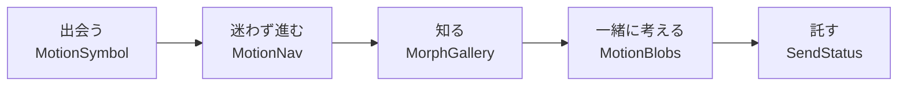

# 05. モーション仕様（React Bits のモーフィング）

公開サイト `frontend/verdant-virgo` に入れる動き（React Bits のモーフィング 4 種＋状態の表示 1 種）の正本。体験の筋書き・動きの規則・トークン・部品ごとの振る舞いを決める。

- 作成: 2026-10-18（spec-writer）。計画は `docs/superpowers/plans/2026-10-18-jis-x-8341-3-accessibility.md`（以下「計画」）の「インタラクションデザイン」。ユーザーの決定は U-5（4 種をすべて入れる。目標は「訪れてワクワクする UX」。インタラクションデザイナーの視点を取り入れる）。決定の記録は `RequirementDefinition/AA/05-application-decisions.md` の ADR-28。
- **責任者は teammate `motion`**（インタラクションデザイナー兼実装者）。この文書を守る責任を持ち、ほかの所有者の組み込みを見る。
- **状態: G-1 承認済み（2026-10-18）。** M2 の試作（通常と reduced-motion、Desktop と Mobile）をユーザーが見て、筋書き・置き場所・強さ・速さと MO-5・MO-6 を承認した。
- アクセシビリティの基準との対応は `04-accessibility-spec.md`（§3.5）。この文書の規則はその基準を満たすための具体である。

## 0. 目的

**「動きは誰も締め出さない」ことを、このサイトで実演する。** すべての動きに次の 4 つを持たせる。

1. 意味がある（飾りのために動かさない）
2. 止められる
3. reduced-motion で静止する
4. WebGL が無くても内容が欠けない

この両立が、ComeGin の「納品する画面は AA を標準にする」約束（`01-content-spec.md` の 1-4d のカード 3）の説得力になる。動きを我慢してアクセシビリティを守るのではなく、両方を満たした実物を見せる。

## 1. 体験の筋書き

訪問者の旅に沿って、動きに 1 つずつ役割を持たせる。

| 場面 | 部品（公開口）と置き場所 | 動きの意味（なぜここで動くか） | 振る舞いの要点 |
|---|---|---|---|
| **出会う**（トップ 1-3 のヒーロー） | **ShapeBlur**（`MotionSymbol`）: ロゴのシンボル（`brand` の SVG を `src` に渡す） | ポインターを近づける（またはキーボードでフォーカスする）とピントが合い、離れるとぼける。「近づくほど、はっきり見えてくる会社」という最初の手触り。ロゴは、訪問者が触れるまではピントが合った正しい形のまま見せる（MO-5） | ポインターに反応するだけで、勝手には動かない（`idle` と `spin` は 0）。Desktop で `hover: hover` の端末だけ。**Mobile では出さない**（MO-6。決定済み）。**ネイビーの単色でぼかし、ポインターが動くまでは全体にピントが合ったまま。動いた後は近づけた所だけにピントが合い、離れるとぼける（止まっているときのぼけは 8px）**（MO-5。決定済み）。h1 と写真（LCP）はアニメーションで隠さない |
| **迷わず進む**（全ページのヘッダー。Desktop） | **GooeyNav**（`MotionNav`）: メインのナビ | 現在地を示す形が、液体のように指した先へ流れる。「今どこにいて、次にどこへ行けるか」を形の連続で見せる | 本物の `<a>` と `aria-current`。hover に加えて**キーボードのフォーカスでも同じように流す**。ページ間は CSS のページ遷移（`@view-transition { navigation: auto }` と `view-transition-name`）で現在地の形をつなぐ。対応していないブラウザでは通常の遷移。Mobile は既存の `<dialog>` のメニューのまま（React を読まない） |
| **知る**（`/services/partnership` の「提携する事業」。福祉・介護・教育の 3 分野） | **MorphSlider**（`MorphGallery`）: `PHOTOS` の `welfareWorkSupport`・`careRecreation`・`educationChildren`。今の写真の並び（`01-content-spec.md` §4.3.3）を置き換える | 3 つの現場が溶け合うように移り変わる。「分野は違っても、同じ仕組みでつながる」という主張を絵で見せる | **自動再生しない。** 写真は**ネイティブのラジオ 3 つ**で選び、選んだときだけ動く（ラベルは既存の 3 分野の語、まとまりの名前は見出しを `aria-labelledby` で指す。`01-content-spec.md` §12 の S-12・S-13。**前へ・次へのボタンと切り替えの通知は置かない**。選んだ状態はラジオの標準の読み上げで伝わる）。原本の `role="tab"` は使わない。写真は `` として DOM に残し、WebGL が無ければ今の並びのまま見せる。**置き場所は 2026-10-18 にリードが決定**（計画の「トップの業務提携の対象」は、トップにその節が無いため改めた。§7 の MO-1） |
| **一緒に考える**（締めの CTA バナー。navy の地） | **MetaBalls**（`MotionBlobs`）: バナーの右側の装飾（文字の後ろには置かない） | 粒が寄り合って 1 つになる。「福祉の言葉と技術の言葉が合わさる」余韻で、行動の直前の期待を上げる | トップの 1-11 の CTA バナーだけに置く。ゆっくり自動で動くので **`MotionPause` の一時停止のボタンを右下に付ける**（2.2.2）。**md 以上の幅だけ**で、Mobile では出さない（MO-6）。画面外とタブが非表示のときは止める。`clickBurst` は使わない（2.3.1）。reduced-motion では静止画（原本に無いので `// a11y:` で足す） |
| **託す**（無料相談・無料 DL の送信） | **StatusMark**（`SendStatus`）: 形の `SendStatusMark`（送信のボタンの中。`aria-hidden`）と、読み上げの `SendStatusAnnouncer`（ボタンの外の `role="status"`）の 2 つ | 待機の輪 → 進捗の弧 → チェックへと形が変わり、「ちゃんと届いた」を目で伝える | **読み上げるのは送信中の「送信中…」（既存の語）の 1 回だけ。完了は読まない**（無料相談は遷移先の h1、無料 DL は成功の表示へのフォーカスに任せる。足すと 2 回読まれる。`01-content-spec.md` §12 の S-17。2026-10-18 に motion・integrations・リードで合意）。形は補助で、意味は文字とページの移動が持つ。失敗のときはチェックにせず、既存の `Alert` に任せる。`useReducedMotion` は原本に組み込み済み |

## 2. 動きの規則

全員が守る。違反は motion が所有者に SendMessage で直しを頼む。

1. **1 つの画面で、目を引く動きは 1 つまで。** ヒーローの ShapeBlur と CTA の MetaBalls が同時に視界に入らない配置にする。ブランドの配色比率（青は面積の 10% まで。`03-handoff.md` の H-9）と「余白と数字」を壊さない。
2. **意味は動きに持たせない。** 動きが見えない人・止めた人にも、同じ情報が文字・形・状態で届く（1.1.1・1.3.3・4.1.3）。
3. **止められる。** 5 秒を超えて自動で動くものには `MotionPause` を付ける（2.2.2）。押した結果は `sessionStorage` に覚え、ページを移っても止まったままにする（try/catch で囲む。読めない・書けないときは「動かす」に倒さず、そのページの中だけ覚える）。
4. **reduced-motion では動きを止める。** フェードなどの短い切り替えは残してよい。点滅は 1 秒に 3 回まで（2.3.1）。
5. **段階的に強化する。** 静的な HTML（SVG・``・`<a>`）で内容が完結し、その上に WebGL と React を載せる。WebGL が無い・JS が失敗したときは、静的な形のままで欠けない。
6. **性能の予算**（§4）。
7. **トークン。** 時間と緩急を `theme.css` の CSS 変数と `motion/lib/tokens.ts` にそろえる（§3）。部品ごとに数値を書かない。
8. **入力の手段で体験を分けない。** hover で起きることは focus-visible でも起きる。ポインターの動きだけに頼る操作は作らない（2.1.1・2.5.1）。

## 3. トークン

| CSS 変数（`theme.css`） | 値 | 使いどころ |
|---|---|---|
| `--motion-duration-micro` | 120ms | ボタン・リンクの状態の変化 |
| `--motion-duration-small` | 200ms | Mobile メニューの開閉（既存の 200ms と同じ）、MotionPause の切り替え |
| `--motion-duration-medium` | 320ms | 静止の形から canvas への切り替え（フェード）、ページ遷移 |
| `--motion-duration-large` | 600ms | MorphGallery の写真の切り替え、**GooeyNav の形の移動**（GooeyNav の `animationTime`。320ms では粒の飛び方がせわしなかったため。2026-10-18 の motion の実装） |
| `--motion-ease-standard` | （値は `theme.css` が正） | 状態の変化 |
| `--motion-ease-emphasized` | （値は `theme.css` が正） | **MorphGallery の溶ける遷移だけ** |

- `theme.css` への追加は foundation が行った（2026-10-18。`theme.css` の所有者）。**reduced-motion のときは 4 つの時間がすべて 0.01ms に上書きされる**（foundation の実装）。緩急の値はこの文書に写さない（2 か所に書くと食い違う）。
- **GooeyNav は原本のばね（物理）で動くので、トークンの緩急を使わない**（時間だけ `--motion-duration-large` にそろえる）。
- `motion/lib/tokens.ts` は同じ値を JS から使う写しで、CSS 変数を実行時には読まない。**値の正本は `theme.css`** で、一致はテストで確かめる。
- reduced-motion のときは、`global.css` の規則（`04-accessibility-spec.md` §3.4）で CSS の時間が 0.01ms になる。JS の動き（WebGL・`requestAnimationFrame`）は `useReducedMotion()` で部品ごとに止める。

## 4. 性能の予算

| 項目 | 予算（実装） | 理由 |
|---|---|---|
| ヒーロー（ShapeBlur）と GooeyNav の読み込み | `client:media="(min-width: 768px) and (hover: hover)"` で水和する。ShapeBlur は水和の後、`requestIdleCallback` を待ってから WebGL を作る | Mobile とポインターの無い端末では JS を読まず（MO-6）、Desktop でも最初の描画と LCP を遅らせない（`client:idle` の意図を、Mobile で読まないことと両立させた） |
| MotionBlobs の読み込み | `client:visible`。**md 以上だけ**（md 未満は `display: none` なので見えるようにならず、水和しない） | 画面に入るまで読まない |
| MorphGallery の読み込み | **island にしない。** 素の `<script>` で、画面の 200px 手前に来たら `ogl` を動的に import する。React も gsap も読まない | `/services/partnership` に React を持ち込まない |
| 画面外・タブが非表示 | `requestAnimationFrame` を止める（`motion/lib/run-when-visible.ts`） | 電池と CPU。止めたものは見えていない |
| 表示の大きさ | CSS で先に確保する | CLS 0 |
| Lighthouse | performance は Mobile で 0.9 以上。accessibility 1.0、SEO 1.0 を保つ | `lighthouserc.cjs`。モーションを入れた後のトップは Desktop の preset でも 1 回測る（GooeyNav・ShapeBlur は Desktop だけで読むため） |

## 5. 部品ごとの振る舞い

| 公開口（`motion/index.ts`） | 原本 | 通常 | reduced-motion | WebGL なし・JS の失敗 | Mobile |
|---|---|---|---|---|---|
| `MotionSymbol` | ShapeBlur | **ネイビーの単色。**最初はシンボル全体にピントが合っていて、**ポインターが動くまではそのまま**（訪問者が何もしていないのに見た目は変わらない）。ポインターが動いた後は、ポインターの近く（レンズの範囲。シンボルの箱の短辺の約 45%）だけにピントが合ってポインターを追い、離れるとシンボル全体がぼける（止まっているときのぼけは 8px）。キーボードのフォーカスがヒーローの中にある間は、シンボル全体にピントが合う。勝手には動かない（`idle`・`spin` は 0）（MO-5。2026-10-18 の M3 の最終形。G-1 で (a)「最初からぼけを弱く」と比べて (b)「最初はピントが合っている」に決まった）。入力の手段で体験を分けない（規則 8）。canvas は `aria-hidden` | 静止したシンボルの SVG | 静止したシンボルの SVG（同じ） | 出さない（JS も読まない。MO-6） |
| `MotionNav` | GooeyNav | hover と focus-visible で現在地の形が流れる（`--motion-duration-large`、緩急は原本のばね）。`<a>` と `aria-current`。フォーカスリングを形で隠さない。ページ遷移は CSS の View Transitions | **形は流れない。** hover・フォーカスした項目へ形が「その場で移る」のは通常と同じ | 静的な `<nav>`（今の `SiteHeader` と同じ） | 使わない（`<dialog>` のメニュー） |
| `MorphGallery` | MorphSlider（`ogl`。React なし） | ラジオで写真を選んだときだけ溶け合って切り替わる（`--motion-ease-emphasized`）。`aria-live` の通知は置かない。**自動再生しない**。スワイプを使うならラジオが代わりになる（2.5.1・2.5.7） | 写真はフェードだけで切り替える（溶け合う変形はしない） | **通常と同じ「写真の枠 ＋ ラジオ 3 つ」の形のまま。** JS が無いときは CSS（`:has(:checked)`）で、WebGL が無いときは短いフェードで写真が切り替わる。どれも 3 枚とも見られる（3 列の一覧には戻さない） | Desktop と同じ形。写真の枠は Desktop 3:2、Mobile 4:3 |
| `MotionBlobs` | MetaBalls | 粒がゆっくり寄り合う。CTA に hover・フォーカスすると、粒は置き場所の空きの中央に寄り合う。`MotionPause` のボタンで止まる。画面外・タブが非表示で止まる。`clickBurst` なし。canvas は `aria-hidden` | **静止の SVG**（大きい粒 1 つに小さい粒が寄った形）。**一時停止のボタンは出さない**（動かないので要らない） | 静止の SVG（同じ形） | 出さない（装飾も一時停止のボタンも。MO-6） |
| `SendStatus` | StatusMark | 形（`SendStatusMark`。ボタンの中、`aria-hidden`）は待機の輪 → 進捗の弧 → チェック。読み上げ（`SendStatusAnnouncer`）は送信中の「送信中…」だけ（`01-content-spec.md` §12 の S-17）。失敗はチェックにせず消して、`Alert` が出る | **形は描くが回らない**（輪・弧・チェックの止まった形。原本の扱い）。読み上げは同じ | 形を描かない（送信は JS の island なので、JS が無ければフォームの送信のボタンが押せない既存の扱いのまま） | 同じ |

- **ナビの現在地は、形とは別に、現在の項目の下の 2px の線（`role/text-heading`）で常に示す**（通常・reduced-motion・JS の失敗のどの状態でも。1.4.1 の色だけに頼らない印）。
- **`MotionBlobs` の置き場所は、実際の文字の右端と CTA のボタンの左端の間の空きを測って決める。** 両側に 24px 空けて置き、空きが 120px より狭ければ置かない。バナーの幅や文言が変わっても、粒が文字の後ろに回らないことを保証するため（規則 2・「文字の上に動きを重ねない」）。
- **`MotionPause` のボタン**: トップの 1-11 の CTA バナーの右下（MetaBalls の近く。md 以上だけ。reduced-motion では出さない）。暗い地の上なので文字とリングは白（`tone` で切り替える。リングは `--color-role-focus-ring-on-dark`。`04-accessibility-spec.md` §3.1・§3.3）。24×24 CSS px 以上（2.5.8）。文言は `01-content-spec.md` §12 の S-11（「動きを止める」／「動きを再開する」）。押した結果は `storageKey` で `sessionStorage` に覚える
- **文字の上に動きを重ねない。** 重ねる配置にするなら、キャンバスを含めたスクリーンショットで文字のコントラスト 4.5:1 を測る（計画の「検証」の 9）
- 原本の差分は M1 で motion が一覧にした（MorphSlider の英語のラベルと `role="tab"` の誤用、MetaBalls の reduced-motion、GooeyNav のフォーカスでの流れ、画面外での停止など）。差分には `// a11y:`／`// perf:` の印を付ける（P-10）

## 6. `01-content-spec.md` への置き場所の追記

この文書が要る文言は、すべて `01-content-spec.md` に置いた（2 か所に書かない）。

| 部品 | 文言 | `01-content-spec.md` |
|---|---|---|
| `MotionPause` | 「動きを止める」／「動きを再開する」（**この文書で新しく要る文言はこの 2 つだけ**） | §12 の S-11、§4.1 の 1-11 |
| `MorphGallery` | **新しい文言なし。** ラジオのまとまりの名前は見出し「提携する事業」、ラジオのラベルは既存の 3 分野の語 | §12 の S-12・S-13、§4.3.3 |
| `SendStatus` | **新しい文言なし。** 送信中の「送信中…」（既存）だけを読む。完了は読まない | §12 の S-17 |
| `MotionSymbol`・`MotionBlobs` | 文言なし（装飾） | §12 の S-20 |
| `MotionNav` | ナビの名前「メイン」 | §12 の S-5 |

## 7. 未決定事項

| # | 事項 | 理由 | 判断者 |
|---|---|---|---|
| MO-1 | （**2026-10-18 にリードが決定**）`MorphGallery` の置き場所は `/services/partnership` の「提携する事業」。計画は「トップの業務提携の対象 3 分野」としていたが、3 枚の写真と見出しは `/services/partnership` にあり、トップには無かった。トップに節を足すと、セクション順・新しい文言・規則 1 の見直しが要るため。**試作の動画で G-1 の承認を受ける** | — | ユーザー（G-1） |
| MO-2 | `--motion-ease-*` の値 | foundation が `theme.css` に置いた値を、M2 の試作で確かめる | motion |
| MO-3 | Mobile で `MorphGallery` を動かすか | M2 で Mobile の performance を測ってから決める（§4 の予算）。`MotionBlobs` は MO-6 | motion（G-1） |
| MO-4 | GooeyNav の View Transitions の対応外のブラウザでの見え方 | 通常の遷移に倒すことは決めた。対応の範囲は M2 で確かめる | motion |
| MO-5 | （**2026-10-18 に G-1 でユーザーが決定**）ShapeBlur のロゴのシンボルは、**ネイビーの単色でぼかし、最初はピントが合っている**。振る舞いは、最初はシンボル全体にピントが合っていて、**ポインターが動くまではそのまま**（訪問者が何もしていないのに見た目は変わらない）。ポインターが動いた後は、ポインターの近く（レンズの範囲。シンボルの箱の短辺の約 45%）だけにピントが合ってポインターを追い、離れるとシンボル全体がぼける（止まっているときのぼけは 8px）。キーボードのフォーカスがヒーローの中にある間は、シンボル全体にピントが合う。勝手には動かない（`idle`・`spin` は 0）（M3 の最終形。M3 の前の試作の動画では、ポインターを動かさなくても少しして〈idle の後〉ぼけていたが、訪問者が何もしていないのに見た目が変わるため M3 で改めた）。比べた案は (a)「最初からぼけを弱く」。ブランドガイドライン §4.6-4 との関係はこの形で受け入れた。**判断の材料**: ぼけた形は、ネイビーの面が薄く広がって明るい青に見える（ガイドライン §5.5-6「透明度で薄める」に近い見え方）。ぼけを弱めるほど navy.700 に近づく。最初にピントを合わせておけば、ロゴは正しい色と形で最初に見える | — | — |
| MO-6 | （**2026-10-18 に G-1 でユーザーが決定**）**Mobile では `MotionSymbol`・`MotionBlobs`（と一時停止のボタン）を出さない**。出さなくても内容は欠けない（装飾） | — | — |
| MO-7 | （**2026-10-18 にリードが決定**）ぼけた状態に移る契機は**ポインターが最初に動いた後**（motion の M3 の実装にそろえた）。リードが伝えた「少ししてぼける」は M3 で直す前の試作の振る舞いだった | — | — |
