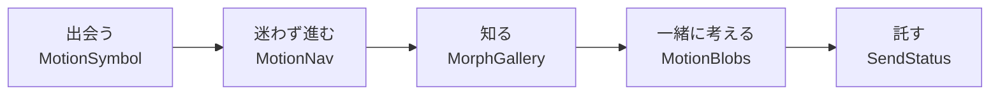

# 05. モーション仕様（React Bits のモーフィング、Aceternity の動き、アバター）

公開サイト `frontend/verdant-virgo` に入れる動き（React Bits のモーフィング 4 種＋状態の表示 1 種、2026-10-19 からは Aceternity UI を参考にした動き・VRM アバター・ページの形のつながり）の正本。体験の筋書き・動きの規則・トークン・部品ごとの振る舞いを決める。

- **2026-10-19 に追加（§8〜§10）**: ページの区分（A／B／C）、Aceternity の 14 種の置き場所と振る舞い、ページの形のつながり（View Transitions）、VRM アバター。設計は `docs/superpowers/specs/2026-10-19-aceternity-motion-design.md`（以下「設計書」）。ブランドガイドラインの例外と Lighthouse の performance を warn にしたことの決定は `RequirementDefinition/AA/05-application-decisions.md` の **ADR-29**。§0〜§7 の React Bits の記述は、ADR-29 で変えた所（§2 の規則 1、§4 の Lighthouse）を除いてそのまま有効。

- 作成: 2026-10-18（spec-writer）。計画は `docs/superpowers/plans/2026-10-18-jis-x-8341-3-accessibility.md`（以下「計画」）の「インタラクションデザイン」。ユーザーの決定は U-5（4 種をすべて入れる。目標は「訪れてワクワクする UX」。インタラクションデザイナーの視点を取り入れる）。決定の記録は `RequirementDefinition/AA/05-application-decisions.md` の ADR-28。
- **責任者は teammate `motion`**（インタラクションデザイナー兼実装者）。この文書を守る責任を持ち、ほかの所有者の組み込みを見る。
- **状態: G-1 承認済み（2026-10-18）。** M2 の試作（通常と reduced-motion、Desktop と Mobile）をユーザーが見て、筋書き・置き場所・強さ・速さと MO-5・MO-6 を承認した。
- アクセシビリティの基準との対応は `04-accessibility-spec.md`（§3.5）。この文書の規則はその基準を満たすための具体である。

## 0. 目的

**「動きは誰も締め出さない」ことを、このサイトで実演する。** すべての動きに次の 4 つを持たせる。

1. 意味がある（飾りのために動かさない）
2. 止められる
3. reduced-motion で静止する
4. WebGL が無くても内容が欠けない

この両立が、ComeGin の「納品する画面は AA を標準にする」約束（`01-content-spec.md` の 1-4d のカード 3）の説得力になる。動きを我慢してアクセシビリティを守るのではなく、両方を満たした実物を見せる。

## 1. 体験の筋書き

訪問者の旅に沿って、動きに 1 つずつ役割を持たせる。

| 場面 | 部品（公開口）と置き場所 | 動きの意味（なぜここで動くか） | 振る舞いの要点 |
|---|---|---|---|
| **出会う**（トップ 1-3 のヒーロー） | **ShapeBlur**（`MotionSymbol`）: ロゴのシンボル（`brand` の SVG を `src` に渡す） | ポインターを近づける（またはキーボードでフォーカスする）とピントが合い、離れるとぼける。「近づくほど、はっきり見えてくる会社」という最初の手触り。ロゴは、訪問者が触れるまではピントが合った正しい形のまま見せる（MO-5） | ポインターに反応するだけで、勝手には動かない（`idle` と `spin` は 0）。Desktop で `hover: hover` の端末だけ。**Mobile では出さない**（MO-6。決定済み）。**ネイビーの単色でぼかし、ポインターが動くまでは全体にピントが合ったまま。動いた後は近づけた所だけにピントが合い、離れるとぼける（止まっているときのぼけは 8px）**（MO-5。決定済み）。h1 と写真（LCP）はアニメーションで隠さない |
| **迷わず進む**（全ページのヘッダー。Desktop） | **GooeyNav**（`MotionNav`）: メインのナビ | 現在地を示す形が、液体のように指した先へ流れる。「今どこにいて、次にどこへ行けるか」を形の連続で見せる | 本物の `<a>` と `aria-current`。hover に加えて**キーボードのフォーカスでも同じように流す**。ページ間は CSS のページ遷移（`@view-transition { navigation: auto }` と `view-transition-name`）で現在地の形をつなぐ。対応していないブラウザでは通常の遷移。Mobile は既存の `<dialog>` のメニューのまま（React を読まない） |
| **知る**（`/services/partnership` の「提携する事業」。福祉・介護・教育の 3 分野） | **MorphSlider**（`MorphGallery`）: `PHOTOS` の `welfareWorkSupport`・`careRecreation`・`educationChildren`。今の写真の並び（`01-content-spec.md` §4.3.3）を置き換える | 3 つの現場が溶け合うように移り変わる。「分野は違っても、同じ仕組みでつながる」という主張を絵で見せる | **自動再生しない。** 写真は**ネイティブのラジオ 3 つ**で選び、選んだときだけ動く（ラベルは既存の 3 分野の語、まとまりの名前は見出しを `aria-labelledby` で指す。`01-content-spec.md` §12 の S-12・S-13。**前へ・次へのボタンと切り替えの通知は置かない**。選んだ状態はラジオの標準の読み上げで伝わる）。原本の `role="tab"` は使わない。写真は `` として DOM に残し、WebGL が無ければ今の並びのまま見せる。**置き場所は 2026-10-18 にリードが決定**（計画の「トップの業務提携の対象」は、トップにその節が無いため改めた。§7 の MO-1） |
| **一緒に考える**（締めの CTA バナー。navy の地） | **MetaBalls**（`MotionBlobs`）: バナーの右側の装飾（文字の後ろには置かない） | 粒が寄り合って 1 つになる。「福祉の言葉と技術の言葉が合わさる」余韻で、行動の直前の期待を上げる | トップの 1-11 の CTA バナーだけに置く。ゆっくり自動で動くので **`MotionPause` の一時停止のボタンを右下に付ける**（2.2.2）。**md 以上の幅だけ**で、Mobile では出さない（MO-6）。画面外とタブが非表示のときは止める。`clickBurst` は使わない（2.3.1）。reduced-motion では静止画（原本に無いので `// a11y:` で足す） |
| **託す**（無料相談・無料 DL の送信） | **StatusMark**（`SendStatus`）: 形の `SendStatusMark`（送信のボタンの中。`aria-hidden`）と、読み上げの `SendStatusAnnouncer`（ボタンの外の `role="status"`）の 2 つ | 待機の輪 → 進捗の弧 → チェックへと形が変わり、「ちゃんと届いた」を目で伝える | **読み上げるのは送信中の「送信中…」（既存の語）の 1 回だけ。完了は読まない**（無料相談は遷移先の h1、無料 DL は成功の表示へのフォーカスに任せる。足すと 2 回読まれる。`01-content-spec.md` §12 の S-17。2026-10-18 に motion・integrations・リードで合意）。形は補助で、意味は文字とページの移動が持つ。失敗のときはチェックにせず、既存の `Alert` に任せる。`useReducedMotion` は原本に組み込み済み |

## 2. 動きの規則

全員が守る。違反は motion が所有者に SendMessage で直しを頼む。

1. **1 つの画面で、目を引く動きは 1 つまで。** ヒーローの ShapeBlur と CTA の MetaBalls が同時に視界に入らない配置にする。ブランドの配色比率（青は面積の 10% まで。`03-handoff.md` の H-9）と「余白と数字」を壊さない。
   - **例外（2026-10-19。ADR-29・実装の計画の裁定 R4）: A（vivid）のページ（§8.1）では、目を引く動きを 1 つの画面に複数置いてよい**（ヒーローの背景とシンボル、Marquee と地球儀など。設計書の U-5「Aceternity らしい華やかさまで踏み込む」）。**B（calm）のページはこの規則のまま**（アバターは §10 の扱い）。A でも、色はパレットだけ・本文のコントラスト 4.5:1・ロゴを傾けない／光らせない・組版は守る（ADR-29 の決定 4）。
2. **意味は動きに持たせない。** 動きが見えない人・止めた人にも、同じ情報が文字・形・状態で届く（1.1.1・1.3.3・4.1.3）。
3. **止められる。** 5 秒を超えて自動で動くものには**すべて** `MotionPause` を付ける（2.2.2）。押した結果は `sessionStorage` に覚え、ページを移っても止まったままにする（try/catch で囲む。読めない・書けないときは「動かす」に倒さず、そのページの中だけ覚える）。
   - **1 つのページに一時停止のボタンが複数並ぶときは、対象名で区別する**（2026-10-19。裁定 R6）。見える文字（S-11 の「動きを止める」／「動きを再開する」）の後ろに、sr-only で対象名を足す（例「動きを止める（ヒーロー）」。見える文字で始まるので 2.5.3 も満たす）。対象名は `site-content/a11y.ts` の `MOTION_PAUSE_TARGETS`（`01-content-spec.md` §12 の S-25）。ボタンを置く部品は必ず対象名を渡す。
   - 前のページで止めていたら、水和を待たずに最初の描画から止まった状態で出す（小さな inline script が `data-motion-paused` を先に付ける。動きが一瞬出てから止まるのを避ける）。
4. **reduced-motion では動きを止める。** フェードなどの短い切り替えは残してよい。点滅は 1 秒に 3 回まで（2.3.1）。
5. **段階的に強化する。** 静的な HTML（SVG・``・`<a>`）で内容が完結し、その上に WebGL と React を載せる。WebGL が無い・JS が失敗したときは、静的な形のままで欠けない。
   - CSS だけで動かす部品（Aceternity のヒーローの背景・Marquee・CTA の光の縁など）は、`@media (scripting: enabled)` の中でだけ動かす（JS が無いと一時停止のボタンが出ないため）。**`(scripting: enabled)` に対応していない古いブラウザでは、動かさずに静止させる**（安全側。止められない動きを出さない）。
6. **性能の予算**（§4）。
7. **トークン。** 時間と緩急を `theme.css` の CSS 変数と `motion/lib/tokens.ts` にそろえる（§3）。部品ごとに数値を書かない。
8. **入力の手段で体験を分けない。** hover で起きることは focus-visible でも起きる。ポインターの動きだけに頼る操作は作らない（2.1.1・2.5.1）。
   - カードの中にフォーカスがあるときの変化（3D Card の浮き、3D Pin のピン、光の縁）は、**`:focus-within` ではなく `:has(:focus-visible)`** で起こす（2026-10-19）。マウスでリンクを押した後（戻る操作や bfcache で戻ったとき）に、浮き・光が残らないようにするため。

## 3. トークン

| CSS 変数（`theme.css`） | 値 | 使いどころ |
|---|---|---|
| `--motion-duration-micro` | 120ms | ボタン・リンクの状態の変化 |
| `--motion-duration-small` | 200ms | Mobile メニューの開閉（既存の 200ms と同じ）、MotionPause の切り替え |
| `--motion-duration-medium` | 320ms | 静止の形から canvas への切り替え（フェード）、ページ遷移 |
| `--motion-duration-large` | 600ms | MorphGallery の写真の切り替え、**GooeyNav の形の移動**（GooeyNav の `animationTime`。320ms では粒の飛び方がせわしなかったため。2026-10-18 の motion の実装） |
| `--motion-duration-ambient` | 8000ms | **2026-10-19 に追加（§8）。** ゆっくり漂う動き（A のヒーローのスポットライト・光の筋）の 1 周。5 秒を超えるので一時停止（`MotionPauseFor`）を付ける。3 倍の 24 秒を 3D Marquee の 1 周と地球儀の振れの 1 往復に使う（新しい値を足さない）。`motion/lib/tokens.ts` の `DURATION.ambient` と同じ値 |
| `--motion-duration-glow` | 2400ms | **2026-10-19 に追加（§8）。** 光の明るさ（CTA の光の縁・粒、地球儀の大阪の輪）の 1 周。**1 秒以上**（点滅は 1 秒に 3 回まで。2.3.1）。CTA の粒はこの 1〜1.5 倍。`DURATION.glow` と同じ値 |
| `--motion-ease-standard` | （値は `theme.css` が正） | 状態の変化 |
| `--motion-ease-emphasized` | （値は `theme.css` が正） | **MorphGallery の溶ける遷移だけ** |

- `theme.css` への追加は foundation が行った（2026-10-18。`theme.css` の所有者）。**reduced-motion のときは micro・small・medium・large の 4 つの時間が 0.01ms に上書きされる**（foundation の実装）。**ambient と glow は上書きしない**（2026-10-19。これを使う部品は reduced-motion で動き自体を出さないか、静止の形に替える。§8.3）。緩急の値はこの文書に写さない（2 か所に書くと食い違う）。
- 2026-10-19 の部品で、トークンから導いた値: 数え上げ（CountUp）は `large` の 2 倍、3D Marquee の 1 周と地球儀の振れの 1 往復は `ambient` の 3 倍（24 秒）、送信中の弧の 1 周は `large` の 2 倍（`SPIN_PERIOD`。既存）。どれも新しいトークンにはしない。
- **GooeyNav は原本のばね（物理）で動くので、トークンの緩急を使わない**（時間だけ `--motion-duration-large` にそろえる）。
- `motion/lib/tokens.ts` は同じ値を JS から使う写しで、CSS 変数を実行時には読まない。**値の正本は `theme.css`** で、一致はテストで確かめる。
- reduced-motion のときは、`global.css` の規則（`04-accessibility-spec.md` §3.4）で CSS の時間が 0.01ms になる。JS の動き（WebGL・`requestAnimationFrame`）は `useReducedMotion()` で部品ごとに止める。

## 4. 性能の予算

| 項目 | 予算（実装） | 理由 |
|---|---|---|
| ヒーロー（ShapeBlur）と GooeyNav の読み込み | `client:media="(min-width: 768px) and (hover: hover)"` で水和する。ShapeBlur は水和の後、`requestIdleCallback` を待ってから WebGL を作る | Mobile とポインターの無い端末では JS を読まず（MO-6）、Desktop でも最初の描画と LCP を遅らせない（`client:idle` の意図を、Mobile で読まないことと両立させた） |
| MotionBlobs の読み込み | `client:visible`。**md 以上だけ**（md 未満は `display: none` なので見えるようにならず、水和しない） | 画面に入るまで読まない |
| MorphGallery の読み込み | **island にしない。** 素の `<script>` で、画面の 200px 手前に来たら `ogl` を動的に import する。React も gsap も読まない | `/services/partnership` に React を持ち込まない |
| 画面外・タブが非表示 | `requestAnimationFrame` を止める（`motion/lib/run-when-visible.ts`）。**CSS の無限の animation（ヒーローの光・マーキー・CTA の光の縁）は対象外**（合成スレッドで回り、画面外ではブラウザが描画を省くため。一時停止と reduced-motion では止まる） | 電池と CPU。止めたものは見えていない |
| 表示の大きさ | CSS で先に確保する | CLS 0 |
| Lighthouse | accessibility 1.0、SEO 1.0 を保つ。**performance は 0.9 を目安に測り続けるが、合否の条件にしない**（2026-10-19 に `lighthouserc.cjs` で `warn`。動きと performance がぶつかったら動きを優先する。ADR-29） | `lighthouserc.cjs`。モーションを入れた後のトップは Desktop の preset でも 1 回測る（GooeyNav・ShapeBlur は Desktop だけで読むため）。実ユーザーの体験は PostHog の CWV（LCP の p75）で見る（ADR-29 の見直しの条件） |
| three.js（2026-10-19） | 地球儀とアバターで **three の実装を含むチャンクを 1 つだけ**にする（`motion/lib/three.ts` の `loadThree()` を両方が使う。ビルド後の `dist/_astro` で `isWebGLRenderer` を含む JS が 1 本）。three は最初の描画の後に動的 import で読む | 同じ three を 2 回配らない。three-globe が静的に読む `three/webgpu`・`three/tsl` は、ビルドで空の部品に差し替える（`motion/vite-plugin.ts`。使わない WebGPU の一式を配らない） |
| 地球儀の読み込み（2026-10-19） | `client:visible` で水和し、ページの `load` の後の idle で three を読む。md 以上・reduced-motion でない・WebGL あり・一時停止でないときだけ | `/services/` だけ。止めて開いたページでは three を読まない（再開で初めて読む） |
| アバターの読み込み（2026-10-19） | island は `client:idle`（gzip 約 3KB）。three・描画・`.vrm`（約 4.3MB）・クリップは、3D を出すと決めたときだけ読む。Mobile は訪問者が「アバターを表示する」を押してから。reduced-motion・WebGL なし・一時停止・たたんだまま開いたページは静止画だけ | §10。資産は `src/modules/avatar/assets/` から Vite の資産（`?url`）として `_astro/` に出し、1 年キャッシュ（`immutable`）が効く |

## 5. 部品ごとの振る舞い

| 公開口（`motion/index.ts`） | 原本 | 通常 | reduced-motion | WebGL なし・JS の失敗 | Mobile |
|---|---|---|---|---|---|
| `MotionSymbol` | ShapeBlur | **ネイビーの単色。**最初はシンボル全体にピントが合っていて、**ポインターが動くまではそのまま**（訪問者が何もしていないのに見た目は変わらない）。ポインターが動いた後は、ポインターの近く（レンズの範囲。シンボルの箱の短辺の約 45%）だけにピントが合ってポインターを追い、離れるとシンボル全体がぼける（止まっているときのぼけは 8px）。キーボードのフォーカスがヒーローの中にある間は、シンボル全体にピントが合う。勝手には動かない（`idle`・`spin` は 0）（MO-5。2026-10-18 の M3 の最終形。G-1 で (a)「最初からぼけを弱く」と比べて (b)「最初はピントが合っている」に決まった）。入力の手段で体験を分けない（規則 8）。canvas は `aria-hidden` | 静止したシンボルの SVG | 静止したシンボルの SVG（同じ） | 出さない（JS も読まない。MO-6） |
| `MotionNav` | GooeyNav | hover と focus-visible で現在地の形が流れる（`--motion-duration-large`、緩急は原本のばね）。`<a>` と `aria-current`。フォーカスリングを形で隠さない。ページ遷移は CSS の View Transitions | **形は流れない。** hover・フォーカスした項目へ形が「その場で移る」のは通常と同じ | 静的な `<nav>`（今の `SiteHeader` と同じ） | 使わない（`<dialog>` のメニュー） |
| `MorphGallery` | MorphSlider（`ogl`。React なし） | ラジオで写真を選んだときだけ溶け合って切り替わる（`--motion-ease-emphasized`）。`aria-live` の通知は置かない。**自動再生しない**。スワイプを使うならラジオが代わりになる（2.5.1・2.5.7） | 写真はフェードだけで切り替える（溶け合う変形はしない） | **通常と同じ「写真の枠 ＋ ラジオ 3 つ」の形のまま。** JS が無いときは CSS（`:has(:checked)`）で、WebGL が無いときは短いフェードで写真が切り替わる。どれも 3 枚とも見られる（3 列の一覧には戻さない） | Desktop と同じ形。写真の枠は Desktop 3:2、Mobile 4:3 |
| `MotionBlobs` | MetaBalls | 粒がゆっくり寄り合う。CTA に hover・フォーカスすると、粒は置き場所の空きの中央に寄り合う。`MotionPause` のボタンで止まる。画面外・タブが非表示で止まる。`clickBurst` なし。canvas は `aria-hidden` | **静止の SVG**（大きい粒 1 つに小さい粒が寄った形）。**一時停止のボタンは出さない**（動かないので要らない） | 静止の SVG（同じ形） | 出さない（装飾も一時停止のボタンも。MO-6） |
| `SendStatus` | StatusMark | 形（`SendStatusMark`。ボタンの中、`aria-hidden`）は待機の輪 → 進捗の弧 → チェック。読み上げ（`SendStatusAnnouncer`）は送信中の「送信中…」だけ（`01-content-spec.md` §12 の S-17）。失敗はチェックにせず消して、`Alert` が出る | **形は描くが回らない**（輪・弧・チェックの止まった形。原本の扱い）。読み上げは同じ | 形を描かない（送信は JS の island なので、JS が無ければフォームの送信のボタンが押せない既存の扱いのまま） | 同じ |

- **ナビの現在地は、形とは別に、現在の項目の下の 2px の線（`role/text-heading`）で常に示す**（通常・reduced-motion・JS の失敗のどの状態でも。1.4.1 の色だけに頼らない印）。
- **`MotionBlobs` の置き場所は、実際の文字の右端と CTA のボタンの左端の間の空きを測って決める。** 両側に 24px 空けて置き、空きが 120px より狭ければ置かない。バナーの幅や文言が変わっても、粒が文字の後ろに回らないことを保証するため（規則 2・「文字の上に動きを重ねない」）。
- **`MotionPause` のボタン**: トップの 1-11 の CTA バナーの右下（MetaBalls の近く。md 以上だけ。reduced-motion では出さない）。暗い地の上なので文字とリングは白（`tone` で切り替える。リングは `--color-role-focus-ring-on-dark`。`04-accessibility-spec.md` §3.1・§3.3）。24×24 CSS px 以上（2.5.8）。文言は `01-content-spec.md` §12 の S-11（「動きを止める」／「動きを再開する」）。押した結果は `storageKey` で `sessionStorage` に覚える
- **文字の上に動きを重ねない。** 重ねる配置にするなら、キャンバスを含めたスクリーンショットで文字のコントラスト 4.5:1 を測る（計画の「検証」の 9）
- 原本の差分は M1 で motion が一覧にした（MorphSlider の英語のラベルと `role="tab"` の誤用、MetaBalls の reduced-motion、GooeyNav のフォーカスでの流れ、画面外での停止など）。差分には `// a11y:`／`// perf:` の印を付ける（P-10）

## 6. `01-content-spec.md` への置き場所の追記

この文書が要る文言は、すべて `01-content-spec.md` に置いた（2 か所に書かない）。

| 部品 | 文言 | `01-content-spec.md` |
|---|---|---|
| `MotionPause` | 「動きを止める」／「動きを再開する」（**2026-10-18 の範囲で新しく要る文言はこの 2 つだけ**。2026-10-19 の対象名〈S-25〉とアバター〈S-24〉は下の行） | §12 の S-11、§4.1 の 1-11 |
| `MorphGallery` | **新しい文言なし。** ラジオのまとまりの名前は見出し「提携する事業」、ラジオのラベルは既存の 3 分野の語 | §12 の S-12・S-13、§4.3.3 |
| `SendStatus` | **新しい文言なし。** 送信中の「送信中…」（既存）だけを読む。完了は読まない | §12 の S-17 |
| `MotionSymbol`・`MotionBlobs` | 文言なし（装飾） | §12 の S-20 |
| `MotionNav` | ナビの名前「メイン」 | §12 の S-5 |
| 一時停止のボタンの対象名（2026-10-19） | sr-only の「（ヒーロー）」「（相談の案内）」「（使うツールの一覧）」「（地球儀）」「（アバター）」（`MOTION_PAUSE_TARGETS`。§2 の規則 3） | §12 の S-25 |
| アバター（2026-10-19。§10） | 「アバターをしまう」「アバターを出す」「アバターを表示する」。一時停止は S-11 ＋「（アバター）」 | §12 の S-24 |
| Aceternity の部品（2026-10-19。§8） | **新しい文言なし**（装飾。Marquee は今のツールのバッジ、Stats は今の数値と出典をそのまま使う） | — |

## 7. 未決定事項

| # | 事項 | 理由 | 判断者 |
|---|---|---|---|
| MO-1 | （**2026-10-18 にリードが決定**）`MorphGallery` の置き場所は `/services/partnership` の「提携する事業」。計画は「トップの業務提携の対象 3 分野」としていたが、3 枚の写真と見出しは `/services/partnership` にあり、トップには無かった。トップに節を足すと、セクション順・新しい文言・規則 1 の見直しが要るため。**試作の動画で G-1 の承認を受ける** | — | ユーザー（G-1） |
| MO-2 | `--motion-ease-*` の値 | foundation が `theme.css` に置いた値を、M2 の試作で確かめる | motion |
| MO-3 | Mobile で `MorphGallery` を動かすか | M2 で Mobile の performance を測ってから決める（§4 の予算）。`MotionBlobs` は MO-6 | motion（G-1） |
| MO-4 | GooeyNav の View Transitions の対応外のブラウザでの見え方 | 通常の遷移に倒すことは決めた。対応の範囲は M2 で確かめる | motion |
| MO-5 | （**2026-10-18 に G-1 でユーザーが決定**）ShapeBlur のロゴのシンボルは、**ネイビーの単色でぼかし、最初はピントが合っている**。振る舞いは、最初はシンボル全体にピントが合っていて、**ポインターが動くまではそのまま**（訪問者が何もしていないのに見た目は変わらない）。ポインターが動いた後は、ポインターの近く（レンズの範囲。シンボルの箱の短辺の約 45%）だけにピントが合ってポインターを追い、離れるとシンボル全体がぼける（止まっているときのぼけは 8px）。キーボードのフォーカスがヒーローの中にある間は、シンボル全体にピントが合う。勝手には動かない（`idle`・`spin` は 0）（M3 の最終形。M3 の前の試作の動画では、ポインターを動かさなくても少しして〈idle の後〉ぼけていたが、訪問者が何もしていないのに見た目が変わるため M3 で改めた）。比べた案は (a)「最初からぼけを弱く」。ブランドガイドライン §4.6-4 との関係はこの形で受け入れた。**判断の材料**: ぼけた形は、ネイビーの面が薄く広がって明るい青に見える（ガイドライン §5.5-6「透明度で薄める」に近い見え方）。ぼけを弱めるほど navy.700 に近づく。最初にピントを合わせておけば、ロゴは正しい色と形で最初に見える | — | — |
| MO-6 | （**2026-10-18 に G-1 でユーザーが決定**）**Mobile では `MotionSymbol`・`MotionBlobs`（と一時停止のボタン）を出さない**。出さなくても内容は欠けない（装飾） | — | — |
| MO-7 | （**2026-10-18 にリードが決定**）ぼけた状態に移る契機は**ポインターが最初に動いた後**（motion の M3 の実装にそろえた）。リードが伝えた「少ししてぼける」は M3 で直す前の試作の振る舞いだった | — | — |
| MO-8 | （2026-10-19 に追加）**Mixamo の利用条件。** アバターの身ぶりは Mixamo（Adobe）のモーションを VRM の骨格へ当て直した JSON で配る（§10.5）。**公開前に、Adobe の利用条件で正確な制限（単独での配布・編集できる形での配布・素材としての販売の扱い）とクレジットの要否を確かめる。** 2026-10-19 に見た FAQ（2021-09-14 更新）には制限の文言が見当たらなかった（`src/modules/avatar/assets/README.md`）。確かめるまで、条件を満たしているとは扱わない（ADR-29 の未決定事項） | 確かめていない | ユーザー |
| MO-9 | （2026-10-19 に追加）**Aceternity の無料の部品のライセンス。** 原本（`motion/vendor/aceternity/`）の冒頭の「ライセンス」の行は配布区分（Pro ではない）の説明で、一次の確認が取れていない。公開前に配布元で確かめる | 確かめていない | ユーザー |
| MO-10 | （2026-10-19 に追加）**アバターの手触りの直し。** 動画の確認（実装の計画の Task 12 のゲート）で、ユーザーは「直しがあるが、このセッションでは行わなくて良い」と答えた。直しの中身は次のセッションで聞く | 中身を聞いていない | ユーザー |
| MO-11 | （2026-10-19 に追加）**A の光の表現と、ブランドガイドライン §5.5-6（透明度でブランドカラーを薄める）の関係。** スポットライト・光の縁などは、パレットの色を `color-mix` で薄めて描いている。ADR-29 の例外（光の表現）に含めるかを、ガイドラインの文案（`docs/proposals/brand-guideline-web-motion-exception.md`）で決める | 例外の範囲の確認 | ユーザー |

## 8. Aceternity の動き（2026-10-19 に追加）

訪問時と閲覧中のどちらも静かすぎたため、Aceternity UI の部品を参考に、規約・ポリシー以外の全ページへ動きを作り込んだ（設計書 §1）。**取り込んだのは無料の部品だけで、有料（Pro）のコードは使わない。** 原本は `src/modules/motion/vendor/aceternity/<Name>/`（冒頭に出典の URL・取り込み日・ライセンス。MO-9）、ページに置く包みは `src/modules/motion/sections/<Kind>/` で、ページとレイアウトは `motion/index.ts` が公開する包みだけを使う。原本をそのまま置かなかった理由（文字を opacity 0 から JS で出す、reduced-motion でも rAF が回る、パレット外の色など）は `vendor/aceternity/README.md` の表にある。

### 8.1 ページの区分（A／B／C）

| 区分 | ページ | 動きの強さ |
|---|---|---|
| **A. 華やか（vivid）** | トップ `/`、サービス一覧 `/services/`、サービス詳細 `/services/{environment-setup,development,consulting,partnership}/`（**6 ルート**） | Aceternity らしい光・立体・粒子・文字のにじみ出しまで使う。**ブランドガイドラインの例外**（動き・光・立体の表現だけ。ADR-29）。§2 の規則 1 の例外（目を引く動きを複数置いてよい） |
| **B. 静か（calm）** | A と C 以外のすべて（料金・会社紹介・お問い合わせと完了・ブログの一覧／カテゴリ／記事・アクセシビリティ方針・サイトマップ・404） | 現れる（下からわずかに上がる）・線が引かれる・数字が切り替わる程度。**光り物・立体は使わない**（e2e で、B の区分の中に `[data-motion="hero"|"globe"|"cta-glow"|"marquee"]` が 0 個であることを確かめる）。例外はアバターだけ（§10） |
| **C. 動きなし（none）** | `/legal/privacy/`、`/legal/tokushoho/` | **動き・アバター・ページの形のつながりを一切出さない**。そのための JS も読まない（§9・§10.6） |

- 区分はページが `BaseLayout` の `motionZone`（`"vivid" | "calm" | "none"`）で渡す。部品は自分でページを判定しない（設計書 §9）。
- A と B の手触り（ヒーローの比較）は、ユーザーが試作で承認した（設計書 U-6）。A のヒーローは navy.900 の地に白い見出し、B は今の明るい地のまま。

### 8.2 14 種の置き場所

| Aceternity の種類 | 公開口（`motion/index.ts`） | 置き場所 | 区分 |
|---|---|---|---|
| Hero Sections ＋ Backgrounds & Effects | `HeroHeading`（見出しのにじみ出し）。**2026-10-28 から背景は「基盤の模型」（diorama。§11）**。旧版: `HeroBackdrop`（SpotlightNew・BackgroundBeams・グリッド）と `MotionSymbol`（ShapeBlur）は、どのページでも使わなくなった（部品は残してある） | トップ 1-3、サービス一覧・詳細の導入ヒーロー（`PageIntro` の `tone="dark"`） | A |
| Stats Sections | `StatRow`（A）、`CountUp`（B） | トップ 1-8 の数値カード（値は「—」のまま数え上げない。下から現れて下線が引かれる）／ブログ一覧 7-3 の 72.2%・53.8%・50.8%（数え上げ） | A・B |
| Feature Sections | `GlowGrid`（ポインターに沿う光の縁） | トップ 1-4a（5 つの方法）・1-4c（選ばれる理由）・1-4d（体験の約束）、サービス詳細の「こんな方に向いています」 | A |
| 3D Card Effect | `Tilt3d` | トップ 1-7・サービス一覧 2-4 のサービスカード | A |
| 3D Marquee | `ToolMarquee` | トップ 1-6「使うツール」（今の文字のバッジ 10 個。ロゴは使わない） | A |
| 3D Globe | `GlobeOsaka` | **2026-10-28 からサービス一覧の導入ヒーローの直下**（ヒーローは模型になった。最終的な置き場所は 2026-10-28 の計画の Task 12 で決める）。旧版: 導入ヒーローの右（`PageIntro` の media の枠） | A |
| 3D Animated Pin | `Pin3d` | トップ 1-8 のお客さまの声 3 枚、1-9 の無料 DL のブロック | A |
| CTA Sections | `CtaGlow`（A）、`MotionBlobs`（B。既存） | 締めの CTA バナー。A の 3 ページは光の縁と粒（トップは既存の `MotionBlobs` と並べる）。B は料金・会社紹介・記事（顕在記事）の CTA に `MotionBlobs` | A・B |
| Pricing Sections | `Reveal` | 料金ページのカード 5 枚と料金表（表ごと。行ごとにすると表の横スクロールの枠に結びついて進まないため）。金額の数字は切り替えない（誤読を避ける）。サービス詳細のプラン（A）は、節に入るとアバターがうなずく（§10.2）だけで、カードには動きを足していない | B（A はアバターだけ） |
| Team Sections | `Reveal` | 会社紹介 5-7 のメンバー（代表 1 名）。この節が見えている間はアバターが小さくなる（§10.4） | B |
| Contact Sections | `Reveal`、`SendStatus`（既存） | お問い合わせの 3 枚の案内カード、完了画面の自動返信の文と「ご連絡までの間に」。完了画面の h1・本文には付けない（最初の画面にあり、§8.3 の規則で h1・本文を動かさない） | B |
| Blog Sections | `Reveal` | ブログ一覧・カテゴリのカード、記事の関連記事。サービス詳細の関連記事（ダミーのカード）には付けていない | B |
| Blog Content Sections | `ReadingProgress`、`TocTracker` | 記事の読了の進み具合のバー、目次の現在地の追従 | B |

- **設計書 §6 との違い**: Pricing（サービス詳細のプラン）と Blog（サービス詳細の関連記事）は、A の中でカード自体を動かしていない。
- 対象外の B のページ（アクセシビリティ方針・サイトマップ・404）も、節ごとに `Reveal` を付けた。

### 8.3 部品ごとの振る舞い

**共通**: h1・本文・LCP の写真は最初の HTML に入れ、JS を待たずに読める。**opacity を 0 から始める演出を h1・本文に使わない**（A のヒーローの見出しは opacity 0.35 以上から始める）。装飾の canvas・SVG は `aria-hidden`。ロゴ（ComeGin・他社とも）を傾けない・光らせない。色は役割トークンとパレットの変数だけ。

| 公開口 | 通常 | reduced-motion | JS なし・WebGL なし | Mobile・タッチ |
|---|---|---|---|---|
| `HeroBackdrop` | navy.900 の地に、静止の放射状の光とグリッド。その上で、スポットライトが漂い（1 周 `--motion-duration-ambient`）、光の筋（BackgroundBeams。17 本の線を `stroke-dashoffset` で流す）が横切る。動く層は右半分に寄せ、文字の列を避ける。**CSS の animation だけ**（rAF・island なし）。一時停止は右下（対象名「ヒーロー」、`motion:hero`） | 静止のグラデーション。一時停止のボタンは出さない | 静止のグラデーション（`scripting: enabled` の中でだけ動く。§2 の規則 5） | **通常と同じ**（2026-10-20 から。§8.4）。光の筋は文字が全幅に並ぶので 60% の濃さ。一時停止はヒーローの右下（CTA の注記の下の余白） |
| `HeroHeading` | 見出しが、ぼかし（6px）と opacity 0.35 から焦点が合いながら現れる（各行 `--motion-duration-large`、行の間隔 `--motion-duration-micro`、`--motion-ease-emphasized`）。**文字は分割しない**（トップは行ごと、サービスは見出し全体に 1 つ）。終わると `filter: none` | 動かない | CSS だけなので JS を待たない | 同じ |
| `GlowGrid` | ポインターに沿って、カードの縁が `brand.sky`・`brand.blue` の光で光る（内側は sky の薄い光）。ポインターを動かしたときだけ rAF 1 回で位置を書く。自動では動かないので一時停止は無い | 光は追わない。キーボードの印は出す | 光らない（印の `data-glow-ready` が付かない） | **指で押している間だけ、押した所を中心に縁が光り、指に沿う**（2026-10-20 から。§8.4） |
| `Tilt3d` | ポインターで最大 8 度傾き、手前へ浮き（`translateZ`）、価格の枠がさらに手前へ出る。影は `--shadow-lg`。**キーボードのフォーカスでは傾けずに浮くだけ**（方向を決めるポインターが無いため）。静止時は `transform: none`（常に 3D の層を作らない）。浮かせるのは価格の枠だけで、リンクの当たり判定とフォーカスリングは崩さない | 何もしない | 何もしない | **指で押している間だけ、押した側へ傾いて浮く**（2026-10-20 から。§8.4。マウスの傾きは `hover: hover` と `pointer: fine` のときだけ） |
| `ToolMarquee` | **傾いた面（`rotateX(40deg)`＋`rotateZ(-5deg)`）に横の流れを 3 本、交互の向きで流す**（1 周は `ambient` の 3 倍＝24 秒。CSS の animation だけ）。原本の縦の往復ではなく横にしたのは、日本語のバッジが横に流れるほうが読めるため（裁定 R7）。ポインターを流れの上に載せている間は止まる（一時停止のボタンの上では止めない）。読み上げ用の `<ul>` は 1 つだけで、流れる面（複製を含む）は `aria-hidden` かつ `inert`。一時停止は対象名「使うツールの一覧」（`motion:marquee`） | 面を出さず、今の折り返しの並び | 今の折り返しの並び | **通常と同じ流れ**（2026-10-20 から。§8.4）。指で押している間は止まる（離すと流れる）。`:hover` で止めるのは hover のある端末だけ（iOS の Safari はタップの後に `:hover` が残るため）。一時停止は面の右上 |
| `Pin3d` | hover とフォーカス（§2 の規則 8 の `:has(:focus-visible)`）で、カードの上辺の真ん中にピン（`brand.sky` の線と点）が立ち、カードが奥へわずかに倒れる。CSS だけ。原本の波紋（6 秒の無限の animation で止められない）とタイトルのピルは付けない | ピンは立つ（静止の変化。フォーカスの手がかり）。倒れない | hover でピンが立つ（指の反応は JS なしでは起きない） | **指で押している間だけ、ピンが立って倒れる**（2026-10-20 から。§8.4） |
| `StatRow` | 画面に入ると、カードが順に下から現れ、値の下に罫が引かれる（`animation-timeline: view()`）。**opacity は変えない**（transform と枠の色だけ） | 動かない（罫は引かれた状態） | 罫は引かれた状態 | 同じ |
| `GlobeOsaka` | 最初は静止画（navy の球、陸地、大阪の点、sky の光）。画面に入り、ページの `load` の後の idle で three を読み、描けたら canvas に替える。**大阪を軸に ±30 度、1 往復 24 秒（`ambient` の 3 倍）で左右に振れる**（一周の自転はしない。大阪が常に正面付近に見え、陸地のデータを大阪から 105 度以内の国〈約 108KB〉に絞れる。裁定 R8）。**弧は出さない**（販売先は大阪府内で、どこへ弧を伸ばしても事実に反する）。大阪の輪は 1 周 `--motion-duration-glow`（広がって消える。点滅ではない）。画面外とタブの非表示で止まる。一時停止は対象名「地球儀」（`motion:globe`）。止めて開いたページでは three を読まない | 静止画。canvas・ボタンなし。three を読まない | 静止画（WebGL なしでもコンソールのエラーを出さない） | **通常と同じ**（2026-10-20 から。§8.4。Desktop 360px、Mobile 260px）。Mobile の一時停止は地球儀の左下（ヒーローの右下の一時停止と重ならないように） |
| `CtaGlow` | CTA バナーの縁を光が巡る（conic-gradient の角度を 1 周 `--motion-duration-glow`）。粒 8 個は上端・下端の余白の帯だけで、`glow` の 1〜1.5 倍の周期でゆっくり明滅する（文字の地を明るくしない）。**一時停止のボタンは 1 つ**（対象名「相談の案内」、`motion:cta-blobs`。トップでは `MotionBlobs` も同じボタンで止まる。裁定 R1）。ボタンが水和するまで光らせない | 出さない | 出さない | **通常と同じ**（2026-10-20 から。§8.4）。Mobile は縦積みで一時停止のボタンの置き場所が無いので、動くときだけバナーの上の余白を 40px（粒の帯を見出しの外に）、下の余白を 56px（ボタンの置き場所）に広げる |
| `Reveal` | 画面に入るときに 16px 下から上がる（`animation-timeline: view()`、`entry 0%〜40%`）。順の遅れは範囲の始まりを 8% ずつずらして表す。**opacity を使わず transform だけ**（画面外の要素の初期の opacity を axe がコントラストの違反に数えるため。裁定 R10）。ヒーローの h1・本文には使わない | 静止 | 静止（印刷・非対応のブラウザも） | 同じ |
| `CountUp` | 最終値を見える文字として最初の HTML に入れる（読み上げはこれだけ）。画面に入ると 1 回だけ、0 から最終値まで数える（`large` の 2 倍、`emphasized`）。数えている間の数字は `aria-hidden` の重ねた要素で、幅を変えない | 最終値のまま | 最終値のまま | 同じ |
| `ReadingProgress` | 記事の上端に 2px のバー（`brand.blue.500`、`aria-hidden`）。記事の本文の上端が画面の上端に来てから、下端が画面の下端に来るまでで 0〜100%（ページ全体ではない。CTA・関連記事・フッターのぶん届かなくなるため）。CSS だけ（`animation-timeline: view()`） | 出さない（読み進めの情報は本文と目次が持つ） | CSS だけなので JS が無くても出る。非対応のブラウザと印刷では出さない | 同じ |
| `TocTracker` | 記事の目次で、画面の上 30% の線より上にある最後の見出しの項目に `aria-current="location"` と印を付ける。ブログの記事だけ（規約の目次には付けない） | 同じ（動きではない） | 付かない（目次はそのまま使える） | 同じ |

- **一時停止のボタンの一覧**（5 秒を超えて自動で動くもの。§2 の規則 3）: A のヒーロー（`motion:hero`）、Marquee（`motion:marquee`）、地球儀（`motion:globe`）、CTA（`motion:cta-blobs`。B の `MotionBlobs` も同じ）、アバター（`motion:avatar`。§10.4）。どれも reduced-motion では、動かないのでボタンを出さない。2026-10-20 から Mobile でも動かすので、Mobile でもボタンを出す（アバターは出したとき。§8.4）。
- 新しい色のトークン（2026-10-19。A のヒーロー）: `--color-role-surface-hero`（navy.900）、`--color-role-text-on-hero-muted`（navy.100）、`--color-role-text-on-hero-accent`（navy.200）。白・navy.100・navy.200 の文字は navy.900 の地で 4.5:1 以上（`theme-tokens.test.ts`）。

### 8.4 Mobile・タッチ（2026-10-20 に追加）

**iPhone の Safari で「アニメーション・モーフィングが動いていないように見える」との指摘を受け、ユーザーの判断で、A の動きを Mobile・タッチの端末でも出すことにした。** iOS 26 以降の Safari（WebKit）は View Transitions・`animation-timeline: view()`・WebGL をすべて扱える。動かなかったのは、多くの部品を `(hover: hover)`・`min-width: 768px` の条件で Mobile から外していたためで、トップで iPhone に見えていた動きは `StatRow` だけだった。

- **自動で流れる飾りは、Mobile でも Desktop と同じに動かす**: `HeroBackdrop`・`ToolMarquee`・`CtaGlow`・`GlobeOsaka`。5 秒を超えて動くので、どれも Mobile にも一時停止のボタンを置く（置き場所は §8.3 の表）。条件は reduced-motion でないこと・JS が使えること（`scripting: enabled`）だけで、画面の幅と hover は問わない。
- **ポインターに頼る動きは、「押している間だけ応える」に置き換える**: `Tilt3d`（押した側へ傾いて浮く）・`GlowGrid`（押した所を中心に縁が光り、指に沿う）・`Pin3d`（ピンが立って倒れる）・`ToolMarquee`（押している間は流れが止まる）。部品は `motion/lib/touch-press.ts` の `watchTouchPress` で、マウス以外の `pointerdown` から `pointerup` まで要素に `data-touch-press` を付ける。
  - 素早いタップでも見えるよう、付けてから `--motion-duration-medium` は外さない（`ToolMarquee` は離したらすぐ流れに戻す）。ページを移るタップでは、移る前に一瞬見えてから形のつながり（§9）へ続く。
  - スクロールが始まったら（`pointercancel`）すぐ戻す。スクロールの間、傾いた・光ったまま流れていかない。
  - **hover の状態の CSS は `@media (hover: hover)` の中だけに書く**。iOS の Safari はタップの後に `:hover` が残るので、外に書くと影が残ったり、マーキーが止まったままになったりする。
  - reduced-motion では付けない（変化は `prefers-reduced-motion: no-preference` の中でだけ書く）。bfcache から戻ったときは外す。
- **変えないもの（MO-6 のまま）**: `MotionSymbol`（ShapeBlur）と `MotionBlobs`（MetaBalls）は Mobile では出さない。ShapeBlur は、Mobile のヒーローにシンボルを置く余白が無く、置くと h1（LCP）を押し下げるため。MetaBalls は、Mobile のバナーに文字の後ろを避けて置ける空き（120px 以上）が無いため。`MotionNav`（GooeyNav）も Mobile は `<dialog>` のメニューのまま。
- **開発サーバーでの確認の注意**: `node_modules/.vite/deps`（依存の事前バンドル）が途中で作り直されると、開発用の React と本番用の React Three Fiber が混ざって配られ、地球儀が `dispatcher.getOwner is not a function` で描けなくなることがある（2026-10-20 に Desktop・iPhone の両方で再現）。そのときは `astro dev stop` → `node_modules/.vite` を消す → `astro dev --background` で直る。ビルドには影響しない。

## 9. ページの形のつながり（2026-10-19 に追加）

ブラウザ標準の文書間の View Transitions で、ページを移るときに形をつなぐ。**Astro の `ClientRouter` は使わない**（GA4・PostHog・Chatwoot・同意の読み込みが普通のページ遷移を前提にしているため）。実装は `src/modules/page-transition/`。

| 移動元 | 移動先 | つなぐもの（`view-transition-name`） |
|---|---|---|
| トップ 1-7・サービス一覧 2-4 のサービスカード | サービス詳細 | カードの見出し → 詳細の h1（`vt-service-title`） |
| ブログのカード | 記事 | カードの見出しと画像 → 記事の h1 とアイキャッチ（`vt-article-title`・`vt-article-media`） |
| CTA のボタン（`data-cta-id`。料金カードの申し込みボタンを含む） | お問い合わせ | 押したボタン → お問い合わせの h1（`vt-contact-title`） |
| すべて | すべて（C を除く） | ヘッダー（`site-header`。既存） |

- **サービスのアイコンはつながない**（裁定 R13）。サービスカードにも詳細の導入ヒーローにもアイコンが無く、足すと見た目と文言の仕様の変更になるため、見出しだけをつなぐ（設計書 §8 の「見出しとアイコン」を改めた）。
- **名前はページの中で一意にする。** 一覧では押したカードにだけ、移る直前（`pageswap`）に inline style で名前を付ける。名前を付ける前に、同じ名前を持つ既存の要素（静的な h1 など）を外す（記事 → 関連記事の記事で、h1 の静的な名前と重なって遷移が中止されるため。裁定 R12）。付けた・外した名前は、次のページ遷移と遷移の終わりで元に戻す（bfcache で戻ったときに残さない）。
- **C のページは View Transitions に opt-in しない**（裁定 R11）。`@view-transition { navigation: auto; }` は `global.css` から外し、`BaseLayout` が `motionZone` が `none` でないときだけ head に出す。C のページには、そのための JS も無い。C へ入るとき・C から出るときは、`pageswap`・`pagereveal` の側でも演出を飛ばす（`shouldSkipTransition`。二重の守り）。
- **戻るときの名付け（`pagereveal`）は、head の classic の inline script で登録する**（module では最初の描画に間に合わない。裁定 R12）。
- **最初の描画を待たせるのは、詳細・記事からカードの一覧（`/`・`/services/`・`/blog/` とそのページ送り・カテゴリ）へ戻るときだけ。** そのときだけ head に `<link rel="expect" href="#site-footer" blocking="render">` を足し、本文の後ろのフッター（`<footer id="site-footer">`）を読み終えるまで描画を待つ。一覧のカードを読み終える前に `pagereveal` が起きると名前を付けられないため（待つ先を `#main` にすると、Chromium は `main` の開始タグの時点で描画を始めた）。直接の訪問、記事 → 記事、ほかのページへの移動、reduced-motion では足さない（普段の表示を遅らせない）。
- 動きは `::view-transition-group(*)` に `--motion-duration-medium`・`--motion-ease-standard` を当てるだけ（拡大・回転・光なし）。**reduced-motion では動かさない**（`global.css` の既存の規則）。対応していないブラウザは普通の遷移になる。

## 10. アバター（2026-10-19 に追加）

代表（亀谷 銀大）の VRoid アバターを画面の左下に出し、訪問者の動きに合わせて身ぶり（エモート）をさせる。**飾りであり、サイトの情報を持たない**（会話はしない。チャットは Chatwoot の役目）。代表の分身として、A・B の全ページでブランドガイドラインの例外にする（ADR-29。B のページでの例外はアバターだけ）。実装は `src/modules/avatar/`。

### 10.1 見せ方

- **画面の左下**（16px）に固定する。右下は Chatwoot のウィジェット、下端は Cookie 同意のバナーが使う。同意のバナーが出ている間は、バナーの高さ（`--consent-banner-height`）の分だけ上に逃がす（`translate`。レイアウトのずれにしない）。
- 背景が透明な canvas に全身を描く。canvas は `aria-hidden`。ポインターは下の要素へ通す（ボタンだけが受ける）。印刷では出さない。
- 大きさ: A は Desktop で高さ 280px、B は 180px、Mobile の幅（768px 未満）はどちらも 180px の枠（幅は高さの 0.6 倍）。768px 以上でポインターの無い端末（タブレット）は Mobile の扱い〈最初はアイコン〉だが、枠の大きさは Desktop と同じ（A 280px・B 180px）。Mobile で出した後は 120px（§10.3）。
- 視線は、A ではポインターを追い、B では正面のまま。まばたきと待機の呼吸のような動きを常に続ける。

### 10.2 エモート（2026-10-20 の裁定 R20 で改めた。ユーザーの選択）

動きは「出たときの挨拶」「しばらく操作が無いときの待機」と「訪問者が押した結果」だけにする。ページの印（料金の節）・CTA・送信の成功では動かさない（2026-10-19 版の表は廃止）。A と B で同じ。

| 場面 | 動き |
|---|---|
| 着いた（アバターが出た） | 手を振る（greeting＝Waving）。**セッションで 1 回だけ**（`sessionStorage` の `avatar:greeted`。裁定 R17）。終わったら直立 |
| 直立 | 待機（BreathingIdle）のクリップの最初の 1 フレームで止めた姿勢。まばたきと視線だけが動く |
| ポインター・スクロール・キーの操作が 15 秒無い | 待機の呼吸（BreathingIdle のループ）。直立と同じ姿勢から始まるので継ぎ目が無い |
| 呼吸の後に操作があった | 直立に戻る（訪問者が戻ってきたのに気づく） |
| アバターを押した（クリック・タップ・Enter／Space） | うなずく・指さす・考える・喜ぶ・全身を見せるの 5 本から 1 本。5 本を混ぜた袋から順に出し、袋の境目でも同じ身ぶりを続けない |

- 再生中に押されたら、いまの身ぶりから直に次へ切り替える（押したのに何も起きない、を避ける）。ただし前に受けてから 1 秒は受けない（連打で細切れにしない）。
- 身ぶりが終わったら、そのときの基本の姿勢（直立か呼吸）へ戻る（つなぎは `--motion-duration-medium`）。
- 合図を受理するのは、動いている（3D が描けていて、出ていて、画面に見えていて、一時停止でない）ときだけ。受理されなかった「15 秒操作なし」は、操作が無い限り 1 秒ごとに出し直す（R18 の考え方を残す）。
- 押す・ホイールを受けるのは、マウスではアバターの体の上だけ（骨を太さのある線分に見立てた当たり判定）。透明な余白の下のリンクは押せ、体の外のホイールはページのスクロールになる。hover の無い端末（タッチ）では、アバターの枠全体が受ける。
- **拡大・縮小**（R20。ユーザーの選択で「枠自体を大きくする」）: ホイール（上で拡大）・トラックパッドのピンチ・タッチのピンチ・＋／−キーで 0.6〜2 倍（画面からはみ出さない範囲）。0 キーで元の大きさ。左下を起点に `transform: scale()` で広げる（レイアウトのずれにしない）。描画の解像度は拡大率に合わせて上げる（上限 devicePixelRatio 3）。端まで来たホイールはページのスクロールに譲る。タッチのピンチは 1 本目がアバターの上なら 2 本目はどこでもよく、ページの拡大にはしない。大きさは `sessionStorage` の `avatar:zoom` に覚える。拡大すると本文に重なる範囲が増えるが、フォーカスとの重なり（§10.4）は拡大した範囲で判定する。
- キーボード（2.1.1）: アバター本体はボタン（名前「アバターに身ぶりをさせる」、`title` に操作の案内、`aria-keyshortcuts`）。

### 10.3 端末と設定ごとの扱い

| 状況 | 扱い |
|---|---|
| Desktop（通常） | 最初の描画の後（`client:idle`）に静止画を出し、three・`.vrm`・待機と挨拶のクリップを読んで、描けたら canvas に替える |
| **reduced-motion** | three を読まず、静止画（`still.webp`。待機の姿勢）を出す。**一時停止のボタンは出さない**（動かないため）。**「アバターをしまう」ボタンは残す**（280px の静止画が本文に重なったまま消せないことを避ける。実装の計画の Task 10 で追認した） |
| WebGL なし | reduced-motion と同じ静止画 |
| **Mobile**（Mobile の幅、またはポインターの無い端末） | 最初は顔のアイコン（56px。「アバターを表示する」）だけ。押したら 3D を読み込んで出す（約 4.3MB を勝手に読まない）。次のページではまたアイコンから始まる |
| **Mobile で出した後**（裁定 R19。2026-10-19 のユーザーの選択） | **高さを 120px に小さくする**（会社紹介のメンバーの節で小さくなる仕組みと同じ。両方が重なっても 120px）。**スクロールしている間は左の画面外へ逃がし、止まって 600ms ほどで戻す**（`translate`／`transform` だけで動かし、レイアウトのずれにしない。時間と緩急はトークン。reduced-motion ではトランジションなしで瞬時に出し入れする）。アバターのボタンに見えるフォーカス（`:focus-visible`。キーボードで入ったとき）がある間は逃がさず、Tab で入ったら戻す（2.4.7）。タップの後のフォーカスは対象にしない（タップで出すとフォーカスがたたむボタンへ移り、対象にすると Mobile では一度も逃げないため。2026-10-19 の Task 10b）。逃がしている間にフォームへフォーカスが入ったときは、戻った後の定位置で重なりを判定する（2.4.11）。逃がしている間は描画を止める（rAF を回さない）。同意のバナーの縦の逃がしと横の逃がしは両立させる。逃がしている間の合図は §10.2 のとおり受理しない |
| JS なし | 何も出さない |
| C のページ | §10.6 |

### 10.4 止める・たたむ・重ならない

- **一時停止**: 待機の動きは 5 秒を超えて続くので、`MotionPause` を付ける（対象名「アバター」、`motion:avatar`）。止めている間は最後の姿勢で止まる。止めて開いたページでは three を読まず静止画を出す。
- **たたむ**: 「アバターをしまう」で左下の小さなアイコン（56px）にする。たたんだ状態は `sessionStorage` の `avatar:collapsed` に覚え、ページを移っても保つ（たたんだまま開いたページは `.vrm` を読まない）。「アバターを出す」で戻す。たたむ・出すで消えたボタンのフォーカスは、入れ替わったボタンへ移す。
- **フォーカスに重ならない**（2.4.11）: フォームの入力欄・ボタン、またはフォーカスの見えている要素がアバターの枠（拡大しているときは拡大した絵の範囲も。R20）と重なったら、出ている絵を一時的にたたむ（覚えない）。アイコンとも重なるなら、アイコンも見えなくする（Tab の順からは外さない。フォーカスがアバターのボタンに来たら見せる）。フォーカスが外れたら戻す。
- 会社紹介の 5-7 メンバー（代表の写真がある）が見えている間は、アバターを 120px に縮める（`transform: scale()`。訪問者の拡大率と掛け合わせる）。
- 右下の Chatwoot のボタンと、同意のバナーには重ならない（e2e で確かめる）。

### 10.5 素材

| ファイル（`src/modules/avatar/assets/`） | 中身 | 出所 |
|---|---|---|
| `avatar.vrm`（4,347,032 バイト） | 自社のアバターのモデル（VRM 0.x）。原本（約 11MB）をテクスチャの縮小（長い辺 768px）・使われていない accessor の除去・モーフの疎な accessor 化で軽くした（目標 4MB・上限 6MB） | 自社で VRoid Studio で作ったもの |
| `motions/*.json`（7 本） | 身ぶりのクリップ（手を振る・うなずく・指さす・考える・喜ぶ・全身を見せる・待機）。VRM の骨格へ当て直した数値（24fps） | **Mixamo（Adobe）のモーション**（ユーザーの決定 U-14）。当て直しは three-vrm の公式サンプルと同じ式 |
| `still.webp`・`icon.webp` | 静止画（reduced-motion と、たたんだとき・Mobile の最初のアイコン） | 上のモデルとクリップを撮ったもの |

- **動きの出どころは Mixamo**（U-14）。FBX の原本は配らず、リポジトリにも入れない。VRoid 公式の「VRMアニメーション 7 種セット」は、Readme の禁止事項「許可なく取り出せる状態で二次配布すること」に当たる恐れがあるため使わない（U-13）。
- **Mixamo の利用条件は未確認**（MO-8）。公開前にユーザーが Adobe の利用条件で、正確な制限とクレジットの要否を確かめる。
- **`.vrm` とクリップは、誰でもダウンロードできる状態になってよい**（ユーザーの決定 U-10。ADR-29 の決定 6）。`.vrm` のメタ情報は「作者だけ・商用不可・再配布禁止」にしてある（ダウンロードを妨げるものではない）。
- 作り直しの手順は `src/modules/avatar/assets/README.md`（`pnpm avatar:slim`・`avatar:motions`・`avatar:stills`）。

### 10.6 C のページ

規約・ポリシーの 2 ページには、アバターの DOM も JS も `.vrm` の要求も無い（`BaseLayout` が `motionZone` が `none` のときは `AvatarDock` を置かない）。

## 11. ヒーローの「基盤の模型」（2026-10-28 に追加）

設計書 `docs/superpowers/specs/2026-10-28-hero-diorama-design.md`、計画 `docs/superpowers/plans/2026-10-28-hero-diorama.md`。実装は `src/modules/diorama/`。

### 11.1 置き場所と見せ方

| ページ | 部品 | 見せ方 |
|---|---|---|
| トップ 1-3 | `DioramaHero` | 区画の全面に、ランプに照らされた木と紙の模型。光の粒が基盤の実際のデータの流れどおりに部品の間を受け渡す（白＝流れ込み・青＝提案・金＝承認済み。金の粒だけがサイトに届く）。部品の上に本物の `<button>` を重ね、押すとカメラが寄ってパネルが開く。Mobile は文字 → CTA → 模型（4:3）の順で、部品は模型の上端の名前のボタンの列 |
| サービス一覧・詳細 4 本 | `DioramaIntro`（`PageIntro` の `slot="backdrop"`） | 同じ模型の、そのサービスの部品へ寄ったカメラ。眺めるだけ（部品のボタン・パネルなし） |
| 会社概要・料金・ブログ一覧・お問い合わせ・送信完了（B） | `DioramaStill`（`PageIntro` の `slot="media"`） | 同じ模型を同じ光で撮った静止画（4:3）。動かさない・光らせない。Desktop だけ |
| 規約・ポリシー（C） | — | 変えない |

### 11.2 動きの規則との対応

- 文字（タグライン・h1・本文・CTA）は最初の HTML。模型の canvas は `aria-hidden`。
- 最初の HTML にポスター（同じ模型・同じカメラを three で撮った静止画。`pnpm diorama:stills`）。reduced-motion・JS なし・WebGL なし・一時停止・遅い端末・読み込みの失敗は、すべてこのポスターのまま。
- 5 秒を超えて動くので一時停止のボタン（`motion:diorama`。対象名「（模型）」）。画面外・タブ非表示では rAF を止める。
- 遅い端末: 最初の 3 秒のフレーム時間の平均が 20ms を超えたら解像度 1、40ms を超えたらポスターに戻す。判定は `sessionStorage` の `diorama:quality` に残す。
- 押せる部品の点は 34px 以上離し（2.5.8）、枠の外の部品も隠さず端に寄せる（2.1.1）。Desktop のトップは文字の後ろを紺で覆う（1.4.3）。
- ページの移動: トップ・サービス一覧からサービス詳細へは、移動元の模型が行き先の部品へ寄りながら消える（`view-transition-name: vt-diorama`。拡大の中心は `sessionStorage` の `diorama:vt` で渡す）。全景へ戻るときは広がって現れる。B へは寄らない。

### 11.3 性能

| 項目 | 予算 |
|---|---|
| 最初の描画 | 文字とポスター（WebP。トップ約 29KB）だけ。three は読まない |
| three と模型 | `loadThree()`（three の実装のチャンクは 1 本のまま）。手が空いてから。glb は 1.5MB 以内（いまは約 858KB。meshopt で圧縮） |
| 描画 | 影・陰影は焼き込み（実行時のシャドウマップなし）。解像度の上限は Desktop 2・Mobile 1.5 |

### 11.4 アバター（§10 との関係）

トップ・サービス一覧・会社概要の模型には、代表のアバターが承認台の横に立つ（承認の粒が着くとうなずく）。同じ画面に 2 人いないよう、模型が見えている間は画面の端のアバターを左の画面の外へ引っ込める（`data-avatar-yield`。`avatar/lib/yield.ts`）。Tab でアバターのボタンへ来たら、すぐ戻す。
