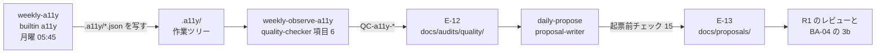

# DD-09 a11y の監査のフロー

詳細設計層。ID はそれぞれの正本の定義をそのまま使う（索引は [`docs/README.md` の「ID の採番と正本」](../README.md)）。ファイルパスはリポジトリのルートを起点とした相対で書く。

**2026-10-18 に追加（AA-05 の ADR-27。ユーザーの決定 U-3）。** 公開サイト（`frontend/verdant-virgo`）の JIS X 8341-3:2016 の AA の対応度の表明（一部準拠。自社の部分は全基準を満たす）を、後の変更（人とエージェントの両方）で落とさないために、再帰的自己改善のループに a11y の監査を組み込む。計画は `docs/superpowers/plans/2026-10-18-jis-x-8341-3-accessibility.md` の L1〜L3。

- 試験の方法（自動・手動・スクリーンリーダー）と基準ごとの対応の正本は `docs/BasicDesign/DesignSpec/website/04-accessibility-spec.md`。この文書は**週次の自動の監査が、どう観測になり、どう提案に効くか**だけを扱う。
- **状態: `条件付き`**（DetailedDesign/README の「状態について」）。定期実行の定義（`weekly-a11y`・`weekly-observe-a11y`）は `enabled: false`。`.a11y/` の要約の形は `summary.json`（version 1）に決着した（2026-10-18。3 節）。

## 1. 流れの全体

| 段 | 実行するもの | 入力 | 出力 | 定義 |
|---|---|---|---|---|
| 1 | 監視アプリの builtin `a11y`（エージェントを使わない） | 承認済みの `main` のチェックアウトの `frontend/verdant-virgo` | `.a11y/` 直下の `*.json`（作業ツリーへ写す） | `ops/schedules/weekly-a11y.yaml`、`backend/control-plane/src/builtin/a11y.ts` |
| 2 | `agent/quality-checker` の項目 6「WCAG の機械検査」 | `.a11y/summary.json` | `E-12`（`source: quality`） | `ops/schedules/weekly-observe-a11y.yaml`（毎週月曜 06:30）、`.claude/agents/quality-checker.md` |
| 3 | `agent/proposal-writer` | `E-12` の `QC-a11y-*` | `E-13`（`change.kind: accessibility` など） | `ops/schedules/daily-propose.yaml`、DD-06 の 1.2 |
| 4 | 人（`R1`・`R2`） | `E-13` の PR | `E-14`、修正のマージと配信 | BA-04 の 3b、AA-04 の 2.2 |

## 2. 段 1 `weekly-a11y`（builtin `a11y`）

| 項目 | 値 |
|---|---|
| 起動 | 毎週月曜 05:45（cron `45 5 * * 1`）。`enabled: false` で始める |
| `after` | **持たない**（2026-10-18 にリードが決定。計画の案 `after: [weekly-lighthouse]` から変えた） |
| 実行するコマンド | `pnpm a11y:ci`（`astro build && playwright test`）。ビルドから検査までを 1 本で行う |
| 実行元 | 承認済みの `main` のチェックアウト（`CONTROL_MAIN_CHECKOUT`）の `frontend/verdant-virgo`（ADR-18） |
| 子プロセスの env | 許可リスト: `PATH`・使い捨ての `HOME`（`CONTROL_AGENT_HOME` があればそれ）・`npm_config_ignore_scripts`・`SITE_URL`（設定されていれば）・`PLAYWRIGHT_BROWSERS_PATH`（実ホームの `~/.cache/ms-playwright`）。CI の扱いは verifier と調整中 |
| 写すもの | `.a11y/` の直下の、今回の実行で作られた `*.json` だけ。シンボリックリンクはたどらない |
| `timeout_sec` | 1800 |

**`after` を持たない理由**

1. Lighthouse のしきい値割れや揺れで `weekly-lighthouse` が `failure` になると、`after` で結んだ a11y の検査まで止まる。a11y の観測は Lighthouse の成否と関係が無い。
2. `dist` を配信して測るだけにすると、Lighthouse のビルドが失敗した週に、**古い `dist` を黙って測る**。`pnpm a11y:ci` が自分でビルドすれば、測るのは常にその時点の `main` である。

**重ならないことは cron の時刻で保つ。** `weekly-lighthouse` は 05:00 に始まり、`timeout_sec` 1800 で 05:30 までに終わる。`weekly-a11y` は 05:45 に始まる。同時に走らせると機械の負荷で Lighthouse の performance が 0.3 以上ぶれる（`docs/BasicDesign/DesignSpec/website/03-handoff.md` の 11.7、TA-05 の 7 節）。

### 2.1 結果の当てはめ

DD-01 の 4.2 の失敗分類の語彙で、builtin の結果を次のとおり当てはめる。

| 状況 | 実行の結果 | `fetch.outcome` | 写すか |
|---|---|---|---|
| `node_modules` が無い | `skipped`（`dependencies not installed`） | — | 写さない |
| Chromium が無い | `skipped`（`chromium not installed`） | — | 写さない |
| 終了コード 0 か 1 で、今回の Playwright の JSON レポートが読め、トップの `errors` が空 | `success` | `ok` | 写す |
| 終了コード 0 で、写すものが無い | `partial` | `empty_but_ok` | — |
| レポートが無い（ビルドの失敗を含む）・読めない・`errors` がある・その他の終了コード | `failure` | `invalid_response` | 写さない |
| タイムアウト・停止の要求 | `failure` | `timeout` | 写さない |
| 起動できない | `failure` | `unreachable` | 写さない |

- **axe の違反でテストが落ちる終了コード 1 は `success` にする。** 違反は観測した結果であって、検査の失敗ではない。`failure` にすると、違反があるときに限って段 2（`after: [weekly-a11y]`）が見送られ、**違反が観測に残らない**。違反の判断は段 2 が行う。
- **`skipped` は失敗にしない。** `main` のチェックアウトに依存か Chromium が無いだけで、ループの不具合ではない。ただし `skipped` が続くと a11y の観測が止まったまま気づかない。TA-05 の 8 節の未決定事項（誰が `pnpm install` と `playwright install chromium` をやり直すか）と一体で扱う。

## 3. 段 2 `weekly-observe-a11y`（`quality-checker` の項目 6）

| 項目 | 値 |
|---|---|
| 起動 | 毎週月曜 06:30（`ops/schedules/weekly-observe-a11y.yaml`。`after: [weekly-a11y]`、`enabled: false`） |
| エージェント | `agent/quality-checker`。**項目 6 だけを行う**（プロンプトで指定する） |
| 読むもの | **`frontend/verdant-virgo/.a11y/summary.json` だけ**（version 1。形の正本は `frontend/verdant-virgo/e2e/a11y/merge.ts` の冒頭のコメント）。Bash が無いので Read で読む。`.a11y/` の直下に写るのは `results.json` と `summary.json` だけで、ページごとの結果（`pages/`）は作業ツリーに写らない |
| `E-12` の単位 | サイト全体で 1 ファイル（`target_ref: "E-05 url_path=*"`）。**項目 6 はほかの項目と同じ `E-12` に混ぜない**（`fetch.outcome` がファイル単位のため）。本文に違反のあったページ（ルート × 端末）とルールの一覧を書く |

`metrics` のキー（DA-02 の 4.3）

| キー | 意味 | `summary.json` の値 |
|---|---|---|
| `QC-a11y-violations` | axe の違反の件数（全ルート × 端末の合計） | `totals.violations` |
| `QC-a11y-serious` | 違反のうち影響度が critical と serious の件数。**AA-04 の 3.8 の止め線** | `totals.serious` |
| `QC-a11y-pages-failed` | 違反が 1 件以上あったページ（ルート × 端末）の数 | `totals.pages_failed` |
| `QC-a11y-incomplete` | axe が判定できず、人の判断が要るもの（`incomplete`）の件数。合格・不合格に数えない | `totals.incomplete` |

- **件数はすべて要素の単位**（同じルールが 3 つの要素に当たれば 3 件）。

**`fetch.outcome` の当てはめ**（`.claude/agents/quality-checker.md` の項目 6。上から順に判定する。2026-10-18 に loop-engineer が決めた）

| # | 状況 | `fetch.outcome` | `metrics` |
|---|---|---|---|
| 1 | `summary.json` が無い、または `measured_at` が古い（定期実行のプロンプトでは「`measured_at` の日付が実行の当日でない」。指定の無い手動の起動では 7 日超） | `unreachable` | 空。本文に「判定不能」と理由 |
| 2 | JSON として読めない・`version` が 1 でない・`totals` の 4 つの件数のどれかが無い | `invalid_response` | 空 |
| 3 | `totals.pages_errored` か `totals.pages_missing` が 0 でない | `truncated` | 空。欠けたページを本文に書く |
| 4 | それ以外 | `ok` | 4 つのキー。**違反が 0 でも `ok` で、0 を入れる**（`empty_but_ok` にしない） |

- **古い結果を今週の値として書かない**（1 の行）。段 1 が `skipped`・`failure` で写さなかった週は、前の週の `summary.json` が残っていても `unreachable` になる。
- 3 の行で `metrics` を空にするのは、ページが欠けた件数は 0 に近く見え、止め線（`QC-a11y-serious`）を誤って外すため。
- 本文には違反の場所（ルート・端末・ルールの ID・要素のセレクタ）を書く。直し方の提案は書かない（`proposal-writer` の仕事）。

## 4. 段 3 `proposal-writer`（起票前チェックの 15）

DD-06 の 1.2 の 15 を通す。要点だけ写す（正本は DD-06）。

- **最新の `QC-a11y-serious` が 0 でない間は、UI を変える提案は `change.kind: accessibility` だけを起票する**（`technical_seo`・`cta_swap`・`experiment_start` は止める）。**確認できないとき（`E-12` が無い・`ok` でない・14 日超）も同じ扱い**（検査 8 の `LH-seo` と同じ。7 節）。
- **UI を変える提案は `risk` に、変えるページと a11y への影響を書く。** `QC-a11y-violations` を増やす見込みの提案は起票しない。
- `accessibility` の提案の `expectation.metric` は `QC-a11y-violations` か `QC-a11y-serious`。`expectation.target` は 0。`judge_after` は**起票日の後の最初の月曜（`weekly-observe-a11y` の日）の翌日**（効果の判定に 30 日を待たない。違反は配信の直後の観測で消えたかが分かるため。`.claude/agents/proposal-writer.md` の書き方）。

## 5. 段 4 人の確認

- `accessibility` の提案の適用は `technical_seo` と同じ（マージまで `R1`、配信も人間。AA-04 の 2.2、DD-01 の 8.3）。
- **UI を変える公開の前に、変えたページを人がスクリーンリーダーで確かめる**（BA-04 の 3b。手順は `04-accessibility-spec.md` の §4.4）。週次の自動の監査は、この確認の代わりにならない。
- 公開した後に `/accessibility/` の試験日より後の UI の変更が溜まったら、試験し直して試験日を更新する（`04-accessibility-spec.md` の §6）。

## 6. この流れで守ること

1. **検知（`quality-checker`）と、起票を絞る判断（`proposal-writer`）を同じエージェントに持たせない**（AA-04 の 3.6）。
2. **機械の検査の違反 0 を「準拠」「適合」と書かない。** `E-12` にも `E-13` にも、対応度を書かない（判定は人の試験の結果。`04-accessibility-spec.md` の §4.5）。
3. **`.a11y/` の生データを Git に入れない**（ADR-27 の決定 6）。`E-12` には値と参照だけを書く。
4. **定義の変更は PR を通す**（ADR-18）。作業ツリーで `weekly-a11y.yaml` を書き換えても、次の実行には効かない。

## 7. 未決定事項

- **（2026-10-18 に決着）`.a11y/` の要約の形。** `summary.json`（version 1）。形の正本は `frontend/verdant-virgo/e2e/a11y/merge.ts` の冒頭のコメント（3 節）。
- **`weekly-a11y`・`weekly-observe-a11y` を有効にする時期。** **この 2 本を有効にすることが、UI を変える提案（`technical_seo`・`cta_swap`・`experiment_start`）を自動で起票する前提になる**（2026-10-18 にリードが決定。DD-06 の 1.2 の 15）。検査 15 は、最新の `QC-a11y-serious` が確認できないとき（`E-12` が無い・`ok` でない・`measured_at` が 14 日超）も 0 でない扱いにするため、**有効にして `ok` の `E-12` ができるまで、`technical_seo`・`cta_swap`・`experiment_start` は起票されない。** つまり**有効にしないままだと UI を変える提案は止まり続け、有効にすると `QC-a11y-serious` が 0 になるまで `accessibility` だけになる**。公開サイトの改修（計画の Wave 2）で違反が 0 になった後（L4-1 の後）に有効にする案。有効にする前に、`main` に入れた後で builtin `a11y` を手動で 1 回実行して確かめる（`03-handoff.md` の申し送り）。判断者 `R1`。
- **ブログ記事の数が増えたときの実行時間。** 全記事を axe で回す（P-1）ので、記事の数に比例して伸びる。`timeout_sec` 1800 に収まらなくなったら、記事をテンプレート単位に絞るか、時間を延ばす。判断者 `R1`。
