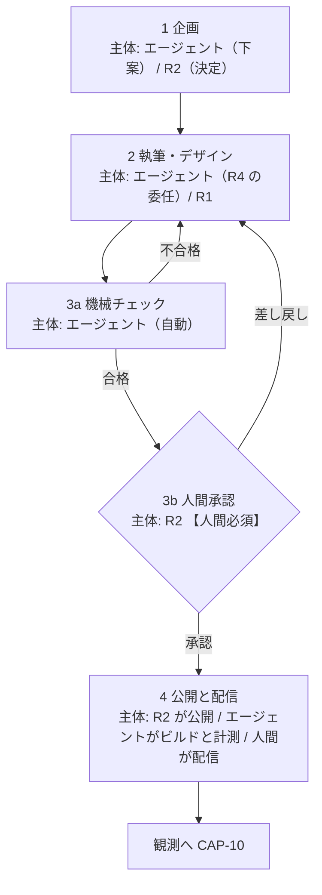
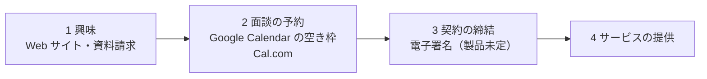

# 04. 業務プロセス

BA（Business Architecture）層。ロール ID（正本は BA-03）・Capability ID（BA-02）・エンティティ ID（DA-01）はそれぞれの正本の定義をそのまま使う（索引は [`docs/README.md` の「ID の採番と正本」](../../README.md)）。

このファイルで定義する 3 つのプロセスは、いずれも **To-Be の設計**である。現状はどれも業務として稼働していない（記事を描画するページが無く、CTA も無く、観測データも 0 のため）。各表に状態列を設けて、どこまでが既存実装に支えられているかを示す。

## 更新ワークフロー

README の「企画 → 執筆/デザイン → 承認（ダブルチェック） → 公開」を、実行主体と人間ゲートの位置まで含めて具体化する。

図は To-Be を描いている。**現在このワークフローで実際に実行できるのは、ステップ 2（下書きの作成）と 3a の一部（Lighthouse CI による計測）だけ**で、3b の承認記録と 4 の公開経路は存在しない。ステップごとの状態は直後の「ステップ定義」の状態列で確認する。

**ダブルチェックは「機械チェック（3a）＋ 人間承認（3b）」の 2 段で構成する。** README の「ダブルチェック」を人間 2 人による確認と解釈すると、兼務の体制では成立しない（03 の未決定事項を参照）。機械が検証できる項目（リンク切れ、しきい値、構造化データ、表記ゆれ）と人間にしか判断できない項目（事実の正確さ、主張の妥当性、公開してよいか）を分けることで、片方が自動化されても検証の層は 2 枚残る。

### ステップ定義

| # | ステップ | 実行主体 | 入力 | 出力 | 人間必須 | 状態 |
|---|---|---|---|---|---|---|
| 1 | 企画 | エージェントが下案、`R2` が決定 | `E-01` `E-02` `E-12` | `E-03` `ContentPlan` | **必須**（採否の決定は `R2`） | `未着手`（`E-03` の格納先が未定） |
| 2 | 執筆・デザイン | エージェント（`R4` の委任）、UI 実装は `R1` | `E-03` | `E-04` `Content`（下書き） | 不要 | `部分的`（Strapi と `strapi-mcp` で下書きは作れる） |
| 3a | 機械チェック | エージェント（自動） | `E-04` | 指摘一覧 | 不要 | `部分的`（Lighthouse CI は動く。原稿側のチェックは未実装） |
| 3b | 人間承認 | `R2` | `E-04` ＋ 3a の指摘一覧 | `E-14` `ApprovalRecord` | **必須** | `未着手`（`E-14` の記録場所が未定） |
| 4 | 公開と配信 | **`R2` が本番の Strapi の管理画面で公開する → エージェントがビルドと計測を行う → 人間が配信する**（AA-05 の ADR-15・ADR-17。当初は「`R1`、または承認後にエージェント」としていた） | 承認済みの `E-04` | `E-05` `Page` | **必須**（公開と配信は人間の操作。ADR-17 でエージェントのトークンに公開の権限を与えないことにした） | `未着手`（Astro に記事描画ページが無い） |

### 人間ゲートの位置を固定する理由

再帰的自己改善型の基盤で最も危険な失敗は、**承認の過剰自動化**である（生成・チェック・承認・公開がすべて自動化されると、誤りが誰にも気づかれないまま実体に反映され、その結果が次の観測データになって誤りを強化する）。したがって次の 2 点を設計事項として固定し、後から効率化の名目で外さない。

- **人間必須のゲートは 3b（人間承認）と、企画の採否決定（1）の 2 か所。** ここを跨ぐ自動化は行わない。**ADR-15・ADR-17 で、4 の公開（`R2`）と配信（人間）も人間の操作になった**（ゲートというより、実行手段を人間に残した操作である）。
- **ステップ 4（公開）をエージェントが実行してよいのは、3b の承認が記録されている場合に限る。** 「承認を得てから公開する」ではなく「承認の記録が無ければ公開操作が成立しない」形にする（手順としての約束ではなく、状態としての前提にするため）。実装手段は AA / TA に引き渡す。
  - **（2026-09-19 に AA-05 の ADR-17 で決着）AA / TA の回答は「エージェントに公開させない」である。** 本番の Strapi に書くエージェントのトークンに公開の権限を与えず、公開は承認者の `R2` が本番の管理画面で自ら行う。承認と公開の操作が同じ人間に揃うため、「承認の記録が無ければ公開操作が成立しない」は、エージェントについては実行手段の欠落として成り立つ（Strapi 5 で公開だけを外せるかは実装時に確認する）。その後のビルドと計測はエージェントが行い、配信は人間が行う。
- 3a（機械チェック）は完全に自動化してよい。合格が公開の必要条件であって十分条件ではない（3a の合格は 3b をスキップする根拠にならない）。
- **（2026-10-18 に追加。AA-05 の ADR-27）UI を変える公開の前に、変えたページを人がスクリーンリーダーで確かめる（3b に含める）。** 公開サイトは JIS X 8341-3:2016 の AA の対応度と試験結果を公開しており、機械の検査（3a の axe・Lighthouse）は基準の一部しか見ない。確かめる項目と手順は `docs/BasicDesign/DesignSpec/website/04-accessibility-spec.md` の §4.4（NVDA ＋ Chrome、VoiceOver ＋ iOS Safari）。確かめた結果は `E-14` の承認の記録に添える。記事の本文だけを変える公開（`content_rewrite`）は対象外だが、本文に画像・表・英語の段落を足したときは、代替テキスト・表の見出し・`lang` を 3a で検査する

## PDCA の定例

| サイクル | 実施内容 | 入力データ | 出力 | 主担当 | 状態 |
|---|---|---|---|---|---|
| 週次 | コンテンツ投入（企画済みの記事を更新ワークフローに載せて公開する） | `E-03` `E-04` | 公開された `E-05`、次週の企画残 | `R2` | `未着手` |
| 週次 | AB テストの実施（CTA の文言・配置・出し分けの検証） | `E-05` `E-06` `E-11` | `E-11` `Experiment` の結果 | `R3` | `未着手`（PostHog のトラッカー未設置） |
| 週次 | 問い合わせの棚卸し（未対応・未割り当ての会話を消化する） | `E-10` | 対応済みの `E-10`、記事化候補 | `R3` | `未配線`（Chatwoot は動くがウィジェット未設置） |
| 週次 | キーワード候補の調査（OpenSEO で候補と検索ボリュームを出し、採否を決める） | `E-01` `E-12`（`source: market`） | 採用された `E-01`（`adoption_status: 採用`） | `R2` | `未配線`（OpenSEO は稼働中。エージェントから未接続） |
| 月次 | 順位・流入・CVR 分析 | `E-12`（`source: gsc` / `serp` を含む）`E-07` `E-08` `E-09` | 分析結果、`E-13` の候補 | `R3` | `未着手` |
| 月次 | 過去記事のリライト（順位が伸びない記事・情報が古い記事の改稿） | `E-12` `E-04` `E-07` | 改稿された `E-04`（更新ワークフローの 2 に戻す） | `R2` | `未着手` |
| 月次 | 内部リンク構造の最適化 | `E-04` `E-05` `E-07` | リンク構成の変更 | `R1` | `未着手` |
| 月次 | 改善提案の採否決定 | 上記すべての出力 | `E-13` `ImprovementProposal` と `E-14` `ApprovalRecord` | `R2` | `未着手`（`CAP-14` の中核） |

### 定例の設計方針

- **週次は「作用」、月次は「学習」に割り当てる。** 週次は既に決まった企画を実行に移す回転で、意思決定を含まない。月次は観測結果から方針を書き換える回転で、`CAP-14` が働く。両者を同じサイクルに混ぜない（毎週方針を変えると、施策の効果が出る前に条件が変わって因果が読めなくなるため）。
- **月次の 4 項目はすべて `E-13` に集約してから承認する。** 分析・リライト・内部リンクをそれぞれ個別に承認すると、承認ゲートが 3 つに分散して抜けやすくなる。`CAP-14` が単一の合流点である理由はここにある（02 参照）。
- **各定例の入力データがすべて `未着手` または `未配線` である。** 定例を先に設定しても入力が空なので、実務上は 01 の「測定可能化の順序」が先行する。

## キーワード＆ CV 設計の標準化

### 検索意図の 3 分類

README の分類をそのまま使う（分類名を変えると README との対応が取れなくなるため）。

| 分類 | 読者の状態 | 検索の例 | 記事タイプ |
|---|---|---|---|
| 潜在（課題探求） | 課題は感じているが、解決手段の存在を知らない | 「〇〇 属人化」「〇〇 工数 削減」 | 課題の言語化、業界動向、失敗事例 |
| 準顕在（手法比較） | 解決手段のカテゴリは知っており、やり方を比べている | 「〇〇 自動化 方法」「〇〇 ツール 比較」 | 手法解説、選定基準、比較記事 |
| 顕在・指名（サービス比較・導入検討） | 具体的な製品を検討している | 「〇〇（製品名） 料金」「〇〇 導入事例」 | 事例、料金の考え方、導入手順 |

### 検索意図の割り当ての根拠（OpenSEO）

キーワードを 3 分類のどれに割り当てるかを、推測ではなくデータで下案にする。OpenSEO（DataForSEO）はキーワードごとに**検索意図の 4 分類**を返すため、次の対応を**暫定の既定**として使う。割り当ての確定は `R2` が行う（`E-01` の採否と同じ承認）。

| DataForSEO の検索意図 | この基盤の分類（既定） | 注意 |
|---|---|---|
| informational（情報収集） | 潜在 | 課題の言語化を求める検索。「〇〇 とは」も含む |
| commercial（比較検討） | 準顕在 | 「〇〇 ツール 比較」「おすすめ」 |
| transactional（取引） | 顕在・指名 | 「料金」「導入」「無料トライアル」 |
| navigational（指名） | 顕在・指名 | **自社名・製品名の場合だけ**。競合の製品名の場合は準顕在に置く（比較の途中にいるため） |

- **対応は 1 対 1 ではない。** DataForSEO の分類は Google 全体の検索行動からの推定であり、BtoB の文脈を知らない。**既定を機械的に適用せず、`R2` が採否のときに上書きする**前提で置く。
- **意図が返らない市場がある。** Google Ads のデータで代用される国では検索意図が `null` になる（OpenSEO のツール説明）。日本語の市場で実際に返るかは未確認（未決定事項）。

### CTA 出し分けマトリクス

**CTA は実際にサイトに置く 2 種（無料相談 / ソースコードの無料 DL）とする。**（**2026-10-01 に 3 種から改めた**。下記）。**1 ページに主 CTA は 1 つだけ置く**（複数の主 CTA を並べると、どの意図に効いたのかが AB テストで分離できなくなるため）。副 CTA は補助で、主 CTA より視覚的な重みを下げる。

| 検索意図 | 主 CTA | 副 CTA | 置かない CTA | 根拠 |
|---|---|---|---|---|
| 潜在 | **無料 DL**（ソースコード。`cta_type: source_dl`） | なし | 無料相談 | 製品を知らない段階で商談系 CTA を出すと直帰する。まず匿名のまま持ち帰れる形にする |
| 準顕在 | **無料 DL** | **無料相談**（`cta_type: consult`。視覚的な重みを下げる） | — | 比較段階では自分で試せるものを主にし、人と話す選択肢を添える。**旧版は副 CTA を無料トライアルとしていたが、トライアルを提供していないため無料相談に置き換えた**（重みで差を付ける） |
| 顕在・指名 | **無料相談** | 無料 DL（副次的に残してよい） | — | 検討段階では人と話すほうが速い。無料 DL は自走したい読者の逃げ道として残す |

- **`cta_type` の値は `consult` / `source_dl`**（DA-01 の 4 節。`chat` は CTA の数に入れない補助、`booking` は完了画面だけ）。
- **CV に数えるのはこの 2 種だけ**（無料相談は Mautic のフォームの送信、無料 DL は 2026-10-20 から CTA の押下で数える。DA-02 の 1.3）。**オンライン面談の予約（`booking`）は CV の後ろの段**であり、この表には載せない（商談プロセスの段 2）。
- 状態: **開発環境で実装済み・本番は未デプロイ**（CTA コンポーネントは `frontend/verdant-virgo` の `CTAButton`・`SourceDlBlock`、Mautic のフォームは `consult` だけ。2026-10-26 に「すべて未着手」から改めた）。

#### 3 種から 2 種に改めた理由（2026-10-01）

**リポジトリルートの `README.md` は CTA を 3 種（ホワイトペーパー / 無料トライアル / デモ予約）としており、本ファイルの旧版はそれをそのまま使っていた。** デザインの検討で、**サイトに実在するのは 2 種で、無料トライアルは提供していない**ことが確定した（`docs/BasicDesign/DesignSpec/website/01-content-spec.md` の 6.1。ユーザーの決定）。

| README の 3 種 | サイトの実態 | 扱い |
|---|---|---|
| ホワイトペーパー | **環境構築のソースコードの無料 DL** | 名前を実態に合わせた（`cta_type: source_dl`）。配布しているのはホワイトペーパーではない |
| デモ予約 | **無料相談** | 同じく実態に合わせた（`cta_type: consult`）。デモを見せるのではなく相談を受ける |
| 無料トライアル | **無い** | **使わない。** 受託開発とコンサルが中心の事業であり、試用の形を取れるサービスが無い |

- **`README.md` の 3 種の記述が古くなっている。** ルートの `README.md` は事業スキームの原典であり、本ファイルからは直さない（`docs/README.md` の横断的な未決定事項に記録した）。
- **DA-02 の指標 ID も同日に合わせた**（`CVR-wp` → `CVR-source-dl`、`CVR-demo` → `CVR-consult`、**`CVR-trial` は廃止**。DA-02 の 1.3）。
- **`cta_type` の値 `trial` は「使わない」として残す**（DA-01 の 4 節）。**将来トライアルを始めたときに意味が変わらないようにするため**で、指標 ID を廃止したのとは扱いを分けている（指標は「いま測るもの」の一覧であり、測れないものを並べない）。

### MA へのトスアップ条件

どの CTA が押されたら Mautic（`E-09` `Contact`）の何になるかを明文化する。この表が **DA の指標定義（`E-06` `E-09` のフィールド設計）と AA の Mautic 連携（フォーム・セグメント・キャンペーンの設計）への引き渡し物**にあたる。

| CTA | 発火条件 | Mautic で起きること | 通知 | 後続 |
|---|---|---|---|---|
| **無料 DL**（ソースコード。`source_dl`。旧「ホワイトペーパー DL」） | **CTA の押下**（PostHog の `cta_clicked`。2026-10-20 にフォームの送信から改めた。下記） | **なし**（メールアドレスを取らないので `E-09` を作らない） | なし | **無料相談のフォームへ移る**（押すと zip のダウンロードと `/contact?from=` への遷移が同時に起きる） |
| ~~無料トライアル申込~~ | **使わない**（2026-10-01。サイトに無料トライアルの CTA が無い。上の「3 種から 2 種に改めた理由」）。**行は残す**（将来トライアルを始めたときに、ステージ `trial`・セグメント `trial-signup`・ポイント `+30` の設計をそのまま使えるようにするため） | — | — | — |
| **無料相談**（`consult`。旧「デモ予約」） | Mautic フォームの送信完了（会社名・氏名・メールアドレス必須。**同意のチェックが必須**） | `E-09` のステージを `demo-requested` に更新。セグメント `demo-request` に追加。ポイント `+50`。同意の 3 項目（`privacy_consent_at` / `privacy_consent_version` / `email_optin`）を保存。受付の自動返信を送る（`email_optin` に関係なく） | `R3` に**即時**通知 | **完了画面で面談の枠を予約してもらう**（下の「商談プロセス」の段 2）。予約されなかった場合は Chatwoot の会話（`E-10`）または直接連絡で商談へ。**お知らせメールの任意のチェックを入れた方（`email_optin = true`）だけ、ナーチャリングメールのキャンペーンに投入する**（Do Not Contact の方は除く） |
| （共通） | 累計ポイントが `50` 以上に到達 | セグメント `mql` に追加 | `R3` に通知 | 商談化の判断対象にする |

**通知の経路を `R1` が 2026-09-17 に決定した。** 上表の「通知」列はすべて、**運用者のメールアドレスへ届ける**（本番は Amazon SNS のトピック `comegin-lead-alert`、開発は MailHog）。設計は AA-02 の `I-21` と TA-01 の経路 10 にある。

- **通知に載せるのは「種別・会社名・各システムの ID」だけとする。** 氏名・メールアドレス・問い合わせ本文は載せず、詳細は Mautic / Chatwoot を見に行く（DA-05 の 1.3）。会社名を載せるのは、**メールを見た時点で優先度を判断できるようにする**ため。
- **Chatwoot の社内メモは通知に使わない。** Chatwoot は顧客対応の用途であり、内部通知を載せると `agent/conversation-triage` の取得範囲と `CAP-12` のレポートを汚す（AA-02 の 3.4）。

トスアップ条件の設計上の約束。

- **CV の判定は「CTA のクリック」ではなく「フォームの送信完了」で行う。** クリックは PostHog 側で計測するが、`E-09` を作るのは送信完了時のみ（クリックだけでコンタクトを作ると、実体のないコンタクトが増えて CVR が実態より高く出るため）。
- **ポイントの加算値（10 / 30 / 50）と MQL のしきい値（50）は暫定値。** 実データが取れるまで妥当性を検証できない。運用開始後に `CAP-14` の対象として見直す前提で置く。
- **流入記事の URL を必ずコンタクトに保存する。** これが無いと「どの記事が CV を生んだか」を月次分析で辿れず、KPI ツリーの `公開記事数 → CV 数` の経路が検証できない。
- **通知の即時性は CTA の温度感に比例させる。** デモ予約だけ即時通知にするのは、顕在層の検討タイミングが短いため。

**2026-10-20 に無料 DL の行を改めた（ユーザーの判断）。** 公開サイトから無料 DL のフォーム（`source_dl`）を消し、「ソースコードを無料 DL」の CTA は無料相談のフォームへ移るだけになった（DA-02 の 1.3、`01-content-spec.md` の 5.1 の項目 8）。**ナーチャリングの入口は、無料 DL から「無料相談でお知らせメールを希望した方」に移った。** 希望（`email_optin`）と配信停止（Do Not Contact）は別の項目に持つ（DD-02 の 5.3）。旧版: 発火条件は「Mautic フォームの送信完了（メールアドレス必須。同意のチェックが必須）」、Mautic で起きることは「`E-09` を作成または既存に統合。セグメント `wp-download` に追加。ポイント `+10`。カスタムフィールドに DL した資料名と流入記事の URL を保存」、後続は「ナーチャリングメールのキャンペーンに投入」。

状態: 開発環境では `setup` がフォーム `consult`（同意の 3 項目を含む）・受付の自動返信・セグメント `mql` を作り、n8n の `I-11` が無料相談と `mql` を通知する。**ステージ `demo-requested`・セグメント `demo-request`・ポイントは未作成。** **ナーチャリングのセグメント（`email_optin = true` かつ Do Not Contact でない）とキャンペーンは、本番のデプロイの後に作る**（2026-10-26 のユーザーの判断）。それまでは、チェックを入れても記録が残るだけで、お知らせメールは届かない。

## 商談プロセス

**ユーザーが 2026-10-01 に、興味を持った読者が契約に至るまでの流れを 4 段階で確定した**（`docs/BasicDesign/DesignSpec/website/01-content-spec.md` の 10.2 の C5。「ご利用の流れ・ご相談の流れ」としてオンライン面談の有無と形式が未確定だった箇所）。更新ワークフローが「記事を出す側」のプロセスなのに対し、**出した結果として来た人を受ける側**のプロセスにあたる。トスアップ条件（上）はこのプロセスの入口を Mautic 側から見たものである。

図は To-Be を描いている。**段 1 は開発環境で実装済みで、本番は未デプロイ**（2026-10-26 時点）。段 2 以降は下の表の状態欄のとおり。旧版: 「現在この 4 段のうち 1 段も成立していない（CTA もフォームも無く、予約の手段も契約の手段も未着手）」。

### 段の定義

| 段 | 何が起きるか | 主体 | 使う手段 | 主なエンティティ | 状態 |
|---|---|---|---|---|---|
| 1 | 記事・サービスのページ・無料 DL で興味を持つ | 訪問者 | Astro の CTA（無料相談・無料 DL）→ Mautic の無料相談のフォーム（無料 DL の CTA もここへ移る） | `E-05` `E-06` `E-09` | **開発環境で実装済み・本番は未デプロイ**（CTA は `CTAButton`・`SourceDlBlock`、フォームは `ContactForm` と Mautic のフォーム `consult`。2026-10-26 に「未着手」から改めた） |
| 2 | **ComeGin の Google Calendar の空き時間から、オンライン面談の枠を自分で予約する** | 訪問者（枠の提供は `R3`） | **Cal.com**（Google Calendar と連携。AA-02 の `I-25`）（**2026-10-06: SaaS の Cal.com〈米国〉。ADR-24**） | **`E-16 Booking`**（2026-10-01 に DA-01 で新設。正本は本番の Cal.com）＋ `E-09`（email で突合） | `未着手` |
| 3 | 契約を**電子署名**で締結する | `R3` と顧客 | **製品未定**（下記） | **未定義** | `未着手` |
| 4 | サービスを提供する | 各サービスの担当 | サービスごとに異なる | **未定義** | **本基盤の対象外**（01 のバリューストリームの「受注」以降） |

### 設計上の約束

- **段 2 の入口は無料相談フォームの完了画面に置く。** 無料相談フォームの送信が成功したら `/contact/thanks` に遷移し、**その画面に Cal.com の予約枠を埋め込む**（`docs/BasicDesign/DesignSpec/website/01-content-spec.md` の 4.6 の 6'-2）。メールの往復で日程を決める手間が消え、**訪問者が最も前向きな 1 回の来訪のうちに予約まで済む**。
- **予約を CV の条件にしない。** `CV` の判定はフォームの送信完了のままである（DA-02 の 1.2）。**予約しなかった人を CV から外すと、トスアップ条件（ポイント `+50`・`R3` への即時通知）の起点も変わってしまう**。予約は「商談化の確度を上げる手段」であって、リードの成立条件ではない。
- **予約が無くても商談の経路を残す。** 段 2 を飛ばした訪問者には、従来どおり `R3` が Chatwoot かメールで接触する（トスアップ条件の「後続」列）。**Cal.com が落ちても、CV とその後の対応は止まらない**。予約の枠が表示できなかったときに「担当者からメールで日程を調整する」と画面に出すのは、この約束を訪問者に見える形にしたものである（`01-content-spec.md` の 4.6 の 6'-2）。
- **面談の実施・契約の締結・サービスの提供はすべて人間が行う。** エージェントはこの 4 段のどこにも作用しない（段 1 の記事と CTA を用意するところまでが更新ワークフローの範囲）。
- **段 3・4 は Web サイト運用の外にある。** 01 のバリューストリームは「受注」を本基盤の対象外としており（SFA 未選定）、このプロセスはその境界を跨ぐ。**ここに並べるのは、段 2 の設計がどこで終わるか（＝予約が取れたら基盤の役割は終わり）を示すため**であり、段 3・4 の手順をこの基盤で設計するという意味ではない。

## 収益化の業務プロセス（2026-10-03 に追加。本システムの完成後に着手）

`CAP-17` `CAP-18`（BA-02）の業務を 4 本で定義する。**すべて承認ゲート G-1〜G-3（BA-05）を通るまで行わない。** 連携点は AA-02 の `I-26`〜`I-30`、電文と状態遷移は DD-08。

| # | プロセス | 起点 | 担当 | 手順 |
|---|---|---|---|---|
| P-M1 | オプトインと撤回 | 利用者がポータルで操作する | 利用者（`R1` は監視） | ① 利用者がポータル（`points-api`）で同意文を読み、同意する（`E-17` が記録される）② 利用者が自分のサーバで `MINER_ENABLED=true` にして miner を起動する ③ 撤回はポータルで行い、利用者が `MINER_ENABLED=false` にする（次の起動から止まる） |
| P-M2 | 月次の締めと付与 | 本番の n8n の月次のスケジュール | `R1` | ① n8n が `points-api` の締めを呼ぶ（`E-18` の前月分から付与量を計算し、`E-19` を `計算済み` で追記する）② `R1` が管理画面で内訳を確かめて承認する（却下もできる）③ `points-api` が thirdweb で mint する ④ 翌日の突き合わせで `確定` を確かめる |
| P-M3 | 発注時の消化 | 利用者が発注時にポイントの利用を申し出る | `R1`（`R3` が発注と突き合わせる） | ① `R3` が発注書番号と利用するポイント数を確かめる ② `R1` が管理画面で消化を実行する（burn。`E-19` に発注書番号を残す）③ 発注書の金額からポイント分を差し引く |
| P-M4 | ComeGin の換金 | `R1` が任意の時期に行う | `R1` | ① 取引業者の画面で POL の入金アドレスを表示し、**ネットワークが Polygon であること**を確かめる ② 取引業者の画面で、送付元を「**自分のプライベートウォレット**」（ComeGin の thirdweb サーバウォレットのアドレス）として申告する（初回、または取引業者が求めるとき）③ 初回とアドレスを変えた後は、**少額で試しに送り**、着金を確かめてから残りを送る ④ thirdweb のダッシュボードから、**Polygon ネットワーク**で POL を送る ⑤ 着金を確かめて売却し、送金の tx hash・売却の約定・円の金額を `E-20` の換金の記録に残す |

### 設計上の約束

- **unMineable から取引業者へ直接送らない。** 採掘プールのような共有アドレスから送ると、トラベルルールで送付人の情報を確認できず、入金の保留の原因になる。経路は「unMineable → ComeGin の thirdweb サーバウォレット → 国内の取引業者」の 1 本だけにする。
- **トークンとネットワークは POL・Polygon に固定する。** 送り先が対応していないネットワークで送ると着金せず、資産を失うおそれがある。変更は `承認`（`R1`。BA-05）。
- **換金先の候補は bitbank と SBI VC トレード**（Polygon の POL に対応することを確認済み）。GMO コインは未確認。いずれも登録番号を金融庁の登録業者一覧で確かめてから使う。
- **P-M2 の承認を自動化しない。** 付与は利用者に対する値引きの約束であり、取り消せない（チェーンに残る）。

## 未決定事項

- **`E-13` `ImprovementProposal` と `E-14` `ApprovalRecord` の格納先が未定。** 承認ゲート（3b）を「記録が無ければ公開できない」形にするには、承認記録を機械が参照できる場所に置く必要がある。Strapi のコンテンツタイプにするか、別のストアにするかで実装が変わるため、DA の決定を待つ。
- **`E-01` `Keyword` と `E-03` `ContentPlan` の正本が未定。** 企画ステップの入出力がどこに書かれるかが決まらないと、週次・月次の定例が入力を参照できない。
- **AB テストの実施主体が PostHog のフィーチャーフラグか、Astro のビルド時分岐かが未定。** 静的サイトで AB テストを行う方式によって、`E-11` の粒度と `CAP-10` の計測方法が変わる。TA の判断事項。
- **CTA のフォームを Mautic のフォームで作るか、Astro 側のフォームから Mautic の API を叩くかが未定。** 前者は実装が軽いが埋め込みの表示速度が `CAP-09` のしきい値に影響し、後者は `E-06` の正本が Strapi 側に寄る。AA の判断事項。
- **ダブルチェックを人間 2 人で行う体制に戻す余地。** 本ファイルでは「機械 ＋ 人間」の 2 段としたが、これは兼務を前提とした妥協である。`R2` と `R4` が別の人間で埋まった場合、3b を人間 2 名の確認に強化する選択肢が生じる。
- **電子署名の製品が未定**（商談プロセスの段 3。2026-10-01 の決定で生じた）。締結の手段を電子署名にすることは決まったが、製品が決まっていない。**製品が決まるまで連携点を立てない**（AA-02 の 5 節。受信先もペイロードも書けないため）。あわせて、電子署名の記録（契約書そのもの）の正本をどこに置くかも決まっていない（`E-01`〜`E-15` に対応する型が無い）。判断者 ユーザー、`R1`。
- **（2026-10-01 に解決）面談の予約を表す型。****（2026-10-06 の注記。ADR-24: 正本は SaaS の Cal.com〈米国〉。セルフホストではなくなった）**  **`E-16 Booking` を立てた**（DA-01 の 4.1）。正本は**本番の Cal.com**（セルフホスト）で、`E-09` とは email で結ぶ。`E-09` の属性にしなかったのは、**1 人が複数回予約しうる**ためである。**残るのは保持期間と、削除請求の対象に含めるか**（`invitee_email` は実名情報。DA-05 への反映が要る。DA-01 の 7 節）。判断者 `R1`（DA）。
- **予約を指標として持つか**（商談プロセスの段 2）。予約を CV の条件にはしないと決めたが、「CV のうち何件が面談の予約まで進んだか」は商談化の確度を示す。測るなら Cal.com 側の件数を取る手段と、`CVR-*` とは別の指標 ID が要る（DA-02 の 4 節）。判断者 `R3`。
- **面談の枠の出し方**（商談プロセスの段 2）。Google Calendar の空き時間をそのまま公開範囲にするのか、面談用の時間帯を限るのか、1 枠の長さと直前の予約をどこまで許すかが決まっていない。**カレンダーの予定の内容が外に漏れない設定であることを確かめる必要がある**（Cal.com に渡す権限の範囲。TA の判断と合わせる）。判断者 `R3` `R1`。
- **DataForSEO の検索意図と 3 分類の対応が妥当か。** 上の対応表は暫定の既定であり、日本語・BtoB のキーワードで検索意図が実際に返るか、返った値が 3 分類と噛み合うかを確かめていない。キーワード調査を実際に回してから見直す。判断者 `R2`。
