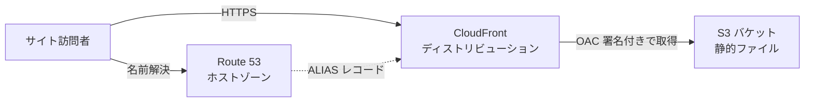
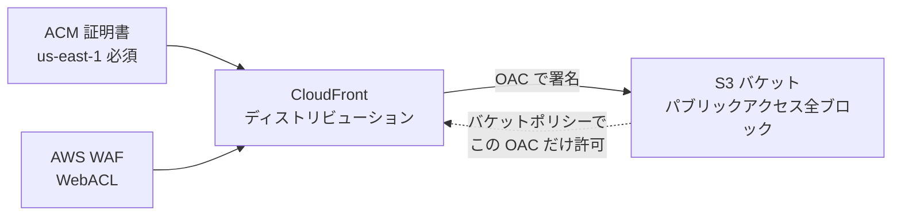
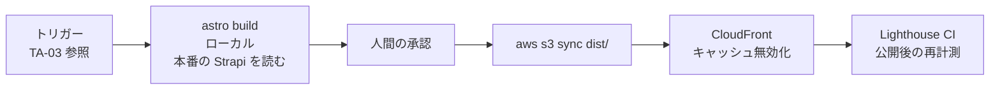

# 02. 製品（Astro）の AWS 配信設計

TA（Technology Architecture）層。ID はそれぞれの正本の定義をそのまま使う（索引は [`docs/README.md` の「ID の採番と正本」](../../README.md)）。
ファイルパスは リポジトリのルートを起点とした相対で書く。

**状態: 未着手（`cloud/` ディレクトリは空）。** 本ファイルの内容はすべて To-Be の設計であり、AWS 上に存在するリソースはホストゾーンを除いて 1 つも無い（2026-09-17 に実 API で確認。1 節を参照）。

**本ファイルは Astro の配信だけを扱う。** ADR-12（AA-05）で AWS に置くことになった Mautic・Chatwoot・Umami（**ADR-25 で廃止**）と、ADR-16 で加わった Strapi・n8n の本番実行環境は TA-06 に、オンプレの開発環境と監視アプリは TA-07 に書く。**Astro のビルドはオンプレ（ローカル）で行い、本番の Strapi（`cms.comegin.com` の Content API）を読む。配信は人間が承認して実行する**（ADR-15・ADR-16。6 節）。ADR-15 ではビルドがオンプレの Strapi を読んでいたが、ADR-16 で記事の正本を本番の Strapi に置いたため読み先が変わった。

> **（2026-10-06）ADR-21 の反映。本ファイルの本文より、この注記を優先する。**
> - **Strapi と n8n の本番は ECS に置かない。オンプレで動く**（`onprem/strapi`・`onprem/n8n`。データは AWS の RDS・S3）。上の「`cms.comegin.com` の Content API」「Strapi・n8n の本番実行環境は TA-06」「本番の Strapi は S3 への権限をタスクロールで持つ」は ADR-16 の記述である。**TA-06 が扱う AWS の実行環境は Mautic・Chatwoot・Umami と `consent-api`・Cal.com・`admin-auth`**（**ADR-24: Cal.com は SaaS に変わり、ここから外れた**）（**2026-10-06 ADR-25〈AA-05〉: Umami を廃止し、ここから外れた。後継の GA4 は SaaS で AWS に何も置かない**）（と、Strapi・n8n のデータの置き場）。
> - **Astro のビルドは本番の Strapi をオンプレの `127.0.0.1:1338` で読む**（読み取り専用の API トークン。ALB・WAF・回線を通らない）。ビルドと Strapi が同じオンプレにあるため、6 節の「Strapi に届かない（回線・ALB・トークンの失効を含む）」のうち、**回線・ALB・WAF のレート制限は原因から外れる**（Strapi の停止とトークンの失効は残る）。
> - **Strapi のメディアの S3 は、タスクロールではなく IAM ユーザー `comegin-<env>-onprem-strapi-media`（そのバケットだけ）のアクセスキーで使う。** ローカルのビルドに S3 の資格情報を持たせない点は変わらない。
> - **配信（S3 + CloudFront。この文書の主題）は ADR-21 の影響を受けない**（クラウドの製品のまま。配信は人間が承認して実行する）。

## 1. 検証の状態

**2026-09-17 に AWS API で実地検証を行った。** 当初この節は「AWS MCP が接続できず未検証」と記していたが、接続が回復したため検証結果に差し替えた。**検証によって 5 節と 8 節の結論が変わっている**（当初は「L7 の防御は有料なので当面入れない」「コスト見積りは未実施」としていた）。

| 検証項目 | 結果 |
|---|---|
| アカウント | `798560359429`（`ComeGin`）。**2026-09-16 作成の新規アカウント**。`accountPlanType: PAID`（無料利用枠ではない＝フラットレートプランの対象になる） |
| 実行者 | IAM ユーザー `comegin-iam`。`Developer` グループ経由で権限を得ている（ユーザー直付けのポリシーとインラインポリシーは無い） |
| 権限 | この設計に必要な 17 アクション（S3・CloudFront・OAC・ACM・Route 53・WAF・CloudWatch の作成と更新）を `SimulatePrincipalPolicy` で検査し、**すべて `allowed`** |
| 既存リソース | S3 バケット 0・CloudFront ディストリビューション 0・ACM 証明書 0（`us-east-1` / `ap-northeast-1` とも）・WAF WebACL 0・OAC 0。**`cloud/` が空であることと整合する** |
| **公開ドメイン** | **`comegin.com` を取得済み**（Route 53 に登録、有効期限 2027-09-16）。パブリックホストゾーン `Z0000211V2SV6GQWKMCL` が作成済み |
| ACM の `us-east-1` 制約 | **確認済み。** 「CloudFront は `us-east-1` の ACM 証明書のみをサポートする」と公式ドキュメントに明記がある。設計の前提は正しい |
| リージョン | 17 リージョンが有効。`ap-northeast-1` と `us-east-1` の両方が使える |

**最大の訂正は公開ドメインである。** 9 節に「公開ドメインが未取得で、この設計は 1 つも着手できない」と書いていたが、**実際には取得済みであり、着手の起点はすでに通過している**。

## 2. 図 1 リクエスト経路（To-Be）



図は To-Be を描いている。**As-Is ではこの図のリソースが 1 つも存在しない**（S3・CloudFront・OAC・ACM・WAF とも 0 件。2026-09-17 に実 API で確認）。
ただし**ドメイン `comegin.com` は取得済みで、Route 53 のホストゾーンも作成済み**である。`frontend/verdant-virgo/.env.example` の `SITE_URL` が `https://example.com` のままなのは未更新であり、使うホスト名（apex か `www` か）が決まっていないため（9 節）。

## 3. 図 2 CloudFront に付随する保護（To-Be）



図は To-Be を描いている。**As-Is では未着手。**
この図の要点は S3 と CloudFront の間の双方向の縛りにある。S3 側はパブリックアクセスを全ブロックしたうえで、バケットポリシーで**この CloudFront ディストリビューションの OAC だけ**を許可する。CloudFront 側は OAC で署名して取得する。こうすると S3 の URL を直接叩く経路が存在しなくなり、**WAF と TLS を迂回してオリジンに到達する裏口が塞がれる**（S3 の静的ウェブサイトホスティング機能を使うとバケットを公開せざるをえず、この裏口が開いたままになるため、その機能は使わない）。

## 4. 構成要素表

| 要素 | 役割 | 決めておく設定 | 状態 |
|---|---|---|---|
| S3 バケット | `astro build` の成果物（`E-05` `Page`）の置き場 | パブリックアクセスを 4 項目とも全ブロック。静的ウェブサイトホスティングは**使わない**（上記のとおり公開が必須になるため）。バージョニングを有効にする（誤ったデプロイからの復旧手段になる） | `未着手` |
| CloudFront | エッジ配信と TLS 終端 | オリジンは S3 の REST エンドポイント。OAC を使う。既定ルートオブジェクトは `index.html`。404 / 403 を Astro の 404 ページに割り当てる | `未着手` |
| OAC（Origin Access Control） | CloudFront から S3 への署名付きアクセス | SigV4。バケットポリシーでこの OAC のみ許可 | `未着手` |
| ACM 証明書 | CloudFront の TLS | **`us-east-1` で発行する**（CloudFront に関連付けられる証明書はこのリージョンのものだけ。他リージョンで発行すると関連付けの段階で失敗する。2026-09-17 に公式ドキュメントで確認済み） | `未着手` |
| Route 53 | 公開ドメインの名前解決 | ホストゾーンと、CloudFront への ALIAS レコード。ACM の DNS 検証用 CNAME もここに置く（同じホストゾーンにあると証明書の自動更新が無人で回る）。**`comegin.com` のホストゾーンは作成済み** | `一部実装済み` |
| AWS WAF | L7 の防御 | CloudFront に関連付ける WebACL。**フラットレートプランを使う場合は WebACL の関連付けが必須**で、プランを解約しない限り外せない。**ルールグループは使えない**ため個別ルールとして作る。静的サイトなのでレート制限とマネージドルールを主目的にする | `未着手` |
| CloudFront フラットレートプラン | 課金方式と付帯サービスの束 | **Free（$0/月）から始める。** CDN・WAF・DDoS 対策・ボット管理・Route 53 DNS・TLS 証明書・CloudWatch Logs の取り込み・S3 ストレージクレジットを含み、**超過課金が無い**。1 プラン＝1 ディストリビューション＋1 apex ドメイン。**OAI は非対応なので OAC が必須**（本設計は既に OAC を使う） | `未着手` |
| キャッシュ方針 | 配信の速度と更新の反映 | `_astro/` 配下のハッシュ付き資産は長期キャッシュ ＋ `immutable`、HTML は短期または都度検証（ファイル名が変わらないため） | `未着手` |

### 経路 4 の決定が AWS 側に与える影響（ADR-12 で書き直し）

**旧版の前提は「TA-01 の経路 4（訪問者のブラウザから観測系・接客系への到達）はオンプレの ngrok の常設トンネルで解決する」だった。** 2026-09-18 の ADR-12（AA-05）で、Umami・Chatwoot・Mautic は AWS（ECS on Fargate の前段に ALB）に移ることになり、この前提は崩れた。本番の実行環境は TA-06 が扱う。

> **（2026-10-06）ADR-25〈AA-05〉で Umami を廃止し、アクセス解析は GA4（SaaS）にした。** 下の「`/umami/*` のようなパス」「トラッカー…は ALB のサブドメイン（`stats.`…）」は ADR-12 の記述である。**`stats.comegin.com` は無くなり、GA4 のタグは `www.googletagmanager.com` から読み込み、計測は `*.google-analytics.com` に送る**（同意の後だけ。TA-01 の経路 24、DD-02 の `I-05`）。CloudFront をトラッキングの中継に使わない判断は GA4 にもそのまま当てはまる。**別ホストへの接続が増える点は変わらない**（`comegin.com` の配下ではなく Google のホストになるため、Cookie はファーストパーティ〈`_ga` は `comegin.com` に置かれる〉だが接続先は第三者になる）。Lighthouse の再計測はタグの設置後に行う（Lighthouse CI は同意の前の状態を測るため、タグは読み込まれない。同意の後の影響は PostHog の実測の Core Web Vitals で見る）。

- **上の構成要素表は変わらない。** この表は Astro の配信専用であり、ALB・ECS・RDS・ElastiCache・EFS・SES などは TA-06 の構成要素として別に管理する。**CloudFront のフラットレートプランの対象はこの表の要素だけ**で、TA-06 の ALB に付ける WAF はプランの外（従量課金）になる（TA-06 の 5.5・9 節）。
- **CloudFront をトラッキングの中継に使わない判断は維持する。** オリジンを増やして `/umami/*` のようなパスを ALB へ転送する案（リバースプロキシとしての利用）は採らない。採ると CloudFront が製品の配信と ALB への中継という 2 つの役割を持ち、**キャッシュ方針を役割ごとに分ける必要が生じる**（トラッキングのリクエストはキャッシュしてはならず、静的ファイルはキャッシュしなければならない）。加えてフラットレートプランは 1 ディストリビューションが対象であり、ビヘイビアの数にも上限がある（8 節）。設定の複雑さに見合う利点が無い。
- **結果として、公開サイトのページからは 2 系統のホストにリクエストが出る。** 製品本体は CloudFront（`comegin.com`）、トラッカーとウィジェットとフォームは ALB のサブドメイン（`stats.` / `chat.` / `mkt.comegin.com`。2026-09-18 に確定。TA-06 の 5.1）である。旧版の ngrok の固定ドメインと違い、**どちらも `comegin.com` の配下にあるため同一サイトの扱いになり、Cookie がサードパーティの制限を受けない**。それでも `CAP-09`（テクニカル SEO・パフォーマンス）の観点では**別ホストへの接続が増える**ことに変わりはない。Lighthouse の performance しきい値（`minScore: 0.9`）に影響しうるため、トラッカー設置後に再計測して確認する（現在の実測ベースラインは 0.98〜1.00 で余裕があるが、余裕の幅は計測してみないと分からない）。
- **ACM 証明書は 2 か所で発行する。** CloudFront 用は `us-east-1`（この表）、ALB 用は `ap-northeast-1`（TA-06 の 5.1）。同じドメインでもリージョンが違う証明書が並ぶため、構成管理上は別の行として扱う。

### Strapi の画像をビルド時に取り込む決定が AWS 側に与える影響（配信の構成には無し）

2026-09-18 に、**Strapi の画像はビルド時に `dist/_astro/` へ取り込む**と決めた（AA-05 の ADR-11、DD-05 の 1.5）。S3 にアップロードさせる案は採らない。

- **上の構成要素表は変わらない。** 画像は `astro build` の成果物の一部として、ほかのファイルと同じく `aws s3 sync` で配信される。
- **本番の Strapi のメディアは、配信用とは別の S3 バケットに置く**（ADR-16。`@strapi/provider-upload-aws-s3`。TA-06 の 4.1）。ADR-14 で加えたメディア用の S3 は ADR-15 で一度取り消し（Strapi はオンプレだけ、AWS の資格情報を持たせない）、ADR-16 で再び置いた。**メディアのバケットは TA-06 の構成要素であり、上の表（配信用）に含めない。** CloudFront のオリジンにもしない（公開ページはメディアのバケットを参照しない。ADR-11）。
- **ビルドはメディアを本番の Strapi（または S3）から取得し、`dist/` に取り込む。** 成果物の検査では、Strapi の URL に加えてメディアのバケットの URL が残っていないことも確かめる（DD-05 の 1.5.4。ADR-11 の帰結）。メディアのバケットを非公開のままビルドが画像を取得できるか（署名付き URL を使うか）は TA-06 の 11 節の未決定事項である。
- **（2026-10-06 の注記。ADR-21: タスクロールではなく、オンプレの IAM ユーザー `comegin-<env>-onprem-strapi-media` のアクセスキー。ECS に Strapi はいない。以下は ADR-16 の記述）本番の Strapi は S3 への権限をタスクロールで持つ。** ローカルのビルドには S3 の資格情報を持たせない（ビルドが持つのは Strapi の読み取り専用の API トークンだけ。TA-06 の 7 節）。
- **キャッシュ方針もそのまま効く。** 変換後の画像はハッシュ付きのファイル名で `_astro/` に出るため、表の「長期キャッシュ ＋ `immutable`」に乗り、無効化も要らない。
- **S3 の保存量が増える。** 1 枚の画像から `srcset` 用に複数のサイズが生成される。フラットレートプランの S3 ストレージクレジットに収まるかは、画像の枚数が決まってから見積もる。

### OpenSEO のサイト監査が AWS 側に与える影響

OpenSEO（オンプレ）のサイト監査は公開サイトをクロールする（TA-01 の経路 13）。AWS 側の構成は変えないが、2 点を運用上の注意として記録する。

- **クロールもリクエストとして数えられる。** Free プランの上限は月 100 万リクエストであり、ページ数が数百のうちは誤差だが、週次の監査を続けると一定の割合を占める。
- **WAF のレート制限に掛かりうる。** 掛かった場合、OpenSEO は該当ページを「取得できなかった」と記録し、問題なしとは扱わない（ツールの説明）。**監査のために WAF に例外を作らない**（例外は攻撃者にも使える）。監査の速度のほうを落とす。

## 5. Cloudflare / Vercel の代替対応（`CAP-08` の引き渡し分）

README が外注の模倣対象として挙げる機能を、AWS の何がどう満たすかを 1 行ずつ対応させる。
**満たせない項目と追加コストがかかる項目は正直に書く**（内製化の判断は、できることの一覧ではなくできないことの一覧を見て行うため）。

**この節の結論は 2026-09-17 の検証で変わった。** 当初は「L7 の防御は有料なので当面入れない」としていたが、**CloudFront のフラットレートプランは Free（$0/月）でも AWS WAF と常時稼働の DDoS 対策を含む**ことが公式ドキュメントで確認できたため、判断を差し替えた。

| README が挙げる機能 | Cloudflare / Vercel での提供 | AWS での対応 | 差分・追加で必要になるもの | 状態 |
|---|---|---|---|---|
| 表示速度の高速化 | エッジキャッシュ、圧縮、HTTP/3 が既定で有効 | CloudFront のエッジキャッシュ、gzip / Brotli 圧縮、HTTP/3 | **機能としては同等。ただし既定では最適にならない。** キャッシュポリシー・圧縮・`Cache-Control` を自分で設計する必要がある（`_astro/` と HTML で寿命を分ける設計が必須） | `未着手` |
| DDoS 攻撃対策（L3 / L4） | 無料プランに含まれる | AWS Shield Standard（CloudFront に自動適用、追加料金なし） | 同等。設定作業も不要 | `未着手` |
| DDoS 攻撃対策（L7 / アプリケーション層） | Cloudflare は無料プランでも一定のレート制限を含む | **CloudFront Free プランに AWS WAF と常時稼働の DDoS 対策が含まれる** | **同等。追加費用なし。** Free プランで WAF ルール 5 本と IP ベースのレート制限が使える。**ただし WebACL の関連付けは必須**で、プランを使う限り外せない | `未着手` |
| SSL の自動化 | 証明書の発行・更新が自動 | ACM の DNS 検証と自動更新。プランにも TLS 証明書が含まれる | 同等かつ無料。**ただし `us-east-1` 制約がある**ため、他のリソースと同じリージョンに置けない（構成管理上の例外として記録が要る） | `未着手` |
| （README に無いが Vercel では既定）PR ごとのプレビュー環境 | Vercel の標準機能 | **標準では存在しない** | **満たせない。** 別バケット ＋ 別ディストリビューション ＋ 別ドメインを自前で組む必要がある。今回は作らない（レビューはローカルの `astro dev` と、実装済みの ngrok 経由の dev 共有で行えるため） | `未着手` |
| （README に無いが Vercel では既定）Git 連携の自動デプロイ | push / merge で自動 | **自前で組む** | CI を設計する必要がある。TA-03 に引き渡す | `未着手` |
| （README に無いが Cloudflare では既定）WAF のマネージドルール | 無料〜低額 | **Free プランに含まれる**（ルール 5 本まで。Pro 以上は 25 本〜） | 同等。ただし**ルールグループはフラットレートプランでは使えず**、個別ルールとして作る必要がある | `未着手` |

### この対応表から読み取れること

**「Cloudflare / Vercel を AWS で置き換える」は、配信と防御に関しては無料で成立する。** 検証前は「機能的には成立するが無料では成立しない」と結論していたが、これは誤りだった。CloudFront のフラットレートプランが CDN・WAF・DDoS 対策・Route 53 DNS・TLS 証明書を $0 で束ねるため、Cloudflare の無料プランと比べて見劣りする点は無い。

**残る差分は開発体験の側にある。** PR ごとのプレビュー環境と Git 連携の自動デプロイは AWS の標準機能として存在せず、自前で組む必要がある。つまり内製化のコストは**お金ではなく手間として**現れる。

**判断: Free プランで始める。** 当初の「WAF を入れずに始め、攻撃トラフィックを観測してから入れる」という判断は**撤回する**（WAF が無料で付いてくる以上、入れない理由が無い。むしろプランを使う限り WebACL の関連付けは必須である）。観測してから判断するという BA-02 の方針自体は正しいが、この件では観測を待つ costs が 0 だったため、待つ意味が無くなった。

## 6. デプロイ手順の設計



図は To-Be を描いている。**As-Is で動くのは 2 番目のビルドと 5 番目の計測だけ**で、いずれもローカル実行にとどまる（`frontend/verdant-virgo/package.json` の `pnpm build` と `pnpm lh`）。

| # | 手順 | 内容 | 失敗したときの扱い |
|---|---|---|---|
| 1 | トリガー | 記事の公開、または `main` へのマージ。**記事の公開は人間（`R2`）が本番の Strapi の管理画面で行い、監視アプリの定期実行が本番の Strapi を読んで見つける**（案。ADR-17）。詳細は TA-03 | — |
| 2 | ビルド | **オンプレ（ローカル）で**、`SITE_URL` を注入して `pnpm build`。**本番の Strapi の Content API を読み取り専用の API トークンで読む**（ADR-16。ADR-15 ではオンプレの Strapi を読んだ）。Claude Code が実行してよい（ADR-15。TA-07 の 7 節） | **`SITE_URL` が無ければ例外で停止する**（後述）。**Strapi に届かない（回線・ALB・トークンの失効を含む）、または記事が 0 件ならビルドを失敗させる**（DD-05 の 1.2）。ここで止まった場合は後続を実行しない |
| 2a | 承認 | ビルドと Lighthouse の計測の結果を見て、**人間が配信を承認する**（BA-05 の公開の承認 `R2`。ADR-15） | 承認されなければ 3 以降を実行しない |
| 3 | 同期 | `aws s3 sync dist/ s3://<bucket> --delete` | 部分的に同期された状態になりうる。`--delete` を付けるのは古いページを残さないため（残すと sitemap に載らない孤児ページが公開され続ける） |
| 4 | 無効化 | CloudFront のキャッシュ無効化 | 無効化はフラットレートプランに含まれる（「Fast cache invalidations」は Free プランから利用できる）。それでも毎回 `/*` を投げるより変更された HTML のパスを列挙するほうが枠に収まりやすい（枠の正確な数量は本セッションでは未検証）。ハッシュ付きの `_astro/` は無効化不要（ファイル名が変わるため） |
| 5 | 検証 | 公開 URL に対して Lighthouse CI を再計測 | しきい値違反は `E-13` の起票につながる。TA-03 の 3 節 |

### 同期と無効化の順序を入れ替えない

必ず「S3 へ同期 → 無効化」の順で行う。逆にすると、無効化の直後から次の同期が終わるまでの間、CloudFront が**古い内容をオリジンから取り直してキャッシュし直す**ため、更新が一巡遅れる。

### ビルドはオンプレで、配信は人間が承認する（ADR-15・ADR-16）

- **ビルドの入力は本番の Strapi（記事の正本）である。** ADR-14 で「本番の Strapi を読む」とし、ADR-15 で本番の Strapi を取り消して「オンプレの Strapi を読む」に変え、**ADR-16 で本番の Strapi を AWS に戻したため、再び本番の Strapi を読む**。ビルドの場所（オンプレ）は ADR-15 のまま変えない。
- **ビルドが本番の Strapi を読むのは Content API（`/api/*`）だけで、読み取り専用の API トークンを使う**（TA-06 の 5.4）。トークンはローカルの PC の本番用の設定に置く（TA-04 の 1 節）。ビルドが本番の Strapi に書き込む経路は無い。
- **ビルドに入るのは、人間が公開した記事だけである**（ADR-17）。エージェントが本番の Strapi に書くのは下書きまでで（`strapi-prod` の Admin トークンに公開の権限が無い）、公開は `R2` が管理画面で行う。したがって記事の配信には、**公開（`R2`）と配信の承認（手順 2a）の 2 回の人間の操作**が入る。公開と配信を同じ人が続けて行うかは運用で決める（ADR-17）。
- **Claude Code はビルドと計測（手順 2）まで行い、配信（手順 3・4）は人間が承認して実行する。** 配信用の IAM は Claude Code の実行環境に置かない（TA-07 の 7 節）。**`E-13` の `applied_at` は配信した人間が記録する**（ADR-16）。
- **オンプレが止まると、本番の更新（ビルドとデプロイ）も止まる。** 公開中のサイトと記事の正本（本番の Strapi）は止まらない（ADR-16）。ビルドをクラウド（CI）に移す案は採らなかった。**ADR-17 の後は、公開を見つける監視アプリの定期実行も止まる**ため、開発機が止まっている間に `R2` が公開した記事は、開発機の再開後の最初の確認でビルドの対象になる。

### デプロイに使う権限

デプロイ用の IAM は、対象バケットへの `s3:PutObject` / `s3:DeleteObject` / `s3:ListBucket` と、対象ディストリビューションへの `cloudfront:CreateInvalidation` に限る。バケットポリシーの変更権限やディストリビューションの設定変更権限は渡さない（デプロイ経路が構成そのものを書き換えられると、BA-05 の `禁止` 分類「エージェントが自分の権限や実行条件を変える操作」に実質的に到達できてしまうため）。

## 7. `SITE_URL` 未設定時のビルド停止を手順に織り込む

`frontend/verdant-virgo/astro.config.mjs` は、Vite の `loadEnv` で `SITE_URL` を明示的に読み込み、**ビルド時に未設定であれば例外を投げてビルドを停止する**。

```
const isBuild = process.argv.includes('build');
if (isBuild && !SITE_URL) { throw new Error(...) }
```

この停止は不具合ではなく事故防止のための設計である（未設定のままビルドすると `site` が `http://localhost:4321` にフォールバックし、`sitemap.xml` の全 URL と各ページの canonical に localhost が焼き込まれる。しかも警告は出ないため、公開してから検索エンジンに拾われるまで誰も気づかない）。

したがって CI 側の扱いは次のとおり。

- **CI では `SITE_URL` を必ず注入する。** 環境変数を CI の設定に置き、ビルドコマンドに渡す。
- **この停止を回避する仕組みを CI に入れない。** 既定値を埋めたり、`|| true` で握りつぶしたりしない（停止の目的は「設定漏れに気づかせること」であり、回避策を用意した時点で目的が失われる）。
- **dev サーバー（`astro dev`）は停止しない。** `isBuild` の判定で `build` のときだけ止めているため、開発中は `SITE_URL` 無しで動く。この非対称は意図的（開発の摩擦を増やさずに、公開物の事故だけを防ぐ）。
- 値は環境ごとに変える。本番の公開ドメインと、将来プレビュー環境を作る場合のドメインを取り違えると、canonical が別ドメインを指す（`SITE_URL` は sitemap と canonical の両方の基点であるため、間違いが SEO に直結する）。

## 8. コスト

**2026-09-17 に AWS Pricing API から取得した実データに基づく。**

### CloudFront フラットレートプラン（採用する課金方式）

| プラン | 月額 | リクエスト | データ転送 | S3 ストレージ | WAF ルール | キャッシュビヘイビア |
|---|---|---|---|---|---|---|
| **Free** | **$0** | 100 万 | 100 GB | 5 GB | 5 | 5 |
| Pro | $15 | 1,000 万 | 50 TB | 50 GB | 25 | 10 |
| Business | $200 | 1 億 2,500 万 | 50 TB | 1 TB | 50 | 50 |
| Premium | $1,000 | 5 億 | 50 TB | 5 TB | 75 | 100 |

Premium の上には使用量を増やした段（$1,450 / $2,250 / $3,500 / $6,000 / $10,000）がある。
**いずれのプランも超過課金が無い**（allowance を超えても請求は増えない）。年間契約も不要で、いつでも変更できる。

### この事業規模での見積り

**当面は $0/月。** 新規の B2B SaaS マーケティングサイトは Free プランの範囲に収まる。
1 ページあたりのリクエストを 20〜30 とすると、100 万リクエストは**月間 3〜5 万ページビュー**に相当する。

| 項目 | 月額 | 根拠 |
|---|---|---|
| CloudFront Free プラン | $0 | CDN・WAF・DDoS 対策・TLS 証明書・ボット管理を含む |
| Route 53 ホストゾーン | $0 | 通常は $0.50/月 だが、プランに紐づけるとプランが負担する |
| ACM 証明書 | $0 | CloudFront 用途は無料 |
| S3 ストレージ | $0 | Free プランに 5 GB のクレジットが含まれる（Astro のビルド成果物は数十 MB） |
| **合計** | **$0** | |

参考として、プランを使わない従量課金の単価は CloudFront の日本向けデータ転送が $0.114/GB（最初の 10 TB）、S3 東京の標準ストレージが $0.025/GB・月 である。

### アップグレードの判断基準

月間リクエストが 100 万、またはデータ転送が 100 GB を超えたら **Pro（$15/月）**に上げる。
超過課金が無いため**上げ忘れても請求は増えない**が、allowance を超えた状態が続いたときの挙動は着手前に確認する（料金 API は `NO_OVERAGE_THROTTLE` と返す）。

### プランに含まれない費用

- Lambda@Edge の実行（この設計では使わない）
- CloudWatch のログ**保存**とクエリ（取り込みは含まれるが、保存は別）
- Route 53 の DNSSEC（AWS KMS 費用）、ヘルスチェック（50 個まで無料）
- WAF ログの S3 / Amazon Data Firehose への配信
- ドメインの更新料（`comegin.com` は 2027-09-16 まで取得済み）

**上の見積り（$0/月）は Astro の配信だけの費用である。**（2026-10-06 の注記: ADR-21 で Strapi・n8n は ECS から外れ、オンプレに移った。固定費の増減は TA-06 の 9 節と `cloud/README.md`。）ADR-12 で Mautic・Chatwoot・Umami（**ADR-25 で廃止**）を、ADR-16 で Strapi・n8n を AWS に置くことになり、ALB・Fargate・RDS・ElastiCache・NAT Gateway・ALB 用の WAF などの固定費が別に発生する。見積りは TA-06 の 9 節で扱う（未実施）。

## 8'. 非機能要件: アクセシビリティ（2026-10-18 に追加。ADR-27）

製品（公開サイト `frontend/verdant-virgo`）の非機能要件のうち、アクセシビリティの要件をここに置く。**設計書にアクセシビリティの非機能要件が無かった**ため、製品の配信を扱うこのファイルに節を足した（番号は後の節の参照を動かさないため 8' にした）。基準ごとの対応と試験の方法の正本は `docs/BasicDesign/DesignSpec/website/04-accessibility-spec.md`、動きの正本は同じディレクトリの `05-motion-spec.md`。

| # | 要件 | 測り方 | 根拠 |
|---|---|---|---|
| NFR-A11Y-1 | **JIS X 8341-3:2016 の適合レベル AA を目標にし、自社で作る部分は 38 基準をすべて満たす。** 対応度の表記は WAIC の対応度表記ガイドラインの「一部準拠」（第三者の埋め込みに部分適合に関する記述を付けたため。2026-10-19） | 自動（axe）・手動・スクリーンリーダーの試験で、全ページが全基準を満たす | ADR-27（U-1・U-4） |
| NFR-A11Y-2 | WCAG 2.1・2.2 の AA で増えた 18 基準も満たす（表明には含めない） | 同上 | ADR-27（U-4） |
| NFR-A11Y-3 | **対象は全ページ**（ブログの公開済みの全記事を含む）。ページを抽出しない | `04-accessibility-spec.md` の §4.1 | ADR-27（P-1） |
| NFR-A11Y-4 | axe（`wcag2a`・`wcag2aa`・`wcag21a`・`wcag21aa`・`wcag22aa`）の違反が全ルート × Desktop・Mobile × 状態で **0** | `pnpm a11y`（週次は builtin `a11y`。TA-05 の 7.1） | ADR-27 |
| NFR-A11Y-5 | Lighthouse の accessibility は **1.0 を保つ**（しきい値は 0.9 のまま）。performance・best-practices は 0.9 以上、**SEO は 1.0** | `pnpm lh`（TA-05 の 7 節） | ADR-27・ADR-28 |
| NFR-A11Y-6 | **動きは止められ、`prefers-reduced-motion: reduce` で静止し、WebGL が無くても内容が欠けない。** 1 秒に 3 回を超えて点滅しない | e2e（`requestAnimationFrame` が止まる、一時停止、WebGL なし）と目視 | ADR-28 |
| NFR-A11Y-7 | 文字・枠・フォーカスリングのコントラストは役割トークンで保つ（文字 4.5:1、大きい文字と UI 部品 3:1） | 単体テスト（`contrastRatio()`） | ADR-27（P-3） |
| NFR-A11Y-8 | **UI を変える公開の前に、変えたページを試験し直す**（自動・手動、人のスクリーンリーダー）。年に 1 回は全ページを試験し直し、`/accessibility/` の試験日を更新する | BA-04 の 3b、`04-accessibility-spec.md` の §6 | ADR-27 |
| NFR-A11Y-9 | **AWS に新しいリソースを足さない**（試験の生データはローカルの `.a11y/`、公開する結果は静的なページ） | — | ADR-27（P-9） |

- **配信の構成（CloudFront・S3）には影響が無い**（静的なページが 2 つ〈`/accessibility/`・`/sitemap/`〉増えるだけ）。
- **NFR-A11Y-1 は試験の結果であって、宣言ではない。** 試験を終えるまで `/accessibility/` を公開しない。

## 9. 未決定事項

- **`SITE_URL` に使うホスト名が未定。** ドメイン `comegin.com` は取得済みだが、apex（`comegin.com`）で配信するか `www` を使うかが決まっていない。**フラットレートプランは 1 プランにつき 1 apex ドメインまで**のため、ここで決めた形がプランの単位になる。`frontend/verdant-virgo/.env.example` の `SITE_URL` は `https://example.com` のままである。
- **AWS アカウントを分けるかどうか。** 現在は単一アカウント（`798560359429`、2026-09-16 作成）。本番と開発を分けるかは未定。分けるならフラットレートプランもアカウントごとに要る。
- **IaC を使うか手動で作るかが未定。** CloudFormation / CDK / Terraform のいずれを使うかで、TA-05 の構成管理表に載る行が変わる（IaC を使えば AWS 側の構成が Git 管理下に入り、TA-05 の「管理外」の一覧が 1 項目減る。これは再帰的自己改善の観点では小さくない差である）。リポジトリの `cloud/` が空の枠として用意されていることから IaC の置き場は想定されているが、選定はされていない。**ADR-12 で TA-06 の要素（VPC・ALB・ECS・RDS・ElastiCache・EFS・SES など）が加わり、ADR-16 で Strapi と n8n のサービス・データベース・メディアのバケットがさらに加わって、手作業で作ったときに管理外になる範囲が大きく広がった**ため、この判断の重みが増している（TA-06 の 8 節・11 節と一体で決める）。
- **allowance を超過した後の挙動を実地確認していない。** 料金 API は `NO_OVERAGE_THROTTLE` と返すが、超過後に配信が絞られるのか単に課金されないだけなのかを確認していない。Free プランで始める以上、最初に当たる制約はここになる。
- **プレビュー環境を将来作るかどうか。** 5 節では「作らない」と判断したが、これは公開面を増やさない原則を優先した結果であり、`R2` の公開承認（BA-05）を実物で行いたいという要求が出た場合は再検討の余地がある。**フラットレートプランは 1 ディストリビューションが対象**のため、プレビュー用に別ディストリビューションを立てるとプランの外（従量課金）になる点も判断材料になる。
- **CloudFront のアクセスログを `E-12` に変換する経路が未定。** TA-01 の経路 2 と同じ論点であり、DA-04 の鮮度要件（観測は日次）と合わせて決める。なお**リアルタイムアクセスログはフラットレートプランでは使えない**ため、標準アクセスログを使う前提になる。
- **（2026-10-06 の注記。ADR-21: 本番の Strapi はオンプレの `127.0.0.1:1338`。ビルドは回線・ALB・WAF を通らないため、WAF のレート制限の値の確認は不要になり、監視アプリの確認の頻度の制約も下がる。残るのは Strapi の停止とトークンの失効）** **ビルドが本番の Strapi に依存することの扱い**（ADR-16）。ADR-15 ではビルドの入力が開発機の中で完結していたが、ADR-16 の後は回線・ALB・WAF のレート制限・読み取り専用の API トークンの失効のどれでもビルドが止まる。止まるのは更新だけで公開中のサイトには影響しないが、**WAF のレート制限の値がビルドの取得の量（記事と画像の件数）に見合うか**を、記事の件数が決まってから確かめる。**ADR-17 で、監視アプリの定期実行が公開の確認のために同じ Content API を読むようになった**（確認の間隔は TA-03 の 7 節で未決定）。確認の読み取りは件数が少ないが、ビルドと同じ送信元・同じレート制限に数えられる。判断者 `R1`。
- **ビルド用の読み取り専用の API トークンの交換手順**（ADR-16）。ローカルの PC に置く本番用のトークンの 1 つであり、交換と失効の手順は TA-04 の 9 節の「本番の MCP 用のトークンの交換と失効の手順」と一体で決める。
