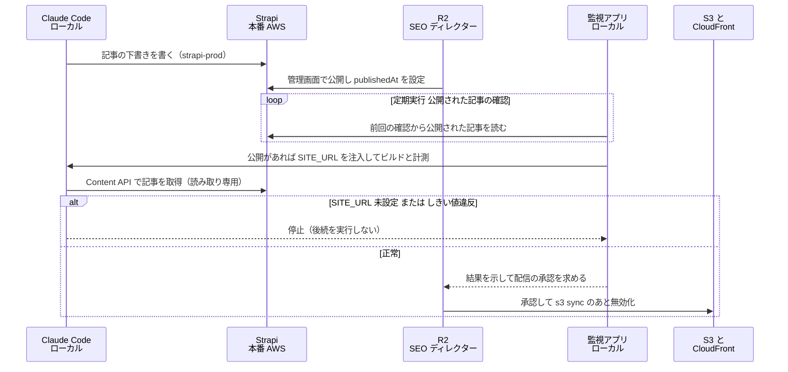
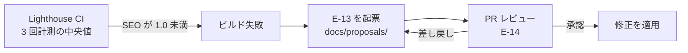

# 03. トリガーと CI/CD

TA（Technology Architecture）層。ID はそれぞれの正本の定義をそのまま使う（索引は [`docs/README.md` の「ID の採番と正本」](../../README.md)）。
ファイルパスは リポジトリのルートを起点とした相対で書く。

> **（2026-10-06）ADR-21 の反映。本ファイルの本文より、この注記を優先する。**
> - **本番の n8n はオンプレ**（`onprem/n8n`。エディター・API・MCP は `127.0.0.1:5679`。データは RDS の `n8n`）。下の「本番の n8n は AWS」「VPC の中で届く」「ECS で本番デプロイ」は ADR-16 の記述である。**Webhook の受け口は WireGuard 越しのオンプレのリバースプロキシ `10.99.0.2:5680`**（AA-02 の注記、DD-04 の 4.4）。
> - **ワークフローの Git への書き出し（6 節）は決着した。** 監視アプリの定期実行（builtin `n8n-export`。`ops/schedules/daily-n8n-export.yaml`）が、本番の n8n の Public API で読み、差分があれば GitHub に PR を作る（6 節の「決着」）。作業ツリーには書かない。**有効化（`enabled: true`）の前に、API キーの権限をユーザーが判断する**（コミュニティ版では全権限になる）。
> - **n8n の新しい定期処理 3 本**を作った（`middleware/n8n/workflows/`。**どれも未公開**）: `weekly-inquiry-inventory.json`（週次の棚卸し。2 節・3.3）、`n8n-schedule-heartbeat.json`（n8n のスケジュール実行のハートビート。TA-05 の項目 3）、`ops-monitor.json`（開発環境の n8n だけ。OpenSEO の死活とサンドボックスの証明書の期限。TA-05 の項目 5・9）。**開発の n8n に作成済みで、`validate_workflow` と `test_workflow` で確かめた**（外部 API を呼ぶノードはピン留め。I-21 は実際に動かし、MailHog に届くことを確認）。本番の取り込みと公開（人間）が残る。provision は 8 本を取り込み（本番は `ops-monitor` を除く 7 本）、定期実行の 3 本は公開しない。**実機の n8n に対する provision の通し実行は、ユーザーが `setup` を実行するとき（Wave 4）が初めて**（モックの n8n では確認済み）。
> - **n8n の実行履歴は 90 日保持する**（`EXECUTIONS_DATA_PRUNE=true`・`EXECUTIONS_DATA_MAX_AGE=2160`〈時間〉・`EXECUTIONS_DATA_PRUNE_MAX_COUNT=50000`〈既定の 10,000 件だと 90 日に届く前に件数で消えるため〉。開発・本番の両方の compose）。ハートビート・棚卸し・運用監視の成功した実行は保存しない。**棚卸しの失敗した実行には Chatwoot の応答が 90 日残りうる**（DA-05 の 5 節）。

## 1. トリガーの 4 系統

この基盤で「何かが自動的に動き出す」きっかけを 4 系統に分類する。分類する目的は、**系統ごとに失敗の性質が違い、対処も違う**ためである。

| 系統 | 定義 | 主な失敗の性質 | 対処の方向 |
|---|---|---|---|
| Event | あるシステムの内部で起きた出来事が、同じプロセス内のコードを呼ぶ | 送信先が落ちていても発生源は成功してしまう（欠損に気づかない） | 送信の成否を発生源側でログに残す |
| Webhook | あるシステムが HTTP で別のシステムを呼ぶ | 受け口が到達不能・URL の変更・再送の重複 | 受け口の URL を設定として一元管理し、冪等に作る |
| スケジュール | 時刻で起動する | 静かに止まる（動いていないことが観測されない） | 実行そのものを観測対象にする |
| CI-CD | コードやコンテンツの変更を検証し、配信に反映する | しきい値を緩めて通してしまう | しきい値を設定ファイルに置き、変更を PR に乗せる |

## 2. トリガー一覧

| トリガー名 | 種別 | 発火源 | 処理 | 作用先 | 頻度 | 状態 |
|---|---|---|---|---|---|---|
| `article_created` / `article_updated` / `article_deleted` | Event | Strapi のライフサイクル（`backend/strapi-system/src/index.ts`）。**本番の Strapi は AWS**（ADR-16。ADR-15 ではオンプレだけだった） | PostHog にイベントを送る（`$process_person_profile: false`）。**本番は本番用のプロジェクトに、開発環境は開発用のプロジェクトに送る**（ADR-16） | PostHog | 記事の変更ごと | `実装済み`（開発環境） |
| `article_published` | Event | 同上 | 同上 | PostHog | 公開ごと | `実装済み`（開発環境） |
| Strapi の例外 | Event | `global::posthog-error`（`backend/strapi-system/src/middlewares/posthog-error.ts`） | `captureException`。`ApplicationError` と 4xx の `HttpError` は送らない | PostHog | 例外ごと | `実装済み`（開発環境） |
| 記事公開 → 再ビルド | スケジュール（**ADR-16 で Webhook から手動に変え、ADR-17 で監視アプリの定期実行に変えた**） | **本番の Strapi での公開**（`R2` が管理画面で行う。**`strapi-prod` には公開の権限が無い**。ADR-17）を、**監視アプリの定期実行（「公開された記事の確認」）が本番の Strapi を読んで見つける**（案。TA-07 の 3.5）。**本番の Strapi（AWS）からローカルのビルドへ届く Webhook は無い**（ローカルにトンネルを張らない）。ADR-15 では「オンプレの Strapi の Webhook がオンプレ内で n8n に届き、n8n がビルドを起動する」としていたが、ADR-16 で Strapi と n8n が AWS に移り、ビルドだけがローカルに残ったため成り立たなくなった。ADR-16 の反映では「管理者が監視アプリから指示する」とし、公開を知らせる手段を未決定にしていた | 前回の確認から公開された記事があれば、監視アプリが Claude Code を起動し、Claude Code が**ローカルで**ビルドと計測を行う（本番の Strapi の Content API を読む）。**配信は人間が承認して実行する**（TA-02 の 6 節。TA-07 の 7 節）。管理者が監視アプリから直接指示する経路も残る | ビルド成果物 → 承認後に AWS（S3 / CloudFront） | 確認の間隔ごと（未決定。7 節） | `未着手` |
| Mautic のフォーム送信 | Webhook | Mautic（本番は AWS。ADR-12） | BA-04 のトスアップ処理（セグメント追加・ポイント加算・通知） | Mautic / **Amazon SNS**（`comegin-lead-alert`） | CV ごと | `未着手` |
| Chatwoot の会話イベント | Webhook | Chatwoot（本番は AWS。ADR-12） | 一次対応と記事化候補の抽出、**顧客からの要求の通知** | n8n / Chatwoot の社内メモ / **Amazon SNS**（`comegin-lead-alert`） | 会話ごと | `未着手` |
| n8n の Webhook 受け口 | Webhook | 本番の Mautic・Chatwoot・Strapi（**VPC の中で届く。ngrok を通らない**。`N8N_WEBHOOK_URL`。TA-01 の経路 5。ADR-12〜ADR-15 では、公開の経路で ngrok を通る唯一の線だった。ADR-16 で n8n が AWS に移った。**ADR-21 で n8n はオンプレに戻り、Mautic・Chatwoot からの Webhook は WireGuard 越しにオンプレの `http://10.99.0.2:5680/webhook/*`〈リバースプロキシ。POST の `/webhook/*` だけを通す。送信元は `10.99.0.1` だけ〉に届く。Strapi → n8n の Webhook は ADR-17 で使わなくなった**） | 本番の n8n が対応するワークフローを実行する | 各システム | 随時 | `未配線`（**ワークフロー `I-11` `I-12` は作成済み・未公開**） |
| PostHog Scout の検知 | Event | PostHog の Scout・Replay Vision スキャナ | 検知を受け取り `E-13` の候補にする | `docs/proposals/` | Scout の実行に依存（1 日 100 回の予算） | `未配線` |
| 日次 観測の収集 | スケジュール | **監視アプリの定期実行**（ADR-17。ADR-16 の反映では本番の n8n の Schedule Trigger としていた） | エージェントが GA4（OpenSEO の MCP 経由）・PostHog・Mautic・Lighthouse から `E-12` を集める（**2026-10-06 ADR-25〈AA-05〉: Umami を GA4 に置き換えた。GA4 は反映が 24〜48 時間遅れるため、期間は直近 35 日・終端は 3 日前の終わり〈JST〉にする**）。**取得の範囲（期間と件数）はスケジュールの定義に固定する**（ADR-17。TA-07 の 3.5）。ADR-16 の反映では「Lighthouse の結果はローカル（`.lighthouse/`）にあり、本番の n8n からは届かない」としていたが、起動元がローカルに移ったため届くようになった | `E-13` の `evidence[]` | 日次（DA-04 の鮮度要件） | `未着手` |
| 日次 GSC の実績の取得 | スケジュール | 日次の観測バッチ（`agent/seo-auditor`。**監視アプリの定期実行から起動する**。ADR-17） | OpenSEO の MCP で GSC の実績を読み、`E-12`（`source: gsc`）にする。**対象期間を 3 日ずらす** | `docs/audits/gsc/` | 日次 | `未着手` |
| 週次 コンテンツ投入 | スケジュール | **監視アプリの定期実行**（ADR-17。下書きを書くのはエージェントであるため。**本ファイルの判断**。ADR-16 の反映では本番の n8n としていた） | 承認済みの企画から、エージェントが下書きを作る（`strapi-prod`。**下書きまで**。ADR-17） | **本番の Strapi**（記事の正本。ADR-16。ADR-15 ではオンプレの Strapi だった） | 週次 | `未着手` |
| 週次 キーワード候補の調査 | スケジュール | `agent/keyword-researcher`（**監視アプリの定期実行から起動する**。ADR-17） | OpenSEO で候補と検索ボリュームを取り、`E-01` の候補にする（**費用が発生する**。1 回 2,000 クレジットまで） | 本番の Strapi（`E-01` の候補。`strapi-prod`） | 週次 | `未配線` |
| **改善提案の起票（`I-13`）** | スケジュール | **監視アプリの定期実行**（ADR-17。ADR-05 では n8n） | ローカルの `docs/proposals/` の `E-13` から GitHub に PR を作る。**改善提案のファイルがローカルの Git にあるため、ローカルで行う** | GitHub（PR） | 未決定（7 節） | `未着手` |
| **誤った書き込みの突き合わせ** | スケジュール | **監視アプリの定期実行**（ADR-17） | エージェント専用ユーザーが送ったメッセージ（`sender`）のうち、どの `E-13` にも対応しないものを「誤った書き込みの候補」として監視アプリに出す（TA-07 の 6.2。Chatwoot の監査ログには頼らない） | 監視アプリの表示 | 未決定（TA-07 の 9 節） | `未着手` |
| **OpenSEO のランク追跡** | スケジュール | **OpenSEO 内部の cron**（`*/5 * * * *` で期限が来た追跡を実行する作り） | DataForSEO で採用キーワードの順位を計測する（**自動で課金される**） | OpenSEO の DB | 週次（設定は `R2` の承認） | `未着手`（**Docker 版で cron が発火するかは、実機で初めて週次の追跡を設定したときに確認する**。`R1` の 2026-09-18 の判断） |
| **監視アプリからの指示** | 手動 | **管理者が監視アプリ（Next.js。オンプレ）から指示する**（ADR-14） | Claude Agent SDK で Claude Code を動かし、MCP で**開発環境と、本番の Strapi・Mautic・Chatwoot・n8n を読み書きする**（**2026-10-06 ADR-25: Umami を外した。本番の GA4 は OpenSEO の MCP で読むだけ**）（本番は `read_write` まで。ADR-15・ADR-16。`strapi-prod` は下書きまで。ADR-17。`n8n-prod` はワークフローの作成と更新まで）。**定期実行も同じ経路で起動する**（ADR-17。1 回の起動を 1 回の実行として記録する。TA-07 の 3.3） | 開発環境・本番の Strapi / Mautic / Chatwoot / n8n（GA4 は読み取りだけ） | 随時 | `未着手`（TA-07） |
| 週次 サイト監査 | スケジュール | **人間（`R1`）** が OpenSEO の画面から実行 | 自サイトをクロールし問題を列挙する | OpenSEO の DB → `E-12`（`source: site_audit`） | 週次 | `未着手`（公開サイトが無い） |
| 週次 AB テスト | スケジュール | **監視アプリの定期実行**（ADR-17。状況の確認と停止の判断をエージェントが行うため。**本ファイルの判断**。旧版は n8n） | `E-11` の開始・状況確認 | PostHog | 週次 | `未着手` |
| 週次 問い合わせの棚卸し | スケジュール | 本番の n8n（**エージェントを使わない決定論的な処理として本番の n8n に残す**。ADR-17。**本ファイルの判断**。**ADR-21 でオンプレの n8n。Chatwoot の API は ALB の公開ホスト名〈`chat.comegin.com`〉を呼ぶ**） | 未対応・未割り当ての会話を一覧化する | Chatwoot | 週次 | `未配線`（**ワークフロー `weekly-inquiry-inventory.json` は作成済み・開発の n8n で動作確認済み〈Chatwoot の応答はピン留め〉・未公開**。毎週月曜 09:00〈JST〉、`ops_settings` の `inventoryEnabled` が `true` のときだけ動く。3.3） |
| 週次 Lighthouse の定点計測 | スケジュール | **ローカル**（Lighthouse CI は道具としてローカルに残る。ADR-16）。**起動元は監視アプリの定期実行**（ADR-17 はエージェントを使う定期処理を対象にした決定だが、本番の n8n からローカルを起動できない理由は同じであるため、ローカルの道具の定期実行も監視アプリから起動する。**本ファイルの判断**。3.3） | `pnpm lh` を実行する | `frontend/verdant-virgo/.lighthouse/` | 週次 | `未配線` |
| 月次 順位・流入・CVR 分析 | スケジュール | **監視アプリの定期実行**（ADR-17。分析と `E-13` の生成をエージェントが行うため。旧版は n8n） | 観測を集約し `E-13` の候補を生成する | `docs/proposals/` | 月次 | `未着手` |
| 月次 改善提案の採否 | スケジュール | 人間（`R2`） | PR のレビューで承認・差し戻し | `E-14` | 月次 | `未着手` |
| **定期実行の定義の変更**（ADR-18 の追加の決定） | CI-CD | **PR のレビュー（人間）** | 取得範囲・頻度・使うエージェントとツールを書いた定義を PR で変える。**承認されて `main` に入るまで、監視アプリの次の実行に効かない**（監視アプリは承認済みの `main` のチェックアウトで読む。3.3） | リポジトリ（パスは未決定） | 変更ごと | `未着手` |
| n8n ワークフローの定期エクスポート | スケジュール | n8n の API / CLI（**エクスポート元は本番の n8n を想定。手段は未決定**。6 節）。**（2026-10-06 に決着）監視アプリの定期実行（builtin `n8n-export`。`ops/schedules/daily-n8n-export.yaml`。毎日 08:45）が、本番の n8n の Public API（`/api/v1/workflows`）で読む** | ワークフロー JSON を書き出して Git に入れる（**差分があれば GitHub に PR を作る。作業ツリーには書かない**） | リポジトリ（PR） | 日次 | `未着手`（**実装済み・`enabled: false`**。有効化の前に API キーの権限をユーザーが判断する。6 節） |
| `SITE_URL` 未設定時のビルド停止 | CI-CD | `frontend/verdant-virgo/astro.config.mjs` | 例外を投げてビルドを止める | ビルドの成否 | ビルドごと | `実装済み` |
| Lighthouse CI のしきい値判定 | CI-CD | `frontend/verdant-virgo/lighthouserc.cjs` | 4 カテゴリのスコアを判定する（SEO は 1.0） | ビルドの成否 | ビルドごと | `実装済み`（ローカル実行のみ） |
| PR の作成 → レビュー | CI-CD | GitHub | `E-14` `ApprovalRecord` を記録する | `docs/proposals/` | 提案ごと | `未着手` |
| `main` へのマージ → デプロイ | CI-CD | GitHub | ビルド → 計測 → **人間の承認** → S3 同期 → CloudFront 無効化（ADR-15） | AWS | マージごと | `未着手` |
| **Strapi・Mautic・Chatwoot・n8n の本番デプロイ**（**ADR-21: ECS に置くのは Mautic・Chatwoot・Umami と `consent-api`・Cal.com・`admin-auth`。（**2026-10-12 ADR-26: `consent-api` は VPC の中の Lambda〈ALB のターゲット〉になり、ECS に置かない。`sam build` が zip にする**）（**2026-10-06 ADR-24: Cal.com は SaaS になり、ECS に置かない**）（**2026-10-06 ADR-25: Umami は廃止し、ECS に置かない**）Strapi と n8n の本番はオンプレの compose〈`onprem/strapi`・`onprem/n8n`。`docker compose build && up -d`〉で、人が更新する。起動順は WireGuard → Strapi → n8n。`onprem/README.md`**） | CI-CD | **人間（`R1`）** | イメージを ECR に置く → DB の移行を 1 回だけのタスクで実行（Strapi と n8n は起動時に自分で移行する）→ ECS サービスを更新 → 訪問者向けのパスと管理画面の関門を確認（TA-06 の 8 節）。**Strapi のコンテンツタイプの変更と n8n の版の更新もこの経路で行う**（ADR-16 の「そろえ続ける」） | AWS（ECS・RDS） | 製品の更新ごと | `未着手` |
| **n8n ワークフローの本番への反映** | 手動 | **Claude Code（`n8n-prod`）と人間（`R1`）** | 開発環境の n8n で確かめたワークフローを `n8n-prod` で本番に置く（作成と更新まで）。**有効化は人間が本番のエディターで行い、`applied_at` を記録する**（ADR-16。TA-07 の 6.1） | 本番の n8n | 変更ごと | `未着手` |

**実装済みは 5 行しかなく、そのすべてが Event 系統か、ローカルのビルド時判定である。**
Webhook 系統とスケジュール系統には実装済みの行が 1 つも無い。これは n8n のワークフローが 0 件であることと同義である（6 節）。**ADR-17 でエージェントを使う定期処理の起動元を監視アプリに移したため、監視アプリに画面も定期実行の仕組みも無いこと（TA-07）とも同義になった。**

## 3. 主要フローの設計

### 3.1 公開フロー

図は To-Be を描いている。**As-Is で動くのは `R2` が開発環境の Strapi で公開する部分と、ビルドをローカルで手実行する部分だけ**である。監視アプリには画面も定期実行の仕組みも無く、デプロイ先も存在しない。**本番の Strapi は AWS にあり（ADR-16）、公開の操作は本番の Strapi の管理画面（`cms.comegin.com/admin`。ALB の Better Auth の関門の内側）で `R2` が行う。** エージェントは下書きを作り（`strapi-prod`）、ビルドと計測まで行うが、`publishedAt` の設定と配信は人間が行う。**ADR-17 で `strapi-prod` の Admin トークンから公開の権限を外したため、エージェントは公開できない**（約束ではなく仕組みで守られる）。

**旧版の図は「Strapi の Webhook → n8n → ビルド」だった。** ADR-15 では Strapi・n8n・ビルドがすべてオンプレにあり、Webhook がオンプレ内で届いた。**ADR-16 で Strapi と n8n は AWS に、ビルドはローカルに分かれ、AWS からローカルへ届く経路が無くなった**（ローカルにトンネルを張らない）。そのため ADR-16 の反映では、ビルドの起点を Webhook から**監視アプリからの指示（`R2` が公開のあとに指示する）**に変え、公開したことを監視アプリに知らせる手段（監視アプリが本番の Strapi を定期的に読むか、本番の n8n が SNS で知らせるか）を未決定にしていた。**ADR-17 で、監視アプリの定期実行が本番の Strapi を読み、公開された記事を見つけてビルドと計測を起こす形にした**（案。TA-07 の 3.5・7 節）。管理者が監視アプリから直接指示する経路は残る。

設計上の要点。

- **`publishedAt` の設定は人間（`R2`）が行う。** BA-05 は記事の公開を `承認`（承認者 `R2`）に分類している。ここを n8n のスケジュールで自動化すると、承認ゲートがワークフローに迂回される（6 節）。ADR-16 の反映では「`strapi-prod` の Admin トークンに公開（publish）の権限を与えるかは、この承認ゲートと合わせて決める」としていた。**ADR-17 で、公開・非公開化・削除の権限を与えず、下書きまでに絞ると決めた。** **ADR-18 で、本番の n8n に登録する Strapi の資格情報も同じく下書きまでにし、必要になるまで登録しないと決めた**（n8n のスケジュールやワークフローから公開する経路も、資格情報の権限で塞がる）。Strapi 5 の Admin トークンで公開だけを外せるかは実装時に確かめる（TA-07 の 9 節）。
- **公開の確認は取得の範囲を固定して行う。** 「前回の確認の時刻より後に公開された記事」のように、スケジュールの定義で範囲を決め、エージェントに判断させない（ADR-17。TA-07 の 3.5）。確認そのものは記事の公開日時を読むだけの決定論的な処理で、エージェントを起動するのは公開が見つかったとき（ビルドと計測）だけにする（**本ファイルの判断**）。
- **非公開化と削除もビルドのきっかけになる。** 人間が管理画面で記事を非公開にしたり削除したりしても、ビルドと配信をしない限り公開サイトにページが残る。Content API は既定で公開中の記事だけを返すため、「新しく公開された記事」を見るだけでは非公開化・削除を見つけられない（7 節）。
- **ビルドの失敗は必ず後続を止める。** `SITE_URL` 未設定の停止（TA-02 の 7 節）とテクニカル SEO のしきい値違反（3.2）は、どちらも「止めること自体が目的」であり、握りつぶさない。
- **ビルドの同時実行を抑止する。** 旧版では「Strapi の Webhook は再送されうるため冪等にする」としていた。ADR-16 でビルドの起点は Webhook ではなくなったが、指示が重なればビルドは重なりうる。静的サイトの全ビルドは元々冪等なので、必要なのは同時実行の抑止だけである（ビルドが重なると S3 の状態が交錯するため、実行中は後続をキューに入れる）。**ADR-17 で定期実行も手動の指示も監視アプリを通るようになったため、抑止は監視アプリで行える**（定期実行は重ねて起動しない。TA-07 の 3.5）。

### 3.2 Lighthouse CI のしきい値違反

図は To-Be を描いている。**As-Is では左端の計測だけが動く。** しきい値違反でビルドが落ちるところまでは `frontend/verdant-virgo/lighthouserc.cjs` に実装されているが、それを `E-13` の起票に繋げる経路は存在しない。

- しきい値は performance / accessibility / best-practices が `minScore: 0.9`、**SEO は `minScore: 1`（死守ライン）**。SEO だけ満点を要求するのは、この計測の目的が SEO 対策そのものであるため。
- **しきい値違反を `E-13` にするのは、SEO が 1.0 を割った場合を最優先にする。** 他の 3 カテゴリは 0.9 という余地のあるしきい値であり、実測のベースラインが 0.98〜1.00 のため、違反したときの意味が「劣化した」であって「不足している」ではない。SEO の 1.0 割れだけは、割れた瞬間に公開物の品質が要件を満たしていない状態になる。
- 起票先は Git（`docs/proposals/<proposal_id>.md`）。DA-01 の 5.2 で `E-13` の正本を Git に決めているため、しきい値違反の記録と修正の PR が同じ場所に収まる。
- 計測結果そのもの（`E-12`）は `.lighthouse/` に出るが**これは Git 管理外**（`frontend/verdant-virgo/.gitignore` で除外）。したがって `E-13` には値そのものではなく参照と要約だけを書く（DA-04 の 2 節の方針と一致する）。

### 3.3 スケジュール実行

BA-04 の PDCA 定例をトリガーに落とす。**週次は「作用」、月次は「学習」**という BA-04 の割り当てをそのまま保つ。

| 定例 | 実装手段 | エージェントが行う範囲 | 人間が行う範囲 | 状態 |
|---|---|---|---|---|
| 日次 観測の収集 | **監視アプリの定期実行**（ADR-17。ADR-16 の反映では本番の n8n の Schedule Trigger） | すべて（読み取りのみ。BA-05 で `自律`） | なし | `未着手` |
| 週次 コンテンツ投入 | **監視アプリの定期実行**（ADR-17。ADR-16 の反映では本番の n8n の Schedule Trigger） | 承認済みの企画から下書きを作るところまで（`strapi-prod` は下書きまで。ADR-17） | 公開（`R2` が本番の Strapi の管理画面で行う） | `未着手` |
| 週次 AB テスト | **監視アプリの定期実行** ＋ PostHog（ADR-17。ADR-16 の反映では本番の n8n） | 実験の状況確認と停止（停止は `自律`） | 実験の開始（`R3` の承認） | `未着手` |
| 週次 問い合わせの棚卸し | 本番の n8n（Chatwoot の API を VPC の中で呼ぶ。旧版は `n8n ＋ chatwoot-mcp`。**エージェントを使わないため ADR-17 の後も本番の n8n に残す**。**ADR-21: オンプレの n8n が ALB の公開ホスト名〈`chat.comegin.com`〉の API を呼ぶ**） | 未対応会話の一覧化、社内メモの作成（`private=true` は `自律`）。**（実装の範囲）一覧化と通知だけで、社内メモは作らない** | 顧客への返信（`R3` の承認） | `未配線`（作成済み・未公開） |
| 週次 Lighthouse の定点計測 | **ローカル。起動元は監視アプリの定期実行**（旧版は `n8n または CI`。ADR-16 の反映では実行主体を未決定にしていた。ADR-17 と同じ理由で監視アプリから起動する。**本ファイルの判断**） | すべて（`自律`） | なし | `未配線` |
| 月次 順位・流入・CVR 分析 | **監視アプリの定期実行** ＋ GA4（OpenSEO 経由）/ Mautic / PostHog（ADR-17。ADR-16 の反映では本番の n8n。**2026-10-06 ADR-25: Umami を GA4 に置き換えた**） | 分析と `E-13` の起票（生成は `自律`） | 採否の決定（`R2` の承認） | `未着手` |

> **（2026-10-06）ADR-21。** 本番の n8n はオンプレに戻った。**棚卸しの Chatwoot の API は、オンプレの n8n から ALB の公開ホスト名を通る**（WireGuard のトンネルを通れるのは RDS の 5432 だけ。TA-06 の 5.4）。**開発環境は `http://host.docker.internal:3100`**（`middleware/host-relay` が `172.17.0.1:3100 → 127.0.0.1:3100` を中継する socat。確認済み）。ワークフロー `weekly-inquiry-inventory.json` の仕様（実装済み・開発の n8n で `test_workflow` 確認済み。**定義・時刻・0 件の扱いは `R3` が 2026-10-06 に決めた**）: **毎週月曜 09:00（JST）** に、開いている会話のうち**担当者のいないもの**だけを数え（件数は Chatwoot の応答の `meta.unassigned_count`。全ページの総数。ページは進めない）、`comegin-lead-alert`（`I-21` の `lead`）に件数・最も長い待ち時間・会話番号（`display_id`。先頭 10 件）だけを通知する（`I-21` の入力 `detail` に入れる。DD-04 の 8.2）。**0 件のときは通知しない**（生存の信号はハートビートが担う）。取得に失敗したときは `ops` で通知する（`ok → ng`・`ng → ok` の遷移のときだけ）。**会話の中身・顧客の氏名・email は取り出さない**（DD-04 の 8.3）。**読み取りだけで、社内メモも顧客への返信も作らない。** **「未対応」の定義（`R3` の決定）**: `open` で担当者のいない会話だけ。担当者がいる会話（顧客が返信を待っているものを含む）、`pending`（ボット対応中）・`snoozed`・`resolved` は含めない。**Chatwoot のトークンは棚卸し専用に別で発行する**（`CHATWOOT_N8N_API_TOKEN`。空なら provision が管理者のトークンで代用し、本番では警告を出す。TA-04 の 1 節）。**成功した実行は保存しない**が、**失敗した実行には Chatwoot の応答（コンタクトの名前・メールを含みうる）が 90 日残る**（DA-05 の未決定事項と同じ論点）。送り先 URL は `ops_settings` の `chatwootBaseUrl`（開発 `http://host.docker.internal:3100`、本番 `https://chat.comegin.com`。provision の設定 `CHATWOOT_URL_FROM_N8N`）。
>
> **n8n で動く定期処理は、棚卸しのほかに、ハートビート（5 分ごと。`ComeGin/OnpremN8n`）と、開発環境だけの運用監視（OpenSEO の `/api/health`・サンドボックスの証明書の期限）がある**（TA-05 の項目 3・5・9。いずれも `ops_settings` の `heartbeatEnabled`・`opsMonitorEnabled` が `true` のときだけ動き、**既定は `false`**。provision は行を「無いときだけ」入れるので、人が `true` にしたあとの再実行で戻らない）。

**ADR-16 で n8n は本番（AWS）に移った。** 定例のうち本番のシステムと SaaS だけを相手にするもの（観測の収集・コンテンツ投入・AB テスト・問い合わせの棚卸し・月次分析）は、本番の n8n が VPC の中（と NAT Gateway 経由の外部 API）で実行する、というのが ADR-16 の反映での整理だった。**自作の MCP サーバ（`chatwoot-mcp` など）は stdio で動くローカルの道具であり、本番の n8n からは使えない**（n8n は製品の API を直接呼ぶ。ADR-02 の `sanitize()` と `ACCESS_LEVEL` はこの経路には及ばない）。**ローカルの道具（Lighthouse CI・OpenSEO）と、ローカルの Claude Code で動くエージェントは、本番の n8n から起動できない**（ローカルにトンネルを張らない）。AA-05 の ADR-05 は「日次のスケジュール起動は n8n、観測データの取得はエージェント（MCP 経由）」と分けていたが、**n8n が AWS に、エージェントがローカルに分かれたため、n8n がエージェントを起動する形は成り立たない。** ADR-16 の反映ではエージェントを使う定例の起動元を未決定にしていた。

**ADR-17 で、エージェントを使う定例は監視アプリ（ローカル）が起動することにした**（ADR-05 の「日次のスケジュール起動は n8n」を置き換えた）。上の表のうち、観測の収集・コンテンツ投入・AB テスト・月次分析はエージェントが判断を担うため監視アプリから起動し、問い合わせの棚卸しは決定論的な処理として本番の n8n に残す（**どの定例がエージェントを使うかの振り分けは本ファイルの判断**。ADR-17 が例に挙げたのは観測の日次バッチ・`I-13` の起票・公開された記事の確認・誤った書き込みの突き合わせの 4 つ）。**ローカルの道具（Lighthouse CI）の定例も、同じ理由で監視アプリから起動する**（本ファイルの判断）。

- **定例の実行そのものを観測対象にする。** スケジュール系統の失敗は「静かに止まる」ことであり、止まっていても誰も気づかない。ADR-16 の反映では「実行のたびに `E-15` `AgentRun` が本番の n8n の実行履歴（RDS の `n8n` データベース）に残るため、**『今日の日次収集が走ったか』を確認する監視が要る**」とし、TA-05 の 4 節の項目 3 に引き渡していた。**ADR-17 の後、エージェントを使う定例の実行は監視アプリの実行記録に残る**（1 回の起動を 1 回の実行として相関 ID を振る。TA-07 の 3.3）。**ADR-18 で、この実行記録が `E-15` の正本になった**（TA-07 の 3.6。n8n の実行履歴は `E-15` ではない）。本番の n8n の実行履歴に残るのは決定論的な定例だけになる。監視は 2 系統に分かれる（本番の n8n の定例は TA-05 の項目 3、監視アプリの定期実行は項目 16・19）。
- **取得の範囲はスケジュールの定義に固定する**（ADR-17。ADR-05 の理由の 1 つ目）。定期実行の指示に期間と件数を書き、エージェントに判断させない。
- **定期実行の定義（取得範囲・頻度・使うエージェントとツール）は Git で持つ**（AA-05 の ADR-18 の追加の決定。TA-07 の 3.5）。ADR-18 の反映では置き場所を未決定とし、「Git で持ち、承認済みの `main` から作った別の場所で監視アプリが読む」を案にしていた。**監視アプリは、承認済みの `main` から作った別のチェックアウト（Claude Code が編集する作業ツリーとは別）で定義を読む。** 定義の変更は**必ず PR を通す**（`E-14` の承認と同じ経路。4 節）。エージェントが作業ツリーで定義を書き換えても、PR が承認されて `main` に入るまで次の実行には効かない。したがって上の表の頻度（日次・週次・月次）を変える操作も、PR のレビューを通る。
- **監視アプリが読む `main` のチェックアウトをいつ・誰が更新するかは未決定**（マージのたびか定期的か、人間か監視アプリか。7 節・TA-07 の 9 節）。更新が遅れると、承認済みの変更が次の実行に効くまでの間が延びる。
- **同じ定例を重ねて起動しない。** 前回の実行が終わっていなければ次の起動を見送り、見送ったことを記録する（TA-07 の 3.5）。
- **開発機が止まると、監視アプリから起動する定例はすべて止まる**（ADR-17 の帰結）。止まっていた間の分を取り戻すかは定例ごとに決める（観測の日次バッチは取得の範囲が固定されているため、欠けた日の分を後から実行できる。TA-07 の 3.5）。
- **観測は日次、判定は 30 日後**という DA-04 の非対称を崩さない。スケジュールを細かくしたくなっても、判定の側を速くしない（早い判定が最も壊しやすい）。
- **（2026-10-06 の注記）ADR-21 で本番の n8n はオンプレになり、AWS の `points-api` を呼ぶ経路が未設計になった。** 起動の主体（n8n か、`points-api` 自身の定期実行か、監視アプリか）は AA-02 の 5 節の未決定事項「`I-27` の起動の経路」で決める。決まるまで、下の「本番の n8n から `points-api` を呼ぶ」は前提にしない。
- **（2026-10-03 に追加）収益化の定期処理は本番の n8n から `points-api` を呼ぶ**（ADR-17「エージェントを使わない決定論的な定期処理は n8n」）。日次: 貢献量と払い出しの取り込み（`I-27`）、DB とチェーンの突き合わせ、`E-19` の S3 への写し。月次: 締め（`E-19` を `計算済み` で追記する。**付与〈mint〉は `R1` の承認の後**）。n8n のワークフローはエージェントを呼ばない。

## 4. 承認ゲートとの整合

BA-05 の承認ゲート一覧に対して、本ファイルのトリガーがどう対応するかを明示する。**トリガーが承認ゲートを跨ぐ場合、跨ぐ箇所で必ず人間が入る。**

| トリガー | BA-05 の分類 | 承認者 | 実装上の扱い |
|---|---|---|---|
| 日次 観測の収集 | `自律`（観測データの参照・集計） | — | 全自動でよい |
| `E-13` の起票 | `自律`（提案の生成） | — | 全自動でよい。提案は実体に作用しない |
| `E-13` の採用と適用 | `承認` | `R2` | **PR のマージが承認の記録**（`E-14`）になる。自動マージを設定しない |
| 記事の公開 | `承認` | `R2` | 3.1 のとおり `publishedAt` の設定を自動化しない。**`R2` が本番の Strapi の管理画面で自分で公開する。`strapi-prod` の Admin トークンに公開・非公開化・削除の権限を与えない**（ADR-17。承認を約束ではなく仕組みで守る） |
| 記事の下書き作成 | `自律` | — | 週次のコンテンツ投入で自動化してよい（`strapi-prod` は下書きまで。ADR-17） |
| AB テストの開始 | `承認` | `R3` | ワークフローから開始しない |
| AB テストの停止 | `自律` | — | ワークフローから停止してよい |
| Chatwoot の社内メモ | `自律` | — | `private=true` を必ず付ける。**エージェント（MCP）では、引数の付け忘れに頼らない。** `chatwoot_send_message` は社内メモと顧客への送信を兼ね、`private` の既定値が `false`（顧客に送信）であるため、**社内メモ専用のツールか社内メモ用の登録を分け、社内メモだけを使うエージェントに `chatwoot_send_message` を見せない**（ADR-17。どちらで分けるかは TA-07 の 9 節）。本番の n8n のワークフローは Chatwoot の API を直接呼ぶため、この分離は及ばない。ワークフローでは `private=true` を明示して書く |
| Chatwoot の顧客への返信 | `承認` | `R3` | ワークフローから `private=false` のメッセージを送らない。**Claude Code は `chatwoot-prod` で送信できる**（ADR-16 で送信系のツールを外さないと決めた）が、`R3` の承認を得てから送る。ADR-16 の反映では「送ったことは監査ログ（またはエージェント専用ユーザーの `sender`）と `E-13` の突き合わせで確かめる」としていた。**ADR-17 で監査ログ（Enterprise）には頼らず、エージェント専用ユーザーの送信の記録（`sender`）と `E-13` を、監視アプリの定期実行で突き合わせることにした**（TA-07 の 6.2。会話の属性の変更は拾えない） |
| Mautic のメール送信・キャンペーン開始 | `承認` | `R3` | ワークフローから開始しない |
| `main` へのマージ | `承認` | `R1` | 自動マージを設定しない |
| 本番環境へのデプロイ（Astro の配信） | `承認` | `R1` / `R2` | **人間が承認して実行する**（ADR-15）。配信用の IAM を Claude Code とワークフローに渡さない。**`E-13` の `applied_at` は配信した人間が記録する**（ADR-16）。マージや `publishedAt` の承認と配信の承認を 1 回にまとめるかは未決定（7 節） |
| **Strapi・Mautic・Chatwoot・n8n の本番デプロイ**（ECS・DB の移行。Strapi のコンテンツタイプの変更と n8n の版の更新を含む。**2026-10-06 ADR-25: Umami を外した**） | `承認` | `R1` | **運用者が実行する。** エージェントやワークフローに ECS・RDS の変更権限を渡さない（TA-06 の 8 節。BA-05 の `禁止`「エージェントが自分の権限や実行条件を変える操作」に到達させない） |
| **n8n ワークフローの新規作成・変更** | `承認` | `R1` | 6 節のエクスポート方針で、変更が PR として現れるようにする。**本番へは Claude Code が `n8n-prod` で置く（作成と更新まで）**（ADR-16） |
| **n8n ワークフローの本番での有効化** | `承認` | `R1` | **人間が本番のエディターで行う。** `n8n-prod` に有効化（publish）と実行を許さない（TA-07 の 3.3）。**`applied_at` は有効化した人間が記録する**（ADR-16）。有効化したワークフローは承認なしに実行が続くため、Astro の配信と同じ位置に置く |
| OpenSEO の調査（1 回 2,000 クレジット以下） | `自律` | — | 週次のキーワード調査で自動化してよい。費用の上限は DataForSEO の前払い残高（AA-05 の ADR-10） |
| **ランク追跡のスケジュールの設定** | `承認` | `R2` | **n8n のワークフローと同じ性質を持つ**（一度設定すると承認なしに実行と課金が続く）。エージェントのツール許可リストから外してある（AA-03 の 2.4） |
| **定期実行の定義の変更**（ADR-18 の追加の決定） | `承認` | `R1` | **PR のマージで反映する。** エージェントは作業ツリーで書き換えて PR を作るところまで。監視アプリは承認済みの `main` のチェックアウトだけを読むため、マージされるまで次の実行に効かない（3.3）。自動マージを設定しない |
| 権限・`ACCESS_LEVEL` の変更 | `禁止` | — | ワークフローから到達させない。TA-04 の 4 節の分離を維持する |

**OpenSEO のランク追跡は、n8n の外にある 2 つ目のスケジュール実行である。** 2 節の表のとおり、スケジュール系統の実行主体はこれまで n8n だけだったが、OpenSEO の内部にも課金を伴うスケジュールがある。**ADR-17 で監視アプリの定期実行が 3 つ目の実行主体に加わった**（エージェントを使う定例。3.3）。**「静かに止まる」（1 節）だけでなく「静かに続く」失敗もありうる**（誰も見ていない順位の計測に費用が払われ続ける）。そのため設定を `承認` にし、支出を TA-05 の項目 11 で監視する。

**「本番環境へのデプロイ」は、当初は承認ゲートがあるのに自動化してよい項目としていた**（承認の対象はデプロイという操作ではなく、デプロイされる内容〈`main` の状態〉であり、2 度目の承認を求めると承認が形式化するため）。**ADR-15 で配信は人間が承認して実行することになった。** 2 度目の承認が形式化する懸念は残るため、マージや `publishedAt` の承認と配信の承認を 1 回にまとめる方法を 7 節で決める。

## 5. CI の設計と実装の保留

**`.github/workflows/` は今回作らない。**
`.claude/rules/devops-testing.md` に「GitHub Actions のワークフローファイルは、明確な指示がない限り作成しない」とあり、本タスクにその指示は含まれていない。したがって**以下は設計の記述にとどめ、実装は明示指示を待つ**。

現在リポジトリに `.github/` は存在しない。

### 実装する場合のジョブ構成（設計のみ）

| ジョブ | 起動条件 | 内容 | 失敗時 |
|---|---|---|---|
| 検証 | PR の作成・更新 | `pnpm install` → `pnpm typecheck` → `SITE_URL` を注入して `pnpm build` → `lhci autorun` | PR をマージ不可にする |
| デプロイ | `main` へのマージ | `SITE_URL` を注入して `pnpm build` → `aws s3 sync` → CloudFront の無効化 | 通知する。自動ロールバックはしない（S3 のバージョニングから手で戻す。自動で戻すと、壊れた原因が消えたように見えて調査できなくなるため） |
| ワークフローのエクスポート | 日次 | n8n から JSON を書き出し、差分があれば PR を作る | 通知する |

- **`SITE_URL` は必ず CI の環境変数から注入する**（TA-02 の 7 節）。
- **AWS の認証情報は長期のアクセスキーではなく、OIDC による一時認証を使う**（長期キーを CI の秘密値に置くと、失効の管理が人の記憶に依存する）。ただし本セッションでは AWS 側を検証できていないため、実装時に確認する。
- **Lighthouse CI の結果を CI から外部にアップロードしない。** `lighthouserc.cjs` は `upload.target: 'filesystem'`、`outputDir: './.lighthouse'` を指定しており、既定の `temporary-public-storage` はレポートを外部に公開するため使っていない。CI に移しても同じ方針を保つ（公開サイトの構造と計測結果が第三者から読める状態になるのを避けるため）。
- **単体テスト・結合テストのジョブは入れない**（`.claude/rules/devops-testing.md` により、テストコードの作成・実行には明示指示が要る）。

## 6. n8n ワークフローが Git 管理外である問題

> **（2026-10-06）ADR-21 と書き出しの決着。** 本番の n8n はオンプレの `127.0.0.1:5679` にあり、**監視アプリ（ローカル）から Public API で届く**ようになった。このため手段は **「監視アプリの定期実行（builtin `n8n-export`）が本番の n8n の Public API で読み、差分があれば PR を作る」に決着した**（下の「決着」）。次の「事実」の「`workflows/` が 0 件」は 2026-09 時点の記述で、現在は `middleware/n8n/workflows/` に開発の n8n で組んで確かめたワークフローの JSON が 5 本ある（新しい 3 本は作成中）。**Git に入る JSON は「開発の n8n で組んだものの書き出し」と「本番の n8n から書き出したもの」の 2 系統になる**が、ファイルの名前は同じにそろえる（下の「決着」）。

### 事実

`middleware/n8n/` に追跡されているファイルは 7 つ（`compose.yml`、`README.md`、`AGENTS.md`、環境変数のテンプレート、`.gitignore`、`dev/init-env.sh`、`searxng-settings.yml`）であり、**`workflows/` ディレクトリもワークフローの JSON も 1 件も無い**。ワークフローの実体は n8n の DB（`db-data` の PostgreSQL 18）と `n8n-data` ボリュームの中だけに存在する。

**ADR-16 の後、ワークフローの実体は 2 か所に分かれる。** 開発環境の n8n（`db-data`）と、本番の n8n（RDS の `n8n` データベース。TA-06 の 4.1）である。開発環境で確かめたワークフローを `n8n-prod` で本番に置き、人間が有効にする（TA-07 の 6.1）。**本番で動いているワークフローが改善の適用先であり、Git に残すべき履歴もこちらである。** 2 か所に分かれても、どちらも Git の外にあることは変わらない。

現時点ではワークフローが 0 件のため実害は出ていない。しかしこれは「問題が無い」のではなく「まだ何も作っていないから顕在化していない」だけである。

### なぜこれが設計上の欠陥なのか

再帰的自己改善システムでは、**エージェントが自分の作用経路そのものを書き換える**。この基盤において作用経路とは n8n のワークフローであり、`CAP-14` が生む改善提案の適用先には「ワークフローの変更」が当然含まれる（BA-05 が「n8n ワークフローの新規作成・変更」を `承認` 分類として明記していることが、それを前提にしている証拠にあたる）。

その作用経路がバージョン管理外にあると、次の 3 つが成立しない。

1. **改善の履歴が追えない。** 「いつ、誰が、なぜワークフローを変えたか」が残らない。n8n 自身のバージョン履歴は UI から見られるが、リポジトリの変更履歴とは切り離されており、コード側の変更と時系列で突き合わせられない。
2. **ロールバックできない。** DA-01 の `E-13` 型は「取り消せる」ことを要件に挙げており、Git / PR がそれを提供するという理由で `E-13` の正本を Git に置いている。ワークフローだけがその外側にあると、**提案の一部だけが取り消せないという歪な状態**になる。
3. **`E-13` の `verification` が変更前の状態を参照できない。** 30 日後に効果を判定するとき、比較対象となる「変更前のワークフロー」が残っていない。

つまり、ワークフローが Git 管理外であることは運用の不便ではなく、**`CAP-14` の改善ループを原理的に閉じさせない構造的欠陥**である。

### エクスポート方針の設計

| 項目 | 方針 | 理由 |
|---|---|---|
| 手段 | **（2026-10-06 に決着: 監視アプリの定期実行が本番の n8n の Public API で読む。下の「決着」）** n8n の Public API（`/api/v1/workflows`）または CLI（`docker compose exec n8n n8n export:workflow --backup --output=...`） | どちらも n8n に標準で備わる。CLI は認証設定なしでコンテナ内から実行でき、API は n8n 自身のワークフローから呼べる。**まず CLI で始める**（API キーを新たに管理する対象を増やさないため）。**ADR-16 の後、この CLI の形は開発環境の n8n にしか使えない。** 本番の n8n（Fargate）では `docker compose exec` が無く、ECS Exec で CLI を呼ぶか、Public API を使うか、`n8n-prod`（MCP）で読むかを選ぶ必要がある（7 節） |
| エクスポート元 | **本番の n8n**（ADR-16。案。**2026-10-06 に決定。ADR-21 でオンプレの `127.0.0.1:5679`**） | 本番で有効になっているものが作用経路の実体である。開発環境だけを書き出すと、`n8n-prod` で置いた後に人間が本番のエディターで直した差分が残らない |
| 置き場 | `middleware/n8n/workflows/<workflow_id>.json`。**（2026-10-06 に変更）ファイル名は既存の JSON（`I-21-sns-notify.json` など）に合わせる** | compose と同じディレクトリに置き、スタックの定義と作用の定義を同じ場所で読めるようにする。`<workflow_id>` だと本番の ID が名前になり、既存の 5 本と別のファイルができるため、**承認済み `main` の JSON の `name` と本番のワークフロー名で対応を取り、対応が無いものだけ名前から slug を作る**（`I-xx` で始まる名前はそのまま） |
| 頻度 | 日次 ＋ 変更のたび | 日次だけだと「作って壊して直した」履歴が 1 日分に潰れる |
| 差分の安定化 | `updatedAt` / `versionId` / ピン留めデータなど、実行のたびに変わるフィールドを書き出し前に除去する | 除去しないと毎日意味の無い差分が出て、レビューが形骸化する（差分が常にあると、差分があることが情報でなくなる） |
| クレデンシャル | **エクスポートしない。** JSON に残るのは ID の参照だけ | `n8n export:credentials` は復号された値を出力しうる。秘密値をリポジトリに入れない方針と両立させる |
| 反映の方向 | **Git → n8n の自動インポートは行わない。** 一方向（n8n → Git）のみ | インポートで本番のワークフローを上書きすると、UI 上で行われた編集が黙って消える。復旧時は人間が意図を持って手でインポートする。**開発環境から本番への移送は `n8n-prod` で行い（ADR-16）、Git は経由しない** |
| 承認 | エクスポートされた JSON の差分を PR に載せ、`R1` がレビューする | BA-05 の「n8n ワークフローの新規作成・変更は `承認`」を、手順としての約束ではなく**変更が PR として現れる仕組み**に変える |

### 決着（2026-10-06。ADR-21 の後）

**手段: 監視アプリの定期実行（builtin `n8n-export`）が、本番の n8n の Public API（`/api/v1/workflows`）で読み、差分があれば GitHub に PR を作る。** CLI（`n8n export:workflow`）と `n8n-prod`（MCP）は採らなかった。CLI は本番の n8n がオンプレの compose になったため `docker compose exec` なら使えるが、API キーを増やさない利点より、**監視アプリのサーバー側からコンテナの外で読める**ことと、PR を作る処理と同じプロセスで完結することを取った。`n8n-prod` はエージェントが使う経路で、**エージェントに書き出しを担わせると、書き出しが作用の経路になる**ため採らない（エージェントの env には API キーを渡さない）。

| 項目 | 内容 |
|---|---|
| 定義 | `ops/schedules/daily-n8n-export.yaml`（`kind: builtin`・`builtin: n8n-export`・毎日 08:45・`timeout_sec: 600`。**`enabled: false`**）。ハンドラは `backend/control-plane/src/builtin/n8n-export.ts` |
| 環境変数 | **`CONTROL_N8N_EXPORT_URL`**（例 `http://127.0.0.1:5679`）と **`CONTROL_N8N_EXPORT_API_KEY`**（秘密値）。どちらかが未設定ならジョブは `skipped`（理由には変数名だけを書く）。GitHub の書き込みの資格情報は `I-13` と同じ（TA-04 の 9 節）。**エージェントの env には渡さない**（許可リスト方式の `env` に入っていない） |
| 読む範囲 | 一覧（`workflow:list`）→ 1 件ずつ本体（`workflow:read`）。アーカイブ済みは対象外。**API キーのスコープを絞れるのは Enterprise だけで、コミュニティ版では全権限（書き込み・資格情報の操作を含む）になる。有効化の前に、本番の n8n の版と、その権限の資格情報をオンプレの監視アプリに置くことの是非をユーザーが判断する**（未決定事項） |
| 差分の安定化 | 除去するフィールド: `id`・`versionId`・`activeVersionId`・`activeVersion`・`versionCounter`・`updatedAt`・`createdAt`・`pinData`（`{}` に直す）・`staticData`・`meta.instanceId`・`shared`・`triggerCount`・`isArchived`・`sourceWorkflowId`・`parentFolder`、ノードの `createdAt`・`updatedAt`、`settings.binaryMode`・`settings.credentialResolverId`。**`active` は残す**（本番で有効かどうかが作用経路の状態だから）。キーの順序は再帰的にアルファベット順（トップとノードは固定の順）、**配列の順序は変えない**、インデント 2・末尾に改行 |
| 比較 | 承認済み `main` のチェックアウト（`CONTROL_MAIN_CHECKOUT`）の `middleware/n8n/workflows/*.json` と**バイト単位**で比べる。差分のあるものは GitHub の base とも比べ、同じなら除く。**n8n に無いファイルは消さない**（Git → n8n は一方向のまま。n8n 側の削除や改名は PR の差分として人間が見る） |
| 資格情報 | ノードの `credentials` の ID の参照だけ残る（値は API が返さない） |
| 秘密値の検査 | 疑いのあるワークフロー（`Authorization: Bearer ...` のヘッダーの値など）は PR から外し、`E-15` の要約には「ワークフロー名: 秘密値の疑い」だけを書く（値・キーの中身は書かない）。結果は `partial` |
| PR | ブランチ `chore/n8n-export-YYYYMMDD`（JST）。当日のブランチの PR があれば何もしない。別日の未マージの書き出しの PR があれば新しく作らない（冪等）。**差分が無ければ `success` で何もしない。作業ツリーには書かない**（承認済み `main` の読み取りと PR だけ） |
| 承認 | PR を `R1` がレビューし、マージで `main` に入る（BA-05 の「n8n ワークフローの新規作成・変更は `承認`」を、変更が PR として現れる仕組みにする）。**初回の PR では、既存の 5 本にキー順だけの再整形の差分が出る**（内容は同じ） |

**ここで決着した範囲と、残る範囲。** 手段・実行主体・差分の安定化の初期値・ファイル名・PR の形は決まった。**実機の確認（Wave 4）が残る**: ① Public API の応答に含まれるフィールド（一覧にアーカイブ済みが出るか、単体取得に `description` があるか、ピン留めの除外の挙動）、② 2 回続けて実行して 2 回目に差分が出ないこと（除去するフィールドの確定）、③ GitHub の Git Data API（`POST /git/trees` に本文を直接入れる方式）が書き込みトークンで通ること。

### `N8N_ENCRYPTION_KEY` との関係

`N8N_ENCRYPTION_KEY` は保存済みクレデンシャルの復号に必要で、**失うと登録済みの認証情報を復元できない**（`middleware/n8n/README.md` の運用上の注意、`middleware/n8n/dev/init-env.sh` の冒頭コメント）。

ここから、ワークフローの復旧には**構造と資格情報の 2 つが揃う必要がある**ことがわかる。

| 要素 | 何を失うと何が起きるか | 守り方 |
|---|---|---|
| ワークフローの構造（JSON） | 失うと、何をしていたかが分からなくなる | **Git**（本節のエクスポート方針） |
| クレデンシャルの暗号文 ＋ `N8N_ENCRYPTION_KEY` | どちらか一方を失うと、ワークフローの形が残っていても接続先に繋がらない | **Git の外**。**本番は RDS の `n8n` データベース（自動バックアップとポイントインタイムリカバリ）と Secrets Manager の鍵**（ADR-16。TA-06 の 4.5・7 節）。開発環境は `db-data` と環境変数ファイル（TA-05 の 5 節） |

**本番の n8n の資格情報は、開発環境から持ち込まない。** 本番の Chatwoot・Mautic・Strapi などのトークンは、人間が本番のエディターで登録する（TA-06 の 7 節）。**Strapi のトークンは必要になるまで登録せず、登録するときも公開・非公開化・削除の権限を与えない**（ADR-18）。`n8n-prod` でワークフローを置いても、資格情報は ID の参照しか移らない（本節のエクスポート方針と同じ）。

**この分離はむしろ好都合である。** 構造だけを Git に置けば、リポジトリに秘密値が入らないまま、改善の履歴とロールバックの手段が手に入る。逆にクレデンシャルまで Git に入れようとすると、秘密値を追跡しない方針と正面から衝突する。

## 7. 未決定事項

- **（ADR-15 で決着、ADR-16 で前提が変わった）Strapi から n8n への Webhook。** ADR-15 では「オンプレ内で届く（Strapi はオンプレだけ。ngrok を通らない）」とした。**ADR-16 で Strapi と n8n はどちらも AWS に移り、本番の Strapi から本番の n8n への Webhook は VPC の中で届く**（TA-06 の 11 節の内部の名前の付け方と一体で決める）。ホストのプロセスからコンテナへの到達方法を決める論点は、開発環境だけのものになった。
- **（ADR-15 で決着、ADR-16 で読み先が変わった）ビルドの実行場所は、オンプレの開発機である。** ADR-15 ではオンプレの Strapi を読み、**ADR-16 の後は本番の Strapi を読む**（TA-02 の 6 節）。帰結として、**開発機が落ちている間は本番の更新が止まる**（公開中のサイトと記事の正本は止まらない）。CI への移行は採らなかった。
- **（ADR-17 で決着）公開を監視アプリに知らせる手段**（ADR-16。3.1）。本番の Strapi からローカルのビルドへ届く Webhook は無い。ADR-16 の反映では、**監視アプリが本番の Strapi の最終公開日時を定期的に読む**か、**本番の n8n が Strapi の Webhook を受けて SNS で人間に知らせる**か、**人間が公開のあとに監視アプリから指示する運用に任せる**かを未決定にしていた。**ADR-17 で、監視アプリの定期実行が本番の Strapi を読んで公開を見つける形にした**（案。TA-07 の 3.5）。残る論点は下の「公開の確認の間隔と、非公開化・削除の検知」と、監視アプリが本番の Strapi を読むためのトークン（TA-04 の 9 節）である。
- **公開の確認の間隔と、非公開化・削除の検知**（ADR-17。3.1）。間隔を短くするほど公開から配信の承認までが縮むが、本番の Strapi への読み取りが増える（WAF のレート制限。TA-02 の 9 節）。また、「前回の確認より後に公開された記事」を見るだけでは、人間が管理画面で行った非公開化・削除を見つけられない（公開サイトにページが残り続ける）。公開中の記事の一覧を前回と比べるか、`R2` が非公開化・削除のあとに監視アプリから指示する運用にするかを決める。「前回」の記録（最後に確認した時刻、または最後にビルドした時点の公開中の記事の一覧）をどこに持つかも合わせて決める（TA-05 の 4 節の項目 18 と同じ記録を使える）。判断者 `R1` `R2`。
- **（ADR-17 で決着）エージェントを使う定例と、ローカルの道具を使う定例の起動元**（ADR-16。3.3）。本番の n8n はローカルの Claude Code・Lighthouse CI・OpenSEO を起動できない。ADR-16 の反映では、**監視アプリのスケジューラ**、**開発機の OS のタイマー**、**開発環境の n8n**（ハートビートを送る役を既に暫定で持つ。TA-07 の 8 節）のどれにするかを未決定とし、「開発環境の n8n に持たせると『開発環境』が本番の定例を担うことになり、ADR-16 の置き場所の基準と食い違う」「**AA-05 の ADR-05 の『スケジュールの起動は n8n』とも食い違う**ため、AA の判断が要る」としていた。**AA-05 の ADR-17 で、エージェントを使う定例は監視アプリから起動すると決め、ADR-05 の該当部分を置き換えた。** ローカルの道具（Lighthouse CI）の定例も同じく監視アプリから起動する（本ファイルの判断。3.3）。**スケジュールの仕組み**（監視アプリのプロセスの中に持つか、OS のタイマーから監視アプリを呼ぶか）は未決定のまま残る（TA-07 の 9 節）。
- **（2026-10-06 に決着）本番の n8n のワークフローを Git に書き出す手段。** 監視アプリの定期実行（builtin `n8n-export`）が本番の n8n の Public API で読み、PR を作る（6 節の「決着」）。**残件**: 本番の n8n の版（コミュニティ版なら API キーが全権限になる）と、その資格情報をオンプレの監視アプリに置くことの是非を、有効化の前にユーザーが判断する。判断者 `R1`。以下は ADR-17 までの記述。
- **本番の n8n のワークフローを Git に書き出す手段**（6 節）。ECS Exec で CLI を呼ぶか、Public API（API キーを新たに管理する）か、`n8n-prod` の読み取りか。書き出しの実行主体（本番の n8n 自身か、ローカルか）も合わせて決める。**ローカルで行う場合、起動元は監視アプリの定期実行になる**（ADR-17。Git のリポジトリはローカルにあるため、`I-13` と同じ理由でローカルが自然である）。判断者 `R1`。
- **（ADR-17 で決着）`strapi-prod` の Admin トークンに公開（publish）の権限を与えるか**（3.1）。与えると、エージェントが `R2` の承認なしに記事を公開できる経路ができる（公開ページへの反映は配信の承認で止まるが、本番の Strapi の公開状態は変わる）。**ADR-17 で、公開・非公開化・削除の権限を与えず下書きまでに絞ると決めた。記事の公開は `R2` が本番の Strapi の管理画面で行う。** 残るのは、Strapi 5 の Admin トークンで公開だけを外せるか（外したときに Strapi の MCP で公開のツールが出ないか）の実装時の確認である（TA-07 の 9 節）。
- **配信の承認を、マージや記事の公開（`publishedAt`）の承認とまとめるか。** ADR-15 で配信は人間の承認になった。まとめない場合、同じ内容に 2 度承認を求めることになり、承認が形式化しうる（4 節）。**ADR-17 で記事の公開は `R2` が管理画面で自分で行う操作になり、記事については「公開（人間）→ ビルドと計測（Claude Code）→ 配信（人間）」の 2 段階の人間の操作になった。** 公開と配信を同じ人が続けて行うかは運用で決める（ADR-17）。判断者 `R1` `R2`。
- **（2026-10-06 に ADR-21 で前提が再び変わった）Mautic・Chatwoot から n8n への Webhook の取りこぼし。** 本番の n8n がオンプレに戻ったため、取りこぼしの原因は「ECS のタスクの停止」ではなく、**オンプレのマシン・回線・WireGuard・プロキシ・n8n の停止とワークフローの未公開**になった（DD-07 の 2.5）。**Mautic・Chatwoot の再送の有無は未確認で、runbook の B4 で確かめる**（Wave 4 以降。AWS のデプロイ後）。ハートビートで分からない停止（プロキシだけの停止・未公開・送信元の制限の誤り）は TA-05 の項目 15 に「検出手段が無い」として残す。以下は ADR-16 の時点の記述。
- **（ADR-16 で前提が変わった）Mautic・Chatwoot から n8n への Webhook の取りこぼし。** ADR-12〜ADR-15 では、受け口の n8n がオンプレに残ったため ngrok のトンネル断で取りこぼされうるとしていた。**ADR-16 で n8n が AWS に移り、ngrok は通らなくなった。** ただし本番の n8n のタスクの停止（単一構成。TA-06 の 4.6）と再起動の間には取りこぼしが起きうる。製品側に再送の仕組みがあるか、失敗がどこに記録されるかは確認していない（TA-05 の 4 節の項目 15 と合わせて決める）。
- **（ADR-17 で決着）`E-13` の起票を誰が行うか。** 旧版は n8n から GitHub API を叩く前提で書いており、GitHub の認証情報を n8n に持たせることの是非を TA-04 の 4 節と合わせて検討していなかった。ADR-16 の反映では「GitHub の認証情報が本番の n8n（AWS）の資格情報ストアに置かれる。**本番の n8n は全システムの資格情報を持つ**（AA-05 の ADR-16 の帰結）ため、ここに GitHub の書き込み権限を足すかを改めて判断する」としていた。**ADR-17 で、`I-13` はローカル（監視アプリの定期実行）で行うと決めた**（改善提案のファイル `docs/proposals/` がローカルの Git にあるため）。**GitHub の書き込み権限は本番の n8n に置かない。** 代わりにローカルの PC に GitHub の資格情報が要る。どのアカウントのどの権限で発行するか（PR の作成だけを許し、マージを許さない）は TA-04 の 9 節の未決定事項とする。起票の頻度も未決定（2 節）。判断者 `R1`。
- **（2026-10-06 に初期値を決定。確定は実機）ワークフローのエクスポートで除去すべきフィールド。** 6 節の「決着」の表の一覧を初期値にした（n8n の API のドキュメントと既存の 5 本の JSON から。既存 5 本を正規化しても再正規化で同じ文字列になること、内容は変わらずキー順だけが変わることは確認した）。**確定は、本番の n8n から 2 回続けて書き出して 2 回目に差分が出ないことを確かめてから**（Wave 4）。
- **（旧版）ワークフローのエクスポートで除去すべきフィールドの具体が未確定。** 「実行のたびに変わるフィールド」の実際の一覧は、ワークフローを 1 件作って 2 回エクスポートし差分を見ないと確定できない。ワークフローが 0 件の現時点では検証できない。
- **同時実行の抑止をどこで行うかが未定。** ビルドの重複実行を防ぐ必要があるが、n8n 側の設定で行うか、デプロイスクリプト側のロックで行うかを決めていなかった。**ADR-17 でビルドの起動元（定期実行と手動の指示）が監視アプリに一本化されたため、監視アプリで抑止するのが自然である**（案。n8n 側の設定という選択肢は、ビルドを n8n から起動しなくなったため外れた）。定期実行と手動の指示が重なったときに、後から来たものをキューに入れるか見送るかを決める。判断者 `R1`。
- **（2026-09-19 に ADR-18 の追加の決定で決着）定期実行の定義の置き場所**（ADR-17 で生じた論点。3.3）。**Git で持ち、監視アプリは承認済みの `main` から作った別のチェックアウトで読む。変更は PR を通す。** 残るのは、**そのチェックアウトをいつ・誰が更新するか**（マージのたびか定期的か。人間か監視アプリか）と、**定義を置くパスと書式**である。判断者 `R1`。
- **PostHog Scout の検知を `E-13` に変換する経路が未定。** Scout は PostHog の inbox に findings を出すが、そこから Git の `docs/proposals/` に持ってくる手段（API で取りに行くか、通知を受けるか）を決めていない。Scout の実行予算が 1 日 100 回であることから、取りに行く側の頻度は日次で足りる。**取りに行く場合、変換はエージェントの判断を含み、書き先がローカルの Git であるため、監視アプリの定期実行（観測の日次バッチ）に含めるのが自然である**（ADR-17。案）。
- **（2026-10-03 に追加）月次の締めの日時。** unMineable の払い出し（1 日 1 回）の後で、前月分の `E-18` がそろう日時にする。
