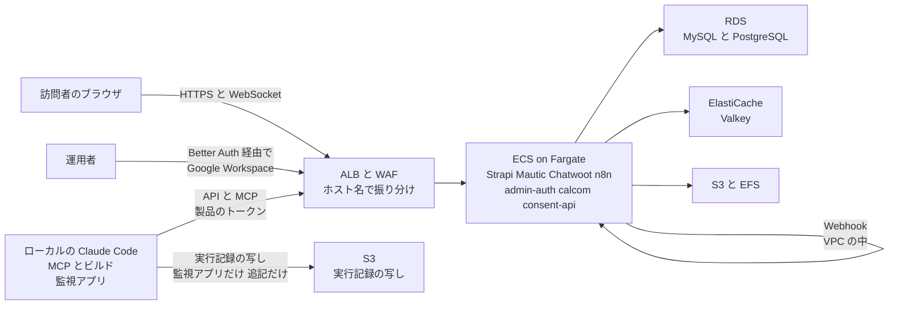
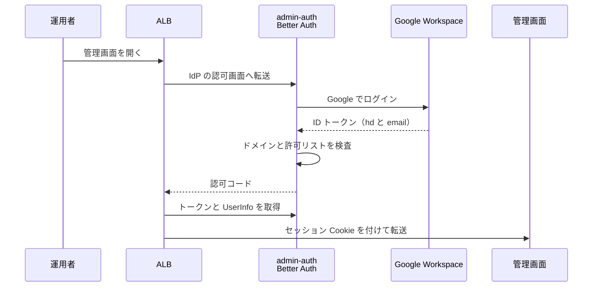

# 06. 本番システムの AWS 実行環境（Strapi / Mautic / Chatwoot / n8n）

<!-- 2026-10-06 ADR-25: 表題から Umami を外した（旧: Strapi / Mautic / Chatwoot / Umami / n8n） -->

TA（Technology Architecture）層。ID はそれぞれの正本の定義をそのまま使う（索引は [`docs/README.md` の「ID の採番と正本」](../../README.md)）。
ファイルパスは リポジトリのルートを起点とした相対で書く。

AA-05 の ADR-16 で、**正本のデータを持つシステムをすべて AWS に置き、ローカルには道具だけを残す**と決めた（ADR-12 は訪問者のブラウザが直接触れるシステムを AWS に置いた。Strapi は ADR-14 で加え、ADR-15 で外し、ADR-16 で再び加えた。n8n は ADR-16 で加えた）。**例外は `E-15 AgentRun`（エージェントの実行記録）だけで、正本を監視アプリ（ローカル）に置く**（ADR-18。TA-07 の 3.6）。**ただし実行記録の写しは AWS の S3 に追記専用で置く**（ADR-18 の追加の決定。写しは正本ではなく、開発機を失ったときの復旧に使う。4.7）。Astro の配信は TA-02 が扱い、本ファイルは残りの 5 つ（Strapi・Mautic・Chatwoot・Umami・n8n）の本番の実行環境を扱う（**ADR-25 で Umami を外した。ADR-21 で Strapi・n8n の実行はオンプレに移った**）。オンプレの開発環境と監視アプリは TA-07 が扱う。

**状態: 未着手（`cloud/` ディレクトリは空）。** 本ファイルの内容はすべて To-Be の設計である。**開発環境は今のままローカルの Docker と dev サーバーで動かし、本ファイルの構成は本番にだけ適用する。** **ローカルの Claude Code は MCP で本番の Strapi・Mautic・Chatwoot・Umami・n8n も読み書きする**（ADR-15・ADR-16。**Umami は ADR-25 で廃止**。本番用の登録は `ACCESS_LEVEL=read_write` まで。Strapi は Admin トークンの権限で絞る。ADR-16 では `read_write` と同等としたが、**ADR-17 で下書きまでに絞った**。5.4）。**エージェントの定期実行はローカルの監視アプリが起動し、本番の n8n はエージェントを起動しない**（ADR-17。本番の n8n に残るのは Webhook の受け口とエージェントを使わない決定論的な定期処理。TA-03 の 3.3）。

> **（2026-10-05）ADR-21 による変更。本ファイルの本文より、この注記を優先する。**
> - **Strapi と n8n は ECS から外れ、オンプレで動く**（TA-07）。データの置き場（RDS の `strapi` `n8n`、S3 の Strapi のメディア）は AWS に残る。ALB の `cms.`・`n8n.` のホスト名とルール、ACM の対応する名前、Strapi・n8n の ECS 用の Secrets は不要になる。
> - **ECS に残るのは**、製品の Mautic（web・cron）・Chatwoot（web・worker）・Umami と、例外の `consent-api`・Cal.com・`admin-auth`。（**ADR-24 で Cal.com が、ADR-25 で Umami が外れた。下の注記**）（**2026-10-12 ADR-26: `consent-api` も ECS から外れ、VPC の中の Lambda〈ALB のターゲット〉になった。`docs/superpowers/specs/2026-10-12-consent-api-lambda-design.md`**）（**同日、`admin-auth` も Lambda〈本体と運用の 2 つ〉になり、ECS に残るのは Mautic・Chatwoot だけになった。`docs/superpowers/specs/2026-10-12-admin-auth-lambda-design.md`**）
> - **WireGuard の EC2 を足す**（`t4g.nano` 程度、public サブネット、Elastic IP、送信元／宛先チェック無効）。private サブネットの経路表に「オンプレの WireGuard のアドレス帯 → この EC2」を足し、Mautic・Chatwoot のタスクからオンプレの n8n の Webhook に届くようにする。RDS のセキュリティグループには、WireGuard の EC2 から `strapi` `n8n` のために 5432 を許す。
> - `cloud/` の SAM はこの注記に合わせて直した（2026-10-05）。
>
> **（2026-10-06）ADR-24: Cal.com も ECS から外れた**（SaaS の cal.com を使う。ユーザーの決定による例外）。**ECS の `calcom` サービス・RDS の `calcom` データベース・ALB の `cal.comegin.com` のルールと許可リスト・ACM の `cal.comegin.com`・WAF の Cal.com 向けのレート制限・Secrets Manager の Cal.com の鍵・開発ポート 3105 は作らない。** ECS に残るのは Mautic・Chatwoot・Umami と `consent-api`・`admin-auth`。**本文の Cal.com の記述（3.1・3.2・3.3・4.1・4.3・5.1・5.3・5.4・5.5・7・9・10・11）は ADR-19 の記述で、この注記を優先する。**
>
> **（2026-10-06）ADR-25〈AA-05〉: Umami を廃止し、ECS から外した。** アクセス解析の正本は GA4（SaaS。Google LLC）で、**AWS に何も置かない**（タグはブラウザから Google に直接届く。TA-01 の経路 24）。**ECS の `umami` サービス・RDS の `umami` データベースとユーザー・ALB の `stats.comegin.com` のルールと許可リスト（5.3 の `/script.js`・`/api/send`）と機械向けの `/mcp`（5.4）・ACM の `stats.comegin.com`・ECR の Umami のイメージ（`cloud/images/umami`）・Secrets Manager の Umami の値（`APP_SECRET` ほか）・Umami のアラーム・`cloud/stacks/services/umami.yaml` を外した。** 本番の MCP の登録 `umami-prod` も無くなった（GA4 はオンプレの OpenSEO の MCP で読む。TA-07 の 3.3）。**ECS に残るのは Mautic・Chatwoot と `consent-api`・`admin-auth`**（`points-api` は本システムの完成後）。**本文の Umami の記述（2・3.1・3.2・3.3・4.1・4.3・5.1・5.3・5.4・7・9・10・11 と決定の表）は ADR-12〜ADR-21 の記述で、この注記を優先する。**

## 1. 検証の状態

**2026-09-18 に AWS API で実地検証を行った**（読み取りのみ）。

| 検証項目 | 結果 |
|---|---|
| RDS for MySQL | `ap-northeast-1` で **8.4 系（8.4.7〜8.4.9）** が使える。開発環境の MySQL 8.4（`backend/mautic-system/docker/compose.yaml`）と同じ系列 |
| RDS for PostgreSQL | `ap-northeast-1` で **16 系（〜16.15）と 17 系（〜17.9）** が使える。開発環境の Chatwoot は `pgvector/pgvector:pg16`、Umami は `postgres:15-alpine`（Umami は ADR-25 で廃止） |
| ElastiCache | **Valkey 7.2〜9.1** と **Redis OSS 4.0〜7.1** が使える |
| VPC | **デフォルト VPC（`172.31.0.0/16`）のみ。** 本設計の VPC は新規に作る |
| ECS | **クラスター 0 件** |
| **SES** | **サンドボックスのまま**（`ProductionAccessEnabled: false`。24 時間で 200 通、毎秒 1 通）。**顧客向けメールを送るには本番アクセスの申請が必須**（6 節） |

## 2. 図 1 全体構成（To-Be）

> **（2026-10-06）ADR-21: 下の図の ECS の Strapi・n8n はオンプレに移った。図は ADR-16 の構成で、冒頭の ADR-21 の注記を優先する**（ECS に残るのは Mautic・Chatwoot・Umami と `consent-api`・Cal.com・`admin-auth`〈**ADR-24 で Cal.com、ADR-25 で Umami が外れた。図の Umami と calcom も同じ**〉。Strapi・n8n のデータの置き場の RDS・S3 は AWS に残り、WireGuard の EC2 が RDS への経路になる）。

図は To-Be を描いている。**As-Is ではこの図のリソースが 1 つも存在しない**（ECS クラスター 0 件。1 節）。

**入口は ALB 1 つで、3 種類の主体が入ってくる。** 訪問者（無認証。レート制限のみ）・運用者（Better Auth を IdP にした ALB の OIDC 認証）・ローカルの Claude Code（製品側のトークン。MCP の本番用の登録と、ビルドが Strapi を読む経路。ADR-15・ADR-16。**ADR-17 で、監視アプリの定期実行が公開の確認のために Strapi を読む経路が加わった**。案）である。**AWS からローカルへ向かう線は無い**（ADR-17 はこれを保つために、エージェントの定期実行の起動元をローカルの監視アプリに置いた）。**ADR-18 の追加の決定で、監視アプリが実行記録の写しを S3 に書く線が加わった**（ALB を通らず S3 の API に直接書く。向きはローカルから AWS で、この原則は崩れない。4.7）。**n8n も AWS に移ったため、本番の Chatwoot・Mautic から n8n への Webhook は VPC の中で完結し、ngrok を通らない**（ADR-16）。TA-04 の 7 節が ngrok で解こうとしていた「要件が正反対の経路の同居」は、**ALB のリスナールールで経路ごとに分ける**形に置き換わる（5 節）。

**2026-10-01 に ECS のサービスが 2 つ増えた**（`calcom` と `consent-api`。3.1）。**図には外へ出る線を 2 本描いていない**（1 図あたり 7±2 ノードの規約のため）。**`calcom` → Google Calendar API** と、既存の **SES・SNS への送信**である。どちらも中から外への送信であり、**AWS からローカルへ向かう線が無い**という原則には関わらない（AA-02 の 1.3 の分類でも露出にあたらない）。

## 3. 実行基盤（ECS on Fargate）

### 3.1 サービスとタスク

> **（2026-10-06）ADR-21: この節の Strapi・n8n のサービス（タスク）は ECS に置かない**（オンプレの compose。`onprem/strapi`・`onprem/n8n`。n8n は本体と runners とリバースプロキシで、本番にサンドボックスは置かない）。ECS のサービスは Mautic（web・cron）・Chatwoot（web・worker）・Umami・`consent-api`・Cal.com・`admin-auth`。（**ADR-24: Cal.com は SaaS になり、ECS のサービスから外れた**）「n8n は 1 タスクに固定」「`cms.`・`n8n.` の ALB のターゲット」は ADR-16 の記述。
>
> **（2026-10-11）ADR-26: 常時稼働が不要な自作の部品は Lambda で動かす。faq-bot は VPC の外の Lambda（関数 URL）で、ECS のサービスではない。consent-api・admin-auth の移行は別の仕様で行う。この節の「実行基盤を ECS にそろえる」は ADR-26 で置き換えた。**

| システム | ECS サービス | 役割 | タスク数（4.6 で決定） | 開発環境での対応 |
|---|---|---|---|---|
| **Mautic** | `mautic-web` | 管理画面・API・フォーム受付・トラッキング | 1 | PHP ビルトインサーバー（`backend/mautic-system/dev/serve.sh`） |
| | `mautic-cron` | セグメント更新・キャンペーン実行・メールのキュー処理などの定期実行。**Webhook のキューの送信（`mautic:webhooks:process` を毎分。2026-10-11 に追加）** | **1 に固定** | 手動実行（Webhook のキューだけは `dev/serve.sh` が 60 秒ごとに送る） |
| **Chatwoot** | `chatwoot-web` | Rails（管理画面・API・ウィジェット・ActionCable） | 1 | `rails` サービス（`backend/chatwoot-system/docker-compose.yaml`） |
| | `chatwoot-worker` | Sidekiq | 1 | `sidekiq` サービス |
| **Umami**（**2026-10-06 ADR-25 で廃止。サービスを作らない**） | （旧 `umami`） | （旧: トラッカー配信・イベント受信・管理画面・API） | 0 | — |
| **Strapi** | `strapi` | 管理画面・Content API（ビルドが読む）・組み込みの MCP（`/mcp`） | 1 | `strapi develop`（`backend/strapi-system`） |
| **n8n** | `n8n` | 本体（エディター・Webhook の受付・実行）と runners（同じタスクのサイドカー） | **1 に固定** | `n8n` と `task-runners`（`middleware/n8n/compose.yml`）。**サンドボックス（`sandbox-api` / `sandbox-runner-1`）は本番に置かない** |
| **管理画面の関門**（自作） | `admin-auth` | Better Auth。ALB に対する OIDC の IdP と、Google Workspace でのログイン（5.2） | 1 | 未作成（置き場所は `backend/admin-auth` を想定） |
| **Cal.com**（**2026-10-01 に追加**。セルフホスト。ADR-19） | `calcom` | オンライン面談の予約ページと埋め込みの配信（`I-25`）、Google Calendar との連携 | 1 | 未作成（置き場所は `backend/calcom-system` を想定。公式イメージ ＋ compose。開発ポートは 10 節） |
| **同意の受け口**（**2026-10-01 に追加**。自作） | `consent-api` | Cookie 同意の状態を受け取り、ElastiCache に記録する（4.8、DD-02 の 8 節） | 1 | 未作成（置き場所は `backend/consent-api` を想定。開発ポートは 10 節） |
| **ポイントの付与**（**2026-10-03 に追加**。自作。ADR-20） | `points-api` | 採掘の貢献量の取り込み、ポイントの付与・消化の指示（thirdweb）、日次の突き合わせと `E-19` の S3 への写し、利用者ポータルと管理画面 | 1 | `backend/points-api`（想定）の開発サーバー（3106） |

- **`mautic-cron` は 1 タスクに固定する。** 2 つ動くとキャンペーンの実行やメールの送信が二重になる。オートスケールの対象にしない。
- **（2026-10-11）Mautic の Webhook はキューに積んで `mautic-cron` が送る**（`queue_mode = command_process`）。既定の `immediate_process` では、公開サイトのフォームの送信の要求の中でオンプレの n8n（I-11）へ送るため、WireGuard 越しの n8n が遅い・止まっていると、フォームの応答が公開サイトの 10 秒の打ち切りを超える（開発で発生。経緯は `docs/BasicDesign/DesignSpec/website/03-handoff.md` の 11.5）。送れなかった分は `webhook_retry_delay` ごとに送り直される（値は未決定。判断者 `R1`）。
- **`n8n` も 1 タスクに固定する。** 2 つ動くとスケジュールのトリガーが二重に発火する（キューモードは使わない）。
- **n8n のサンドボックスを本番に置かない理由**（ADR-16）。`sandbox-runner-1` は privileged な Docker-in-Docker で、**Fargate は privileged のコンテナを受け付けない。** サンドボックスは n8n Assistant がコードを実行するための仕組みであり、本番のワークフローの実行には使わない。本番のワークフローがサンドボックスを必要とした時点で、n8n を EC2 起動タイプの ECS に移す。
- **`mautic-web` を 2 タスク以上にするには、PHP のセッションを共有する必要がある。** Mautic の既定はファイルに保存するセッション（`app/config/config.php` の `session.handler_id` が `null`）であり、タスクをまたげない。当面は 1 タスクで運用し、増やすときにセッションの保存先（ElastiCache か RDS）を決める。
- **各サービスのタスク数は 1 で決定した**（単一構成。`R1` の 2026-09-18 の決定。4.6）。そのタスクがある AZ が障害を起こすと、そのサービスは別の AZ で起動し直すまで止まる。
- **（2026-10-12）ADR-26 で置き換え: `consent-api` は VPC の中の Lambda〈ALB のターゲット〉にした（デプロイは同じ SAM、監視は Lambda のアラームを足すだけ）。以下は 2026-10-01 の記録。** **`calcom` と `consent-api` を ECS に置くのは、実行基盤を増やさないためである**（2026-10-01 の決定）。`consent-api` では Lambda 関数 URL・API Gateway・CloudFront Function も候補だったが、**デプロイ手順（8 節）と監視（TA-05）が二重になる**ため採らなかった（DD-02 の 8.1）。`admin-auth` という自作のサービスの前例があり、扱いをそろえられる。
- **（2026-10-12）ADR-26: `admin-auth` も VPC の中の Lambda にした**（本体は ALB のターゲット、運用〈migrate・ALB の登録〉は別の関数 `admin-auth-ops`。3.3）。表の「タスク数 1」は Lambda では予約同時実行数 5 に当たる。
- **`consent-api` は訪問者のリクエストを直接受ける唯一の自作のコードである。** `admin-auth` は管理者だけが触り、他の 6 サービスは上流の製品である。**自作のコードを公開経路に出す初めての箇所**にあたるため、入力の検査（受け取るのは状態と識別子だけ）と WAF のレート制限（5.5）を、他のサービスより厳しく見る。 **（2026-10-03 に追加）`points-api` の利用者ポータルもインターネットから直接リクエストを受けるが、相手は訪問者ではなく利用者（基盤を立てた事業者）で、メールのワンタイムリンクでログインした後にだけ使える。**
- **`consent-api` は RDS を使わない**（記録は ElastiCache。4.8）。DB を持たないサービスにすることで、**訪問者のリクエストが製品の DB に届く経路を作らない**。
- **（2026-10-03 に追加）`points-api` は採掘しない。** unMineable と thirdweb の API を呼ぶだけで、採掘プールも Monero のノードも AWS に置かない（AWS Service Terms 1.25。AA-05 の ADR-20）。**本システムの完成後に着手し、承認ゲート G-1〜G-3 を通るまで置かない。**

### 3.2 コンテナイメージ

> **（2026-10-06）ADR-21: Strapi と n8n のイメージは ECR に置かない。** オンプレの compose がビルドする（Strapi は `backend/strapi-system` の Dockerfile、n8n は RDS の CA を足した派生イメージ。`onprem/README.md`）。ECR の対象は Mautic・Chatwoot・Umami・自作のサービス。

| システム | イメージ | 規則 |
|---|---|---|
| Chatwoot | 公式の `chatwoot/chatwoot` | **`latest` を使わず、バージョンのタグで固定する。** 開発環境の compose は `latest` のままであり、本番と開発でバージョンがずれうる |
| Umami（**ADR-25 で廃止。ECR に置かない**） | 公式の `ghcr.io/umami-software/umami` | 同上。**v3.4.0 以上に固定する**（API キーと `/mcp` が要る。5.4）。開発環境の compose は `latest`、取り込んだソースは **3.4.0**（2026-09-18 に取り込み直した） |
| Mautic | 公式イメージが 7.x を提供していればそれを使う。**無ければ `backend/mautic-system`（7.2.0）からビルドする** | 取り込んだソースと本番のバージョンを一致させる。**公式イメージの有無は本セッションで確認していない**（11 節） |
| Strapi | **`backend/strapi-system` からビルドする**（Strapi 5.53.0） | コンテンツタイプの定義はコードにあるため、**スキーマの変更はイメージの更新で本番に反映する**（ADR-16 の「そろえ続ける」） |
| n8n | 公式の `n8nio/n8n` と `n8nio/runners` | **2 つのバージョンを必ず一致させる**（`N8N_VERSION`。`.claude/CLAUDE.md` の Docker スタックの共通方針と同じ） |
| **Cal.com**（2026-10-01 に追加） | **公式イメージ**（`calcom/cal.com`。**本セッションでは未確認**。無ければ上流のソースからビルドする） | **`latest` を使わず、バージョンのタグで固定する。** **ライセンスの確認が先に要る**（機能によってライセンスが分かれており、使う機能〈予約ページ・埋め込み・Google Calendar の連携〉が自前で動かせる範囲に収まるかを上流の条件で確かめる。11 節、AA-02 の 5 節）。**取り込み済みの上流は持たない**（`backend/calcom-system` は compose と環境変数のテンプレートだけにする。`.claude/CLAUDE.md` の `chatwoot-system` と `middleware/n8n` と同じ扱い） |
| **`consent-api`**（2026-10-01 に追加） | **ECR に置かない**（Lambda。`sam build` が esbuild で zip にする。ADR-26。2026-10-12） | 依存を最小にする（公開経路に出る自作のコードのため。3.1） |
| **`admin-auth`** | **ECR に置かない**（Lambda。`sam build` が esbuild で zip にする。ADR-26。2026-10-12） | RDS の CA は Lambda の実行環境の `/var/runtime/ca-cert.pem` を読む（以前はイメージに同梱） |

**イメージは ECR に置く。** Docker Hub から直接取得すると、取得回数の制限と、上流のタグの付け替えの影響を受ける。

### 3.3 DB の移行は、デプロイの前に 1 回だけのタスクで行う

> **（2026-10-06）ADR-21: Strapi と n8n は起動時に自分で DB を移行する**ため、オンプレの compose の `up -d` で行う（1 回だけのタスクは使わない）。1 回だけのタスクの対象は ECS に残るサービスに限る。

**Chatwoot のエントリーポイントは DB の移行を行わない**（`.claude/CLAUDE.md` の記述と同じ）。本番でも同じで、新しいイメージを出す前に `bundle exec rails db:chatwoot_prepare` を**1 回だけの ECS タスク**（`RunTask`）として実行する。

- **移行を Web のタスクの起動処理に入れない。** タスクが複数起動すると移行が並行して走る。
- 移行が失敗したら、サービスのイメージを更新しない（古いイメージのまま動かし続ける）。
- Mautic（`doctrine:migrations:migrate`）も同じ扱いにする。（旧版: Umami も同じ扱いにし、Umami のイメージが起動時に自動で移行するかを実装時に確認する。**ADR-25 で廃止**）
- **Strapi と n8n は起動時に自分で DB を移行する。** どちらもタスクを 1 に固定するため（3.1）、移行が並行して走ることはない。
- **Cal.com も起動時に自分で DB を移行する**（Prisma の移行。2026-10-01 に追加）。タスクを 1 に固定するため並行して走らないが、**起動時の移行は実装時に実際の挙動を確かめる**（イメージが移行を含むか、別のコマンドが要るかで手順が変わる。11 節）。`consent-api` は DB を持たないため移行が無い。
- **（2026-10-12）`admin-auth` の移行は、運用の Lambda（`admin-auth-ops`）の `{"action":"migrate"}` で行う**（ADR-26。1 回だけのタスクの代わり。予約同時実行数 1 で、並行して走らない）。許可リストの初期値もここで入る。

## 4. データストア

### 4.1 一覧

| ストア | 使うシステム | 構成（4.6 で単一構成に決定） | 開発環境での対応 |
|---|---|---|---|
| **RDS for MySQL 8.4**（**2026-10-26: Aurora MySQL 8.4 互換のクラスター〈db.t4g.medium × 1〉に変えた。ユーザーの方針「DB は、高コストでなくアプリに互換があればサーバーレス、それ以外はクラスター」。Serverless v2 は常時の接続で止まらず約 3 倍の費用になるためクラスター。判断と単価は `cloud/README.md` の 6 節**） | Mautic | Single-AZ、自動バックアップ 7 日（ポイントインタイムリカバリ） | `mysql:8.4`（Docker） |
| **RDS for PostgreSQL 16**（**2026-10-26: Aurora PostgreSQL 16 互換のクラスター〈db.t4g.medium × 1〉に変えた。理由は上と同じ**） | Chatwoot・`admin-auth`・**Strapi・n8n**・**Cal.com**（2026-10-01 に追加）・**points-api**（2026-10-03 に追加）（**2026-10-06 ADR-25: Umami を外した**） | **1 インスタンスに 7 つのデータベース**（`chatwoot` / `umami` / `admin_auth` / `strapi` / `n8n` / **`calcom`** / **`points`**。`points` は 2026-10-03 に追加）（**ADR-24 で `calcom`、ADR-25 で `umami` を作らないことにし、5 つになった**）。ユーザーもデータベースごとに分ける。Single-AZ、自動バックアップ 7 日 | Chatwoot は `pgvector/pgvector:pg16`、**Strapi は SQLite**（本番の前に PostgreSQL に揃える。11 節）、n8n は `postgres:18`、**Cal.com は compose の PostgreSQL** |
| **ElastiCache（Valkey）** | Chatwoot（必須）・Mautic（キャッシュ。任意）・**Cookie 同意の状態の記録**（4.8。受け口は未決） | **ノードベース・クラスターモード無効**・1 ノード。転送中の暗号化（TLS）と AUTH を有効にする | `redis:alpine` |
| **S3** | Chatwoot（添付ファイル。Active Storage）・**Strapi（メディア。`@strapi/provider-upload-aws-s3`）** | バケットはシステムごとに分ける。パブリックアクセスを全ブロック。バージョニング有効 | Chatwoot はローカルのディスク（`ACTIVE_STORAGE_SERVICE=local`）、Strapi は `public/uploads` |
| **EFS** | Mautic（`media/` と設定ファイル） | `mautic-web` と `mautic-cron` の両方にマウントする | ホストのディレクトリ |
| **S3（実行記録の写し。ADR-18）** | **監視アプリ（ローカル）が書く。ECS のタスクは使わない** | **`E-15` の写し専用のバケット**を 1 つ作る（`ap-northeast-1`）。パブリックアクセスを全ブロック。バージョニング有効。**追記だけを許し、削除と上書きを許さない**（4.7） | **無い**（写しは本番の実行記録だけ。開発機の監視アプリの記録が正本） |
| **S3（`E-19` の写し。2026-10-03 に追加）** | `points-api`（タスクロール） | **`E-19` の写し専用のバケット**（4.9）。`E-15` の写しのバケットとは分ける | なし（開発環境では写さない） |

### 4.2 ElastiCache Serverless は使えない（重要）

**ElastiCache Serverless は常にクラスターモードで動き、クラスタープロトコルに対応したクライアントからしか使えない**（AWS の公式トラブルシューティングで確認）。**Chatwoot のジョブ実行基盤である Sidekiq は Redis のクラスターモードに対応していない**ため、Serverless を選ぶと Chatwoot のワーカーが動かない。

- **ノードベースのクラスターを、クラスターモード無効で作る。** 「Serverless のほうが運用が楽」という理由で選ばない。
- **Valkey を選ぶのは暫定である。** Redis OSS 7.1 より安いが、Chatwoot の公式ドキュメントは Redis を前提に書かれている。動作に問題が出たら、同じノードタイプのまま Redis OSS 7.1 に切り替える。
- **TLS を有効にすると URL が `rediss://` になる。** Chatwoot の `.env.example` には証明書の検証を緩める `REDIS_OPENSSL_VERIFY_MODE` があるが、**本番では使わない**（ElastiCache の証明書は検証できる）。

### 4.3 RDS for PostgreSQL を Chatwoot・Umami・`admin-auth`・Strapi・n8n・Cal.com・`points-api` で共有する

> **（2026-10-06）ADR-25 で Umami を、ADR-24 で Cal.com を外した。** 表題と下の例（「Umami のイベント受信が急増すると…」「Chatwoot のユーザーは `umami` データベースに接続できない」）は旧版の記述。負荷の相乗りの懸念で最も大きかった訪問者のイベント受信は、GA4 に移って RDS に来なくなった。

**1 インスタンスにまとめるのは費用のためである**（RDS はインスタンス単位の固定費が大きい）。代わりに次を受け入れる。

- **片方の負荷がもう片方に響く。** Umami のイベント受信が急増すると Chatwoot の応答が遅くなりうる。
- **メンテナンスと障害が同時に来る。**
- **データベースとユーザーを分けて、権限は混ぜない。** Chatwoot のユーザーは `umami` データベースに接続できない。後から別インスタンスに分けるときは、データベース単位で移せる。
- **`calcom` を相乗りさせるのも同じ理由（費用）である**（2026-10-01 に追加）。**予約のデータは失うと再取得できない**（訪問者が選んだ日時は Google Calendar 側にも予定として入るが、予約の一覧そのものは `calcom` のデータベースにある）ため、4.5 のバックアップ（自動バックアップ 7 日 ＋ ポイントインタイムリカバリ）の対象に含まれることを前提にする。
- **pgvector は `chatwoot` データベースでだけ有効にする**（`CREATE EXTENSION vector`）。Chatwoot は開発環境でも pgvector 入りのイメージを使っている。

### 4.4 Mautic のファイルは EFS に置く

Mautic は次のファイルをローカルのディスクに書く。Fargate のタスクのディスクはタスクが止まると消えるため、**`mautic-web` と `mautic-cron` で共有する EFS に置く。**

| パス | 中身 | EFS に置かない場合 |
|---|---|---|
| `media/images` | メールやランディングページに使う画像（`image_path`） | **配信済みのメールの画像が消える** |
| `media/files` | アセット（`upload_dir`） | ダウンロード資料が消える |
| `config/local.php` | 管理画面の設定画面から保存される設定 | **設定画面で変えた内容がタスクの再起動で消える** |

- **`var/cache` は EFS に置かない。** キャッシュは読み書きが多く、EFS に置くと遅くなる。タスクのローカルに置く。
- Mautic には S3 と連携するプラグイン（`plugins/MauticCloudStorageBundle` の Amazon S3 連携）があるが、**これはアセットの参照先を S3 にする機能で、`media/images` を S3 に移すものではない。** EFS を使う理由は変わらない。

### 4.5 バックアップ

| ストア | 手段 | 復旧できる範囲 |
|---|---|---|
| RDS（2 台） | 自動バックアップ 7 日 ＋ ポイントインタイムリカバリ | 7 日以内の任意の時点 |
| EFS | AWS Backup（日次） | 日次 |
| S3（Chatwoot の添付ファイル・Strapi のメディア） | バージョニング | 削除・上書きの取り消し |
| **S3（実行記録の写し。ADR-18）** | **バケットそのものが `E-15`（正本は開発機）のバックアップである。** バージョニングと、削除を許さない権限（4.7） | 開発機を失ったときに、写した時点までの実行記録。**写す頻度より新しい分は失われる**（頻度は未決定。11 節） |
| ElastiCache | **取らない** | Chatwoot のキューに入っていたジョブは失われる。正本は RDS にあるため、会話そのものは失われない |

**訪問者が生んだデータ（`E-07` `E-09` `E-10`）と記事の正本（`E-04`）の復旧が、運用担当者 1 人の手作業に依存しなくなる。** これが ADR-12 と ADR-16 の理由の 1 つである（TA-01 の 9 節が挙げていた可用性の課題）。**開発機のバックアップは、本番の復旧には関わらなくなる**（開発環境のデータだけが残る）。ただし ADR-18 で `E-15` の正本（監視アプリの実行記録）が開発機に置かれたため、**開発機のバックアップは調査と検証の根拠を守るものとして再び意味を持つ**（本番の復旧に関わらないことは変わらない。TA-05 の 5 節）。**`E-15` の開発機の外への写しは、ADR-18 の追加の決定でこの S3 に置くと決めた**（4.7）。

### 4.6 可用性は単一構成にする（決定）

**`R1` が 2026-09-18 に単一構成で決定した。** 冗長化の費用を、事業の現在の規模では払わない。

| 要素 | 構成 | 障害時に起きること | 復旧 |
|---|---|---|---|
| RDS（2 台） | Single-AZ | その AZ の障害で DB が止まり、依存するサービスがすべて止まる | AZ の復旧を待つか、ポイントインタイムリカバリで別の AZ に新しいインスタンスを作る |
| ECS のタスク | 各サービス 1 | タスクの停止から ECS が起動し直すまで止まる | ECS が自動で起動し直す |
| ElastiCache | 1 ノード | Chatwoot のワーカーと ActionCable が止まる。キューのジョブは失われる | ノードの置き換えを待つ |
| NAT Gateway | 1 つ | タスクから外への送信（Webhook・メール・ECR）が止まる | AZ の復旧を待つ |

- **止まったことは CloudWatch のアラームから SNS で知らせる**（TA-05）。単一構成を選んだ以上、止まらないことではなく、**止まったことにすぐ気づけること**で補う。
- **見直す契機は、止まった時間の実績である。** 障害の記録（`E-12`）から、問い合わせを受け付けられなかった時間が許容できないと分かった時点で、Multi-AZ から順に冗長化する。

### 4.7 実行記録の写し（`E-15`。ADR-18 の追加の決定）

**`R1` が 2026-09-19 に、監視アプリの実行記録（`E-15` の正本。ローカル）を S3 に写すと決めた**（AA-05 の ADR-18 の追加の決定 5。TA-07 の 3.6）。**写しは正本ではない。** 正本はローカルの実行記録のままで、写しは開発機を失ったときの復旧に使う。ADR-16 の置き場所の基準の例外（ADR-18 の決定 1）は変わらない。

| 項目 | 内容 |
|---|---|
| バケット | **写し専用のバケットを 1 つ**（`ap-northeast-1`）。Chatwoot・Strapi のバケットと相乗りしない（権限を混ぜない） |
| 公開 | **パブリックアクセスを全ブロック** |
| 書き手 | **監視アプリのサーバー側だけ**（7 節の写し用の資格情報）。Claude Code の実行環境・ECS のタスク・n8n には書かせない |
| 許す操作 | **追記だけ**（新しいオブジェクトの作成）。**削除と上書きを許さない**（エージェントや盗まれた資格情報で記録を消す経路を作らない） |
| 削除と上書きの防ぎ方 | **バケットポリシーとバージョニング。** 写し用の資格情報に `s3:DeleteObject` / `s3:DeleteObjectVersion` / バケットの設定を変える権限を与えず、バケットポリシーでも明示的に拒否する。バージョニングを有効にし、上書きされても前の版が残るようにする。**必要なら Object Lock も候補**（未決定。11 節） |
| 中身 | **要約と ID だけ**（ADR-18 の追加の決定 4。ツールの結果は正本にも写しにも入らない）。そのため写し先は個人情報の保管先にならない前提である（DA-05 の 1.5） |
| 形式と頻度 | **未決定**（11 節。TA-07 の 9 節） |
| 保持期間 | **未決定**（ローカルの `E-15` の保持期間と合わせて決める。DA-05 の 2 節）。決まるまでライフサイクルの削除を設定しない |
| 暗号化 | S3 の既定の暗号化（SSE-S3） |

- **写しの経路は ALB を通らない。** 監視アプリは S3 の API に直接書く。向きはローカルから AWS であり、「AWS からローカルへ向かう線は無い」（2 節）は保たれる。
- **写しの削除や保持期間の変更は人間の操作に残す。** 保持期間が決まったときにライフサイクルを設定するのは運用者で、エージェントにも監視アプリにもその権限を渡さない（BA-05 の `禁止` 分類「エージェントの実行記録（`E-15`）の書き込み・変更・削除」と同じ考え方）。
- **上書きを拒む方法は実装時に確かめる。** バージョニングは上書きを「取り消せる」ようにするだけで、上書きそのものは止めない。オブジェクトのキーを実行ごとに一意にする（相関 ID を含める）運用と、S3 の条件付き書き込み（`If-None-Match`）をバケットポリシーで必須にできるかを、実装時に公式ドキュメントで確かめる（11 節）。

### 4.8 Cookie 同意の状態の記録（2026-10-01 の決定）

**ユーザーが 2026-10-01 に、同意の状態を Cookie とサーバの両方に保存すると決めた**（DD-02 の 3.3、`docs/BasicDesign/DesignSpec/website/01-content-spec.md` の 10.4 の K1）。TA 側で決めるのは、サーバ側の置き場所である。

| 項目 | 内容 |
|---|---|
| ストア | **既存の ElastiCache（Valkey）を使う**（4.1）。新しいストアも新しい AWS のサービスも足さない |
| 置き方 | **Chatwoot・Mautic とキーの名前空間を分ける**（接頭辞で分ける）。1 ノードを共有するため、4.3 で RDS について受け入れたのと同じ「片方の負荷がもう片方に響く」ことを受け入れる |
| 中身 | 同意の状態（`granted` / `denied`）・時刻・同意した文面の版・Cookie が指す識別子。**訪問者の氏名・メールアドレス・IP を入れない** |
| 書き手 | **`consent-api`**（ALB の後ろの自作のサービス。VPC の中の Lambda〈ALB のターゲット〉。ADR-26〈2026-10-12〉。3.1。`R1` の 2026-10-01 の決定） |
| 保持期間 | **未決定**（11 節。DA-05 の 2 節と合わせて決める）。決まるまで TTL を設定しない |
| 開発環境での対応 | `redis:alpine`（4.1 の ElastiCache と同じ対応） |

- **RDS ではなく ElastiCache を選ぶ理由**: 同意の記録は「訪問者ごとに 1 件、キーで引くだけ」であり、関連も検索も要らない。4.3 の共有の PostgreSQL に表を 1 つ足すと、**訪問者のリクエストが製品の DB に直接届く経路**ができる（今は届いていない）。ElastiCache は Chatwoot のためにすでに必須であり、**ストアの数を増やさない**（4.1）。
- **バックアップは取らない**（4.5 の ElastiCache の行のまま）。**ただし同意の記録は失うと再取得できない**（訪問者にもう一度同意を求めるしかない）。これは `E-15` の写し（4.7）と同じ論点であり、**TTL と保持期間を決めるときに、バックアップを取るか・取らずに「消えたら未同意として扱う」かも合わせて決める**（11 節）。
**受け口は `consent-api`（ALB の後ろの自作のサービス）に決まった**（`R1` の 2026-10-01 の決定。AA-05 の **ADR-19** の決定 2）。公開サイトは静的配信（S3 ＋ CloudFront。TA-02）で、**訪問者から書き込みを受ける動的な口が本番に 1 つも無かった**ためである（ALB の後ろの既存の 6 システムはいずれも製品で、同意を預かるエンドポイントを持たない。製品に手を入れて足すのは上流無改変の方針に反する）。

| 候補 | 採否 | 理由 |
|---|---|---|
| **ALB の後ろの自作のサービス（ECS）** | **採用** | **実行基盤が増えない**（3.1 の「ECS on Fargate に揃える」）。`admin-auth` の前例があり、デプロイ（8 節）・ログ・監視（TA-05）の扱いが既存とそろう |
| Lambda 関数 URL / API Gateway | 不採用 | 実行基盤が 1 つ増え、デプロイ手順と監視が二重になる |
| CloudFront Function / Lambda@Edge | 不採用 | 同上。加えて ElastiCache（VPC の中）に届かせるための構成が増える |

- **公開経路に認証なしで通すパスが 1 つ増える。** 5.3 の許可リストと 5.5 の WAF のレート制限に加えた（AA-02 の 1.3 の分類にも反映済み）。
- **Cookie は `consent-api` の応答が書く**（`Domain=.comegin.com`。`HttpOnly` を付けない。DD-02 の 8.2）。`consent.comegin.com` と公開サイト（`comegin.com`）が同じサイトになるため、サイト側の JavaScript が同期で読める。**CORS は公開サイトのオリジンだけを許し、`*` を使わない**（Cookie 付きのリクエストでは使えず、使えたとしても他サイトから同意を書き換えられる）。
- **`consent-api` が落ちているあいだ、同意の記録だけが欠ける**（訪問者から見た挙動は変わらない。DD-02 の 8.3）。ただし**Cookie を受け口の応答だけで書く形にすると、落ちているあいだは同意そのものが成立しない**ため、サイト側でも Cookie を書く二重化を採るかを実装時に決める（DD-02 の 8.4、11 節）。

### 4.9 ポイントの台帳の写し（`E-19`。2026-10-03 に追加。ADR-20）

- **バケット**: `ap-northeast-1`、パブリックアクセスを全ブロック、バージョニングを有効化、**Object Lock のコンプライアンスモード**を有効化（保管期間中はルートユーザーでも消せず、上書きもできない）。
- **保管期間**: 帳簿と同じ（税理士の確認〈承認ゲート G-2〉。目安 7 年）。**後から短くできないため、決めてから設定する。**
- **書くもの**: 前日分の `E-19` の出来事を日次で書き出す。**`E-17`（実名への入口）は写さない**（DA-05 の 1.6）。
- **書く主体**: `points-api` のタスクロール（書き込みだけ。削除の権限なし）。
- **ADR-18 の `E-15` の写しとは仕組みが同じで、バケットを分ける。** 保管期間と書く主体が違うため。

## 5. 経路の分離（ALB と WAF）

### 5.1 ホスト名

> **（2026-10-06）ADR-21: `cms.comegin.com`・`n8n.comegin.com` は使わない**（本番の Strapi・n8n の管理画面はオンプレの `127.0.0.1` だけ。ALB のルールと ACM の対応する名前も外した）。

**ALB を 1 つにして、ホスト名で 3 つのシステム（と `admin-auth`）に振り分ける。** ALB は 1 台ごとに固定費がかかるため、システムごとに分けない。

| ホスト名（**2026-09-18 に確定**） | 振り分け先 | DD-02 の変数 |
|---|---|---|
| `chat.comegin.com` | `chatwoot-web` | `PUBLIC_CHATWOOT_BASE` |
| `mkt.comegin.com` | `mautic-web` | `PUBLIC_MAUTIC_BASE` |
| `stats.comegin.com`（**2026-10-06 ADR-25 で廃止。ALB のルール・ACM の名前から外した**） | （旧 `umami`） | （旧 `PUBLIC_UMAMI_BASE`。後継は `PUBLIC_GA4_MEASUREMENT_ID`〈ALB を通らない〉） |
| `auth.comegin.com` | `admin-auth`（管理画面の関門。5.2.1） | —（公開ページには出さない） |
| `cms.comegin.com` | `strapi`（ADR-16） | —（公開ページには出さない。ビルドだけが読む） |
| `n8n.comegin.com`（**案**） | `n8n`（ADR-16） | —（公開ページには出さない） |
| **`cal.comegin.com`（案）** | **`calcom`**（2026-10-01 に追加） | **`PUBLIC_CALCOM_BASE`** |
| **`consent.comegin.com`（案）** | **`consent-api`**（同日に追加） | **`PUBLIC_CONSENT_BASE`** |

- **証明書は `ap-northeast-1` の ACM で発行する。** CloudFront（`us-east-1` 必須。TA-02）とは逆で、ALB に付ける証明書は ALB と同じリージョンのものでなければならない。
- **`chat.` / `mkt.` / `stats.` / `auth.` は `R1` が 2026-09-18 に確定した。** `cms.` は ADR-14 で加え、ADR-15 で取り消し、ADR-16 で戻した。`n8n.` は ADR-16 で加えた案で、確定していない（11 節）。（**`stats.` は ADR-25 で廃止。次の文は旧版**）Umami のホスト名とスクリプト名（`TRACKER_SCRIPT_NAME`）が広告ブロッカーに遮断されるかは、設置後に実測する（遮断されていればスクリプト名を変える）。
- **`cal.` と `consent.` は 2026-10-01 に加えた案である**（確定していない。11 節）。**ACM の証明書に含める名前が 2 つ増える**ため、証明書の発行（DNS の検証）をやり直す前に決める。`consent.` を同一サイトのサブドメインにするのは、**同意の Cookie を公開サイトの JavaScript が読めるようにするため**である（別のドメインにすると 3.3 の役割分担が成り立たない。DD-02 の 8.2）。
- **`comegin.com` のサブドメインにすることで、Cookie が同一サイトの扱いになる。** ngrok のドメインは公開サイトとは別のサイトであり、ブラウザのサードパーティ Cookie の制限を受ける（Chatwoot のウィジェットの会話の継続や Mautic のトラッキング Cookie が影響を受ける）。サブドメインに移すと、公開サイト（`comegin.com`）と同じサイトになる。
- **ホスト名は ngrok の固定ドメインと違い、再起動で変わらない。** `SITE_URL`・`PUBLIC_*_BASE`・`MCP_ALLOWED_HOSTS` を揃える作業（DD-02 の 1.1）は 1 回で済む。

### 5.2 3 種類の主体をリスナールールで分ける

TA-04 の 7 節のエンドポイント分離表を、**ALB のリスナールールと WAF でそのまま実現する。** 方針は許可リストで変わらない。**列挙したパスだけを ALB の認証なしで通し、それ以外はすべて管理者の認証を求める。**

| 優先度 | 条件 | 動作 | 対象 |
|---|---|---|---|
| 1 | 訪問者向けのパス（5.3 の表） | **認証・認可をしない。WAF のレート制限だけをかける** | 訪問者（ブラウザからの API 実行を含む） |
| 2 | 機械向けの API のパス（5.4 の表） | **ALB の認証なしで転送**。製品側のトークンで認証される。WAF のレート制限をかける | ローカルの Claude Code の MCP（本番用の登録。ADR-15・ADR-16）と、ビルドが Strapi を読む経路 |
| 3 | `auth.comegin.com`（`admin-auth` 自身） | **ALB の認証なしで転送**。WAF のレート制限をかける | 運用者（ログインの途中） |
| 4 | 上記以外のすべて | **ALB の `authenticate-oidc` で認証してから転送。IdP は `admin-auth`（Better Auth）** | 運用者（管理画面） |

- **優先度 4 を既定にする。** 列挙し損ねたパスは認証が必要な側に倒れ、「管理画面が開いてしまう」ではなく「訪問者向けの機能が動かない」という気づきやすい壊れ方になる（TA-04 の 7 節の許可リスト方式と同じ理由）。
- **訪問者側は認証も認可も行わない**（`R1` の 2026-09-18 の決定）。ウィジェット・フォーム・トラッカーは訪問者にログインを求められないため、守りは WAF のレート制限だけになる。**1 つの送信元から短時間に大量のリクエストが来ることだけを防ぐ**（5.5）。
- **送信元 IP による許可は採らない**（2026-09-18。オンプレの送信元 IP が固定ではないため）。機械向けの API は、製品側の認証と WAF のレート制限の 2 つで守る（5.4）。
- **管理画面の SPA が呼ぶ API は、優先度 2 か 4 で通る。** Chatwoot の管理画面が呼ぶ `/api/v1/accounts/*` は優先度 2 に当たるが、製品側のトークンを持って呼ぶため問題ない。

#### 5.2.1 管理者の認証は Better Auth で Google Workspace を使う（決定）

**`R1` が 2026-09-18 に決定した**（AA-05 の ADR-13。当初の案だった Amazon Cognito は採らない）。**Better Auth を OIDC の IdP として動かし、ALB の `authenticate-oidc` から参照する。** Better Auth 自身は Google Workspace の OIDC でログインさせる。

図は To-Be を描いている。**As-Is では `admin-auth` 自体が存在しない。**

| 項目 | 設定 | 理由 |
|---|---|---|
| Better Auth の構成 | **OAuth 2.1 Provider プラグイン**（`@better-auth/oauth-provider`）と JWT プラグイン。OIDC の探索メタデータ・認可・トークン・UserInfo のエンドポイントを持つ | ALB の `authenticate-oidc` が求める 3 つのエンドポイント（認可・トークン・UserInfo）をそろえる |
| ALB の登録 | **機密クライアント**（クライアントシークレットあり）。**信頼済みクライアントとして同意画面を省略する**（`skip_consent`） | 自社の管理画面に対して毎回「許可しますか」と聞く意味が無い |
| ログインの手段 | Better Auth の Google プロバイダー。Google Cloud の OAuth クライアントは**「内部」**（Workspace の組織内のアカウントだけ） | 組織外の Google アカウントは同意画面の段階で通らない（TA-04 の 8 節の GSC と同じ扱い） |
| ドメインの検査 | **ID トークンの `hd` クレームが `comegin.com` であることをサーバー側で検査する** | 認可リクエストの `hd` パラメータは画面の候補を絞るだけで、制限にはならない |
| 認可（誰を通すか） | **管理者の許可リスト**（`admin_auth` データベースに持つ）に載っている email だけを通す | Workspace のアカウントを持つことと、管理画面に入ってよいことは別である |
| MFA | **Google Workspace の 2 段階認証を組織で必須にする** | Better Auth 側では MFA を持たない。ログインの強さは Google 側で担保する |
| ALB のセッション | **12 時間**（43,200 秒） | 既定の 7 日では、端末を離れた後も長く通れてしまう。1 日の作業で 1 回のログインに収まる長さにする |
| ホスト名 | `auth.comegin.com`（同じ ALB。ACM の証明書に含める） | ALB の OIDC は、IdP の DNS が公開で名前解決でき、証明書が公的な認証局の発行であることを求める |

- **Better Auth は製品の SSO ではなく、製品の手前にかける関門である**（TA-04 の 6 節の「SSO を導入しない」判断とは別の層）。関門を通った後も、各製品のアカウントでログインする。
- **管理画面への通信は `admin-auth` を通らない。** `admin-auth` が関わるのはログインのときだけで、その後は ALB が自分のセッション Cookie で判定して製品に直接転送する。自作のコードをすべての管理操作の経路に挟まない。
- **`admin-auth` が止まると、新しいログインだけができなくなる。** ALB のセッションが残っている間は管理画面を使い続けられ、訪問者向けの機能には影響しない。
- **（2026-10-12）`admin-auth` は Lambda になった（ADR-26）。** ALB はトークンと UserInfo を、ブラウザが同じ関数を呼んだ数秒後に呼ぶため、関数は起動済みである見込み。ALB が IdP の応答を何秒待つかは公式文書で確かめられていないので、Wave 4 で実測し、遅ければプロビジョニングされた同時実行数を付ける（`docs/superpowers/specs/2026-10-12-admin-auth-lambda-design.md` の D1）。
- **許可リストの追加と削除は BA-05 の参加時・離任時チェックリストに含める。** 離任時は Google Workspace のアカウントの停止と、許可リストからの削除の両方を行う。
- **ベンダーは増えない。** Google Workspace は既に使っており（GSC の OAuth。TA-04 の 8 節）、Better Auth はライブラリで、`admin-auth` は自作のサービスである。

### 5.3 訪問者向けに認証なしで通すパス（許可リスト）

> **（2026-10-06）ADR-21: n8n の Webhook は ALB を通らない**（ADR-16 では VPC の中。ADR-21 では WireGuard 越しにオンプレの `10.99.0.2:5680` へ。TA-01 の経路 5・DD-04 の 4.4）。

**パスの一覧は製品のバージョンに依存する**（TA-04 の 7 節）。次の表は設計時点の想定であり、**実装時に各製品の実際のリクエストを DevTools で観測して確定する。**

| システム | パス（想定） | 用途 |
|---|---|---|
| （欠番。旧: Umami の `/script.js`・`/api/send`〈`I-05`〉。**2026-10-06 ADR-25 で廃止。`I-05` は GA4 に変わり ALB を通らない**） | — | — |
| Chatwoot | `/packs/*`、`/widget*`、`/api/v1/widget/*`、`/cable`、`/rails/active_storage/*` | ウィジェットの配信・会話 API・WebSocket・添付ファイル（`I-07`） |
| Mautic | `/form/submit*`、`/mtc.js`、`/mtc/event`、`/mtracking.gif` | フォーム受付とトラッキング（`I-08`） |
| Mautic | `/email/*`、`/r/*`、`/media/images/*` | **配信したメール**の開封計測・クリック計測・配信停止・画像。**訪問者だけでなく、メールの受信者も無認証で到達する** |
| **Cal.com**（2026-10-01 に追加） | **予約ページ（公開する予約の種類のパス）と埋め込みのスクリプト・その静的ファイル・予約の確定に使う API**（パスは**実装時に実測して確定する**） | オンライン面談の予約（`I-25`）。**Cal.com の管理画面（設定・連携・予約の一覧）は許可リストに載せず、管理者の認証の内側に残す**（下記） |
| **`consent-api`**（同日に追加） | **同意の記録（書き込み）と、同意の状態の取得の 2 本だけ** | Cookie 同意の受け口（4.8、DD-02 の 8 節）。**自作のため、パスは実装で決める（増やさない）** |

- **Cal.com は訪問者向けと管理者向けが同一オリジンにある**（Chatwoot と同じ構造。旧版は「Umami・Chatwoot と同じ」。Umami は ADR-25 で廃止）。**訪問者に要るのは予約ページと埋め込みだけ**で、設定・連携・予約の一覧は運用経路（5.2 の管理者の認証）に残す。**パスの切り分けを実装時に DevTools で確かめる**（切り分けを誤ると、予約の管理画面が無認証で開くか、予約そのものができなくなる。11 節）。
- **`consent-api` のパスを 2 本に限る。** 自作であるため、**公開経路に出すパスをこちらで決められる**（製品と違い、バージョンで増えない）。増やさないことが守りになる。
- **（2026-10-12）consent-api のターゲットは lambda 型**（ADR-26）。許可パス（ルール 106）は変えない。ターゲットグループは `cloud/stacks/services/consent-api.yaml` が持つ。
- **Strapi と n8n には訪問者向けのパスが無い。** 公開ページは Strapi に実行時のリクエストを出さない（ADR-11）。n8n の Webhook（`/webhook/*`）は本番の Chatwoot・Mautic から VPC の中で受け、ALB には出さない（11 節）。外部のサービスから Webhook を受ける必要が出たときに、そのパスだけを許可リストに加える。
- **`/cable` は訪問者と運用者の両方が使う。** Chatwoot のウィジェットと管理画面は同じ WebSocket のエンドポイントを使うため、無認証で通し、製品側の認証に任せる。
- **Mautic の `/api/*` と `/oauth/*` は訪問者向けに含めない。** 機械向けの API（5.4）として扱う。

### 5.4 機械向けの API（ALB の認証なしで通すパス）

> **（2026-10-06）ADR-21: ここに載る Strapi の `/mcp`・`/api/*` と n8n の `/mcp-server/http` は ALB で開けなくなった**（`strapi-prod`・`n8n-prod` の接続先と、ビルドが読む Content API は、オンプレの `127.0.0.1:1338`・`127.0.0.1:5679`）。**代わりに、オンプレの n8n が Chatwoot・Mautic の API を呼ぶ処理（`I-19`・棚卸しなど）がこの節の Chatwoot・Mautic のパスを通る**（トンネルを通れるのは RDS の 5432 だけ。認証は製品側のトークンと WAF のレート制限）。

**ローカルの Claude Code の MCP とビルドはブラウザでのログインができない**ため、API のパスは管理者の認証の外に置く。**ADR-15・ADR-16 で、MCP は本番の Strapi・Mautic・Chatwoot・Umami・n8n を読み書きする**（**Umami と `umami-prod` は ADR-25 で廃止**。自作の MCP サーバは本番用に別登録し、製品の組み込みの MCP には本番用の登録を足す。TA-07 の 3.3）。n8n は AWS に移ったため、n8n から Chatwoot・Mautic への呼び出しは VPC の中で行い、この表の経路を使わない。代わりに次の 2 つで守る。

| システム | パス（想定） | 製品側の認証 | 開けるか |
|---|---|---|---|
| Chatwoot | `/api/v1/accounts/*`、`/api/v2/accounts/*`、`/api/v1/profile`（2026-10-26 追加。chatwoot-mcp の `chatwoot_get_account`） | `api-access-token` ヘッダー（2026-10-26: ALB の `drop_invalid_header_fields` がアンダースコアの `api_access_token` を捨てるためハイフンで送る。ユーザーに紐づく。**エージェント専用のユーザーで発行**） | **開ける**（`chatwoot-prod`〈`read_write` まで〉） |
| Mautic | `/api/*`、`/oauth/v2/token` | OAuth2 client_credentials（**エージェント専用の API クライアント**） | **開ける**（`mautic-prod`〈`read_write` まで〉） |
| Strapi | `/mcp` | **Admin トークン**（Strapi の管理画面で発行。**MCP のツールはトークンに与えた権限の範囲に絞られる**。本番のトークンは**下書きまで**に絞り、公開・非公開化・削除の権限を与えない。ADR-17） | **開ける**（`strapi-prod`。ADR-16） |
| Strapi | `/api/*`（Content API） | **API トークン（読み取り専用）** | **開ける**（ローカルのビルド。DD-05 の `I-09`。**監視アプリの定期実行の公開の確認も読む**。ADR-17。案。使うトークンは TA-04 の 9 節） |
| n8n | `/mcp-server/http` | n8n の MCP のアクセストークン | **開ける**（`n8n-prod`。ワークフローを本番へ移す経路。暫定。TA-07 の 3.3） |
| Umami（**2026-10-06 ADR-25 で廃止**） | （旧: `/mcp` だけ） | （旧: API キー） | **開けない**（`umami-prod` の登録を外した。GA4 はオンプレの OpenSEO が Google の API を直接読み、ALB を通らない） |

- **パスの一覧は実装時に MCP サーバの `resources.ts` と照合して確定する**（5.3 と同じく、製品のバージョンに依存する）。
- **本番の登録の `ACCESS_LEVEL` は `read_write` を上限にする**（削除・統合を含む `full` は開発環境だけ。ADR-15 で暫定、ADR-16 で確定）。**`strapi-prod` には `ACCESS_LEVEL` が無いため、Admin トークンの権限で絞る**（ADR-17 で `read_write` よりさらに狭い「下書きまで」にした。公開は人間が管理画面で行う）。 Strapi の `/admin` と n8n のエディターは優先度 4（管理者の認証の内側）に残る。本番のトークンは人間の管理者のものを使わず、エージェント専用のアカウントで発行する（操作履歴がそのアカウントに残る）。トークンは本番用の環境変数ファイル（`.env.production`。Git で追跡しない）に置く。
- **`chatwoot-prod` では社内メモと顧客への送信を分ける**（ADR-17）。`chatwoot_send_message` は両方を兼ね、`private` の既定値が `false`（顧客に送信）であるため、社内メモ専用のツールを足すか社内メモ用の登録を分けて、社内メモだけを使うエージェントに送信のツールを見せない（TA-07 の 3.3。どちらにするかは TA-07 の 9 節）。**ALB のパスは変わらない**（どちらも `/api/v1/accounts/*` を呼ぶ）。登録で分ける場合は、社内メモ用のエージェント専用ユーザーを別に作るか（トークンが増える）も合わせて決める。
- **パスワードで入れる API を管理者の認証の外に出さない。** Mautic の API の Basic 認証（`api_enable_basic_auth`）は既定の無効のままにする。有効にすると、`/api/*` がパスワード総当たりの入口になる。Chatwoot のパスワードログイン（`/auth/sign_in`）は優先度 4（管理者の認証の内側）に残る。
- （**以下の Umami の 4 項目は旧版の記述。ADR-25 で廃止**）**Umami の機械向けのパスは `/mcp` の 1 本だけ**を開け、`/api/*` は開けない（ローカルで `@umami/mcp` を動かして本番の `/api` を呼ぶ方式は採らない。ADR-15）。計測データの置き場所は自前の Umami のまま（Umami Cloud は使わない）。**Umami は v3.4.0（2026-09-17 公開）から、自前で動かす場合にも API キーと MCP のエンドポイント（`/mcp`）を持つ。**
  - **パスワードでログインする口（`/api/auth/login`）は管理者の認証の内側に残る。** API キーは Umami の設定画面で発行し、失効もそこで行える。
  - **API キーは閲覧専用のユーザーで発行する。** Umami の MCP のツールは読み取り専用で、キーの持ち主の権限の範囲でしか見えない。
  - **本番の Umami は v3.4.0 以上に固定する。** 取り込み済みのソース（`middleware/umami-master`）は **2026-09-18 に上流の v3.4.0 へ取り込み直した**（それまでの 3.3.1 には API キーも `/mcp` も無かった）。開発環境でも API キーと `/mcp` を試せる。
- **WAF のレート制限を機械向けの API にかける。** 送信元 IP で絞れないため、総当たりや乱用に対する防御はレート制限だけになる。トークンが漏れた場合の被害は製品側の権限の範囲に限られる（Chatwoot のトークンは発行したユーザーの権限、Mautic は API クライアントの権限。TA-04 の 1 節）。

### 5.5 WAF

**ALB に WAF の WebACL を関連付ける。** 内容は TA-02 の CloudFront 側と同じ方針（マネージドルールとレート制限）にする。**訪問者向けのパス（5.3）には、認証の代わりにレート制限を必ずかける。** 訪問者側の守りはこれだけである（5.2）。

- **CloudFront のフラットレートプランは ALB に付けた WAF を含まない。** WebACL・ルール・リクエスト数に応じて課金される（9 節）。
- **機械向けの API（5.4）にもレート制限をかける。** 送信元 IP で絞らないため、この経路の防御は製品側の認証とレート制限の 2 つだけになる。
- **無認証で開く書き込み口は 3 つになった**（2026-10-01。旧版は Mautic のフォーム受付の 1 つだけだった）。**どれにもレート制限をかける。**
  - **Mautic のフォーム受付（`/form/submit*`）。** スパムの投稿がそのまま `E-09` を汚す（DD-01 の 6.3 の冪等キーは二重送信を畳むが、別々の偽の送信は防げない）。**（2026-10-11）無料相談の自動返信（01-content-spec の 6'-1a）を入れたので、送信のたびに入力された任意のアドレスへ当方のドメインからメールが出る。** 同じアドレスへ繰り返し送らせる嫌がらせ（メール爆撃）と、SES の苦情率の悪化を防ぐためにも、ここのレート制限が要る。
  - **Cal.com の予約（`I-25`）。** 偽の予約が入ると**実在しない相手のために時間枠が埋まる**（`R3` の時間が直接奪われる）。Cal.com 側の防御（確認メール・1 日あたりの上限など）の設定も合わせて見る（11 節）。
  - **`consent-api` の書き込み（4.8）。** 記録の件数を膨らませる攻撃が ElastiCache の容量に効く（TTL が未決のため、増え続ける側に倒れている。11 節）。**識別子は受け口が発行し、訪問者が指定した識別子を信用しない**（他人の記録を上書きできないようにする）。
- **`consent-api` のレート制限は他より厳しくする。** 1 人の訪問者が同意を押す回数は多くても数回であり、**正常な利用の上限が明確な唯一の口**である（フォームの送信や予約と違い、業務上「たくさん来てよい」理由が無い）。

### 5.6 ネットワーク

| 要素 | 配置 | 規則 |
|---|---|---|
| VPC | 新規（デフォルト VPC は使わない） | 2 つの AZ に public / private のサブネットを 1 つずつ |
| ALB・NAT Gateway | public サブネット | ALB はインターネットから 443 のみ受ける |
| Fargate のタスク・RDS・ElastiCache・EFS | **private サブネット** | タスクは ALB からだけ、RDS・ElastiCache・EFS はタスクのセキュリティグループからだけ受ける |
| NAT Gateway | 1 つ（単一 AZ。4.6 で決定） | タスクからインターネットへの送信（SES、ECR、n8n から外部の API など）に使う。**本番の Chatwoot・Mautic から n8n への Webhook は VPC の中で届くため通らない** |
| VPC エンドポイント | S3（ゲートウェイ型。無料） | S3 への通信を NAT Gateway に通さない |

- **DB と ElastiCache をインターネットに面させない。** 運用者が DB に入る必要があるときは、踏み台サーバーを置かず、ECS Exec か Session Manager のポートフォワードを使う。
- **NAT Gateway は固定費がかかる。** 単一 AZ にするのは費用のためであり（4.6 で決定）、その AZ が落ちるとタスクから外への送信（Webhook・メール）が止まる。

## 6. 顧客向けメール（Amazon SES）

**Mautic と Chatwoot のメールは、SES の SMTP インターフェースから送る。** 開発環境はこれまでどおり MailHog に送る。

| 項目 | 内容 |
|---|---|
| 送るもの | Mautic のメール配信（キャンペーン・フォームの自動返信）、Chatwoot のメール（通知・メールでの返信） |
| 送信元ドメイン | `comegin.com`（Route 53 のホストゾーンに DKIM・SPF・DMARC を登録する） |
| 認証 | SES の SMTP 認証情報（Mautic と Chatwoot で別々に発行する） |
| **本番アクセス** | **現在はサンドボックス**（1 節）。検証済みの宛先にしか送れず、24 時間で 200 通まで。**本番で顧客に送る前に申請が必要**で、申請には配信停止と苦情の扱いの説明が求められる |

- **社内向けの通知は SES に載せない。** 通知は SNS に集約する決定（ADR-08）を変えない。SES は顧客向けで、SNS は社内向けである。
- **Mautic のメール送信は BA-05 で `承認`（`R3`）に分類されている。** SES に移ってもこの分類は変わらない。SES はメールを運ぶ手段であり、送るかどうかの判断はこれまでどおり承認ゲートを通る。
- **バウンスと苦情を Mautic に返す経路が要る。** 返さないと、届かない宛先に送り続けて SES の送信停止の基準に近づく。SES のイベント（SNS 経由）を Mautic の配信停止に反映する方法は 11 節に上げる。

## 7. 秘密値

> **（2026-10-06）ADR-21: Strapi・n8n の秘密値は Secrets Manager の注入先ではなくなった。** 暗号化キー・鍵類（`N8N_ENCRYPTION_KEY`・Strapi の各鍵）はオンプレの環境変数ファイル（`onprem/strapi`・`onprem/n8n`。追跡しない）に置き、別の場所に控える。DB のパスワードだけは Secrets Manager の `comegin/prod/strapi/DB_PASSWORD`・`comegin/prod/n8n/DB_PASSWORD` から人が取り出して入れる。SNS への発行はタスクロールではなく IAM ユーザー `comegin-<env>-onprem-n8n-sns`、Strapi のメディアは `comegin-<env>-onprem-strapi-media` のアクセスキー（人が発行。TA-04 の 1 節）。

| 秘密値 | 置き場所 | 渡し方 |
|---|---|---|
| RDS のマスターパスワード | Secrets Manager（**RDS に管理させる**） | タスクには渡さない。アプリ用のユーザーを別に作る |
| アプリ用の DB パスワード・ElastiCache の AUTH トークン・SES の SMTP 認証情報 | Secrets Manager | タスク定義の `secrets` で環境変数として注入する |
| **暗号化の鍵**（Chatwoot の `SECRET_KEY_BASE`・`ACTIVE_RECORD_ENCRYPTION_*`、Mautic の `secret_key`、（Umami の `APP_SECRET` は ADR-25 で削除）`admin-auth` の `BETTER_AUTH_SECRET`、Strapi の `APP_KEYS`・`ADMIN_JWT_SECRET`・`API_TOKEN_SALT`・`TRANSFER_TOKEN_SALT`・`JWT_SECRET`・`ENCRYPTION_KEY`、**n8n の `N8N_ENCRYPTION_KEY`**・`N8N_RUNNERS_AUTH_TOKEN`） | Secrets Manager | 同上。**`N8N_ENCRYPTION_KEY` を変えると、n8n に保存した資格情報を復号できなくなる**。`admin-auth` の `BETTER_AUTH_SECRET` は、2026-10-12 から Lambda がコールドスタートで読む（ADR-26） |
| **n8n に保存する資格情報**（本番の Chatwoot・Mautic のトークンなど） | n8n の DB（`N8N_ENCRYPTION_KEY` で暗号化） | 人間が本番の n8n のエディターで登録する。**開発環境の資格情報を本番に持ち込まない**。**Strapi の資格情報は必要になるまで登録せず、登録するときも公開・非公開化・削除の権限を与えない（下書きまで。ADR-18）** |
| Strapi の本番の PostHog のプロジェクトトークン | Secrets Manager | **本番用のプロジェクトのトークン**（開発と本番でプロジェクトを分ける。ADR-16） |
| **本番の MCP 用のトークン**（Chatwoot の `api_access_token`・Mautic の API クライアント・Strapi の Admin トークン（Umami の API キーは ADR-25 で削除）・n8n の MCP のアクセストークン）と、**ビルド用の Strapi の読み取り専用の API トークン** | **ローカルの PC の本番用の設定**（`.env.production` と Claude Code の MCP の設定。AWS には置かない。Git で追跡しない） | 本番の各管理画面でエージェント専用のアカウントに発行する。`ACCESS_LEVEL` は `read_write` まで（5.4。ADR-15・ADR-16）。Strapi の Admin トークンは下書きまで（ADR-17） |
| `admin-auth` の Google の OAuth クライアントシークレット／ALB 用のクライアントシークレット | Secrets Manager（後者は ALB のリスナールールにも設定する） | **（2026-10-12）Lambda がコールドスタートで読む。本体は Google の分、運用の Lambda だけが ALB 用を読む**（2026-10-12 までは前者をタスクに注入していた）。後者は ALB と `admin-auth` の両方が知る必要がある |
| **Cal.com の鍵**（セッションの秘密鍵・連携の暗号化の鍵。**変えると保存済みのカレンダー連携を復号できなくなる**）と、**Cal.com が使う Google の OAuth クライアントシークレット**（Google Calendar API） | Secrets Manager | 2026-10-01 に追加。**`admin-auth` と GSC と同じ Google Workspace の中で OAuth クライアントを発行する**（TA-04 の 8 節と同じ扱い）。**`admin-auth` のクライアントと共用しない**（用途とスコープが違う。Cal.com は Calendar、`admin-auth` はログイン） |
| **`consent-api` が ElastiCache に接続する資格情報**（AUTH トークン） | Secrets Manager | 2026-10-01 に追加。既存の ElastiCache の AUTH と同じもの（4.1）。**`consent-api` には RDS の資格情報を一切渡さない**（DB を持たないサービスのため。3.1） |
| S3 への権限（Chatwoot の添付ファイル・Strapi のメディア） | **タスクロール**（IAM ロール） | アクセスキーを発行しない |
| n8n から SNS への発行（社内通知。ADR-08） | **タスクロール** | 同上 |
| **監視アプリが実行記録の写しを S3 に書く資格情報**（ADR-18 の追加の決定。4.7） | **ローカルの PC の監視アプリのサーバー側の設定**（AWS のタスクロールは使えない。Git で追跡しない） | **写し専用の IAM ユーザー（またはロール）で発行し、写しのバケットへの書き込み（`s3:PutObject`）だけを許す。削除（`s3:DeleteObject` / `s3:DeleteObjectVersion`）・バケットの設定の変更・読み取りの権限を与えない。** **Claude Code の実行環境に渡さない**（監視アプリがエージェントを起動するときに環境変数を引き継がないことを確かめる。TA-04 の 1 節） |
| **unMineable の API キーと秘密・thirdweb の秘密鍵**（2026-10-03 に追加。ADR-20） | Secrets Manager | タスク定義の `secrets` で `points-api` に渡す。権限の範囲は TA-04 の「収益化の秘匿値と権限」 |
| **`points-api` が `E-19` の写しを S3 に書く権限**（同上） | **タスクロール** | 書き込みだけで削除なし（4.9） |
| **`points-api` から SNS への発行**（2026-10-03 に追加） | **タスクロール** | `comegin-ops-alert` への発行だけ |

- **開発環境の値を本番で使い回さない。** `dev/init-env.sh` が生成した値は開発機の中だけで使う。
- **暗号化の鍵を失うと、既存のデータを復号できなくなる**（`.claude/CLAUDE.md` の Docker スタックの共通方針と同じ）。Secrets Manager の値を消したり作り直したりしない。削除には復旧期間を設定する。
- **Chatwoot の S3 をタスクロールで使えるかは実地で確認する。** Chatwoot の `.env.example` は `AWS_ACCESS_KEY_ID` / `AWS_SECRET_ACCESS_KEY` を前提に書かれている。空にしたときに SDK の既定の認証情報の探索（タスクロール）に倒れるかを、実装時に確かめる（11 節）。倒れない場合でも、アクセスキーは対象のバケットにだけ権限を持つ専用の IAM ユーザーで発行する。
- **写し用の資格情報は、監視アプリのサーバー側に置く AWS の資格情報である**（ADR-18。タスクロールを使えないため、キーがローカルに置かれる）。漏れても写しを消せない（削除の権限が無い）ことで被害を追記に限る。読み取りの権限も与えないのは、写しの中身（要約と ID）を開発機の外から引き出す経路を増やさないためである（本設計の判断。復旧時の読み取りは運用者の別の資格情報で行う）。
- 設計の詳細（ローテーション・権限の範囲）は TA-04 の 1 節に従う。

## 8. デプロイ

> **（2026-10-06）ADR-21: Strapi・n8n のデプロイは ECS ではなく、オンプレの `docker compose build && up -d`**（人が行う。起動順は WireGuard → Strapi → n8n。TA-03 の 2 節）。この節の ECS・ECR の手順は、残るサービスに限る。

| # | 手順 | 内容 |
|---|---|---|
| 1 | イメージの用意 | 固定したバージョンのイメージを ECR に置く（3.2） |
| 2 | DB の移行 | 1 回だけのタスクで移行を実行する（3.3）。失敗したら 3 に進まない |
| 3 | サービスの更新 | ECS サービスのタスク定義を新しいリビジョンに更新する（ローリング更新） |
| 4 | 確認 | 5.3 の訪問者向けのパスが無認証で 200 を返すこと、5.4 の API がトークン無しでは製品側で 401 になること、管理画面のパス（Strapi の `/admin`・n8n のエディターを含む）が `auth.comegin.com` を経由して Google のログインに転送されること |

- **4 の確認をデプロイごとに行う。** 製品を更新すると訪問者向けのパスが変わりうる（5.3）。パスが変わると、許可リスト方式ではその機能が止まる側に倒れる（管理画面が開く側には倒れない）。
- **Strapi のスキーマの変更と n8n の版の更新もこの手順で行う**（ADR-16 の「そろえ続ける」）。開発環境で確かめた変更をイメージにして本番に出す。n8n のワークフローの中身はイメージに含めず、`n8n-prod` で移す（TA-07 の 3.3）。
- **デプロイは運用者が実行する。** エージェントに ECS・RDS の変更権限を渡さない（TA-02 のデプロイ用 IAM と同じ理由で、BA-05 の `禁止` 分類「エージェントが自分の権限や実行条件を変える操作」に到達させない）。
- **IaC を使うかは TA-02 の 9 節の未決定事項と一体で決める。** 本ファイルの構成は要素が多く、手作業で作ると TA-05 の構成管理の「管理外」が一気に増える。

## 9. 費用

> **（2026-10-06）ADR-21: ECS のサービスが 2 つ（Strapi・n8n）減り、WireGuard の EC2（`t4g.nano`）・Elastic IP・EBS が増える。** 最新の見積りは `cloud/README.md`。この節の Strapi・n8n の Fargate の費用は ADR-16 の見積りである。
>
> **（2026-10-06）ADR-25: Umami の分（Fargate の 1 タスク・RDS の `umami` の容量・ECR の 1 リポジトリ・Secrets Manager の値・アラーム・ALB のルール）が減る。** GA4 は無料の範囲で使い（標準のプロパティ）、AWS の費用は増えない。下の表の「11 サービス」「約 18 個」は Umami を含む旧版の数である。
>
> **（2026-10-06）ADR-25 の反映後の `cloud/` の数**（`cloud/README.md` の 1 節・3 節。cloud 担当の確認）: **Secrets Manager はテンプレートが作るもの 21 → 18**（RDS が管理するものを含めると 23 → 20。`services/umami.yaml` の `DATABASE_URL` と `secrets.yaml` の `UmamiDbPassword`・`UmamiAppSecret` が無くなった）・**ECR 5 → 4**・**ECS のサービス 7 → 6**・**PostgreSQL のデータベース（`ops-tasks` が作るもの）5 → 4**（`chatwoot`・`admin_auth`・`strapi`・`n8n`）・**CloudWatch のアラーム 28 → 26**。ALB の `stats.` のリスナールール 3 つ（訪問者向け・機械向け・OIDC）・ACM の SAN と DNS 検証の `stats.`・WAF の `/mcp` の条件も外した。**前の版をデプロイ済みの環境があれば、`DeletionPolicy: Retain` の ECR（`comegin/<env>/umami`）・Secret（`comegin/<env>/umami/*`）と RDS の `umami` データベースを手で消す**（`cloud/README.md` の 6 節）。

**見積もりは未実施である。** 固定費がかかる要素だけを列挙する。

| 要素 | 課金の単位 | 備考 |
|---|---|---|
| ALB | 時間 ＋ LCU | 1 台に集約する（5.1） |
| WAF（ALB 用） | WebACL・ルール・リクエスト数 | **CloudFront のフラットレートプランの対象外** |
| Fargate | vCPU と メモリの時間 | **11 サービス**（3.1。`admin-auth`・`strapi`・`n8n`・`points-api`〈2026-10-03 に追加。採掘はしない〉を含む。ADR-16 で 2 つ、**2026-10-01 の決定で `calcom` と `consent-api` の 2 つ、2026-10-03 に `points-api` の 1 つ**増えた。**2026-10-12 ADR-26: `consent-api` は Lambda になり、Fargate から外れた**〈Lambda の呼び出しと実行時間の料金に替わる〉）（**同日、`admin-auth` も外れた**） |
| RDS | インスタンスの時間 ＋ ストレージ ＋ バックアップ | 2 台（MySQL・PostgreSQL） |
| ElastiCache | ノードの時間 | 1 ノード |
| NAT Gateway | 時間 ＋ 処理したデータ量 | 1 つ |
| EFS・S3 | 保存量 | 小さい |
| **S3（実行記録の写し。ADR-18）** | 保存量 ＋ リクエスト数 | **極めて小さい**（要約と ID だけ。4.7）。バージョニングで残る古い版と、保持期間（未決定）で保存量が決まる |
| SES | 送信数 | Mautic の配信量に比例する |
| Secrets Manager | シークレット数 | 約 18 個（ADR-16 で Strapi と n8n の分が増えた。**2026-10-03 に `points-api` の分の 3 つが増えた**: unMineable の API キーと秘密〈1 つにまとめる〉・thirdweb の秘密鍵・`points-api` の DB ユーザー） |
| CloudWatch のアラーム・カスタムメトリクス | アラーム数・メトリクス数 | ハートビート（TA-05）と AWS 側の監視 |
| CloudWatch Logs | 取り込み量と保存量 | タスクのログ |
| **S3（`E-19` の写し。同上）** | 保存量 ＋ リクエスト数 | 極めて小さい（月に利用者数 × 数件の出来事） |

**これまでの AWS の費用は CloudFront のフラットレート Free（$0/月）と SNS の無料枠だけだった。** ADR-12 によって、事業の規模にかかわらず毎月の固定費が発生するようになる。ADR-16 で Strapi と n8n の分（Fargate のタスク 2 つ・S3 のバケット 1 つ）が増えるが、DB は共有の RDS に相乗りするため RDS は増えない。ADR-18 の追加の決定で実行記録の写しのバケットが 1 つ増えるが、中身が要約と ID だけのため費用はほぼ無視できる。**2026-10-01 の決定で `calcom` と `consent-api` の 2 タスクが増える**（DB は共有の RDS に相乗りし、`consent-api` は DB を持たない）。**Cal.com をセルフホストにしたことで、SaaS の月額の代わりに Fargate の 1 タスク分がかかる**（どちらが安いかは見積もり時に比べる。基準を守ることが選択の理由であり、費用は理由ではない）。見積もりは AWS の料金 API で行い、ADR-12 の「覆すのに必要な根拠」（固定費が規模に見合わない）の判断材料にする。

## 10. 開発環境との対応

> **（2026-10-06）ADR-21: 本番の Strapi・n8n はオンプレにあり、開発環境とは別のインスタンス**（Strapi は 1337 と 1338、n8n は 5678 と 5679）。そろえる対象（設定・構造）は変わらない（TA-07 の 6.1）。

| 要素 | 開発環境（ローカル） | 本番（AWS） |
|---|---|---|
| 実行 | Docker compose ／ PHP ビルトインサーバー | ECS on Fargate |
| MySQL | `mysql:8.4` | RDS for MySQL 8.4 |
| PostgreSQL | `pgvector/pgvector:pg16`、`postgres:15-alpine` | RDS for PostgreSQL 16（共有） |
| Redis | `redis:alpine` | ElastiCache（Valkey、クラスターモード無効） |
| ファイル | ホストのディスク | S3（Chatwoot）・EFS（Mautic） |
| メール | MailHog | SES（顧客向け）・SNS（社内向け。ADR-08） |
| 入口 | `127.0.0.1`（ngrok は Astro dev サーバーの共有にだけ使う） | ALB ＋ WAF ＋ `admin-auth`（Better Auth） |
| n8n | サンドボックスを含む（Docker-in-Docker） | **サンドボックスを置かない**（Fargate は privileged を受け付けない） |
| **エージェント（MCP）の接続** | **する**（`chatwoot` / `mautic` / `strapi-mcp` / `n8n`。`full` まで。**`umami` は ADR-25 で外した**） | **する**（`chatwoot-prod` / `mautic-prod` / `strapi-prod` / `n8n-prod`。`read_write` まで。ADR-15・ADR-16。`strapi-prod` は下書きまで。ADR-17。**`umami-prod` は ADR-25 で外した。GA4 は `openseo` で読むだけ**） |
| **アクセス解析**（2026-10-06 に追加。ADR-25） | **無し**（開発環境では GA4 のタグを出さない。`PUBLIC_GA4_MEASUREMENT_ID` を設定しない） | **GA4（SaaS）**。本番のプロパティ 1 つ。AWS に何も置かない |
| PostHog | 開発用のプロジェクト | **本番用のプロジェクト**（ADR-16） |
| **Cal.com**（2026-10-01 に追加） | **compose**（`backend/calcom-system`。想定）。**開発ポートは `3105`**（**ユーザーが 2026-10-01 に承認**。TA-01 の 5 節の表に記載済み。`3103` は `admin-auth`、`3104` は `consent-api`） | `calcom`（`cal.comegin.com`） |
| **`consent-api`**（同日に追加） | **ローカルで起動**（`backend/consent-api`。想定）。**開発ポートは `3104`**（同上） | `consent-api`（`consent.comegin.com`） |
| **Google Calendar の連携** | **開発用の OAuth クライアントと、開発用のテストのカレンダー**（**本番のカレンダーに開発環境から予定を入れない**。入れると `R3` の実際の予定が埋まる） | 本番の OAuth クライアントと ComeGin のカレンダー |
| 秘密値 | `dev/init-env.sh` が作る環境変数ファイル | Secrets Manager |

**差が大きいのは「入口」と「Redis のクラスターモード」である。** 入口は 5 節の許可リストが開発環境には無いため、パスの漏れは本番で初めて見つかる。Redis はローカルで動いても ElastiCache Serverless では動かない（4.2）。

**2026-10-01 に 3 つめの差が加わった**: **Google Calendar の連携先**である。開発環境の Cal.com が本番のカレンダーを指すと、**試験の予約が実際の予定として入る**（他の開発環境が本番のデータに触れない作りになっているのと揃えるため、カレンダーも分ける）。**開発用のカレンダーを用意するのは人間の作業**であり、分けないまま動かさない。

## 11. 未決定事項

> **（2026-10-06）ADR-21: 「n8n の Webhook を VPC の中で届ける方法」は解決した**（WireGuard の固定のアドレス `10.99.0.2:5680`。AA-02 の 5 節）。**Strapi・n8n の ECS・ALB に関する項目は、オンプレに移ったため前提が消えた。** 残件は、Mautic・Chatwoot がプライベートアドレス宛・`http://` の送信先を受け付けるか（runbook の B4）。

- **（2026-10-03 に追加）`points-api` から unMineable・thirdweb への外向きの通信。** NAT Gateway（既存）を通す。宛先を絞るか（unMineable の API と thirdweb の API だけ）。
- **（2026-10-03 に追加）`points-api` の利用者ポータルの公開の形。** ホスト名（5.1）、ALB で認証なしに通すパス（5.3 の許可リスト）、ログインのワンタイムリンクを送る口の WAF のレート制限（5.5。認証なしで SES の送信を起こせるため）を着手時に決める。決めるまでは 5.2 の既定（列挙していないパスは管理者の認証の側に倒す）により利用者はポータルに入れない。
- **`admin-auth` の実装と置き場所。** 自作のコードになる（`.claude/CLAUDE.md` の自作コードの一覧に加わる）。置き場所は `backend/admin-auth`、開発環境のポートは 3103（TA-01 の 5 節の表で空いている番号）を想定する。**Better Auth の OAuth 2.1 Provider と ALB の組み合わせを実地で確認していない**（トークンエンドポイントのクライアント認証方式が ALB と合うかなど）。判断者 `R1`。
- **Strapi の本番の構成**（ADR-16）。今の `backend/strapi-system` は SQLite で動いており、`pg` と `@strapi/provider-upload-aws-s3` が依存関係に無い。開発環境も PostgreSQL に揃えるかを決める。**メディアの S3 を非公開のままビルドが画像を取得できるか**（署名付き URL を使うか）を実装時に確かめる。判断者 `R1`。
- **n8n の Webhook を VPC の中で届ける方法**（5.3）。ECS Service Connect か Cloud Map の内部の名前で、本番の Chatwoot・Mautic から `n8n` に直接届ける想定である。Webhook の URL（`N8N_WEBHOOK_URL`）を内部の名前にするか、ALB の内部向けのリスナーを置くかを実装時に決める。
- **n8n のホスト名**（5.1）。`n8n.comegin.com` は案。判断者 `R1`。
- **n8n の MCP（`/mcp-server/http`）の認証方式とツールの範囲**（5.4）。ワークフローの実行・有効化まで含むため、`n8n-prod` で許すツールを TA-07 の 3.3 で絞る。
- **Mautic の公式イメージが 7.x を提供しているか。** 3.2。無ければ取り込み済みのソースからイメージを作る作業が増える。
- **（2026-10-06 に ADR-25 で消滅）Umami のイメージが起動時に DB を自動で移行するか。** 3.3。
- **Chatwoot の S3 をタスクロールで使えるか。** 7 節。
- **SES の本番アクセスの申請と、バウンス・苦情を Mautic に返す経路。** 6 節。申請は顧客にメールを送る前に済ませる必要があり、BA-04 のトスアップ（フォームの自動返信）を始める前提になる。
- **費用の見積もり。** 9 節。
- **IaC の選定。** TA-02 の 9 節と一体で決める。
- **実行記録の写しの頻度と形式**（4.7。ADR-18 の追加の決定で残った論点。TA-07 の 9 節）。頻度は開発機を失ったときに失われる範囲を決める。判断者 `R1`。
- **実行記録の写しの保持期間とライフサイクル**（4.7）。ローカルの `E-15` の保持期間（DA-05 の 2 節）と合わせて決める。少なくとも改善の検証の期間（既定 30 日）と `rollback.deadline` を覆う。判断者 `R1`。
- **写しの上書きを拒む方法と Object Lock**（4.7）。条件付き書き込みをバケットポリシーで必須にできるか、Object Lock（保持期間が決まってから）を使うかを実装時に確かめる。
- **写し用の資格情報の形式**（7 節）。IAM ユーザーのアクセスキーにするか、ローカルから一時的な資格情報を得る仕組みにするか。いずれも書き込みだけで削除の権限を持たせない。
- **同意の記録の保持期間（TTL）とバックアップ**（4.8）。TTL を設けると記録が消え、設けないと増え続ける。消えたときに「未同意として扱う」なら TTL でよいが、同意を取った事実を後から示せなくなる。DA-05 の 2 節（保持期間）と削除請求の対象に含めるかを合わせて決める。**TTL が未決のあいだ、記録は増え続ける側に倒れている**（5.5 のレート制限がその影響を抑える）。判断者 `R1`。
- **同意の Cookie を `consent-api` の応答だけで書くか、サイト側でも書くか**（4.8、DD-02 の 8.4）。応答だけにすると、**`consent-api` または ALB が落ちているあいだ同意が成立せず、新しい訪問者の PostHog と Chatwoot が止まる**。二重化すると、落ちていても同意は成立し記録だけが欠ける。判断者 `R1`。
- **`consent-api` の実装**（3.1・4.8）。自作のサービスであり、`admin-auth` と同じく**まだ 1 行も無い**（`.claude/CLAUDE.md` の自作コードの一覧に加わる）。置き場所は `backend/consent-api`、**開発ポートは `3104`（ユーザーが 2026-10-01 に承認。10 節）**。判断者 `R1`。
- **Cal.com のライセンスと公式イメージ**（3.2。2026-10-01 の決定で生じた）。**機能によってライセンスが分かれており、使う機能（予約ページ・埋め込み・Google Calendar の連携）が自前で動かせる範囲に収まるかを上流の条件で確かめる**（本セッションでは未確認）。公式イメージの有無とタグの付け方も同じく未確認である。**確かめずに動かさない。** 判断者 `R1`。
- **Cal.com の訪問者向けと管理者向けのパスの切り分け**（5.3）。訪問者に要るのは予約ページと埋め込みだけで、設定・連携・予約の一覧は管理者の認証の内側に残す。**切り分けを誤ると、予約の管理画面が無認証で開くか、予約そのものができなくなる。** 実装時に DevTools で実測して確定する。判断者 `R1`。
- **Cal.com の起動時の DB の移行**（3.3）。イメージが Prisma の移行を含むか、別のコマンドが要るかを実装時に確かめる。
- **Cal.com 側の予約の濫用の防御**（5.5）。WAF のレート制限に加えて、Cal.com 自身の設定（確認メール・1 日あたりの上限・直前の予約の制限）で何をかけるかを決める。**偽の予約は `R3` の時間枠を直接奪う。** 判断者 `R3` `R1`。
- **`cal.` と `consent.` のホスト名**（5.1）。どちらも案であり、**ACM の証明書に含める名前が 2 つ増える**ため、証明書の発行をやり直す前に確定させる。判断者 `R1`。
- **（2026-10-01 に決定）開発環境のポート（`3104` `consent-api` / `3105` Cal.com）。** **ユーザーが承認した。** TA-01 の 5 節のポート割当の表と `.claude/CLAUDE.md` のポート表にも反映済みで、**他の割当との衝突が無いことを確認した**（`TA-01` §5 の表・`.claude/CLAUDE.md`・実際の設定ファイルの 3 つを突き合わせた。既知の衝突は 3100〈Chatwoot 本体と `mautic-mcp` の HTTP〉だけで、今回の追加とは無関係）。

### 2026-09-18 に決まったこと

| 項目 | 決定 | 節 |
|---|---|---|
| オンプレの送信元 IP による許可 | **採らない**（IP が固定ではない）。機械向けの API は製品側の認証と WAF のレート制限で守る | 5.2・5.4 |
| 管理画面の関門 | **Better Auth（`admin-auth`）を IdP にした ALB の OIDC 認証。ログインは Google Workspace**（当初案の Cognito は採らない。ADR-13） | 5.2.1 |
| 訪問者側の守り | **認証・認可をしない。WAF のレート制限だけ** | 5.2・5.5 |
| ホスト名 | **`chat.` / `mkt.` / `stats.comegin.com` で確定**（**`stats.` は 2026-10-06 の ADR-25 で廃止**） | 5.1 |
| 可用性 | **単一構成**（RDS は Single-AZ、タスクは 1、NAT Gateway は 1、ElastiCache は 1 ノード） | 4.6 |
| Umami MCP の接続先 | **自前の Umami**。Umami Cloud は使わない。（ADR-14 で一時保留にしたが、ADR-15 で本番の `/mcp` に接続すると戻した）（**2026-10-06 ADR-25 で Umami ごと廃止**） | 5.4 |
| 取り込み済みの Umami | **上流の v3.4.0 に取り込み直した**（無改変。3.3.1 と差分が無いことを確認してから置き換えた）（**ADR-25 で `middleware/umami-master` を削除**） | 3.2・5.4 |
| オンプレの全滅の検知 | **CloudWatch のアラームから SNS へ直接送る**（オンプレからのハートビートが途絶えたら通知。TA-05） | — |

### 2026-09-19 に決まったこと（ADR-14・ADR-15）

| 項目 | 決定 | 節 |
|---|---|---|
| 本番の Strapi | **置かない**（ADR-14 で AWS に置くとしたが、ADR-15 で取り消し。**同日の ADR-16 で再び置くことにした**） | — |
| エージェント（MCP）の接続先 | **開発環境と、本番の Mautic・Chatwoot・Umami**（同じ MCP サーバを本番用に別登録。本番は `read_write` まで。ADR-15）（**Umami は ADR-25 で廃止**） | 5.4・7・10 |
| Astro のビルド | **オンプレで行い、配信は人間が承認する**（ADR-15。TA-07 の 7 節）。読む Strapi は ADR-16 で本番の Strapi に変わった | — |
| n8n の本番への書き込み（`I-17` `I-19`） | **認める**（ADR-15 と整合） | 5.4 |

### 2026-09-19 に決まったこと（ADR-16）

| 項目 | 決定 | 節 |
|---|---|---|
| 置き場所の基準 | **正本のデータを持つものはクラウド、道具はローカル** | — |
| 本番の Strapi | **置く**（`strapi` サービス・RDS の `strapi` データベース・メディアの S3・`cms.comegin.com`。ADR-15 の取り消しを戻した） | 3.1・4.1・5.1 |
| 本番の n8n | **置く**（本体と runners。サンドボックスは置かない。1 タスクに固定） | 3.1・3.2 |
| Webhook の経路 | **VPC の中で完結する。ngrok を通らない** | 5.3・5.6 |
| 顧客へのメッセージ送信 | **許す**（`chatwoot-prod` から送信系のツールを外さない。分類は BA-05 のとおり `承認`） | 5.4 |
| 本番の `ACCESS_LEVEL` | **`read_write` で確定**（`strapi-prod` は Admin トークンの権限で同等に絞る。**ADR-17 で下書きまでにさらに絞った**） | 5.4 |
| PostHog のプロジェクト | **開発と本番で分ける** | 7・10 |

### 2026-09-19 に決まったこと（ADR-17）

| 項目 | 決定 | 節 |
|---|---|---|
| エージェントの定期実行の起動元 | **ローカルの監視アプリ**（本番の n8n からローカルを起動しない。本番の n8n に残るのは Webhook の受け口と、エージェントを使わない決定論的な定期処理） | 冒頭・2 |
| `strapi-prod` の Admin トークン | **下書きまで**（作成・読み取り・更新。公開・非公開化・削除の権限を与えない。公開は `R2` が `cms.comegin.com/admin` で行う）。Strapi 5 で公開だけを外せるかは実装時に確かめる（TA-07 の 9 節） | 5.4・7 |
| 記事の公開の検知 | **監視アプリの定期実行が本番の Strapi の Content API を読む**（案） | 2・5.4 |
| Chatwoot の社内メモと顧客への送信 | **ツールか登録で分ける**（どちらかは未決定。TA-07 の 9 節） | 5.4 |

### 2026-09-19 に決まったこと（ADR-18）

| 項目 | 決定 | 節 |
|---|---|---|
| 本番の n8n に登録する Strapi の資格情報 | **公開・非公開化・削除の権限を与えない**（`strapi-prod` と同じく下書きまで）。**必要になるまで登録しない**（今の設計で本番の n8n が Strapi に書く処理は無い） | 7 |
| `E-15 AgentRun` の正本 | **監視アプリ（ローカル）の実行記録**。ADR-16 の「正本のデータを持つものはクラウド」の唯一の例外で、**本番（AWS）には置かない**。監視アプリをクラウドに置く案は採らない（TA-07 の 3.6） | 冒頭・4.5 |
| `E-15` を開発機の外に写すか | **S3 に写す**（追加の決定 5）。写し専用のバケット（`ap-northeast-1`。パブリックアクセスを全ブロック・バージョニング有効）に**追記だけ**を許し、削除と上書きを許さない。写しは正本ではない | 2・4.1・4.5・4.7・9 |
| 写しを書く資格情報 | **監視アプリのサーバー側だけ**に置き、書き込みだけを許す（削除の権限なし）。Claude Code の実行環境に渡さない | 7 |
| `E-15` に何を残すか | **要約と ID だけ**（追加の決定 4）。写し先も個人情報の保管先にならない前提 | 4.7 |

### 2026-10-01 に決まったこと（Web サイトのデザインの決定の反映。**AA-05 の ADR-19**）

| 項目 | 決定 | 節 |
|---|---|---|
| Cookie 同意の状態の保存先 | **Cookie とサーバの両方**（`localStorage` は使わない）。サーバ側は**既存の ElastiCache（Valkey）**を使い、ストアを増やさない | 4.1・4.8 |
| 同意の対象 | **PostHog と Chatwoot の 2 つ**（Umami は同意の前でも送る）。本番の Chatwoot のウィジェットは同意の後にだけ読み込まれる（**2026-10-06 ADR-25: 同意の対象は PostHog・Chatwoot・GA4 の 3 つになった。Umami は廃止。同意のポリシーの版〈`CONSENT_POLICY_VERSION`〉を上げる。`consent-api` のコードと Cookie の形式は変えない**） | 4.8（DD-02 の 4.4） |
| 同意を受け取る受け口 | **ALB の後ろの自作のサービス `consent-api`（ECS on Fargate）。** **（2026-10-12 ADR-26: VPC の中の Lambda に移した。ALB の後ろに置くことは変えない）** Lambda 関数 URL・API Gateway・CloudFront Function は採らない（**実行基盤を増やさない**） | 3.1・4.8・5.3・5.5 |
| **Cal.com**（`I-25`） | **セルフホストする**（SaaS として使わない）。TA-01 の 8 節の「SaaS に依存してよい 2 種類」に当たらないため、**基準を変えずに運用対象を 1 つ増やす側を選んだ**。ECS の `calcom`・RDS の `calcom` データベース・`cal.comegin.com`（案） | 3.1・3.2・4.1・4.3・5.1・5.3 |
| Cal.com と Google Calendar | **`calcom` が Google Calendar API を呼ぶ**（OAuth クライアントは `admin-auth`・GSC と同じ Google Workspace の中で発行し、**`admin-auth` のクライアントと共用しない**）。**開発環境は本番のカレンダーを指さない** | 7・10 |
| 氏名・メールアドレスの越境 | **予約の正本（`E-16`）は起きない**（セルフホストのため `ap-northeast-1` に留まる）。**ただし予約の成立後に Google Calendar へ予定を作るため、氏名・メールアドレス・日時は Google LLC（米国）に渡る**（同日のユーザーの決定）。**TA-01 の 8 節の SaaS 依存の基準は変えないが、越境する先は PostHog と Google Calendar の 2 つになった**（DA-05 の 1.2・1.2.2） | 7（DD-02 の 7.5） |

### 2026-10-06 に決まったこと（アクセス解析の正本を GA4 にする。**AA-05 の ADR-25**）

| 項目 | 決定 | 節 |
|---|---|---|
| Umami | **廃止する**（ユーザーの決定）。ECS の `umami`・RDS の `umami`・ALB の `stats.comegin.com`・ECR・Secrets Manager の値・アラーム・`umami-prod` を外す | 冒頭・3.1・4.1・5.1・5.3・5.4・7・9・10 |
| アクセス解析の正本 | **GA4（SaaS）。AWS に何も置かない。** タグは gtag.js を公開サイトに直接置き、同意の後だけ読み込む（Consent Mode v2 の basic）。読み取りはオンプレの OpenSEO（`analytics.readonly`）。TA-01 の 8 節の SaaS の基準は変えず、「ユーザーの決定による例外」に加える | TA-01 の 7 節（経路 24・25）・8 節 |
| 同意の対象 | **PostHog・Chatwoot・GA4 の 3 つ**。`consent-api` のコードと Cookie の形式は変えず、同意のポリシーの版を上げる | 4.8（DD-02 の 4 節） |
| 開発環境 | **GA4 のタグを出さない**（測定 ID を設定しない）。開発環境のアクセス解析は無い | 10 |
