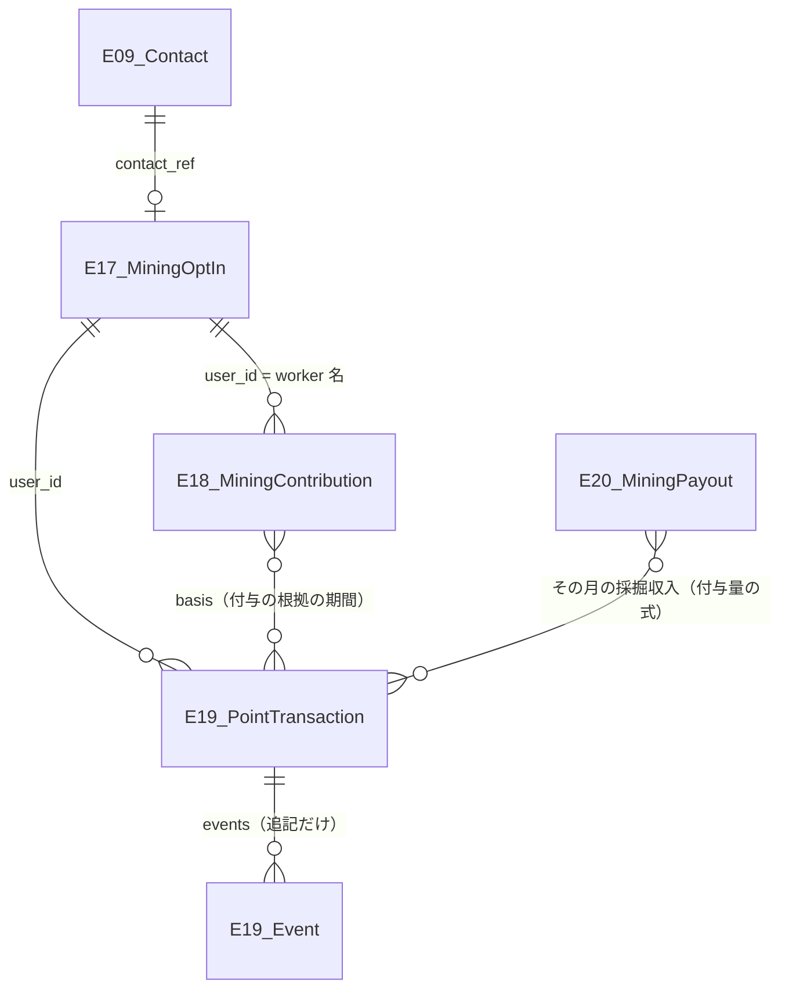
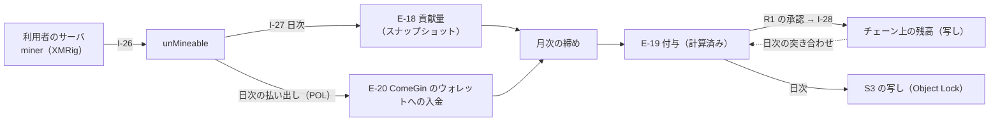
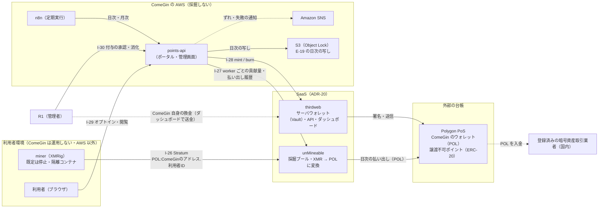
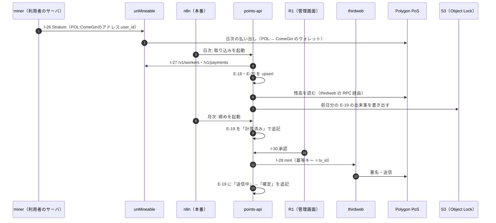
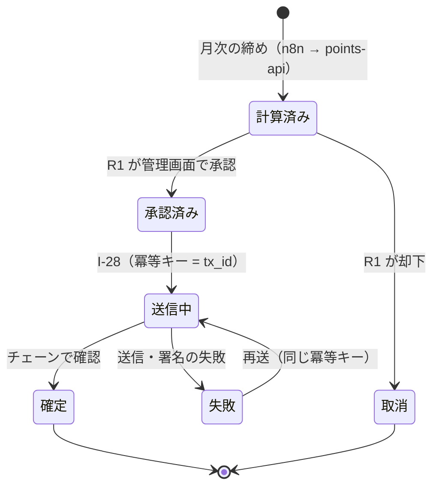

# マネタイズモデルの設計書への反映 実装計画

> **For agentic workers:** REQUIRED SUB-SKILL: Use superpowers:subagent-driven-development (recommended) or superpowers:executing-plans to implement this plan task-by-task. Steps use checkbox (`- [ ]`) syntax for tracking.

**Goal:** 承認済みの spec（採掘〈XMRig・unMineable〉と譲渡不可ポイント〈thirdweb〉のマネタイズモデル）を、既存の EA 文書群（BA/DA/AA/TA・詳細設計）・ルートの `README.md`・`.claude/CLAUDE.md` に、既存の書式と ID 体系を崩さずに反映する。

**Architecture:** 文書だけの変更で、コードは書かない。BA → DA → AA → TA → 詳細設計 → 図 → 索引の順に反映する（索引の `docs/README.md` は全 ID が正本のファイルに入った後に更新する）。新しい ID は正本のファイルに足し、増やした理由をそこに書く。状態は表に書き、図には書かない。すべての新しい行の状態は `未着手`。

**Tech Stack:** Markdown、Mermaid（`mcp-mermaid` で描画を確認）、draw.io（`mcp__drawio__create_diagram`）、`rg`、`git diff`（参照のみ）

**Spec:** `docs/superpowers/specs/2026-10-03-monetization-design.md`（以下「spec」。節番号は spec のもの）

## Global Constraints

- 文書・コメントはすべて日本語。です・ます調ではなく、既存の文書と同じ常体（「〜する」「〜である」）で書く
- 日付は本文に `2026-10-03 に追加` の形で残す（spec の決定日）
- 新しい ID と範囲: エンティティ `E-17`〜`E-20`、連携点 `I-26`〜`I-30`、ケイパビリティ `CAP-17` `CAP-18`、適用判断 `ADR-20`、暴走条件 `#12` `#13`、指標 `MINE-optin` `MINE-hashrate` `PT-granted` `PT-redeemed` `PT-redeem-rate` `REV-mining-jpy`、ポート `3106`（`points-api` の開発サーバー）
- 構成の固有名: マイニングは **XMRig**、プールは **unMineable（SaaS）**、ウォレット／ダッシュボードは **thirdweb（SaaS）**、チェーンは **Polygon PoS**、払い出しのトークンは **POL**、自作のサービスは **`points-api`**、利用者側のコンテナは **`miner`**
- 新しい行の状態列はすべて `未着手`。着手の前提は承認ゲート **G-1（弁護士）・G-2（税理士）・G-3（AWS 規約）**
- **AWS 上では採掘しない**（AWS Service Terms 1.25）。デモアプリでも採掘しない
- 採らなかった案（Engine のセルフホスト＋KMS、AMB、AWS 上の自前ノード、QLDB、スキーム B・C、自前のプール、XMR での受け取り）は ADR-20 にだけ書き、他の文書では採用した構成だけを書く
- **git の状態を変えるコマンド（`git add` `git commit` など）は実行しない**（`.claude/rules/git.md`）。各タスクの最後は `git diff --stat` での確認にする
- `.env` を含むディレクトリに `grep -r` を向けない。検索は `rg` を使う（`.claude/rules/bash-commands.md`）
- ビルド・テストは実行しない（`.claude/rules/build-deploy.md`・`devops-testing.md`）。検証は `rg` と `mcp-mermaid` の描画で行う
- パスの基点: `DOCS=MarketingDepartment/WebsiteOperations/docs`、`REQ=$DOCS/RequirementDefinition`（リポジトリルートからの相対）

## Review Focus

1. **ID の取り違え・欠番** — `E-17`〜`E-20`・`I-26`〜`I-30`・`CAP-17`・`CAP-18`・`ADR-20` が、正本のファイルと索引（`docs/README.md`）で同じ名前・同じ意味になっていること。Task 10 の検査 1 で全件を突き合わせる
2. **旧構成の名残** — Engine のセルフホスト・KMS・AMB・XMR のウォレット・ポート 3107 が、ADR-20 の「採らなかった案」以外に出てこないこと。Task 10 の検査 2
3. **Mermaid の構文の崩れ** — 新しく足す図（DA-01 の ER 図・AA-01 のコンテナ図・DA-04 のフロー図・DD-08 のシーケンス図と状態遷移図）が描画できること。各タスクの検証の手順で `mcp-mermaid` に通す
4. **相対リンクの切れ** — 新しく足すリンク（DD-08 への参照、spec への参照、図のファイル）が実在するファイルを指すこと。Task 10 の検査 3
5. **「承認ゲートを通るまで未着手」の一貫性** — 新しく足す行がすべて `未着手` で、どの文書も「実装済み」「未配線」と書いていないこと。Task 10 の検査 4

---

### Task 1: 原典（ルートの README とポート表）

**Files:**
- Modify: `README.md`（リポジトリルート。「## システム（組み込むツール群）」の節の末尾と、ファイルの末尾）
- Modify: `.claude/CLAUDE.md`（「## ポートの割り当て」の表。`| 3105 |` の行の直後）

**Interfaces:**
- Consumes: なし
- Produces: 事業スキームの原典に「マネタイズモデル」の節。下流の文書はこの節を「原典」として参照する

- [ ] **Step 1: 反映前の状態を確かめる**

Run: `rg -n "マネタイズ|XMRig|unMineable|thirdweb|3106" README.md .claude/CLAUDE.md`
Expected: 何も出ない（終了コード 1）

- [ ] **Step 2: ルートの `README.md` の「## システム（組み込むツール群）」の箇条書きの末尾（`- SEO・パフォーマンス自動監査ツール: Google Search Console, Lighthouse CI` の直後）に追記する**

```markdown
- マイニング: XMRig（**本システムの完成後に追加**。下の「マネタイズモデル」）
- マイニングプール（EVM 対応トークンへの変換）: unMineable（SaaS。**本システムの完成後に追加**）
- ウォレット / ダッシュボード: thirdweb（SaaS。**本システムの完成後に追加**）
```

- [ ] **Step 3: ルートの `README.md` の末尾に節を追記する**

```markdown

## マネタイズモデル（2026-10-03 に追加。本システムの完成後に着手）

| 流れ | 利用者 | ComeGin |
|---|---|---|
| キャッシュアウト | 本プロジェクトのシステムを動かすサーバ代、発注代金 | 本プロジェクトのデモアプリのサーバ代 |
| キャッシュイン | 採掘によって得られたトークンの配布 | 採掘によって得られた暗号資産、受注による報酬 |

- **利用者**は、無料 DL したソースコードでこの基盤を自前のサーバに立てた事業者を指す。**採掘は利用者が明示的に同意したサーバでだけ動かし、既定では無効にする。** ComeGin の AWS（本番・デモアプリ）では採掘しない（AWS の規約が採掘を禁じているため）。
- 採掘の成果（XMR）は unMineable が **POL（Polygon）** に変換して ComeGin のウォレット（thirdweb）へ払い出す。利用者には貢献量に比例した**譲渡できないポイント**を付与し、ComeGin への発注代金の値引きにだけ使えるようにする（暗号資産の交換・預かりを ComeGin が行わないため）。
- 着手の前に、弁護士・税理士・AWS の規約の 3 つの確認を通す。
- 設計: `MarketingDepartment/WebsiteOperations/docs/RequirementDefinition/AA/05-application-decisions.md` の ADR-20、`docs/superpowers/specs/2026-10-03-monetization-design.md`
```

- [ ] **Step 4: `.claude/CLAUDE.md` のポート表の `| 3105 |` の行の直後に 1 行を足す**

```markdown
| 3106 | points-api（採掘の貢献量の取り込みと譲渡不可ポイントの付与。**本システムの完成後に着手**。本番は ALB 配下の ECS on Fargate。設計は `MarketingDepartment/WebsiteOperations/docs/DetailedDesign/08-monetization-flows.md`） |
```

- [ ] **Step 5: 反映を確かめる**

Run: `rg -n "マネタイズモデル|unMineable|thirdweb" README.md && rg -n "^\| 3106 \|" .claude/CLAUDE.md`
Expected: README で 4 行以上、CLAUDE.md で 1 行

- [ ] **Step 6: 差分を確認する（コミットしない）**

Run: `git diff --stat -- README.md .claude/CLAUDE.md`
Expected: 2 files changed

---

### Task 2: BA（業務アーキテクチャ）

**Files:**
- Modify: `$REQ/BA/01-business-model.md`（「### 各段の詳細」の表の直後、「## 未決定事項」）
- Modify: `$REQ/BA/02-capability-map.md`（「### 観測・改善群」の節の後、「## Capability 一覧と成熟度」の表の末尾）
- Modify: `$REQ/BA/03-roles-and-raci.md`（「## RACI 表」の表の末尾と、その直後）
- Modify: `$REQ/BA/04-business-processes.md`（「## 未決定事項」の直前に新しい節）
- Modify: `$REQ/BA/05-governance.md`（「## 承認ゲートの一覧」の表の末尾、「## 未決定事項」）

**Interfaces:**
- Consumes: Task 1 の「マネタイズモデル」の節
- Produces: `CAP-17` 計算資源の受け入れ（採掘）・`CAP-18` ポイントの付与と消化（主担当 `R1`）、承認ゲート G-1〜G-3 と 7 行の承認ゲート、業務プロセス 4 本（P-M1〜P-M4）

- [ ] **Step 1: 反映前の状態を確かめる**

Run: `rg -n "CAP-17|CAP-18|G-1|ポイント" $REQ/BA/`
Expected: 何も出ない

- [ ] **Step 2: BA-01 の「### 各段の詳細」の表の直後（「## KPI ツリー」の直前）に節を足す**

```markdown
### キャッシュの流れ（2026-10-03 に追加。本システムの完成後に着手）

バリューストリームとは別に、**採掘とポイントによるお金の流れ**を持つ（リポジトリルートの `README.md` の「マネタイズモデル」、AA-05 の ADR-20）。

| 流れ | 利用者 | ComeGin |
|---|---|---|
| キャッシュアウト | 自分のサーバ代、発注代金（ポイントを差し引いた残り） | デモアプリのサーバ代（**デモでは採掘しない**）、`points-api` の実行費、ガス代（POL）、unMineable の手数料（採掘の 1%）、thirdweb の無料枠を超えた分 |
| キャッシュイン | **譲渡できないポイント**（ComeGin への発注代金の値引きにだけ使える。1 ポイント = 1 円） | POL（unMineable から日次。国内の登録済みの取引業者で円に換える）、受注の報酬 |

- **「受注」は引き続き本基盤の対象外である。** ただし**ポイントの消化（発注代金の値引き）だけが受注の境界をまたぐ**。消化の根拠は発注書番号を外部の参照として持ち、発注を表す型は作らない（SFA が未選定のため。DA-01 の 4.2）。
- **採掘は利用者の業務を支える収入ではない。** 1 vCPU の採掘益は月 $0.7 前後で、サーバ代の約 2% にとどまる。**すでに払っているサーバの余った CPU だけを使う**前提にし、「採掘で元が取れる」とは打ち出さない。
- 担う Capability は `CAP-17`（計算資源の受け入れ）と `CAP-18`（ポイントの付与と消化）。どちらも `未着手` で、**承認ゲート G-1〜G-3（BA-05）を通るまで着手しない**。
```

- [ ] **Step 3: BA-01 の「## 未決定事項」の箇条書きの末尾に足す**

```markdown
- **（2026-10-03 に追加）ポイントの規則の数値。** 還元率・有効期限・1 回の発注で使える上限が未定（spec の 2.3。決めるのはユーザーと `R1`）。付与量の式は「その月の ComeGin の採掘収入（円換算）× 利用者の貢献比 × 還元率」で確定している。
```

- [ ] **Step 4: BA-02 の「### 観測・改善群」の節の直後（「## Capability 一覧と成熟度」の直前）に群を足す**

```markdown
### 収益化群（2026-10-03 に追加）

採掘とポイントによるマネタイズモデル（AA-05 の ADR-20）を担う。**本システムの完成後に着手し、承認ゲート G-1〜G-3（BA-05）を通るまで手を付けない。**

| ID | Capability | 中身 |
|---|---|---|
| `CAP-17` | 計算資源の受け入れ（採掘） | 利用者の同意（オプトイン）と撤回の受付、利用者のサーバでの XMRig の有効化、unMineable の貢献量の取り込み、ComeGin の POL の受け取りと換金 |
| `CAP-18` | ポイントの付与と消化 | 月次の締めと付与（承認つき）、発注時の消化、付与率の管理、チェーンと台帳の突き合わせ |

- **他の群に入れなかった理由。** 既存の 3 群は「検索流入を起点にリードを獲得する」流れのどこかを担う。収益化群はその流れとは別の、**利用者（すでに基盤を立てた事業者）との関係**を扱うため、群を分けた。
```

- [ ] **Step 5: BA-02 の「## Capability 一覧と成熟度」の表の末尾（`CAP-16` の行の直後）に 2 行を足す**

```markdown
| `CAP-17` | 計算資源の受け入れ（採掘） | `R1` | `未着手` | 2026-10-03 に追加。手段（XMRig・unMineable）を決めただけで、何も置いていない。承認ゲート G-1〜G-3 が前提 |
| `CAP-18` | ポイントの付与と消化 | `R1` | `未着手` | 2026-10-03 に追加。手段（`points-api`・thirdweb）を決めただけで、何も置いていない。承認ゲート G-1〜G-3 が前提 |
```

- [ ] **Step 6: BA-03 の「## RACI 表」の表の末尾（`CAP-16` の行の直後）に 2 行を足し、表の直後に注記を足す**

```markdown
| `CAP-17` 計算資源の受け入れ（採掘） | **A/R** | I | I | I | **関与しない**（2026-10-03 に追加。採掘の有効化・停止はエージェントに委任しない） |
| `CAP-18` ポイントの付与と消化 | **A/R** | I | C（発注との突き合わせ） | I | **関与しない**（2026-10-03 に追加。付与・消化・付与率の変更は `禁止`。付与率の変更を `E-13` で提案することだけを許す） |
```

表の直後（「### 表の読み方と設計上の要点」の直前）:

```markdown
- **（2026-10-03 に追加）`CAP-17` `CAP-18` には外部の関係者がいる。** RACI の列に足さず、ここに書く（ロールではないため）。
  - **利用者** — `CAP-17` の `C`（採掘を有効にするのは利用者の同意による）、`CAP-18` の `I`（残高と付与の履歴をポータルで見る）
  - **弁護士** — 承認ゲート G-1 の判断者（`C`）
  - **税理士** — 承認ゲート G-2 の判断者（`C`）
  - Accountable はどちらも `R1`（人間）であり、外部の関係者やエージェントには置かない。
```

- [ ] **Step 7: BA-04 の「## 未決定事項」の直前に節を足す**

```markdown
## 収益化の業務プロセス（2026-10-03 に追加。本システムの完成後に着手）

`CAP-17` `CAP-18`（BA-02）の業務を 4 本で定義する。**すべて承認ゲート G-1〜G-3（BA-05）を通るまで行わない。** 連携点は AA-02 の `I-26`〜`I-30`、電文と状態遷移は DD-08。

| # | プロセス | 起点 | 担当 | 手順 |
|---|---|---|---|---|
| P-M1 | オプトインと撤回 | 利用者がポータルで操作する | 利用者（`R1` は監視） | ① 利用者がポータル（`points-api`）で同意文を読み、同意する（`E-17` が記録される）② 利用者が自分のサーバで `MINER_ENABLED=true` にして miner を起動する ③ 撤回はポータルで行い、利用者が `MINER_ENABLED=false` にする（次の起動から止まる） |
| P-M2 | 月次の締めと付与 | 本番の n8n の月次のスケジュール | `R1` | ① n8n が `points-api` の締めを呼ぶ（`E-18` の前月分から付与量を計算し、`E-19` を `計算済み` で追記する）② `R1` が管理画面で内訳を確かめて承認する（却下もできる）③ `points-api` が thirdweb で mint する ④ 翌日の突き合わせで `確定` を確かめる |
| P-M3 | 発注時の消化 | 利用者が発注時にポイントの利用を申し出る | `R1`（`R3` が発注と突き合わせる） | ① `R3` が発注書番号と利用するポイント数を確かめる ② `R1` が管理画面で消化を実行する（burn。`E-19` に発注書番号を残す）③ 発注書の金額からポイント分を差し引く |
| P-M4 | ComeGin の換金 | `R1` が任意の時期に行う | `R1` | ① 取引業者の画面で POL の入金アドレスを表示し、**ネットワークが Polygon であること**を確かめる ② 取引業者の画面で、送付元を「**自分のプライベートウォレット**」（ComeGin の thirdweb サーバウォレットのアドレス）として申告する（初回、または取引業者が求めるとき）③ 初回とアドレスを変えた後は、**少額で試しに送り**、着金を確かめてから残りを送る ④ thirdweb のダッシュボードから、**Polygon ネットワーク**で POL を送る ⑤ 着金を確かめて売却し、送金の tx hash・売却の約定・円の金額を `E-20` の換金の記録に残す |

### 設計上の約束

- **unMineable から取引業者へ直接送らない。** 採掘プールのような共有アドレスから送ると、トラベルルールで送付人の情報を確認できず、入金の保留の原因になる。経路は「unMineable → ComeGin の thirdweb サーバウォレット → 国内の取引業者」の 1 本だけにする。
- **トークンとネットワークは POL・Polygon に固定する。** 送り先が対応していないネットワークで送ると着金せず、資産を失うおそれがある。変更は `承認`（`R1`。BA-05）。
- **換金先の候補は bitbank と SBI VC トレード**（Polygon の POL に対応することを確認済み）。GMO コインは未確認。いずれも登録番号を金融庁の登録業者一覧で確かめてから使う。
- **P-M2 の承認を自動化しない。** 付与は利用者に対する値引きの約束であり、取り消せない（チェーンに残る）。
```

- [ ] **Step 8: BA-05 の「## 承認ゲートの一覧」の表の末尾に 9 行を足す**

```markdown
| **（2026-10-03 に追加）収益化の着手**（`CAP-17` `CAP-18` に手を付けること） | `承認`（**G-1 弁護士・G-2 税理士・G-3 `R1`〈AWS の規約〉の 3 つ**） | ユーザー・`R1` | 規制（資金決済法・施行後の金商法）・税務・AWS の規約の判断を、実装の後に覆すと作ったものが無駄になる。G-1〜G-3 の確認事項は AA-05 の ADR-20 |
| （2026-10-03 に追加）ポイントの月次の付与 | `承認` | `R1` | 利用者に対する値引きの約束で、チェーンに残り取り消せない（P-M2） |
| （2026-10-03 に追加）ポイントの消化（発注代金の値引き） | `禁止`（**`R1` が管理画面で行う**） | — | 発注との突き合わせが要る（P-M3） |
| （2026-10-03 に追加）付与率（還元率）の変更 | `承認`（**反映は `R1` が管理画面で行う**） | `R1` | エージェントは `E-13` で提案できるが、変更の経路は管理画面にしか無い（AA-04 の暴走条件 #12） |
| （2026-10-03 に追加）払い出しのトークン・ネットワークの変更 | `承認` | `R1` | 取り違えると着金せず資産を失う。取引業者の対応を先に確かめる（P-M4） |
| （2026-10-03 に追加）POL の送金（換金） | `禁止`（**`R1` が thirdweb のダッシュボードで行う**） | — | 資産の移転であり取り消せない。`points-api` の資格情報にも送金の権限を与えない（TA-04） |
| （2026-10-03 に追加）採掘の有効化・停止（利用者のサーバ） | `禁止`（**利用者が行う**） | — | 利用者の同意に基づく操作であり、ComeGin もエージェントも行わない |
| （2026-10-03 に追加）`E-19`（付与と消化の台帳）の書き換え・削除 | `禁止`（**仕組みで不可能にする**） | — | 追記だけの表と S3 Object Lock で守る（DA-01 の 4.2）。訂正は打ち消しの取引で行う |
| （2026-10-03 に追加）unMineable・thirdweb の API キーの発行・変更 | `禁止` | — | 認証情報の発行にあたる。人間（`R1`）が行う |
```

- [ ] **Step 9: BA-05 の「## 未決定事項」の箇条書きの先頭（最初の `###` 小見出しより前）に足す**

```markdown
- **（2026-10-03 に追加）承認ゲート G-1〜G-3 の結果しだいで、収益化の承認ゲートの行が変わりうる。** たとえば G-1 で「ポイントが前払式支払手段にあたる」とされれば、発行の手続き（届出など）が新しい承認点になる。
```

- [ ] **Step 10: 反映を確かめる**

Run: `rg -c "CAP-17|CAP-18" $REQ/BA/ ; rg -n "P-M[1-4]" $REQ/BA/04-business-processes.md | wc -l ; rg -n "2026-10-03 に追加" $REQ/BA/05-governance.md | wc -l`
Expected: BA-01・02・03・05 に `CAP-17|CAP-18` がある。P-M の行が 4 以上。BA-05 の追加が 10 行

- [ ] **Step 11: 差分を確認する（コミットしない）**

Run: `git diff --stat -- $REQ/BA/`
Expected: 5 files changed

---

### Task 3: DA（データアーキテクチャ）

**Files:**
- Modify: `$REQ/DA/01-conceptual-data-model.md`（4 節の表の末尾、4.1 の後に 4.2、7 節）
- Modify: `$REQ/DA/02-metrics-and-kpi.md`（4.4 の後に 4.5、6 節）
- Modify: `$REQ/DA/03-identity-resolution.md`（2.6 の後に 2.7）
- Modify: `$REQ/DA/04-data-flow.md`（1.3 の後に 1.4、2 節の表の末尾と箇条書き）
- Modify: `$REQ/DA/05-data-governance.md`（1.1 の表の末尾、1.5 の後に 1.6、2 節の表の末尾、5 節）

**Interfaces:**
- Consumes: Task 2 の `CAP-17` `CAP-18`
- Produces: `E-17 MiningOptIn`・`E-18 MiningContribution`・`E-19 PointTransaction`・`E-20 MiningPayout`（正本と複製先は下の表のとおり）、指標 6 つ

- [ ] **Step 1: 反映前の状態を確かめる**

Run: `rg -n "E-1[7-9]|E-20|MINE-|PT-" $REQ/DA/`
Expected: 何も出ない

- [ ] **Step 2: DA-01 の 4 節の表の末尾（`E-16` の行の直後）に 4 行を足す**

```markdown
| `E-17` | `MiningOptIn`（2026-10-03 に追加） | `user_id` / `contact_ref`（`E-09` への参照）/ `consent_version` / `consented_at` / `revoked_at` / `max_threads` | `points-api` の DB（RDS for PostgreSQL の `points`。本番: AWS） | テーブル（**削除できる**。削除請求に応じるため） | 未着手 |
| `E-18` | `MiningContribution`（2026-10-03 に追加） | `user_id`（unMineable の worker 名）/ `date` / `hashrate` / `accepted_shares` | `points-api` の日次スナップショット（発生源は unMineable の `/v1/workers`） | テーブル | 未着手 |
| `E-19` | `PointTransaction`（2026-10-03 に追加） | `tx_id` / `kind`（`grant` / `redeem` / `reversal`）/ `user_id` / `amount` / `basis`（`E-18` の期間、発注書番号、または打ち消す `tx_id`）/ `approved_by` / `idempotency_key` / `correlation_id` / `chain_tx_hash`。**状態は出来事の列（`events[]`）から求める** | `points-api` の DB（**追記だけ**） | テーブル（INSERT だけ。出来事も行として追記） | 未着手 |
| `E-20` | `MiningPayout`（2026-10-03 に追加） | `payout_uuid`（unMineable）/ `chain_tx_hash` / `amount_pol` / `jpy_at_receipt` / `conversion`（換金の tx hash・約定・円の金額） | **チェーン上の ComeGin のウォレットへの入金**（unMineable の `/v1/payments` と突き合わせる） | チェーン（換金の記録は `points-api` の DB） | 未着手 |
```

- [ ] **Step 3: DA-01 の「### 4.1 `E-16 Booking` を立てた理由」の節の末尾（「## 5.」の直前）に 4.2 を足す**

````markdown
### 4.2 `E-17`〜`E-20` を立てた理由（2026-10-03 の決定）

マネタイズモデル（AA-05 の ADR-20）で、**利用者の同意・貢献量・ポイントの台帳・ComeGin の受け取り**を表す型が要った。既存の型に属性として足さなかった理由は次のとおり。

- **`E-17` を `E-09 Contact` の属性にしない。** 同意には版と撤回の履歴があり、削除請求のときに `E-17` だけを消して、消せない記録（チェーン・S3 の写し）を誰のものか特定できなくする必要がある（DA-05 の 1.6）。実名は `E-09` にだけ置き、`E-17` は `contact_ref` で指す。
- **`E-18` の正本を unMineable にしない。** unMineable の履歴の保持期間をこちらで決められず、付与の根拠が後から消える。日次で自前のスナップショットを取る（`E-12` が Lighthouse の JSON を手元に貯めるのと同じ考え方）。
- **`E-19` の正本をチェーンにしない。** チェーンには「なぜ付与したか」「誰が承認したか」を書けない。正本は `points-api` の DB に置き、チェーンの残高は公開の写しとして日次で突き合わせる。
- **`E-19` を追記だけにする。** Amazon QLDB は 2025-07-31 に提供を終えたため、AWS の推奨構成（PostgreSQL ＋ S3）に沿って 2 段で守る。（1）DB ユーザーに INSERT と SELECT だけを許し、状態の変化も訂正も新しい行として追記する。（2）日次で S3 に写し、Object Lock のコンプライアンスモードで保管期間中は消せず上書きもできないようにする（TA-06 の 4.9）。
- **`E-20` の正本をチェーン上の入金にする。** unMineable の画面の数字ではなく、実際に ComeGin のウォレットに入った POL を収入とする（税務の根拠を外部の SaaS の表示に置かない）。
- **発注を表す型（`Order`）は作らない。** SFA が未選定（BA-01）。消化の根拠は発注書番号を外部の参照として `E-19` の `basis` に持つ。



図は To-Be を描いている。状態はすべて `未着手`（4 節の表）。
````

- [ ] **Step 4: DA-01 の「## 7. 未決定事項」の箇条書きの末尾に足す**

```markdown
- **（2026-10-03 に追加）`E-19` の出来事（event）の保存の形。** 同じテーブルに状態の行を追記するか、取引と出来事の 2 テーブルに分けるか。どちらでも「UPDATE・DELETE を許さない」は守れる（DD-08 で決める）。
```

- [ ] **Step 5: DA-02 の「### 4.4 CTA とフォームの計測イベント（PostHog）」の節の末尾（「## 5.」の直前）に 4.5 を足す**

```markdown
### 4.5 収益化の指標（2026-10-03 に追加。月次・`R1` が管理）

| 指標 ID | 定義 | 集計元 | 粒度 | 状態 |
|---|---|---|---|---|
| `MINE-optin` | 期末時点で同意が有効な利用者の数（`E-17` の `revoked_at` が空） | `points-api` の DB | 月次 | 未着手 |
| `MINE-hashrate` | 期間内の利用者全体の平均ハッシュレート | `E-18` | 日次・月次 | 未着手 |
| `PT-granted` | 期間内に `確定` した付与のポイント数 | `E-19` | 月次 | 未着手 |
| `PT-redeemed` | 期間内に `確定` した消化のポイント数 | `E-19` | 月次 | 未着手 |
| `PT-redeem-rate` | `PT-redeemed ÷ PT-granted`（累計） | 導出値 | 月次 | 未着手 |
| `REV-mining-jpy` | 期間内に受け取った POL の円換算の合計 | `E-20` | 月次 | 未着手 |

- **KPI ツリー（BA-01）の 2 本の式には入れない。** 受注数へのつながりは `PT-redeem-rate` で観測する（ポイントが発注で使われているか）。
- **エージェントは読まない。** 指標は `points-api` の管理画面の月次表で人間が見る（AA-03 の 2.6。収益化の MCP は作らない）。
```

- [ ] **Step 6: DA-02 の「## 6. 未決定事項」の箇条書きの末尾に足す**

```markdown
- **（2026-10-03 に追加）`REV-mining-jpy` の円換算の基準。** 受け取った時点の価格か、換金した時点の約定か（税理士の確認〈承認ゲート G-2〉に従う）。
```

- [ ] **Step 7: DA-03 の「### 2.6 同意の撤回と昇格の巻き戻し」の節の末尾（「## 3.」の直前）に 2.7 を足す**

```markdown
### 2.7 利用者の ID の対応（2026-10-03 に追加）

マネタイズモデル（AA-05 の ADR-20）では、訪問者ではなく**利用者（基盤を自前のサーバに立てた事業者）**を識別する。訪問者の昇格（2.1）とは別系統の ID である。

| ID | 発行元 | 置き場所 | 個人情報 |
|---|---|---|---|
| 利用者 ID（`user_id`） | `points-api`（オプトインのとき） | `E-17` `E-18` `E-19` | 仮名 |
| Mautic のコンタクト ID（`contact_ref`） | Mautic（`E-09`） | `E-17` だけ | 実名への入口（実名は `E-09` にある） |
| unMineable の worker 名 | 利用者 ID をそのまま使う | 利用者のサーバの XMRig の設定（`POL:<ComeGin のアドレス>.<user_id>`）、unMineable | 仮名 |
| ポイントのアドレス | `points-api` が thirdweb のサーバウォレットで作る | `E-17` に対応を持つ。チェーン | 仮名（対応を消せば特定できない） |

- **実名につながる対応は `E-17` の `contact_ref` だけに置く。** 削除請求では `E-17` を消し、チェーンと S3 の写し（消せない記録）を誰のものか特定できなくする（DA-05 の 1.6）。
- **worker 名に実名・メールアドレス・社名を使わない。** unMineable（海外）に渡るため。
```

- [ ] **Step 8: DA-04 の「### 1.3 作用の出力先」の節の末尾（「## 2.」の直前）に 1.4 を足す**

````markdown
### 1.4 収益化のデータフロー（2026-10-03 に追加）

改善ループとは別の流れ。**エージェントはこの流れに関与しない**（AA-03 の 2.6）。



図は To-Be を描いている。状態は 2 節の表で確認する。
````

- [ ] **Step 9: DA-04 の 2 節の表の末尾（`E-16` の行の直後）に 4 行を足す**

```markdown
| `E-17` | `MiningOptIn` | `points-api` の DB（AWS） | 利用者のサーバの環境変数 `MINER_ENABLED`（既定 `false`） | 正本 → 複製先 | **利用者が自分で設定する**（ComeGin から書き込まない） | 未着手 |
| `E-18` | `MiningContribution` | `points-api` の日次スナップショット（AWS） | なし（発生源の unMineable は正本ではない） | 発生源 → 正本 | `I-27`（日次。n8n が起動） | 未着手 |
| `E-19` | `PointTransaction` | `points-api` の DB（AWS。**追記だけ**） | チェーン上の残高、S3 の写し（Object Lock） | 正本 → 複製先 | `I-28`（付与・消化）、日次の書き出し | 未着手 |
| `E-20` | `MiningPayout` | チェーン上の ComeGin のウォレットへの入金 | `points-api` の月次の円換算表 | 正本 → 複製先 | `I-27`（unMineable の `/v1/payments` と突き合わせる） | 未着手 |
```

- [ ] **Step 10: DA-04 の 2 節の表の直後の箇条書きの末尾に足す**

```markdown
- **（2026-10-03 に追加）`E-19` は「正本が DB、複製先が公開チェーンと消せない写し」という形になる唯一のエンティティである。** 残高の改ざんはチェーンとの突き合わせで、理由・承認者の改ざんは追記だけの表と S3 の写しで防ぐ。ずれたら SNS で通知し、`R1` が `E-19` を正として補正の取引を起こす（DD-08）。
```

- [ ] **Step 11: DA-05 の 1.1 の表の末尾に 6 行を足す**

```markdown
| **`E-17`** | **`MiningOptIn`**（2026-10-03 に追加） | **仮名**（実名への入口の `contact_ref` を持つ） | 利用者 ID、Mautic のコンタクト ID | `points-api` の DB（AWS の RDS） | 無し | 未着手 |
| **`E-18`** | **`MiningContribution`**（同上） | 仮名 | 利用者 ID | `points-api` の DB（AWS の RDS） | **有り**（発生源の unMineable。1.6） | 未着手 |
| **`E-19`** | **`PointTransaction`**（同上） | 仮名 | 利用者 ID、ポイントのアドレス | `points-api` の DB（AWS の RDS。追記だけ） | **有り**（チェーンの写し。1.6） | 未着手 |
| **`E-20`** | **`MiningPayout`**（同上） | 含まない | — | チェーン、`points-api` の DB | 無し | 未着手 |
| — | **`E-19` の S3 の写し**（Object Lock。2026-10-03 に追加） | 仮名（**`E-17` は写さない**） | 利用者 ID、ポイントのアドレス | S3（`ap-northeast-1`） | 無し | 未着手 |
| — | **利用者のサーバの接続情報**（unMineable に渡る。2026-10-03 に追加） | 仮名 | 利用者のサーバの IP アドレス、worker 名（利用者 ID） | unMineable（SaaS。海外） | **有り** | 未着手 |
```

- [ ] **Step 12: DA-05 の「### 1.5 監視アプリの実行記録」の節の末尾（「## 2.」の直前）に 1.6 を足す**

```markdown
### 1.6 収益化が増やした外部送信と、消せない記録（2026-10-03 に追加）

マネタイズモデル（AA-05 の ADR-20）で、**利用者（事業者）**に関わるデータの外部送信が 2 つ増える。いずれも**氏名・メールアドレスは渡らない**。利用者は訪問者・顧客ではないため、1.2 の「訪問者・顧客の個人データが国外に出る先」の数には入れない。

| 送信先 | 渡るもの | 渡らないもの |
|---|---|---|
| **unMineable**（SaaS。海外） | 利用者のサーバの IP アドレス、worker 名（利用者 ID）、ComeGin のアドレス | 氏名・メールアドレス・社名 |
| **thirdweb**（SaaS。米国） | ポイントのアドレスと数量、ComeGin のサーバウォレットの操作の記録 | 氏名・メールアドレス・社名・利用者 ID |

**消せない記録が 2 つある。** 公開チェーン（Polygon）の取引と、S3 の写し（Object Lock のコンプライアンスモード。保管期間中はルートユーザーでも消せない）である。削除請求との両立は次のとおり。

- **消せない記録には仮名だけを置く。** チェーンにはアドレスと数量、S3 の写しには `E-19`（利用者 ID とアドレス）だけを入れ、**`E-17`（実名への入口）は写さない**。
- **削除請求では `E-17` を消す。** これでチェーンと S3 の写しは誰のものか特定できなくなる。この扱いは同意文に明記する（承認ゲート G-1 で文言を確かめる）。
- **worker 名に実名・社名を使わない**（DA-03 の 2.7）。
```

- [ ] **Step 13: DA-05 の 2 節の表の末尾に 3 行を足す**

```markdown
| **`E-17 MiningOptIn`**（2026-10-03 に追加） | 撤回から **未決定**（5 節） | 撤回後も付与の根拠を示すために一定期間は要る。削除請求があれば期間にかかわらず消す | 未着手 |
| **`E-18`・`E-19`・`E-20`・`E-19` の S3 の写し**（同上） | **未決定（税理士の確認。目安 7 年）** | 値引きと収入の帳簿の根拠になる（承認ゲート G-2）。S3 の Object Lock の保管期間も同じ値にする | 未着手 |
| **unMineable 側の履歴**（同上） | unMineable の規定による（こちらで決められない） | そのため `E-18` を自前のスナップショットにした（DA-01 の 4.2） | 未着手 |
```

- [ ] **Step 14: DA-05 の「## 5. 未決定事項」の箇条書きの末尾に足す**

```markdown
- **（2026-10-03 に追加）収益化の保持期間。** `E-17` の撤回後の保持期間と、`E-18`〜`E-20`・S3 の写しの保持期間（税理士の確認。目安 7 年）。S3 の Object Lock の保管期間は**後から短くできない**ため、決めてから設定する。
```

- [ ] **Step 15: 新しい Mermaid の 2 図を描画して構文を確かめる**

`mcp__mcp-mermaid__generate_mermaid_diagram` に Step 3 の `erDiagram` と Step 8 の `flowchart` をそれぞれ渡す（`outputType: "mermaid"`）。
Expected: どちらもエラーなく返る

- [ ] **Step 16: 反映を確かめる**

Run: `rg -c "E-17|E-18|E-19|E-20" $REQ/DA/ ; rg -n "MINE-optin|PT-redeem-rate|REV-mining-jpy" $REQ/DA/02-metrics-and-kpi.md`
Expected: DA-01〜05 のすべてにヒットがある。DA-02 で 3 行以上

- [ ] **Step 17: 差分を確認する（コミットしない）**

Run: `git diff --stat -- $REQ/DA/`
Expected: 5 files changed

---

### Task 4: AA（ランドスケープ・連携点・エージェント・改善ループ）

**Files:**
- Modify: `$REQ/AA/01-application-landscape.md`（5 節の後に 5.5、6 節の表の末尾、7 節、8 節）
- Modify: `$REQ/AA/02-integration-architecture.md`（1 節の種別の定義と表の末尾、3.9 の後に 3.10、4 節、5 節）
- Modify: `$REQ/AA/03-agent-architecture.md`（2.5 の後に 2.6）
- Modify: `$REQ/AA/04-recursive-improvement-loop.md`（4 節の表の末尾と直後の段落）

**Interfaces:**
- Consumes: Task 2 の `CAP-17` `CAP-18`、Task 3 の `E-17`〜`E-20`
- Produces: `I-26`〜`I-30`（種別 `Stratum` を含む）、アプリ `miner` `points-api`、暴走条件 `#12` `#13`

- [ ] **Step 1: 反映前の状態を確かめる**

Run: `rg -n "I-2[6-9]|I-30|Stratum|points-api|unMineable" $REQ/AA/0[1-4]*.md`
Expected: 何も出ない

- [ ] **Step 2: AA-01 の「## 5. C4 Lv2 コンテナ図（エージェント系）」の節の末尾（「## 6.」の直前）に 5.5 を足す**

````markdown
## 5.5 C4 Lv2 コンテナ図（収益化系。2026-10-03 に追加）

マネタイズモデル（AA-05 の ADR-20）。**本システムの完成後に着手し、承認ゲート G-1〜G-3（BA-05）を通るまで手を付けない。**



図は To-Be を描いている。状態は 6 節の表で確認する（すべて `未着手`）。お金の流れの全体図（境界 4 つ）は `docs/diagrams/monetization-overview.drawio` にある。

- **エージェントはこの図に現れない。** 付与・消化・付与率の変更・送金はどのエージェントにも与えない（AA-03 の 2.6）。
- **`miner` は ComeGin の運用対象ではない。** 配布するのは導入時に公式のリリースを**ハッシュを固定して**取得する定義だけで、実行ファイルは配布物に含めない（AWS の S3・CloudFront からも配布しない）。
````

- [ ] **Step 3: AA-01 の 6 節の表の末尾に 5 行を足す**

```markdown
| **miner**（利用者のサーバ。2026-10-03 に追加） | XMRig のコンテナ。既定は停止で、`MINER_ENABLED=true` のときだけ起動する。接続先は `rx.unmineable.com:3333`、`user` は `POL:<ComeGin のアドレス>.<利用者 ID>`。ボリュームを持たず、ネットワークの宛先は unMineable だけ | `CAP-17` | （unMineable の中で `E-18` になる） | — | **利用者環境**（ComeGin は運用しない） | 未着手 |
| **points-api**（`backend/points-api` を想定。**自作**。2026-10-03 に追加） | 貢献量の取り込み、付与量の計算、付与・消化の指示、日次の突き合わせと S3 への写し。利用者ポータル（オプトイン・残高）と管理画面（承認・消化・付与率・円換算表。ALB の関門の後ろ） | `CAP-17` `CAP-18` | `E-17` `E-18` `E-19` `E-20` | 3106 | AWS（ECS on Fargate。TA-06） | 未着手 |
| **unMineable**（SaaS。2026-10-03 に追加） | 採掘プール。XMR を POL に変換し、日次で ComeGin のアドレスへ払い出す。API（HMAC 署名）で worker ごとの貢献量と払い出しの履歴を返す | `CAP-17` | `E-18` `E-20`（発生源） | — | SaaS（海外） | 未着手 |
| **thirdweb**（SaaS。2026-10-03 に追加） | ComeGin のサーバウォレット（鍵は Vault）、ポイントのコントラクトへの mint・burn、RPC、ダッシュボード（`R1` による POL の送金） | `CAP-18` | `E-19`（複製先への書き込み）、`E-20` | — | SaaS（米国） | 未着手 |
| **Polygon PoS**（外部の台帳。2026-10-03 に追加） | 譲渡不可ポイント（ERC-20。移転の権限〈`TRANSFER_ROLE`〉を ComeGin のサーバウォレットだけに与える）と ComeGin の POL の残高 | `CAP-17` `CAP-18` | `E-19`（複製先）、`E-20`（正本） | — | 公開チェーン | 未着手 |
```

- [ ] **Step 4: AA-01 の 7 節の表（Capability → アプリ）の末尾に 2 行を足す**（7 節の表の列は既存の表に合わせ、`CAP-17` `CAP-18` の行を足す。列が「Capability | アプリケーション | 備考」以外の場合は既存の列数に合わせて空欄を `—` で埋める）

```markdown
| `CAP-17` 計算資源の受け入れ（採掘） | miner（利用者環境）・unMineable・points-api | 2026-10-03 に追加。未着手 |
| `CAP-18` ポイントの付与と消化 | points-api・thirdweb・Polygon PoS | 2026-10-03 に追加。未着手 |
```

- [ ] **Step 5: AA-01 の「## 8. 未決定事項」の箇条書きの末尾に足す**

```markdown
- **（2026-10-03 に追加）unMineable がサービスを終えたときの代わり。** 代わりのプールは選定しておかない（YAGNI）。利用者の miner の接続先を変えるには配布物の更新が要るため、起きたら ADR を起票する（DD-07）。
```

- [ ] **Step 6: AA-02 の 1 節の種別の定義の段落（`` `ビルド` = ビルド時に取り込んで成果物に焼き込む。`` で終わる行）の末尾に追記する**

```markdown
 `Stratum` = 採掘のプロトコル（2026-10-03 に追加。`I-26` だけ）。
```

- [ ] **Step 7: AA-02 の 1 節の連携点カタログの表の末尾（`I-25` の行の直後）に 5 行を足す**

```markdown
| I-26 | miner（利用者のサーバの XMRig。2026-10-03 に追加） | Stratum | unMineable（`rx.unmineable.com:3333`） | 常時（利用者が有効化している間） | （unMineable の中で `E-18` になる） | `未着手` | unMineable の仕様に従う | **利用者のサーバの中で完結する。** ComeGin からは「貢献量が 0」としてしか見えない |
| I-27 | `points-api`（2026-10-03 に追加） | API（HMAC 署名） | unMineable の API（`/v1/workers` `/v1/workers/chart` `/v1/payments`） | 日次（本番の n8n が起動） | `E-18` `E-20` | `未着手` | 有り（worker × 日、払い出しの UUID で upsert） | 再取得する。保持期間を過ぎると取り戻せないため、**3 日続けて失敗したら SNS** |
| I-28 | `points-api`（2026-10-03 に追加） | API | thirdweb の API → Polygon PoS | 付与（`R1` の承認後）・消化（`R1` の操作） | `E-19` | `未着手` | 有り（`E-19` の `tx_id` を冪等キーにする） | 送信待ちのまま残して再送する。**DB とチェーンを日次で突き合わせ、ずれたら SNS** |
| I-29 | 利用者（ブラウザ。2026-10-03 に追加） | API | `points-api`（利用者ポータル） | オプトイン・撤回・閲覧 | `E-17` `E-19` | `未着手` | 有り（同意の版 × 利用者） | 失敗を利用者に明示する（`I-08` と同じ扱い） |
| I-30 | `R1`（管理画面。2026-10-03 に追加） | API | `points-api`（管理画面。ALB の関門の後ろ） | 付与の承認・消化・付与率の変更 | `E-19` | `未着手` | 有り | 失敗を明示する。**エージェントの経路は無い** |
```

- [ ] **Step 8: AA-02 の「### 3.9 オンライン面談の予約（I-25）」の節の末尾（「## 4.」の直前）に 3.10 を足す**

```markdown
### 3.10 収益化（I-26〜I-30。2026-10-03 に追加）

マネタイズモデル（AA-05 の ADR-20）の連携。**承認ゲート G-1〜G-3（BA-05）を通るまで着手しない。** 電文・冪等キー・状態遷移は DD-08。

| 連携 | 手段 | 前提 |
|---|---|---|
| I-26 miner → unMineable | XMRig の設定（`algo: rx/0`、接続先 `rx.unmineable.com:3333`、`user: POL:<ComeGin のアドレス>.<利用者 ID>`）。**払い出しのトークンとネットワークは POL・Polygon に固定する** | 利用者の同意（`E-17`）と `MINER_ENABLED=true` |
| I-27 points-api → unMineable | unMineable の API（HMAC-SHA256 の署名。`x-user-api-key` `x-user-api-timestamp` `x-user-api-signature`）。API キーは Secrets Manager | ComeGin の unMineable のアカウント（`R1` が作る） |
| I-28 points-api → thirdweb | thirdweb の API（SaaS）。**`points-api` の資格情報は mint・burn に限り、POL の送金を含めない**。アカウント抽象化（ガス代の肩代わり）は使わない | ポイントのコントラクト（ERC-20。`TRANSFER_ROLE` を ComeGin のサーバウォレットだけに与える） |
| I-29 利用者 → points-api | ポータル。ログインは SES で送るメールのワンタイムリンク | オプトインの同意文（承認ゲート G-1 で文言を確かめる） |
| I-30 R1 → points-api | 管理画面。ALB の関門（ADR-13。Google Workspace）の後ろ | — |

- **ComeGin の POL の換金は連携点にしない。** `R1` の手作業で、BA-04 の P-M4。**unMineable から取引業者へ直接送らない**（トラベルルール）。
- **採掘プールを自前で立てない。** AWS に置けば AWS Service Terms 1.25（採掘の禁止）に正面から抵触する。
```

- [ ] **Step 9: AA-02 の「## 4. 着手順の提案」の表の直後に段落を足す**

```markdown
**（2026-10-03 に追加）収益化（`I-26`〜`I-30`）は番号を振らず、「本システムの完成後」に置く。** 着手の可否を決めるのが配線ではなく**承認ゲート G-1〜G-3（弁護士・税理士・AWS の規約。BA-05）**だからである。依存は **0**（`points-api` を AWS に置くため）と、`I-21`（SNS の通知）。
```

- [ ] **Step 10: AA-02 の「## 5. 未決定事項」の箇条書きの末尾に足す**

```markdown
- **（2026-10-03 に追加）thirdweb の資格情報の権限の絞り方。** `points-api` に渡す資格情報を「ポイントのコントラクトへの mint・burn だけ」に絞れるか（Vault のアクセストークンの権限設定）。絞れなければ、POL の受け取り用とポイントの操作用でサーバウォレットを分ける。
- **（2026-10-03 に追加）unMineable の紹介コード。** ComeGin 自身の紹介コードで手数料を 0.75% にできるか（規約で自己紹介が許されるか）。
```

- [ ] **Step 11: AA-03 の「### 2.5 操作対象…」の節の末尾（「## 3.」の直前）に 2.6 を足す**

```markdown
### 2.6 収益化の操作はどのエージェントにも与えない（2026-10-03 に追加）

マネタイズモデル（AA-05 の ADR-20）の操作（ポイントの付与・消化、付与率の変更、POL の送金、採掘の有効化・停止）は、**12 本のどのエージェントにも与えない**（BA-05 で `禁止`）。新しいエージェントも、収益化の MCP サーバ（`points-mcp`）も作らない。

- **許すのは提案だけである。** 付与率の変更を `E-13` で提案することはできる。承認と反映は `R1` が管理画面で行う（変更の経路が管理画面にしか無い。AA-04 の暴走条件 #12）。
- **指標も読ませない。** `MINE-*` `PT-*` `REV-mining-jpy`（DA-02 の 4.5）は管理画面の月次表で人間が見る。`agent/analytics-reporter` の接続先にも加えない。
- **理由。** 付与と送金は取り消せない（チェーンに残る）。BA-05 の分類基準の 2 問目（取り消せるか）で `禁止` にあたる。
```

- [ ] **Step 12: AA-04 の 4 節の表の末尾（`11` の行の直後）に 2 行を足す**

```markdown
| 12 | **付与率がエージェント経由で承認なしに変わる**（2026-10-03 に追加） | 利用者へのポイントの付与が増減し、値引きの約束と収入が釣り合わなくなる | **付与率を変える経路が `points-api` の管理画面（`R1`）にしか無い**（AA-03 の 2.6）。エージェントは `E-13` で提案だけできる |
| 13 | **採掘が利用者の業務を圧迫する**（2026-10-03 に追加） | 利用者のサーバの CPU を採掘が使い切り、利用者の業務システムが遅くなる | **miner がスレッドの上限と負荷で自分から止まる**（DD-08）。**ComeGin からは観測できない**（`I-26` は利用者のサーバの中で完結する） |
```

- [ ] **Step 13: AA-04 の 4 節の表の直後の段落「**歯止めが不完全な行が 2 つある**（#7 と #8。」を「**歯止めが不完全な行が 3 つある**（#7 と #8、**2026-10-03 に追加した #13**。」に置き換え、その段落の末尾に 1 文を足す**

```markdown
#13 は、ComeGin が利用者のサーバを観測しない（観測すれば利用者の業務データに近づく）ことの裏返しであり、**検出は「部分的」のまま受け入れる**。
```

- [ ] **Step 14: AA-01 の新しい図を描画して構文を確かめる**

`mcp__mcp-mermaid__generate_mermaid_diagram` に Step 2 の `flowchart` を渡す（`outputType: "mermaid"`）。
Expected: エラーなく返る

- [ ] **Step 15: 反映を確かめる**

Run: `rg -n "^\| I-(26|27|28|29|30) \|" $REQ/AA/02-integration-architecture.md | wc -l ; rg -n "^\| 1[23] \|" $REQ/AA/04-recursive-improvement-loop.md | wc -l ; rg -n "2\.6 収益化" $REQ/AA/03-agent-architecture.md`
Expected: 5、2、1 行

- [ ] **Step 16: 差分を確認する（コミットしない）**

Run: `git diff --stat -- $REQ/AA/01-application-landscape.md $REQ/AA/02-integration-architecture.md $REQ/AA/03-agent-architecture.md $REQ/AA/04-recursive-improvement-loop.md`
Expected: 4 files changed

---

### Task 5: ADR-20（AA-05）

**Files:**
- Modify: `$REQ/AA/05-application-decisions.md`（「## 決定の一覧」の直前に ADR-20、「## 決定の一覧」の表の末尾、「## 未決定事項」）

**Interfaces:**
- Consumes: Task 2〜4 の ID
- Produces: `ADR-20`（承認ゲート G-1〜G-3 の確認事項の正本、TA-01 の 8 節の拡張の根拠、thirdweb の例外の根拠）

- [ ] **Step 1: 反映前の状態を確かめる**

Run: `rg -n "ADR-20" $REQ/AA/05-application-decisions.md`
Expected: 何も出ない

- [ ] **Step 2: 「## 決定の一覧」の直前に ADR-20 を足す**

```markdown
## ADR-20 マネタイズモデル: 利用者の自前サーバでの採掘（オプトイン、unMineable 経由）と、譲渡不可ポイントの付与（thirdweb）

**状態: `決定済み`**（ユーザーの 2026-10-03 の決定。**本システムの完成後に着手し、承認ゲート G-1〜G-3 を通るまで手を付けない**。spec は `docs/superpowers/specs/2026-10-03-monetization-design.md`、フローは DD-08）

### 文脈

- **ユーザーが新しいマネタイズモデルを指示した。** キャッシュアウトは「利用者: システムを動かすサーバ代・発注代金／ComeGin: デモアプリのサーバ代」、キャッシュインは「利用者: 採掘によって得られたトークンの配布／ComeGin: 採掘によって得られた暗号資産・受注による報酬」。構成は **XMRig（マイニング）・unMineable（マイニングプール。EVM 対応トークンに変換。SaaS）・thirdweb（ウォレット／ダッシュボード。SaaS）**。
- **AWS は全サービスで採掘を禁じている**（AWS Service Terms 1.25: "You will not use, and will not facilitate or allow End Users to use, the Services to mine cryptocurrency."）。本番を AWS に置いた（ADR-12・ADR-16）以上、ComeGin の本番・デモアプリでは採掘できない。
- **クラウドの CPU での採掘は採算が合わない。** 1 vCPU の採掘益は月 $0.7 前後、Fargate の 1 vCPU は月 $37 前後（2026-07 時点）。
- **国内の規制が変わる途中にある。** 改正金商法が 2026-07-15 に成立・07-23 に公布され、暗号資産の根拠法が資金決済法から金商法に移る（公布から 1 年以内に施行）。ユーザーは「外部の取引業者を使う前提で、資金決済法に違反しないスキーム」を求めた。

### 選択肢

| | 内容 | 採否 |
|---|---|---|
| **A** | 採掘の全量を ComeGin が受け取り、利用者には貢献量に比例した**譲渡できないポイント**（発注代金の値引きにだけ使える）を付与する | **採用** |
| B | 利用者が自分のアドレスで直接受け取る（ComeGin の収入は unMineable の紹介報酬 0.25% だけ） | 不採用（ComeGin の収入がほぼ無く、福祉事業者に海外のサービスからの受け取り・ウォレットの管理・換金を求める） |
| C | 譲渡できるトークンを発行し、登録済みの取引業者で上場（IEO） | 不採用（特定暗号資産の発行者として情報公表・監査・JVCEA の審査がかかり、個人事業には現実的でない） |
| — | AWS 上で採掘する、自前の採掘プールを AWS に置く | 不採用（AWS Service Terms 1.25） |
| — | Monero 向けのプールで XMR を受け取る | 不採用（国内の取引業者がプライバシー通貨を扱わず、換金できない） |
| — | thirdweb Engine のセルフホスト ＋ AWS KMS ＋ 既存の RDS・ElastiCache | **2026-10-03 に一度採り、同日にユーザーの指示で SaaS に改めた** |
| — | Amazon Managed Blockchain（AMB）の RPC | 不採用（新規の受付が 2026-10-29 で終わり、既存の顧客も 2027-09-29 以降は使えない） |
| — | AWS 上の自前のノード（AWS Blockchain Node Runners） | 不採用（Polygon PoS の設計図が無い。Base でも `i8ge.6xlarge` で月約 $2,450 ＋ L1 の RPC が要り、月に数百件の書き込みに釣り合わない） |
| — | Amazon QLDB で `E-19` を守る | 不採用（2025-07-31 にサポート終了）。代わりに追記だけの表 ＋ S3 Object Lock |

### 決定

1. **採掘は利用者の自前サーバでだけ、オプトインで動かす。** 既定は無効。ComeGin の AWS（本番・デモアプリ）では採掘しない。XMRig の実行ファイルは配布物に含めず、導入時に公式のリリースをハッシュを固定して取得する。
2. **unMineable（SaaS）の払い出し先は ComeGin のアドレス（thirdweb のサーバウォレット）にする。** トークンは **POL**、ネットワークは **Polygon** に固定する。ComeGin は XMR を一度も持たない。
3. **利用者には譲渡できないポイントを付与する**（スキーム A）。1 ポイント = 発注代金 1 円の値引き。払い戻しはしない。付与量は「その月の ComeGin の採掘収入（円換算）× 利用者の貢献比 × 還元率」。
4. **thirdweb は SaaS で使う**（サーバウォレット〈鍵は Vault〉・API・RPC・ダッシュボード）。`points-api` に渡す資格情報は mint・burn に限り、POL の送金は `R1` がダッシュボードで行う。
5. **換金の経路は「unMineable → ComeGin の thirdweb サーバウォレット → 国内の登録済みの取引業者」の 1 本だけにする。** unMineable から取引業者へ直接送らない（トラベルルールで送付人の情報を確認できず、保留の原因になる）。取引業者には「自分のプライベートウォレットからの送金」として申告する。
6. **`E-19`（付与と消化の台帳）は追記だけの表 ＋ S3 Object Lock で守る**（DA-01 の 4.2）。
7. **TA-01 の 8 節（SaaS 依存の基準）を広げる。** 2 種類目を「自前で持てない外部の台帳（検索データ・ブロックチェーン・採掘プール）」にし、unMineable と Polygon PoS をここに入れる。**AWS で用意でき、かつ費用と運用の負担が用途に釣り合う場合は AWS を優先する。釣り合わない場合は既存のベンダー、新しいベンダーの順に選ぶ。**
8. **thirdweb（SaaS）は 8 節の 2 種類のどちらにも当たらない。ユーザーの決定による例外として記録する**（PostHog が当初の唯一の例外だったのと同じ扱い）。

**着手前の承認ゲート**（BA-05）:

| # | ゲート | 確認すること | 判断者 |
|---|---|---|---|
| G-1 | 弁護士の確認 | 譲渡不可ポイントが、施行前の資金決済法と施行後の金商法で、暗号資産・前払式支払手段・その他の規制対象にあたらないこと。**海外の unMineable に XMR から POL への変換を任せる使い方に問題が無いこと**。ComeGin のサーバウォレットの鍵を thirdweb（米国）が持つことの扱い。景品表示法の扱い。同意文の文言 | ユーザー（外部の弁護士） |
| G-2 | 税理士の確認 | 採掘収入（POL の受け取り）の計上時期と評価額、unMineable の手数料の扱い、ポイントの値引きの会計処理、帳簿の保存期間 | ユーザー（外部の税理士） |
| G-3 | AWS の規約の確認 | `points-api`（unMineable の API を読み、ポイントを付与する）が Service Terms 1.25 の "facilitate" にあたらないこと。必要なら AWS に問い合わせる | `R1` |

### 理由

- **ComeGin が規制対象の行為を 1 つも行わない形にできる。** ComeGin はトークンを売らず、利用者の暗号資産を交換・預かり・移転しない。自分の POL を自分で換金するだけである。弁護士に確認する論点が「ポイントが前払式支払手段にあたるか」と「unMineable の使い方」に絞れる。
- **ポイントの使い道を発注に限ることで、採掘が受注（ComeGin のもう 1 つの収入）につながる。** 観測は `PT-redeem-rate`（DA-02 の 4.5）。
- **unMineable を入れると、ComeGin が XMR を持たなくなり、国内で換金できない問題が構造ごと消える。**
- **thirdweb を SaaS にしたのは、セルフホストの Engine（送信のキュー・nonce・更新の運用）と自前の署名の運用が、月に数百件の書き込みに釣り合わないためである。** RPC・署名・ダッシュボードを 1 社にまとめ、ベンダーを増やさない。

### 帰結

- **ベンダーが 2 つ増える**（unMineable・thirdweb）。どちらも SaaS で、unMineable は海外、thirdweb は米国。**氏名・メールアドレスは渡らない**（DA-05 の 1.6）。
- **鍵を thirdweb の Vault が持つ。** TA-04 に明記する。Vault の管理者の鍵は AWS に置かない。
- **消せない記録が 2 つ増える**（公開チェーンと S3 の写し）。削除請求は `E-17` を消して仮名化で応じる（DA-05 の 1.6）。
- **暴走条件が 2 つ増える**（AA-04 の #12・#13）。#13（採掘が利用者の業務を圧迫する）は ComeGin から観測できず、検出は部分的のまま受け入れる。
- **AWS の規約の解釈（G-3）しだいで、`points-api` を AWS の外に出す必要が生じうる。** そのときは ADR を起票する。
```

- [ ] **Step 3: 「## 決定の一覧」の表の末尾（`ADR-19` の行の直後）に 1 行を足す**

```markdown
| **ADR-20** | **マネタイズモデル: 利用者の自前サーバでの採掘（オプトイン。XMRig → unMineable〈SaaS〉で POL〈Polygon〉に変換し ComeGin へ）と、譲渡不可ポイントの付与（thirdweb〈SaaS〉）。AWS では採掘しない。換金は ComeGin のウォレットを経由して国内の取引業者へ。`E-19` は追記だけ＋S3 Object Lock。TA-01 の 8 節を「外部の台帳」に広げ、thirdweb は例外。本システムの完成後に着手し、承認ゲート G-1〜G-3 が前提** | `決定済み`（2026-10-03） | G-1〜G-3 のいずれかが否定的な結論を出すこと。unMineable または thirdweb がサービスを終えること。AWS が `points-api` の利用を規約違反と判断すること |
```

- [ ] **Step 4: 「## 未決定事項」の箇条書きの末尾に足す**

```markdown
- **（2026-10-03 に追加。ADR-20）** 還元率・有効期限・1 回の発注での上限、換金先の取引業者の選定（候補は bitbank と SBI VC トレード。GMO コインは未確認。登録番号を金融庁の登録業者一覧で確かめる）、トラベルルールでの入金の申告で署名による所有の確認を求められるか（求められたら thirdweb のサーバウォレットで署名できるか）、thirdweb のプラン（無料枠で本番を回してよいか）、XMRig の寄付の設定（既定で採掘時間の 1%）、Web サイトでの告知（G-1 の結果に依存）。
```

- [ ] **Step 5: 反映を確かめる**

Run: `rg -n "ADR-20" $REQ/AA/05-application-decisions.md | wc -l ; rg -n "^\| G-[123] \|" $REQ/AA/05-application-decisions.md | wc -l`
Expected: 3 以上、3

- [ ] **Step 6: 差分を確認する（コミットしない）**

Run: `git diff --stat -- $REQ/AA/05-application-decisions.md`
Expected: 1 file changed

---

### Task 6: TA（配置・トリガー・秘匿値・監視・AWS・オンプレ）

**Files:**
- Modify: `$REQ/TA/01-deployment-topology.md`（1 節、5 節の表、7 節の表、8 節、9 節）
- Modify: `$REQ/TA/03-triggers-and-cicd.md`（3.3、7 節）
- Modify: `$REQ/TA/04-security-and-secrets.md`（1 節の「AWS 上の秘密値」の後、9 節）
- Modify: `$REQ/TA/05-observability-and-ops.md`（4 節の後、8 節）
- Modify: `$REQ/TA/06-aws-runtime.md`（3.1 の表と箇条書き、4.1 の表、4.8 の後に 4.9、7 節の表、9 節の表、11 節）
- Modify: `$REQ/TA/07-onprem-control-plane.md`（2 節、9 節）

**Interfaces:**
- Consumes: Task 4 の `points-api`・`I-26`〜`I-30`、Task 5 の ADR-20
- Produces: 境界「利用者環境」、ECS サービス `points-api`、RDS の `points` データベース、S3 バケット（`E-19` の写し）、ポート 3106

- [ ] **Step 1: 反映前の状態を確かめる**

Run: `rg -n "points-api|利用者環境|unMineable|thirdweb" $REQ/TA/`
Expected: 何も出ない

- [ ] **Step 2: TA-01 の「## 1. 配置の原則」の節の末尾（「## 2.」の直前）に足す**

```markdown
### 利用者環境（2026-10-03 に追加）

**ComeGin が運用しない 4 つ目の境界**として「利用者環境」を置く（AA-05 の ADR-20）。無料 DL したソースコードで基盤を立てた利用者のサーバで、ここでだけ採掘（`miner`。XMRig）が動く。

- **ComeGin の AWS（本番・デモアプリ）とローカルでは採掘しない**（AWS Service Terms 1.25）。
- **ComeGin は利用者環境を観測しない。** `I-26`（miner → unMineable）は利用者のサーバの中で完結する（AA-04 の暴走条件 #13）。
- **配布物には XMRig の実行ファイルを含めない。** 導入時に公式のリリースをハッシュを固定して取得する定義だけを含める。
```

- [ ] **Step 3: TA-01 の 5 節の表の `| **3105** |` の行の直後に 1 行を足す**

```markdown
| **3106** | **`points-api`（採掘の貢献量の取り込みと譲渡不可ポイントの付与）の開発サーバー**（本番は ALB の後ろ。TA-06 の 3.1。AA-05 の ADR-20。2026-10-03 に追加） | `backend/points-api`（想定） | `未着手` |
```

- [ ] **Step 4: TA-01 の 7 節（境界を越える通信の一覧）の表の末尾に 3 行を足す**（列は既存の表に合わせる。既存の列が異なる場合は、経路・発信元・宛先・内容・状態の順に読み替えて埋める）

```markdown
| （2026-10-03 に追加）利用者環境 → unMineable | `miner`（XMRig） | `rx.unmineable.com:3333`（Stratum） | 採掘の share、worker 名（利用者 ID） | `未着手` |
| （2026-10-03 に追加）AWS → unMineable | `points-api` | unMineable の API（HTTPS） | 貢献量と払い出しの履歴の取得 | `未着手` |
| （2026-10-03 に追加）AWS → thirdweb | `points-api` | thirdweb の API（HTTPS） | ポイントの mint・burn | `未着手` |
```

- [ ] **Step 5: TA-01 の 8 節の「**外部の SaaS に依存してよいのは、次の 2 種類に限る。**」の表の 2 行目（`自前で持てないデータの取得元`）を次の行に置き換える**

```markdown
| **自前で持てない外部の台帳**（2026-10-03 に「データの取得元」から広げた。ADR-20） | Google Search Console、DataForSEO、**Polygon PoS（ブロックチェーン）、unMineable（採掘プール）** | 検索結果での扱い・検索ボリューム・競合の順位は**Google の外に存在しない**。チェーンの残高と採掘の成果も、その台帳の外に存在しない。自前で立てる選択肢そのものが無いか、立てても用途に釣り合わない |
```

- [ ] **Step 6: TA-01 の 8 節の「### 境界に関わるその他の約束」の直前に小節を足す**

```markdown
### AWS を優先する条件と、thirdweb の例外（2026-10-03。ADR-20）

- **AWS で用意でき、かつ費用と運用の負担が用途に釣り合う場合は AWS を優先する。** 釣り合わない場合は既存のベンダー、新しいベンダーの順に選ぶ。判断と理由は ADR に残す。
- **この基準を初めて当てたのがチェーンの RPC である。** Amazon Managed Blockchain は提供を終える（新規の受付は 2026-10-29 まで）。AWS 上の自前のノードは月約 $2,450 以上で、月に数百件の書き込みに釣り合わない。
- **thirdweb（SaaS。サーバウォレット・API・RPC・ダッシュボード）は 2 種類のどちらにも当たらない。ユーザーの決定による例外とした**（PostHog が当初の唯一の例外だったのと同じ扱い）。鍵は thirdweb の Vault が持つ（TA-04）。
```

- [ ] **Step 7: TA-01 の「## 9. 未決定事項」の箇条書きの末尾に足す**

```markdown
- **（2026-10-03 に追加）AWS の規約の解釈（承認ゲート G-3）。** `points-api` が unMineable の API を読みポイントを付与することが、AWS Service Terms 1.25 の "facilitate" にあたるか。あたるなら `points-api` を AWS の外に出す（ADR を起票する）。
```

- [ ] **Step 8: TA-03 の「### 3.3 スケジュール実行」の節の末尾に足す**

```markdown
- **（2026-10-03 に追加）収益化の定期処理は本番の n8n から `points-api` を呼ぶ**（ADR-17「エージェントを使わない決定論的な定期処理は n8n」）。日次: 貢献量と払い出しの取り込み（`I-27`）、DB とチェーンの突き合わせ、`E-19` の S3 への写し。月次: 締め（`E-19` を `計算済み` で追記する。**付与〈mint〉は `R1` の承認の後**）。n8n のワークフローはエージェントを呼ばない。
```

- [ ] **Step 9: TA-03 の「## 7. 未決定事項」の箇条書きの末尾に足す**

```markdown
- **（2026-10-03 に追加）月次の締めの日時。** unMineable の払い出し（1 日 1 回）の後で、前月分の `E-18` がそろう日時にする。
```

- [ ] **Step 10: TA-04 の「### AWS 上の秘密値（ADR-12・ADR-15・ADR-16）」の節の末尾（「## 2.」の直前）に小節を足す**

```markdown
### 収益化の秘匿値と権限（2026-10-03 に追加。ADR-20）

| 秘匿値・権限 | 置き場所 | 権限の範囲 |
|---|---|---|
| unMineable の API キーと秘密（HMAC 署名用） | Secrets Manager | 参照系（貢献量・払い出しの履歴）だけを使う。手動の払い出しの要求（`POST /v1/payments`）は使わない |
| thirdweb の秘密鍵（`points-api` 用） | Secrets Manager | **ポイントのコントラクトへの mint・burn だけ。POL の送金を含めない**（絞れなければサーバウォレットを分ける。AA-02 の 5 節） |
| thirdweb の Vault の管理者の鍵 | **AWS に置かない**（`R1` が管理する） | サーバウォレットの鍵は thirdweb の Vault が持つ。POL の送金は `R1` がダッシュボードで行う |
| `points-api` の DB ユーザー | Secrets Manager | `E-19` に **INSERT と SELECT だけ**（UPDATE・DELETE なし）。権限の付与は DB の管理者が行い、アプリの資格情報では変えられない |
| `E-19` の写しを S3 に書く権限 | **タスクロール** | 書き込みだけで削除なし。バケットは Object Lock のコンプライアンスモード（TA-06 の 4.9） |
| ComeGin のアドレス（POL の受け取り・XMRig の設定に書く） | 公開値 | 秘匿しない |
```

- [ ] **Step 11: TA-04 の「## 9. 未決定事項」の箇条書きの末尾に足す**

```markdown
- **（2026-10-03 に追加）thirdweb の Vault の管理者の鍵の保管方法。** AWS に置かないと決めたが、`R1` の手元のどこに置くか（紛失すると POL を送れなくなる）。
```

- [ ] **Step 12: TA-05 の「## 4. 横断的な監視基盤が無いことの扱い」の節の末尾（「## 5.」の直前）に小節を足す**

```markdown
### 収益化の監視（2026-10-03 に追加。ADR-20）

`points-api` が検知し、Amazon SNS（`comegin-ops-alert`）へ通知する。

| 事象 | 条件 | 通知 |
|---|---|---|
| unMineable の取り込みの失敗 | `I-27` が 3 日続けて失敗 | SNS |
| DB とチェーンのずれ | `E-19` の合計とチェーンの残高が一致しない | SNS |
| DB と S3 の写しの食い違い | 突き合わせで差がある（追記だけの権限が崩れた疑い） | SNS |
| S3 への写しの失敗 | 2 日続けて失敗 | SNS |

- **利用者のサーバの miner は監視しない**（AA-04 の暴走条件 #13）。
```

- [ ] **Step 13: TA-05 の「## 8. 未決定事項」の箇条書きの末尾に足す**

```markdown
- **（2026-10-03 に追加）収益化の監視が `points-api` 自身の停止を拾えない。** `points-api` が止まると上の 4 つの通知も止まる。ハートビート（4 節）の対象に加えるかを決める。
```

- [ ] **Step 14: TA-06 の 3.1 の表の末尾（`consent-api` の行の直後）に 1 行を足し、表の直後の箇条書きの末尾に 1 項を足す**

```markdown
| **ポイントの付与**（**2026-10-03 に追加**。自作。ADR-20） | `points-api` | 採掘の貢献量の取り込み、ポイントの付与・消化の指示（thirdweb）、日次の突き合わせと `E-19` の S3 への写し、利用者ポータルと管理画面 | 1 | `backend/points-api`（想定）の開発サーバー（3106） |
```

```markdown
- **（2026-10-03 に追加）`points-api` は採掘しない。** unMineable と thirdweb の API を呼ぶだけで、採掘プールも Monero のノードも AWS に置かない（AWS Service Terms 1.25。AA-05 の ADR-20）。**本システムの完成後に着手し、承認ゲート G-1〜G-3 を通るまで置かない。**
```

- [ ] **Step 15: TA-06 の 4.1 の表の `RDS for PostgreSQL 16` の行の「使うシステム」に `・**points-api**（2026-10-03 に追加）` を足し、表の末尾に 1 行を足す**

```markdown
| **S3（`E-19` の写し。2026-10-03 に追加）** | `points-api`（タスクロール） | **`E-19` の写し専用のバケット**（4.9）。`E-15` の写しのバケットとは分ける | なし（開発環境では写さない） |
```

- [ ] **Step 16: TA-06 の「### 4.8 Cookie 同意の状態の記録」の節の末尾（「## 5.」の直前）に 4.9 を足す**

```markdown
### 4.9 ポイントの台帳の写し（`E-19`。2026-10-03 に追加。ADR-20）

- **バケット**: `ap-northeast-1`、パブリックアクセスを全ブロック、バージョニングを有効化、**Object Lock のコンプライアンスモード**を有効化（保管期間中はルートユーザーでも消せず、上書きもできない）。
- **保管期間**: 帳簿と同じ（税理士の確認〈承認ゲート G-2〉。目安 7 年）。**後から短くできないため、決めてから設定する。**
- **書くもの**: 前日分の `E-19` の出来事を日次で書き出す。**`E-17`（実名への入口）は写さない**（DA-05 の 1.6）。
- **書く主体**: `points-api` のタスクロール（書き込みだけ。削除の権限なし）。
- **ADR-18 の `E-15` の写しとは仕組みが同じで、バケットを分ける。** 保管期間と書く主体が違うため。
```

- [ ] **Step 17: TA-06 の 7 節の表の末尾に 2 行を足す**

```markdown
| **unMineable の API キーと秘密・thirdweb の秘密鍵**（2026-10-03 に追加。ADR-20） | Secrets Manager | タスク定義の `secrets` で `points-api` に渡す。権限の範囲は TA-04 の「収益化の秘匿値と権限」 |
| **`points-api` が `E-19` の写しを S3 に書く権限**（同上） | **タスクロール** | 書き込みだけで削除なし（4.9） |
```

- [ ] **Step 18: TA-06 の 9 節の表の末尾に 2 行を足す**

```markdown
| **Fargate（`points-api`。2026-10-03 に追加）** | vCPU とメモリの時間 | 1 タスク。採掘はしない（CPU を使い切らない） |
| **S3（`E-19` の写し。同上）** | 保存量 ＋ リクエスト数 | 極めて小さい（月に利用者数 × 数件の出来事） |
```

- [ ] **Step 19: TA-06 の「## 11. 未決定事項」の箇条書きの先頭（最初の `###` 小見出しより前）に足す**

```markdown
- **（2026-10-03 に追加）`points-api` から unMineable・thirdweb への外向きの通信。** NAT Gateway（既存）を通す。宛先を絞るか（unMineable の API と thirdweb の API だけ）。
```

- [ ] **Step 20: TA-07 の「## 2. 開発環境」の節の末尾（「## 3.」の直前）に足す**

```markdown
- **（2026-10-03 に追加）収益化の開発環境。** thirdweb は**開発用のプロジェクト**と **Polygon の Amoy テストネット**を使う。XMRig は **unMineable に繋がないベンチマークの起動だけ**を行い、開発機で採掘しない。`points-api` の開発サーバーは 3106。
```

- [ ] **Step 21: TA-07 の「## 9. 未決定事項」の箇条書きの先頭（最初の `###` 小見出しより前）に足す**

```markdown
- **（2026-10-03 に追加）unMineable の API を開発環境で試す方法。** unMineable にはテスト用の環境が無いため、本番のアカウントの参照系を開発機から読むか、応答を固定したスタブで代えるか。
```

- [ ] **Step 22: 反映を確かめる**

Run: `rg -c "2026-10-03" $REQ/TA/01-deployment-topology.md $REQ/TA/03-triggers-and-cicd.md $REQ/TA/04-security-and-secrets.md $REQ/TA/05-observability-and-ops.md $REQ/TA/06-aws-runtime.md $REQ/TA/07-onprem-control-plane.md`
Expected: 6 ファイルすべてで 1 以上

- [ ] **Step 23: 差分を確認する（コミットしない）**

Run: `git diff --stat -- $REQ/TA/`
Expected: 6 files changed

---

### Task 7: 詳細設計（DD-08 の新設と DD-01・DD-07・README）

**Files:**
- Create: `$DOCS/DetailedDesign/08-monetization-flows.md`
- Modify: `$DOCS/DetailedDesign/01-flow-specification-rules.md`（7.2 の表の末尾、10 節）
- Modify: `$DOCS/DetailedDesign/07-failure-and-degradation.md`（最初の「## 」の表のうち、連携点ごとの縮退の表の末尾。末尾の未決定事項）
- Modify: `$DOCS/DetailedDesign/README.md`（索引の表と、連携点とファイルの対応の表）

**Interfaces:**
- Consumes: Task 3 の `E-17`〜`E-20`、Task 4 の `I-26`〜`I-30`
- Produces: DD-08（`I-26`〜`I-30` の電文・冪等キー・`E-19` の状態遷移・月次の締めの手順）

- [ ] **Step 1: 反映前の状態を確かめる**

Run: `ls $DOCS/DetailedDesign/08-monetization-flows.md; rg -n "I-2[6-9]|I-30" $DOCS/DetailedDesign/`
Expected: ファイルが無い。ヒットも無い

- [ ] **Step 2: DD-07 の構成を読んで、縮退の表の位置と列を確かめる**

Run: `rg -n "^#{1,3} |^\| I-25" $DOCS/DetailedDesign/07-failure-and-degradation.md`
Expected: 連携点ごとの縮退の表の位置と、`I-25` の行の列の並びがわかる（Step 6 で同じ列数で書く）

- [ ] **Step 3: `$DOCS/DetailedDesign/08-monetization-flows.md` を作る**

````markdown
# DD-08 収益化のフロー（2026-10-03 に追加）

マネタイズモデル（AA-05 の ADR-20）の連携 `I-26`〜`I-30` を、実装に着手できる粒度まで下ろす。横断規約（相関 ID・失敗分類・リトライ・冪等キー・タイムアウト）は DD-01 に従う。ID の正本は各層のファイル（索引は [`docs/README.md` の「ID の採番と正本」](../README.md)）。

**仕様の状態は `条件付き`**（承認ゲート G-1〜G-3〈BA-05〉の結果で変わりうる）。**本システムの完成後に着手する。**

## 1. 全体の流れ



## 2. `I-26` miner → unMineable

| 項目 | 値 |
|---|---|
| プロトコル | Stratum（XMRig の `algo: rx/0`） |
| 接続先 | `rx.unmineable.com:3333` |
| `user` | `POL:<ComeGin のアドレス>.<user_id>`（**トークンとネットワークは POL・Polygon に固定**） |
| 起動の条件 | `MINER_ENABLED=true`（既定 `false`。利用者が設定する） |
| CPU の使い方 | スレッドの上限（`E-17` の `max_threads`。既定は論理コア数の半分以下）を設け、利用者の業務の負荷が高いときは止める（AA-04 の暴走条件 #13） |
| コンテナの隔離 | ボリュームを持たない。ネットワークの宛先は unMineable の接続先だけ |
| 取得 | 導入時に公式のリリースを**ハッシュを固定して**取得する（配布物に実行ファイルを含めない） |

- **ComeGin はこの連携を観測しない。** 失敗は「`E-18` の貢献量が 0」としてしか見えない。
- **`user` に取引業者の入金アドレスを書かない**（トラベルルール。BA-04 の P-M4）。

## 3. `I-27` points-api → unMineable の API

| 項目 | 値 |
|---|---|
| 起動 | 本番の n8n の日次のスケジュール（TA-03 の 3.3） |
| 認証 | HMAC-SHA256（`x-user-api-key` `x-user-api-timestamp` `x-user-api-signature`）。鍵は Secrets Manager |
| 呼ぶ API | `GET /v1/workers`（worker ごとの状態）、`GET /v1/workers/chart`（ハッシュレートの時系列）、`GET /v1/payments`（払い出しの履歴） |
| 書く先 | `E-18`（`user_id` × `date` で upsert）、`E-20`（`payout_uuid` で upsert。`chain_tx_hash` はチェーンで確かめてから埋める） |
| タイムアウト | DD-01 の 7.2（`I-27`） |
| 失敗時 | DD-01 の失敗分類に従って再試行する。**3 日続けて失敗したら SNS**（unMineable の保持期間を過ぎると取り戻せない） |

## 4. `I-28` points-api → thirdweb → Polygon PoS

| 項目 | 値 |
|---|---|
| 起動 | 付与: `R1` の承認（`I-30`）の後。消化: `R1` の操作（`I-30`） |
| 呼ぶ API | thirdweb の API（SaaS）。ポイントのコントラクト（ERC-20）の mint（付与）・burn（消化） |
| 資格情報 | **mint・burn に限る。POL の送金を含めない**（TA-04） |
| 冪等キー | `E-19` の `tx_id` |
| ガス代 | ComeGin のサーバウォレットが POL で直接払う（アカウント抽象化は使わない） |
| タイムアウト | DD-01 の 7.2（`I-28`） |
| 失敗時 | `E-19` を `失敗` で追記し、同じ冪等キーで再送する。thirdweb が止まっている間は待つ（付与は月次の締めなので数日の遅れは許容する） |

### 4.1 `E-19` の状態遷移



- **状態の遷移は行の更新ではなく、出来事の追記で表す。** 1 件の付与は「計算済み」「承認済み」「送信中」「確定」の 4 行になり、現在の状態は最新の行で決まる（DA-01 の 4.2）。
- **消化（burn）は `承認済み` から始まる**（`R1` の操作そのものを承認として扱う）。
- **`確定` の後の訂正は、状態を戻さずに打ち消しの取引（`kind: reversal`）を新しく起こす。**
- **禁止する遷移**: `確定` → 他の状態、`取消` → 他の状態、`計算済み` → `送信中`（承認を飛ばす）。

### 4.2 日次の突き合わせ

1. `E-19` の `確定` の合計（利用者ごと）と、チェーン上の残高（利用者ごとのアドレス）を比べる。ずれたら SNS。`R1` が `E-19` を正として補正の取引を起こす。
2. DB の前日分の出来事と S3 の写しを比べる。食い違ったら SNS（追記だけの権限が崩れた疑い。S3 の写しを正として調べる）。
3. `E-20` の unMineable の払い出しと、チェーン上の入金を比べる。差は `R1` が月次で確かめる（`E-20` の正本はチェーンの入金）。

## 5. 月次の締め

1. n8n が `points-api` の締めを呼ぶ（前月の 1 日〜末日。日時は TA-03 の未決定事項）。
2. `points-api` が前月の `E-20` の円換算の合計（その月の採掘収入）を出す。
3. 利用者ごとの貢献比 = 利用者の `E-18` の前月のハッシュ数 ÷ 全利用者の合計。
4. 付与量 = 採掘収入 × 貢献比 × 還元率（1 ポイント = 1 円。端数は切り捨て）。
5. 利用者ごとに `E-19`（`kind: grant`）を `計算済み` で追記する。冪等キーは `grant:<user_id>:<YYYY-MM>`（同じ月を 2 回締めても 2 件にならない）。
6. `R1` が管理画面で内訳を確かめ、承認するか却下する（`I-30`）。

## 6. `I-29` 利用者 → points-api（ポータル）

| 操作 | 書く先 | 冪等キー | 失敗時 |
|---|---|---|---|
| オプトイン | `E-17`（`consented_at` `consent_version`） | `optin:<user_id>:<consent_version>` | 利用者に明示する |
| 撤回 | `E-17`（`revoked_at`） | `revoke:<user_id>:<consent_version>` | 利用者に明示する |
| 残高・履歴の閲覧 | 読むだけ（`E-19`） | — | 利用者に明示する |

- ログインは SES で送るメールのワンタイムリンク。メールアドレスは `E-09`（Mautic）と突き合わせ、`E-17` には `contact_ref` だけを置く。
- 同意文には、採掘の内容、CPU の使い方、越境（unMineable・thirdweb）、チェーンと S3 の写しの記録が消えないことを書く（文言は承認ゲート G-1 で確かめる）。

## 7. `I-30` R1 → points-api（管理画面）

| 操作 | 書く先 | 備考 |
|---|---|---|
| 付与の承認・却下 | `E-19`（`承認済み` / `取消` を追記） | 承認の後に `I-28` が走る |
| 消化 | `E-19`（`kind: redeem`、`basis` に発注書番号） | 冪等キーは `redeem:<発注書番号>` |
| 付与率の変更 | `points-api` の設定（変更の履歴を残す） | エージェントの経路は無い（AA-04 の暴走条件 #12） |

## 8. 未決定事項

- `E-19` の出来事を同じテーブルに追記するか、取引と出来事の 2 テーブルに分けるか（DA-01 の 7 節）。
- スレッドの上限の既定値と、「負荷が高い」の判定の方法（XMRig の設定で表せるか、miner のコンテナの外側で止めるか）。
- 月次の締めの日時（TA-03）。
````

- [ ] **Step 4: DD-08 の 2 図を描画して構文を確かめる**

`mcp__mcp-mermaid__generate_mermaid_diagram` に Step 3 の `sequenceDiagram` と `stateDiagram-v2` をそれぞれ渡す（`outputType: "mermaid"`）。
Expected: どちらもエラーなく返る

- [ ] **Step 5: DD-01 の 7.2 のタイムアウトの表の末尾に 2 行を足す**（列は既存の表に合わせる）

```markdown
| `I-27` points-api → unMineable（2026-10-03 に追加） | **30 秒** | 日次のバッチで、利用者の待ちが無い。応答の遅い外部の SaaS |
| `I-28` points-api → thirdweb（同上） | **30 秒**（送信の受付まで。チェーンでの確定は日次の突き合わせで確かめる） | 確定を待つとタイムアウトが長くなりすぎる |
```

- [ ] **Step 6: DD-07 の連携点ごとの縮退の表の末尾（`I-25` の行の直後）に 3 行を足し、ファイル末尾の未決定事項の箇条書きの末尾に 1 項を足す**（列は Step 2 で確かめた並びに合わせる。下は「連携 | 止まると | 影響」の 3 列の場合）

```markdown
| `I-27` unMineable（2026-10-03 に追加） | 止まる・API が変わる・変換をやめる | `E-18` `E-20` が取れない。払い出しが止まる。3 日続けて失敗したら SNS。付与はその期間を飛ばさず、取れた時点で締め直す。**サービスを終えたら配布物の更新が要る**（代わりのプールは選定しておかない） |
| `I-28` thirdweb（同上） | 止まる | mint・burn が送れない。`E-19` は `承認済み` か `失敗` に留まり、復旧後に同じ冪等キーで再送する |
| ネットワークの取り違え（同上） | POL を対応していないネットワークで送る | 着金せず、資産を失うおそれ。**防止が中心**（BA-04 の P-M4 の手順 1〜3）。起きたら取引業者に問い合わせる（取り戻せる保証は無い） |
```

```markdown
- **（2026-10-03 に追加）取引業者で入金が保留されたとき（トラベルルール）の対応の手順。** 取引業者の求めに応じて送付元を申告し直す。申告で署名による所有の確認を求められたときに、thirdweb のサーバウォレットで署名できるかは未確認（AA-05 の ADR-20 の未決定事項）。
```

- [ ] **Step 7: DD の README の索引の表の末尾（`07-failure-and-degradation.md` の行の直後）に 1 行を足し、連携点とファイルの対応の表に `I-26`〜`I-30` → DD-08 を足す**

```markdown
| [08-monetization-flows.md](08-monetization-flows.md) | **（2026-10-03 に追加）収益化の 5 本**（`I-26`〜`I-30`。採掘〈XMRig → unMineable〉と譲渡不可ポイント〈thirdweb〉。`E-19` の状態遷移と月次の締め）。仕様の状態は `条件付き`（承認ゲート G-1〜G-3） |
```

連携点とファイルの対応の表（列は既存に合わせる）:

```markdown
| `I-26`〜`I-30`（2026-10-03 に追加） | DD-08 | `条件付き` |
```

- [ ] **Step 8: 反映を確かめる**

Run: `rg -c "I-2[6-9]|I-30" $DOCS/DetailedDesign/ ; test -f $DOCS/DetailedDesign/08-monetization-flows.md && echo ok`
Expected: README・01・07・08 にヒットがある。`ok`

- [ ] **Step 9: 差分を確認する（コミットしない）**

Run: `git status --short -- $DOCS/DetailedDesign/ && git diff --stat -- $DOCS/DetailedDesign/`
Expected: `?? .../08-monetization-flows.md` と、3 files changed

---

### Task 8: お金の流れの全体図（draw.io）

**Files:**
- Create: `$DOCS/diagrams/monetization-overview.drawio`

**Interfaces:**
- Consumes: Task 4 の AA-01 の 5.5 の図（同じ構成を境界 4 つで配置したもの）
- Produces: AA-01 の 5.5 から参照される図のファイル

- [ ] **Step 1: 反映前の状態を確かめる**

Run: `ls $DOCS/diagrams 2>&1`
Expected: 「そのようなファイルやディレクトリはありません」

- [ ] **Step 2: `mcp__drawio__create_diagram` で図を作る**

`mermaid` 引数に AA-01 の 5.5 の `flowchart` をそのまま渡す（`postLayout` は指定しない。サブグラフ〈境界〉の配置を保つため）。返ってきた draw.io の XML（`<mxfile>` または `<mxGraphModel>`）を控える。

- [ ] **Step 3: 控えた XML を `$DOCS/diagrams/monetization-overview.drawio` に書き出す**

ファイルの中身は Step 2 で返った XML そのもの。`<mxGraphModel>` だけが返った場合は次で包む:

```xml
<mxfile host="drawio">
  <diagram id="monetization-overview" name="お金の流れ（2026-10-03）">
    <!-- ここに Step 2 の <mxGraphModel>…</mxGraphModel> をそのまま入れる -->
  </diagram>
</mxfile>
```

（XML のコメント行は書き出すときに取り除く。draw.io は XML のコメントを受け付けない場合がある）

- [ ] **Step 4: 反映を確かめる**

Run: `rg -c "unMineable|thirdweb|points-api" $DOCS/diagrams/monetization-overview.drawio`
Expected: 1 以上

- [ ] **Step 5: 差分を確認する（コミットしない）**

Run: `git status --short -- $DOCS/diagrams/`
Expected: `?? .../diagrams/`

---

### Task 9: 索引（`docs/README.md`）

**Files:**
- Modify: `$DOCS/README.md`（索引の AA-05・TA の行、詳細設計の表、層間トレーサビリティの表、配線ギャップと着手順、横断的な未決定事項、ID の採番と正本）

**Interfaces:**
- Consumes: Task 1〜8 のすべての ID とファイル
- Produces: EA 全体の目次とチェックサム（トレーサビリティ表）の更新

- [ ] **Step 1: 反映前の状態を確かめる**

Run: `rg -n "CAP-17|ADR-20|E-20|I-30|08-monetization" $DOCS/README.md`
Expected: 何も出ない

- [ ] **Step 2: 「### AA — Application Architecture」の表の AA-05 の行の内容の末尾（最後の `）` の直前）に追記する**

```markdown
、**ADR-20 マネタイズモデル: 利用者の自前サーバでの採掘（XMRig → unMineable〈SaaS〉で POL に変換し ComeGin へ）と譲渡不可ポイントの付与（thirdweb〈SaaS〉）・AWS では採掘しない・本システムの完成後に着手し承認ゲート G-1〜G-3 が前提（2026-10-03）**
```

- [ ] **Step 3: 「### 詳細設計（`DetailedDesign/`）」の表の末尾に 1 行を足し、直前の段落の `` `I-01`〜`I-24` `` を `` `I-01`〜`I-30` `` に改める**

```markdown
| [DetailedDesign/08-monetization-flows.md](DetailedDesign/08-monetization-flows.md) | **（2026-10-03 に追加）収益化の 5 本**（`I-26`〜`I-30`）、`E-19` の状態遷移、月次の締め |
```

- [ ] **Step 4: 「## 層間トレーサビリティ」の表の末尾（`CAP-16` の行の直後）に 2 行を足す**

```markdown
| `CAP-17` 計算資源の受け入れ（採掘）（2026-10-03 に追加） | `R1` | `E-17` `E-18` `E-20` | miner（XMRig。利用者環境）＋ **unMineable**（SaaS）＋ points-api | **利用者環境**（採掘）＋ AWS（points-api。**AWS では採掘しない**）＋ SaaS | `未着手`（**承認ゲート G-1〜G-3 が前提**） |
| `CAP-18` ポイントの付与と消化（2026-10-03 に追加） | `R1` | `E-19` `E-20` | points-api ＋ **thirdweb**（SaaS）＋ Polygon PoS | AWS（ECS + RDS + **S3 Object Lock**）＋ SaaS ＋ 公開チェーン | `未着手`（同上） |
```

- [ ] **Step 5: 層間トレーサビリティの表の直後の段落の `` `E-01`〜`E-15` と、2026-10-01 に DA-01 で追加した **`E-16 Booking`** `` を `` `E-01`〜`E-15`、2026-10-01 に DA-01 で追加した **`E-16 Booking`**、2026-10-03 に追加した **`E-17`〜`E-20`**（収益化） `` に改め、「RACI の Accountable は全 16 Capability で人間にあり」の `16` を `18` に改める**

- [ ] **Step 6: 「## 配線ギャップと着手順」の「**2026-10-01 の決定で、手順 0 と 4 に続くものが 2 つ増えた**」の箇条書きの末尾に 1 項を足す**

```markdown
- **（2026-10-03 に追加）収益化（`I-26`〜`I-30`）** — **本システムの完成後**に置く（手順 0〜9 の後）。着手の可否を決めるのは配線ではなく**承認ゲート G-1〜G-3**（弁護士・税理士・AWS の規約。BA-05）。依存は **0**（`points-api` を AWS に置く）と **9**（SNS の通知）。これが通ると**利用者の採掘が受注（発注代金の値引き）につながる**（BA-01 のキャッシュの流れ）。
```

- [ ] **Step 7: 「## 横断的な未決定事項」の表の先頭の行（`（2026-10-01 に決定）商談プロセス`）の直前に 1 行を足す**

```markdown
| **（2026-10-03 に決定）マネタイズモデル（採掘と譲渡不可ポイント）** | **利用者の自前サーバでの採掘（オプトイン）と、譲渡不可ポイントの付与に決めた**（[AA/05](RequirementDefinition/AA/05-application-decisions.md) の ADR-20）。構成は XMRig → **unMineable（SaaS。XMR を POL〈Polygon〉に変換）** → ComeGin の **thirdweb（SaaS）**のサーバウォレット → 国内の取引業者。**AWS では採掘しない**（AWS Service Terms 1.25）。**`E-19` は追記だけ＋S3 Object Lock**（QLDB は提供終了）。**TA-01 の 8 節を「自前で持てない外部の台帳」に広げ、「AWS で用意でき、かつ費用と運用が釣り合う場合は AWS を優先」と具体化した。thirdweb はユーザーの決定による例外**。**本システムの完成後に着手し、承認ゲート G-1（弁護士）・G-2（税理士）・G-3（AWS の規約）が前提**。**残件**: 還元率・有効期限・上限、換金先の取引業者（bitbank・SBI VC トレード。GMO コインは未確認）、トラベルルールでの入金の申告で署名を求められるか、thirdweb の資格情報を mint・burn に絞れるか、保持期間（目安 7 年） | ユーザー、`R1` |
```

- [ ] **Step 8: 「## ID の採番と正本」の表を更新する**

- `` `E-01`〜**`E-16`** エンティティ `` の行: ID の範囲を `` `E-01`〜**`E-20`** `` に改め、備考の末尾に「。**`E-17`〜`E-20`（収益化）は 2026-10-03 に DA-01 の 4.2 で追加した**」を足す
- `` `I-01`〜**`I-25`** 連携点 `` の行: 範囲を `` `I-01`〜**`I-30`** `` に改め、備考の末尾に「。**`I-26`〜`I-30`（収益化）は 2026-10-03** に追加。`I-26` で種別 `Stratum` を足した」を足す
- `` `CAP-01`〜`CAP-16` ケイパビリティ `` の行: 範囲を `` `CAP-01`〜`CAP-18` `` に改め、備考の末尾に「。**`CAP-17` `CAP-18`（収益化群）は 2026-10-03 に追加**」を足す
- `` `ADR-01`〜**`ADR-19`** 適用判断 `` の行: 範囲を `` `ADR-01`〜**`ADR-20`** `` に改め、備考の末尾に「。**`ADR-20`（マネタイズモデル）は 2026-10-03 に起票**」を足す
- 表の末尾に 1 行を足す:

```markdown
| 承認ゲート `G-1`〜`G-3`（2026-10-03 に追加） | [AA/05](RequirementDefinition/AA/05-application-decisions.md) の ADR-20 | 収益化の着手の前提。BA-05 の承認ゲートの一覧にも載せる |
```

- [ ] **Step 9: 反映を確かめる**

Run: `rg -n "CAP-17|CAP-18|ADR-20|E-20|I-30|08-monetization|G-1" $DOCS/README.md | wc -l`
Expected: 8 以上

- [ ] **Step 10: 差分を確認する（コミットしない）**

Run: `git diff --stat -- $DOCS/README.md`
Expected: 1 file changed

---

### Task 10: 全体の検証

**Files:**
- 読むだけ（変更しない）

**Interfaces:**
- Consumes: Task 1〜9 の成果物
- Produces: Review Focus の 5 項目の確認結果

- [ ] **Step 1: 検査 1 — 新しい ID が正本と索引の両方にあること**

Run:
```bash
for id in E-17 E-18 E-19 E-20 I-26 I-27 I-28 I-29 I-30 CAP-17 CAP-18 ADR-20; do
  printf "%s: " "$id"; rg -l --fixed-strings "$id" MarketingDepartment/WebsiteOperations/docs | wc -l
done
```
Expected: すべて 2 以上（正本のファイルと `docs/README.md` を含む）

- [ ] **Step 2: 検査 2 — 旧構成の名残が ADR-20 の「採らなかった案」以外に無いこと**

Run: `rg -n "Engine|KMS|AMB|3107|XMR のウォレット|QLDB" MarketingDepartment/WebsiteOperations/docs README.md .claude/CLAUDE.md | rg "2026-10-03|ADR-20|E-19|E-1[7-9]|E-20" `
Expected: ヒットは AA-05 の ADR-20 の「選択肢」の表と、DA-01 の 4.2 の QLDB の 1 文だけ（それ以外の行が出たら直す）

- [ ] **Step 3: 検査 3 — 新しく足した相対リンクが実在すること**

Run:
```bash
cd MarketingDepartment/WebsiteOperations/docs && \
test -f DetailedDesign/08-monetization-flows.md && \
test -f diagrams/monetization-overview.drawio && \
test -f ../../../docs/superpowers/specs/2026-10-03-monetization-design.md && \
test -f README.md && echo links-ok
```
Expected: `links-ok`

- [ ] **Step 4: 検査 4 — 新しい行の状態がすべて `未着手` であること**

Run: `rg -n "2026-10-03 に追加" MarketingDepartment/WebsiteOperations/docs | rg "実装済み|未配線"`
Expected: 何も出ない（終了コード 1）

- [ ] **Step 5: 検査 5 — 新しい Mermaid の図がすべて描画できること**

DA-01 の 4.2（`erDiagram`）、DA-04 の 1.4（`flowchart`）、AA-01 の 5.5（`flowchart`）、DD-08 の 1 節（`sequenceDiagram`）と 4.1（`stateDiagram-v2`）の 5 図を、ファイルから読み出して `mcp__mcp-mermaid__generate_mermaid_diagram`（`outputType: "mermaid"`）に 1 つずつ渡す。
Expected: 5 図ともエラーなく返る

- [ ] **Step 6: 変更の全体を確認する（コミットしない）**

Run: `git status --short && git diff --stat`
Expected: 変更は README.md、.claude/CLAUDE.md、BA 5・DA 5・AA 5・TA 6・DD 3 ファイル、新規は DD-08・diagrams/・docs/superpowers/。それ以外のファイルに変更が無いこと

- [ ] **Step 7: ユーザーに報告する**

変更したファイルの一覧、検査 1〜5 の結果、コミットはユーザーが行うこと（ブランチ名の例: `<Issue番号>-feature-マネタイズモデルの設計`、メッセージの例: `mod: マネタイズモデル（採掘と譲渡不可ポイント）を設計書に反映`）を伝える。
