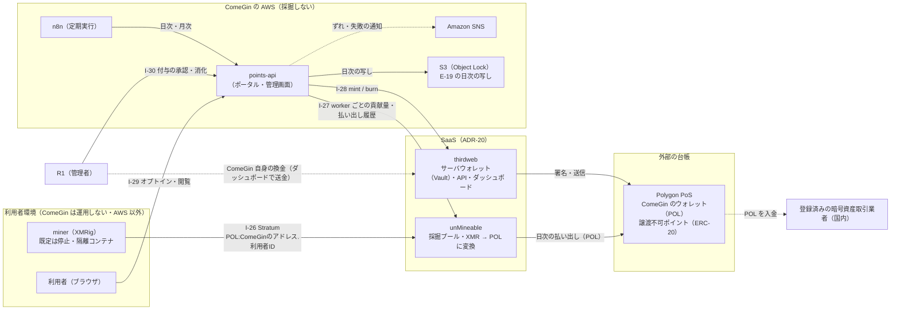
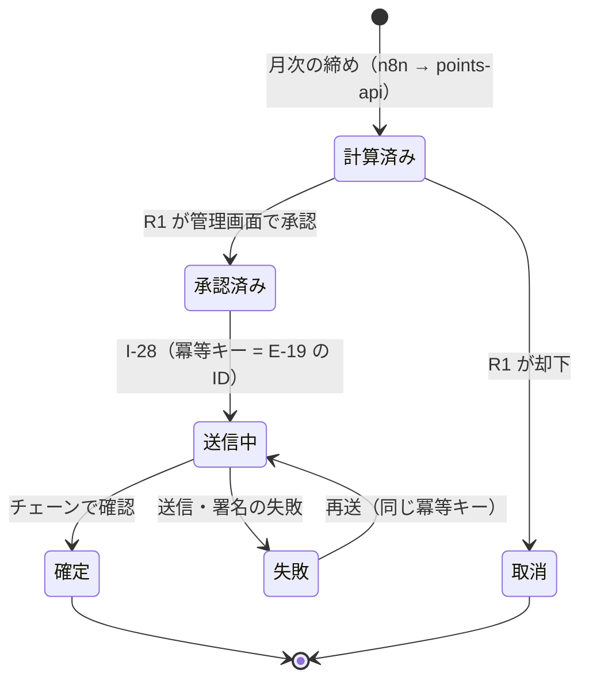

# マネタイズモデル（採掘と譲渡不可ポイント）の設計

- 作成日: 2026-10-03（同日に構成を「XMRig ＋ unMineable ＋ thirdweb（いずれも SaaS は SaaS のまま使う）」へ改訂）
- 状態: **spec のレビュー待ち**（各セクションはユーザーが会話で承認済み）
- 反映先: `MarketingDepartment/WebsiteOperations/docs/`（4 層 BA/DA/AA/TA と詳細設計）、リポジトリルートの `README.md`、`.claude/CLAUDE.md` のポート表
- 着手時期: **本システムの完成後**（既存の着手順の手順 0〜9 の後）。この spec は設計書への反映だけを対象にし、実装は含めない

## 0. 目的と前提

### 0.1 ユーザーの指示

SaaS 販売事業の事業経営基盤に、次のマネタイズモデルを加える。

| 流れ | 利用者 | ComeGin |
|---|---|---|
| キャッシュアウト | 本プロジェクトのシステムを動かすサーバ代、発注代金 | 本プロジェクトのデモアプリのサーバ代 |
| キャッシュイン | 採掘によって得られたトークンの配布 | 採掘によって得られた暗号資産、受注による報酬 |

構成（2026-10-03 のユーザーの指示）:

| 役割 | 製品 | 使い方 |
|---|---|---|
| マイニング | **XMRig** | 利用者のサーバで動かす（オープンソース） |
| マイニングプール（EVM 対応トークンに変換） | **unMineable** | **SaaS** |
| ウォレット / ダッシュボード | **thirdweb** | **SaaS** |

フレームワーク・ライブラリの追加は本システムの完成後に行う。

### 0.2 用語

- **利用者**: 無料 DL したソースコード（`cta_type: source_dl`）で、この基盤を自前のサーバに立てた事業者。主に福祉・介護・教育事業者
- **発注**: 利用者から ComeGin への、環境構築・受託開発・コンサル・業務提携の依頼（`BasicDesign/DesignSpec/website/01-content-spec.md` の料金表）
- **ポイント**: この設計で利用者に配るもの。ユーザーの指示の「トークン」にあたるが、性質を明確にするため本文では「ポイント」と書く
- **POL**: Polygon PoS のネイティブトークン。unMineable の払い出しに使う

### 0.3 会話で決まったこと

| # | 論点 | 決定 |
|---|---|---|
| D-1 | 採掘をどこで動かすか | **利用者の自前サーバのみ**（オプトイン）。ComeGin の AWS（本番・デモ）では一切動かさない |
| D-2 | トークンの性質 | 外部の取引業者を使う前提で、資金決済法に違反しないスキームを探す（ユーザーの指示）→ **案 A: 譲渡不可ポイント**を採用 |
| D-3 | デモアプリ | **採掘しない**（オプトインの画面だけを見せる） |
| D-4 | XMRig の配布 | **配布物に実行ファイルを含めない。** 導入時に公式のリリースを**ハッシュを固定して**取得する |
| D-5 | 着手前の承認ゲート | **3 つ置く**（弁護士・税理士・AWS 規約の確認。4 節） |
| D-6 | データ設計 | 3.2 のとおり（`E-17`〜`E-20`） |
| D-7 | thirdweb の使い方 | **SaaS**（サーバウォレット〈Vault〉・API・ダッシュボード）。当初はセルフホストの Engine ＋ AWS KMS としたが、ユーザーの指示で SaaS に改めた |
| D-8 | TA-01 の 8 節（SaaS に依存してよいもの） | **広げる。** 2 種類目を「自前で持てない外部の台帳（検索データ・ブロックチェーン・採掘プール）」にする。**AWS で用意でき、かつ費用と運用の負担が用途に釣り合う場合は AWS を優先する。釣り合わない場合は既存のベンダー、新しいベンダーの順に選ぶ**。thirdweb（SaaS）はこの基準に当たらず、**ユーザーの決定による例外**として ADR-20 に記録する |
| D-9 | 反映範囲 | 3.4 のとおり |
| D-10 | ルートの `README.md` | **「マネタイズモデル」と「追加するツール（XMRig・unMineable・thirdweb）」を追記する** |
| D-11 | チェーンの RPC | **thirdweb（SaaS）に含まれるものを使う。** AMB は提供終了のため使えず、AWS 上の自前のノードは用途に釣り合わない（1 節） |
| D-12 | `E-19` の改ざん対策 | **追記だけの表 ＋ S3 Object Lock。** QLDB は 2025-07-31 に提供終了（3.2） |
| D-13 | 採掘プール | **unMineable（SaaS）。** 採掘した XMR を unMineable が **POL（Polygon）** に変換して払い出す |
| D-14 | unMineable の払い出し先 | **ComeGin のアドレス**（thirdweb のサーバウォレット）。全量を ComeGin が受け取り、利用者には貢献量に比例した譲渡不可ポイントを付与する（スキーム A を維持） |
| D-15 | 払い出しのトークンとネットワーク、換金の経路（2026-10-03。ユーザーの調査を反映） | **トークンは POL、ネットワークは Polygon に固定する**（unMineable の払い出し・ComeGin のウォレット・国内の取引業者の入金の 3 か所すべて）。換金は **unMineable → ComeGin の thirdweb サーバウォレット → 国内の取引業者** の経路だけを使い、**unMineable から取引業者へ直接は送らない**（トラベルルールで送付人の情報を確認できず、保留の原因になるため）。取引業者への入金は「自分のプライベートウォレットからの送金」として申告する |

## 1. 設計を左右する外部の事実（2026-10-03 時点）

| 事実 | 内容 | 設計への帰結 |
|---|---|---|
| AWS の規約 | AWS Service Terms 1.25（全サービス共通）: "You will not use, and will not facilitate or allow End Users to use, the Services to mine cryptocurrency." GuardDuty にも採掘の検出がある（`CryptoCurrency:*`、`Impact:Runtime/CryptoMinerExecuted`） | AWS 上では採掘しない。XMRig の実行ファイルを S3・CloudFront で配布しない。`points-api` が unMineable の API を読むことが "facilitate" にあたらないかは承認ゲート G-3 で確認する |
| 採算 | ネットワークのハッシュレート約 5.78 GH/s、XMR 約 $407（2026 年 7 月）。1 vCPU（約 800 H/s）の採掘益は**月 $0.7 前後**（unMineable の手数料 1% の前）。Fargate の 1 vCPU は東京で**月 $37 前後** | 利用者はサーバ代の**約 2%** しか回収できない。**すでに払っているサーバの余った CPU だけを使う**設計にし、「採掘で元が取れる」と打ち出さない |
| 国内の規制 | 改正金商法が **2026-07-15 に成立、07-23 に公布**。暗号資産の根拠法が資金決済法から金商法に移り、**公布から 1 年以内に施行**。「暗号資産交換業」は「暗号資産取引業」に名前が変わる。発行者のいる暗号資産には新規販売時と継続的な情報公表の義務がかかる | 施行前（資金決済法）と施行後（金商法）の両方で、ComeGin が規制対象の行為を行わない形にする |
| unMineable の仕組み | XMRig（RandomX）の接続先を `rx.unmineable.com:3333`、`user` を `COIN:払い出し先アドレス.worker名` にすると、採掘した XMR を unMineable が指定のコインに変換し、**1 日 1 回自動で払い出す**（払い出しの手数料なし）。**採掘の手数料は 1%**（紹介コードで 0.75%）。払い出しのコインに **POL（Polygon）** がある | 払い出しは **POL（Polygon）で ComeGin のアドレスへ**。**ComeGin は XMR を一度も持たない**（XMR の換金経路の問題が消える） |
| unMineable の API | アカウント単位の API（HMAC-SHA256 署名。`x-user-api-key` など）に、**worker の一覧**（`GET /v1/workers`）、**ハッシュレートの時系列**（`GET /v1/workers/chart`）、**払い出しの履歴**（`GET /v1/payments`）がある | worker 名を利用者 ID にすれば、**利用者ごとの貢献量（`E-18`）と ComeGin の受け取り（`E-20`）を API で取れる** |
| unMineable の規制上の位置 | 海外の事業者で、XMR からの変換を行う。日本の暗号資産交換業（取引業）の登録は**確認できていない** | ComeGin は**自分の採掘の成果を受け取る利用者**として使う（他人のために変換するのではない）。この使い方で問題が無いかを**承認ゲート G-1 の確認項目に加える** |
| トークンとネットワークの一致 | unMineable は同じトークンでも複数のネットワーク（Ethereum・Polygon・Arbitrum・BSC など）から払い出し先を選べる。**送り先が対応していないネットワークで送ると着金せず、資産を失うおそれがある**（例: Arbitrum の ETH を Ethereum メインネットにしか対応しない取引業者へ送る） | **POL・Polygon に固定**（D-15）。ネットワークを変えるときは `承認`（`R1`）とし、取引業者の対応を先に確かめる |
| 国内の取引業者の POL（Polygon）への対応 | **bitbank**: POL の入出金は **Polygon ネットワークのみ**（確認済み）。**SBI VC トレード**: **Polygon PoS** の POL の入出庫に対応（画面上の表記は MATIC のまま。確認済み）。**GMO コイン**: 預入は「各銘柄の本来のネットワーク」にだけ対応すると公表しているが、**POL の取り扱いと対応ネットワークは確認できていない**（公式の対応表を取得できず）。登録番号（bitbank 関東財務局長 第00004号、GMO コイン 同 第00006号、SBI VC トレード 同 第00011号）はユーザーの調査による | 換金先の候補は **bitbank と SBI VC トレード**。GMO コインは要確認。登録番号は金融庁の登録業者一覧で確かめる（7 節） |
| トラベルルール | 国内の取引業者（JVCEA の会員）にはトラベルルール（送付人・受取人の情報の通知）が適用される（2023-06-01 施行の改正犯収法）。**採掘プールのような共有アドレスから取引業者へ直接送ると、送付人の情報を確認できず、入金の保留やトラブルの原因になる**（ユーザーの調査）。プライベートウォレットからの入金は、取引業者の画面で「自分のプライベートウォレットからの送金」として申告する | 換金の経路を固定する（D-15）。**申告で何を求められるか（署名による所有の確認など）は取引業者ごとに要確認**（7 節） |
| thirdweb（SaaS） | サーバウォレットの鍵は thirdweb の **Vault** が管理し、ダッシュボードで監視できる。署名のリクエストは 1,000 件まで込み、超過は $1/1,000 件。RPC は月 1M リクエストまで込み。ガス代の肩代わり（アカウント抽象化）は $1/1,000 件で、メインネットは 2.5% の上乗せ | 付与・消化は月に利用者数×2 件程度で無料枠に収まる。**アカウント抽象化は使わない**（ComeGin のサーバウォレットがガス代を直接払う） |
| AMB | **Amazon Managed Blockchain は提供を終了する。** 新規の受付は **2026-10-29** で終わり、既存の顧客も **2027-09-29** 以降は使えない | AMB は使わない |
| AWS 上の自前のノード | Node Runners に **Polygon PoS の設計図は無い**（L2 では Base がある）。Base の本番ノードは `i8ge.6xlarge`（東京で **$3.3516/時 ≒ 月 $2,450**）、データ約 9〜10 TB に加え、Ethereum の L1 の RPC とビーコン API が別途必要 | 用途に釣り合わないため採らない |
| Amazon QLDB | **2025-07-31 にサポート終了。** AWS が勧める移行先は Aurora PostgreSQL（履歴は pgAudit・Database Activity Streams、ジャーナルは S3 で置き換える） | `E-19` の改ざん対策は D-12 |
| Web3 on AWS | 現在の柱は、Node Runners（自前のノード）、AWS KMS と Nitro Enclaves（鍵と署名）、Public Blockchain Datasets（Bitcoin・Ethereum のデータ）、AWS Marketplace の事業者。**AMB は載っていない** | 鍵と署名は thirdweb（SaaS）に任せる（D-7）。Public Blockchain Datasets は Polygon を含まないため不要 |

## 2. スキームの選定

### 2.1 ComeGin が行わないこと

ComeGin（個人事業）は、次の 4 つを**自分では行わない**。外部の取引業者に任せるか、そもそも発生させない。

1. トークンを利用者に売る
2. 利用者の暗号資産を交換・媒介する
3. 利用者の暗号資産を預かる
4. 受け取った暗号資産（POL）を利用者に移す

ComeGin が**自分の** POL を登録済みの取引業者経由で円に換えることは、他人のために業として行う取引にあたらないため、ここに含めない。unMineable が XMR を POL に変換するのは、ComeGin が**自分の採掘の成果**について受けるサービスであり、ComeGin が他人のために行う変換ではない（G-1 で確認する）。

### 2.2 比べた 3 案と決定

| | **A. 譲渡不可ポイント（採用）** | B. 利用者が直接受け取る | C. 譲渡できるトークンを IEO で上場 |
|---|---|---|---|
| 採掘の行き先 | 全量を ComeGin のアドレスへ（unMineable が POL に変換） | 利用者自身のアドレスへ（unMineable が POL に変換）。ComeGin の収入は紹介報酬の 0.25% だけ | 全量を ComeGin へ |
| 利用者が受け取るもの | 移転できないポイント。ComeGin への発注代金の値引きにだけ使える | POL そのもの | 売買できる ERC-20 |
| 外部の取引業者の役割 | ComeGin が自社の POL を換金するときだけ | 利用者の換金 | 発行と販売の委託 |
| 法的な位置 | 不特定の相手と交換できないため、暗号資産にあたらない方向。**前払式支払手段にあたるかは弁護士の確認が要る** | ComeGin は他人の暗号資産を扱わないが、福祉事業者に海外のサービスからの受け取り・ウォレットの管理・換金を求める | 特定暗号資産の発行者として情報公表・監査・JVCEA の審査がかかる。個人事業には現実的でない |

**A を採る理由:**

- ComeGin が規制対象の行為を 1 つも行わない。
- 弁護士に確認する論点が絞れる（前払式支払手段にあたるか、unMineable の使い方）。
- ポイントの使い道を発注に限ることで、採掘が受注につながる。

**B と C を採らない理由:**

- B: ComeGin の収入がほぼ無く、利用者の負担が大きい。
- C: 個人事業の規模で発行者の義務を負えない。

### 2.3 ポイントの規則

- **1 ポイント = 発注代金 1 円の値引き。** 現金・暗号資産への払い戻しはしない。チェーンの上でも移転できない（ポイントのコントラクトの移転の権限〈`TRANSFER_ROLE`〉を ComeGin のサーバウォレットだけに与える）
- **付与量 = その月の ComeGin の採掘収入（POL の受け取りの円換算。`E-20`）× 利用者の貢献比（`E-18`）× 還元率**
- 還元率・有効期限・1 回の発注で使える上限は**未決定**（7 節）。付与率（還元率）の変更は `承認`（`R1`）

## 3. 設計

### 3.1 全体構造（セクション 1）

図は To-Be を描いている。状態はすべて `未着手`。

| 流れ | 中身 |
|---|---|
| 利用者が払う | 自分のサーバ代、発注代金（ポイントを差し引いた残り） |
| ComeGin が払う | デモアプリのサーバ代（AWS。**デモでは採掘しない**）、`points-api` の実行費、ガス代（POL）、unMineable の手数料（採掘の 1%）、thirdweb の無料枠を超えた分 |
| 利用者が受け取る | ポイント（移転できず、ComeGin への発注にだけ使える） |
| ComeGin が受け取る | POL（unMineable から日次）。`R1` が thirdweb のダッシュボードから国内の取引業者の入金アドレスへ送り、円に換える。受注の報酬 |

**境界の約束:**

1. **AWS 上では採掘しない。** `points-api` は unMineable の API を読み、thirdweb の API を呼ぶだけ。XMRig の実行ファイルは AWS で配布しない（D-4）
2. **採掘は既定で無効。** 利用者が自分で有効化したときだけ動く。同意は `E-17` に記録し、撤回すれば次の起動から止まる
3. **余った CPU だけを使う。** スレッドの上限を設け、負荷が高いときは止める。miner コンテナはボリュームを持たず、ネットワークの宛先は unMineable の接続先だけにする（福祉事業者のサーバには個人情報があり、XMRig はウイルス対策ソフトに検出されやすいため）
4. **ポイントを付与・消化するのは人間とサーバ側の処理だけ。** エージェントには渡さない
5. **POL を ComeGin のウォレットの外へ送る権限は AWS に置かない。** `points-api` に渡す thirdweb の資格情報は、ポイントのコントラクトへの mint・burn に限る。POL の送金（換金）は `R1` が thirdweb のダッシュボードで行う
6. **トークンとネットワークは POL・Polygon に固定し、換金の経路は 1 本だけにする**（D-15）。unMineable の払い出し、ComeGin のウォレット、取引業者の入金のネットワークがすべて Polygon であることを、払い出し先の設定時と送金のたびに確かめる。unMineable から取引業者へ直接送る設定（XMRig の `user` に取引業者の入金アドレスを書くこと）はしない

### 3.2 データ（セクション 2）

| ID | 型 | 中身 | 正本 | 複製先 | 個人情報の区分 |
|---|---|---|---|---|---|
| `E-17` | `MiningOptIn` | 利用者 ID・Mautic のコンタクト ID（`E-09` への参照）・同意文の版・同意日時・撤回日時・スレッドの上限 | `points-api` の DB（RDS、`ap-northeast-1`） | 利用者側の環境変数 `MINER_ENABLED`（既定 `false`） | 仮名（実名は `E-09` にだけ置く） |
| `E-18` | `MiningContribution` | worker（＝利用者 ID）× 日の、ハッシュレートと受理された share | **`points-api` の日次スナップショット**（発生源は unMineable の `/v1/workers`） | `E-19` の付与の根拠 | 仮名 |
| `E-19` | `PointTransaction` | 種類（付与 / 消化 / 打ち消し）・数量・根拠（`E-18` の期間、発注書番号、または打ち消す取引の ID）・承認者・冪等キー・相関 ID・tx hash。**状態は、取引ごとに追記する出来事の列から求める** | `points-api` の DB（**追記だけ**） | **チェーン上の残高**（公開の写し。利用者が検証できる）、**S3 の日次の写し**（Object Lock） | 仮名 |
| `E-20` | `MiningPayout` | unMineable からの POL の払い出し・受け取った時点の円換算・換金の記録 | **チェーン上の ComeGin のウォレットへの入金**（unMineable の `/v1/payments` と突き合わせる） | `points-api` の月次の円換算表（税務用） | 含まない |

**判断:**

- **`E-18` の正本は自前のスナップショット**にする。unMineable の履歴の保持期間をこちらで決められず、付与の根拠が後から消えるため（`E-12` が Lighthouse の JSON を手元に貯めるのと同じ考え方）
- **`E-19` の正本は DB**、チェーンは複製先。チェーンには「なぜ付与したか」「誰が承認したか」を書けない。DB の合計とチェーンの残高を日次で突き合わせ、ずれたら SNS で通知する
- **`E-20` の正本はチェーン上の入金**にする。unMineable の画面の数字ではなく、実際に ComeGin のウォレットに入った POL を収入とする（税務の根拠を外部の SaaS の表示に置かない）
- **ポイントのアドレスは ComeGin がサーバ側で作る**（thirdweb のサーバウォレット）。利用者にウォレットを持たせない。thirdweb の「メールでログインするウォレット（in-app wallet）」は、メールアドレスが米国に渡るため使わない
- **発注を表す型（`Order`）は作らない。** SFA が未選定（BA-01）。消化の根拠は発注書番号を外部の参照として持つ
- **`E-19` は追記だけにする（D-12）。** QLDB は提供を終えており、AWS の推奨構成（PostgreSQL ＋ S3）に沿って次の 2 段で守る
  1. **追記だけの表。** `points-api` の DB ユーザーに INSERT と SELECT だけを許し、UPDATE・DELETE を許さない（権限の付与は DB の管理者が行い、アプリの資格情報では変えられない）。取引の状態の変化（計算済み → 承認済み → …）は、取引ごとの**出来事（event）として行を追記**し、現在の状態は最新の出来事から求める。訂正は**打ち消しの取引**を新しく起こす
  2. **S3 の日次の写し。** 前日分の出来事を日次で S3 に書き出し、**Object Lock のコンプライアンスモード**で保管期間中は誰も（ルートユーザーも）消せず上書きもできないようにする。保管期間は帳簿と同じ（税理士の確認。目安 7 年）。写しを書く資格情報は `points-api` のサーバー側だけが持ち、削除の権限を持たない。ADR-18 の `E-15` の写しと同じ仕組み
  - **チェーンとの役割分担**: 残高の改ざんはチェーンとの突き合わせで、理由・承認者の改ざんは追記だけの表と S3 の写しで防ぐ
  - **採らないもの**: Aurora PostgreSQL・pgAudit・Database Activity Streams。Activity Streams は Aurora 専用で、既存の設計は RDS for PostgreSQL を使う。追記だけの表と Object Lock で「書き換えられない」が成り立つため、「書き換えを記録する」仕組みは要らない

**`E-19` の状態遷移:**

消化（burn）は、`R1` が管理画面で実行した時点で `承認済み` から始まる（`R1` の操作そのものを承認として扱う）。

**状態の遷移は行の更新ではなく、出来事の追記で表す**（D-12）。たとえば 1 件の付与は「計算済み」「承認済み」「送信中」「確定」の 4 行になり、現在の状態は最新の行で決まる。`確定` の後の訂正は、状態を戻すのではなく打ち消しの取引（別の `E-19`）を起こす。

**DA-05（個人情報）:**

- チェーンには**アドレスと数量だけ**を書く。削除請求を受けたら、DB にある「アドレスと利用者の対応」を消す。これでチェーン上の記録は誰のものか特定できなくなる。この扱いは同意文に明記する
- **S3 の写し（Object Lock）も同じ扱いにする。** 写しには仮名の `E-19` だけを入れ、実名につながる対応（`E-17` の Mautic のコンタクト ID）は**写さない**。`E-17` は追記だけにせず削除できるようにしておき、削除請求では `E-17` を消して、消せない写しとチェーンを誰のものか特定できない状態にする
- 越境が 2 つ増える。いずれも氏名・メールアドレスは渡らない
  - **unMineable（海外）**: 利用者のサーバの IP アドレス、worker 名（＝利用者 ID）、ComeGin のアドレス
  - **thirdweb（米国）**: アドレスと数量、ComeGin のサーバウォレットの操作の記録
  - 利用者は事業者なので、「訪問者・顧客」とは別の区分で書く
- 保持期間は「税理士に確認、目安は 7 年」（`E-19` と `E-20` は値引きと収入の帳簿の根拠になる）

**DA-02（指標）:** `MINE-optin`、`MINE-hashrate`、`PT-granted`、`PT-redeemed`、`PT-redeem-rate`（付与したポイントのうち発注に使われた割合）、`REV-mining-jpy`。**KPI ツリーの 2 本の式には入れない。** 受注数へのつながりは `PT-redeem-rate` で観測する。

### 3.3 アプリケーション（セクション 3）

**新しいアプリケーションと SaaS:**

| アプリ | 置き場所 | 中身 |
|---|---|---|
| `miner` | 利用者環境 | XMRig のコンテナ。既定は停止で、`MINER_ENABLED=true` のときだけ起動する。接続先は `rx.unmineable.com:3333`、`user` は `POL:<ComeGin のアドレス>.<利用者 ID>` |
| unMineable | **SaaS**（海外） | 採掘プール。XMR を POL に変換し、日次で ComeGin のアドレスへ払い出す。API で worker ごとの貢献量と払い出しの履歴を返す |
| thirdweb | **SaaS**（米国） | ComeGin のサーバウォレット（鍵は Vault）、ポイントのコントラクト（ERC-20、`TRANSFER_ROLE` で移転を封じる）への mint・burn、RPC、ダッシュボード（残高・取引の監視、`R1` による POL の送金） |
| `points-api`（自作） | AWS（ECS on Fargate。RDS の `points` データベース。開発ポート **3106**） | 貢献量の取り込み、付与量の計算、付与・消化の指示、日次の突き合わせと S3 への写し。**利用者ポータル**（オプトインと撤回、残高と履歴。ログインは SES で送るメールのワンタイムリンク）と、**管理画面**（付与の承認、消化、付与率の変更、月次の円換算表。ALB の関門〈ADR-13〉の後ろ）を持つ |

**連携点（`I-26`〜`I-30`）:**

| # | 発信元 → 受信先 | 種別 | トリガー | E-ID | 冪等性 | 失敗時の扱い |
|---|---|---|---|---|---|---|
| I-26 | `miner` → unMineable | **Stratum**（新しい種別） | 常時 | （unMineable の中で `E-18` になる） | unMineable の仕様に従う | 利用者のサーバの中で完結する。ComeGin からは「貢献量が 0」としてしか見えない |
| I-27 | `points-api` → unMineable の API | API（HMAC 署名） | 日次（n8n） | `E-18` `E-20` | 有り（worker × 日、払い出しの UUID で upsert） | 再取得する。保持期間を過ぎると取り戻せないため、**3 日続けて失敗したら SNS** |
| I-28 | `points-api` → thirdweb の API → チェーン | API | 付与（`R1` の承認後）・消化（`R1` の操作） | `E-19` | 有り（`E-19` の ID を冪等キーにする） | 送信待ちのまま残し、再送する。**DB とチェーンを日次で突き合わせ、ずれたら SNS** |
| I-29 | 利用者 → `points-api`（ポータル） | API | オプトイン・撤回・閲覧 | `E-17` `E-19` | 有り（同意の版 × 利用者） | 失敗を利用者に明示する（`I-08` と同じ扱い） |
| I-30 | `R1` → `points-api`（管理画面） | API | 付与の承認・消化・付与率の変更 | `E-19` | 有り | 失敗を明示する。**エージェントの経路は無い** |

- ComeGin の POL の換金（thirdweb のダッシュボード → 国内の取引業者）は**連携点にしない。** `R1` の手作業であり、BA-04 の業務プロセスとして次の手順で書く
  1. 取引業者の画面で POL の入金アドレスを表示し、**ネットワークが Polygon であること**を確かめる
  2. 取引業者の画面で、送付元を「**自分のプライベートウォレット**」（ComeGin の thirdweb サーバウォレットのアドレス）として申告する（初回、または取引業者が求めるとき）
  3. 初回とアドレスを変えた後は、**少額で試しに送り**、着金を確かめてから残りを送る
  4. thirdweb のダッシュボードから、**Polygon ネットワーク**で POL を送る
  5. 着金を確かめて売却し、送金の tx hash・売却の約定・円の金額を `E-20` の換金の記録に残す
- 採掘プールは自前で立てない（AWS に置けば 1.25 に正面から抵触する）

**エージェントと改善ループ（AA-03・AA-04）:**

- 新しいエージェントと MCP サーバ（`points-mcp`）は作らない。指標は管理画面の月次表で人間が見る
- 既存の 12 本のエージェントは、ポイントの付与・消化と付与率の変更が `禁止`。ただし `E-13` で付与率の変更を**提案することは許す**（承認と反映は `R1`）
- 暴走条件を 2 件足す（11 件 → 13 件）
  - **#12** 付与率がエージェント経由で承認なしに変わる → 歯止めは「変更の経路が管理画面にしか無い」こと
  - **#13** 採掘が利用者の業務を圧迫する → 歯止めは「miner がスレッドの上限と負荷で自分から止まる」こと。ComeGin から観測できないため、検出は「部分的」

**ADR-20（AA-05）:** 「マネタイズモデル: 利用者の自前サーバでの採掘（オプトイン、unMineable 経由）と、譲渡不可ポイントの付与（thirdweb）」。

- **採らなかった案**: B、C、AWS 上での採掘、自前のプール、Monero 向けのプールで XMR を受け取る構成（国内で換金できない）、**thirdweb Engine のセルフホスト ＋ AWS KMS**（2026-10-03 に一度採り、同日にユーザーの指示で SaaS に改めた）、AMB（提供終了）、AWS 上の自前のノード（用途に釣り合わない）、QLDB（提供終了）
- **TA-01 の 8 節の拡張**: 2 種類目を「自前で持てない外部の台帳（検索データ・ブロックチェーン・採掘プール）」に広げる。unMineable はここに入る。**AWS で用意でき、かつ費用と運用の負担が用途に釣り合う場合は AWS を優先する。** 釣り合わない場合は既存のベンダー、新しいベンダーの順に選ぶ
- **thirdweb（SaaS）は 8 節の 2 種類のどちらにも当たらない。** ユーザーの決定による例外として記録する（PostHog が当初の唯一の例外だったのと同じ扱い）。理由は、セルフホストの Engine（送信のキュー・nonce・更新の運用）と自前の署名の運用が、月に数百件の書き込みに釣り合わないため。**鍵を thirdweb の Vault が持つ**ことを TA-04 に明記する

### 3.4 反映範囲（セクション 4）

| 層 | 文書 | 反映する内容 |
|---|---|---|
| 原典 | ルートの `README.md` | 「マネタイズモデル」（キャッシュイン・アウトの 4 本とスキーム A の要約）と、「組み込むツール群」に XMRig・unMineable・thirdweb を追記する（**本システムの完成後に追加**と明記） |
| 原典 | `.claude/CLAUDE.md` | ポート割り当て表に 3106（`points-api`）を追加する（同ファイルの「新しくポートを使うときはこの表を崩さない」に従う） |
| 索引 | `docs/README.md` | トレーサビリティ表に `CAP-17` `CAP-18`（`未着手`）、着手順に「完成後」（ゲート G-1〜G-3 が前提）、ID 採番の範囲（`E-20` `I-30` `CAP-18` `ADR-20`）、横断の未決定事項、AA-05 の索引の行 |
| BA | BA-01 | バリューストリームにキャッシュの流れを追加。「受注」は対象外のままとし、**ポイントの消化だけが受注の境界をまたぐ**と明記する |
| | BA-02 | `CAP-17` 計算資源の受け入れ（採掘）、`CAP-18` ポイントの付与と消化。主担当は `R1` |
| | BA-03 | RACI に外部の関係者（利用者・弁護士・税理士）を `C` / `I` として追加。Accountable は人間 |
| | BA-04 | 業務プロセス 4 本: オプトインと撤回、月次の締めと付与、発注時の消化、ComeGin の換金（thirdweb のダッシュボード → 国内の取引業者。**ネットワークの確認・プライベートウォレットとしての申告・少額の試し送金**を含む 5 手順。3.3） |
| | BA-05 | 承認ゲート: G-1〜G-3（着手前）、月次の付与（`承認`・`R1`）、付与率の変更（`承認`・`R1`）、**払い出しのトークン・ネットワークの変更（`承認`・`R1`。取引業者の対応を先に確かめる）**、POL の送金（`R1` だけが行う）、エージェントによる付与・消化・付与率の変更・送金（`禁止`） |
| DA | DA-01 | `E-17`〜`E-20` の定義と ER 図、4.2「`E-17`〜`E-20` を立てた理由」 |
| | DA-02 | 6 指標（3.2） |
| | DA-03 | 利用者 ID ↔ `E-09` のコンタクト ↔ ポイントのアドレス ↔ unMineable の worker 名の対応 |
| | DA-04 | System of Record 表に 4 行、データフローに収益化の流れ |
| | DA-05 | 個人情報の区分、越境 2 件（unMineable・thirdweb）、保持期間、削除請求の扱い（チェーンと S3 の写しは対応を消して特定できなくする） |
| AA | AA-01 | ランドスケープ（C4）に `miner` `points-api` と SaaS 2 つ（unMineable・thirdweb）、外部の台帳（Polygon PoS）を追加 |
| | AA-02 | `I-26`〜`I-30`、種別 `Stratum`、手段の節、着手順 |
| | AA-03 | 権限の表に「付与・消化・付与率の変更・送金は全エージェント `禁止`」 |
| | AA-04 | 暴走条件 #12・#13 |
| | AA-05 | ADR-20 |
| TA | TA-01 | 境界「利用者環境」、8 節の拡張と「AWS 優先（費用と運用が釣り合う場合）」、thirdweb の例外、ポート 3106 |
| | TA-03 | 日次・月次の定期処理は本番の n8n から `points-api` を呼ぶ（ADR-17 の「エージェントを使わない決定論的な定期処理は n8n」） |
| | TA-04 | `points-api` の DB ユーザーは `E-19` に INSERT・SELECT だけ、S3 の写しを書く資格情報は書き込みだけで削除なし、unMineable の API キー・秘密と thirdweb の秘密鍵は Secrets Manager、**`points-api` に渡す thirdweb の資格情報は mint・burn に限り POL の送金を含めない**、Vault の管理者の鍵は AWS に置かない、ComeGin のアドレスは公開値 |
| | TA-05 | 監視: `I-27` の 3 日連続失敗、DB とチェーンのずれ、DB と S3 の写しの食い違い、S3 への写しの 2 日連続失敗を SNS へ |
| | TA-06 | ECS に `points-api`、RDS に `points` データベース、**`E-19` の写しの S3 バケット**（`ap-northeast-1`、パブリックアクセスを全ブロック、バージョニングと **Object Lock のコンプライアンスモード**を有効化。ADR-18 の `E-15` の写しのバケットとは分ける）。unMineable と thirdweb への外向きの通信が要る |
| | TA-07 | 開発環境: thirdweb は開発用のプロジェクトと Polygon Amoy テストネット、XMRig は unMineable に繋がないベンチマークの起動だけ |
| 詳細設計 | DD-08（新設） | `08-monetization-flows.md`: `I-26`〜`I-30` の電文、冪等キー、`E-19` の状態遷移、月次の締めの手順 |
| | DD-07 | unMineable の停止・API の変更・変換の停止、thirdweb の停止、DB とチェーンのずれ、DB と S3 の写しの食い違いの縮退運転 |
| | DD-01 | 種別 `Stratum` と `I-27`・`I-28` のタイムアウト |
| | DD の README | 索引と連携点の対応表 |
| 図 | `MarketingDepartment/WebsiteOperations/docs/diagrams/monetization-overview.drawio`（新設） | お金の流れの全体図（境界 4 つ: 利用者環境・SaaS・外部の台帳・ComeGin の AWS）。本文の図は Mermaid のまま |

**書き方の約束（既存の文書に合わせる）:**

- 状態は表に書き、図には書かない（`docs/README.md` の「この文書群の読み方」）
- 新しい ID は正本のファイルに足し、増やした理由をそこに書く
- 日付は `2026-10-03 に追加` の形で本文に残す

## 4. 承認ゲート（着手の前提）

| # | ゲート | 確認すること | 判断者 |
|---|---|---|---|
| G-1 | 弁護士の確認 | 譲渡不可ポイントが、施行前の資金決済法と施行後の金商法で、暗号資産・前払式支払手段・その他の規制対象にあたらないこと。**海外の unMineable に XMR から POL への変換を任せる使い方に問題が無いこと**。ComeGin のサーバウォレットの鍵を thirdweb（米国）が持つことの扱い。景品表示法の扱い。同意文の文言 | ユーザー（外部の弁護士） |
| G-2 | 税理士の確認 | 採掘収入（POL の受け取り）の計上時期と評価額、unMineable の手数料の扱い、ポイントの値引きの会計処理、帳簿の保存期間 | ユーザー（外部の税理士） |
| G-3 | AWS の規約の確認 | `points-api`（unMineable の API を読み、ポイントを付与する）が Service Terms 1.25 の "facilitate" にあたらないこと。必要なら AWS に問い合わせる | `R1` |

3 つが通るまで、`CAP-17` `CAP-18` は `未着手` のまま手を付けない。

## 5. 異常系（要点。詳細は DD-07 と DD-08 に書く）

| 事象 | 影響 | 扱い |
|---|---|---|
| unMineable が止まる・API が変わる | `E-18` が取れない。払い出しが止まる | 3 日続けて失敗したら SNS。付与はその期間を飛ばさず、取れた時点で締め直す |
| unMineable が変換・払い出しをやめる、サービスを終える | 収入が途絶える | 利用者の miner の接続先を変えるには配布物の更新が要る。**代わりのプールは選定しておかない**（YAGNI）。起きたら ADR を起票する |
| thirdweb が止まる | mint・burn が送れない | `E-19` は `承認済み` か `失敗` に留まり、復旧後に同じ冪等キーで再送する（付与は月次の締めなので数日の遅れは許容する） |
| DB とチェーンがずれる | 残高の不一致 | SNS で通知し、`R1` が `E-19` を正として補正の取引を起こす |
| DB と S3 の写しが食い違う | `E-19` の書き換えの疑い（追記だけの権限が崩れた） | SNS で通知する。S3 の写し（Object Lock）を正として調べる。日次の突き合わせは写しを書く処理と同じ処理で行う |
| S3 への日次の写しが失敗する | 写しが欠ける | 翌日に前日分も含めて書き直す（出来事の ID で冪等）。2 日続けて失敗したら SNS |
| ネットワークを取り違えて送る | 着金せず、資産を失うおそれ | 防止が中心（D-15・3.1 の約束 6・BA-04 の手順 1〜3）。起きたら取引業者に問い合わせる（取り戻せる保証は無い） |
| 取引業者で入金が保留される（トラベルルール） | 換金が遅れる | 取引業者の求めに応じて送付元を申告し直す。unMineable から直接送らないことで、起きにくくしている |
| unMineable の表示とチェーンの入金が食い違う | 収入の根拠が揺れる | `E-20` の正本はチェーンの入金。差は `R1` が月次で確かめる |
| 利用者のサーバで miner が暴走 | 利用者の業務の圧迫 | 利用者側のスレッドの上限と負荷による停止（暴走条件 #13）。ComeGin からは検出できない |

## 6. テスト・検証の方針（実装時）

この spec は設計書への反映だけを対象にし、実装しない。実装の段階では次を確かめる（リポジトリのルールにより、テストコードの作成・実行は明確な指示があってから行う）。

- Polygon Amoy テストネットで、ポイントが移転できないこと（`TRANSFER_ROLE` を持たないアドレスからの移転が失敗すること）
- `points-api` に渡す thirdweb の資格情報で、mint・burn はできて、POL の送金はできないこと
- 同じ冪等キーで `I-28` を 2 回送っても、付与が 1 回にしかならないこと
- unMineable の `/v1/workers` で、worker 名（利用者 ID）ごとのハッシュレートが取れること
- XMRig のスレッドの上限と負荷による停止が効くこと（unMineable に繋がないベンチマークの起動で確かめる）

## 7. 未決定事項

| 項目 | 内容 | 判断者 |
|---|---|---|
| 還元率・有効期限・1 回の発注での上限 | ポイントの規則（2.3）の数値 | ユーザー、`R1` |
| 換金先の取引業者の選定 | 候補は **bitbank と SBI VC トレード**（Polygon の POL に対応することを確認済み）。**GMO コインは POL の取り扱いと対応ネットワークが未確認**。いずれも**登録番号を金融庁の登録業者一覧で確かめ**、個人事業の口座で入金・売却ができることを確かめる | ユーザー |
| トラベルルールでの入金の申告 | 「自分のプライベートウォレットからの送金」の申告で、**署名による所有の確認などを求められるか**（取引業者ごとに異なる）。求められる場合、**thirdweb のサーバウォレットで所定の文への署名ができるか**。できなければ換金の経路を見直す | `R1` |
| thirdweb の資格情報の権限の絞り方 | `points-api` に渡す資格情報を「ポイントのコントラクトへの mint・burn だけ」に絞れるか（Vault のアクセストークンの権限設定）。絞れなければ、POL の受け取り用とポイントの操作用でサーバウォレットを分ける | `R1` |
| thirdweb のプラン | 無料枠で本番を回してよいか。レート制限と、秘密鍵に紐づく利用条件 | `R1` |
| unMineable の紹介コード | ComeGin 自身の紹介コードで手数料を 0.75% にできるか（自己紹介が規約で許されるか） | `R1` |
| XMRig の寄付の設定 | XMRig は既定で採掘時間の 1% を開発者に寄付する（`donate-level`）。そのまま残すか | `R1` |
| Web サイトでの告知 | サービス・料金ページにポイントの説明を載せるか。景品表示法・特定商取引法の表記（G-1 の結果に依存） | ユーザー、`R2` |
| 同意文の文言 | 採掘の内容、CPU の使い方、越境（unMineable・thirdweb）、チェーンと S3 の写しの記録が消えないこと（G-1 の結果に依存） | ユーザー、`R1` |

## 8. 参考

- [AWS Service Terms](https://aws.amazon.com/service-terms/)（1.25）
- [unMineable](https://unmineable.com/)、[対応コイン](https://unmineable.com/coins)、[API](https://www.unmineable.com/api)、[XMRig の設定](https://unmineable.com/support/article/how-to-setup-xmrig-for-cpu-mining)
- [unMineable の紹介制度（unMineable Referral Code Guide）](https://unmineable.wordpress.com/2026/05/08/unmineable-referral-code-guide/)
- [ポリゴンエコシステムトークン（POL）の取扱いを開始しました（bitbank）](https://bitbank.cc/blog/articles/310351801)、[bitbank の POL の入出金（Polygon ネットワークのみ）](https://bitbank.cc/blog/articles/933112080)
- [SBI VC トレードの POL（MATIC）の入出庫（MyForex）](https://myforex.com/ja/news/myf25021001.html)
- [暗号資産の送付・預入時のプラットフォーム（GMO コイン）](https://support.coin.z.com/hc/ja/articles/4408517936281)（取得できず。検索結果の要約による）
- [トラベルルールについてのよくあるご質問（bitbank）](https://support.bitbank.cc/hc/en-us/articles/4820198042393-Frequently-asked-questions-about-Travel-Rules)
- [トラベルルール（CoinPost）](https://coinpost.jp/crypto/exchange/travel-rule/)
- [thirdweb Pricing](https://thirdweb.com/pricing)、[Server Wallet](https://portal.thirdweb.com/dotnet/wallets/server-wallet)、[Wallet FAQ](https://portal.thirdweb.com/connect/wallet/faq)
- [Self-Host Engine（thirdweb）](https://portal.thirdweb.com/engine/v2/self-host)（採らなかった案の根拠）
- [Web3 on AWS](https://aws.amazon.com/web3/)
- [Amazon Managed Blockchain (AMB) end of support](https://docs.aws.amazon.com/managed-blockchain/latest/hyperledger-fabric-dev/managed-blockchain-end-of-support.html)
- [Migrating Amazon Managed Blockchain Node and RPC Workloads](https://docs.aws.amazon.com/managed-blockchain/latest/ethereum-dev/migrating-node-rpc-workloads.html)
- [AWS Blockchain Node Runners](https://github.com/aws-samples/aws-blockchain-node-runners)（`blueprints/base/samples/.env-mainnet-base-reth-full`）
- AWS Price List API: `i8ge.6xlarge`（Asia Pacific (Tokyo)、Linux、オンデマンド）$3.3516/時（2026-09-25 公開分）
- [[廃止] Amazon QLDB が 2025年7月31日に終了します（Classmethod）](https://dev.classmethod.jp/articles/amazon-qldb-eos-announcement/)
- [AWS kills QLDB（InfoQ）](https://www.infoq.com/news/2024/07/aws-kill-qldb)
- [Monero のハッシュレート（CoinWarz）](https://www.coinwarz.com/mining/monero/hashrate-chart)
- [Mining Monero 2026（Coin Bureau）](https://coinbureau.com/education/mining-monero)
- [暗号資産に係る規制・税制の改正の内容（長島・大野・常松）](https://www.nagashima.com/publications/publication20260424-1/)
- [金融商品取引法等改正法が成立（投信まるごとニュース）](https://toushin-news.jp/others/news-07152026-3/)
- [2027 年施行 暗号資産に関する金商法・資金決済法改正の概要（BUSINESS LAWYERS）](https://www.businesslawyers.jp/articles/1568)
- [ICO 規制（モノリス法律事務所）](https://monolith.law/blockchain/ico-regulation)
- [IEO（大和総研）](https://www.dir.co.jp/world/entry/ieo)
