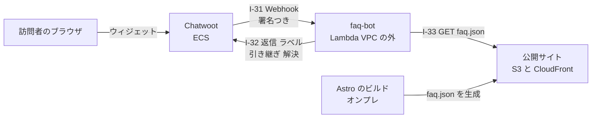

# Chatwoot の FAQ ボット（faq-bot）と ADR-26 の設計

- 日付: 2026-10-11
- 状態: 設計の承認待ち（会話での設計はユーザーが承認済み）
- 対象: サブプロジェクト ① 「ADR-26 ＋ faq-bot」。② consent-api の Lambda 化、③ admin-auth の Lambda 化は、この仕様の対象外（それぞれ別の仕様・計画・実装で進める。13 節）

## 1. 目的と合意した理解

**目的**: Chatwoot の受信箱「Web サイト」で、訪問者の質問に Web サイトの FAQ で答えるボットを動かす。答えられないときは人（`R3`）に引き継ぐ。答えられなかった質問は、自己改善ループ（FAQ の追加・修正の提案）に渡る。

**ユーザーが決めたこと（2026-10-11）**

| # | 決定 |
|---|---|
| D1 | 回答の選び方は**文字列の類似度**（外部 API を使わず、返すのは必ず FAQ の原文） |
| D2 | 改善ループへの渡し方は**ラベルだけ**（`faq-answered` / `faq-unmatched` / `faq-handoff`）。ボットは訪問者の発言を Chatwoot の外に書き出さない |
| D3 | **常時稼働が不要なものは Lambda にする**（ADR-26 として記録する）。faq-bot は Lambda で作る |
| D4 | ADR-26 は**既存の consent-api・admin-auth にも適用し、今回の一連の作業で移す**。ただし 3 つのサブプロジェクト（① ADR-26＋faq-bot → ② consent-api → ③ admin-auth）に分け、この順に進める |
| D5 | テストは**単体と結合の両方を作る**（`.claude/rules/devops-testing.md` の「明確な指示」にあたる） |
| D6 | モジュールごとにフォルダを作る。改善の仕組みはオンプレ、製品はクラウド、データの置き場は AWS（ADR-21） |

**確かめた事実（開発の Chatwoot v4.18.0 のソース。2026-10-11）**

- **Captain（Chatwoot の AI）は使えない。** `enterprise/app/models/enterprise/account.rb` が `ChatwootApp.self_hosted_paid?` のときだけ `captain_integration` を有効にする（有償ライセンスが要る）。
- **エージェントボット（Webhook 型）を受信箱に付けると、新しい会話は `pending` で始まる**（`app/models/conversation.rb`）。
- **ボットへの通知**（`app/listeners/agent_bot_listener.rb`）: `message_created`・`message_updated`・`conversation_*`・`webwidget_triggered`。メッセージのイベントは `incoming`・`outgoing`・`template` のものだけ（`webhook_sendable?`）。
- **送信**（`lib/webhooks/trigger.rb`）: `X-Chatwoot-Delivery`（送り直しでも同じ値）・`X-Chatwoot-Timestamp`・`X-Chatwoot-Signature: sha256=HMAC-SHA256(secret, "<timestamp>.<body>")`。**打ち切りは 5 秒**（`WEBHOOK_TIMEOUT` の既定）。**送り直すのは応答が 429 か 500 のときだけ**で、3 秒おきに最大 3 回（`RETRYABLE_AGENT_BOT_STATUSES`、`app/jobs/agent_bots/webhook_job.rb`）。**タイムアウト・接続の失敗・502 などは送り直さない。**
- **送り直さない失敗か、送り直しの 3 回目の失敗で、Chatwoot が会話を `pending` から `open` にし、活動メッセージを残す**（`handle_failure` → `update_conversation_status`。`message_created`・`message_updated` のときだけ。アカウントの `keep_pending_on_bot_failure` が偽のとき）。**ボットが落ちても、会話は人に渡る。**
- **ボットのトークンで呼べる API は限られる**（`app/controllers/concerns/access_token_auth_helper.rb` の `BOT_ACCESSIBLE_ENDPOINTS`）: 会話の `show`・`toggle_status`・`toggle_typing_status`・`toggle_priority`・`create`・`update`・`custom_attributes`、メッセージの `create`、担当の `create`、ラベルの `index`・`create`。**メッセージの一覧（`index`）は呼べない。**
- **会話の `show` は、最新のメッセージ 1 件・ラベル・ステータスを返す**（`app/views/api/v1/conversations/partials/_conversation.json.jbuilder`）。
- **ラベルの `create` は付け替え**（`update_labels` が `label_list` を置き換える）。足すときは今のラベルと合わせて送る。
- **選択肢（`content_type: input_select`）を訪問者が選ぶと、新しいメッセージは作られず、ボットのメッセージの `content_attributes.submitted_values` が更新され、`message_updated` が届く**（ウィジェットの `store/modules/message.js`、`Api::V1::Widget::MessagesController#update`）。
- FAQ の正本は Astro の `frontend/verdant-virgo/src/modules/site-content/`（`top.ts` 6 件・`pricing.ts` 6 件・`services.ts` 4 サービス × 計 18 件）。型は `FaqItemCopy { question; answer; marker?: '要記入' | '要確認' }`。

## 2. ADR-26（AA-05 に追加する決定）

**ADR-26 常時稼働が不要な自作の部品は Lambda で動かす**

- **状態**: `決定済み`（ユーザーの 2026-10-11 の決定）。**TA-06 の 3.1 の「実行基盤を ECS on Fargate にそろえる」と、DD-02 の 8.1 の consent-api を ECS にした理由（実行基盤を増やさない）を置き換える。** ADR-21 の置き場所の基準（改善の仕組みはオンプレ、製品はクラウド、データは AWS）は変えない。
- **基準**:
  - **Lambda にする**: 要求・イベントが来たときだけ動き、1 回の処理が短く（数秒）、接続を持ち続けない自作の部品。
  - **ECS に残す**: 上流の製品（Mautic・Chatwoot の Web・Worker・cron。管理画面・WebSocket・常駐のジョブを持つ）と、常駐が要る自作の部品。
- **適用**: faq-bot（新規。この仕様）、consent-api と admin-auth（既存。サブプロジェクト ②③ で移す。どちらも ALB の配下のまま、ターゲットを `ip` から `lambda` に替え、VPC の中の Lambda にする）、points-api（未着手。着手時にこの基準で判断する）。
- **理由**: 呼ばれないあいだ費用がかからない（ECS の常時 1 タスクは 0.25 vCPU・0.5 GB で月 11 USD 前後。概算）。SAM が Lambda を直接扱うため、デプロイ手順は同じ `sam build` / `sam deploy` に収まる。
- **帰結**: 監視が 2 種類になる（ECS の `RunningTaskCount` と Lambda の `Errors`。どちらも SNS の `ops` に送る）。ALB の配下に置く Lambda は、ALB と Lambda の形式（ヘッダー・Cookie・本文の変換）に合わせる入口が要る（開発は Node の HTTP サーバーのまま。処理の本体と入口を分ける）。
- **覆すのに必要な根拠**: コールドスタートで要件（Chatwoot の 5 秒、ALB の OIDC の IdP 呼び出し）を満たせないと分かること、または Lambda の運用（同時実行数・VPC の ENI）が ECS より重いと分かること。

## 3. 全体の構成



- **faq-bot は VPC の外の Lambda に、関数 URL（認証 `NONE`）で置く。** 届く先は Chatwoot の公開の API（`https://chat.comegin.com/api/v1/accounts/*`。TA-06 の 5.4 で機械向けに開けてあるパス）と公開サイトの `faq.json` だけで、VPC・セキュリティグループ・NAT に何も足さない。
- **入口の守りは署名と時刻**（6.1）。関数 URL はインターネットに開くが、Chatwoot の HMAC の署名と 5 分以内の時刻を満たさない要求は何もせず 401 を返す（n8n の `I-12` と同じ守り方）。
- **データの置き場を持たない。** FAQ はメモリ、会話の状態は Chatwoot の会話（ステータス・ラベル・最新のメッセージ）から読む。訪問者の発言は Chatwoot の外に残さない（D2）。
- ADR-21 との関係: 訪問者が使う部品なのでクラウドに置く（オンプレの n8n に置くと、開発機の停止でボットも止まる）。

## 4. モジュールとフォルダ

### 4.1 `backend/faq-bot`（自作のサービス。新規）

構成は consent-api・admin-auth に合わせる（pnpm 11・TypeScript・zod・vitest。`package.json` の scripts は `build` / `start` / `dev` / `typecheck` / `test` / `test:integration`）。

| パス | 責務 | 依存 |
|---|---|---|
| `src/config.ts` | 環境変数を zod で検証。失敗時は変数名と理由だけを stderr に出して終了（値は出さない） | zod |
| `src/constants.ts` | 名前・既定のしきい値・時刻の許容幅・本文の上限 | — |
| `src/faq/` | `faq.json` の取得・検証・正規化済みの索引の作成・10 分ごとの更新（失敗したら直前の索引を使い続ける） | `matcher/` の正規化 |
| `src/matcher/` | 文字列の正規化と文字 2-gram の Dice 係数。上位 N 件とスコアを返す。**副作用なし** | — |
| `src/chatwoot/` | 署名の検証（`signature.ts`）、ボットのトークンで呼ぶ API クライアント（`client.ts`）、イベントの型と検証（`events.ts`） | node:crypto、fetch |
| `src/dialog/` | イベントと会話の状態から「何をするか」を決める（`decide.ts`。**副作用なし**）と、それを実行する（`execute.ts`。二重回答の防止を含む） | `faq/`、`matcher/`、`chatwoot/` |
| `src/handler.ts` | 入口に依存しない本体: `(method, headers, rawBody) → { status, body }` | 上のすべて |
| `src/lambda.ts` | 本番の入口（Lambda の関数 URL のイベント → `handler`）。コールドスタートで Secrets Manager から秘密値を 1 回だけ読む | `@aws-sdk/client-secrets-manager` |
| `src/server.ts` | 開発の入口（Node の HTTP サーバー。3107。`127.0.0.1` に bind） | node:http |
| `setup/index.mjs` | 開発の setup モジュール（`setup/lib/core.mjs` の契約。4.4） | — |
| `tests/` | 単体テスト（11 節） | vitest |
| `integration/` | 結合テスト（11 節） | vitest |
| `README.md` | 使い方・環境変数・Chatwoot の落とし穴（ボットのトークンで呼べる API など） | — |

### 4.2 `frontend/verdant-virgo/src/modules/faq-export/`（新規）と `src/pages/faq.json.ts`

- `faq-export/index.ts`: `site-content` の FAQ（トップ・料金・4 サービス）を集め、`marker` の無い項目だけを `faq.json` の形（5 節）にする。他モジュールからは `index.ts` だけを import する（既存のモジュールの規約）。
- `src/pages/faq.json.ts`: 静的エンドポイント（ビルド時に `dist/faq.json` を出す）。sitemap に載らない。

### 4.3 `cloud/`（SAM）

- `cloud/stacks/services/faq-bot.yaml`（新規）: `AWS::Serverless::Function`（Node.js 22、arm64、メモリ 256 MB、**タイムアウト 4 秒**、**予約同時実行数 5**）、関数 URL（`AuthType: NONE`）、ロググループ（保持期間は既存のサービスと同じ）、実行ロール（Secrets Manager の `comegin/<env>/faq-bot/*` の読み取りとログの書き込みだけ）。
- `cloud/stacks/secrets.yaml`: `faq-bot/CHATWOOT_BOT_TOKEN` と `faq-bot/CHATWOOT_BOT_SECRET` のプレースホルダを足す。
- `cloud/stacks/alarms.yaml`: faq-bot の `Errors > 0`（1 分）を SNS の `ops` に送るアラームを足す（`TreatMissingData: notBreaching`）。
- `cloud/template.yaml`: 上をつなぎ、パラメータ（しきい値・`FaqUrl`・`ChatwootBaseUrl`・`ChatwootAccountId`）を足す。
- **パッケージは `sam build` の esbuild でまとめる**（ECR は使わない）。

### 4.4 開発環境

- **ポート 3107**（faq-bot の開発サーバー）。`.claude/CLAUDE.md` のポート表に足す（3105 は旧 Cal.com の欠番のまま残す）。
- **`middleware/host-relay` に 3107 を足す**（開発の Chatwoot〈Docker〉→ `host.docker.internal:3107` → ホストの `127.0.0.1:3107`）。`middleware/host-relay/README.md` の表も更新する。
- **`backend/chatwoot-system/setup/index.mjs` に足す処理**（冪等）: ラベル 3 つ（`faq-answered`・`faq-unmatched`・`faq-handoff`）の作成、エージェントボット「FAQ ボット」の作成（`outgoing_url` は `http://host.docker.internal:3107/webhook`）、受信箱「Web サイト」への接続。ボットのトークンと `secret` は `~/.config/comegin/setup/dev.state.json` にだけ置く。
- **`backend/faq-bot/setup/index.mjs`**: state から faq-bot の `.env` を作る（`CHATWOOT_BASE_URL=http://127.0.0.1:3100`、`FAQ_URL=http://localhost:4321/faq.json` など）。`after: ["chatwoot"]`。
- エージェントボットの作成は Application API（`/api/v1/accounts/{id}/agent_bots`）で行う。**API で作れない場合だけ** rails runner を使う（既存の setup の方針と同じ。実装時に確かめる）。

## 5. `faq.json` の形（I-33 の契約）

```json
{
  "version": 1,
  "generated_at": "2026-10-11T00:00:00.000Z",
  "items": [
    {
      "id": "services-consulting-2",
      "question": "契約の期間と解約を教えてください",
      "answer": "コンサルティング契約書と発注書を取り交わします。…",
      "url": "https://comegin.com/services/consulting#detail-faq",
      "context": "コンサル"
    }
  ]
}
```

- `id` は「ページの識別子-ページ内の順番（1 から。`marker` で除いた項目も数える）」。ページの識別子は `top`・`pricing`・`services-<slug>`。
- **トップの項目（`top-`）は、ウィジェットを開いたときの一覧にも使う**（`docs/superpowers/specs/2026-10-12-faq-bot-welcome-design.md`。2026-10-12 に追加）。id の形を変えると一覧が空になる。
- `context` はページの名前（料金は「料金」、サービスは `SERVICE_CARDS[slug].title`〈環境構築・受託開発・コンサル・業務提携〉、トップは `null`）。**同じ質問が複数のページにある**ため（2026-10-11 の時点で「契約の期間と解約を教えてください」が 3 件〈答えが違う〉、「クラウドの利用料は料金に含まれますか？」が 2 件〈答えが同じ〉など）、選択肢の見出しを「質問（context）」にして見分けられるようにする。照合の索引は「context ＋ 質問」で作る（context を前に置くと、質問の末尾の定型句を削れる）（「コンサルの契約期間は？」のような質問が該当のページに寄る）。
- `url` は `SITE_URL` ＋ ページのパス ＋ FAQ の見出しのアンカー（既存の `SectionHeading` の `id`）。トップは `/#top-faq`、料金は `/pricing#pricing-faq`、サービスの詳細は `/services/<slug>#detail-faq`（`src/pages/index.astro`・`pricing.astro`・`services/[slug].astro` で確認済み）。
- **`marker` のある項目（`【要記入】`・`【要確認】`）は出さない。**
- faq-bot は `version` が 1 でない、または `items` が 0 件の応答を受け付けない（直前の索引を使い続ける。索引が無ければ失敗として扱う。8 節）。

## 6. 連携点

| ID | 発信元 → 受信先 | 種別 | 内容 |
|---|---|---|---|
| **I-31** | Chatwoot → faq-bot | Webhook（エージェントボット） | `message_created`・`message_updated` ほか。署名つき。打ち切り 5 秒。送り直しは 429・500 のときだけ最大 3 回 |
| **I-32** | faq-bot → Chatwoot | API（ボットのトークン） | 会話の `show`、メッセージの `create`、ラベルの `create`、`toggle_status` |
| **I-33** | faq-bot → 公開サイト | HTTP GET | `faq.json` をコールドスタート時と 10 分ごとに取得 |

### 6.1 署名と時刻の検証

1. `X-Chatwoot-Timestamp` と `X-Chatwoot-Signature` が無ければ 401。
2. `|現在時刻 − timestamp| > 300 秒` なら 401（古い要求の再送を拒む）。
3. `sha256=` の後ろと `HMAC-SHA256(CHATWOOT_BOT_SECRET, "<timestamp>.<生の本文>")` を `timingSafeEqual` で比べ、違えば 401。**本文は解析する前の生のバイト列で計算する。**
4. 本文の上限は 64 KB（超えたら 413）。JSON として読めない、または型に合わなければ 400。

## 7. 会話の流れ

### 7.1 扱うイベント（それ以外は 200 で何もしない）

| イベント | 条件 |
|---|---|
| `message_created` | `message_type` が `incoming`（訪問者の発言）。**本文の無い発言（添付だけ）も空の質問として扱い、担当者に引き継ぐ**（2026-10-11 の最終レビューで修正。旧版は無視していたため、会話が `pending` のまま誰にも見えなくなった） |
| `message_updated` | ボット自身の `input_select` のメッセージで、`content_attributes.submitted_values` がある（訪問者が選択肢を選んだ） |
| `webwidget_triggered` | 訪問者がウィジェットを開いた。会話が無いか直前の会話が `resolved` のときだけ、会話を作ってトップページの FAQ の一覧を出す（2026-10-12 に追加。`docs/superpowers/specs/2026-10-12-faq-bot-welcome-design.md`） |

- 処理の前に会話の `show` を呼び、**ステータスが `pending` のときだけ**続ける（`open` 以降は人の担当。イベントの本文のステータスは古いことがあるので信用しない）。
- ボット自身の `outgoing` の `message_created` は扱わない（無限の往復を防ぐ）。

### 7.2 判定（`dialog/decide.ts`）

**正規化**: NFKC → 小文字 → 空白・句読点・記号を削る → 末尾の定型句（「ですか」「でしょうか」「ますか」「ください」「教えて」など。一覧は `constants.ts`）を削る。FAQ の質問も同じ正規化をして、起動時に 2-gram の集合を作っておく。

**スコア**: 文字 2-gram の Dice 係数（`2|A∩B| / (|A|+|B|)`）。1 文字だけの入力は 1-gram で比べる。

| 状況 | 返すメッセージ（1 回の応答で 1 通） | ラベル | ステータス |
|---|---|---|---|
| 1 位 ≥ 上のしきい値（既定 0.5）**かつ** 1 位 − 2 位 ≥ 差のしきい値（既定 0.1） | `input_select`。本文は **FAQ の回答の原文 ＋ 改行 ＋「詳しくは: <url>」**。選択肢は［解決しました］［担当者に相談する］ | `faq-answered` を足す | `pending` のまま |
| 下のしきい値（既定 0.25）≤ 1 位、かつ上の条件を満たさない | `input_select`。本文は「次のどれに近いですか？」。選択肢は上位 3 件の FAQ の質問（値は FAQ の `id`）と［どれにも当てはまらない］ | — | `pending` のまま |
| 1 位 < 下のしきい値 | 引き継ぎ（7.3） | `faq-unmatched` を足す | `open` |
| 選択: FAQ の `id` | 上の「答える」と同じ（その FAQ を返す） | `faq-answered` を足す | `pending` のまま |
| 選択:［どれにも当てはまらない］ | 引き継ぎ | `faq-unmatched` を足す | `open` |
| 選択:［担当者に相談する］ | 引き継ぎ | `faq-handoff` を足す | `open` |
| 選択:［解決しました］ | テキスト「お役に立ててよかったです。ほかにもご質問があれば、いつでもどうぞ。」 | （足さない） | `resolved` |
| 索引の FAQ が 0 件（取得できていない） | 失敗として扱う（8 節） | — | — |

- **「1 位 − 2 位」の 2 位は、1 位と答えが実質同じ項目を飛ばして数える**（正規化した答えの一方が他方を含めば同じとみなす。例: 「表示価格はすべて税別です。」と「いいえ。表示価格はすべて税別です。」）。答えが同じ重複のせいで、答えられる質問が候補の提示に落ちないようにする。
- **候補の選択肢の見出しは「質問（context）」**（context が `null` なら質問だけ）。同じ見出しが並ばないようにする。
- **しきい値 3 つは環境変数**（`FAQ_MATCH_HIGH`・`FAQ_MATCH_LOW`・`FAQ_MATCH_MARGIN`）。実装時に言い換えの例文で決め直す（11 節の評価）。以後は `conversation-triage`（`CAP-12`）がラベル別の件数を E-12 に残し、調整は `proposal-writer` の提案（E-13）を通す。
- 選択肢の値: FAQ の `id`、`__none`（どれにも当てはまらない）、`__handoff`（担当者に相談する）、`__resolved`（解決しました）。
- **選択肢を選ばずに文字を打った場合は、新しい質問として扱う。**

### 7.3 引き継ぎ

1. テキスト「担当者におつなぎします。順番にお返事しますので、このままお待ちください。」を送る。
2. ラベルを足す。
3. `toggle_status` で `open` にする。

以後、会話は `pending` でないためボットは何もしない。`open` で担当者のいない会話は、n8n の週次の棚卸し（`R3` に通知）の対象になる。

### 7.4 実行の順序と二重回答の防止（`dialog/execute.ts`）

ボットのトークンはメッセージの一覧を読めないため、**会話の `show` が返す `last_non_activity_message`**（活動メッセージを除いた最新の 1 件。`messages` の 1 件はラベルやステータスの変更の活動メッセージになりうるので使わない。`_conversation.json.jbuilder` と `Message.non_activity_messages` で確認済み）で判断する。

1. `show` を呼ぶ（ステータス・ラベル・`last_non_activity_message`）。`pending` でなければ終了。
2. **送信の要否**（対象のメッセージ ＝ `message_created` なら訪問者の発言、`message_updated` なら選ばれたボットのメッセージ）:
   - `last_non_activity_message` の `id` が対象と同じ → まだ答えていない。1 通送る（`content_attributes.in_reply_to` に対象の `id` を入れる）。
   - `last_non_activity_message` が対象より新しい **`template`（`message_type` が 3）** → Chatwoot が自動で足したもの（ウィジェットの最初の発言の直後の連絡先の入力欄。2026-10-11 の結合テストで判明）で、訪問者の発言ではない。まだ答えていないとみなして 1 通送る。
   - `last_non_activity_message` が対象より新しい `outgoing`（`message_type` が 1）で、送信者の `type` が `agent_bot` → その `content_attributes.in_reply_to`（ボットは返事に必ず入れる。Chatwoot は同じ会話のメッセージの id ならそのまま残す。`Messages::InReplyToMessageBuilder`）で見分ける（2026-10-11 の最終レビューで修正。旧版は「送信は済んでいる」の一択で、古い選択肢を後から押すと解決・引き継ぎが黙って実行された）:
     - 対象への返事 → **送信は済んでいる**。送らずに 3・4 だけ行う。
     - 対象より前の発言への返事 → 対象にはまだ答えていない（続けて送られた 2 つの質問の競合）。1 通送る。
     - 対象より後の発言への返事、または `in_reply_to` が無い → **古いイベント**として何もしない（前の回答の［解決しました］を後から押した、など）。
   - それ以外（訪問者がその後に発言した、など）→ **古いイベント**として何もしない（新しい発言は、そのイベントで扱われる）。
3. ラベルを「今のラベル ∪ 足すラベル」で送る（冪等）。
4. ステータスを変える必要があれば `toggle_status`（冪等）。

- 2〜4 のどこかで失敗したら例外にする（8 節）。Chatwoot が送り直したときは、2 の判定で送信を飛ばし、3・4 をやり直す。
- 「古いイベント」の規則により、訪問者が次の発言をした後に古いイベントが届いても、同じ回答を 2 回送らない。

## 8. 失敗時の扱い

| 失敗 | 扱い | 訪問者から見える結果 |
|---|---|---|
| 署名・時刻の不一致 | 401。何もしない | 変化なし |
| `faq.json` の更新に失敗 | 直前の索引を使い続ける。警告をログに出す | 変化なし |
| `faq.json` を一度も取れていない（索引が空） | 例外 → `Errors` のアラーム。関数 URL は 502 を返し、**Chatwoot は送り直さずに会話を `open` にする** | 返事は無いが、すぐ人の担当に移る |
| Chatwoot の API の失敗（4xx/5xx・通信失敗） | 例外（同上） | 同上 |
| 4 秒以内に終わらない | Lambda の打ち切り（`Errors` に数えられる）→ 同上 | 同上 |
| 同時実行数の上限（5）を超える | 関数 URL が 429 を返す → **Chatwoot が 3 秒おきに最大 3 回送り直す**（7.4 の判定で二重に送らない） | 遅れて返事が来るか、人に移る |

- **失敗を 500 ではなく例外（502）にする理由**: 500 を返すと Chatwoot は送り直すが、Lambda の `Errors` に数えられず、アラームに別の仕組み（ログのメトリクスフィルター）が要る。訪問者を待たせずに人へ渡すほうを優先し、例外にする。

**ログ**: 1 件の処理ごとに JSON 1 行（会話の番号・イベント・判定・1 位のスコア・処理時間・結果）。**メッセージの本文・氏名・メールアドレス・トークンは出さない。** 例外のスタックは出すが、上流の応答の本文は出さない。

## 9. 環境変数（`backend/faq-bot/.env.example` が正本）

| 変数 | 開発 | 本番 | 説明 |
|---|---|---|---|
| `CHATWOOT_BASE_URL` | `http://127.0.0.1:3100` | `https://chat.comegin.com` | I-32 の宛先 |
| `CHATWOOT_ACCOUNT_ID` | setup が入れる | パラメータ | アカウントの ID |
| `CHATWOOT_BOT_TOKEN` | setup が入れる | Secrets Manager | ボットのトークン（`api_access_token`） |
| `CHATWOOT_BOT_SECRET` | setup が入れる | Secrets Manager | 署名の鍵（ボットの `secret`） |
| `FAQ_URL` | `http://localhost:4321/faq.json` | `https://comegin.com/faq.json` | I-33 |
| `FAQ_REFRESH_SECONDS` | 600 | 600 | 索引の更新間隔 |
| `FAQ_MATCH_HIGH` / `FAQ_MATCH_LOW` / `FAQ_MATCH_MARGIN` | 0.5 / 0.25 / 0.1 | 同じ | しきい値（7.2） |
| `PORT` / `HOST` | 3107 / 127.0.0.1 | （使わない） | 開発の入口だけ |
| `SECRETS_PREFIX` | （使わない） | `comegin/prod/faq-bot` | 本番の入口だけ。コールドスタートで読む |

## 10. 更新する文書

| 文書 | 内容 |
|---|---|
| `docs/RequirementDefinition/AA/05-application-decisions.md` | **ADR-26**（2 節）。決定の一覧と ADR-21・TA-06 の 3.1・DD-02 の 8.1 への注記 |
| `docs/RequirementDefinition/AA/02-integration-architecture.md` | I-31・I-32・I-33 |
| `docs/RequirementDefinition/AA/01-application-landscape.md` | faq-bot を足す |
| `docs/RequirementDefinition/BA/02-capability-map.md` | `CAP-12` に FAQ ボットを足す |
| `docs/DetailedDesign/04-server-to-server-flows.md` | I-31〜I-33 のフロー（7 節） |
| `docs/DetailedDesign/07-failure-and-degradation.md` | 8 節の縮退 |
| `docs/RequirementDefinition/TA/05-observability-and-ops.md` | Lambda の `Errors` のアラーム |
| `docs/RequirementDefinition/TA/06-aws-runtime.md` | 3.1 の注記（ADR-26）、faq-bot の行 |
| `cloud/README.md` | faq-bot のデプロイと本番の Chatwoot への登録の手順（12 節） |
| `.claude/CLAUDE.md` | ポート 3107、自作コードの表に faq-bot |
| `middleware/host-relay/README.md` | 3107 |

## 11. テスト

単体テストは既存の決まりに従う: 対象ごとに `describe("正常系")` / `describe("異常系")`、各公開関数・エンドポイントに `空入力: ` のケース、異常系の名前は `入力: `（検証・形式）か `サーバ: `（上流の 4xx/5xx・通信失敗・タイムアウト・AWS SDK の例外）で始める。外部はモック。`testTimeout` / `hookTimeout` は 30 秒。

| 種別 | 置き場 | 対象 |
|---|---|---|
| 単体 | `backend/faq-bot/tests/` | `config`・`matcher`（正規化・Dice・順位）・`faq`（取得・検証・更新の失敗時に直前の索引を保つ）・`chatwoot/signature`（正しい署名・改ざん・時刻のずれ・ヘッダー欠落）・`chatwoot/client`（呼ぶパスとヘッダー、4xx/5xx・タイムアウト）・`dialog/decide`（7.2 の表の全行）・`dialog/execute`（7.4 の送信の要否、送り直しでの再実行）・`handler`（401/400/413/200）・`lambda`（関数 URL のイベントの変換、秘密値の読み込みの失敗）・`server` |
| 単体（評価） | `backend/faq-bot/tests/matcher-eval.test.ts` | 言い換えの例文（`tests/fixtures/paraphrases.json`。各 FAQ に 2 文以上と、FAQ に無い質問）で、既定のしきい値の正答率・誤答率が基準（正答 80% 以上、FAQ に無い質問を答えてしまう誤答 0 件）を満たすこと。FAQ はリポジトリの `faq-export` の出力を使う |
| 単体 | `frontend/verdant-virgo` の `faq-export` | `marker` のある項目を出さない、`id`・`url` の形、件数 |
| 結合 | `backend/faq-bot/integration/`（`vitest.integration.config.ts`、`pnpm test:integration`） | **開発の Chatwoot を本物として使う**（`faq.json` だけテスト内の偽の HTTP サーバー）。ウィジェットの公開 API（`website_token`）で訪問者として会話を作り、答える・候補・どれにも当てはまらない・担当者に相談・解決の各経路で、返信・ラベル・ステータスを確かめる。faq-bot を止めたとき（接続できない）、会話が `open` になること。テストデータは `it-` 接頭辞で作り、`afterAll` で消す |

## 12. 本番への反映（手順を `cloud/README.md` に書く。実行はしない）

`.claude/rules/build-deploy.md` により、ビルドとデプロイはこの作業では実行しない。手順だけを書く。

1. 本番の Chatwoot でラベル 3 つとエージェントボット「FAQ ボット」を作る（管理画面か `chatwoot-prod` の MCP。`outgoing_url` は後で入れる）。ボットのトークンと `secret` を Secrets Manager に入れる。
2. `sam build` / `sam deploy`（faq-bot のスタックと、アラーム・Secrets の追加）。
3. 出力の関数 URL をボットの `outgoing_url` に入れる（末尾は `/webhook`）。
4. 公開サイトを `faq.json` 入りでビルド・配信する。
5. 受信箱「Web サイト」にボットを接続する。
6. 確認: ウィジェットで質問し、回答・ラベル・引き継ぎを確かめる。CloudWatch のアラームが鳴っていないこと。

## 13. 対象外と後続

- **サブプロジェクト ②: consent-api の Lambda 化**。ALB のターゲットを `lambda` にし、VPC の中の Lambda で Valkey につなぐ。`Set-Cookie`・CORS の変換、接続の再利用。
- **サブプロジェクト ③: admin-auth の Lambda 化**。同上（RDS につなぐ）。`migrate`・`register-alb-client` を 1 回だけの Lambda の呼び出しに移す。**ALB の OIDC が IdP（トークン・UserInfo）を待つ時間を、公式文書で確かめられていない**（2026-10-11 に検索して見つからなかった）。コールドスタートと DB の接続を含めて実測する。
- **対象外**: LLM による判定・生成（D1）、営業時間外の自動応答（Chatwoot の受信箱の営業時間の設定で行う）、多言語（日本語のみ）。

## 14. 未決定事項

- **しきい値の既定値**（0.5・0.25・0.1）は **11 節の評価で決めた値**（2026-10-11。FAQ にある質問の言い換え 43 件で正答率 93.0%〈直接の回答 22 件・候補 18 件〉、別の答えを直接返したもの 0 件、FAQ に無い質問 10 件はすべて引き継ぎ）。外れた 3 件（「提携できる条件は何ですか」「採掘に協力しないといけませんか」「記事を書いてもらうこともできますか」）は言い換えが FAQ の文と文字で重ならないもので、文字列の類似度の限界である。本番のラベル別の件数を見て見直す。判断者 `R3`。
- **ボットの名前と文言**（「FAQ ボット」、7.2・7.3 の文）。仮の文言で実装し、`R3` が見直す。
- **開発の Chatwoot でエージェントボットを API で作れるか**（4.4）。作れなければ rails runner で作る。
