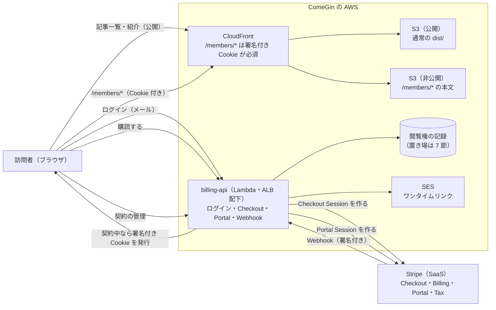

# Stripe による決済・請求・税（受託の請求と有料コンテンツの読み放題）の設計

- 作成日: 2026-10-25
- 状態: **spec のレビュー待ち**（1 節の決定はユーザーが会話で承認済み。3 節以降の「推奨」は未承認）
- 計画の出典: Stripe の `stripe_implementation_planner`（guide `iguide_61VdZln9853KBqnpz41CRkFqiv80L`、2026-10-25 に accepted。構成は `checkout_type: hosted`・`origin_context: web`）
- 反映先（承認後）: 4 層の設計書（BA/DA/AA/TA）と詳細設計、`.claude/CLAUDE.md` のポート表、料金の正本 `frontend/verdant-virgo/src/modules/site-content/pricing.ts`（金額は変えない）
- この spec は設計だけを対象にする。コードは承認後に書く（テストコードの作成・実行は明確な指示があってから。`.claude/rules/devops-testing.md`）

## 0. 目的と前提

### 0.1 ユーザーの指示（2026-10-25）

- 事業: SaaS システムの受託開発、FDE、有料コンテンツの販売
- 使う Stripe の製品: Payments、Invoicing、Tax
- 公開サイト: `https://comegin-astro-dev.ngrok.app`（開発。`frontend/verdant-virgo`）

### 0.2 コードから読み取った前提

| 前提 | 出典 | 設計への帰結 |
|---|---|---|
| 表示価格はすべて税込 | `pricing.ts` の `TAX_NOTE` | Price は `tax_behavior: inclusive`。表示額をそのまま請求し、登録後は Stripe がその中から消費税を切り出す |
| 支払いは「カードは申込日に初回、以後 1 か月ごと」「銀行振込は月末締め・翌月末払い」 | `pricing.ts` の `PAYMENT_TIMING` | カード＝サブスクの自動課金、振込＝請求書（`collection_method: send_invoice`）と `due_date` |
| 月額の起点は「契約締結日または発注日の、いずれか遅い日」 | `pricing.ts` の `BILLING_START` | サブスクの `billing_cycle_anchor`（または開始日）を Dashboard で指定する |
| 受託はすべて `/contact` 経由の営業 | `pricing.astro` | 受託の決済画面は作らない（Dashboard の見積・請求書） |
| 公開サイトは静的ビルド（アダプターなし） | `astro.config.mjs` | 有料の本文を通常の `dist/` に出すと誰でも読める。**本文の配信に関門が要る**（3.2） |
| 訪問者側は認証・認可をしない | `docs/README.md`（本番の管理画面の関門） | 読み放題には「誰が契約者か」が要る。**新しい ADR が要る**（3.3） |
| 常時稼働が不要な自作の部品は Lambda | ADR-26 | 新サービス `billing-api` は ALB 配下の Lambda（`consent-api` と同じ型） |

### 0.3 会話で決まったこと

| # | 論点 | 決定 |
|---|---|---|
| D-1 | 有料コンテンツの形 | **月額の読み放題**（単品販売はしない） |
| D-2 | 受託・FDE・コンサルの請求 | **Stripe の Dashboard で手動**（見積〈Quote〉→ 請求書／月額はサブスク）。システムから自動で作らない |
| D-3 | 消費税の立場 | **適格請求書発行事業者の登録手続き中。** 登録が済むまで Stripe Tax は閾値の監視だけ（徴収しない） |
| D-4 | 販売先 | **国内のみ**（JPY だけ） |
| D-5 | 決済画面 | **Stripe ホストの Checkout**（リダイレクト）。埋め込みや自前のフォームは作らない |
| D-6 | 税コード | 受託開発・環境構築 = `txcd_20060000`（Professional Services）、コンサル = `txcd_20060048`（Consulting Services）、読み放題 = `txcd_10503005`（Digital other news or documents - viewable only - subscription）。**最終判断は税理士に確認する**（[Tax Codes API](https://docs.stripe.com/api/tax_codes)） |

## 1. Stripe 側の構成（サンドボックスは 2026-10-25 に作成済み）

対象はサンドボックス「ComeGinサンドボックス」（`acct_1UU3bGCRkFqiv80L`、`livemode: false`）。**本番（live）には何も作っていない。** 本番に移すときは同じ構成を作り直す（ID は変わるので、コードは `lookup_key` で Price を引く）。

### 1.1 商品と価格

1 プラン = 1 Product。同じ Product に複数の Price を付けるのは、同じプランの請求の違い（月額・年額など）に限る。

| Product | ID（サンドボックス） | 税コード | Price の `lookup_key` | 金額（税込） | 種類 |
|---|---|---|---|---|---|
| 本プロジェクトの環境構築 | `prod_VVCVOwpPeZA85N` | `txcd_20060000` | `environment_setup_jpy` | 23,000円 | 一回 |
| 受託開発：バイブコーディングのみ | `prod_VVCVNMd9iKIK0e` | `txcd_20060000` | `development_vibe_jpy` | 50,000円 | 一回 |
| 受託開発：要件定義〜運用保守 | `prod_VVCV64FvBfUlmM` | `txcd_20060000` | `development_full_monthly_jpy` | 500,000円／月 | 月額 |
| 受託開発：保守のみ | `prod_VVCVoxxO4iHNIG` | `txcd_20060000` | `maintenance_monthly_jpy` | 150,000円／月 | 月額 |
| コンサル | `prod_VVCVrXXYloa2ah` | `txcd_20060048` | `consulting_session_jpy` | 31,250円／回（4回から。数量 4 以上で請求） | 一回 |
| 有料コンテンツ：読み放題 | `prod_VVCVwZN0Nytf96` | `txcd_10503005` | （**未作成。金額が未決定**。7 節） | — | 月額 |

- 業務提携（要相談）は Product を作らない。契約ごとに請求書の明細を手で起こす
- Product の `metadata.pricing_key` は `pricing.ts` の `PricingKey` と同じ値にした（保守のみは `development-full` ＋ `variant: maintenance`）
- **金額の正本は `pricing.ts` のまま。** Stripe の Price は写しであり、金額を変えるときは両方を変える（Price は金額を変えられないので、新しい Price を作って `lookup_key` を `transfer_lookup_key` で移す）

### 1.2 Customer Portal（`bpc_1UUC7fCRkFqiv80LseLLvZY2`、既定）

| 機能 | 設定 | 理由 |
|---|---|---|
| 解約 | 有効・**期間の終わりに解約**（`at_period_end`）・日割りなし・理由を聞く | 払った期間は読めるようにし、返金の手間を作らない |
| プランの変更 | 無効 | 読み放題は 1 プランだけ |
| 支払い方法の変更・請求の履歴 | 有効 | |
| 顧客情報の変更 | メール・氏名・住所・税 ID | 住所は税の計算に使う |
| ホストのログインページ | **有効**（メールで届くリンクでログイン） | 契約の管理だけなら、自前のログインを作らなくても契約者が使える |
| プライバシーポリシー | `https://comegin-astro-dev.ngrok.app/legal/privacy` | **利用規約のページが無い**ため `terms_of_service_url` は空（7 節） |

### 1.3 Tax（現状）

- Tax Settings は `active`（本社の国 = JP）。既定の `tax_behavior` は `inferred_by_currency`（JPY は内税）
- 登録（Registrations）は **0 件**
- 2026-10-25 の試算（Tax Calculation、東京都の住所、上の 3 つの税コード）: `tax_type: jct`・`taxability_reason: not_collecting`・税額 0。**税コードは Nontaxable ではないので、原因は登録が無いこと**（D-3 のとおり）

### 1.4 Dashboard で行う設定（コードなし。`R1` が行う）

1. **支払い方法**: カードと**銀行振込（`jp_bank_transfer`。顧客ごとに仮想口座が割り当てられ、金額と参照が合えば自動で消し込まれる）**を有効にする。コードでは `payment_method_types` を渡さない（動的な支払い方法）
2. **ブランディング**: ロゴ・色・請求書のフッター
3. **請求書のテンプレート**（`rendering[template]`）: メモ（振込の案内・支払期限の書き方）、フッター、カスタム項目（発注書番号など）。受託の請求書はこれを付けて作る
4. **Revenue Recovery**: Smart Retries・失敗時のメール・カード情報の自動更新を有効にする。すべての再試行が失敗したら**解約**にする（読み放題）
5. **見積（Quote）**: 月額 500,000円・150,000円の案件は Quote で送り、承諾されたらサブスクに変わる。銀行振込の顧客は `collection_method: send_invoice` と `due_date`（翌月末）

## 2. 受託・FDE・コンサルの請求（D-2）

| 場面 | 作り方 | 支払い | 確認 |
|---|---|---|---|
| 単発（環境構築・バイブコーディング・コンサル 4 回〜） | Dashboard で請求書（テンプレートを適用、Product を選ぶ）。`auto_advance: true` | **Hosted Invoice Page**（`hosted_invoice_url` を顧客に送る。カード・振込・3DS は Stripe が扱う） | Dashboard の請求書一覧。CSV を税理士へ |
| 月額（要件定義〜運用保守・保守のみ） | Quote → 承諾 → サブスク。起点は `BILLING_START` | カードは自動課金、振込は請求書（月末締め・翌月末払い） | 同上。振込の一部入金は手で充当する |

- **連携点は作らない**（Webhook も受けない）。会計システムへの同期が要るかは 7 節
- 振込は、入金が着いても `invoice.paid` の時点で手元の現金ではない（着金まで日数がかかる）

## 3. 有料コンテンツの読み放題（D-1・D-5）

### 3.1 全体構造



### 3.2 本文の配信（推奨: CloudFront の署名付き Cookie）

| | **A. CloudFront の署名付き Cookie（推奨）** | B. Astro を SSR にする | C. billing-api が本文を返す |
|---|---|---|---|
| 公開サイト | 静的のまま。`/members/*` だけ別の非公開の置き場へ出す | アダプターを入れ、全ページの配信を変える | 静的のまま |
| 関門 | CloudFront（期限付きの Cookie を `billing-api` が発行） | Astro のミドルウェア | Lambda が毎回確認 |
| Lighthouse・SEO | 変わらない（有料の本文は `noindex`） | 配信が変わり、計測の前提が崩れる | 変わらない |
| 費用と運用 | 鍵ペアの管理だけ | Node の常時稼働か Lambda への載せ替え | 記事ごとに Lambda が動く |

**A を推す理由**: ADR-26（常時稼働しない）と既存の静的配信を崩さず、関門をアプリの外（CloudFront）に置けるため。Cookie の期限は短くし（例: 1 時間）、切れたら `billing-api` が閲覧権を確かめて出し直す。

### 3.3 契約者の識別（推奨: メールのワンタイムリンク）

- パスワードは持たない。メールアドレスに SES でワンタイムリンクを送り、開いたら `billing-api` がセッションの Cookie（`HttpOnly`・`Secure`・`SameSite=Lax`）を発行する。points-api の利用者ポータル（`docs/superpowers/specs/2026-10-03-monetization-design.md` の 3.3）と同じ方式
- 契約者 1 人 = Stripe の Customer 1 件。対応（メール ↔ `cus_...`）は `billing-api` の記録が正本。Checkout には既存の Customer を渡し、初回は `customer_creation` に任せて Webhook で対応を記録する
- **ADR-30（案）**: 「有料コンテンツの契約者に限り、訪問者を識別する（メールのワンタイムリンク）。管理画面の関門（ADR-13）とは分け、Google Workspace は使わない」

### 3.4 billing-api（新設）

| 項目 | 内容 |
|---|---|
| 置き場所 | `backend/billing-api`（`consent-api` と同じ構成: `src/handler.ts`・`src/lambda.ts`・`src/server.ts`・`src/config.ts`） |
| 本番 | ALB 配下の Lambda（ADR-26）。ホスト名は案 `billing.comegin.com` |
| 開発ポート | 案 **3108**（ポート表の空き。3105 は Cal.com の履歴があるため使わない） |
| 依存 | `stripe`（Node SDK v23。API バージョン `2026-09-30.endive`）、`zod` |
| Stripe の鍵 | **制限付きキー（`rk_`）**。権限は Checkout Sessions・Customer Portal・Customers が書き込み、Subscriptions・Invoices・Prices が読み取り。本番は Secrets Manager、開発は `.env`（追跡しない。`.env.example` を同時に更新） |
| SDK の使い方 | `new Stripe(key)` のインスタンスを使う（グローバルの API キーは使わない） |

**パス（許可リスト。増やさない）:**

| メソッドとパス | 用途 |
|---|---|
| `POST /v1/login` | メールを受け取り、ワンタイムリンクを送る（応答は常に同じ。登録の有無を漏らさない） |
| `GET /v1/login/callback` | リンクの検証、セッションの発行、契約中なら署名付き Cookie も発行 |
| `POST /v1/checkout` | 読み放題の Checkout Session を作って URL を返す（ログイン必須） |
| `POST /v1/portal` | Customer Portal のセッションを作って URL を返す（ログイン必須） |
| `GET /v1/me` | 契約の状態（`active` / `past_due` / `canceled` / `none`）を返す |
| `POST /v1/stripe/webhook` | Stripe の Webhook（署名の検証。Origin の検査はしない） |

**Checkout Session の作り方:**

```ts
const session = await stripe.checkout.sessions.create({
  mode: 'subscription',
  customer: customerId,             // 既存の契約者。初回は省略し customer_creation に任せる
  line_items: [{ price: membershipPriceId, quantity: 1 }], // lookup_key で引いた ID
  automatic_tax: { enabled: true }, // 登録が無い間は 0 円（D-3）。登録を足せばコードを変えずに徴収が始まる
  // payment_method_types は渡さない（動的な支払い方法）
  integration_identifier: 'comegin-membership-<8 文字の英字>',
  custom_text: { submit: { message: '<特商法の最終確認の文言。7 節>' } },
  success_url: `${SITE_URL}/members/welcome?session_id={CHECKOUT_SESSION_ID}`,
  cancel_url: `${SITE_URL}/members`,
});
```

- success ページは表示だけで、**閲覧権の付与は Webhook で行う**（success ページは閉じられたり、二度開かれたりする）

### 3.5 Webhook（必須）

| イベント | 処理 |
|---|---|
| `checkout.session.completed` | `payment_status` を確かめ、Customer の対応と Subscription の ID を記録する |
| `checkout.session.async_payment_succeeded` / `_failed` | 非同期の支払い方法の結果を反映する |
| `customer.subscription.created` / `updated` / `deleted` | 閲覧権の状態（`status`・`current_period_end`・`cancel_at_period_end`）を写す |
| `invoice.paid` | 更新の成功。閲覧権を延ばす |
| `invoice.payment_failed` | `past_due` にする（Smart Retries が再試行する間の扱いは 7 節） |
| `charge.refunded` / `charge.dispute.created` / `radar.early_fraud_warning.created` | Subscription をたどって状態を記録し、SNS で `R1` に通知する（返金・チャージバック・不正の兆候） |

- 署名は生の本文で検証する（`stripe.webhooks.constructEvent`）。秘密は `STRIPE_WEBHOOK_SECRET`
- **冪等**: `event.id` を記録し、同じイベントは 2 回処理しない。順序は保証されないので、状態は Stripe の Subscription を取得し直して上書きする
- イベントとアプリの記録の対応は、metadata ではなく Stripe のオブジェクト（Customer → Subscription）でたどる
- 開発では `stripe listen --forward-to localhost:3108/v1/stripe/webhook` で受ける

### 3.6 データ（案。採番は承認後に DA-01 へ）

| ID（案） | 型 | 中身 | 正本 | 個人情報 |
|---|---|---|---|---|
| `E-21` | `Member` | メール・Stripe の Customer ID・作成日時・削除日時 | `billing-api` の記録 | 実名情報（メール） |
| `E-22` | `Entitlement` | Subscription の ID・状態・期間の終わり・最後に処理したイベントの ID | **Stripe の Subscription**（`billing-api` は写し） | 仮名 |

- カード番号は持たない（Stripe のホスト画面だけが扱う。PCI DSS は SAQ A の範囲）
- 越境: Stripe, Inc.（米国）にメール・氏名・住所・支払い情報が渡る。DA-05 に区分を足し、プライバシーポリシーに書く

## 4. Tax の運用（D-3）

1. **いま**: 徴収しない。Checkout と請求書は `automatic_tax` を有効にしておく（税額は 0 円）。**この間「税込」と表示した額に消費税は含まれない扱いになる**ので、表示の扱いは税理士に確認する（7 節）
2. **登録の通知が来たら**（`R1`。確認を取ってから実施）:
   - Stripe に JP の登録を追加する（`active_from` は登録日）。**Stripe への追加は国税庁への登録の代わりにならない**
   - アカウントの税 ID に T 番号（`jp_trn`）を入れ、請求書に表示する
   - 試算（Tax Calculation）で `taxability_reason` が `not_collecting` でなくなったことを確かめる
3. **本番（live）でも同じ設定を作り直す**（サンドボックスの登録・設定は本番に反映されない）
4. 適格請求書の記載事項（登録番号・税率ごとの対価と税額など）を Stripe の請求書が満たすかは、テンプレートと合わせて税理士に確認する

## 5. 異常系（要点）

| 事象 | 影響 | 扱い |
|---|---|---|
| Webhook が届かない・失敗する | 閲覧権が古いまま | Stripe は最大 3 日再送する。`/v1/me` とログイン時に Subscription を取得し直して補う |
| イベントの順序が入れ替わる | 状態の巻き戻り | 毎回 Subscription を取得し直して上書きする（3.5） |
| 更新の支払いが失敗 | `past_due` | Smart Retries の間の閲覧の可否は 7 節。最後に失敗したら解約 → `deleted` で閲覧権を外す |
| チャージバック・不正の兆候 | 売上の取り消し | SNS で `R1` に通知し、Dashboard で対応する |
| Stripe の障害 | 新規の購読・Portal が使えない | 既存の契約者は記録した閲覧権で読める（期限までは Stripe に問い合わせない） |

## 6. 反映範囲（承認後）

| 層 | 文書 | 反映する内容 |
|---|---|---|
| 原典 | `.claude/CLAUDE.md` | ポート表に 3108（`billing-api`） |
| BA | BA-02・BA-04・BA-05 | ケイパビリティ（案 `CAP-19` 請求と回収、`CAP-20` 有料コンテンツの提供）、受託の請求の手順（2 節）、Tax の登録の追加を `承認`（`R1`） |
| DA | DA-01・DA-04・DA-05 | `E-21` `E-22`、System of Record、越境（Stripe） |
| AA | AA-02・AA-05 | 連携点（案 `I-31` Checkout・Portal、`I-32` Webhook）、ADR-30 |
| TA | TA-04・TA-06 | 制限付きキーと Webhook の秘密を Secrets Manager、CloudFront の署名付き Cookie の鍵、`billing-api` の Lambda |
| 詳細設計 | DD-02 | `billing-api` のパスと応答、Webhook の処理 |
| サイト | 特商法・料金・FAQ | 読み放題の価格・自動更新・解約方法の表記（7 節） |

## 7. 未決定事項

| 項目 | 内容 | 判断者 |
|---|---|---|
| 読み放題の月額 | Price を作れない。無料期間は付けない（計画どおり） | ユーザー |
| 有料コンテンツの中身と置き場 | Strapi の記事に「有料」の印を付けて `/members/*` に出すか、別の型にするか | ユーザー、`R4` |
| 本文の配信方式 | 3.2 の A（推奨）・B・C | ユーザー |
| 閲覧権の記録の置き場 | DynamoDB（Lambda と相性がよく VPC が要らない）か、既存の RDS か | `R1` |
| `past_due` の間の閲覧 | 再試行の間も読めるようにするか、すぐ止めるか | ユーザー |
| 特商法の最終確認画面 | サブスクの申込で、分量・価格・支払時期・提供時期・解約の条件を、確定ボタンの近くに表示する義務への対応（Checkout の `custom_text` と特商法ページ）。**弁護士に確認** | ユーザー（外部の弁護士） |
| 利用規約のページ | 読み放題には要る（Portal と Checkout の `terms_of_service_url`） | ユーザー |
| 登録前の「税込」表示 | 免税事業者の間の価格表示と、登録後の切り替え。**税理士に確認** | ユーザー（外部の税理士） |
| 会計システムへの同期 | Dashboard の CSV で足りるか、freee・マネーフォワードなどへの連携が要るか | ユーザー |
| 本番の Stripe アカウント | 本番の審査（事業者情報・口座）と、本番での 1.1〜1.4 の作り直し | ユーザー、`R1` |

## 8. 参考

- [Design a subscriptions integration](https://docs.stripe.com/billing/subscriptions/design-an-integration)、[Using webhooks with subscriptions](https://docs.stripe.com/billing/subscriptions/webhooks)
- [Customer Portal](https://docs.stripe.com/customer-management/integrate-customer-portal)
- [Collect taxes for recurring payments](https://docs.stripe.com/billing/taxes/collect-taxes)、[Tax codes](https://docs.stripe.com/tax/tax-codes)、[Register for tax](https://docs.stripe.com/tax/registering)
- [Bank transfers（Japan）](https://docs.stripe.com/payments/bank-transfers)
- [Restricted API keys](https://docs.stripe.com/keys)、[Go-live checklist](https://docs.stripe.com/get-started/checklist/go-live)
