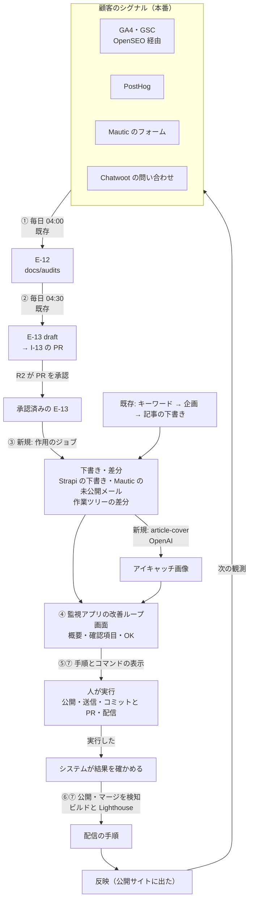

# 改善ループの 1 周（2 週間の周と承認の画面）の設計

- 作成: 2026-11-09
- 対象: `backend/control-plane`・`frontend/next-js`（監視アプリ）・`ops/`・`.claude/agents/`・`frontend/verdant-virgo`（最小限）・`setup/`・`onprem/`・`cloud/`
- 関連する正本: AA-04（再帰的自己改善ループ）、TA-07（監視アプリ）、DD-05（ビルドと配信）、DD-06（提案と承認）、`ops/README.md`

## 1. 意図（なぜ作るか）

この基盤の目的は、**顧客のシグナル（GA4・GSC の検索と行動、PostHog、Mautic のフォーム、Chatwoot の問い合わせ）から AI が解析した改修案を、自社の SaaS（いまは公開 Web サイト）に反映し続けること**である（再帰的自己改善）。

2026-11-09 の確認で、ループの前半（観測 → 提案 → 記事の下書き）は定期実行で動いているが、**後半（承認 → 公開・送信 → 評価・改修 → ビルド・配信）を通す処理が無く、改修案がサイトに届かないまま終わる**ことが分かった。

| 段階 | 2026-11-09 の状態 |
|---|---|
| データ取得 | 済み（`daily-observe-*` 4 本、週次の SERP・サイト監査・Lighthouse・a11y） |
| 解析と改修案（E-12 → E-13） | 済み（`daily-propose`、`daily-i13-file` が PR を作る） |
| 記事の下書き | 記事の本文だけ済み（`content-planner` → `content-writer`）。**アイキャッチ画像は無い（OpenAI はリポジトリのどこにも無い）** |
| Mautic のメール案 | **無い** |
| 承認の画面 | **無い**（E-13 の PR レビューだけ） |
| 公開・送信 | 人が各管理画面で行う設計だが、**何をすればよいかを示す仕組みが無い** |
| 評価と Astro の改修 | 計測と観測は週次で動く。**承認済みの E-13 から Astro の差分を作る流れが無い** |
| ビルドと配信 | **無い**（`published-article-check` は「未実装のため見送った」を返す雛形。配信は `cloud/README.md` の手順を人が打つ） |

### 失敗の定義（ユーザーの言葉）

> フィジカル空間のデータ（顧客のシグナルデータ）からの AI による解析・改修案を、自社の SaaS（今回は Web サイト）に反映できていないとき（再帰的自己改善が行われていない）。

したがって、**この設計の成否は「周ごとに、シグナル由来の改修案がサイトに反映されたか」で測る**。段階のジョブが成功で終わっても、反映が 0 件なら失敗である。

## 2. 目標・非目標・反目標

### 目標

1. **2 週間に 1 周**、シグナル → 解析（E-12）→ 改修案（E-13）→ 下書き・差分 → 承認 → 公開・送信・配信 → 反映の確認、を通せるようにする。
2. 監視アプリに**「改善ループ」画面**を作り、周ごとに各段階の**概要**と**人が確かめる項目（法務など）**を出し、人が **OK** を出せるようにする。
3. OK の後は、システムが**人の実行する手順とコマンドを表示するところまで**自動で進む。人が実行したら、システムが結果を確かめて次に進む。
4. 記事の下書きに加え、**OpenAI SDK で記事のアイキャッチ画像**を作り、**Mautic のキャンペーンとそのコンテンツ**（Strapi の記事の下書きとしての 1 次資料のまとめ、記事に結ぶソースコードなどの配布ファイル、記事へのリンクを載せた未公開のメール）を作る。記事とファイルは Strapi を正本にして公開サイトから配る。
5. 周の画面の上に、**この周の改修案が何件サイトに反映されたか**と、反映できなかった案がどこで止まったかを出す。周の終わりに反映が 0 件なら知らせる。

### 非目標

- **AB テスト（PostHog の実験）は作らない。**（2026-11-09 にユーザーが不要とした。PostHog は観測〈読み取り〉だけに使う）
- **公開・送信・配信・コミット・PR・マージをシステムが実行することはしない。** システムは手順とコマンドを表示するまで。実行は人。
- E-13 の承認経路（GitHub の PR レビュー＝E-14）を置き換えない。
- 新しいエージェントに公開・送信の権限を渡さない。
- 開発環境での「1 周」の自動化はしない（ループの観測元も作用先も本番。AA-04 の 1 節）。開発環境では画面と処理の動作確認ができればよい。

### 反目標（技術的に動いても失敗とみなすもの）

- 段階のジョブがすべて `success` なのに、**サイトに反映された改修案が 0 件のまま周が終わり、それに誰も気づかない**。
- 承認の画面が「段階が進んだか」しか見せず、**どのシグナルからどの改修が生まれたか**（つながり）が見えない。
- エージェントが自分で公開・送信・配信できてしまう（AA-04 の 2.2・3.5、ADR-17 の守りが崩れる）。
- 承認の OK が形だけになる（確かめる項目を見ずに押せる）。

## 3. 制約（既存の決定で、変えないもの）

- **エージェントの権限**: 公開・送信・配信の資格情報をエージェントに渡さない。Strapi は下書きまで（`strapi-prod`）。配信の IAM（`cloud/stacks/iam.yaml` の配信用ポリシー）は人の主体だけ（IAM Identity Center で都度ログイン）。新しい資格情報（OpenAI・Strapi の読み取りとアップロード・Mautic の読み取り）は**監視アプリのサーバー側（control-plane）にだけ**置き、エージェントの実行環境に引き継がない（TA-07 の 7 節、`backend/control-plane/src/runner/hooks.ts` の守り）。
- **定義は承認済みの `main` から読む**（ADR-18）。新しい定期実行・エージェント定義・確認項目の定義は `ops/`・`.claude/agents/` に置き、監視アプリは `CONTROL_MAIN_CHECKOUT` から読む。初期値は `enabled: false`。
- **定期実行は JST の 0〜8 時に起動し、`timeout_sec` で打ち切られても 8 時までに終わる**（`ops/README.md` の「時刻の決め方」）。月曜 03:00〜03:30（RDS の保守の窓）を空ける。Chatwoot を読むものは 03:45 より後。
- **E-13 の状態の遷移**（`docs/proposals/README.md`）: `review → approved/rejected` は R2 の PR レビューだけ。エージェントは遷移させられない。
- **配信の順序**（DD-05 の 3.3・4.2）: ビルド → 計測 → 配信。`LH-seo` が 1.0 未満なら配信の手順を出さない。転送は新規・更新を先に、削除を最後に、成功してから無効化。
- **設定の置き場**（ユーザーの指示）: 全体の設定スクリプトとマニュアルは `setup/`、クラウドは `cloud/`、オンプレは `onprem/`。秘密値は生成・保存の既存の仕組み（`~/.config/comegin/…`）に従い、`.env.example` を同時に更新する。
- **画像の生成には OpenAI SDK（公式の `openai` npm パッケージ）を使う**（ユーザーの指示）。
- リポジトリの規則: ドキュメント・コメントは日本語。pnpm。ビルド・デプロイ・テストの実行とテストコードの作成は、ユーザーの明確な指示があるときだけ（`.claude/rules/`）。git の状態を変えるコマンドは使わない。

## 4. ユーザーが決めたこと（この形で作る）

1. **承認は監視アプリの画面で行う。** 各段階の要約（概要と、人が承認するべき項目〈法務など〉）を見て「OK」を出す。
2. **OK の後は、必要な手順とコマンドを表示するところまで自動で進む。** 実行は人。
3. **画面の並べ方は A（ループ 1 周を 1 枚で）。** 左に段階を縦に並べて状態（済み・承認待ち・未着手）を出し、選んだ段階の概要・確認項目・OK・手順とコマンドを右に出す。
4. **1 周は 2 週間。**
5. **下書きするコンテンツ**: 記事、OpenAI で作る記事のアイキャッチ画像、Mautic のメール本文、SEO 向上に必要なコンテンツ。**「その他のコンテンツ」は、Mautic のキャンペーンに該当する記事やファイル（1 次資料のまとめやソースコード）**（2026-11-09 の追加の指示。5.8）。**記事やファイルは Strapi で配り（公開サイトから）、Mautic のメールは該当するページへのリンクにする**（同日の指示）。
6. **Astro の改修は差分を作るところまで。コミットと PR は人。**
7. **AB テストは不要。**
8. **失敗の定義は 1 節のとおり**（シグナル由来の改修案がサイトに反映されないこと）。
9. 書き戻した次の内容に「違っている点・足りない点は無い」と確認済み:
   - 画面の主役は、シグナル → 解析（E-12）→ 改修案（E-13）→ 下書き・差分 → 承認 → 配信 → 効果の確認のつながり
   - 反映（成功）と数えるのは配信が済んで公開サイトに出たとき。30 日後の効果の確認（E-13 の `verification`）は後の周に「前の周の反映の結果」として出す
   - 周の終わりに反映が 0 件なら、画面と通知で知らせ、止まった場所を出す
   - 段階の並び: ① データ取得 → ② 解析と改修案 → ③ 下書き（記事・アイキャッチ画像・SEO 項目）と Mautic のメール案 → ④ 承認 → ⑤ 公開・送信の手順の表示 → ⑥ Lighthouse の評価と Astro の差分 → ⑦ ビルドと配信の手順の表示

10. **エージェント専用の作業場を足す**（2026-11-09。レビューの問いへの回答）。いまの `CONTROL_WORKTREE` は、ユーザーが普段開発しているリポジトリそのもので、夜中の差分が開発中の変更と混ざる。そこで、エージェント専用の 3 本目のチェックアウト（`git worktree`。例 `~/ComeGin/agent-worktree`）を作り、`CONTROL_WORKTREE` をそこに向ける。
    - **観測・提案（`docs/audits`・`docs/proposals`）も含め、すべてのエージェントの書き込みをそこに移す**（`CONTROL_WORKTREE` を変えれば既存のジョブもそこに書く）。
    - 周の始まり（`cycle-open`）で、未コミットの変更が無ければ `origin/main` に合わせる。未コミットの変更が残っていれば合わせずに画面で知らせる（人の作業を消さない）。
    - 画面に出すコミットのコマンドは、その作業場で `origin/main` からブランチを切り（`<Issue番号>-feature-<名前>`）、項目に結びついたファイルだけを `git add` する形にする。
    - setup（`setup/manual-steps.md` の 6 節の隣）に作業場の作り方を足し、`setup/` の `worktree-paths` の確認（作業ツリーと main のチェックアウトが同じ場所を指していないか）を、3 つの場所に広げる。
11. **配布するソースコードのライセンスの既定は MIT**（2026-11-09）。`campaign-planner` の定義に既定として書き、確認項目で毎回人が確かめる。
12. **キャンペーンのファイル（1 次資料のまとめ・ソースコード）は、介護・障がい福祉を運営している法人・事業所に向けて作る。ソースコードは Agentic AI Foundation の Plugin（Agent Plugins）とする**（2026-11-09。5.8.1）。

## 5. 全体の形



### 5.1 周（サイクル）

- **周は 14 日。** 起点は 2 週間ごとの月曜 00:00（JST）。起点の最初の月曜は設定で決める（`CONTROL_CYCLE_ANCHOR`。例 `2026-11-16`）。周の ID は `C-<起点の日付>`（例 `C-2026-11-16`）。
- **周は「区切り」である。** 既存の毎日・毎週の定期実行は止めずに動かし、その成果物（E-12・E-13・下書き・差分）を、作られた日時で周に振り分ける。新しく足すジョブのうち、周に 1 回だけ動けばよいものは、定期実行の定義の新しい任意の欄 `cycle_days`（周の何日目〈0〜13〉に動くか）で絞る。
- **画面の「この周を始める」** で、起点を待たずに手で周を開ける（設定の起点からのずれは記録する）。

### 5.2 周の中の流れ（時刻は 0〜8 時の窓に収める。具体の時刻は作る人が `ops/README.md` の表に合わせて決める）

| いつ | 何が動くか | 新規／既存 |
|---|---|---|
| 0 日目（月）00:00 | `cycle-open`（builtin）: 周を開き、前の周を閉じた結果（反映の件数）を記録する | 新規 |
| 毎日 04:00〜05:30 | 観測 4 本 → `daily-propose` → `daily-i13-file`（改修案の E-13 と PR） | 既存 |
| 毎週（月・火・水） | キーワード調査 → 企画 → 記事の下書き | 既存 |
| 毎日 | `article-cover`（builtin）: 表紙の無い下書きの記事にアイキャッチ画像を作る | 新規 |
| 毎日 | `cycle-apply-content`（agent `content-writer` の E-13 モード）: R2 が承認した `content_rewrite` の E-13 から、対象の記事の下書きを更新する | 新規 |
| 毎日 | `cycle-apply-code`（agent `design-implementer`）: R2 が承認したコードの E-13（`technical_seo`・`accessibility`・`cta_swap`・`internal_link`）から、作業ツリーに差分を作る | 新規 |
| 周の 2 週目に 1 回（`cycle_days`） | `cycle-campaign`（新しい agent `campaign-planner`）: 承認済みの `email_campaign` の E-13 から、キャンペーン一式（キャンペーンの記事の下書き・記事へのリンクを載せた未公開のメールとキャンペーン・配布ファイルの原稿）を作る | 新規 |
| `cycle-campaign` の後（`after`） | `campaign-asset-upload`（builtin）: 配布ファイルの原稿を zip／PDF にまとめ、本番の Strapi のメディアに上げてキャンペーンの記事に結ぶ | 新規 |
| 毎日 00:00 | `published-article-check`（builtin。**雛形を実装する**）: 本番の Strapi の公開の差分と `main` の更新を見つけたら、ビルドと Lighthouse を起こし、配信の項目を作る | 既存の雛形を実装 |
| 毎日 | `cycle-collect`（builtin）: 上の成果物を周の「項目」として集め、確認項目を付けて画面に出す（5.3） | 新規 |
| 13 日目（日） | `cycle-close`（builtin）: 反映の件数を数え、0 件なら知らせる | 新規 |

- **E-13 を待つ理由**: AA-04 の 2.1「E-13 を経由しない変更を作らない」を守る。下書き・差分は承認済みの E-13（PR が承認された＝`main` の `docs/proposals/` で `approval.state: approved`）からだけ作る。既存のキーワードの経路の記事（企画の承認は R2 が Strapi で行う）はこの例外として今までどおり動き、画面には「キーワード由来の記事」として出す。
- **作業ツリーの差分の扱い**: 作業ツリーはエージェント専用の作業場（4 節の 10）。`cycle-apply-code` は 1 回の実行で 1 件の E-13 だけを扱い、`frontend/verdant-virgo/src` に未コミットの差分が残っているときは見送る（`skipped`。差分が混ざらないように）。人がコミットして PR を作れば、次の E-13 に進む。

### 5.3 周の項目（承認の単位）

周の中で人が見て OK を出す単位を「項目」と呼ぶ。control-plane の SQLite（E-15 と同じ DB）に新しい表で持つ（**作業ツリーの外**。エージェントは書けない）。

| 項目の種類 | 中身 | 由来 | OK の後に表示する手順 | 「実行した」の後にシステムが確かめること |
|---|---|---|---|---|
| `article` | 本番の Strapi の下書きの記事（本文・`description`・内部リンク・アイキャッチ画像） | E-13（`content_rewrite`）または キーワード由来 | Strapi の管理画面で公開する（記事の管理画面の URL、確かめる観点） | Content API で `publishedAt` が入った |
| `campaign` | Mautic のキャンペーンとそのコンテンツ（5.8）: 未公開のメールとキャンペーン（件名・本文・リンク先の URL・送信先のセグメントと件数）、キャンペーンの記事の下書き（1 次資料のまとめ）、記事に結んだ配布ファイル（ソースコードの zip など）。**1 つの項目として OK を出す**（ばらばらに公開すると、メールのリンク先がまだ公開サイトに無い状態が生まれるため） | E-13（`email_campaign`） | 公開の順番つきの手順: ① Strapi で記事を公開 → ② 配信（`deploy` の項目）を待つ → ③ Mautic でメールとキャンペーンを公開（管理画面の URL）。**③ は、メールのリンク先の URL が公開サイトで 200 を返すまで表示しない** | 記事とファイルが公開サイトに出た（`deploy` の確認でリンク先と配布ファイルの URL が 200）、Mautic の API でメールとキャンペーンの `isPublished` が true（送信が始まったら `sentCount` も表示） |
| `code` | 作業ツリーの差分（変更したファイル・差分の要約。計測は人が行う。5.11 の 1） | E-13（コードの種類） | `git switch -c <Issue番号>-feature-<名前>`・`git add`・`git commit`・`gh pr create` のコマンド（ブランチ名とコミットメッセージはリポジトリの規則どおりに埋めて出す） | GitHub で PR がマージされた |
| `deploy` | 配信する成果物（ビルドした `main` のコミット・含まれる記事の変更・Lighthouse の 4 指標） | 公開とマージの検知（`published-article-check`） | `aws sso login`・`aws s3 sync`（2 回。`_astro/*` を先に、削除を最後に）・`aws cloudfront create-invalidation` のコマンド（`cloud/README.md` の配信の手順と同じもの。バケット名・ディストリビューション ID・dist のパスを埋めて出す） | 公開サイトで、変更した記事の URL が 200 を返し、ビルドの印（5.6）が一致する |
| `proposal` | E-13 そのもの（根拠の E-12 の要約・対象・期待する指標） | `daily-propose` | 「GitHub で PR を承認する」（PR のリンク）。**OK は押させず、PR の状態を表示するだけ**（E-14 の経路を変えない） | PR の承認・マージ |

項目の状態: `preparing`（下書き・差分を作っている）→ `awaiting_review`（OK 待ち）→ `approved`（OK 済み。手順を表示中）→ `executed`（人が「実行した」を押した）→ `confirmed`（システムが確かめた）／ `rejected`（差し戻し。理由つき）／ `failed_check`（確かめられなかった。理由を表示し、もう一度「実行した」を押せる）。

**OK の条件**: その項目の確認項目のチェックボックスをすべて入れたときだけ押せる。承認の記録（誰が・いつ・どの確認項目を入れたか・差し戻しの理由）を SQLite に残す。**差し戻しの理由は、次の周の `proposal-writer` と作用のジョブが読める形（作業ツリーの `docs/cycles/<周 ID>.md` に、個人情報を含まない要約として書き出す）にする**（同じ案を繰り返さないため）。

### 5.4 確認項目（法務など）の定義

- `ops/approval-checklists.yaml` に、項目の種類ごとの確認項目を置く（承認済み `main` から読む。変えるときは PR）。
- 初期値（**作る人の判断で文言を整えてよい**）:
  - `article`: 事実と数字に出典がある／引用と著作権（引用の範囲・出典の表示）／景品表示法（「必ず」「No.1」などの根拠の無い言い切りが無い）／アイキャッチ画像は AI で作ったもので、人物・他社のロゴや商標が写っていない／`description` が 80 文字以内で内容と合っている
  - `campaign`: 特定電子メール法（送信者の表示・配信停止のリンク）／送信先は同意を得たコンタクトだけ（セグメントと件数を表示）／景品表示法／事実と数字／メールのリンク先がキャンペーンの記事の URL で、UTM が付いている／キャンペーンの記事は `article` と同じ観点／1 次資料のまとめは出典がすべて公的機関・一次資料で、制度の時点（改定の年度）が書かれ、引用が必要な範囲に収まっている／制度の解釈を断定していない（指定権者・専門家に確かめる旨がある）／Plugin が利用者の個人情報（要配慮個人情報）を扱わせず、外部へ送信する処理が無い（ある場合は理由が妥当）／Plugin に秘密値・他者のコードの写しが無く、ライセンス（既定 MIT）でよい
  - `code`: 表示したコマンドで測り、Lighthouse の SEO が 1.0／a11y の重大（serious 以上）の違反が 0 を確かめた（5.11 の 1）／差分が E-13 の対象の範囲に収まっている
  - `deploy`: Lighthouse の SEO が 1.0（未満なら手順を出さない）／含まれる記事と差分が承認済みのものだけ

### 5.5 画面（監視アプリ「改善ループ」）

- 場所: `frontend/next-js` の `(console)` に新しいページ（例 `/cycle` と `/cycle/[cycleId]`）。ナビゲーションに「改善ループ」を足す。既存の画面と同じ Cloudscape の部品を使う。
- **上部（周のまとめ）**: 周の ID と期間、「この周の改修案 n 件のうち、反映済み a・承認待ち b・差し戻し c・止まっている d」、前の周の反映の 30 日後の判定（E-13 の `verification`）、反映 0 件の周の警告。
- **左（段階）**: ①〜⑦ を縦に並べ、段階ごとに状態（済み・承認待ち・未着手・止まっている）と件数。
- **右（選んだ段階）**: 段階の概要（どのジョブが何を作ったか。既存のジョブの `overview` と実行記録へのリンク）と、その段階の項目の一覧。項目を開くと、
  - 概要（何を・なぜ）と、**根拠のシグナルの要約**（E-13 の `evidence` の `summary` と E-12 へのリンク）
  - 中身のプレビュー（記事の本文と画像、メールの件名と本文、差分の要約）
  - 確認項目のチェックボックス、「OK」「差し戻す（理由）」
  - OK の後: 手順とコマンド（コピーできる形）、「実行した」ボタン、確かめた結果
- 画面に個人情報を出さない（メールの送信先は件数とセグメント名だけ）。既存の PII 検査（`src/pii.ts`）を、画面に出す要約に通す。

### 5.6 ビルドと配信（⑦）

- `published-article-check` を実装する（DD-05 の 3.2 の「この層の判断」のとおり、エージェントを使わない決定論的な処理）:
  1. 本番の Strapi の Content API を、**読み取り専用の API トークン**で読み、公開済みの記事の一覧（`documentId`・`publishedAt`・`updatedAt`）を前回の結果（SQLite に保存）と比べる。新規・更新・消えた（非公開化・削除）のどれかがあれば差分あり。
  2. `CONTROL_MAIN_CHECKOUT` の HEAD を、前回配信したコミットと比べる。違えば差分あり。
  3. 差分があれば、`main` のチェックアウトで本番の値（`SITE_URL`・本番の Strapi の URL と読み取りトークン）を渡してビルドと Lighthouse（既存の builtin `lighthouse` の部品）を行い、`deploy` の項目を作る。`LH-seo` が 1.0 未満なら、項目は「配信できない」として理由を出す。
- **ビルドの印**: ビルドに `dist/_build.json`（`main` のコミット SHA とビルドの時刻）を出力する小さな変更を Astro に入れる。配信の確認は、公開サイトのこのファイルの SHA が項目のものと一致することで行う（作る人が、Astro の設定の慣習に合う置き方を選んでよい）。
- 配信のコマンドは**人が自分の端末で実行する**（配信の資格情報は IAM Identity Center の人の主体。監視アプリのサーバーにも置かない）。画面には、`dist` の絶対パスを埋めたコマンドを出す。
- 配信の確認の後、画面に「E-13 の `applied_at` を記録する」手順（対象の E-13 のファイルと書く値）を出す（記録は配信した人。ADR-16）。

### 5.7 アイキャッチ画像（③）

- builtin `article-cover`: 本番の Strapi の**下書き**の記事のうち `cover` が空のものに対して、
  1. 記事のタイトルと `description` から画像のプロンプトを組み立てる（ブランドの色調と「文字・人物・ロゴを入れない」を固定で含める。プロンプトの雛形は `ops/` に置き、PR で変える）。
  2. OpenAI SDK（`openai` パッケージ）で画像を生成する。モデルとサイズは設定で持ち、既定は作る人が OpenAI の最新のドキュメントで確かめて決める（記事の OGP に使える横長）。
  3. 本番の Strapi のメディアライブラリにアップロードし、下書きの記事の `cover` に結ぶ。
- 資格情報: `OPENAI_API_KEY` と、Strapi の**アップロードと記事の下書きの更新だけ**を許すトークン。どちらも control-plane だけが持つ。
- **確かめてから作ること**: Strapi 5 で「記事の更新はできるが公開はできない」トークンを作れるか（TA-07 の 9 節の未確認の項目と同じ論点）。作れない場合は、**メディアライブラリへのアップロードまで**にとどめ、`article` の項目の手順に「表紙に結ぶ」を足す（公開できるトークンを control-plane に置かない）。
- 1 回の実行で作る枚数の上限を設定で持つ（費用の上限）。生成の失敗は記事ごとに記録し、次の日に再試行する。

### 5.8 Mautic のキャンペーンと、キャンペーンのコンテンツ（③）

ユーザーの指示（2026-11-09）: 「その他のコンテンツ」は、**Mautic のキャンペーンに該当する記事やファイル（1 次資料のまとめやソースコード）**。**記事やファイルは Strapi を正本にして Web サイトから配り、Mautic のメールはそのページへのリンクにする**（Mautic のアセットには置かない）。

| 一式の中身 | 置き場（下書き・未公開） | 作る主体 |
|---|---|---|
| メール本文 1 通とキャンペーン 1 つ。本文のリンクは**公開サイトの該当ページ**（`SITE_URL` の記事の URL。GA4 で流入を測れるよう UTM を付ける〈`utm_source=mautic`・`utm_medium=email`・`utm_campaign=<proposal_id>`〉） | Mautic（`isPublished: false`） | `campaign-planner`（MCP） |
| キャンペーンの記事 1 本（メールから案内するページ。1 次資料のまとめは**記事の本文そのもの**として書く） | 本番の Strapi の下書き | `campaign-planner`（`strapi-prod` の作成のツール。`content-writer` と同じ書き方の規則〈出典・事実確認〉に従う） |
| 配布ファイル（ソースコードの zip、必要なら 1 次資料のまとめの PDF 版） | 原稿は作業ツリーの `campaign-assets/<proposal_id>/`。配布物は**本番の Strapi のメディアライブラリ**に上げて記事に結び、ビルドで `dist/` に取り込んで公開サイトから配る | 原稿は `campaign-planner`、パッケージとアップロードは builtin `campaign-asset-upload` |

- 新しいエージェント `campaign-planner`（`.claude/agents/campaign-planner.md`。13 本目）:
  - 読む: 承認済みの `email_campaign` の E-13、根拠の E-12、公開済みの記事（Strapi の参照。重複を避け、内部リンクの候補にする）、Mautic のセグメント（参照）。
  - 書く（1 回の実行で 1 件の E-13 だけ）:
    - 本番の Strapi にキャンペーンの記事の下書き 1 本（`publishedAt` を設定しない）。**1 次資料のまとめは、この記事の本文として書く**（公的機関・一次資料の出典ごとに URL・参照日・要点。出典を示せない事実は書かない。本文の最後に `## 出典`）。`slug` を決め、公開後の URL（`SITE_URL` ＋ 記事のパス）を確定させる
    - Mautic に未公開のメール 1 通とキャンペーン 1 つ（送信先は E-13 が指すセグメント）。本文は記事の要点と、**記事の公開後の URL へのリンク**（UTM 付き）だけ。ファイルを添付しない
    - 作業ツリーの `campaign-assets/<proposal_id>/` に配布ファイルの原稿（E-13 が求めるときだけ）:
      - **ソースコード**: `plugin/` 以下に Agent Plugins 1.0 の形式の Plugin（5.8.1）。秘密値・実在の個人情報・他者のコードの写しを入れない。`LICENSE` を置く（既定は MIT。4 節の 11。確認項目で人が確かめる）
      - 1 次資料のまとめの PDF 版が要るときは、記事の本文と同じ内容の `summary.md`
      - `manifest.yaml`: 配布ファイルの名前・説明・形式（`zip` か `pdf`）・結ぶ記事の `documentId`
  - 書かない: 公開・送信・既存のメールやキャンペーンや記事の更新・削除・コンタクトの変更。作業ツリーの `campaign-assets/` 以外のファイル。
  - 守りは 2 重にする: エージェント定義の `tools` の許可リストに加え、control-plane の PreToolUse フックで、このエージェントの `mautic_create_record` は `emails`・`campaigns` だけ、`isPublished` が true の入力を拒否する。ファイルの書き込みは `campaign-assets/` の下だけ許す。
- builtin `campaign-asset-upload`（`campaign-planner` の後に `after` で動く）:
  - `manifest.yaml` に従い、ソースコードは zip に、`summary.md` は PDF にまとめる（PDF にする手段は作る人が選ぶ。リポジトリに既にある Playwright の Chromium で印刷する案が有力）。
  - **本番の Strapi のメディアライブラリ**にアップロードし、キャンペーンの記事の下書きに結ぶ（5.7 のアップロード用のトークンを共用。結べないトークンしか作れない場合は 5.7 と同じく、アップロードまでにして手順に「記事に結ぶ」を足す）。記事の本文からのダウンロードのリンクの置き方（`shared.media` のブロックか、新しい部品か）は作る人が Strapi のスキーマと Astro の描画を見て決める。
  - 原稿（`campaign-assets/`）は作業ツリーに残り、人が他の差分と同じくコミットして PR で残す（配布物の元を Git に残すため）。
#### 5.8.1 読み手とファイルの形（ユーザーの指示。2026-11-09）

- **読み手は、介護・障がい福祉を運営している法人・事業所**（経営者・管理者・事務の担当）。キャンペーンの記事・1 次資料のまとめ・Plugin・メールは、この読み手の業務の課題（記録・請求・人員配置・運営指導への備え・報酬改定への対応など）に向けて書く。送信先のセグメントは、この読み手のコンタクトを集めた既存のセグメントを E-13 が指す（無ければ `campaign` の項目の手順に「セグメントを作る」を出す。エージェントはセグメントを作らない。5.11 の 3）。
- **1 次資料のまとめ**: 出典は公的機関・一次資料に限る（厚生労働省の告示・通知・Q&A、報酬改定の資料、都道府県・市区町村の運営指導の資料、個人情報保護委員会のガイダンスなど）。各出典に URL・参照日・要点・**どの時点の制度か**（改定の年度）を書く。制度の解釈を断定せず、「最終的な判断は指定権者・専門家に確かめる」旨を記事に入れる。`campaign-planner` には出典を集めるための `WebSearch`・`WebFetch` を許す（`knowledge-scout` と同じ）。
- **ソースコードは Agent Plugins 1.0 の形式の Plugin**（Agentic AI Foundation〈Linux Foundation〉が定める、Agent Skills と MCP サーバを入れる持ち運べる形。仕様は https://agent-plugins.org/specification 、2026-11-09 に確認）:

  ```
  <plugin-name>/
  ├── plugin.json        必須。$schema（https://agent-plugins.org/schemas/1.0.0/plugin.schema.json）と name。
  │                      version・description・author・homepage（キャンペーンの記事の URL）・license（"MIT"）・keywords を書く
  ├── skills/
  │   └── <skill-name>/
  │       ├── SKILL.md   Agent Skills の形式（https://agentskills.io/specification）
  │       ├── scripts/   任意
  │       └── references/ 任意（1 次資料のまとめの要点を置いてよい）
  ├── mcp.json           任意。MCP サーバを同梱するときだけ
  ├── README.md          日本語。入れ方（対応するクライアントは https://agent-plugins.org/compatible-clients）・使い方・注意
  └── LICENSE            MIT
  ```

  - `name` は小文字の英数字・ハイフン・ピリオドで 1〜64 文字（仕様の制約）。`plugin.json` に仕様に無い最上位の欄を書かない（クライアント固有の値は `extensions` の下）。
  - **Plugin は利用者（介護・障がい福祉サービスの利用者）の個人情報を扱わせない。** 心身の状況・病歴などは要配慮個人情報にあたる。Skill の手順に「利用者の氏名・心身の状況などを入力しない（入力が必要な作業は匿名化した例で示す）」を書き、外部への送信を行う処理（`mcp.json` のリモートのサーバ・`scripts/` の通信）は入れない。入れる必要があるときは E-13 にその理由を書き、確認項目で人が確かめる。
  - `campaign-asset-upload` は、zip にする前に `plugin.json` を正本の JSON スキーマ（リポジトリに写しを置き、取得した日付を残す。実行のたびにネットワークから取らない）で検証し、`skills/*/SKILL.md` の frontmatter（`name`・`description`）があることを確かめる。通らなければアップロードせず、項目に理由を出す。

- **公開サイトでファイルを配れるようにする（DD-05 の 1.5.3 の変更）**: いまは画像以外のメディアがあるとビルドを止める。これを「**`application/zip` と `application/pdf` は、ビルド時に `dist/` に取り込んで配る**（画像と同じく、公開ページから Strapi と S3 へのリクエストを出さない。1.5.4 の検査はそのまま効く）。動画とその他の形式は今までどおり止める」に改める。ファイルの大きさの上限（例 20 MB）を設ける。決定は AA-05 に ADR として足し、DD-05 の 1.5.3 と 5 節の未決定事項を更新する。
- E-13 の `change.kind` に **`email_campaign`** を足す（`backend/control-plane/src/definitions/proposal.ts`、`docs/proposals/README.md`、AA-04 の 2.2 の表、`proposal-writer` の定義）。適用の主体の欄は「エージェントが未公開で作り、公開（送信）は人」。
- Mautic の登録は既存の `mautic-prod`（`read_write`）を使う。control-plane が送信の確認に使う Mautic の読み取りは、既存の参照専用ロールの認証情報（`mautic-prod-ro` と同じもの）を control-plane 用に別に発行する。

### 5.9 E-13 から記事の下書きと差分を作る（③⑥）

- `content-writer` に **E-13 モード**を足す: プロンプトに `PRP: <proposal_id>` があれば、承認済みの `content_rewrite` の E-13 の `target.identifier` の記事だけを、下書きとして更新する（公開済みの記事なら、Strapi の下書きの版を作る）。それ以外の記事に触れない規則は今のまま。
- `design-implementer` を定期実行に載せる（今は「仕様の指示が要る」として載せていない。E-13 が仕様の指示になる）。プロンプトに `PRP: <proposal_id>` を渡し、`frontend/verdant-virgo/src/` に差分を作る。
- どちらも、どの E-13 を渡すかは control-plane の builtin 側が決める（承認済みで、まだ項目が作られていない E-13 のうち最も古いもの 1 件）。エージェントには選ばせない（取得の範囲を定義に固定する ADR-05 の理由）。

### 5.10 反映の数え方と、0 件の知らせ

- **E-13 は、結びついた項目がすべて `confirmed` になり、そのうち公開サイトに出るもの（`article`・`code`）が `deploy` の `confirmed` に含まれたときに「反映済み」**。`email` は送信が始まった（`isPublished` が true）ときに反映済み。
- `cycle-close` が周の反映の件数を数え、画面に記録する。**0 件なら**既存の知らせの仕組み（`status/notify.ts` の SNS）で「この周は反映できなかった」と、止まった場所（改修案が出なかった／PR が承認されていない／OK 待ち／実行されていない／配信されていない）の内訳を送る。

### 5.11 レビューで出た問いへの判断（Claude の判断。ユーザーが読んで違えば直す）

1. **`code` の項目の Lighthouse と a11y は、監視アプリでは測らない。** control-plane は、エージェントが書けるコードを意図してビルドしない（`lighthouse.ts` は承認済み `main` でしか動かない。鍵を持つプロセスで未承認のコードを実行しないため）。`code` の項目の手順に、人が自分の端末で測るコマンド（`pnpm lh`・`pnpm a11y:ci`）を出し、確認項目は「表示したコマンドで測り、SEO 1.0・a11y の重大 0 を確かめた」にする。**機械の歯止めは `deploy` の項目に置く**（`main` のビルドで `LH-seo` が 1.0 未満なら配信の手順を出さない。5.6）。
2. **反映は、反映した（配信・送信が確かめられた）日が属する周に数える。** 起票した周ではない（周をまたぐのが普通なので、起票の周に数えると「0 件」の誤報が出る）。画面の改修案ごとに、起票した周も併記する。
   - **キーワード由来の記事の配信も「反映」に数える。** キーワードは GSC・検索ボリュームという検索のシグナルから選ばれているため（E-01 の根拠）。ただし画面では「改修案（E-13）由来」と「キーワード由来」を分けて数え、0 件の知らせは両方が 0 のときに出す。
3. **Mautic のキャンペーンは完成品まで組み、未公開で置く。** 送信先のセグメント、「メールを送る」イベント、送信のタイミング（公開後すぐ）まで API で組む。**人が Mautic で公開した瞬間が送信の開始**であり、それがユーザーの言う「キャンペーンの送信」にあたる。そのため、
   - 確認項目に「送信先の件数」を必ず出す（5.4）。手順の ③ は、リンク先が 200 を返すまで出さない（5.3）。
   - PreToolUse フックで許す入力は、`emails` と `campaigns` の作成だけ。`campaigns` の `events` は「メールを送る」（`email.send`）と「待つ」だけを許し、`isPublished` は false に限る。`segments` の作成と変更は許さない（既存のセグメントを指すだけ）。
4. **`experiment_start` は起票しない。** AB テストを作らないと決めたため、`proposal-writer` の定義から `experiment_start` を外す（スキーマの値は過去の E-13 を読めるよう残す）。**`config_change` は、画面に「人が手で行う」項目として出し、反映の数からは除く**（作用のジョブを作らない）。

## 6. 設定（setup・cloud・onprem）

| 置き場 | 足すもの |
|---|---|
| `onprem/` | 監視アプリ（control-plane）の環境変数の追加: `CONTROL_CYCLE_ANCHOR`、`OPENAI_API_KEY`、OpenAI のモデルと上限、本番の Strapi の読み取りトークンとアップロード用のトークン、Mautic の読み取りの認証情報、配信のコマンドに埋める値（バケット名・ディストリビューション ID）。`onprem/README.md` の手順と、`.env.example` 相当のテンプレート |
| `setup/` | 設定スクリプトのモジュール（`setup/lib/core.mjs` の契約）で、上の値の入力・保存・確認を行う。`setup/00-setup-overview.md` と `setup/manual-steps.md` に、人が行う作業（OpenAI の API キーの発行、Strapi のトークンの発行、Mautic の参照用の認証情報の発行、`CONTROL_CYCLE_ANCHOR` の決定）を足す。設定の状況の画面（`setup/status/steps.mjs`）にも項目を足す |
| `cloud/` | 新しい AWS の資源は作らない想定（配信は既存の人の主体のポリシー）。画面に出す配信のコマンドの元になる値（バケット名・ディストリビューション ID）を、`cloud/README.md` のどの出力から写すかを書く |
| `ops/` | 新しい定期実行の定義（初期値 `enabled: false`）、`approval-checklists.yaml`、画像のプロンプトの雛形、`mcp-registry.yaml` の変更（必要なら）、`ops/README.md` の一覧と時刻の表 |

## 7. 作る人に任せること

- 新しいジョブの具体の時刻（5.2 の制約の中で）と `timeout_sec`。
- SQLite の表の設計、`contract.ts` に足す型と `ControlPlane` のメソッドの名前（境界の型は `contract.ts` に置く規則を守る）。
- 画面の細部（Cloudscape の部品の選び方、文言）。
- 確認項目の文言の整え。
- OpenAI のモデル名・サイズ・品質の既定（最新のドキュメントで確かめる）。
- ビルドの印の置き方。
- `docs/` の正本（AA-04・TA-07・DD-05・DD-06・`ops/README.md`・`docs/proposals/README.md`）への反映の書き方。設計の決定は AA-05 に ADR として足す。

## 8. テストと検証

- リポジトリの規則により、**テストコードの作成とテストの実行はユーザーの明確な指示があるときだけ**。計画では、テストを書く段階を「指示があれば」として分ける。
- 型検査（`pnpm typecheck`）と lint は実行してよい範囲で行う。ビルドは指示があるときだけ。
- 本番での 1 周の確認は、ユーザーが定義を `enabled: true` にして `main` に入れた後に行う（手順を `onprem/README.md` に書く）。
